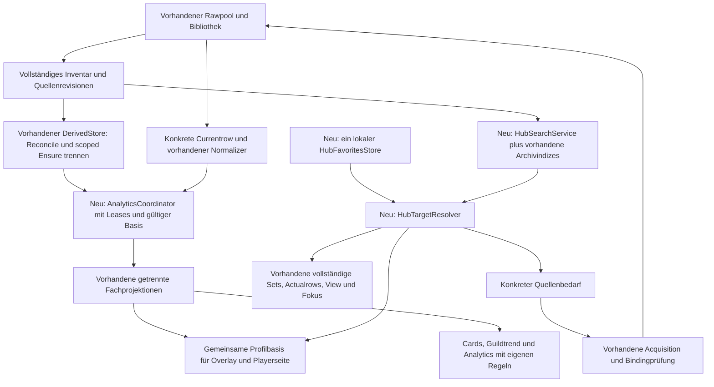

# Gemeinsames Arbeitsprotokoll: Data-Hub-Analyse

## 1. Zweck, Geltungsbereich und Arbeitsregeln

Dieses Dokument bereitet die mehrteilige Bestandsanalyse für den geplanten Data Hub vor und dient als gemeinsames Arbeitsprotokoll über getrennte Tasks und Chats im selben Checkout. Es bleibt während der späteren Umsetzung erhalten. **Keine automatische Löschung nach der Zusammenführung.** Über Aufbewahrung oder Löschung wird später ausdrücklich entschieden.

Task 0 bereitet ausschließlich dieses Dokument vor. **Es wurde noch keine fachliche Analyse durchgeführt.** Anwendungscode, Datenflüsse, Laufzeitverhalten und tatsächliche Architektur wurden in diesem Schritt nicht untersucht. Das Zielbild in Abschnitt 3 ist eine geplante Anforderung, kein nachgewiesener Ist-Zustand.

Grundlage für die Vorbereitung ist die vom Nutzer genannte Kontextdatei `D:\SFDataHub\### Codex-Analyse-Task.txt` (lokal: `/mnt/d/SFDataHub/### Codex-Analyse-Task.txt`). Ihre Aufgabenbeschreibung wird innerhalb des ausdrücklich angefragten Task 0 verwendet; weiterführende Analysen und Umbauten werden dadurch nicht begonnen. Frühere Chatbeschreibungen sind Kontext und Anforderungen, keine Repository-Belege.

Verbindliche Arbeitsregeln:

- Jede spätere Task liest zuerst den **vollständigen Bericht**, einschließlich Korrekturen und Übergaben.
- Die aktuelle Task bleibt innerhalb ihres abgegrenzten Umfangs. Unbekannte Nachbarpfade oder Widersprüche als gezielten Untersuchungsbedarf dokumentieren.
- Frühere Inhalte, Fortschritte und bestehende Repository-Änderungen erhalten. Keine stillschweigende Ersetzung oder Löschung von Befunden.
- Fakten, Laufzeitprüfungen, Hypothesen, offene Punkte und Zielbild explizit trennen (Abschnitt 5).
- Den tatsächlich untersuchten Stand erfassen; HEAD allein beschreibt einen dirty Arbeitsbaum nicht vollständig.
- Nach jeder Analyse Ergebnisse, Status, offene Fragen und Übergabe aktualisieren.
- Task 0 erlaubt ausschließlich das Schreiben dieser Datei und nötigenfalls das Anlegen von `tmp`. Keine Änderungen an Code, Tests, Konfigurationen, Dependencies, Archivdaten oder anderen Dokumenten.
- Für Task 0 kein Reset, Stash, Checkout, Cleanup, Commit oder automatisches Staging; keine Builds, Tests oder Dev-Server.
- Der Bericht sichert Wissen zwischen Chats, ersetzt aber keine Prüfung des jeweils aktuellen Codes.

## 2. Repository-Ausgangsstand

### Stand S0 – Vorbereitung durch Task 0

| Merkmal | Erfasster Wert |
|---|---|
| Repository, Windows | `D:\SFDataHub\sfdatahub.github.io` |
| Repository, lokale Arbeitsumgebung | `/mnt/d/SFDataHub/sfdatahub.github.io` |
| Erfassungszeitpunkt | 2026-10-03T12:00:11+02:00 |
| Zeitzone | Europe/Berlin, CEST (UTC+02:00) |
| Branch | `release/20261003_085632` |
| HEAD-Commit | `b1025f62e65bac22adc198c8c9b5fedecd6e6b46` |
| Arbeitsbaum vor Task 0 | Dirty; 7766 geänderte tracked Pfade und 8 untracked Dateien |
| Bericht vor Task 0 | Datei nicht vorhanden; neue Initialisierung, keine früheren Berichtsinhalte oder Fortschritte zu übernehmen |
| Zutreffende Repository-Anweisungen | Keine `AGENTS.md` in der Vorfahrenkette `/`, `/mnt`, `/mnt/d`, `/mnt/d/SFDataHub`, Repository-Wurzel und `tmp` gefunden |
| Git-Ignore des Berichts | `git check-ignore -v --no-index tmp/data-hub-analysis.md`: Exit 1, keine Ausgabe; zum Prüfzeitpunkt keine passende Ignore-Regel |
| Umfang der Repository-Prüfung | Anweisungssuche, Existenzprüfung des Berichts und lesende Git-Metadatenprüfung; keine fachliche Codeprüfung |

Die vollständige Pfadliste steht unten in einem aufklappbaren Block. Sie ist ein Git-Metadateninventar und kein fachlicher Befund; Ursachen der vorhandenen Änderungen wurden nicht untersucht.

Der Ausgangsstatus wurde mit `git status --porcelain=v1 --untracked-files=all` erfasst. Die beiden Statusspalten bedeuten Index/Arbeitsbaum; `??` bezeichnet untracked Dateien. Pfade beziehen sich auf die Repository-Wurzel.

<details>
<summary>Vollständiger Git-Status vor Task 0 (7774 Pfade)</summary>

```text
 M .firebaserc
 M .github/secret-scanning.yml
 M .github/workflows/toplists.yml
 M .gitignore
 M README.md
 M auth-api/.env.example
 M auth-api/.gcloudignore
 M auth-api/.gitignore
 M auth-api/README.md
 M auth-api/env.sfdatahub-staging.yaml
 M auth-api/package-lock.json
 M auth-api/package.json
 M auth-api/src/admin/featureAccessSnapshot.ts
 M auth-api/src/app.ts
 M auth-api/src/config.ts
 M auth-api/src/firebase.ts
 M auth-api/src/functions-entry.ts
 M auth-api/src/index.ts
 M auth-api/src/internal/analytics/visitor/syncSnapshot.handler.ts
 M auth-api/src/internal/news/discord/refreshSnapshot.handler.ts
 M auth-api/src/lib/adminAuditLog.ts
 M auth-api/src/lib/favorites.ts
 M auth-api/src/lib/firebaseAuth.ts
 M auth-api/src/middleware/auth.ts
 M auth-api/src/public/news/discord/cache.memory.ts
 M auth-api/src/public/news/discord/config.ts
 M auth-api/src/public/news/discord/cors.ts
 M auth-api/src/public/news/discord/discord.client.ts
 M auth-api/src/public/news/discord/latest.handler.ts
 M auth-api/src/public/news/discord/latestByChannel.handler.ts
 M auth-api/src/public/news/discord/list.handler.ts
 M auth-api/src/public/news/discord/types.ts
 M auth-api/src/public/twitch/cache.memory.ts
 M auth-api/src/public/twitch/live.handler.ts
 M auth-api/src/routes/admin.ts
 M auth-api/src/routes/adminAccessControl.ts
 M auth-api/src/routes/adminStats.ts
 M auth-api/src/routes/auth.ts
 M auth-api/src/routes/internalAdmin.ts
 M auth-api/src/routes/internalUploadInbox.test.ts
 M auth-api/src/routes/playerCharts.ts
 M auth-api/src/routes/scanUploads.test.ts
 M auth-api/src/routes/scanUploads.ts
 M auth-api/src/routes/scanUploadsPublic.ts
 M auth-api/src/routes/userUploadInbox.test.ts
 M auth-api/src/routes/userUploadInbox.ts
 M auth-api/src/session.ts
 M auth-api/src/test/fakeFirebase.ts
 M auth-api/src/triggers/guildToplists.ts
 M auth-api/src/triggers/guildToplistsRuntime.ts
 M auth-api/src/triggers/playerToplists.ts
 M auth-api/src/triggers/playerToplistsRuntime.ts
 M auth-api/src/users.ts
 M auth-api/tsconfig.json
 M deploy-all.ps1
 M docs/404.html
 M "docs/New record.txt"
 M docs/assets/am-build-order-BnFIz2TK.js
 M docs/assets/am-build-order-D4TM5Jch.js
 M docs/assets/am-build-order-D52buTuX.js
 M docs/assets/am-build-order-DXfKiygs.js
 M docs/assets/am-build-order-DaLbrj3A.js
 M docs/assets/am-rune-bonuses-CJF-DvuA.js
 M docs/assets/am-rune-bonuses-CW_nBrDL.js
 M docs/assets/am-rune-bonuses-IsL6fd-y.js
 M docs/assets/am-rune-bonuses-O9tKtnzK.js
 M docs/assets/calendar-skip-D6x6tEbX.js
 M docs/assets/calendar-skip-DEJ0xHS7.js
 M docs/assets/dungeon-pause-exit-ZkzZ-yVi.js
 M docs/assets/dungeon-pause-exit-pVmnx-Ip.js
 M docs/assets/dungeon-pause-open-xp-calculator-BteycYxH.js
 M docs/assets/dungeon-pause-open-xp-calculator-YQ5GGUse.js
 M docs/assets/fightReportOcr-AI-SUJ6J.js
 M docs/assets/fightReportOcr-B1Zr3Eji.js
 M docs/assets/fightReportOcr-B3s7OsjH.js
 M docs/assets/fightReportOcr-B4cf-SGK.js
 M docs/assets/fightReportOcr-BAuMJw0T.js
 M docs/assets/fightReportOcr-BZYiKaU9.js
 M docs/assets/fightReportOcr-C-19e-uA.js
 M docs/assets/fightReportOcr-C-pSW_4_.js
 M docs/assets/fightReportOcr-C9byLrlF.js
 M docs/assets/fightReportOcr-CNg_tL7n.js
 M docs/assets/fightReportOcr-DHmq0Zj3.js
 M docs/assets/fightReportOcr-DLKhaBmN.js
 M docs/assets/fightReportOcr-DX25T43S.js
 M docs/assets/fightReportOcr-DbL0_068.js
 M docs/assets/fightReportOcr-DoXpFBhM.js
 M docs/assets/fightReportOcr-Dq3vwIR6.js
 M docs/assets/fightReportOcr-E6zQKzjf.js
 M docs/assets/fightReportOcr-YBJrk06m.js
 M docs/assets/fightReportOcr-bPLZ2KIb.js
 M docs/assets/fightReportOcr-d7fw2T8r.js
 M docs/assets/first-weekend-guide-BgkujKX5.js
 M docs/assets/first-weekend-guide-DLuG36Du.js
 M docs/assets/first-weekend-guide-DQFxvOSz.js
 M docs/assets/first-weekend-guide-DsYZ5a-W.js
 M docs/assets/flags/Flag_of_the_Netherlands.svg
 M docs/assets/fortress-attack-duplication-B6iApnj9.js
 M docs/assets/fortress-attack-duplication-BWqnhzXn.js
 M docs/assets/fortress-attack-duplication-BhtHdXkR.js
 M docs/assets/fortress-attack-duplication-BqnA0Bcn.js
 M docs/assets/fortress-attack-duplication-CJGreaRt.js
 M docs/assets/fortress-attack-duplication-Ddc6ZzdY.js
 M docs/assets/fortress-attack-duplication-GnAQlQA6.js
 M docs/assets/fortress-attack-duplication-TIzw8J2w.js
 M docs/assets/fortress-calculator-CORjh8Tw.js
 M docs/assets/fortress-calculator-DqEgRCj9.js
 M docs/assets/fortress-calculator-NHeMpqZl.js
 M docs/assets/fortress-calculator-WyUiCUWd.js
 M docs/assets/fortress-calculator-cHltJIDv.js
 M docs/assets/fortress-package-skip-order-BDWNCEKJ.js
 M docs/assets/fortress-package-skip-order-BKQW7XJ6.js
 M docs/assets/fortress-package-skip-order-BUX__U6W.js
 M docs/assets/fortress-package-skip-order-CSCU_onC.js
 M docs/assets/fortress-package-skip-order-CclJKt4N.js
 M docs/assets/fortress-package-skip-order-DbfSvVJ_.js
 M docs/assets/fortress-package-skip-order-Dl2Y7YQ1.js
 M docs/assets/fortress-package-skip-order-isHaFLMG.js
 M docs/assets/fusionDashboardInventory.worker-6ycDiXhZ.js
 M docs/assets/fusionDashboardInventory.worker-CodX1ogW.js
 M docs/assets/fusionDashboardInventory.worker-D0vRveFC.js
 M docs/assets/fusionDashboardInventory.worker-Zl_6J3s2.js
 M docs/assets/fusionDashboardInventory.worker-fzadOdkm.js
 M docs/assets/fusionIdentity.worker-BWG0STZm.js
 M docs/assets/fusionIdentity.worker-CYSvSc3_.js
 M docs/assets/fusionIdentity.worker-CdYXmX1N.js
 M docs/assets/fusionIdentity.worker-CsKU6dFw.js
 M docs/assets/fusionIdentity.worker-DMJhMZFL.js
 M docs/assets/gem-calculator-Bmc9iAse.js
 M docs/assets/gem-calculator-Bv1jmLZp.js
 M docs/assets/gem-calculator-Cg2lbGD3.js
 M docs/assets/gem-calculator-DjnJji37.js
 M docs/assets/hellevator-guide-ADHV7vrg.js
 M docs/assets/hellevator-guide-D_iPjDmV.js
 M docs/assets/home-5qDbEUTi.js
 M docs/assets/home-BSHSfcj9.js
 M docs/assets/home-Bt-lFx1Q.js
 M docs/assets/home-CD75Qu5a.js
 M docs/assets/home-CffNiaMH.js
 M docs/assets/home-DXi1sXvX.js
 M docs/assets/home-kIrlO3j_.js
 M docs/assets/index-0ji6nRHl.js
 M docs/assets/index-11b2oluG.js
 M docs/assets/index-1GXugbEC.js
 M docs/assets/index-1X9aW0NT.js
 M docs/assets/index-2OvKioXi.js
 M docs/assets/index-7Us52Jog.js
 M docs/assets/index-88neM_lp.js
 M docs/assets/index-8QMxPuzR.js
 M docs/assets/index-AI695UFX.js
 M docs/assets/index-B0KyJ11j.js
 M docs/assets/index-B0Y_iud3.css
 M docs/assets/index-B32QVEpk.js
 M docs/assets/index-B3Onl2S6.css
 M docs/assets/index-B3X5YVYJ.js
 M docs/assets/index-B3aqvv3r.css
 M docs/assets/index-B3e-4nKo.js
 M docs/assets/index-B3kkGv6f.js
 M docs/assets/index-B3ss_PWX.css
 M docs/assets/index-B5EVePcx.js
 M docs/assets/index-B6j5Nwf8.js
 M docs/assets/index-B8V4mTPu.js
 M docs/assets/index-B9pw7roK.js
 M docs/assets/index-BAd7yp7D.js
 M docs/assets/index-BAmK1q9w.js
 M docs/assets/index-BCId6KJG.js
 M docs/assets/index-BFvTwkDi.js
 M docs/assets/index-BFyGF53a.js
 M docs/assets/index-BGaMxDzE.js
 M docs/assets/index-BGhdPsF3.js
 M docs/assets/index-BHosdD_r.js
 M docs/assets/index-BIZl_Xl1.js
 M docs/assets/index-BJAgn2-y.js
 M docs/assets/index-BJOByT0O.js
 M docs/assets/index-BJOwkR_x.js
 M docs/assets/index-BJb3iPAi.js
 M docs/assets/index-BK4fS1zL.css
 M docs/assets/index-BPpAqYZV.js
 M docs/assets/index-BR4xTQsX.js
 M docs/assets/index-BRNOHdHX.css
 M docs/assets/index-BSH7x1RD.js
 M docs/assets/index-BSRRnp-V.js
 M docs/assets/index-BT7m_fFl.js
 M docs/assets/index-BT7n8e7y.css
 M docs/assets/index-BVNoZ1Su.js
 M docs/assets/index-BXdDauLf.css
 M docs/assets/index-BZh0qrJy.css
 M docs/assets/index-BaaYq-RN.js
 M docs/assets/index-Bb31Giu4.js
 M docs/assets/index-Bbln2Pv6.js
 M docs/assets/index-Bbr1reK0.css
 M docs/assets/index-Bbr3GBtu.js
 M docs/assets/index-Bc64kGum.js
 M docs/assets/index-BcT90cH0.css
 M docs/assets/index-Bdr8zmED.js
 M docs/assets/index-BeVkIWaT.js
 M docs/assets/index-Bevb3JOl.css
 M docs/assets/index-BfWzb-iW.js
 M docs/assets/index-Bgv6Hfx7.css
 M docs/assets/index-Bgy_vqzo.js
 M docs/assets/index-BiLTi3Om.js
 M docs/assets/index-BiUY2hXo.css
 M docs/assets/index-BjCj39xi.js
 M docs/assets/index-BjPO8xL9.js
 M docs/assets/index-Bl-v1Oy3.css
 M docs/assets/index-Bmc9iAse.js
 M docs/assets/index-BmlMehOb.css
 M docs/assets/index-BncihY6g.css
 M docs/assets/index-BnnEGq0H.js
 M docs/assets/index-Bp442jb-.js
 M docs/assets/index-Bqelsq-U.css
 M docs/assets/index-BrOGL2MO.js
 M docs/assets/index-BswN6PU8.css
 M docs/assets/index-BteycYxH.js
 M docs/assets/index-BuFE8IzG.css
 M docs/assets/index-Bv81nICp.js
 M docs/assets/index-BvHsZ-cV.js
 M docs/assets/index-Bv_zZmlh.css
 M docs/assets/index-Bwjh7Xln.js
 M docs/assets/index-BxcqWTwK.js
 M docs/assets/index-ByNGo2zT.js
 M docs/assets/index-Bygkys_Z.css
 M docs/assets/index-ByiCe8q7.css
 M docs/assets/index-BzHb5Gx8.js
 M docs/assets/index-C-rNa0z3.js
 M docs/assets/index-C0BYWZ4H.js
 M docs/assets/index-C1RwNdm3.js
 M docs/assets/index-C1SYV96X.js
 M docs/assets/index-C1buEuNt.css
 M docs/assets/index-C2MxqDEq.js
 M docs/assets/index-C4vwP-jQ.css
 M docs/assets/index-C53Ia7fJ.css
 M docs/assets/index-C5Fbn1E6.css
 M docs/assets/index-C5h8Gyzb.css
 M docs/assets/index-C5w37-dG.js
 M docs/assets/index-C7wAuChN.css
 M docs/assets/index-C8FZ_dil.js
 M docs/assets/index-CAq4SVNZ.js
 M docs/assets/index-CB6M-9wz.js
 M docs/assets/index-CBNRzcQ8.css
 M docs/assets/index-CCuKYjSB.js
 M docs/assets/index-CDz-lTZS.css
 M docs/assets/index-CEEwo3NF.js
 M docs/assets/index-CH4AB2QC.js
 M docs/assets/index-CHoICr38.js
 M docs/assets/index-CHqRSe3M.js
 M docs/assets/index-CItkmPqj.js
 M docs/assets/index-CJGni9zF.js
 M docs/assets/index-CJTnltk5.js
 M docs/assets/index-CLLjyjV0.js
 M docs/assets/index-CLVlnL68.js
 M docs/assets/index-CNLWy5f_.js
 M docs/assets/index-CPN5AQcS.css
 M docs/assets/index-CRCO6KoF.css
 M docs/assets/index-CRpmlnLH.js
 M docs/assets/index-CSi1Vw9L.js
 M docs/assets/index-CSuiYWYx.js
 M docs/assets/index-CTOe-zBs.js
 M docs/assets/index-CUdTX7FT.js
 M docs/assets/index-CW261H9G.js
 M docs/assets/index-CXdvrPoJ.js
 M docs/assets/index-CYGaJsfk.css
 M docs/assets/index-CYStkMCk.css
 M docs/assets/index-CYgEdBc4.css
 M docs/assets/index-C_4IAawK.js
 M docs/assets/index-C_cIzH8C.css
 M docs/assets/index-Cce9FdHG.js
 M docs/assets/index-CcgoPEX_.js
 M docs/assets/index-Cd92AK3c.js
 M docs/assets/index-CdObC_GX.js
 M docs/assets/index-CdPEX-06.js
 M docs/assets/index-CdXHh0FK.css
 M docs/assets/index-CdbHfGzJ.css
 M docs/assets/index-Ce18PQSX.js
 M docs/assets/index-CevX-MSM.js
 M docs/assets/index-CgIVyCka.js
 M docs/assets/index-ChWGwsa8.js
 M docs/assets/index-Ci-_f7zG.css
 M docs/assets/index-Ci3Qqnl-.css
 M docs/assets/index-CiQ5ERlI.css
 M docs/assets/index-CjeYK43o.js
 M docs/assets/index-Ck7tgpkI.css
 M docs/assets/index-CkiaX5pG.js
 M docs/assets/index-Clj_HyZT.js
 M docs/assets/index-ClpfvDtI.js
 M docs/assets/index-ClwjLm6x.css
 M docs/assets/index-CoUAhPG3.js
 M docs/assets/index-CoXJLwJn.js
 M docs/assets/index-ComBx6rl.js
 M docs/assets/index-Cqg1cYQm.js
 M docs/assets/index-CrlxRFt5.css
 M docs/assets/index-Croya7FT.js
 M docs/assets/index-CsAAX196.js
 M docs/assets/index-Cs_DDAZu.css
 M docs/assets/index-CuyrENcS.css
 M docs/assets/index-CvwyVIo-.js
 M docs/assets/index-Cx2Zycp1.css
 M docs/assets/index-Cyi4BwfT.js
 M docs/assets/index-Cz9tXxWH.js
 M docs/assets/index-CzBBZEgi.js
 M docs/assets/index-CzYdrnGO.js
 M docs/assets/index-CzYzbIor.js
 M docs/assets/index-CzhoX8Sr.js
 M docs/assets/index-CzpE0PXR.js
 M docs/assets/index-D1uyFa-F.js
 M docs/assets/index-D3DOPQhX.js
 M docs/assets/index-D3EoI6Bf.css
 M docs/assets/index-D3pGXnw8.js
 M docs/assets/index-D5-gOlok.css
 M docs/assets/index-D5iwAxjC.css
 M docs/assets/index-D6EJaaJU.css
 M docs/assets/index-D70vvnGX.css
 M docs/assets/index-D7g-17jF.css
 M docs/assets/index-D8cJpSAH.css
 M docs/assets/index-DAMs2gEo.css
 M docs/assets/index-DEPs9t_6.js
 M docs/assets/index-DG_GJfz9.css
 M docs/assets/index-DHEWiUMu.js
 M docs/assets/index-DHEb-tp9.js
 M docs/assets/index-DH_GAOgn.js
 M docs/assets/index-DIPALgH_.js
 M docs/assets/index-DJYerYGl.css
 M docs/assets/index-DJtdv6W5.js
 M docs/assets/index-DKww57NA.css
 M docs/assets/index-DLAVx4wD.js
 M docs/assets/index-DQr_2cf6.js
 M docs/assets/index-DU52qjT8.js
 M docs/assets/index-DUsVUhEU.js
 M docs/assets/index-DXFKP67W.js
 M docs/assets/index-DXGLR7bs.css
 M docs/assets/index-DYJoHlCX.js
 M docs/assets/index-DZLCftDb.css
 M docs/assets/index-DZtQGs86.css
 M docs/assets/index-DadmMY6w.css
 M docs/assets/index-Db68MB8a.js
 M docs/assets/index-DdPMdhhX.js
 M docs/assets/index-De2fL7O-.css
 M docs/assets/index-DeUttVnW.js
 M docs/assets/index-DhYipxLI.css
 M docs/assets/index-Di500d9v.css
 M docs/assets/index-DjnJji37.js
 M docs/assets/index-Dk4wmaCc.js
 M docs/assets/index-DlZau8i3.js
 M docs/assets/index-DmJruonX.js
 M docs/assets/index-DmWF-x37.js
 M docs/assets/index-DoQwkvAf.css
 M docs/assets/index-DoYvcpFS.js
 M docs/assets/index-Dq1lb-Sw.js
 M docs/assets/index-DqEgRCj9.js
 M docs/assets/index-DqoDcNpP.js
 M docs/assets/index-Dt40VeGn.css
 M docs/assets/index-DtqR-gBD.js
 M docs/assets/index-DviU_Yu5.css
 M docs/assets/index-DwP8IprK.js
 M docs/assets/index-ELhx9Ds5.js
 M docs/assets/index-FPoJTO70.js
 M docs/assets/index-GBqrppiL.js
 M docs/assets/index-HdS8oAkG.css
 M docs/assets/index-IDBzxvtN.js
 M docs/assets/index-IlEpk7Gp.js
 M docs/assets/index-JFyXN-21.css
 M docs/assets/index-JrGxu4tL.js
 M docs/assets/index-KFi16QN5.css
 M docs/assets/index-LeGLaBAs.js
 M docs/assets/index-PQxIFHE5.css
 M docs/assets/index-Q7-rXMlk.js
 M docs/assets/index-VMeE0iyi.js
 M docs/assets/index-WyUiCUWd.js
 M docs/assets/index-YQ5GGUse.js
 M docs/assets/index-ZFR5WTJ5.js
 M docs/assets/index-bBNwf7i_.js
 M docs/assets/index-cHltJIDv.js
 M docs/assets/index-chA-M28e.js
 M docs/assets/index-dWrUCPTH.js
 M docs/assets/index-dcxHBAoU.css
 M docs/assets/index-eQnmEjty.js
 M docs/assets/index-eT22vIt3.js
 M docs/assets/index-elu7mRN1.js
 M docs/assets/index-fZF9Yex8.js
 M docs/assets/index-gVp7B64Q.js
 M docs/assets/index-h8TLwsXp.css
 M docs/assets/index-i9hgHkuO.js
 M docs/assets/index-jeUKBXbb.js
 M docs/assets/index-jkPTOSuT.js
 M docs/assets/index-l_P4se_f.css
 M docs/assets/index-mYLBa8cQ.js
 M docs/assets/index-pAZ32RUG.js
 M docs/assets/index-pymHrstf.js
 M docs/assets/index-rFpDyHG8.js
 M docs/assets/index-sT3IM1SR.js
 M docs/assets/index-v5dUNdzK.js
 M docs/assets/index-wbn7T4Ri.css
 M docs/assets/index-xiavDUoD.js
 M docs/assets/legendary-dungeon-guide-epics-legendaries-CnZwhKsK.js
 M docs/assets/legendary-dungeon-guide-epics-legendaries-DbI3A2XP.js
 M docs/assets/localPlayerIndex.worker-D6-pz3Y4.js
 M docs/assets/localPlayerIndex.worker-ja8PzEwz.js
 M docs/assets/localToplistDerivation.worker-6rrIR6x2.js
 M docs/assets/localToplistView.worker-BnGHoknk.js
 M docs/assets/max-item-stats-calculator-CymeJfYP.js
 M docs/assets/max-item-stats-calculator-t-mbztCX.js
 M docs/assets/playerPerformance.worker-DyCR4SdI.js
 M docs/assets/progressRadar.worker-BBQWJCen.js
 M docs/assets/scanArchiveBuilder.worker-CjWaFIMo.js
 M docs/assets/scanArchiveDownload.worker-DAuVtjx8.js
 M docs/assets/scanArchiveDownload.worker-DysCy8MX.js
 M docs/assets/scanArchiveSearchIndex.worker-aAGz93iu.js
 M docs/assets/scanCoverage.worker-emgfoW9v.js
 M docs/assets/underworld-calculator-1X9aW0NT.js
 M docs/assets/underworld-calculator-BFvTwkDi.js
 M docs/assets/underworld-calculator-DEPs9t_6.js
 M docs/assets/underworld-calculator-DU52qjT8.js
 M docs/assets/underworld-pro-package-skip-order-BDWFIuiK.js
 M docs/assets/underworld-pro-package-skip-order-BZIaiHil.js
 M docs/assets/underworld-pro-package-skip-order-C-oAuKFn.js
 M docs/assets/underworld-pro-package-skip-order-CTZiwsDM.js
 M docs/data/creators-live.json
 M docs/data/scan-archive/catalog.json
 M docs/dev/toplists-audit.md
 M docs/favicon.ico
 M docs/favicon.svg
 M docs/flipbooks/sf-history-book/manifest.json
 M docs/icons/v1/favicon.svg
 M docs/icons/v1/site.webmanifest
 M docs/icons/v2/favicon.svg
 M docs/icons/v2/site.webmanifest
 M docs/icons/v3/favicon.svg
 M docs/icons/v3/site.webmanifest
 M docs/index.html
 M docs/json-parser-mapping-master-overview.md
 M docs/json-parser-mapping-overview.md
 M docs/manifest.webmanifest
 M docs/service-worker.js
 M docs/site.webmanifest
 M eslint.config.js
 M firebase.json
 M firestore.indexes.json
 M firestore.rules
 M node_modules/.bin/autoprefixer
 M node_modules/.bin/autoprefixer.cmd
 M node_modules/.bin/autoprefixer.ps1
 M node_modules/.bin/baseline-browser-mapping
 M node_modules/.bin/baseline-browser-mapping.cmd
 M node_modules/.bin/baseline-browser-mapping.ps1
 M node_modules/.bin/browserslist
 M node_modules/.bin/browserslist.cmd
 M node_modules/.bin/browserslist.ps1
 M node_modules/.bin/cpy
 M node_modules/.bin/cpy.cmd
 M node_modules/.bin/cpy.ps1
 M node_modules/.bin/cssesc
 M node_modules/.bin/cssesc.cmd
 M node_modules/.bin/cssesc.ps1
 M node_modules/.bin/esbuild
 M node_modules/.bin/esbuild.cmd
 M node_modules/.bin/esbuild.ps1
 M node_modules/.bin/glob
 M node_modules/.bin/glob.cmd
 M node_modules/.bin/glob.ps1
 M node_modules/.bin/jiti
 M node_modules/.bin/jiti.cmd
 M node_modules/.bin/jiti.ps1
 M node_modules/.bin/jsesc
 M node_modules/.bin/jsesc.cmd
 M node_modules/.bin/jsesc.ps1
 M node_modules/.bin/json5
 M node_modules/.bin/json5.cmd
 M node_modules/.bin/json5.ps1
 M node_modules/.bin/loose-envify
 M node_modules/.bin/loose-envify.cmd
 M node_modules/.bin/loose-envify.ps1
 M node_modules/.bin/nanoid
 M node_modules/.bin/nanoid.cmd
 M node_modules/.bin/nanoid.ps1
 M node_modules/.bin/node-which
 M node_modules/.bin/node-which.cmd
 M node_modules/.bin/node-which.ps1
 M node_modules/.bin/parser
 M node_modules/.bin/parser.cmd
 M node_modules/.bin/parser.ps1
 M node_modules/.bin/resolve
 M node_modules/.bin/resolve.cmd
 M node_modules/.bin/resolve.ps1
 M node_modules/.bin/rimraf
 M node_modules/.bin/rimraf.cmd
 M node_modules/.bin/rimraf.ps1
 M node_modules/.bin/rollup
 M node_modules/.bin/rollup.cmd
 M node_modules/.bin/rollup.ps1
 M node_modules/.bin/semver
 M node_modules/.bin/semver.cmd
 M node_modules/.bin/semver.ps1
 M node_modules/.bin/sucrase
 M node_modules/.bin/sucrase-node
 M node_modules/.bin/sucrase-node.cmd
 M node_modules/.bin/sucrase-node.ps1
 M node_modules/.bin/sucrase.cmd
 M node_modules/.bin/sucrase.ps1
 M node_modules/.bin/tailwind
 M node_modules/.bin/tailwind.cmd
 M node_modules/.bin/tailwind.ps1
 M node_modules/.bin/tailwindcss
 M node_modules/.bin/tailwindcss.cmd
 M node_modules/.bin/tailwindcss.ps1
 M node_modules/.bin/tsc
 M node_modules/.bin/tsc.cmd
 M node_modules/.bin/tsc.ps1
 M node_modules/.bin/tsserver
 M node_modules/.bin/tsserver.cmd
 M node_modules/.bin/tsserver.ps1
 M node_modules/.bin/update-browserslist-db
 M node_modules/.bin/update-browserslist-db.cmd
 M node_modules/.bin/update-browserslist-db.ps1
 M node_modules/.bin/vite
 M node_modules/.bin/vite.cmd
 M node_modules/.bin/vite.ps1
 M node_modules/.bin/yaml
 M node_modules/.bin/yaml.cmd
 M node_modules/.bin/yaml.ps1
 M node_modules/.package-lock.json
 M node_modules/.vite/deps/_metadata.json
 M node_modules/@alloc/quick-lru/index.d.ts
 M node_modules/@alloc/quick-lru/index.js
 M node_modules/@alloc/quick-lru/license
 M node_modules/@alloc/quick-lru/package.json
 M node_modules/@alloc/quick-lru/readme.md
 M node_modules/@babel/code-frame/LICENSE
 M node_modules/@babel/code-frame/README.md
 M node_modules/@babel/code-frame/lib/index.js
 M node_modules/@babel/code-frame/package.json
 M node_modules/@babel/compat-data/LICENSE
 M node_modules/@babel/compat-data/README.md
 M node_modules/@babel/compat-data/corejs2-built-ins.js
 M node_modules/@babel/compat-data/corejs3-shipped-proposals.js
 M node_modules/@babel/compat-data/data/corejs2-built-ins.json
 M node_modules/@babel/compat-data/data/corejs3-shipped-proposals.json
 M node_modules/@babel/compat-data/data/native-modules.json
 M node_modules/@babel/compat-data/data/overlapping-plugins.json
 M node_modules/@babel/compat-data/data/plugin-bugfixes.json
 M node_modules/@babel/compat-data/data/plugins.json
 M node_modules/@babel/compat-data/native-modules.js
 M node_modules/@babel/compat-data/overlapping-plugins.js
 M node_modules/@babel/compat-data/package.json
 M node_modules/@babel/compat-data/plugin-bugfixes.js
 M node_modules/@babel/compat-data/plugins.js
 M node_modules/@babel/core/LICENSE
 M node_modules/@babel/core/README.md
 M node_modules/@babel/core/lib/config/cache-contexts.js
 M node_modules/@babel/core/lib/config/caching.js
 M node_modules/@babel/core/lib/config/config-chain.js
 M node_modules/@babel/core/lib/config/config-descriptors.js
 M node_modules/@babel/core/lib/config/files/configuration.js
 M node_modules/@babel/core/lib/config/files/import.cjs
 M node_modules/@babel/core/lib/config/files/index-browser.js
 M node_modules/@babel/core/lib/config/files/index.js
 M node_modules/@babel/core/lib/config/files/module-types.js
 M node_modules/@babel/core/lib/config/files/package.js
 M node_modules/@babel/core/lib/config/files/plugins.js
 M node_modules/@babel/core/lib/config/files/types.js
 M node_modules/@babel/core/lib/config/files/utils.js
 M node_modules/@babel/core/lib/config/full.js
 M node_modules/@babel/core/lib/config/helpers/config-api.js
 M node_modules/@babel/core/lib/config/helpers/deep-array.js
 M node_modules/@babel/core/lib/config/helpers/environment.js
 M node_modules/@babel/core/lib/config/index.js
 M node_modules/@babel/core/lib/config/item.js
 M node_modules/@babel/core/lib/config/partial.js
 M node_modules/@babel/core/lib/config/pattern-to-regex.js
 M node_modules/@babel/core/lib/config/plugin.js
 M node_modules/@babel/core/lib/config/printer.js
 M node_modules/@babel/core/lib/config/resolve-targets-browser.js
 M node_modules/@babel/core/lib/config/resolve-targets.js
 M node_modules/@babel/core/lib/config/util.js
 M node_modules/@babel/core/lib/config/validation/option-assertions.js
 M node_modules/@babel/core/lib/config/validation/options.js
 M node_modules/@babel/core/lib/config/validation/plugins.js
 M node_modules/@babel/core/lib/config/validation/removed.js
 M node_modules/@babel/core/lib/errors/config-error.js
 M node_modules/@babel/core/lib/errors/rewrite-stack-trace.js
 M node_modules/@babel/core/lib/gensync-utils/async.js
 M node_modules/@babel/core/lib/gensync-utils/fs.js
 M node_modules/@babel/core/lib/gensync-utils/functional.js
 M node_modules/@babel/core/lib/index.js
 M node_modules/@babel/core/lib/parse.js
 M node_modules/@babel/core/lib/parser/index.js
 M node_modules/@babel/core/lib/parser/util/missing-plugin-helper.js
 M node_modules/@babel/core/lib/tools/build-external-helpers.js
 M node_modules/@babel/core/lib/transform-ast.js
 M node_modules/@babel/core/lib/transform-file-browser.js
 M node_modules/@babel/core/lib/transform-file.js
 M node_modules/@babel/core/lib/transform.js
 M node_modules/@babel/core/lib/transformation/block-hoist-plugin.js
 M node_modules/@babel/core/lib/transformation/file/babel-7-helpers.cjs
 M node_modules/@babel/core/lib/transformation/file/file.js
 M node_modules/@babel/core/lib/transformation/file/generate.js
 M node_modules/@babel/core/lib/transformation/file/merge-map.js
 M node_modules/@babel/core/lib/transformation/index.js
 M node_modules/@babel/core/lib/transformation/normalize-file.js
 M node_modules/@babel/core/lib/transformation/normalize-opts.js
 M node_modules/@babel/core/lib/transformation/plugin-pass.js
 M node_modules/@babel/core/lib/transformation/util/clone-deep.js
 M node_modules/@babel/core/lib/vendor/import-meta-resolve.js
 M node_modules/@babel/core/package.json
 M node_modules/@babel/core/src/config/files/index-browser.ts
 M node_modules/@babel/core/src/config/files/index.ts
 M node_modules/@babel/core/src/config/resolve-targets-browser.ts
 M node_modules/@babel/core/src/config/resolve-targets.ts
 M node_modules/@babel/core/src/transform-file-browser.ts
 M node_modules/@babel/core/src/transform-file.ts
 M node_modules/@babel/generator/LICENSE
 M node_modules/@babel/generator/README.md
 M node_modules/@babel/generator/lib/buffer.js
 M node_modules/@babel/generator/lib/generators/base.js
 M node_modules/@babel/generator/lib/generators/classes.js
 M node_modules/@babel/generator/lib/generators/deprecated.js
 M node_modules/@babel/generator/lib/generators/expressions.js
 M node_modules/@babel/generator/lib/generators/flow.js
 M node_modules/@babel/generator/lib/generators/index.js
 M node_modules/@babel/generator/lib/generators/jsx.js
 M node_modules/@babel/generator/lib/generators/methods.js
 M node_modules/@babel/generator/lib/generators/modules.js
 M node_modules/@babel/generator/lib/generators/statements.js
 M node_modules/@babel/generator/lib/generators/template-literals.js
 M node_modules/@babel/generator/lib/generators/types.js
 M node_modules/@babel/generator/lib/generators/typescript.js
 M node_modules/@babel/generator/lib/index.js
 M node_modules/@babel/generator/lib/node/index.js
 M node_modules/@babel/generator/lib/node/parentheses.js
 M node_modules/@babel/generator/lib/node/whitespace.js
 M node_modules/@babel/generator/lib/printer.js
 M node_modules/@babel/generator/lib/source-map.js
 M node_modules/@babel/generator/lib/token-map.js
 M node_modules/@babel/generator/package.json
 M node_modules/@babel/helper-compilation-targets/LICENSE
 M node_modules/@babel/helper-compilation-targets/README.md
 M node_modules/@babel/helper-compilation-targets/lib/debug.js
 M node_modules/@babel/helper-compilation-targets/lib/filter-items.js
 M node_modules/@babel/helper-compilation-targets/lib/index.js
 M node_modules/@babel/helper-compilation-targets/lib/options.js
 M node_modules/@babel/helper-compilation-targets/lib/pretty.js
 M node_modules/@babel/helper-compilation-targets/lib/targets.js
 M node_modules/@babel/helper-compilation-targets/lib/utils.js
 M node_modules/@babel/helper-compilation-targets/package.json
 M node_modules/@babel/helper-globals/LICENSE
 M node_modules/@babel/helper-globals/README.md
 M node_modules/@babel/helper-globals/data/browser-upper.json
 M node_modules/@babel/helper-globals/data/builtin-lower.json
 M node_modules/@babel/helper-globals/data/builtin-upper.json
 M node_modules/@babel/helper-globals/package.json
 M node_modules/@babel/helper-module-imports/LICENSE
 M node_modules/@babel/helper-module-imports/README.md
 M node_modules/@babel/helper-module-imports/lib/import-builder.js
 M node_modules/@babel/helper-module-imports/lib/import-injector.js
 M node_modules/@babel/helper-module-imports/lib/index.js
 M node_modules/@babel/helper-module-imports/lib/is-module.js
 M node_modules/@babel/helper-module-imports/package.json
 M node_modules/@babel/helper-module-transforms/LICENSE
 M node_modules/@babel/helper-module-transforms/README.md
 M node_modules/@babel/helper-module-transforms/lib/dynamic-import.js
 M node_modules/@babel/helper-module-transforms/lib/get-module-name.js
 M node_modules/@babel/helper-module-transforms/lib/index.js
 M node_modules/@babel/helper-module-transforms/lib/lazy-modules.js
 M node_modules/@babel/helper-module-transforms/lib/normalize-and-load-metadata.js
 M node_modules/@babel/helper-module-transforms/lib/rewrite-live-references.js
 M node_modules/@babel/helper-module-transforms/lib/rewrite-this.js
 M node_modules/@babel/helper-module-transforms/package.json
 M node_modules/@babel/helper-plugin-utils/LICENSE
 M node_modules/@babel/helper-plugin-utils/README.md
 M node_modules/@babel/helper-plugin-utils/lib/index.js
 M node_modules/@babel/helper-plugin-utils/package.json
 M node_modules/@babel/helper-string-parser/LICENSE
 M node_modules/@babel/helper-string-parser/README.md
 M node_modules/@babel/helper-string-parser/lib/index.js
 M node_modules/@babel/helper-string-parser/package.json
 M node_modules/@babel/helper-validator-identifier/LICENSE
 M node_modules/@babel/helper-validator-identifier/README.md
 M node_modules/@babel/helper-validator-identifier/lib/identifier.js
 M node_modules/@babel/helper-validator-identifier/lib/index.js
 M node_modules/@babel/helper-validator-identifier/lib/keyword.js
 M node_modules/@babel/helper-validator-identifier/package.json
 M node_modules/@babel/helper-validator-option/LICENSE
 M node_modules/@babel/helper-validator-option/README.md
 M node_modules/@babel/helper-validator-option/lib/find-suggestion.js
 M node_modules/@babel/helper-validator-option/lib/index.js
 M node_modules/@babel/helper-validator-option/lib/validator.js
 M node_modules/@babel/helper-validator-option/package.json
 M node_modules/@babel/helpers/LICENSE
 M node_modules/@babel/helpers/README.md
 M node_modules/@babel/helpers/lib/helpers-generated.js
 M node_modules/@babel/helpers/lib/helpers/AwaitValue.js
 M node_modules/@babel/helpers/lib/helpers/OverloadYield.js
 M node_modules/@babel/helpers/lib/helpers/applyDecoratedDescriptor.js
 M node_modules/@babel/helpers/lib/helpers/applyDecs.js
 M node_modules/@babel/helpers/lib/helpers/applyDecs2203.js
 M node_modules/@babel/helpers/lib/helpers/applyDecs2203R.js
 M node_modules/@babel/helpers/lib/helpers/applyDecs2301.js
 M node_modules/@babel/helpers/lib/helpers/applyDecs2305.js
 M node_modules/@babel/helpers/lib/helpers/applyDecs2311.js
 M node_modules/@babel/helpers/lib/helpers/arrayLikeToArray.js
 M node_modules/@babel/helpers/lib/helpers/arrayWithHoles.js
 M node_modules/@babel/helpers/lib/helpers/arrayWithoutHoles.js
 M node_modules/@babel/helpers/lib/helpers/assertClassBrand.js
 M node_modules/@babel/helpers/lib/helpers/assertThisInitialized.js
 M node_modules/@babel/helpers/lib/helpers/asyncGeneratorDelegate.js
 M node_modules/@babel/helpers/lib/helpers/asyncIterator.js
 M node_modules/@babel/helpers/lib/helpers/asyncToGenerator.js
 M node_modules/@babel/helpers/lib/helpers/awaitAsyncGenerator.js
 M node_modules/@babel/helpers/lib/helpers/callSuper.js
 M node_modules/@babel/helpers/lib/helpers/checkInRHS.js
 M node_modules/@babel/helpers/lib/helpers/checkPrivateRedeclaration.js
 M node_modules/@babel/helpers/lib/helpers/classApplyDescriptorDestructureSet.js
 M node_modules/@babel/helpers/lib/helpers/classApplyDescriptorGet.js
 M node_modules/@babel/helpers/lib/helpers/classApplyDescriptorSet.js
 M node_modules/@babel/helpers/lib/helpers/classCallCheck.js
 M node_modules/@babel/helpers/lib/helpers/classCheckPrivateStaticAccess.js
 M node_modules/@babel/helpers/lib/helpers/classCheckPrivateStaticFieldDescriptor.js
 M node_modules/@babel/helpers/lib/helpers/classExtractFieldDescriptor.js
 M node_modules/@babel/helpers/lib/helpers/classNameTDZError.js
 M node_modules/@babel/helpers/lib/helpers/classPrivateFieldDestructureSet.js
 M node_modules/@babel/helpers/lib/helpers/classPrivateFieldGet.js
 M node_modules/@babel/helpers/lib/helpers/classPrivateFieldGet2.js
 M node_modules/@babel/helpers/lib/helpers/classPrivateFieldInitSpec.js
 M node_modules/@babel/helpers/lib/helpers/classPrivateFieldLooseBase.js
 M node_modules/@babel/helpers/lib/helpers/classPrivateFieldLooseKey.js
 M node_modules/@babel/helpers/lib/helpers/classPrivateFieldSet.js
 M node_modules/@babel/helpers/lib/helpers/classPrivateFieldSet2.js
 M node_modules/@babel/helpers/lib/helpers/classPrivateGetter.js
 M node_modules/@babel/helpers/lib/helpers/classPrivateMethodGet.js
 M node_modules/@babel/helpers/lib/helpers/classPrivateMethodInitSpec.js
 M node_modules/@babel/helpers/lib/helpers/classPrivateMethodSet.js
 M node_modules/@babel/helpers/lib/helpers/classPrivateSetter.js
 M node_modules/@babel/helpers/lib/helpers/classStaticPrivateFieldDestructureSet.js
 M node_modules/@babel/helpers/lib/helpers/classStaticPrivateFieldSpecGet.js
 M node_modules/@babel/helpers/lib/helpers/classStaticPrivateFieldSpecSet.js
 M node_modules/@babel/helpers/lib/helpers/classStaticPrivateMethodGet.js
 M node_modules/@babel/helpers/lib/helpers/classStaticPrivateMethodSet.js
 M node_modules/@babel/helpers/lib/helpers/construct.js
 M node_modules/@babel/helpers/lib/helpers/createClass.js
 M node_modules/@babel/helpers/lib/helpers/createForOfIteratorHelper.js
 M node_modules/@babel/helpers/lib/helpers/createForOfIteratorHelperLoose.js
 M node_modules/@babel/helpers/lib/helpers/createSuper.js
 M node_modules/@babel/helpers/lib/helpers/decorate.js
 M node_modules/@babel/helpers/lib/helpers/defaults.js
 M node_modules/@babel/helpers/lib/helpers/defineAccessor.js
 M node_modules/@babel/helpers/lib/helpers/defineEnumerableProperties.js
 M node_modules/@babel/helpers/lib/helpers/defineProperty.js
 M node_modules/@babel/helpers/lib/helpers/dispose.js
 M node_modules/@babel/helpers/lib/helpers/extends.js
 M node_modules/@babel/helpers/lib/helpers/get.js
 M node_modules/@babel/helpers/lib/helpers/getPrototypeOf.js
 M node_modules/@babel/helpers/lib/helpers/identity.js
 M node_modules/@babel/helpers/lib/helpers/importDeferProxy.js
 M node_modules/@babel/helpers/lib/helpers/inherits.js
 M node_modules/@babel/helpers/lib/helpers/inheritsLoose.js
 M node_modules/@babel/helpers/lib/helpers/initializerDefineProperty.js
 M node_modules/@babel/helpers/lib/helpers/initializerWarningHelper.js
 M node_modules/@babel/helpers/lib/helpers/instanceof.js
 M node_modules/@babel/helpers/lib/helpers/interopRequireDefault.js
 M node_modules/@babel/helpers/lib/helpers/interopRequireWildcard.js
 M node_modules/@babel/helpers/lib/helpers/isNativeFunction.js
 M node_modules/@babel/helpers/lib/helpers/isNativeReflectConstruct.js
 M node_modules/@babel/helpers/lib/helpers/iterableToArray.js
 M node_modules/@babel/helpers/lib/helpers/iterableToArrayLimit.js
 M node_modules/@babel/helpers/lib/helpers/jsx.js
 M node_modules/@babel/helpers/lib/helpers/maybeArrayLike.js
 M node_modules/@babel/helpers/lib/helpers/newArrowCheck.js
 M node_modules/@babel/helpers/lib/helpers/nonIterableRest.js
 M node_modules/@babel/helpers/lib/helpers/nonIterableSpread.js
 M node_modules/@babel/helpers/lib/helpers/nullishReceiverError.js
 M node_modules/@babel/helpers/lib/helpers/objectDestructuringEmpty.js
 M node_modules/@babel/helpers/lib/helpers/objectSpread.js
 M node_modules/@babel/helpers/lib/helpers/objectSpread2.js
 M node_modules/@babel/helpers/lib/helpers/objectWithoutProperties.js
 M node_modules/@babel/helpers/lib/helpers/objectWithoutPropertiesLoose.js
 M node_modules/@babel/helpers/lib/helpers/possibleConstructorReturn.js
 M node_modules/@babel/helpers/lib/helpers/readOnlyError.js
 M node_modules/@babel/helpers/lib/helpers/regenerator.js
 M node_modules/@babel/helpers/lib/helpers/regeneratorAsync.js
 M node_modules/@babel/helpers/lib/helpers/regeneratorAsyncGen.js
 M node_modules/@babel/helpers/lib/helpers/regeneratorAsyncIterator.js
 M node_modules/@babel/helpers/lib/helpers/regeneratorDefine.js
 M node_modules/@babel/helpers/lib/helpers/regeneratorKeys.js
 M node_modules/@babel/helpers/lib/helpers/regeneratorRuntime.js
 M node_modules/@babel/helpers/lib/helpers/regeneratorValues.js
 M node_modules/@babel/helpers/lib/helpers/set.js
 M node_modules/@babel/helpers/lib/helpers/setFunctionName.js
 M node_modules/@babel/helpers/lib/helpers/setPrototypeOf.js
 M node_modules/@babel/helpers/lib/helpers/skipFirstGeneratorNext.js
 M node_modules/@babel/helpers/lib/helpers/slicedToArray.js
 M node_modules/@babel/helpers/lib/helpers/superPropBase.js
 M node_modules/@babel/helpers/lib/helpers/superPropGet.js
 M node_modules/@babel/helpers/lib/helpers/superPropSet.js
 M node_modules/@babel/helpers/lib/helpers/taggedTemplateLiteral.js
 M node_modules/@babel/helpers/lib/helpers/taggedTemplateLiteralLoose.js
 M node_modules/@babel/helpers/lib/helpers/tdz.js
 M node_modules/@babel/helpers/lib/helpers/temporalRef.js
 M node_modules/@babel/helpers/lib/helpers/temporalUndefined.js
 M node_modules/@babel/helpers/lib/helpers/toArray.js
 M node_modules/@babel/helpers/lib/helpers/toConsumableArray.js
 M node_modules/@babel/helpers/lib/helpers/toPrimitive.js
 M node_modules/@babel/helpers/lib/helpers/toPropertyKey.js
 M node_modules/@babel/helpers/lib/helpers/toSetter.js
 M node_modules/@babel/helpers/lib/helpers/tsRewriteRelativeImportExtensions.js
 M node_modules/@babel/helpers/lib/helpers/typeof.js
 M node_modules/@babel/helpers/lib/helpers/unsupportedIterableToArray.js
 M node_modules/@babel/helpers/lib/helpers/using.js
 M node_modules/@babel/helpers/lib/helpers/usingCtx.js
 M node_modules/@babel/helpers/lib/helpers/wrapAsyncGenerator.js
 M node_modules/@babel/helpers/lib/helpers/wrapNativeSuper.js
 M node_modules/@babel/helpers/lib/helpers/wrapRegExp.js
 M node_modules/@babel/helpers/lib/helpers/writeOnlyError.js
 M node_modules/@babel/helpers/lib/index.js
 M node_modules/@babel/helpers/package.json
 M node_modules/@babel/parser/CHANGELOG.md
 M node_modules/@babel/parser/LICENSE
 M node_modules/@babel/parser/README.md
 M node_modules/@babel/parser/bin/babel-parser.js
 M node_modules/@babel/parser/lib/index.js
 M node_modules/@babel/parser/package.json
 M node_modules/@babel/parser/typings/babel-parser.d.ts
 M node_modules/@babel/plugin-transform-react-jsx-self/LICENSE
 M node_modules/@babel/plugin-transform-react-jsx-self/README.md
 M node_modules/@babel/plugin-transform-react-jsx-self/lib/index.js
 M node_modules/@babel/plugin-transform-react-jsx-self/package.json
 M node_modules/@babel/plugin-transform-react-jsx-source/LICENSE
 M node_modules/@babel/plugin-transform-react-jsx-source/README.md
 M node_modules/@babel/plugin-transform-react-jsx-source/lib/index.js
 M node_modules/@babel/plugin-transform-react-jsx-source/package.json
 M node_modules/@babel/runtime/LICENSE
 M node_modules/@babel/runtime/README.md
 M node_modules/@babel/runtime/helpers/AwaitValue.js
 M node_modules/@babel/runtime/helpers/OverloadYield.js
 M node_modules/@babel/runtime/helpers/applyDecoratedDescriptor.js
 M node_modules/@babel/runtime/helpers/applyDecs.js
 M node_modules/@babel/runtime/helpers/applyDecs2203.js
 M node_modules/@babel/runtime/helpers/applyDecs2203R.js
 M node_modules/@babel/runtime/helpers/applyDecs2301.js
 M node_modules/@babel/runtime/helpers/applyDecs2305.js
 M node_modules/@babel/runtime/helpers/applyDecs2311.js
 M node_modules/@babel/runtime/helpers/arrayLikeToArray.js
 M node_modules/@babel/runtime/helpers/arrayWithHoles.js
 M node_modules/@babel/runtime/helpers/arrayWithoutHoles.js
 M node_modules/@babel/runtime/helpers/assertClassBrand.js
 M node_modules/@babel/runtime/helpers/assertThisInitialized.js
 M node_modules/@babel/runtime/helpers/asyncGeneratorDelegate.js
 M node_modules/@babel/runtime/helpers/asyncIterator.js
 M node_modules/@babel/runtime/helpers/asyncToGenerator.js
 M node_modules/@babel/runtime/helpers/awaitAsyncGenerator.js
 M node_modules/@babel/runtime/helpers/callSuper.js
 M node_modules/@babel/runtime/helpers/checkInRHS.js
 M node_modules/@babel/runtime/helpers/checkPrivateRedeclaration.js
 M node_modules/@babel/runtime/helpers/classApplyDescriptorDestructureSet.js
 M node_modules/@babel/runtime/helpers/classApplyDescriptorGet.js
 M node_modules/@babel/runtime/helpers/classApplyDescriptorSet.js
 M node_modules/@babel/runtime/helpers/classCallCheck.js
 M node_modules/@babel/runtime/helpers/classCheckPrivateStaticAccess.js
 M node_modules/@babel/runtime/helpers/classCheckPrivateStaticFieldDescriptor.js
 M node_modules/@babel/runtime/helpers/classExtractFieldDescriptor.js
 M node_modules/@babel/runtime/helpers/classNameTDZError.js
 M node_modules/@babel/runtime/helpers/classPrivateFieldDestructureSet.js
 M node_modules/@babel/runtime/helpers/classPrivateFieldGet.js
 M node_modules/@babel/runtime/helpers/classPrivateFieldGet2.js
 M node_modules/@babel/runtime/helpers/classPrivateFieldInitSpec.js
 M node_modules/@babel/runtime/helpers/classPrivateFieldLooseBase.js
 M node_modules/@babel/runtime/helpers/classPrivateFieldLooseKey.js
 M node_modules/@babel/runtime/helpers/classPrivateFieldSet.js
 M node_modules/@babel/runtime/helpers/classPrivateFieldSet2.js
 M node_modules/@babel/runtime/helpers/classPrivateGetter.js
 M node_modules/@babel/runtime/helpers/classPrivateMethodGet.js
 M node_modules/@babel/runtime/helpers/classPrivateMethodInitSpec.js
 M node_modules/@babel/runtime/helpers/classPrivateMethodSet.js
 M node_modules/@babel/runtime/helpers/classPrivateSetter.js
 M node_modules/@babel/runtime/helpers/classStaticPrivateFieldDestructureSet.js
 M node_modules/@babel/runtime/helpers/classStaticPrivateFieldSpecGet.js
 M node_modules/@babel/runtime/helpers/classStaticPrivateFieldSpecSet.js
 M node_modules/@babel/runtime/helpers/classStaticPrivateMethodGet.js
 M node_modules/@babel/runtime/helpers/classStaticPrivateMethodSet.js
 M node_modules/@babel/runtime/helpers/construct.js
 M node_modules/@babel/runtime/helpers/createClass.js
 M node_modules/@babel/runtime/helpers/createForOfIteratorHelper.js
 M node_modules/@babel/runtime/helpers/createForOfIteratorHelperLoose.js
 M node_modules/@babel/runtime/helpers/createSuper.js
 M node_modules/@babel/runtime/helpers/decorate.js
 M node_modules/@babel/runtime/helpers/defaults.js
 M node_modules/@babel/runtime/helpers/defineAccessor.js
 M node_modules/@babel/runtime/helpers/defineEnumerableProperties.js
 M node_modules/@babel/runtime/helpers/defineProperty.js
 M node_modules/@babel/runtime/helpers/dispose.js
 M node_modules/@babel/runtime/helpers/esm/AwaitValue.js
 M node_modules/@babel/runtime/helpers/esm/OverloadYield.js
 M node_modules/@babel/runtime/helpers/esm/applyDecoratedDescriptor.js
 M node_modules/@babel/runtime/helpers/esm/applyDecs.js
 M node_modules/@babel/runtime/helpers/esm/applyDecs2203.js
 M node_modules/@babel/runtime/helpers/esm/applyDecs2203R.js
 M node_modules/@babel/runtime/helpers/esm/applyDecs2301.js
 M node_modules/@babel/runtime/helpers/esm/applyDecs2305.js
 M node_modules/@babel/runtime/helpers/esm/applyDecs2311.js
 M node_modules/@babel/runtime/helpers/esm/arrayLikeToArray.js
 M node_modules/@babel/runtime/helpers/esm/arrayWithHoles.js
 M node_modules/@babel/runtime/helpers/esm/arrayWithoutHoles.js
 M node_modules/@babel/runtime/helpers/esm/assertClassBrand.js
 M node_modules/@babel/runtime/helpers/esm/assertThisInitialized.js
 M node_modules/@babel/runtime/helpers/esm/asyncGeneratorDelegate.js
 M node_modules/@babel/runtime/helpers/esm/asyncIterator.js
 M node_modules/@babel/runtime/helpers/esm/asyncToGenerator.js
 M node_modules/@babel/runtime/helpers/esm/awaitAsyncGenerator.js
 M node_modules/@babel/runtime/helpers/esm/callSuper.js
 M node_modules/@babel/runtime/helpers/esm/checkInRHS.js
 M node_modules/@babel/runtime/helpers/esm/checkPrivateRedeclaration.js
 M node_modules/@babel/runtime/helpers/esm/classApplyDescriptorDestructureSet.js
 M node_modules/@babel/runtime/helpers/esm/classApplyDescriptorGet.js
 M node_modules/@babel/runtime/helpers/esm/classApplyDescriptorSet.js
 M node_modules/@babel/runtime/helpers/esm/classCallCheck.js
 M node_modules/@babel/runtime/helpers/esm/classCheckPrivateStaticAccess.js
 M node_modules/@babel/runtime/helpers/esm/classCheckPrivateStaticFieldDescriptor.js
 M node_modules/@babel/runtime/helpers/esm/classExtractFieldDescriptor.js
 M node_modules/@babel/runtime/helpers/esm/classNameTDZError.js
 M node_modules/@babel/runtime/helpers/esm/classPrivateFieldDestructureSet.js
 M node_modules/@babel/runtime/helpers/esm/classPrivateFieldGet.js
 M node_modules/@babel/runtime/helpers/esm/classPrivateFieldGet2.js
 M node_modules/@babel/runtime/helpers/esm/classPrivateFieldInitSpec.js
 M node_modules/@babel/runtime/helpers/esm/classPrivateFieldLooseBase.js
 M node_modules/@babel/runtime/helpers/esm/classPrivateFieldLooseKey.js
 M node_modules/@babel/runtime/helpers/esm/classPrivateFieldSet.js
 M node_modules/@babel/runtime/helpers/esm/classPrivateFieldSet2.js
 M node_modules/@babel/runtime/helpers/esm/classPrivateGetter.js
 M node_modules/@babel/runtime/helpers/esm/classPrivateMethodGet.js
 M node_modules/@babel/runtime/helpers/esm/classPrivateMethodInitSpec.js
 M node_modules/@babel/runtime/helpers/esm/classPrivateMethodSet.js
 M node_modules/@babel/runtime/helpers/esm/classPrivateSetter.js
 M node_modules/@babel/runtime/helpers/esm/classStaticPrivateFieldDestructureSet.js
 M node_modules/@babel/runtime/helpers/esm/classStaticPrivateFieldSpecGet.js
 M node_modules/@babel/runtime/helpers/esm/classStaticPrivateFieldSpecSet.js
 M node_modules/@babel/runtime/helpers/esm/classStaticPrivateMethodGet.js
 M node_modules/@babel/runtime/helpers/esm/classStaticPrivateMethodSet.js
 M node_modules/@babel/runtime/helpers/esm/construct.js
 M node_modules/@babel/runtime/helpers/esm/createClass.js
 M node_modules/@babel/runtime/helpers/esm/createForOfIteratorHelper.js
 M node_modules/@babel/runtime/helpers/esm/createForOfIteratorHelperLoose.js
 M node_modules/@babel/runtime/helpers/esm/createSuper.js
 M node_modules/@babel/runtime/helpers/esm/decorate.js
 M node_modules/@babel/runtime/helpers/esm/defaults.js
 M node_modules/@babel/runtime/helpers/esm/defineAccessor.js
 M node_modules/@babel/runtime/helpers/esm/defineEnumerableProperties.js
 M node_modules/@babel/runtime/helpers/esm/defineProperty.js
 M node_modules/@babel/runtime/helpers/esm/dispose.js
 M node_modules/@babel/runtime/helpers/esm/extends.js
 M node_modules/@babel/runtime/helpers/esm/get.js
 M node_modules/@babel/runtime/helpers/esm/getPrototypeOf.js
 M node_modules/@babel/runtime/helpers/esm/identity.js
 M node_modules/@babel/runtime/helpers/esm/importDeferProxy.js
 M node_modules/@babel/runtime/helpers/esm/inherits.js
 M node_modules/@babel/runtime/helpers/esm/inheritsLoose.js
 M node_modules/@babel/runtime/helpers/esm/initializerDefineProperty.js
 M node_modules/@babel/runtime/helpers/esm/initializerWarningHelper.js
 M node_modules/@babel/runtime/helpers/esm/instanceof.js
 M node_modules/@babel/runtime/helpers/esm/interopRequireDefault.js
 M node_modules/@babel/runtime/helpers/esm/interopRequireWildcard.js
 M node_modules/@babel/runtime/helpers/esm/isNativeFunction.js
 M node_modules/@babel/runtime/helpers/esm/isNativeReflectConstruct.js
 M node_modules/@babel/runtime/helpers/esm/iterableToArray.js
 M node_modules/@babel/runtime/helpers/esm/iterableToArrayLimit.js
 M node_modules/@babel/runtime/helpers/esm/jsx.js
 M node_modules/@babel/runtime/helpers/esm/maybeArrayLike.js
 M node_modules/@babel/runtime/helpers/esm/newArrowCheck.js
 M node_modules/@babel/runtime/helpers/esm/nonIterableRest.js
 M node_modules/@babel/runtime/helpers/esm/nonIterableSpread.js
 M node_modules/@babel/runtime/helpers/esm/nullishReceiverError.js
 M node_modules/@babel/runtime/helpers/esm/objectDestructuringEmpty.js
 M node_modules/@babel/runtime/helpers/esm/objectSpread.js
 M node_modules/@babel/runtime/helpers/esm/objectSpread2.js
 M node_modules/@babel/runtime/helpers/esm/objectWithoutProperties.js
 M node_modules/@babel/runtime/helpers/esm/objectWithoutPropertiesLoose.js
 M node_modules/@babel/runtime/helpers/esm/package.json
 M node_modules/@babel/runtime/helpers/esm/possibleConstructorReturn.js
 M node_modules/@babel/runtime/helpers/esm/readOnlyError.js
 M node_modules/@babel/runtime/helpers/esm/regenerator.js
 M node_modules/@babel/runtime/helpers/esm/regeneratorAsync.js
 M node_modules/@babel/runtime/helpers/esm/regeneratorAsyncGen.js
 M node_modules/@babel/runtime/helpers/esm/regeneratorAsyncIterator.js
 M node_modules/@babel/runtime/helpers/esm/regeneratorDefine.js
 M node_modules/@babel/runtime/helpers/esm/regeneratorKeys.js
 M node_modules/@babel/runtime/helpers/esm/regeneratorRuntime.js
 M node_modules/@babel/runtime/helpers/esm/regeneratorValues.js
 M node_modules/@babel/runtime/helpers/esm/set.js
 M node_modules/@babel/runtime/helpers/esm/setFunctionName.js
 M node_modules/@babel/runtime/helpers/esm/setPrototypeOf.js
 M node_modules/@babel/runtime/helpers/esm/skipFirstGeneratorNext.js
 M node_modules/@babel/runtime/helpers/esm/slicedToArray.js
 M node_modules/@babel/runtime/helpers/esm/superPropBase.js
 M node_modules/@babel/runtime/helpers/esm/superPropGet.js
 M node_modules/@babel/runtime/helpers/esm/superPropSet.js
 M node_modules/@babel/runtime/helpers/esm/taggedTemplateLiteral.js
 M node_modules/@babel/runtime/helpers/esm/taggedTemplateLiteralLoose.js
 M node_modules/@babel/runtime/helpers/esm/tdz.js
 M node_modules/@babel/runtime/helpers/esm/temporalRef.js
 M node_modules/@babel/runtime/helpers/esm/temporalUndefined.js
 M node_modules/@babel/runtime/helpers/esm/toArray.js
 M node_modules/@babel/runtime/helpers/esm/toConsumableArray.js
 M node_modules/@babel/runtime/helpers/esm/toPrimitive.js
 M node_modules/@babel/runtime/helpers/esm/toPropertyKey.js
 M node_modules/@babel/runtime/helpers/esm/toSetter.js
 M node_modules/@babel/runtime/helpers/esm/tsRewriteRelativeImportExtensions.js
 M node_modules/@babel/runtime/helpers/esm/typeof.js
 M node_modules/@babel/runtime/helpers/esm/unsupportedIterableToArray.js
 M node_modules/@babel/runtime/helpers/esm/using.js
 M node_modules/@babel/runtime/helpers/esm/usingCtx.js
 M node_modules/@babel/runtime/helpers/esm/wrapAsyncGenerator.js
 M node_modules/@babel/runtime/helpers/esm/wrapNativeSuper.js
 M node_modules/@babel/runtime/helpers/esm/wrapRegExp.js
 M node_modules/@babel/runtime/helpers/esm/writeOnlyError.js
 M node_modules/@babel/runtime/helpers/extends.js
 M node_modules/@babel/runtime/helpers/get.js
 M node_modules/@babel/runtime/helpers/getPrototypeOf.js
 M node_modules/@babel/runtime/helpers/identity.js
 M node_modules/@babel/runtime/helpers/importDeferProxy.js
 M node_modules/@babel/runtime/helpers/inherits.js
 M node_modules/@babel/runtime/helpers/inheritsLoose.js
 M node_modules/@babel/runtime/helpers/initializerDefineProperty.js
 M node_modules/@babel/runtime/helpers/initializerWarningHelper.js
 M node_modules/@babel/runtime/helpers/instanceof.js
 M node_modules/@babel/runtime/helpers/interopRequireDefault.js
 M node_modules/@babel/runtime/helpers/interopRequireWildcard.js
 M node_modules/@babel/runtime/helpers/isNativeFunction.js
 M node_modules/@babel/runtime/helpers/isNativeReflectConstruct.js
 M node_modules/@babel/runtime/helpers/iterableToArray.js
 M node_modules/@babel/runtime/helpers/iterableToArrayLimit.js
 M node_modules/@babel/runtime/helpers/jsx.js
 M node_modules/@babel/runtime/helpers/maybeArrayLike.js
 M node_modules/@babel/runtime/helpers/newArrowCheck.js
 M node_modules/@babel/runtime/helpers/nonIterableRest.js
 M node_modules/@babel/runtime/helpers/nonIterableSpread.js
 M node_modules/@babel/runtime/helpers/nullishReceiverError.js
 M node_modules/@babel/runtime/helpers/objectDestructuringEmpty.js
 M node_modules/@babel/runtime/helpers/objectSpread.js
 M node_modules/@babel/runtime/helpers/objectSpread2.js
 M node_modules/@babel/runtime/helpers/objectWithoutProperties.js
 M node_modules/@babel/runtime/helpers/objectWithoutPropertiesLoose.js
 M node_modules/@babel/runtime/helpers/possibleConstructorReturn.js
 M node_modules/@babel/runtime/helpers/readOnlyError.js
 M node_modules/@babel/runtime/helpers/regenerator.js
 M node_modules/@babel/runtime/helpers/regeneratorAsync.js
 M node_modules/@babel/runtime/helpers/regeneratorAsyncGen.js
 M node_modules/@babel/runtime/helpers/regeneratorAsyncIterator.js
 M node_modules/@babel/runtime/helpers/regeneratorDefine.js
 M node_modules/@babel/runtime/helpers/regeneratorKeys.js
 M node_modules/@babel/runtime/helpers/regeneratorRuntime.js
 M node_modules/@babel/runtime/helpers/regeneratorValues.js
 M node_modules/@babel/runtime/helpers/set.js
 M node_modules/@babel/runtime/helpers/setFunctionName.js
 M node_modules/@babel/runtime/helpers/setPrototypeOf.js
 M node_modules/@babel/runtime/helpers/skipFirstGeneratorNext.js
 M node_modules/@babel/runtime/helpers/slicedToArray.js
 M node_modules/@babel/runtime/helpers/superPropBase.js
 M node_modules/@babel/runtime/helpers/superPropGet.js
 M node_modules/@babel/runtime/helpers/superPropSet.js
 M node_modules/@babel/runtime/helpers/taggedTemplateLiteral.js
 M node_modules/@babel/runtime/helpers/taggedTemplateLiteralLoose.js
 M node_modules/@babel/runtime/helpers/tdz.js
 M node_modules/@babel/runtime/helpers/temporalRef.js
 M node_modules/@babel/runtime/helpers/temporalUndefined.js
 M node_modules/@babel/runtime/helpers/toArray.js
 M node_modules/@babel/runtime/helpers/toConsumableArray.js
 M node_modules/@babel/runtime/helpers/toPrimitive.js
 M node_modules/@babel/runtime/helpers/toPropertyKey.js
 M node_modules/@babel/runtime/helpers/toSetter.js
 M node_modules/@babel/runtime/helpers/tsRewriteRelativeImportExtensions.js
 M node_modules/@babel/runtime/helpers/typeof.js
 M node_modules/@babel/runtime/helpers/unsupportedIterableToArray.js
 M node_modules/@babel/runtime/helpers/using.js
 M node_modules/@babel/runtime/helpers/usingCtx.js
 M node_modules/@babel/runtime/helpers/wrapAsyncGenerator.js
 M node_modules/@babel/runtime/helpers/wrapNativeSuper.js
 M node_modules/@babel/runtime/helpers/wrapRegExp.js
 M node_modules/@babel/runtime/helpers/writeOnlyError.js
 M node_modules/@babel/runtime/package.json
 M node_modules/@babel/runtime/regenerator/index.js
 M node_modules/@babel/template/LICENSE
 M node_modules/@babel/template/README.md
 M node_modules/@babel/template/lib/builder.js
 M node_modules/@babel/template/lib/formatters.js
 M node_modules/@babel/template/lib/index.js
 M node_modules/@babel/template/lib/literal.js
 M node_modules/@babel/template/lib/options.js
 M node_modules/@babel/template/lib/parse.js
 M node_modules/@babel/template/lib/populate.js
 M node_modules/@babel/template/lib/string.js
 M node_modules/@babel/template/package.json
 M node_modules/@babel/traverse/LICENSE
 M node_modules/@babel/traverse/README.md
 M node_modules/@babel/traverse/lib/cache.js
 M node_modules/@babel/traverse/lib/context.js
 M node_modules/@babel/traverse/lib/hub.js
 M node_modules/@babel/traverse/lib/index.js
 M node_modules/@babel/traverse/lib/path/ancestry.js
 M node_modules/@babel/traverse/lib/path/comments.js
 M node_modules/@babel/traverse/lib/path/context.js
 M node_modules/@babel/traverse/lib/path/conversion.js
 M node_modules/@babel/traverse/lib/path/evaluation.js
 M node_modules/@babel/traverse/lib/path/family.js
 M node_modules/@babel/traverse/lib/path/index.js
 M node_modules/@babel/traverse/lib/path/inference/index.js
 M node_modules/@babel/traverse/lib/path/inference/inferer-reference.js
 M node_modules/@babel/traverse/lib/path/inference/inferers.js
 M node_modules/@babel/traverse/lib/path/inference/util.js
 M node_modules/@babel/traverse/lib/path/introspection.js
 M node_modules/@babel/traverse/lib/path/lib/hoister.js
 M node_modules/@babel/traverse/lib/path/lib/removal-hooks.js
 M node_modules/@babel/traverse/lib/path/lib/virtual-types-validator.js
 M node_modules/@babel/traverse/lib/path/lib/virtual-types.js
 M node_modules/@babel/traverse/lib/path/modification.js
 M node_modules/@babel/traverse/lib/path/removal.js
 M node_modules/@babel/traverse/lib/path/replacement.js
 M node_modules/@babel/traverse/lib/scope/binding.js
 M node_modules/@babel/traverse/lib/scope/index.js
 M node_modules/@babel/traverse/lib/scope/lib/renamer.js
 M node_modules/@babel/traverse/lib/traverse-node.js
 M node_modules/@babel/traverse/lib/types.js
 M node_modules/@babel/traverse/lib/visitors.js
 M node_modules/@babel/traverse/package.json
 M node_modules/@babel/types/LICENSE
 M node_modules/@babel/types/README.md
 M node_modules/@babel/types/lib/asserts/assertNode.js
 M node_modules/@babel/types/lib/asserts/generated/index.js
 M node_modules/@babel/types/lib/ast-types/generated/index.js
 M node_modules/@babel/types/lib/builders/flow/createFlowUnionType.js
 M node_modules/@babel/types/lib/builders/flow/createTypeAnnotationBasedOnTypeof.js
 M node_modules/@babel/types/lib/builders/generated/index.js
 M node_modules/@babel/types/lib/builders/generated/lowercase.js
 M node_modules/@babel/types/lib/builders/generated/uppercase.js
 M node_modules/@babel/types/lib/builders/productions.js
 M node_modules/@babel/types/lib/builders/react/buildChildren.js
 M node_modules/@babel/types/lib/builders/typescript/createTSUnionType.js
 M node_modules/@babel/types/lib/builders/validateNode.js
 M node_modules/@babel/types/lib/clone/clone.js
 M node_modules/@babel/types/lib/clone/cloneDeep.js
 M node_modules/@babel/types/lib/clone/cloneDeepWithoutLoc.js
 M node_modules/@babel/types/lib/clone/cloneNode.js
 M node_modules/@babel/types/lib/clone/cloneWithoutLoc.js
 M node_modules/@babel/types/lib/comments/addComment.js
 M node_modules/@babel/types/lib/comments/addComments.js
 M node_modules/@babel/types/lib/comments/inheritInnerComments.js
 M node_modules/@babel/types/lib/comments/inheritLeadingComments.js
 M node_modules/@babel/types/lib/comments/inheritTrailingComments.js
 M node_modules/@babel/types/lib/comments/inheritsComments.js
 M node_modules/@babel/types/lib/comments/removeComments.js
 M node_modules/@babel/types/lib/constants/generated/index.js
 M node_modules/@babel/types/lib/constants/index.js
 M node_modules/@babel/types/lib/converters/ensureBlock.js
 M node_modules/@babel/types/lib/converters/gatherSequenceExpressions.js
 M node_modules/@babel/types/lib/converters/toBindingIdentifierName.js
 M node_modules/@babel/types/lib/converters/toBlock.js
 M node_modules/@babel/types/lib/converters/toComputedKey.js
 M node_modules/@babel/types/lib/converters/toExpression.js
 M node_modules/@babel/types/lib/converters/toIdentifier.js
 M node_modules/@babel/types/lib/converters/toKeyAlias.js
 M node_modules/@babel/types/lib/converters/toSequenceExpression.js
 M node_modules/@babel/types/lib/converters/toStatement.js
 M node_modules/@babel/types/lib/converters/valueToNode.js
 M node_modules/@babel/types/lib/definitions/core.js
 M node_modules/@babel/types/lib/definitions/deprecated-aliases.js
 M node_modules/@babel/types/lib/definitions/experimental.js
 M node_modules/@babel/types/lib/definitions/flow.js
 M node_modules/@babel/types/lib/definitions/index.js
 M node_modules/@babel/types/lib/definitions/jsx.js
 M node_modules/@babel/types/lib/definitions/misc.js
 M node_modules/@babel/types/lib/definitions/placeholders.js
 M node_modules/@babel/types/lib/definitions/typescript.js
 M node_modules/@babel/types/lib/definitions/utils.js
 M node_modules/@babel/types/lib/index-legacy.d.ts
 M node_modules/@babel/types/lib/index.d.ts
 M node_modules/@babel/types/lib/index.js
 M node_modules/@babel/types/lib/index.js.flow
 M node_modules/@babel/types/lib/modifications/appendToMemberExpression.js
 M node_modules/@babel/types/lib/modifications/flow/removeTypeDuplicates.js
 M node_modules/@babel/types/lib/modifications/inherits.js
 M node_modules/@babel/types/lib/modifications/prependToMemberExpression.js
 M node_modules/@babel/types/lib/modifications/removeProperties.js
 M node_modules/@babel/types/lib/modifications/removePropertiesDeep.js
 M node_modules/@babel/types/lib/modifications/typescript/removeTypeDuplicates.js
 M node_modules/@babel/types/lib/retrievers/getAssignmentIdentifiers.js
 M node_modules/@babel/types/lib/retrievers/getBindingIdentifiers.js
 M node_modules/@babel/types/lib/retrievers/getFunctionName.js
 M node_modules/@babel/types/lib/retrievers/getOuterBindingIdentifiers.js
 M node_modules/@babel/types/lib/traverse/traverse.js
 M node_modules/@babel/types/lib/traverse/traverseFast.js
 M node_modules/@babel/types/lib/utils/deprecationWarning.js
 M node_modules/@babel/types/lib/utils/inherit.js
 M node_modules/@babel/types/lib/utils/react/cleanJSXElementLiteralChild.js
 M node_modules/@babel/types/lib/utils/shallowEqual.js
 M node_modules/@babel/types/lib/validators/buildMatchMemberExpression.js
 M node_modules/@babel/types/lib/validators/generated/index.js
 M node_modules/@babel/types/lib/validators/is.js
 M node_modules/@babel/types/lib/validators/isBinding.js
 M node_modules/@babel/types/lib/validators/isBlockScoped.js
 M node_modules/@babel/types/lib/validators/isImmutable.js
 M node_modules/@babel/types/lib/validators/isLet.js
 M node_modules/@babel/types/lib/validators/isNode.js
 M node_modules/@babel/types/lib/validators/isNodesEquivalent.js
 M node_modules/@babel/types/lib/validators/isPlaceholderType.js
 M node_modules/@babel/types/lib/validators/isReferenced.js
 M node_modules/@babel/types/lib/validators/isScope.js
 M node_modules/@babel/types/lib/validators/isSpecifierDefault.js
 M node_modules/@babel/types/lib/validators/isType.js
 M node_modules/@babel/types/lib/validators/isValidES3Identifier.js
 M node_modules/@babel/types/lib/validators/isValidIdentifier.js
 M node_modules/@babel/types/lib/validators/isVar.js
 M node_modules/@babel/types/lib/validators/matchesPattern.js
 M node_modules/@babel/types/lib/validators/react/isCompatTag.js
 M node_modules/@babel/types/lib/validators/react/isReactComponent.js
 M node_modules/@babel/types/lib/validators/validate.js
 M node_modules/@babel/types/package.json
 M node_modules/@esbuild/win32-x64/README.md
 M node_modules/@esbuild/win32-x64/package.json
 M node_modules/@isaacs/cliui/LICENSE.txt
 M node_modules/@isaacs/cliui/README.md
 M node_modules/@isaacs/cliui/build/index.cjs
 M node_modules/@isaacs/cliui/build/index.d.cts
 M node_modules/@isaacs/cliui/build/lib/index.js
 M node_modules/@isaacs/cliui/index.mjs
 M node_modules/@isaacs/cliui/package.json
 M node_modules/@jridgewell/gen-mapping/LICENSE
 M node_modules/@jridgewell/gen-mapping/README.md
 M node_modules/@jridgewell/gen-mapping/dist/gen-mapping.mjs
 M node_modules/@jridgewell/gen-mapping/dist/gen-mapping.mjs.map
 M node_modules/@jridgewell/gen-mapping/dist/gen-mapping.umd.js
 M node_modules/@jridgewell/gen-mapping/dist/gen-mapping.umd.js.map
 M node_modules/@jridgewell/gen-mapping/dist/types/gen-mapping.d.ts
 M node_modules/@jridgewell/gen-mapping/dist/types/set-array.d.ts
 M node_modules/@jridgewell/gen-mapping/dist/types/sourcemap-segment.d.ts
 M node_modules/@jridgewell/gen-mapping/dist/types/types.d.ts
 M node_modules/@jridgewell/gen-mapping/package.json
 M node_modules/@jridgewell/gen-mapping/src/gen-mapping.ts
 M node_modules/@jridgewell/gen-mapping/src/set-array.ts
 M node_modules/@jridgewell/gen-mapping/src/sourcemap-segment.ts
 M node_modules/@jridgewell/gen-mapping/src/types.ts
 M node_modules/@jridgewell/gen-mapping/types/gen-mapping.d.cts
 M node_modules/@jridgewell/gen-mapping/types/gen-mapping.d.mts
 M node_modules/@jridgewell/gen-mapping/types/set-array.d.cts
 M node_modules/@jridgewell/gen-mapping/types/set-array.d.mts
 M node_modules/@jridgewell/gen-mapping/types/sourcemap-segment.d.cts
 M node_modules/@jridgewell/gen-mapping/types/sourcemap-segment.d.mts
 M node_modules/@jridgewell/gen-mapping/types/types.d.cts
 M node_modules/@jridgewell/gen-mapping/types/types.d.mts
 M node_modules/@jridgewell/remapping/LICENSE
 M node_modules/@jridgewell/remapping/README.md
 M node_modules/@jridgewell/remapping/dist/remapping.mjs
 M node_modules/@jridgewell/remapping/dist/remapping.mjs.map
 M node_modules/@jridgewell/remapping/dist/remapping.umd.js
 M node_modules/@jridgewell/remapping/dist/remapping.umd.js.map
 M node_modules/@jridgewell/remapping/package.json
 M node_modules/@jridgewell/remapping/src/build-source-map-tree.ts
 M node_modules/@jridgewell/remapping/src/remapping.ts
 M node_modules/@jridgewell/remapping/src/source-map-tree.ts
 M node_modules/@jridgewell/remapping/src/source-map.ts
 M node_modules/@jridgewell/remapping/src/types.ts
 M node_modules/@jridgewell/remapping/types/build-source-map-tree.d.cts
 M node_modules/@jridgewell/remapping/types/build-source-map-tree.d.mts
 M node_modules/@jridgewell/remapping/types/remapping.d.cts
 M node_modules/@jridgewell/remapping/types/remapping.d.mts
 M node_modules/@jridgewell/remapping/types/source-map-tree.d.cts
 M node_modules/@jridgewell/remapping/types/source-map-tree.d.mts
 M node_modules/@jridgewell/remapping/types/source-map.d.cts
 M node_modules/@jridgewell/remapping/types/source-map.d.mts
 M node_modules/@jridgewell/remapping/types/types.d.cts
 M node_modules/@jridgewell/remapping/types/types.d.mts
 M node_modules/@jridgewell/resolve-uri/LICENSE
 M node_modules/@jridgewell/resolve-uri/README.md
 M node_modules/@jridgewell/resolve-uri/dist/resolve-uri.mjs
 M node_modules/@jridgewell/resolve-uri/dist/resolve-uri.umd.js
 M node_modules/@jridgewell/resolve-uri/dist/types/resolve-uri.d.ts
 M node_modules/@jridgewell/resolve-uri/package.json
 M node_modules/@jridgewell/sourcemap-codec/LICENSE
 M node_modules/@jridgewell/sourcemap-codec/README.md
 M node_modules/@jridgewell/sourcemap-codec/dist/sourcemap-codec.mjs
 M node_modules/@jridgewell/sourcemap-codec/dist/sourcemap-codec.mjs.map
 M node_modules/@jridgewell/sourcemap-codec/dist/sourcemap-codec.umd.js
 M node_modules/@jridgewell/sourcemap-codec/dist/sourcemap-codec.umd.js.map
 M node_modules/@jridgewell/sourcemap-codec/package.json
 M node_modules/@jridgewell/sourcemap-codec/src/scopes.ts
 M node_modules/@jridgewell/sourcemap-codec/src/sourcemap-codec.ts
 M node_modules/@jridgewell/sourcemap-codec/src/strings.ts
 M node_modules/@jridgewell/sourcemap-codec/src/vlq.ts
 M node_modules/@jridgewell/sourcemap-codec/types/scopes.d.cts
 M node_modules/@jridgewell/sourcemap-codec/types/scopes.d.mts
 M node_modules/@jridgewell/sourcemap-codec/types/sourcemap-codec.d.cts
 M node_modules/@jridgewell/sourcemap-codec/types/sourcemap-codec.d.mts
 M node_modules/@jridgewell/sourcemap-codec/types/strings.d.cts
 M node_modules/@jridgewell/sourcemap-codec/types/strings.d.mts
 M node_modules/@jridgewell/sourcemap-codec/types/vlq.d.cts
 M node_modules/@jridgewell/sourcemap-codec/types/vlq.d.mts
 M node_modules/@jridgewell/trace-mapping/LICENSE
 M node_modules/@jridgewell/trace-mapping/README.md
 M node_modules/@jridgewell/trace-mapping/dist/trace-mapping.mjs
 M node_modules/@jridgewell/trace-mapping/dist/trace-mapping.mjs.map
 M node_modules/@jridgewell/trace-mapping/dist/trace-mapping.umd.js
 M node_modules/@jridgewell/trace-mapping/dist/trace-mapping.umd.js.map
 M node_modules/@jridgewell/trace-mapping/package.json
 M node_modules/@jridgewell/trace-mapping/src/binary-search.ts
 M node_modules/@jridgewell/trace-mapping/src/by-source.ts
 M node_modules/@jridgewell/trace-mapping/src/flatten-map.ts
 M node_modules/@jridgewell/trace-mapping/src/resolve.ts
 M node_modules/@jridgewell/trace-mapping/src/sort.ts
 M node_modules/@jridgewell/trace-mapping/src/sourcemap-segment.ts
 M node_modules/@jridgewell/trace-mapping/src/strip-filename.ts
 M node_modules/@jridgewell/trace-mapping/src/trace-mapping.ts
 M node_modules/@jridgewell/trace-mapping/src/types.ts
 M node_modules/@jridgewell/trace-mapping/types/binary-search.d.cts
 M node_modules/@jridgewell/trace-mapping/types/binary-search.d.mts
 M node_modules/@jridgewell/trace-mapping/types/by-source.d.cts
 M node_modules/@jridgewell/trace-mapping/types/by-source.d.mts
 M node_modules/@jridgewell/trace-mapping/types/flatten-map.d.cts
 M node_modules/@jridgewell/trace-mapping/types/flatten-map.d.mts
 M node_modules/@jridgewell/trace-mapping/types/resolve.d.cts
 M node_modules/@jridgewell/trace-mapping/types/resolve.d.mts
 M node_modules/@jridgewell/trace-mapping/types/sort.d.cts
 M node_modules/@jridgewell/trace-mapping/types/sort.d.mts
 M node_modules/@jridgewell/trace-mapping/types/sourcemap-segment.d.cts
 M node_modules/@jridgewell/trace-mapping/types/sourcemap-segment.d.mts
 M node_modules/@jridgewell/trace-mapping/types/strip-filename.d.cts
 M node_modules/@jridgewell/trace-mapping/types/strip-filename.d.mts
 M node_modules/@jridgewell/trace-mapping/types/trace-mapping.d.cts
 M node_modules/@jridgewell/trace-mapping/types/trace-mapping.d.mts
 M node_modules/@jridgewell/trace-mapping/types/types.d.cts
 M node_modules/@jridgewell/trace-mapping/types/types.d.mts
 M node_modules/@nodelib/fs.scandir/LICENSE
 M node_modules/@nodelib/fs.scandir/README.md
 M node_modules/@nodelib/fs.scandir/out/adapters/fs.d.ts
 M node_modules/@nodelib/fs.scandir/out/adapters/fs.js
 M node_modules/@nodelib/fs.scandir/out/constants.d.ts
 M node_modules/@nodelib/fs.scandir/out/constants.js
 M node_modules/@nodelib/fs.scandir/out/index.d.ts
 M node_modules/@nodelib/fs.scandir/out/index.js
 M node_modules/@nodelib/fs.scandir/out/providers/async.d.ts
 M node_modules/@nodelib/fs.scandir/out/providers/async.js
 M node_modules/@nodelib/fs.scandir/out/providers/common.d.ts
 M node_modules/@nodelib/fs.scandir/out/providers/common.js
 M node_modules/@nodelib/fs.scandir/out/providers/sync.d.ts
 M node_modules/@nodelib/fs.scandir/out/providers/sync.js
 M node_modules/@nodelib/fs.scandir/out/settings.d.ts
 M node_modules/@nodelib/fs.scandir/out/settings.js
 M node_modules/@nodelib/fs.scandir/out/types/index.d.ts
 M node_modules/@nodelib/fs.scandir/out/types/index.js
 M node_modules/@nodelib/fs.scandir/out/utils/fs.d.ts
 M node_modules/@nodelib/fs.scandir/out/utils/fs.js
 M node_modules/@nodelib/fs.scandir/out/utils/index.d.ts
 M node_modules/@nodelib/fs.scandir/out/utils/index.js
 M node_modules/@nodelib/fs.scandir/package.json
 M node_modules/@nodelib/fs.stat/LICENSE
 M node_modules/@nodelib/fs.stat/README.md
 M node_modules/@nodelib/fs.stat/out/adapters/fs.d.ts
 M node_modules/@nodelib/fs.stat/out/adapters/fs.js
 M node_modules/@nodelib/fs.stat/out/index.d.ts
 M node_modules/@nodelib/fs.stat/out/index.js
 M node_modules/@nodelib/fs.stat/out/providers/async.d.ts
 M node_modules/@nodelib/fs.stat/out/providers/async.js
 M node_modules/@nodelib/fs.stat/out/providers/sync.d.ts
 M node_modules/@nodelib/fs.stat/out/providers/sync.js
 M node_modules/@nodelib/fs.stat/out/settings.d.ts
 M node_modules/@nodelib/fs.stat/out/settings.js
 M node_modules/@nodelib/fs.stat/out/types/index.d.ts
 M node_modules/@nodelib/fs.stat/out/types/index.js
 M node_modules/@nodelib/fs.stat/package.json
 M node_modules/@nodelib/fs.walk/LICENSE
 M node_modules/@nodelib/fs.walk/README.md
 M node_modules/@nodelib/fs.walk/out/index.d.ts
 M node_modules/@nodelib/fs.walk/out/index.js
 M node_modules/@nodelib/fs.walk/out/providers/async.d.ts
 M node_modules/@nodelib/fs.walk/out/providers/async.js
 M node_modules/@nodelib/fs.walk/out/providers/index.d.ts
 M node_modules/@nodelib/fs.walk/out/providers/index.js
 M node_modules/@nodelib/fs.walk/out/providers/stream.d.ts
 M node_modules/@nodelib/fs.walk/out/providers/stream.js
 M node_modules/@nodelib/fs.walk/out/providers/sync.d.ts
 M node_modules/@nodelib/fs.walk/out/providers/sync.js
 M node_modules/@nodelib/fs.walk/out/readers/async.d.ts
 M node_modules/@nodelib/fs.walk/out/readers/async.js
 M node_modules/@nodelib/fs.walk/out/readers/common.d.ts
 M node_modules/@nodelib/fs.walk/out/readers/common.js
 M node_modules/@nodelib/fs.walk/out/readers/reader.d.ts
 M node_modules/@nodelib/fs.walk/out/readers/reader.js
 M node_modules/@nodelib/fs.walk/out/readers/sync.d.ts
 M node_modules/@nodelib/fs.walk/out/readers/sync.js
 M node_modules/@nodelib/fs.walk/out/settings.d.ts
 M node_modules/@nodelib/fs.walk/out/settings.js
 M node_modules/@nodelib/fs.walk/out/types/index.d.ts
 M node_modules/@nodelib/fs.walk/out/types/index.js
 M node_modules/@nodelib/fs.walk/package.json
 M node_modules/@pkgjs/parseargs/.editorconfig
 M node_modules/@pkgjs/parseargs/CHANGELOG.md
 M node_modules/@pkgjs/parseargs/LICENSE
 M node_modules/@pkgjs/parseargs/README.md
 M node_modules/@pkgjs/parseargs/examples/is-default-value.js
 M node_modules/@pkgjs/parseargs/examples/limit-long-syntax.js
 M node_modules/@pkgjs/parseargs/examples/negate.js
 M node_modules/@pkgjs/parseargs/examples/no-repeated-options.js
 M node_modules/@pkgjs/parseargs/examples/ordered-options.mjs
 M node_modules/@pkgjs/parseargs/examples/simple-hard-coded.js
 M node_modules/@pkgjs/parseargs/index.js
 M node_modules/@pkgjs/parseargs/internal/errors.js
 M node_modules/@pkgjs/parseargs/internal/primordials.js
 M node_modules/@pkgjs/parseargs/internal/util.js
 M node_modules/@pkgjs/parseargs/internal/validators.js
 M node_modules/@pkgjs/parseargs/package.json
 M node_modules/@pkgjs/parseargs/utils.js
 M node_modules/@rolldown/pluginutils/LICENSE
 M node_modules/@rolldown/pluginutils/dist/index.cjs
 M node_modules/@rolldown/pluginutils/dist/index.d.cts
 M node_modules/@rolldown/pluginutils/dist/index.d.ts
 M node_modules/@rolldown/pluginutils/dist/index.js
 M node_modules/@rolldown/pluginutils/package.json
 M node_modules/@rollup/rollup-win32-x64-msvc/README.md
 M node_modules/@rollup/rollup-win32-x64-msvc/package.json
 M node_modules/@types/babel__core/LICENSE
 M node_modules/@types/babel__core/README.md
 M node_modules/@types/babel__core/index.d.ts
 M node_modules/@types/babel__core/package.json
 M node_modules/@types/babel__generator/LICENSE
 M node_modules/@types/babel__generator/README.md
 M node_modules/@types/babel__generator/index.d.ts
 M node_modules/@types/babel__generator/package.json
 M node_modules/@types/babel__template/LICENSE
 M node_modules/@types/babel__template/README.md
 M node_modules/@types/babel__template/index.d.ts
 M node_modules/@types/babel__template/package.json
 M node_modules/@types/babel__traverse/LICENSE
 M node_modules/@types/babel__traverse/README.md
 M node_modules/@types/babel__traverse/index.d.ts
 M node_modules/@types/babel__traverse/package.json
 M node_modules/@types/estree/LICENSE
 M node_modules/@types/estree/README.md
 M node_modules/@types/estree/flow.d.ts
 M node_modules/@types/estree/index.d.ts
 M node_modules/@types/estree/package.json
 M node_modules/@types/prop-types/LICENSE
 M node_modules/@types/prop-types/README.md
 M node_modules/@types/prop-types/index.d.ts
 M node_modules/@types/prop-types/package.json
 M node_modules/@types/react-dom/LICENSE
 M node_modules/@types/react-dom/README.md
 M node_modules/@types/react-dom/canary.d.ts
 M node_modules/@types/react-dom/client.d.ts
 M node_modules/@types/react-dom/experimental.d.ts
 M node_modules/@types/react-dom/index.d.ts
 M node_modules/@types/react-dom/package.json
 M node_modules/@types/react-dom/server.d.ts
 M node_modules/@types/react-dom/test-utils/index.d.ts
 M node_modules/@types/react/LICENSE
 M node_modules/@types/react/README.md
 M node_modules/@types/react/canary.d.ts
 M node_modules/@types/react/experimental.d.ts
 M node_modules/@types/react/global.d.ts
 M node_modules/@types/react/index.d.ts
 M node_modules/@types/react/jsx-dev-runtime.d.ts
 M node_modules/@types/react/jsx-runtime.d.ts
 M node_modules/@types/react/package.json
 M node_modules/@types/react/ts5.0/canary.d.ts
 M node_modules/@types/react/ts5.0/experimental.d.ts
 M node_modules/@types/react/ts5.0/global.d.ts
 M node_modules/@types/react/ts5.0/index.d.ts
 M node_modules/@types/react/ts5.0/jsx-dev-runtime.d.ts
 M node_modules/@types/react/ts5.0/jsx-runtime.d.ts
 M node_modules/@vitejs/plugin-react/LICENSE
 M node_modules/@vitejs/plugin-react/README.md
 M node_modules/@vitejs/plugin-react/dist/index.cjs
 M node_modules/@vitejs/plugin-react/dist/index.d.cts
 M node_modules/@vitejs/plugin-react/dist/index.d.ts
 M node_modules/@vitejs/plugin-react/dist/index.js
 M node_modules/@vitejs/plugin-react/dist/refresh-runtime.js
 M node_modules/@vitejs/plugin-react/package.json
 M node_modules/aggregate-error/index.d.ts
 M node_modules/aggregate-error/index.js
 M node_modules/aggregate-error/license
 M node_modules/aggregate-error/package.json
 M node_modules/aggregate-error/readme.md
 M node_modules/ansi-regex/index.d.ts
 M node_modules/ansi-regex/index.js
 M node_modules/ansi-regex/license
 M node_modules/ansi-regex/package.json
 M node_modules/ansi-regex/readme.md
 M node_modules/ansi-styles/index.d.ts
 M node_modules/ansi-styles/index.js
 M node_modules/ansi-styles/license
 M node_modules/ansi-styles/package.json
 M node_modules/ansi-styles/readme.md
 M node_modules/any-promise/.jshintrc
 M node_modules/any-promise/.npmignore
 M node_modules/any-promise/LICENSE
 M node_modules/any-promise/README.md
 M node_modules/any-promise/implementation.d.ts
 M node_modules/any-promise/implementation.js
 M node_modules/any-promise/index.d.ts
 M node_modules/any-promise/index.js
 M node_modules/any-promise/loader.js
 M node_modules/any-promise/optional.js
 M node_modules/any-promise/package.json
 M node_modules/any-promise/register-shim.js
 M node_modules/any-promise/register.d.ts
 M node_modules/any-promise/register.js
 M node_modules/any-promise/register/bluebird.d.ts
 M node_modules/any-promise/register/bluebird.js
 M node_modules/any-promise/register/es6-promise.d.ts
 M node_modules/any-promise/register/es6-promise.js
 M node_modules/any-promise/register/lie.d.ts
 M node_modules/any-promise/register/lie.js
 M node_modules/any-promise/register/native-promise-only.d.ts
 M node_modules/any-promise/register/native-promise-only.js
 M node_modules/any-promise/register/pinkie.d.ts
 M node_modules/any-promise/register/pinkie.js
 M node_modules/any-promise/register/promise.d.ts
 M node_modules/any-promise/register/promise.js
 M node_modules/any-promise/register/q.d.ts
 M node_modules/any-promise/register/q.js
 M node_modules/any-promise/register/rsvp.d.ts
 M node_modules/any-promise/register/rsvp.js
 M node_modules/any-promise/register/vow.d.ts
 M node_modules/any-promise/register/vow.js
 M node_modules/any-promise/register/when.d.ts
 M node_modules/any-promise/register/when.js
 M node_modules/anymatch/LICENSE
 M node_modules/anymatch/README.md
 M node_modules/anymatch/index.d.ts
 M node_modules/anymatch/index.js
 M node_modules/anymatch/package.json
 M node_modules/arg/LICENSE.md
 M node_modules/arg/README.md
 M node_modules/arg/index.d.ts
 M node_modules/arg/index.js
 M node_modules/arg/package.json
 M node_modules/arrify/index.d.ts
 M node_modules/arrify/index.js
 M node_modules/arrify/license
 M node_modules/arrify/package.json
 M node_modules/arrify/readme.md
 M node_modules/autoprefixer/LICENSE
 M node_modules/autoprefixer/README.md
 M node_modules/autoprefixer/bin/autoprefixer
 M node_modules/autoprefixer/data/prefixes.js
 M node_modules/autoprefixer/lib/at-rule.js
 M node_modules/autoprefixer/lib/autoprefixer.d.ts
 M node_modules/autoprefixer/lib/autoprefixer.js
 M node_modules/autoprefixer/lib/brackets.js
 M node_modules/autoprefixer/lib/browsers.js
 M node_modules/autoprefixer/lib/declaration.js
 M node_modules/autoprefixer/lib/hacks/align-content.js
 M node_modules/autoprefixer/lib/hacks/align-items.js
 M node_modules/autoprefixer/lib/hacks/align-self.js
 M node_modules/autoprefixer/lib/hacks/animation.js
 M node_modules/autoprefixer/lib/hacks/appearance.js
 M node_modules/autoprefixer/lib/hacks/autofill.js
 M node_modules/autoprefixer/lib/hacks/backdrop-filter.js
 M node_modules/autoprefixer/lib/hacks/background-clip.js
 M node_modules/autoprefixer/lib/hacks/background-size.js
 M node_modules/autoprefixer/lib/hacks/block-logical.js
 M node_modules/autoprefixer/lib/hacks/border-image.js
 M node_modules/autoprefixer/lib/hacks/border-radius.js
 M node_modules/autoprefixer/lib/hacks/break-props.js
 M node_modules/autoprefixer/lib/hacks/cross-fade.js
 M node_modules/autoprefixer/lib/hacks/display-flex.js
 M node_modules/autoprefixer/lib/hacks/display-grid.js
 M node_modules/autoprefixer/lib/hacks/file-selector-button.js
 M node_modules/autoprefixer/lib/hacks/filter-value.js
 M node_modules/autoprefixer/lib/hacks/filter.js
 M node_modules/autoprefixer/lib/hacks/flex-basis.js
 M node_modules/autoprefixer/lib/hacks/flex-direction.js
 M node_modules/autoprefixer/lib/hacks/flex-flow.js
 M node_modules/autoprefixer/lib/hacks/flex-grow.js
 M node_modules/autoprefixer/lib/hacks/flex-shrink.js
 M node_modules/autoprefixer/lib/hacks/flex-spec.js
 M node_modules/autoprefixer/lib/hacks/flex-wrap.js
 M node_modules/autoprefixer/lib/hacks/flex.js
 M node_modules/autoprefixer/lib/hacks/fullscreen.js
 M node_modules/autoprefixer/lib/hacks/gradient.js
 M node_modules/autoprefixer/lib/hacks/grid-area.js
 M node_modules/autoprefixer/lib/hacks/grid-column-align.js
 M node_modules/autoprefixer/lib/hacks/grid-end.js
 M node_modules/autoprefixer/lib/hacks/grid-row-align.js
 M node_modules/autoprefixer/lib/hacks/grid-row-column.js
 M node_modules/autoprefixer/lib/hacks/grid-rows-columns.js
 M node_modules/autoprefixer/lib/hacks/grid-start.js
 M node_modules/autoprefixer/lib/hacks/grid-template-areas.js
 M node_modules/autoprefixer/lib/hacks/grid-template.js
 M node_modules/autoprefixer/lib/hacks/grid-utils.js
 M node_modules/autoprefixer/lib/hacks/image-rendering.js
 M node_modules/autoprefixer/lib/hacks/image-set.js
 M node_modules/autoprefixer/lib/hacks/inline-logical.js
 M node_modules/autoprefixer/lib/hacks/intrinsic.js
 M node_modules/autoprefixer/lib/hacks/justify-content.js
 M node_modules/autoprefixer/lib/hacks/mask-border.js
 M node_modules/autoprefixer/lib/hacks/mask-composite.js
 M node_modules/autoprefixer/lib/hacks/order.js
 M node_modules/autoprefixer/lib/hacks/overscroll-behavior.js
 M node_modules/autoprefixer/lib/hacks/pixelated.js
 M node_modules/autoprefixer/lib/hacks/place-self.js
 M node_modules/autoprefixer/lib/hacks/placeholder-shown.js
 M node_modules/autoprefixer/lib/hacks/placeholder.js
 M node_modules/autoprefixer/lib/hacks/print-color-adjust.js
 M node_modules/autoprefixer/lib/hacks/text-decoration-skip-ink.js
 M node_modules/autoprefixer/lib/hacks/text-decoration.js
 M node_modules/autoprefixer/lib/hacks/text-emphasis-position.js
 M node_modules/autoprefixer/lib/hacks/transform-decl.js
 M node_modules/autoprefixer/lib/hacks/user-select.js
 M node_modules/autoprefixer/lib/hacks/writing-mode.js
 M node_modules/autoprefixer/lib/info.js
 M node_modules/autoprefixer/lib/old-selector.js
 M node_modules/autoprefixer/lib/old-value.js
 M node_modules/autoprefixer/lib/prefixer.js
 M node_modules/autoprefixer/lib/prefixes.js
 M node_modules/autoprefixer/lib/processor.js
 M node_modules/autoprefixer/lib/resolution.js
 M node_modules/autoprefixer/lib/selector.js
 M node_modules/autoprefixer/lib/supports.js
 M node_modules/autoprefixer/lib/transition.js
 M node_modules/autoprefixer/lib/utils.js
 M node_modules/autoprefixer/lib/value.js
 M node_modules/autoprefixer/lib/vendor.js
 M node_modules/autoprefixer/package.json
 M node_modules/balanced-match/.github/FUNDING.yml
 M node_modules/balanced-match/LICENSE.md
 M node_modules/balanced-match/README.md
 M node_modules/balanced-match/index.js
 M node_modules/balanced-match/package.json
 M node_modules/baseline-browser-mapping/LICENSE.txt
 M node_modules/baseline-browser-mapping/README.md
 M node_modules/baseline-browser-mapping/dist/cli.js
 M node_modules/baseline-browser-mapping/dist/index.cjs
 M node_modules/baseline-browser-mapping/dist/index.d.ts
 M node_modules/baseline-browser-mapping/dist/index.js
 M node_modules/baseline-browser-mapping/package.json
 M node_modules/binary-extensions/binary-extensions.json
 M node_modules/binary-extensions/binary-extensions.json.d.ts
 M node_modules/binary-extensions/index.d.ts
 M node_modules/binary-extensions/index.js
 M node_modules/binary-extensions/license
 M node_modules/binary-extensions/package.json
 M node_modules/binary-extensions/readme.md
 M node_modules/braces/LICENSE
 M node_modules/braces/README.md
 M node_modules/braces/index.js
 M node_modules/braces/lib/compile.js
 M node_modules/braces/lib/constants.js
 M node_modules/braces/lib/expand.js
 M node_modules/braces/lib/parse.js
 M node_modules/braces/lib/stringify.js
 M node_modules/braces/lib/utils.js
 M node_modules/braces/package.json
 M node_modules/browserslist/LICENSE
 M node_modules/browserslist/README.md
 M node_modules/browserslist/browser.js
 M node_modules/browserslist/cli.js
 M node_modules/browserslist/error.d.ts
 M node_modules/browserslist/error.js
 M node_modules/browserslist/index.d.ts
 M node_modules/browserslist/index.js
 M node_modules/browserslist/node.js
 M node_modules/browserslist/package.json
 M node_modules/browserslist/parse.js
 M node_modules/camelcase-css/README.md
 M node_modules/camelcase-css/index-es5.js
 M node_modules/camelcase-css/index.js
 M node_modules/camelcase-css/license
 M node_modules/camelcase-css/package.json
 M node_modules/caniuse-lite/LICENSE
 M node_modules/caniuse-lite/README.md
 M node_modules/caniuse-lite/data/agents.js
 M node_modules/caniuse-lite/data/browserVersions.js
 M node_modules/caniuse-lite/data/browsers.js
 M node_modules/caniuse-lite/data/features.js
 M node_modules/caniuse-lite/data/features/aac.js
 M node_modules/caniuse-lite/data/features/abortcontroller.js
 M node_modules/caniuse-lite/data/features/ac3-ec3.js
 M node_modules/caniuse-lite/data/features/accelerometer.js
 M node_modules/caniuse-lite/data/features/addeventlistener.js
 M node_modules/caniuse-lite/data/features/alternate-stylesheet.js
 M node_modules/caniuse-lite/data/features/ambient-light.js
 M node_modules/caniuse-lite/data/features/apng.js
 M node_modules/caniuse-lite/data/features/array-find-index.js
 M node_modules/caniuse-lite/data/features/array-find.js
 M node_modules/caniuse-lite/data/features/array-flat.js
 M node_modules/caniuse-lite/data/features/array-includes.js
 M node_modules/caniuse-lite/data/features/arrow-functions.js
 M node_modules/caniuse-lite/data/features/asmjs.js
 M node_modules/caniuse-lite/data/features/async-clipboard.js
 M node_modules/caniuse-lite/data/features/async-functions.js
 M node_modules/caniuse-lite/data/features/atob-btoa.js
 M node_modules/caniuse-lite/data/features/audio-api.js
 M node_modules/caniuse-lite/data/features/audio.js
 M node_modules/caniuse-lite/data/features/audiotracks.js
 M node_modules/caniuse-lite/data/features/autofocus.js
 M node_modules/caniuse-lite/data/features/auxclick.js
 M node_modules/caniuse-lite/data/features/av1.js
 M node_modules/caniuse-lite/data/features/avif.js
 M node_modules/caniuse-lite/data/features/background-attachment.js
 M node_modules/caniuse-lite/data/features/background-clip-text.js
 M node_modules/caniuse-lite/data/features/background-img-opts.js
 M node_modules/caniuse-lite/data/features/background-position-x-y.js
 M node_modules/caniuse-lite/data/features/background-repeat-round-space.js
 M node_modules/caniuse-lite/data/features/background-sync.js
 M node_modules/caniuse-lite/data/features/battery-status.js
 M node_modules/caniuse-lite/data/features/beacon.js
 M node_modules/caniuse-lite/data/features/beforeafterprint.js
 M node_modules/caniuse-lite/data/features/bigint.js
 M node_modules/caniuse-lite/data/features/blobbuilder.js
 M node_modules/caniuse-lite/data/features/bloburls.js
 M node_modules/caniuse-lite/data/features/border-image.js
 M node_modules/caniuse-lite/data/features/border-radius.js
 M node_modules/caniuse-lite/data/features/broadcastchannel.js
 M node_modules/caniuse-lite/data/features/brotli.js
 M node_modules/caniuse-lite/data/features/calc.js
 M node_modules/caniuse-lite/data/features/canvas-blending.js
 M node_modules/caniuse-lite/data/features/canvas-text.js
 M node_modules/caniuse-lite/data/features/canvas.js
 M node_modules/caniuse-lite/data/features/ch-unit.js
 M node_modules/caniuse-lite/data/features/chacha20-poly1305.js
 M node_modules/caniuse-lite/data/features/channel-messaging.js
 M node_modules/caniuse-lite/data/features/childnode-remove.js
 M node_modules/caniuse-lite/data/features/classlist.js
 M node_modules/caniuse-lite/data/features/client-hints-dpr-width-viewport.js
 M node_modules/caniuse-lite/data/features/clipboard.js
 M node_modules/caniuse-lite/data/features/colr-v1.js
 M node_modules/caniuse-lite/data/features/colr.js
 M node_modules/caniuse-lite/data/features/comparedocumentposition.js
 M node_modules/caniuse-lite/data/features/console-basic.js
 M node_modules/caniuse-lite/data/features/console-time.js
 M node_modules/caniuse-lite/data/features/const.js
 M node_modules/caniuse-lite/data/features/constraint-validation.js
 M node_modules/caniuse-lite/data/features/contenteditable.js
 M node_modules/caniuse-lite/data/features/contentsecuritypolicy.js
 M node_modules/caniuse-lite/data/features/contentsecuritypolicy2.js
 M node_modules/caniuse-lite/data/features/cookie-store-api.js
 M node_modules/caniuse-lite/data/features/cors.js
 M node_modules/caniuse-lite/data/features/createimagebitmap.js
 M node_modules/caniuse-lite/data/features/credential-management.js
 M node_modules/caniuse-lite/data/features/cross-document-view-transitions.js
 M node_modules/caniuse-lite/data/features/cryptography.js
 M node_modules/caniuse-lite/data/features/css-all.js
 M node_modules/caniuse-lite/data/features/css-anchor-positioning.js
 M node_modules/caniuse-lite/data/features/css-animation.js
 M node_modules/caniuse-lite/data/features/css-any-link.js
 M node_modules/caniuse-lite/data/features/css-appearance.js
 M node_modules/caniuse-lite/data/features/css-at-counter-style.js
 M node_modules/caniuse-lite/data/features/css-autofill.js
 M node_modules/caniuse-lite/data/features/css-backdrop-filter.js
 M node_modules/caniuse-lite/data/features/css-background-offsets.js
 M node_modules/caniuse-lite/data/features/css-backgroundblendmode.js
 M node_modules/caniuse-lite/data/features/css-boxdecorationbreak.js
 M node_modules/caniuse-lite/data/features/css-boxshadow.js
 M node_modules/caniuse-lite/data/features/css-canvas.js
 M node_modules/caniuse-lite/data/features/css-caret-color.js
 M node_modules/caniuse-lite/data/features/css-cascade-layers.js
 M node_modules/caniuse-lite/data/features/css-cascade-scope.js
 M node_modules/caniuse-lite/data/features/css-case-insensitive.js
 M node_modules/caniuse-lite/data/features/css-clip-path.js
 M node_modules/caniuse-lite/data/features/css-color-adjust.js
 M node_modules/caniuse-lite/data/features/css-color-function.js
 M node_modules/caniuse-lite/data/features/css-conic-gradients.js
 M node_modules/caniuse-lite/data/features/css-container-queries-style.js
 M node_modules/caniuse-lite/data/features/css-container-queries.js
 M node_modules/caniuse-lite/data/features/css-container-query-units.js
 M node_modules/caniuse-lite/data/features/css-containment.js
 M node_modules/caniuse-lite/data/features/css-content-visibility.js
 M node_modules/caniuse-lite/data/features/css-counters.js
 M node_modules/caniuse-lite/data/features/css-crisp-edges.js
 M node_modules/caniuse-lite/data/features/css-cross-fade.js
 M node_modules/caniuse-lite/data/features/css-default-pseudo.js
 M node_modules/caniuse-lite/data/features/css-descendant-gtgt.js
 M node_modules/caniuse-lite/data/features/css-deviceadaptation.js
 M node_modules/caniuse-lite/data/features/css-dir-pseudo.js
 M node_modules/caniuse-lite/data/features/css-display-contents.js
 M node_modules/caniuse-lite/data/features/css-element-function.js
 M node_modules/caniuse-lite/data/features/css-env-function.js
 M node_modules/caniuse-lite/data/features/css-exclusions.js
 M node_modules/caniuse-lite/data/features/css-featurequeries.js
 M node_modules/caniuse-lite/data/features/css-file-selector-button.js
 M node_modules/caniuse-lite/data/features/css-filter-function.js
 M node_modules/caniuse-lite/data/features/css-filters.js
 M node_modules/caniuse-lite/data/features/css-first-letter.js
 M node_modules/caniuse-lite/data/features/css-first-line.js
 M node_modules/caniuse-lite/data/features/css-fixed.js
 M node_modules/caniuse-lite/data/features/css-focus-visible.js
 M node_modules/caniuse-lite/data/features/css-focus-within.js
 M node_modules/caniuse-lite/data/features/css-font-palette.js
 M node_modules/caniuse-lite/data/features/css-font-rendering-controls.js
 M node_modules/caniuse-lite/data/features/css-font-stretch.js
 M node_modules/caniuse-lite/data/features/css-gencontent.js
 M node_modules/caniuse-lite/data/features/css-gradients.js
 M node_modules/caniuse-lite/data/features/css-grid-animation.js
 M node_modules/caniuse-lite/data/features/css-grid.js
 M node_modules/caniuse-lite/data/features/css-hanging-punctuation.js
 M node_modules/caniuse-lite/data/features/css-has.js
 M node_modules/caniuse-lite/data/features/css-hyphens.js
 M node_modules/caniuse-lite/data/features/css-if.js
 M node_modules/caniuse-lite/data/features/css-image-orientation.js
 M node_modules/caniuse-lite/data/features/css-image-set.js
 M node_modules/caniuse-lite/data/features/css-in-out-of-range.js
 M node_modules/caniuse-lite/data/features/css-indeterminate-pseudo.js
 M node_modules/caniuse-lite/data/features/css-initial-letter.js
 M node_modules/caniuse-lite/data/features/css-initial-value.js
 M node_modules/caniuse-lite/data/features/css-lch-lab.js
 M node_modules/caniuse-lite/data/features/css-letter-spacing.js
 M node_modules/caniuse-lite/data/features/css-line-clamp.js
 M node_modules/caniuse-lite/data/features/css-logical-props.js
 M node_modules/caniuse-lite/data/features/css-marker-pseudo.js
 M node_modules/caniuse-lite/data/features/css-masks.js
 M node_modules/caniuse-lite/data/features/css-matches-pseudo.js
 M node_modules/caniuse-lite/data/features/css-math-functions.js
 M node_modules/caniuse-lite/data/features/css-media-interaction.js
 M node_modules/caniuse-lite/data/features/css-media-range-syntax.js
 M node_modules/caniuse-lite/data/features/css-media-resolution.js
 M node_modules/caniuse-lite/data/features/css-media-scripting.js
 M node_modules/caniuse-lite/data/features/css-mediaqueries.js
 M node_modules/caniuse-lite/data/features/css-mixblendmode.js
 M node_modules/caniuse-lite/data/features/css-module-scripts.js
 M node_modules/caniuse-lite/data/features/css-motion-paths.js
 M node_modules/caniuse-lite/data/features/css-namespaces.js
 M node_modules/caniuse-lite/data/features/css-nesting.js
 M node_modules/caniuse-lite/data/features/css-not-sel-list.js
 M node_modules/caniuse-lite/data/features/css-nth-child-of.js
 M node_modules/caniuse-lite/data/features/css-opacity.js
 M node_modules/caniuse-lite/data/features/css-optional-pseudo.js
 M node_modules/caniuse-lite/data/features/css-overflow-anchor.js
 M node_modules/caniuse-lite/data/features/css-overflow-overlay.js
 M node_modules/caniuse-lite/data/features/css-overflow.js
 M node_modules/caniuse-lite/data/features/css-overscroll-behavior.js
 M node_modules/caniuse-lite/data/features/css-page-break.js
 M node_modules/caniuse-lite/data/features/css-paged-media.js
 M node_modules/caniuse-lite/data/features/css-paint-api.js
 M node_modules/caniuse-lite/data/features/css-placeholder-shown.js
 M node_modules/caniuse-lite/data/features/css-placeholder.js
 M node_modules/caniuse-lite/data/features/css-print-color-adjust.js
 M node_modules/caniuse-lite/data/features/css-read-only-write.js
 M node_modules/caniuse-lite/data/features/css-rebeccapurple.js
 M node_modules/caniuse-lite/data/features/css-reflections.js
 M node_modules/caniuse-lite/data/features/css-regions.js
 M node_modules/caniuse-lite/data/features/css-relative-colors.js
 M node_modules/caniuse-lite/data/features/css-repeating-gradients.js
 M node_modules/caniuse-lite/data/features/css-resize.js
 M node_modules/caniuse-lite/data/features/css-revert-value.js
 M node_modules/caniuse-lite/data/features/css-rrggbbaa.js
 M node_modules/caniuse-lite/data/features/css-scroll-behavior.js
 M node_modules/caniuse-lite/data/features/css-scrollbar.js
 M node_modules/caniuse-lite/data/features/css-sel2.js
 M node_modules/caniuse-lite/data/features/css-sel3.js
 M node_modules/caniuse-lite/data/features/css-selection.js
 M node_modules/caniuse-lite/data/features/css-shapes.js
 M node_modules/caniuse-lite/data/features/css-snappoints.js
 M node_modules/caniuse-lite/data/features/css-sticky.js
 M node_modules/caniuse-lite/data/features/css-subgrid.js
 M node_modules/caniuse-lite/data/features/css-supports-api.js
 M node_modules/caniuse-lite/data/features/css-table.js
 M node_modules/caniuse-lite/data/features/css-text-align-last.js
 M node_modules/caniuse-lite/data/features/css-text-box-trim.js
 M node_modules/caniuse-lite/data/features/css-text-indent.js
 M node_modules/caniuse-lite/data/features/css-text-justify.js
 M node_modules/caniuse-lite/data/features/css-text-orientation.js
 M node_modules/caniuse-lite/data/features/css-text-spacing.js
 M node_modules/caniuse-lite/data/features/css-text-wrap-balance.js
 M node_modules/caniuse-lite/data/features/css-textshadow.js
 M node_modules/caniuse-lite/data/features/css-touch-action.js
 M node_modules/caniuse-lite/data/features/css-transitions.js
 M node_modules/caniuse-lite/data/features/css-unicode-bidi.js
 M node_modules/caniuse-lite/data/features/css-unset-value.js
 M node_modules/caniuse-lite/data/features/css-variables.js
 M node_modules/caniuse-lite/data/features/css-when-else.js
 M node_modules/caniuse-lite/data/features/css-widows-orphans.js
 M node_modules/caniuse-lite/data/features/css-width-stretch.js
 M node_modules/caniuse-lite/data/features/css-writing-mode.js
 M node_modules/caniuse-lite/data/features/css-zoom.js
 M node_modules/caniuse-lite/data/features/css3-attr.js
 M node_modules/caniuse-lite/data/features/css3-boxsizing.js
 M node_modules/caniuse-lite/data/features/css3-colors.js
 M node_modules/caniuse-lite/data/features/css3-cursors-grab.js
 M node_modules/caniuse-lite/data/features/css3-cursors-newer.js
 M node_modules/caniuse-lite/data/features/css3-cursors.js
 M node_modules/caniuse-lite/data/features/css3-tabsize.js
 M node_modules/caniuse-lite/data/features/currentcolor.js
 M node_modules/caniuse-lite/data/features/custom-elements.js
 M node_modules/caniuse-lite/data/features/custom-elementsv1.js
 M node_modules/caniuse-lite/data/features/customevent.js
 M node_modules/caniuse-lite/data/features/datalist.js
 M node_modules/caniuse-lite/data/features/dataset.js
 M node_modules/caniuse-lite/data/features/datauri.js
 M node_modules/caniuse-lite/data/features/date-tolocaledatestring.js
 M node_modules/caniuse-lite/data/features/declarative-shadow-dom.js
 M node_modules/caniuse-lite/data/features/decorators.js
 M node_modules/caniuse-lite/data/features/details.js
 M node_modules/caniuse-lite/data/features/deviceorientation.js
 M node_modules/caniuse-lite/data/features/devicepixelratio.js
 M node_modules/caniuse-lite/data/features/dialog.js
 M node_modules/caniuse-lite/data/features/dispatchevent.js
 M node_modules/caniuse-lite/data/features/dnssec.js
 M node_modules/caniuse-lite/data/features/do-not-track.js
 M node_modules/caniuse-lite/data/features/document-currentscript.js
 M node_modules/caniuse-lite/data/features/document-evaluate-xpath.js
 M node_modules/caniuse-lite/data/features/document-execcommand.js
 M node_modules/caniuse-lite/data/features/document-policy.js
 M node_modules/caniuse-lite/data/features/document-scrollingelement.js
 M node_modules/caniuse-lite/data/features/documenthead.js
 M node_modules/caniuse-lite/data/features/dom-manip-convenience.js
 M node_modules/caniuse-lite/data/features/dom-range.js
 M node_modules/caniuse-lite/data/features/domcontentloaded.js
 M node_modules/caniuse-lite/data/features/dommatrix.js
 M node_modules/caniuse-lite/data/features/download.js
 M node_modules/caniuse-lite/data/features/dragndrop.js
 M node_modules/caniuse-lite/data/features/element-closest.js
 M node_modules/caniuse-lite/data/features/element-from-point.js
 M node_modules/caniuse-lite/data/features/element-scroll-methods.js
 M node_modules/caniuse-lite/data/features/eme.js
 M node_modules/caniuse-lite/data/features/eot.js
 M node_modules/caniuse-lite/data/features/es5.js
 M node_modules/caniuse-lite/data/features/es6-class.js
 M node_modules/caniuse-lite/data/features/es6-generators.js
 M node_modules/caniuse-lite/data/features/es6-module-dynamic-import.js
 M node_modules/caniuse-lite/data/features/es6-module.js
 M node_modules/caniuse-lite/data/features/es6-number.js
 M node_modules/caniuse-lite/data/features/es6-string-includes.js
 M node_modules/caniuse-lite/data/features/es6.js
 M node_modules/caniuse-lite/data/features/eventsource.js
 M node_modules/caniuse-lite/data/features/extended-system-fonts.js
 M node_modules/caniuse-lite/data/features/feature-policy.js
 M node_modules/caniuse-lite/data/features/fetch.js
 M node_modules/caniuse-lite/data/features/fieldset-disabled.js
 M node_modules/caniuse-lite/data/features/fileapi.js
 M node_modules/caniuse-lite/data/features/filereader.js
 M node_modules/caniuse-lite/data/features/filereadersync.js
 M node_modules/caniuse-lite/data/features/filesystem.js
 M node_modules/caniuse-lite/data/features/flac.js
 M node_modules/caniuse-lite/data/features/flexbox-gap.js
 M node_modules/caniuse-lite/data/features/flexbox.js
 M node_modules/caniuse-lite/data/features/flow-root.js
 M node_modules/caniuse-lite/data/features/focusin-focusout-events.js
 M node_modules/caniuse-lite/data/features/font-family-system-ui.js
 M node_modules/caniuse-lite/data/features/font-feature.js
 M node_modules/caniuse-lite/data/features/font-kerning.js
 M node_modules/caniuse-lite/data/features/font-loading.js
 M node_modules/caniuse-lite/data/features/font-size-adjust.js
 M node_modules/caniuse-lite/data/features/font-smooth.js
 M node_modules/caniuse-lite/data/features/font-unicode-range.js
 M node_modules/caniuse-lite/data/features/font-variant-alternates.js
 M node_modules/caniuse-lite/data/features/font-variant-numeric.js
 M node_modules/caniuse-lite/data/features/fontface.js
 M node_modules/caniuse-lite/data/features/form-attribute.js
 M node_modules/caniuse-lite/data/features/form-submit-attributes.js
 M node_modules/caniuse-lite/data/features/form-validation.js
 M node_modules/caniuse-lite/data/features/forms.js
 M node_modules/caniuse-lite/data/features/fullscreen.js
 M node_modules/caniuse-lite/data/features/gamepad.js
 M node_modules/caniuse-lite/data/features/geolocation.js
 M node_modules/caniuse-lite/data/features/getboundingclientrect.js
 M node_modules/caniuse-lite/data/features/getcomputedstyle.js
 M node_modules/caniuse-lite/data/features/getelementsbyclassname.js
 M node_modules/caniuse-lite/data/features/getrandomvalues.js
 M node_modules/caniuse-lite/data/features/gyroscope.js
 M node_modules/caniuse-lite/data/features/hardwareconcurrency.js
 M node_modules/caniuse-lite/data/features/hashchange.js
 M node_modules/caniuse-lite/data/features/heif.js
 M node_modules/caniuse-lite/data/features/hevc.js
 M node_modules/caniuse-lite/data/features/hidden.js
 M node_modules/caniuse-lite/data/features/high-resolution-time.js
 M node_modules/caniuse-lite/data/features/history.js
 M node_modules/caniuse-lite/data/features/html-media-capture.js
 M node_modules/caniuse-lite/data/features/html5semantic.js
 M node_modules/caniuse-lite/data/features/http-live-streaming.js
 M node_modules/caniuse-lite/data/features/http2.js
 M node_modules/caniuse-lite/data/features/http3.js
 M node_modules/caniuse-lite/data/features/iframe-sandbox.js
 M node_modules/caniuse-lite/data/features/iframe-seamless.js
 M node_modules/caniuse-lite/data/features/iframe-srcdoc.js
 M node_modules/caniuse-lite/data/features/imagecapture.js
 M node_modules/caniuse-lite/data/features/ime.js
 M node_modules/caniuse-lite/data/features/img-naturalwidth-naturalheight.js
 M node_modules/caniuse-lite/data/features/import-maps.js
 M node_modules/caniuse-lite/data/features/imports.js
 M node_modules/caniuse-lite/data/features/indeterminate-checkbox.js
 M node_modules/caniuse-lite/data/features/indexeddb.js
 M node_modules/caniuse-lite/data/features/indexeddb2.js
 M node_modules/caniuse-lite/data/features/inline-block.js
 M node_modules/caniuse-lite/data/features/innertext.js
 M node_modules/caniuse-lite/data/features/input-autocomplete-onoff.js
 M node_modules/caniuse-lite/data/features/input-color.js
 M node_modules/caniuse-lite/data/features/input-datetime.js
 M node_modules/caniuse-lite/data/features/input-email-tel-url.js
 M node_modules/caniuse-lite/data/features/input-event.js
 M node_modules/caniuse-lite/data/features/input-file-accept.js
 M node_modules/caniuse-lite/data/features/input-file-directory.js
 M node_modules/caniuse-lite/data/features/input-file-multiple.js
 M node_modules/caniuse-lite/data/features/input-inputmode.js
 M node_modules/caniuse-lite/data/features/input-minlength.js
 M node_modules/caniuse-lite/data/features/input-number.js
 M node_modules/caniuse-lite/data/features/input-pattern.js
 M node_modules/caniuse-lite/data/features/input-placeholder.js
 M node_modules/caniuse-lite/data/features/input-range.js
 M node_modules/caniuse-lite/data/features/input-search.js
 M node_modules/caniuse-lite/data/features/input-selection.js
 M node_modules/caniuse-lite/data/features/insert-adjacent.js
 M node_modules/caniuse-lite/data/features/insertadjacenthtml.js
 M node_modules/caniuse-lite/data/features/internationalization.js
 M node_modules/caniuse-lite/data/features/intersectionobserver-v2.js
 M node_modules/caniuse-lite/data/features/intersectionobserver.js
 M node_modules/caniuse-lite/data/features/intl-pluralrules.js
 M node_modules/caniuse-lite/data/features/intrinsic-width.js
 M node_modules/caniuse-lite/data/features/jpeg2000.js
 M node_modules/caniuse-lite/data/features/jpegxl.js
 M node_modules/caniuse-lite/data/features/jpegxr.js
 M node_modules/caniuse-lite/data/features/js-regexp-lookbehind.js
 M node_modules/caniuse-lite/data/features/json.js
 M node_modules/caniuse-lite/data/features/justify-content-space-evenly.js
 M node_modules/caniuse-lite/data/features/kerning-pairs-ligatures.js
 M node_modules/caniuse-lite/data/features/keyboardevent-charcode.js
 M node_modules/caniuse-lite/data/features/keyboardevent-code.js
 M node_modules/caniuse-lite/data/features/keyboardevent-getmodifierstate.js
 M node_modules/caniuse-lite/data/features/keyboardevent-key.js
 M node_modules/caniuse-lite/data/features/keyboardevent-location.js
 M node_modules/caniuse-lite/data/features/keyboardevent-which.js
 M node_modules/caniuse-lite/data/features/lazyload.js
 M node_modules/caniuse-lite/data/features/let.js
 M node_modules/caniuse-lite/data/features/link-icon-png.js
 M node_modules/caniuse-lite/data/features/link-icon-svg.js
 M node_modules/caniuse-lite/data/features/link-rel-dns-prefetch.js
 M node_modules/caniuse-lite/data/features/link-rel-modulepreload.js
 M node_modules/caniuse-lite/data/features/link-rel-preconnect.js
 M node_modules/caniuse-lite/data/features/link-rel-prefetch.js
 M node_modules/caniuse-lite/data/features/link-rel-preload.js
 M node_modules/caniuse-lite/data/features/link-rel-prerender.js
 M node_modules/caniuse-lite/data/features/loading-lazy-attr.js
 M node_modules/caniuse-lite/data/features/localecompare.js
 M node_modules/caniuse-lite/data/features/magnetometer.js
 M node_modules/caniuse-lite/data/features/matchesselector.js
 M node_modules/caniuse-lite/data/features/matchmedia.js
 M node_modules/caniuse-lite/data/features/mathml.js
 M node_modules/caniuse-lite/data/features/maxlength.js
 M node_modules/caniuse-lite/data/features/mdn-css-backdrop-pseudo-element.js
 M node_modules/caniuse-lite/data/features/mdn-css-unicode-bidi-isolate-override.js
 M node_modules/caniuse-lite/data/features/mdn-css-unicode-bidi-isolate.js
 M node_modules/caniuse-lite/data/features/mdn-css-unicode-bidi-plaintext.js
 M node_modules/caniuse-lite/data/features/mdn-text-decoration-color.js
 M node_modules/caniuse-lite/data/features/mdn-text-decoration-line.js
 M node_modules/caniuse-lite/data/features/mdn-text-decoration-shorthand.js
 M node_modules/caniuse-lite/data/features/mdn-text-decoration-style.js
 M node_modules/caniuse-lite/data/features/media-fragments.js
 M node_modules/caniuse-lite/data/features/mediacapture-fromelement.js
 M node_modules/caniuse-lite/data/features/mediarecorder.js
 M node_modules/caniuse-lite/data/features/mediasource.js
 M node_modules/caniuse-lite/data/features/menu.js
 M node_modules/caniuse-lite/data/features/meta-theme-color.js
 M node_modules/caniuse-lite/data/features/meter.js
 M node_modules/caniuse-lite/data/features/midi.js
 M node_modules/caniuse-lite/data/features/minmaxwh.js
 M node_modules/caniuse-lite/data/features/mp3.js
 M node_modules/caniuse-lite/data/features/mpeg-dash.js
 M node_modules/caniuse-lite/data/features/mpeg4.js
 M node_modules/caniuse-lite/data/features/multibackgrounds.js
 M node_modules/caniuse-lite/data/features/multicolumn.js
 M node_modules/caniuse-lite/data/features/mutation-events.js
 M node_modules/caniuse-lite/data/features/mutationobserver.js
 M node_modules/caniuse-lite/data/features/namevalue-storage.js
 M node_modules/caniuse-lite/data/features/native-filesystem-api.js
 M node_modules/caniuse-lite/data/features/nav-timing.js
 M node_modules/caniuse-lite/data/features/netinfo.js
 M node_modules/caniuse-lite/data/features/notifications.js
 M node_modules/caniuse-lite/data/features/object-entries.js
 M node_modules/caniuse-lite/data/features/object-fit.js
 M node_modules/caniuse-lite/data/features/object-observe.js
 M node_modules/caniuse-lite/data/features/object-values.js
 M node_modules/caniuse-lite/data/features/objectrtc.js
 M node_modules/caniuse-lite/data/features/offline-apps.js
 M node_modules/caniuse-lite/data/features/offscreencanvas.js
 M node_modules/caniuse-lite/data/features/ogg-vorbis.js
 M node_modules/caniuse-lite/data/features/ogv.js
 M node_modules/caniuse-lite/data/features/ol-reversed.js
 M node_modules/caniuse-lite/data/features/once-event-listener.js
 M node_modules/caniuse-lite/data/features/online-status.js
 M node_modules/caniuse-lite/data/features/opus.js
 M node_modules/caniuse-lite/data/features/orientation-sensor.js
 M node_modules/caniuse-lite/data/features/outline.js
 M node_modules/caniuse-lite/data/features/pad-start-end.js
 M node_modules/caniuse-lite/data/features/page-transition-events.js
 M node_modules/caniuse-lite/data/features/pagevisibility.js
 M node_modules/caniuse-lite/data/features/passive-event-listener.js
 M node_modules/caniuse-lite/data/features/passkeys.js
 M node_modules/caniuse-lite/data/features/passwordrules.js
 M node_modules/caniuse-lite/data/features/path2d.js
 M node_modules/caniuse-lite/data/features/payment-request.js
 M node_modules/caniuse-lite/data/features/pdf-viewer.js
 M node_modules/caniuse-lite/data/features/permissions-api.js
 M node_modules/caniuse-lite/data/features/permissions-policy.js
 M node_modules/caniuse-lite/data/features/picture-in-picture.js
 M node_modules/caniuse-lite/data/features/picture.js
 M node_modules/caniuse-lite/data/features/ping.js
 M node_modules/caniuse-lite/data/features/png-alpha.js
 M node_modules/caniuse-lite/data/features/pointer-events.js
 M node_modules/caniuse-lite/data/features/pointer.js
 M node_modules/caniuse-lite/data/features/pointerlock.js
 M node_modules/caniuse-lite/data/features/portals.js
 M node_modules/caniuse-lite/data/features/prefers-color-scheme.js
 M node_modules/caniuse-lite/data/features/prefers-reduced-motion.js
 M node_modules/caniuse-lite/data/features/progress.js
 M node_modules/caniuse-lite/data/features/promise-finally.js
 M node_modules/caniuse-lite/data/features/promises.js
 M node_modules/caniuse-lite/data/features/proximity.js
 M node_modules/caniuse-lite/data/features/proxy.js
 M node_modules/caniuse-lite/data/features/publickeypinning.js
 M node_modules/caniuse-lite/data/features/push-api.js
 M node_modules/caniuse-lite/data/features/queryselector.js
 M node_modules/caniuse-lite/data/features/readonly-attr.js
 M node_modules/caniuse-lite/data/features/referrer-policy.js
 M node_modules/caniuse-lite/data/features/registerprotocolhandler.js
 M node_modules/caniuse-lite/data/features/rel-noopener.js
 M node_modules/caniuse-lite/data/features/rel-noreferrer.js
 M node_modules/caniuse-lite/data/features/rellist.js
 M node_modules/caniuse-lite/data/features/rem.js
 M node_modules/caniuse-lite/data/features/requestanimationframe.js
 M node_modules/caniuse-lite/data/features/requestidlecallback.js
 M node_modules/caniuse-lite/data/features/resizeobserver.js
 M node_modules/caniuse-lite/data/features/resource-timing.js
 M node_modules/caniuse-lite/data/features/rest-parameters.js
 M node_modules/caniuse-lite/data/features/rtcpeerconnection.js
 M node_modules/caniuse-lite/data/features/ruby.js
 M node_modules/caniuse-lite/data/features/run-in.js
 M node_modules/caniuse-lite/data/features/same-site-cookie-attribute.js
 M node_modules/caniuse-lite/data/features/screen-orientation.js
 M node_modules/caniuse-lite/data/features/script-async.js
 M node_modules/caniuse-lite/data/features/script-defer.js
 M node_modules/caniuse-lite/data/features/scrollintoview.js
 M node_modules/caniuse-lite/data/features/scrollintoviewifneeded.js
 M node_modules/caniuse-lite/data/features/sdch.js
 M node_modules/caniuse-lite/data/features/selection-api.js
 M node_modules/caniuse-lite/data/features/selectlist.js
 M node_modules/caniuse-lite/data/features/server-timing.js
 M node_modules/caniuse-lite/data/features/serviceworkers.js
 M node_modules/caniuse-lite/data/features/setimmediate.js
 M node_modules/caniuse-lite/data/features/shadowdom.js
 M node_modules/caniuse-lite/data/features/shadowdomv1.js
 M node_modules/caniuse-lite/data/features/sharedarraybuffer.js
 M node_modules/caniuse-lite/data/features/sharedworkers.js
 M node_modules/caniuse-lite/data/features/sni.js
 M node_modules/caniuse-lite/data/features/spdy.js
 M node_modules/caniuse-lite/data/features/speech-recognition.js
 M node_modules/caniuse-lite/data/features/speech-synthesis.js
 M node_modules/caniuse-lite/data/features/spellcheck-attribute.js
 M node_modules/caniuse-lite/data/features/sql-storage.js
 M node_modules/caniuse-lite/data/features/srcset.js
 M node_modules/caniuse-lite/data/features/stream.js
 M node_modules/caniuse-lite/data/features/streams.js
 M node_modules/caniuse-lite/data/features/stricttransportsecurity.js
 M node_modules/caniuse-lite/data/features/style-scoped.js
 M node_modules/caniuse-lite/data/features/subresource-bundling.js
 M node_modules/caniuse-lite/data/features/subresource-integrity.js
 M node_modules/caniuse-lite/data/features/svg-css.js
 M node_modules/caniuse-lite/data/features/svg-filters.js
 M node_modules/caniuse-lite/data/features/svg-fonts.js
 M node_modules/caniuse-lite/data/features/svg-fragment.js
 M node_modules/caniuse-lite/data/features/svg-html.js
 M node_modules/caniuse-lite/data/features/svg-html5.js
 M node_modules/caniuse-lite/data/features/svg-img.js
 M node_modules/caniuse-lite/data/features/svg-smil.js
 M node_modules/caniuse-lite/data/features/svg.js
 M node_modules/caniuse-lite/data/features/sxg.js
 M node_modules/caniuse-lite/data/features/tabindex-attr.js
 M node_modules/caniuse-lite/data/features/template-literals.js
 M node_modules/caniuse-lite/data/features/template.js
 M node_modules/caniuse-lite/data/features/temporal.js
 M node_modules/caniuse-lite/data/features/testfeat.js
 M node_modules/caniuse-lite/data/features/text-decoration.js
 M node_modules/caniuse-lite/data/features/text-emphasis.js
 M node_modules/caniuse-lite/data/features/text-overflow.js
 M node_modules/caniuse-lite/data/features/text-size-adjust.js
 M node_modules/caniuse-lite/data/features/text-stroke.js
 M node_modules/caniuse-lite/data/features/textcontent.js
 M node_modules/caniuse-lite/data/features/textencoder.js
 M node_modules/caniuse-lite/data/features/tls1-1.js
 M node_modules/caniuse-lite/data/features/tls1-2.js
 M node_modules/caniuse-lite/data/features/tls1-3.js
 M node_modules/caniuse-lite/data/features/touch.js
 M node_modules/caniuse-lite/data/features/transforms2d.js
 M node_modules/caniuse-lite/data/features/transforms3d.js
 M node_modules/caniuse-lite/data/features/trusted-types.js
 M node_modules/caniuse-lite/data/features/ttf.js
 M node_modules/caniuse-lite/data/features/typedarrays.js
 M node_modules/caniuse-lite/data/features/u2f.js
 M node_modules/caniuse-lite/data/features/unhandledrejection.js
 M node_modules/caniuse-lite/data/features/upgradeinsecurerequests.js
 M node_modules/caniuse-lite/data/features/url-scroll-to-text-fragment.js
 M node_modules/caniuse-lite/data/features/url.js
 M node_modules/caniuse-lite/data/features/urlsearchparams.js
 M node_modules/caniuse-lite/data/features/use-strict.js
 M node_modules/caniuse-lite/data/features/user-select-none.js
 M node_modules/caniuse-lite/data/features/user-timing.js
 M node_modules/caniuse-lite/data/features/variable-fonts.js
 M node_modules/caniuse-lite/data/features/vector-effect.js
 M node_modules/caniuse-lite/data/features/vibration.js
 M node_modules/caniuse-lite/data/features/video.js
 M node_modules/caniuse-lite/data/features/videotracks.js
 M node_modules/caniuse-lite/data/features/view-transitions.js
 M node_modules/caniuse-lite/data/features/viewport-unit-variants.js
 M node_modules/caniuse-lite/data/features/viewport-units.js
 M node_modules/caniuse-lite/data/features/wai-aria.js
 M node_modules/caniuse-lite/data/features/wake-lock.js
 M node_modules/caniuse-lite/data/features/wasm-bigint.js
 M node_modules/caniuse-lite/data/features/wasm-bulk-memory.js
 M node_modules/caniuse-lite/data/features/wasm-extended-const.js
 M node_modules/caniuse-lite/data/features/wasm-gc.js
 M node_modules/caniuse-lite/data/features/wasm-multi-memory.js
 M node_modules/caniuse-lite/data/features/wasm-multi-value.js
 M node_modules/caniuse-lite/data/features/wasm-mutable-globals.js
 M node_modules/caniuse-lite/data/features/wasm-nontrapping-fptoint.js
 M node_modules/caniuse-lite/data/features/wasm-reference-types.js
 M node_modules/caniuse-lite/data/features/wasm-relaxed-simd.js
 M node_modules/caniuse-lite/data/features/wasm-signext.js
 M node_modules/caniuse-lite/data/features/wasm-simd.js
 M node_modules/caniuse-lite/data/features/wasm-tail-calls.js
 M node_modules/caniuse-lite/data/features/wasm-threads.js
 M node_modules/caniuse-lite/data/features/wasm.js
 M node_modules/caniuse-lite/data/features/wav.js
 M node_modules/caniuse-lite/data/features/wbr-element.js
 M node_modules/caniuse-lite/data/features/web-animation.js
 M node_modules/caniuse-lite/data/features/web-app-manifest.js
 M node_modules/caniuse-lite/data/features/web-bluetooth.js
 M node_modules/caniuse-lite/data/features/web-serial.js
 M node_modules/caniuse-lite/data/features/web-share.js
 M node_modules/caniuse-lite/data/features/webauthn.js
 M node_modules/caniuse-lite/data/features/webcodecs.js
 M node_modules/caniuse-lite/data/features/webgl.js
 M node_modules/caniuse-lite/data/features/webgl2.js
 M node_modules/caniuse-lite/data/features/webgpu.js
 M node_modules/caniuse-lite/data/features/webhid.js
 M node_modules/caniuse-lite/data/features/webkit-user-drag.js
 M node_modules/caniuse-lite/data/features/webm.js
 M node_modules/caniuse-lite/data/features/webnfc.js
 M node_modules/caniuse-lite/data/features/webp.js
 M node_modules/caniuse-lite/data/features/websockets.js
 M node_modules/caniuse-lite/data/features/webtransport.js
 M node_modules/caniuse-lite/data/features/webusb.js
 M node_modules/caniuse-lite/data/features/webvr.js
 M node_modules/caniuse-lite/data/features/webvtt.js
 M node_modules/caniuse-lite/data/features/webworkers.js
 M node_modules/caniuse-lite/data/features/webxr.js
 M node_modules/caniuse-lite/data/features/will-change.js
 M node_modules/caniuse-lite/data/features/woff.js
 M node_modules/caniuse-lite/data/features/woff2.js
 M node_modules/caniuse-lite/data/features/word-break.js
 M node_modules/caniuse-lite/data/features/wordwrap.js
 M node_modules/caniuse-lite/data/features/x-doc-messaging.js
 M node_modules/caniuse-lite/data/features/x-frame-options.js
 M node_modules/caniuse-lite/data/features/xhr2.js
 M node_modules/caniuse-lite/data/features/xhtml.js
 M node_modules/caniuse-lite/data/features/xhtmlsmil.js
 M node_modules/caniuse-lite/data/features/xml-serializer.js
 M node_modules/caniuse-lite/data/features/zstd.js
 M node_modules/caniuse-lite/data/regions/AD.js
 M node_modules/caniuse-lite/data/regions/AE.js
 M node_modules/caniuse-lite/data/regions/AF.js
 M node_modules/caniuse-lite/data/regions/AG.js
 M node_modules/caniuse-lite/data/regions/AI.js
 M node_modules/caniuse-lite/data/regions/AL.js
 M node_modules/caniuse-lite/data/regions/AM.js
 M node_modules/caniuse-lite/data/regions/AO.js
 M node_modules/caniuse-lite/data/regions/AR.js
 M node_modules/caniuse-lite/data/regions/AS.js
 M node_modules/caniuse-lite/data/regions/AT.js
 M node_modules/caniuse-lite/data/regions/AU.js
 M node_modules/caniuse-lite/data/regions/AW.js
 M node_modules/caniuse-lite/data/regions/AX.js
 M node_modules/caniuse-lite/data/regions/AZ.js
 M node_modules/caniuse-lite/data/regions/BA.js
 M node_modules/caniuse-lite/data/regions/BB.js
 M node_modules/caniuse-lite/data/regions/BD.js
 M node_modules/caniuse-lite/data/regions/BE.js
 M node_modules/caniuse-lite/data/regions/BF.js
 M node_modules/caniuse-lite/data/regions/BG.js
 M node_modules/caniuse-lite/data/regions/BH.js
 M node_modules/caniuse-lite/data/regions/BI.js
 M node_modules/caniuse-lite/data/regions/BJ.js
 M node_modules/caniuse-lite/data/regions/BM.js
 M node_modules/caniuse-lite/data/regions/BN.js
 M node_modules/caniuse-lite/data/regions/BO.js
 M node_modules/caniuse-lite/data/regions/BR.js
 M node_modules/caniuse-lite/data/regions/BS.js
 M node_modules/caniuse-lite/data/regions/BT.js
 M node_modules/caniuse-lite/data/regions/BW.js
 M node_modules/caniuse-lite/data/regions/BY.js
 M node_modules/caniuse-lite/data/regions/BZ.js
 M node_modules/caniuse-lite/data/regions/CA.js
 M node_modules/caniuse-lite/data/regions/CD.js
 M node_modules/caniuse-lite/data/regions/CF.js
 M node_modules/caniuse-lite/data/regions/CG.js
 M node_modules/caniuse-lite/data/regions/CH.js
 M node_modules/caniuse-lite/data/regions/CI.js
 M node_modules/caniuse-lite/data/regions/CK.js
 M node_modules/caniuse-lite/data/regions/CL.js
 M node_modules/caniuse-lite/data/regions/CM.js
 M node_modules/caniuse-lite/data/regions/CN.js
 M node_modules/caniuse-lite/data/regions/CO.js
 M node_modules/caniuse-lite/data/regions/CR.js
 M node_modules/caniuse-lite/data/regions/CU.js
 M node_modules/caniuse-lite/data/regions/CV.js
 M node_modules/caniuse-lite/data/regions/CX.js
 M node_modules/caniuse-lite/data/regions/CY.js
 M node_modules/caniuse-lite/data/regions/CZ.js
 M node_modules/caniuse-lite/data/regions/DE.js
 M node_modules/caniuse-lite/data/regions/DJ.js
 M node_modules/caniuse-lite/data/regions/DK.js
 M node_modules/caniuse-lite/data/regions/DM.js
 M node_modules/caniuse-lite/data/regions/DO.js
 M node_modules/caniuse-lite/data/regions/DZ.js
 M node_modules/caniuse-lite/data/regions/EC.js
 M node_modules/caniuse-lite/data/regions/EE.js
 M node_modules/caniuse-lite/data/regions/EG.js
 M node_modules/caniuse-lite/data/regions/ER.js
 M node_modules/caniuse-lite/data/regions/ES.js
 M node_modules/caniuse-lite/data/regions/ET.js
 M node_modules/caniuse-lite/data/regions/FI.js
 M node_modules/caniuse-lite/data/regions/FJ.js
 M node_modules/caniuse-lite/data/regions/FK.js
 M node_modules/caniuse-lite/data/regions/FM.js
 M node_modules/caniuse-lite/data/regions/FO.js
 M node_modules/caniuse-lite/data/regions/FR.js
 M node_modules/caniuse-lite/data/regions/GA.js
 M node_modules/caniuse-lite/data/regions/GB.js
 M node_modules/caniuse-lite/data/regions/GD.js
 M node_modules/caniuse-lite/data/regions/GE.js
 M node_modules/caniuse-lite/data/regions/GF.js
 M node_modules/caniuse-lite/data/regions/GG.js
 M node_modules/caniuse-lite/data/regions/GH.js
 M node_modules/caniuse-lite/data/regions/GI.js
 M node_modules/caniuse-lite/data/regions/GL.js
 M node_modules/caniuse-lite/data/regions/GM.js
 M node_modules/caniuse-lite/data/regions/GN.js
 M node_modules/caniuse-lite/data/regions/GP.js
 M node_modules/caniuse-lite/data/regions/GQ.js
 M node_modules/caniuse-lite/data/regions/GR.js
 M node_modules/caniuse-lite/data/regions/GT.js
 M node_modules/caniuse-lite/data/regions/GU.js
 M node_modules/caniuse-lite/data/regions/GW.js
 M node_modules/caniuse-lite/data/regions/GY.js
 M node_modules/caniuse-lite/data/regions/HK.js
 M node_modules/caniuse-lite/data/regions/HN.js
 M node_modules/caniuse-lite/data/regions/HR.js
 M node_modules/caniuse-lite/data/regions/HT.js
 M node_modules/caniuse-lite/data/regions/HU.js
 M node_modules/caniuse-lite/data/regions/ID.js
 M node_modules/caniuse-lite/data/regions/IE.js
 M node_modules/caniuse-lite/data/regions/IL.js
 M node_modules/caniuse-lite/data/regions/IM.js
 M node_modules/caniuse-lite/data/regions/IN.js
 M node_modules/caniuse-lite/data/regions/IQ.js
 M node_modules/caniuse-lite/data/regions/IR.js
 M node_modules/caniuse-lite/data/regions/IS.js
 M node_modules/caniuse-lite/data/regions/IT.js
 M node_modules/caniuse-lite/data/regions/JE.js
 M node_modules/caniuse-lite/data/regions/JM.js
 M node_modules/caniuse-lite/data/regions/JO.js
 M node_modules/caniuse-lite/data/regions/JP.js
 M node_modules/caniuse-lite/data/regions/KE.js
 M node_modules/caniuse-lite/data/regions/KG.js
 M node_modules/caniuse-lite/data/regions/KH.js
 M node_modules/caniuse-lite/data/regions/KI.js
 M node_modules/caniuse-lite/data/regions/KM.js
 M node_modules/caniuse-lite/data/regions/KN.js
 M node_modules/caniuse-lite/data/regions/KP.js
 M node_modules/caniuse-lite/data/regions/KR.js
 M node_modules/caniuse-lite/data/regions/KW.js
 M node_modules/caniuse-lite/data/regions/KY.js
 M node_modules/caniuse-lite/data/regions/KZ.js
 M node_modules/caniuse-lite/data/regions/LA.js
 M node_modules/caniuse-lite/data/regions/LB.js
 M node_modules/caniuse-lite/data/regions/LC.js
 M node_modules/caniuse-lite/data/regions/LI.js
 M node_modules/caniuse-lite/data/regions/LK.js
 M node_modules/caniuse-lite/data/regions/LR.js
 M node_modules/caniuse-lite/data/regions/LS.js
 M node_modules/caniuse-lite/data/regions/LT.js
 M node_modules/caniuse-lite/data/regions/LU.js
 M node_modules/caniuse-lite/data/regions/LV.js
 M node_modules/caniuse-lite/data/regions/LY.js
 M node_modules/caniuse-lite/data/regions/MA.js
 M node_modules/caniuse-lite/data/regions/MC.js
 M node_modules/caniuse-lite/data/regions/MD.js
 M node_modules/caniuse-lite/data/regions/ME.js
 M node_modules/caniuse-lite/data/regions/MG.js
 M node_modules/caniuse-lite/data/regions/MH.js
 M node_modules/caniuse-lite/data/regions/MK.js
 M node_modules/caniuse-lite/data/regions/ML.js
 M node_modules/caniuse-lite/data/regions/MM.js
 M node_modules/caniuse-lite/data/regions/MN.js
 M node_modules/caniuse-lite/data/regions/MO.js
 M node_modules/caniuse-lite/data/regions/MP.js
 M node_modules/caniuse-lite/data/regions/MQ.js
 M node_modules/caniuse-lite/data/regions/MR.js
 M node_modules/caniuse-lite/data/regions/MS.js
 M node_modules/caniuse-lite/data/regions/MT.js
 M node_modules/caniuse-lite/data/regions/MU.js
 M node_modules/caniuse-lite/data/regions/MV.js
 M node_modules/caniuse-lite/data/regions/MW.js
 M node_modules/caniuse-lite/data/regions/MX.js
 M node_modules/caniuse-lite/data/regions/MY.js
 M node_modules/caniuse-lite/data/regions/MZ.js
 M node_modules/caniuse-lite/data/regions/NA.js
 M node_modules/caniuse-lite/data/regions/NC.js
 M node_modules/caniuse-lite/data/regions/NE.js
 M node_modules/caniuse-lite/data/regions/NF.js
 M node_modules/caniuse-lite/data/regions/NG.js
 M node_modules/caniuse-lite/data/regions/NI.js
 M node_modules/caniuse-lite/data/regions/NL.js
 M node_modules/caniuse-lite/data/regions/NO.js
 M node_modules/caniuse-lite/data/regions/NP.js
 M node_modules/caniuse-lite/data/regions/NR.js
 M node_modules/caniuse-lite/data/regions/NU.js
 M node_modules/caniuse-lite/data/regions/NZ.js
 M node_modules/caniuse-lite/data/regions/OM.js
 M node_modules/caniuse-lite/data/regions/PA.js
 M node_modules/caniuse-lite/data/regions/PE.js
 M node_modules/caniuse-lite/data/regions/PF.js
 M node_modules/caniuse-lite/data/regions/PG.js
 M node_modules/caniuse-lite/data/regions/PH.js
 M node_modules/caniuse-lite/data/regions/PK.js
 M node_modules/caniuse-lite/data/regions/PL.js
 M node_modules/caniuse-lite/data/regions/PM.js
 M node_modules/caniuse-lite/data/regions/PN.js
 M node_modules/caniuse-lite/data/regions/PR.js
 M node_modules/caniuse-lite/data/regions/PS.js
 M node_modules/caniuse-lite/data/regions/PT.js
 M node_modules/caniuse-lite/data/regions/PW.js
 M node_modules/caniuse-lite/data/regions/PY.js
 M node_modules/caniuse-lite/data/regions/QA.js
 M node_modules/caniuse-lite/data/regions/RE.js
 M node_modules/caniuse-lite/data/regions/RO.js
 M node_modules/caniuse-lite/data/regions/RS.js
 M node_modules/caniuse-lite/data/regions/RU.js
 M node_modules/caniuse-lite/data/regions/RW.js
 M node_modules/caniuse-lite/data/regions/SA.js
 M node_modules/caniuse-lite/data/regions/SB.js
 M node_modules/caniuse-lite/data/regions/SC.js
 M node_modules/caniuse-lite/data/regions/SD.js
 M node_modules/caniuse-lite/data/regions/SE.js
 M node_modules/caniuse-lite/data/regions/SG.js
 M node_modules/caniuse-lite/data/regions/SH.js
 M node_modules/caniuse-lite/data/regions/SI.js
 M node_modules/caniuse-lite/data/regions/SK.js
 M node_modules/caniuse-lite/data/regions/SL.js
 M node_modules/caniuse-lite/data/regions/SM.js
 M node_modules/caniuse-lite/data/regions/SN.js
 M node_modules/caniuse-lite/data/regions/SO.js
 M node_modules/caniuse-lite/data/regions/SR.js
 M node_modules/caniuse-lite/data/regions/ST.js
 M node_modules/caniuse-lite/data/regions/SV.js
 M node_modules/caniuse-lite/data/regions/SY.js
 M node_modules/caniuse-lite/data/regions/SZ.js
 M node_modules/caniuse-lite/data/regions/TC.js
 M node_modules/caniuse-lite/data/regions/TD.js
 M node_modules/caniuse-lite/data/regions/TG.js
 M node_modules/caniuse-lite/data/regions/TH.js
 M node_modules/caniuse-lite/data/regions/TJ.js
 M node_modules/caniuse-lite/data/regions/TL.js
 M node_modules/caniuse-lite/data/regions/TM.js
 M node_modules/caniuse-lite/data/regions/TN.js
 M node_modules/caniuse-lite/data/regions/TO.js
 M node_modules/caniuse-lite/data/regions/TR.js
 M node_modules/caniuse-lite/data/regions/TT.js
 M node_modules/caniuse-lite/data/regions/TV.js
 M node_modules/caniuse-lite/data/regions/TW.js
 M node_modules/caniuse-lite/data/regions/TZ.js
 M node_modules/caniuse-lite/data/regions/UA.js
 M node_modules/caniuse-lite/data/regions/UG.js
 M node_modules/caniuse-lite/data/regions/US.js
 M node_modules/caniuse-lite/data/regions/UY.js
 M node_modules/caniuse-lite/data/regions/UZ.js
 M node_modules/caniuse-lite/data/regions/VA.js
 M node_modules/caniuse-lite/data/regions/VC.js
 M node_modules/caniuse-lite/data/regions/VE.js
 M node_modules/caniuse-lite/data/regions/VG.js
 M node_modules/caniuse-lite/data/regions/VI.js
 M node_modules/caniuse-lite/data/regions/VN.js
 M node_modules/caniuse-lite/data/regions/VU.js
 M node_modules/caniuse-lite/data/regions/WF.js
 M node_modules/caniuse-lite/data/regions/WS.js
 M node_modules/caniuse-lite/data/regions/YE.js
 M node_modules/caniuse-lite/data/regions/YT.js
 M node_modules/caniuse-lite/data/regions/ZA.js
 M node_modules/caniuse-lite/data/regions/ZM.js
 M node_modules/caniuse-lite/data/regions/ZW.js
 M node_modules/caniuse-lite/data/regions/alt-af.js
 M node_modules/caniuse-lite/data/regions/alt-an.js
 M node_modules/caniuse-lite/data/regions/alt-as.js
 M node_modules/caniuse-lite/data/regions/alt-eu.js
 M node_modules/caniuse-lite/data/regions/alt-na.js
 M node_modules/caniuse-lite/data/regions/alt-oc.js
 M node_modules/caniuse-lite/data/regions/alt-sa.js
 M node_modules/caniuse-lite/data/regions/alt-ww.js
 M node_modules/caniuse-lite/dist/lib/statuses.js
 M node_modules/caniuse-lite/dist/lib/supported.js
 M node_modules/caniuse-lite/dist/unpacker/agents.js
 M node_modules/caniuse-lite/dist/unpacker/browserVersions.js
 M node_modules/caniuse-lite/dist/unpacker/browsers.js
 M node_modules/caniuse-lite/dist/unpacker/feature.js
 M node_modules/caniuse-lite/dist/unpacker/features.js
 M node_modules/caniuse-lite/dist/unpacker/index.js
 M node_modules/caniuse-lite/dist/unpacker/region.js
 M node_modules/caniuse-lite/package.json
 M node_modules/chokidar/LICENSE
 M node_modules/chokidar/README.md
 M node_modules/chokidar/index.js
 M node_modules/chokidar/lib/constants.js
 M node_modules/chokidar/lib/fsevents-handler.js
 M node_modules/chokidar/lib/nodefs-handler.js
 M node_modules/chokidar/node_modules/glob-parent/CHANGELOG.md
 M node_modules/chokidar/node_modules/glob-parent/LICENSE
 M node_modules/chokidar/node_modules/glob-parent/README.md
 M node_modules/chokidar/node_modules/glob-parent/index.js
 M node_modules/chokidar/node_modules/glob-parent/package.json
 M node_modules/chokidar/package.json
 M node_modules/chokidar/types/index.d.ts
 M node_modules/clean-stack/index.d.ts
 M node_modules/clean-stack/index.js
 M node_modules/clean-stack/license
 M node_modules/clean-stack/node_modules/escape-string-regexp/index.d.ts
 M node_modules/clean-stack/node_modules/escape-string-regexp/index.js
 M node_modules/clean-stack/node_modules/escape-string-regexp/license
 M node_modules/clean-stack/node_modules/escape-string-regexp/package.json
 M node_modules/clean-stack/node_modules/escape-string-regexp/readme.md
 M node_modules/clean-stack/package.json
 M node_modules/clean-stack/readme.md
 M node_modules/color-convert/CHANGELOG.md
 M node_modules/color-convert/LICENSE
 M node_modules/color-convert/README.md
 M node_modules/color-convert/conversions.js
 M node_modules/color-convert/index.js
 M node_modules/color-convert/package.json
 M node_modules/color-convert/route.js
 M node_modules/color-name/LICENSE
 M node_modules/color-name/README.md
 M node_modules/color-name/index.js
 M node_modules/color-name/package.json
 M node_modules/commander/CHANGELOG.md
 M node_modules/commander/LICENSE
 M node_modules/commander/Readme.md
 M node_modules/commander/index.js
 M node_modules/commander/package.json
 M node_modules/commander/typings/index.d.ts
 M node_modules/convert-source-map/LICENSE
 M node_modules/convert-source-map/README.md
 M node_modules/convert-source-map/index.js
 M node_modules/convert-source-map/package.json
 M node_modules/cookie/LICENSE
 M node_modules/cookie/README.md
 M node_modules/cookie/dist/index.d.ts
 M node_modules/cookie/dist/index.js
 M node_modules/cookie/package.json
 M node_modules/cp-file/copy-file-error.js
 M node_modules/cp-file/fs.js
 M node_modules/cp-file/index.d.ts
 M node_modules/cp-file/index.js
 M node_modules/cp-file/license
 M node_modules/cp-file/package.json
 M node_modules/cp-file/readme.md
 M node_modules/cpy-cli/cli.js
 M node_modules/cpy-cli/license
 M node_modules/cpy-cli/package.json
 M node_modules/cpy-cli/readme.md
 M node_modules/cpy/cpy-error.js
 M node_modules/cpy/glob-pattern.js
 M node_modules/cpy/index.d.ts
 M node_modules/cpy/index.js
 M node_modules/cpy/license
 M node_modules/cpy/package.json
 M node_modules/cpy/readme.md
 M node_modules/cross-spawn/LICENSE
 M node_modules/cross-spawn/README.md
 M node_modules/cross-spawn/index.js
 M node_modules/cross-spawn/lib/enoent.js
 M node_modules/cross-spawn/lib/parse.js
 M node_modules/cross-spawn/lib/util/escape.js
 M node_modules/cross-spawn/lib/util/readShebang.js
 M node_modules/cross-spawn/lib/util/resolveCommand.js
 M node_modules/cross-spawn/package.json
 M node_modules/cssesc/LICENSE-MIT.txt
 M node_modules/cssesc/README.md
 M node_modules/cssesc/bin/cssesc
 M node_modules/cssesc/cssesc.js
 M node_modules/cssesc/man/cssesc.1
 M node_modules/cssesc/package.json
 M node_modules/csstype/LICENSE
 M node_modules/csstype/README.md
 M node_modules/csstype/index.d.ts
 M node_modules/csstype/index.js.flow
 M node_modules/csstype/package.json
 M node_modules/debug/LICENSE
 M node_modules/debug/README.md
 M node_modules/debug/package.json
 M node_modules/debug/src/browser.js
 M node_modules/debug/src/common.js
 M node_modules/debug/src/index.js
 M node_modules/debug/src/node.js
 M node_modules/didyoumean/LICENSE
 M node_modules/didyoumean/README.md
 M node_modules/didyoumean/didYouMean-1.2.1.js
 M node_modules/didyoumean/didYouMean-1.2.1.min.js
 M node_modules/didyoumean/package.json
 M node_modules/dir-glob/index.js
 M node_modules/dir-glob/license
 M node_modules/dir-glob/package.json
 M node_modules/dir-glob/readme.md
 M node_modules/dlv/README.md
 M node_modules/dlv/dist/dlv.es.js
 M node_modules/dlv/dist/dlv.js
 M node_modules/dlv/dist/dlv.umd.js
 M node_modules/dlv/index.js
 M node_modules/dlv/package.json
 M node_modules/eastasianwidth/README.md
 M node_modules/eastasianwidth/eastasianwidth.js
 M node_modules/eastasianwidth/package.json
 M node_modules/electron-to-chromium/LICENSE
 M node_modules/electron-to-chromium/README.md
 M node_modules/electron-to-chromium/chromium-versions.js
 M node_modules/electron-to-chromium/full-chromium-versions.js
 M node_modules/electron-to-chromium/full-versions.js
 M node_modules/electron-to-chromium/index.js
 M node_modules/electron-to-chromium/package.json
 M node_modules/electron-to-chromium/versions.js
 M node_modules/emoji-regex/LICENSE-MIT.txt
 M node_modules/emoji-regex/README.md
 M node_modules/emoji-regex/RGI_Emoji.d.ts
 M node_modules/emoji-regex/RGI_Emoji.js
 M node_modules/emoji-regex/es2015/RGI_Emoji.d.ts
 M node_modules/emoji-regex/es2015/RGI_Emoji.js
 M node_modules/emoji-regex/es2015/index.d.ts
 M node_modules/emoji-regex/es2015/index.js
 M node_modules/emoji-regex/es2015/text.d.ts
 M node_modules/emoji-regex/es2015/text.js
 M node_modules/emoji-regex/index.d.ts
 M node_modules/emoji-regex/index.js
 M node_modules/emoji-regex/package.json
 M node_modules/emoji-regex/text.d.ts
 M node_modules/emoji-regex/text.js
 M node_modules/esbuild/LICENSE.md
 M node_modules/esbuild/README.md
 M node_modules/esbuild/bin/esbuild
 M node_modules/esbuild/install.js
 M node_modules/esbuild/lib/main.d.ts
 M node_modules/esbuild/lib/main.js
 M node_modules/esbuild/package.json
 M node_modules/escalade/dist/index.js
 M node_modules/escalade/dist/index.mjs
 M node_modules/escalade/index.d.mts
 M node_modules/escalade/index.d.ts
 M node_modules/escalade/license
 M node_modules/escalade/package.json
 M node_modules/escalade/readme.md
 M node_modules/escalade/sync/index.d.mts
 M node_modules/escalade/sync/index.d.ts
 M node_modules/escalade/sync/index.js
 M node_modules/escalade/sync/index.mjs
 M node_modules/fast-glob/LICENSE
 M node_modules/fast-glob/README.md
 M node_modules/fast-glob/node_modules/glob-parent/CHANGELOG.md
 M node_modules/fast-glob/node_modules/glob-parent/LICENSE
 M node_modules/fast-glob/node_modules/glob-parent/README.md
 M node_modules/fast-glob/node_modules/glob-parent/index.js
 M node_modules/fast-glob/node_modules/glob-parent/package.json
 M node_modules/fast-glob/out/index.d.ts
 M node_modules/fast-glob/out/index.js
 M node_modules/fast-glob/out/managers/tasks.d.ts
 M node_modules/fast-glob/out/managers/tasks.js
 M node_modules/fast-glob/out/providers/async.d.ts
 M node_modules/fast-glob/out/providers/async.js
 M node_modules/fast-glob/out/providers/filters/deep.d.ts
 M node_modules/fast-glob/out/providers/filters/deep.js
 M node_modules/fast-glob/out/providers/filters/entry.d.ts
 M node_modules/fast-glob/out/providers/filters/entry.js
 M node_modules/fast-glob/out/providers/filters/error.d.ts
 M node_modules/fast-glob/out/providers/filters/error.js
 M node_modules/fast-glob/out/providers/matchers/matcher.d.ts
 M node_modules/fast-glob/out/providers/matchers/matcher.js
 M node_modules/fast-glob/out/providers/matchers/partial.d.ts
 M node_modules/fast-glob/out/providers/matchers/partial.js
 M node_modules/fast-glob/out/providers/provider.d.ts
 M node_modules/fast-glob/out/providers/provider.js
 M node_modules/fast-glob/out/providers/stream.d.ts
 M node_modules/fast-glob/out/providers/stream.js
 M node_modules/fast-glob/out/providers/sync.d.ts
 M node_modules/fast-glob/out/providers/sync.js
 M node_modules/fast-glob/out/providers/transformers/entry.d.ts
 M node_modules/fast-glob/out/providers/transformers/entry.js
 M node_modules/fast-glob/out/readers/async.d.ts
 M node_modules/fast-glob/out/readers/async.js
 M node_modules/fast-glob/out/readers/reader.d.ts
 M node_modules/fast-glob/out/readers/reader.js
 M node_modules/fast-glob/out/readers/stream.d.ts
 M node_modules/fast-glob/out/readers/stream.js
 M node_modules/fast-glob/out/readers/sync.d.ts
 M node_modules/fast-glob/out/readers/sync.js
 M node_modules/fast-glob/out/settings.d.ts
 M node_modules/fast-glob/out/settings.js
 M node_modules/fast-glob/out/types/index.d.ts
 M node_modules/fast-glob/out/types/index.js
 M node_modules/fast-glob/out/utils/array.d.ts
 M node_modules/fast-glob/out/utils/array.js
 M node_modules/fast-glob/out/utils/errno.d.ts
 M node_modules/fast-glob/out/utils/errno.js
 M node_modules/fast-glob/out/utils/fs.d.ts
 M node_modules/fast-glob/out/utils/fs.js
 M node_modules/fast-glob/out/utils/index.d.ts
 M node_modules/fast-glob/out/utils/index.js
 M node_modules/fast-glob/out/utils/path.d.ts
 M node_modules/fast-glob/out/utils/path.js
 M node_modules/fast-glob/out/utils/pattern.d.ts
 M node_modules/fast-glob/out/utils/pattern.js
 M node_modules/fast-glob/out/utils/stream.d.ts
 M node_modules/fast-glob/out/utils/stream.js
 M node_modules/fast-glob/out/utils/string.d.ts
 M node_modules/fast-glob/out/utils/string.js
 M node_modules/fast-glob/package.json
 M node_modules/fastq/.github/dependabot.yml
 M node_modules/fastq/.github/workflows/ci.yml
 M node_modules/fastq/LICENSE
 M node_modules/fastq/README.md
 M node_modules/fastq/SECURITY.md
 M node_modules/fastq/bench.js
 M node_modules/fastq/example.js
 M node_modules/fastq/example.mjs
 M node_modules/fastq/index.d.ts
 M node_modules/fastq/package.json
 M node_modules/fastq/queue.js
 M node_modules/fastq/test/example.ts
 M node_modules/fastq/test/promise.js
 M node_modules/fastq/test/test.js
 M node_modules/fastq/test/tsconfig.json
 M node_modules/fill-range/LICENSE
 M node_modules/fill-range/README.md
 M node_modules/fill-range/index.js
 M node_modules/fill-range/package.json
 M node_modules/foreground-child/LICENSE
 M node_modules/foreground-child/README.md
 M node_modules/foreground-child/dist/commonjs/all-signals.d.ts
 M node_modules/foreground-child/dist/commonjs/all-signals.js
 M node_modules/foreground-child/dist/commonjs/index.d.ts
 M node_modules/foreground-child/dist/commonjs/index.js
 M node_modules/foreground-child/dist/commonjs/package.json
 M node_modules/foreground-child/dist/commonjs/proxy-signals.d.ts
 M node_modules/foreground-child/dist/commonjs/proxy-signals.js
 M node_modules/foreground-child/dist/commonjs/watchdog.d.ts
 M node_modules/foreground-child/dist/commonjs/watchdog.js
 M node_modules/foreground-child/dist/esm/all-signals.d.ts
 M node_modules/foreground-child/dist/esm/all-signals.js
 M node_modules/foreground-child/dist/esm/index.d.ts
 M node_modules/foreground-child/dist/esm/index.js
 M node_modules/foreground-child/dist/esm/package.json
 M node_modules/foreground-child/dist/esm/proxy-signals.d.ts
 M node_modules/foreground-child/dist/esm/proxy-signals.js
 M node_modules/foreground-child/dist/esm/watchdog.d.ts
 M node_modules/foreground-child/dist/esm/watchdog.js
 M node_modules/foreground-child/package.json
 M node_modules/fraction.js/LICENSE
 M node_modules/fraction.js/README.md
 M node_modules/fraction.js/bigfraction.js
 M node_modules/fraction.js/fraction.cjs
 M node_modules/fraction.js/fraction.d.ts
 M node_modules/fraction.js/fraction.js
 M node_modules/fraction.js/fraction.min.js
 M node_modules/fraction.js/package.json
 M node_modules/function-bind/.eslintrc
 M node_modules/function-bind/.github/FUNDING.yml
 M node_modules/function-bind/.github/SECURITY.md
 M node_modules/function-bind/.nycrc
 M node_modules/function-bind/CHANGELOG.md
 M node_modules/function-bind/LICENSE
 M node_modules/function-bind/README.md
 M node_modules/function-bind/implementation.js
 M node_modules/function-bind/index.js
 M node_modules/function-bind/package.json
 M node_modules/function-bind/test/.eslintrc
 M node_modules/function-bind/test/index.js
 M node_modules/gensync/LICENSE
 M node_modules/gensync/README.md
 M node_modules/gensync/index.js
 M node_modules/gensync/index.js.flow
 M node_modules/gensync/package.json
 M node_modules/gensync/test/.babelrc
 M node_modules/gensync/test/index.test.js
 M node_modules/glob-parent/LICENSE
 M node_modules/glob-parent/README.md
 M node_modules/glob-parent/index.js
 M node_modules/glob-parent/package.json
 M node_modules/glob/LICENSE
 M node_modules/glob/README.md
 M node_modules/glob/dist/commonjs/glob.d.ts
 M node_modules/glob/dist/commonjs/glob.js
 M node_modules/glob/dist/commonjs/has-magic.d.ts
 M node_modules/glob/dist/commonjs/has-magic.js
 M node_modules/glob/dist/commonjs/ignore.d.ts
 M node_modules/glob/dist/commonjs/ignore.js
 M node_modules/glob/dist/commonjs/index.d.ts
 M node_modules/glob/dist/commonjs/index.js
 M node_modules/glob/dist/commonjs/package.json
 M node_modules/glob/dist/commonjs/pattern.d.ts
 M node_modules/glob/dist/commonjs/pattern.js
 M node_modules/glob/dist/commonjs/processor.d.ts
 M node_modules/glob/dist/commonjs/processor.js
 M node_modules/glob/dist/commonjs/walker.d.ts
 M node_modules/glob/dist/commonjs/walker.js
 M node_modules/glob/dist/esm/bin.d.mts
 M node_modules/glob/dist/esm/bin.mjs
 M node_modules/glob/dist/esm/glob.d.ts
 M node_modules/glob/dist/esm/glob.js
 M node_modules/glob/dist/esm/has-magic.d.ts
 M node_modules/glob/dist/esm/has-magic.js
 M node_modules/glob/dist/esm/ignore.d.ts
 M node_modules/glob/dist/esm/ignore.js
 M node_modules/glob/dist/esm/index.d.ts
 M node_modules/glob/dist/esm/index.js
 M node_modules/glob/dist/esm/package.json
 M node_modules/glob/dist/esm/pattern.d.ts
 M node_modules/glob/dist/esm/pattern.js
 M node_modules/glob/dist/esm/processor.d.ts
 M node_modules/glob/dist/esm/processor.js
 M node_modules/glob/dist/esm/walker.d.ts
 M node_modules/glob/dist/esm/walker.js
 M node_modules/glob/node_modules/brace-expansion/.github/FUNDING.yml
 M node_modules/glob/node_modules/brace-expansion/LICENSE
 M node_modules/glob/node_modules/brace-expansion/README.md
 M node_modules/glob/node_modules/brace-expansion/index.js
 M node_modules/glob/node_modules/brace-expansion/package.json
 M node_modules/glob/node_modules/minimatch/LICENSE
 M node_modules/glob/node_modules/minimatch/README.md
 M node_modules/glob/node_modules/minimatch/dist/commonjs/assert-valid-pattern.d.ts
 M node_modules/glob/node_modules/minimatch/dist/commonjs/assert-valid-pattern.js
 M node_modules/glob/node_modules/minimatch/dist/commonjs/ast.d.ts
 M node_modules/glob/node_modules/minimatch/dist/commonjs/ast.js
 M node_modules/glob/node_modules/minimatch/dist/commonjs/brace-expressions.d.ts
 M node_modules/glob/node_modules/minimatch/dist/commonjs/brace-expressions.js
 M node_modules/glob/node_modules/minimatch/dist/commonjs/escape.d.ts
 M node_modules/glob/node_modules/minimatch/dist/commonjs/escape.js
 M node_modules/glob/node_modules/minimatch/dist/commonjs/index.d.ts
 M node_modules/glob/node_modules/minimatch/dist/commonjs/index.js
 M node_modules/glob/node_modules/minimatch/dist/commonjs/package.json
 M node_modules/glob/node_modules/minimatch/dist/commonjs/unescape.d.ts
 M node_modules/glob/node_modules/minimatch/dist/commonjs/unescape.js
 M node_modules/glob/node_modules/minimatch/dist/esm/assert-valid-pattern.d.ts
 M node_modules/glob/node_modules/minimatch/dist/esm/assert-valid-pattern.js
 M node_modules/glob/node_modules/minimatch/dist/esm/ast.d.ts
 M node_modules/glob/node_modules/minimatch/dist/esm/ast.js
 M node_modules/glob/node_modules/minimatch/dist/esm/brace-expressions.d.ts
 M node_modules/glob/node_modules/minimatch/dist/esm/brace-expressions.js
 M node_modules/glob/node_modules/minimatch/dist/esm/escape.d.ts
 M node_modules/glob/node_modules/minimatch/dist/esm/escape.js
 M node_modules/glob/node_modules/minimatch/dist/esm/index.d.ts
 M node_modules/glob/node_modules/minimatch/dist/esm/index.js
 M node_modules/glob/node_modules/minimatch/dist/esm/package.json
 M node_modules/glob/node_modules/minimatch/dist/esm/unescape.d.ts
 M node_modules/glob/node_modules/minimatch/dist/esm/unescape.js
 M node_modules/glob/node_modules/minimatch/package.json
 M node_modules/glob/package.json
 M node_modules/globby/ignore.js
 M node_modules/globby/index.d.ts
 M node_modules/globby/index.js
 M node_modules/globby/license
 M node_modules/globby/package.json
 M node_modules/globby/readme.md
 M node_modules/globby/utilities.js
 M node_modules/graceful-fs/LICENSE
 M node_modules/graceful-fs/README.md
 M node_modules/graceful-fs/clone.js
 M node_modules/graceful-fs/graceful-fs.js
 M node_modules/graceful-fs/legacy-streams.js
 M node_modules/graceful-fs/package.json
 M node_modules/graceful-fs/polyfills.js
 M node_modules/hasown/.eslintrc
 M node_modules/hasown/.github/FUNDING.yml
 M node_modules/hasown/.nycrc
 M node_modules/hasown/CHANGELOG.md
 M node_modules/hasown/LICENSE
 M node_modules/hasown/README.md
 M node_modules/hasown/index.d.ts
 M node_modules/hasown/index.js
 M node_modules/hasown/package.json
 M node_modules/hasown/tsconfig.json
 M node_modules/html-parse-stringify/README.md
 M node_modules/html-parse-stringify/dist/html-parse-stringify.js
 M node_modules/html-parse-stringify/dist/html-parse-stringify.modern.js
 M node_modules/html-parse-stringify/dist/html-parse-stringify.module.js
 M node_modules/html-parse-stringify/dist/html-parse-stringify.umd.js
 M node_modules/html-parse-stringify/package.json
 M node_modules/i18next/.nvmrc
 M node_modules/i18next/LICENSE
 M node_modules/i18next/README.md
 M node_modules/i18next/dist/cjs/i18next.js
 M node_modules/i18next/dist/esm/i18next.bundled.js
 M node_modules/i18next/dist/esm/i18next.js
 M node_modules/i18next/dist/esm/package.json
 M node_modules/i18next/dist/umd/i18next.js
 M node_modules/i18next/dist/umd/i18next.min.js
 M node_modules/i18next/i18next.js
 M node_modules/i18next/i18next.min.js
 M node_modules/i18next/index.d.mts
 M node_modules/i18next/index.d.ts
 M node_modules/i18next/index.js
 M node_modules/i18next/package.json
 M node_modules/i18next/typescript/helpers.d.ts
 M node_modules/i18next/typescript/options.d.ts
 M node_modules/i18next/typescript/t.d.ts
 M node_modules/ignore/LICENSE-MIT
 M node_modules/ignore/README.md
 M node_modules/ignore/index.d.ts
 M node_modules/ignore/index.js
 M node_modules/ignore/legacy.js
 M node_modules/ignore/package.json
 M node_modules/indent-string/index.d.ts
 M node_modules/indent-string/index.js
 M node_modules/indent-string/license
 M node_modules/indent-string/package.json
 M node_modules/indent-string/readme.md
 M node_modules/is-binary-path/index.d.ts
 M node_modules/is-binary-path/index.js
 M node_modules/is-binary-path/license
 M node_modules/is-binary-path/package.json
 M node_modules/is-binary-path/readme.md
 M node_modules/is-core-module/.eslintrc
 M node_modules/is-core-module/.nycrc
 M node_modules/is-core-module/CHANGELOG.md
 M node_modules/is-core-module/LICENSE
 M node_modules/is-core-module/README.md
 M node_modules/is-core-module/core.json
 M node_modules/is-core-module/index.js
 M node_modules/is-core-module/package.json
 M node_modules/is-core-module/test/index.js
 M node_modules/is-extglob/LICENSE
 M node_modules/is-extglob/README.md
 M node_modules/is-extglob/index.js
 M node_modules/is-extglob/package.json
 M node_modules/is-fullwidth-code-point/index.d.ts
 M node_modules/is-fullwidth-code-point/index.js
 M node_modules/is-fullwidth-code-point/license
 M node_modules/is-fullwidth-code-point/package.json
 M node_modules/is-fullwidth-code-point/readme.md
 M node_modules/is-glob/LICENSE
 M node_modules/is-glob/README.md
 M node_modules/is-glob/index.js
 M node_modules/is-glob/package.json
 M node_modules/is-number/LICENSE
 M node_modules/is-number/README.md
 M node_modules/is-number/index.js
 M node_modules/is-number/package.json
 M node_modules/isexe/.npmignore
 M node_modules/isexe/LICENSE
 M node_modules/isexe/README.md
 M node_modules/isexe/index.js
 M node_modules/isexe/mode.js
 M node_modules/isexe/package.json
 M node_modules/isexe/test/basic.js
 M node_modules/isexe/windows.js
 M node_modules/jackspeak/LICENSE.md
 M node_modules/jackspeak/README.md
 M node_modules/jackspeak/dist/commonjs/index.d.ts
 M node_modules/jackspeak/dist/commonjs/index.js
 M node_modules/jackspeak/dist/commonjs/package.json
 M node_modules/jackspeak/dist/commonjs/parse-args.d.ts
 M node_modules/jackspeak/dist/commonjs/parse-args.js
 M node_modules/jackspeak/dist/esm/index.d.ts
 M node_modules/jackspeak/dist/esm/index.js
 M node_modules/jackspeak/dist/esm/package.json
 M node_modules/jackspeak/dist/esm/parse-args.d.ts
 M node_modules/jackspeak/dist/esm/parse-args.js
 M node_modules/jackspeak/package.json
 M node_modules/jiti/LICENSE
 M node_modules/jiti/README.md
 M node_modules/jiti/bin/jiti.js
 M node_modules/jiti/dist/babel.d.ts
 M node_modules/jiti/dist/babel.js
 M node_modules/jiti/dist/jiti.d.ts
 M node_modules/jiti/dist/plugins/babel-plugin-transform-import-meta.d.ts
 M node_modules/jiti/dist/plugins/import-meta-env.d.ts
 M node_modules/jiti/dist/types.d.ts
 M node_modules/jiti/dist/utils.d.ts
 M node_modules/jiti/lib/index.js
 M node_modules/jiti/package.json
 M node_modules/jiti/register.js
 M node_modules/js-tokens/CHANGELOG.md
 M node_modules/js-tokens/LICENSE
 M node_modules/js-tokens/README.md
 M node_modules/js-tokens/index.js
 M node_modules/js-tokens/package.json
 M node_modules/jsesc/LICENSE-MIT.txt
 M node_modules/jsesc/README.md
 M node_modules/jsesc/bin/jsesc
 M node_modules/jsesc/jsesc.js
 M node_modules/jsesc/man/jsesc.1
 M node_modules/jsesc/package.json
 M node_modules/json5/LICENSE.md
 M node_modules/json5/README.md
 M node_modules/json5/dist/index.js
 M node_modules/json5/dist/index.min.js
 M node_modules/json5/dist/index.min.mjs
 M node_modules/json5/dist/index.mjs
 M node_modules/json5/lib/cli.js
 M node_modules/json5/lib/index.d.ts
 M node_modules/json5/lib/index.js
 M node_modules/json5/lib/parse.d.ts
 M node_modules/json5/lib/parse.js
 M node_modules/json5/lib/register.js
 M node_modules/json5/lib/require.js
 M node_modules/json5/lib/stringify.d.ts
 M node_modules/json5/lib/stringify.js
 M node_modules/json5/lib/unicode.d.ts
 M node_modules/json5/lib/unicode.js
 M node_modules/json5/lib/util.d.ts
 M node_modules/json5/lib/util.js
 M node_modules/json5/package.json
 M node_modules/junk/index.d.ts
 M node_modules/junk/index.js
 M node_modules/junk/license
 M node_modules/junk/package.json
 M node_modules/junk/readme.md
 M node_modules/lilconfig/LICENSE
 M node_modules/lilconfig/dist/index.d.ts
 M node_modules/lilconfig/dist/index.js
 M node_modules/lilconfig/package.json
 M node_modules/lilconfig/readme.md
 M node_modules/lines-and-columns/LICENSE
 M node_modules/lines-and-columns/README.md
 M node_modules/lines-and-columns/build/index.d.ts
 M node_modules/lines-and-columns/build/index.js
 M node_modules/lines-and-columns/package.json
 M node_modules/loose-envify/LICENSE
 M node_modules/loose-envify/README.md
 M node_modules/loose-envify/cli.js
 M node_modules/loose-envify/custom.js
 M node_modules/loose-envify/index.js
 M node_modules/loose-envify/loose-envify.js
 M node_modules/loose-envify/package.json
 M node_modules/loose-envify/replace.js
 M node_modules/lru-cache/LICENSE
 M node_modules/lru-cache/README.md
 M node_modules/lru-cache/index.js
 M node_modules/lru-cache/package.json
 M node_modules/lucide-react/LICENSE
 M node_modules/lucide-react/README.md
 M node_modules/lucide-react/dist/cjs/lucide-react.js
 M node_modules/lucide-react/dist/esm/DynamicIcon.js
 M node_modules/lucide-react/dist/esm/Icon.js
 M node_modules/lucide-react/dist/esm/createLucideIcon.js
 M node_modules/lucide-react/dist/esm/defaultAttributes.js
 M node_modules/lucide-react/dist/esm/dynamicIconImports.js
 M node_modules/lucide-react/dist/esm/icons/a-arrow-down.js
 M node_modules/lucide-react/dist/esm/icons/a-arrow-up.js
 M node_modules/lucide-react/dist/esm/icons/a-large-small.js
 M node_modules/lucide-react/dist/esm/icons/accessibility.js
 M node_modules/lucide-react/dist/esm/icons/activity-square.js
 M node_modules/lucide-react/dist/esm/icons/activity.js
 M node_modules/lucide-react/dist/esm/icons/air-vent.js
 M node_modules/lucide-react/dist/esm/icons/airplay.js
 M node_modules/lucide-react/dist/esm/icons/alarm-check.js
 M node_modules/lucide-react/dist/esm/icons/alarm-clock-check.js
 M node_modules/lucide-react/dist/esm/icons/alarm-clock-minus.js
 M node_modules/lucide-react/dist/esm/icons/alarm-clock-off.js
 M node_modules/lucide-react/dist/esm/icons/alarm-clock-plus.js
 M node_modules/lucide-react/dist/esm/icons/alarm-clock.js
 M node_modules/lucide-react/dist/esm/icons/alarm-minus.js
 M node_modules/lucide-react/dist/esm/icons/alarm-plus.js
 M node_modules/lucide-react/dist/esm/icons/alarm-smoke.js
 M node_modules/lucide-react/dist/esm/icons/album.js
 M node_modules/lucide-react/dist/esm/icons/alert-circle.js
 M node_modules/lucide-react/dist/esm/icons/alert-octagon.js
 M node_modules/lucide-react/dist/esm/icons/alert-triangle.js
 M node_modules/lucide-react/dist/esm/icons/align-center-horizontal.js
 M node_modules/lucide-react/dist/esm/icons/align-center-vertical.js
 M node_modules/lucide-react/dist/esm/icons/align-center.js
 M node_modules/lucide-react/dist/esm/icons/align-end-horizontal.js
 M node_modules/lucide-react/dist/esm/icons/align-end-vertical.js
 M node_modules/lucide-react/dist/esm/icons/align-horizontal-distribute-center.js
 M node_modules/lucide-react/dist/esm/icons/align-horizontal-distribute-end.js
 M node_modules/lucide-react/dist/esm/icons/align-horizontal-distribute-start.js
 M node_modules/lucide-react/dist/esm/icons/align-horizontal-justify-center.js
 M node_modules/lucide-react/dist/esm/icons/align-horizontal-justify-end.js
 M node_modules/lucide-react/dist/esm/icons/align-horizontal-justify-start.js
 M node_modules/lucide-react/dist/esm/icons/align-horizontal-space-around.js
 M node_modules/lucide-react/dist/esm/icons/align-horizontal-space-between.js
 M node_modules/lucide-react/dist/esm/icons/align-justify.js
 M node_modules/lucide-react/dist/esm/icons/align-left.js
 M node_modules/lucide-react/dist/esm/icons/align-right.js
 M node_modules/lucide-react/dist/esm/icons/align-start-horizontal.js
 M node_modules/lucide-react/dist/esm/icons/align-start-vertical.js
 M node_modules/lucide-react/dist/esm/icons/align-vertical-distribute-center.js
 M node_modules/lucide-react/dist/esm/icons/align-vertical-distribute-end.js
 M node_modules/lucide-react/dist/esm/icons/align-vertical-distribute-start.js
 M node_modules/lucide-react/dist/esm/icons/align-vertical-justify-center.js
 M node_modules/lucide-react/dist/esm/icons/align-vertical-justify-end.js
 M node_modules/lucide-react/dist/esm/icons/align-vertical-justify-start.js
 M node_modules/lucide-react/dist/esm/icons/align-vertical-space-around.js
 M node_modules/lucide-react/dist/esm/icons/align-vertical-space-between.js
 M node_modules/lucide-react/dist/esm/icons/ambulance.js
 M node_modules/lucide-react/dist/esm/icons/ampersand.js
 M node_modules/lucide-react/dist/esm/icons/ampersands.js
 M node_modules/lucide-react/dist/esm/icons/amphora.js
 M node_modules/lucide-react/dist/esm/icons/anchor.js
 M node_modules/lucide-react/dist/esm/icons/angry.js
 M node_modules/lucide-react/dist/esm/icons/annoyed.js
 M node_modules/lucide-react/dist/esm/icons/antenna.js
 M node_modules/lucide-react/dist/esm/icons/anvil.js
 M node_modules/lucide-react/dist/esm/icons/aperture.js
 M node_modules/lucide-react/dist/esm/icons/app-window-mac.js
 M node_modules/lucide-react/dist/esm/icons/app-window.js
 M node_modules/lucide-react/dist/esm/icons/apple.js
 M node_modules/lucide-react/dist/esm/icons/archive-restore.js
 M node_modules/lucide-react/dist/esm/icons/archive-x.js
 M node_modules/lucide-react/dist/esm/icons/archive.js
 M node_modules/lucide-react/dist/esm/icons/area-chart.js
 M node_modules/lucide-react/dist/esm/icons/armchair.js
 M node_modules/lucide-react/dist/esm/icons/arrow-big-down-dash.js
 M node_modules/lucide-react/dist/esm/icons/arrow-big-down.js
 M node_modules/lucide-react/dist/esm/icons/arrow-big-left-dash.js
 M node_modules/lucide-react/dist/esm/icons/arrow-big-left.js
 M node_modules/lucide-react/dist/esm/icons/arrow-big-right-dash.js
 M node_modules/lucide-react/dist/esm/icons/arrow-big-right.js
 M node_modules/lucide-react/dist/esm/icons/arrow-big-up-dash.js
 M node_modules/lucide-react/dist/esm/icons/arrow-big-up.js
 M node_modules/lucide-react/dist/esm/icons/arrow-down-0-1.js
 M node_modules/lucide-react/dist/esm/icons/arrow-down-01.js
 M node_modules/lucide-react/dist/esm/icons/arrow-down-1-0.js
 M node_modules/lucide-react/dist/esm/icons/arrow-down-10.js
 M node_modules/lucide-react/dist/esm/icons/arrow-down-a-z.js
 M node_modules/lucide-react/dist/esm/icons/arrow-down-az.js
 M node_modules/lucide-react/dist/esm/icons/arrow-down-circle.js
 M node_modules/lucide-react/dist/esm/icons/arrow-down-from-line.js
 M node_modules/lucide-react/dist/esm/icons/arrow-down-left-from-circle.js
 M node_modules/lucide-react/dist/esm/icons/arrow-down-left-from-square.js
 M node_modules/lucide-react/dist/esm/icons/arrow-down-left-square.js
 M node_modules/lucide-react/dist/esm/icons/arrow-down-left.js
 M node_modules/lucide-react/dist/esm/icons/arrow-down-narrow-wide.js
 M node_modules/lucide-react/dist/esm/icons/arrow-down-right-from-circle.js
 M node_modules/lucide-react/dist/esm/icons/arrow-down-right-from-square.js
 M node_modules/lucide-react/dist/esm/icons/arrow-down-right-square.js
 M node_modules/lucide-react/dist/esm/icons/arrow-down-right.js
 M node_modules/lucide-react/dist/esm/icons/arrow-down-square.js
 M node_modules/lucide-react/dist/esm/icons/arrow-down-to-dot.js
 M node_modules/lucide-react/dist/esm/icons/arrow-down-to-line.js
 M node_modules/lucide-react/dist/esm/icons/arrow-down-up.js
 M node_modules/lucide-react/dist/esm/icons/arrow-down-wide-narrow.js
 M node_modules/lucide-react/dist/esm/icons/arrow-down-z-a.js
 M node_modules/lucide-react/dist/esm/icons/arrow-down-za.js
 M node_modules/lucide-react/dist/esm/icons/arrow-down.js
 M node_modules/lucide-react/dist/esm/icons/arrow-left-circle.js
 M node_modules/lucide-react/dist/esm/icons/arrow-left-from-line.js
 M node_modules/lucide-react/dist/esm/icons/arrow-left-right.js
 M node_modules/lucide-react/dist/esm/icons/arrow-left-square.js
 M node_modules/lucide-react/dist/esm/icons/arrow-left-to-line.js
 M node_modules/lucide-react/dist/esm/icons/arrow-left.js
 M node_modules/lucide-react/dist/esm/icons/arrow-right-circle.js
 M node_modules/lucide-react/dist/esm/icons/arrow-right-from-line.js
 M node_modules/lucide-react/dist/esm/icons/arrow-right-left.js
 M node_modules/lucide-react/dist/esm/icons/arrow-right-square.js
 M node_modules/lucide-react/dist/esm/icons/arrow-right-to-line.js
 M node_modules/lucide-react/dist/esm/icons/arrow-right.js
 M node_modules/lucide-react/dist/esm/icons/arrow-up-0-1.js
 M node_modules/lucide-react/dist/esm/icons/arrow-up-01.js
 M node_modules/lucide-react/dist/esm/icons/arrow-up-1-0.js
 M node_modules/lucide-react/dist/esm/icons/arrow-up-10.js
 M node_modules/lucide-react/dist/esm/icons/arrow-up-a-z.js
 M node_modules/lucide-react/dist/esm/icons/arrow-up-az.js
 M node_modules/lucide-react/dist/esm/icons/arrow-up-circle.js
 M node_modules/lucide-react/dist/esm/icons/arrow-up-down.js
 M node_modules/lucide-react/dist/esm/icons/arrow-up-from-dot.js
 M node_modules/lucide-react/dist/esm/icons/arrow-up-from-line.js
 M node_modules/lucide-react/dist/esm/icons/arrow-up-left-from-circle.js
 M node_modules/lucide-react/dist/esm/icons/arrow-up-left-from-square.js
 M node_modules/lucide-react/dist/esm/icons/arrow-up-left-square.js
 M node_modules/lucide-react/dist/esm/icons/arrow-up-left.js
 M node_modules/lucide-react/dist/esm/icons/arrow-up-narrow-wide.js
 M node_modules/lucide-react/dist/esm/icons/arrow-up-right-from-circle.js
 M node_modules/lucide-react/dist/esm/icons/arrow-up-right-from-square.js
 M node_modules/lucide-react/dist/esm/icons/arrow-up-right-square.js
 M node_modules/lucide-react/dist/esm/icons/arrow-up-right.js
 M node_modules/lucide-react/dist/esm/icons/arrow-up-square.js
 M node_modules/lucide-react/dist/esm/icons/arrow-up-to-line.js
 M node_modules/lucide-react/dist/esm/icons/arrow-up-wide-narrow.js
 M node_modules/lucide-react/dist/esm/icons/arrow-up-z-a.js
 M node_modules/lucide-react/dist/esm/icons/arrow-up-za.js
 M node_modules/lucide-react/dist/esm/icons/arrow-up.js
 M node_modules/lucide-react/dist/esm/icons/arrows-up-from-line.js
 M node_modules/lucide-react/dist/esm/icons/asterisk-square.js
 M node_modules/lucide-react/dist/esm/icons/asterisk.js
 M node_modules/lucide-react/dist/esm/icons/at-sign.js
 M node_modules/lucide-react/dist/esm/icons/atom.js
 M node_modules/lucide-react/dist/esm/icons/audio-lines.js
 M node_modules/lucide-react/dist/esm/icons/audio-waveform.js
 M node_modules/lucide-react/dist/esm/icons/award.js
 M node_modules/lucide-react/dist/esm/icons/axe.js
 M node_modules/lucide-react/dist/esm/icons/axis-3-d.js
 M node_modules/lucide-react/dist/esm/icons/axis-3d.js
 M node_modules/lucide-react/dist/esm/icons/baby.js
 M node_modules/lucide-react/dist/esm/icons/backpack.js
 M node_modules/lucide-react/dist/esm/icons/badge-alert.js
 M node_modules/lucide-react/dist/esm/icons/badge-cent.js
 M node_modules/lucide-react/dist/esm/icons/badge-check.js
 M node_modules/lucide-react/dist/esm/icons/badge-dollar-sign.js
 M node_modules/lucide-react/dist/esm/icons/badge-euro.js
 M node_modules/lucide-react/dist/esm/icons/badge-help.js
 M node_modules/lucide-react/dist/esm/icons/badge-indian-rupee.js
 M node_modules/lucide-react/dist/esm/icons/badge-info.js
 M node_modules/lucide-react/dist/esm/icons/badge-japanese-yen.js
 M node_modules/lucide-react/dist/esm/icons/badge-minus.js
 M node_modules/lucide-react/dist/esm/icons/badge-percent.js
 M node_modules/lucide-react/dist/esm/icons/badge-plus.js
 M node_modules/lucide-react/dist/esm/icons/badge-pound-sterling.js
 M node_modules/lucide-react/dist/esm/icons/badge-question-mark.js
 M node_modules/lucide-react/dist/esm/icons/badge-russian-ruble.js
 M node_modules/lucide-react/dist/esm/icons/badge-swiss-franc.js
 M node_modules/lucide-react/dist/esm/icons/badge-turkish-lira.js
 M node_modules/lucide-react/dist/esm/icons/badge-x.js
 M node_modules/lucide-react/dist/esm/icons/badge.js
 M node_modules/lucide-react/dist/esm/icons/baggage-claim.js
 M node_modules/lucide-react/dist/esm/icons/ban.js
 M node_modules/lucide-react/dist/esm/icons/banana.js
 M node_modules/lucide-react/dist/esm/icons/bandage.js
 M node_modules/lucide-react/dist/esm/icons/banknote-arrow-down.js
 M node_modules/lucide-react/dist/esm/icons/banknote-arrow-up.js
 M node_modules/lucide-react/dist/esm/icons/banknote-x.js
 M node_modules/lucide-react/dist/esm/icons/banknote.js
 M node_modules/lucide-react/dist/esm/icons/bar-chart-2.js
 M node_modules/lucide-react/dist/esm/icons/bar-chart-3.js
 M node_modules/lucide-react/dist/esm/icons/bar-chart-4.js
 M node_modules/lucide-react/dist/esm/icons/bar-chart-big.js
 M node_modules/lucide-react/dist/esm/icons/bar-chart-horizontal-big.js
 M node_modules/lucide-react/dist/esm/icons/bar-chart-horizontal.js
 M node_modules/lucide-react/dist/esm/icons/bar-chart.js
 M node_modules/lucide-react/dist/esm/icons/barcode.js
 M node_modules/lucide-react/dist/esm/icons/barrel.js
 M node_modules/lucide-react/dist/esm/icons/baseline.js
 M node_modules/lucide-react/dist/esm/icons/bath.js
 M node_modules/lucide-react/dist/esm/icons/battery-charging.js
 M node_modules/lucide-react/dist/esm/icons/battery-full.js
 M node_modules/lucide-react/dist/esm/icons/battery-low.js
 M node_modules/lucide-react/dist/esm/icons/battery-medium.js
 M node_modules/lucide-react/dist/esm/icons/battery-plus.js
 M node_modules/lucide-react/dist/esm/icons/battery-warning.js
 M node_modules/lucide-react/dist/esm/icons/battery.js
 M node_modules/lucide-react/dist/esm/icons/beaker.js
 M node_modules/lucide-react/dist/esm/icons/bean-off.js
 M node_modules/lucide-react/dist/esm/icons/bean.js
 M node_modules/lucide-react/dist/esm/icons/bed-double.js
 M node_modules/lucide-react/dist/esm/icons/bed-single.js
 M node_modules/lucide-react/dist/esm/icons/bed.js
 M node_modules/lucide-react/dist/esm/icons/beef.js
 M node_modules/lucide-react/dist/esm/icons/beer-off.js
 M node_modules/lucide-react/dist/esm/icons/beer.js
 M node_modules/lucide-react/dist/esm/icons/bell-dot.js
 M node_modules/lucide-react/dist/esm/icons/bell-electric.js
 M node_modules/lucide-react/dist/esm/icons/bell-minus.js
 M node_modules/lucide-react/dist/esm/icons/bell-off.js
 M node_modules/lucide-react/dist/esm/icons/bell-plus.js
 M node_modules/lucide-react/dist/esm/icons/bell-ring.js
 M node_modules/lucide-react/dist/esm/icons/bell.js
 M node_modules/lucide-react/dist/esm/icons/between-horizonal-end.js
 M node_modules/lucide-react/dist/esm/icons/between-horizonal-start.js
 M node_modules/lucide-react/dist/esm/icons/between-horizontal-end.js
 M node_modules/lucide-react/dist/esm/icons/between-horizontal-start.js
 M node_modules/lucide-react/dist/esm/icons/between-vertical-end.js
 M node_modules/lucide-react/dist/esm/icons/between-vertical-start.js
 M node_modules/lucide-react/dist/esm/icons/biceps-flexed.js
 M node_modules/lucide-react/dist/esm/icons/bike.js
 M node_modules/lucide-react/dist/esm/icons/binary.js
 M node_modules/lucide-react/dist/esm/icons/binoculars.js
 M node_modules/lucide-react/dist/esm/icons/biohazard.js
 M node_modules/lucide-react/dist/esm/icons/bird.js
 M node_modules/lucide-react/dist/esm/icons/bitcoin.js
 M node_modules/lucide-react/dist/esm/icons/blend.js
 M node_modules/lucide-react/dist/esm/icons/blinds.js
 M node_modules/lucide-react/dist/esm/icons/blocks.js
 M node_modules/lucide-react/dist/esm/icons/bluetooth-connected.js
 M node_modules/lucide-react/dist/esm/icons/bluetooth-off.js
 M node_modules/lucide-react/dist/esm/icons/bluetooth-searching.js
 M node_modules/lucide-react/dist/esm/icons/bluetooth.js
 M node_modules/lucide-react/dist/esm/icons/bold.js
 M node_modules/lucide-react/dist/esm/icons/bolt.js
 M node_modules/lucide-react/dist/esm/icons/bomb.js
 M node_modules/lucide-react/dist/esm/icons/bone.js
 M node_modules/lucide-react/dist/esm/icons/book-a.js
 M node_modules/lucide-react/dist/esm/icons/book-alert.js
 M node_modules/lucide-react/dist/esm/icons/book-audio.js
 M node_modules/lucide-react/dist/esm/icons/book-check.js
 M node_modules/lucide-react/dist/esm/icons/book-copy.js
 M node_modules/lucide-react/dist/esm/icons/book-dashed.js
 M node_modules/lucide-react/dist/esm/icons/book-down.js
 M node_modules/lucide-react/dist/esm/icons/book-headphones.js
 M node_modules/lucide-react/dist/esm/icons/book-heart.js
 M node_modules/lucide-react/dist/esm/icons/book-image.js
 M node_modules/lucide-react/dist/esm/icons/book-key.js
 M node_modules/lucide-react/dist/esm/icons/book-lock.js
 M node_modules/lucide-react/dist/esm/icons/book-marked.js
 M node_modules/lucide-react/dist/esm/icons/book-minus.js
 M node_modules/lucide-react/dist/esm/icons/book-open-check.js
 M node_modules/lucide-react/dist/esm/icons/book-open-text.js
 M node_modules/lucide-react/dist/esm/icons/book-open.js
 M node_modules/lucide-react/dist/esm/icons/book-plus.js
 M node_modules/lucide-react/dist/esm/icons/book-template.js
 M node_modules/lucide-react/dist/esm/icons/book-text.js
 M node_modules/lucide-react/dist/esm/icons/book-type.js
 M node_modules/lucide-react/dist/esm/icons/book-up-2.js
 M node_modules/lucide-react/dist/esm/icons/book-up.js
 M node_modules/lucide-react/dist/esm/icons/book-user.js
 M node_modules/lucide-react/dist/esm/icons/book-x.js
 M node_modules/lucide-react/dist/esm/icons/book.js
 M node_modules/lucide-react/dist/esm/icons/bookmark-check.js
 M node_modules/lucide-react/dist/esm/icons/bookmark-minus.js
 M node_modules/lucide-react/dist/esm/icons/bookmark-plus.js
 M node_modules/lucide-react/dist/esm/icons/bookmark-x.js
 M node_modules/lucide-react/dist/esm/icons/bookmark.js
 M node_modules/lucide-react/dist/esm/icons/boom-box.js
 M node_modules/lucide-react/dist/esm/icons/bot-message-square.js
 M node_modules/lucide-react/dist/esm/icons/bot-off.js
 M node_modules/lucide-react/dist/esm/icons/bot.js
 M node_modules/lucide-react/dist/esm/icons/bottle-wine.js
 M node_modules/lucide-react/dist/esm/icons/bow-arrow.js
 M node_modules/lucide-react/dist/esm/icons/box-select.js
 M node_modules/lucide-react/dist/esm/icons/box.js
 M node_modules/lucide-react/dist/esm/icons/boxes.js
 M node_modules/lucide-react/dist/esm/icons/braces.js
 M node_modules/lucide-react/dist/esm/icons/brackets.js
 M node_modules/lucide-react/dist/esm/icons/brain-circuit.js
 M node_modules/lucide-react/dist/esm/icons/brain-cog.js
 M node_modules/lucide-react/dist/esm/icons/brain.js
 M node_modules/lucide-react/dist/esm/icons/brick-wall-fire.js
 M node_modules/lucide-react/dist/esm/icons/brick-wall-shield.js
 M node_modules/lucide-react/dist/esm/icons/brick-wall.js
 M node_modules/lucide-react/dist/esm/icons/briefcase-business.js
 M node_modules/lucide-react/dist/esm/icons/briefcase-conveyor-belt.js
 M node_modules/lucide-react/dist/esm/icons/briefcase-medical.js
 M node_modules/lucide-react/dist/esm/icons/briefcase.js
 M node_modules/lucide-react/dist/esm/icons/bring-to-front.js
 M node_modules/lucide-react/dist/esm/icons/brush-cleaning.js
 M node_modules/lucide-react/dist/esm/icons/brush.js
 M node_modules/lucide-react/dist/esm/icons/bubbles.js
 M node_modules/lucide-react/dist/esm/icons/bug-off.js
 M node_modules/lucide-react/dist/esm/icons/bug-play.js
 M node_modules/lucide-react/dist/esm/icons/bug.js
 M node_modules/lucide-react/dist/esm/icons/building-2.js
 M node_modules/lucide-react/dist/esm/icons/building.js
 M node_modules/lucide-react/dist/esm/icons/bus-front.js
 M node_modules/lucide-react/dist/esm/icons/bus.js
 M node_modules/lucide-react/dist/esm/icons/cable-car.js
 M node_modules/lucide-react/dist/esm/icons/cable.js
 M node_modules/lucide-react/dist/esm/icons/cake-slice.js
 M node_modules/lucide-react/dist/esm/icons/cake.js
 M node_modules/lucide-react/dist/esm/icons/calculator.js
 M node_modules/lucide-react/dist/esm/icons/calendar-1.js
 M node_modules/lucide-react/dist/esm/icons/calendar-arrow-down.js
 M node_modules/lucide-react/dist/esm/icons/calendar-arrow-up.js
 M node_modules/lucide-react/dist/esm/icons/calendar-check-2.js
 M node_modules/lucide-react/dist/esm/icons/calendar-check.js
 M node_modules/lucide-react/dist/esm/icons/calendar-clock.js
 M node_modules/lucide-react/dist/esm/icons/calendar-cog.js
 M node_modules/lucide-react/dist/esm/icons/calendar-days.js
 M node_modules/lucide-react/dist/esm/icons/calendar-fold.js
 M node_modules/lucide-react/dist/esm/icons/calendar-heart.js
 M node_modules/lucide-react/dist/esm/icons/calendar-minus-2.js
 M node_modules/lucide-react/dist/esm/icons/calendar-minus.js
 M node_modules/lucide-react/dist/esm/icons/calendar-off.js
 M node_modules/lucide-react/dist/esm/icons/calendar-plus-2.js
 M node_modules/lucide-react/dist/esm/icons/calendar-plus.js
 M node_modules/lucide-react/dist/esm/icons/calendar-range.js
 M node_modules/lucide-react/dist/esm/icons/calendar-search.js
 M node_modules/lucide-react/dist/esm/icons/calendar-sync.js
 M node_modules/lucide-react/dist/esm/icons/calendar-x-2.js
 M node_modules/lucide-react/dist/esm/icons/calendar-x.js
 M node_modules/lucide-react/dist/esm/icons/calendar.js
 M node_modules/lucide-react/dist/esm/icons/camera-off.js
 M node_modules/lucide-react/dist/esm/icons/camera.js
 M node_modules/lucide-react/dist/esm/icons/candlestick-chart.js
 M node_modules/lucide-react/dist/esm/icons/candy-cane.js
 M node_modules/lucide-react/dist/esm/icons/candy-off.js
 M node_modules/lucide-react/dist/esm/icons/candy.js
 M node_modules/lucide-react/dist/esm/icons/cannabis.js
 M node_modules/lucide-react/dist/esm/icons/captions-off.js
 M node_modules/lucide-react/dist/esm/icons/captions.js
 M node_modules/lucide-react/dist/esm/icons/car-front.js
 M node_modules/lucide-react/dist/esm/icons/car-taxi-front.js
 M node_modules/lucide-react/dist/esm/icons/car.js
 M node_modules/lucide-react/dist/esm/icons/caravan.js
 M node_modules/lucide-react/dist/esm/icons/card-sim.js
 M node_modules/lucide-react/dist/esm/icons/carrot.js
 M node_modules/lucide-react/dist/esm/icons/case-lower.js
 M node_modules/lucide-react/dist/esm/icons/case-sensitive.js
 M node_modules/lucide-react/dist/esm/icons/case-upper.js
 M node_modules/lucide-react/dist/esm/icons/cassette-tape.js
 M node_modules/lucide-react/dist/esm/icons/cast.js
 M node_modules/lucide-react/dist/esm/icons/castle.js
 M node_modules/lucide-react/dist/esm/icons/cat.js
 M node_modules/lucide-react/dist/esm/icons/cctv.js
 M node_modules/lucide-react/dist/esm/icons/chart-area.js
 M node_modules/lucide-react/dist/esm/icons/chart-bar-big.js
 M node_modules/lucide-react/dist/esm/icons/chart-bar-decreasing.js
 M node_modules/lucide-react/dist/esm/icons/chart-bar-increasing.js
 M node_modules/lucide-react/dist/esm/icons/chart-bar-stacked.js
 M node_modules/lucide-react/dist/esm/icons/chart-bar.js
 M node_modules/lucide-react/dist/esm/icons/chart-candlestick.js
 M node_modules/lucide-react/dist/esm/icons/chart-column-big.js
 M node_modules/lucide-react/dist/esm/icons/chart-column-decreasing.js
 M node_modules/lucide-react/dist/esm/icons/chart-column-increasing.js
 M node_modules/lucide-react/dist/esm/icons/chart-column-stacked.js
 M node_modules/lucide-react/dist/esm/icons/chart-column.js
 M node_modules/lucide-react/dist/esm/icons/chart-gantt.js
 M node_modules/lucide-react/dist/esm/icons/chart-line.js
 M node_modules/lucide-react/dist/esm/icons/chart-network.js
 M node_modules/lucide-react/dist/esm/icons/chart-no-axes-column-decreasing.js
 M node_modules/lucide-react/dist/esm/icons/chart-no-axes-column-increasing.js
 M node_modules/lucide-react/dist/esm/icons/chart-no-axes-column.js
 M node_modules/lucide-react/dist/esm/icons/chart-no-axes-combined.js
 M node_modules/lucide-react/dist/esm/icons/chart-no-axes-gantt.js
 M node_modules/lucide-react/dist/esm/icons/chart-pie.js
 M node_modules/lucide-react/dist/esm/icons/chart-scatter.js
 M node_modules/lucide-react/dist/esm/icons/chart-spline.js
 M node_modules/lucide-react/dist/esm/icons/check-check.js
 M node_modules/lucide-react/dist/esm/icons/check-circle-2.js
 M node_modules/lucide-react/dist/esm/icons/check-circle.js
 M node_modules/lucide-react/dist/esm/icons/check-line.js
 M node_modules/lucide-react/dist/esm/icons/check-square-2.js
 M node_modules/lucide-react/dist/esm/icons/check-square.js
 M node_modules/lucide-react/dist/esm/icons/check.js
 M node_modules/lucide-react/dist/esm/icons/chef-hat.js
 M node_modules/lucide-react/dist/esm/icons/cherry.js
 M node_modules/lucide-react/dist/esm/icons/chevron-down-circle.js
 M node_modules/lucide-react/dist/esm/icons/chevron-down-square.js
 M node_modules/lucide-react/dist/esm/icons/chevron-down.js
 M node_modules/lucide-react/dist/esm/icons/chevron-first.js
 M node_modules/lucide-react/dist/esm/icons/chevron-last.js
 M node_modules/lucide-react/dist/esm/icons/chevron-left-circle.js
 M node_modules/lucide-react/dist/esm/icons/chevron-left-square.js
 M node_modules/lucide-react/dist/esm/icons/chevron-left.js
 M node_modules/lucide-react/dist/esm/icons/chevron-right-circle.js
 M node_modules/lucide-react/dist/esm/icons/chevron-right-square.js
 M node_modules/lucide-react/dist/esm/icons/chevron-right.js
 M node_modules/lucide-react/dist/esm/icons/chevron-up-circle.js
 M node_modules/lucide-react/dist/esm/icons/chevron-up-square.js
 M node_modules/lucide-react/dist/esm/icons/chevron-up.js
 M node_modules/lucide-react/dist/esm/icons/chevrons-down-up.js
 M node_modules/lucide-react/dist/esm/icons/chevrons-down.js
 M node_modules/lucide-react/dist/esm/icons/chevrons-left-right-ellipsis.js
 M node_modules/lucide-react/dist/esm/icons/chevrons-left-right.js
 M node_modules/lucide-react/dist/esm/icons/chevrons-left.js
 M node_modules/lucide-react/dist/esm/icons/chevrons-right-left.js
 M node_modules/lucide-react/dist/esm/icons/chevrons-right.js
 M node_modules/lucide-react/dist/esm/icons/chevrons-up-down.js
 M node_modules/lucide-react/dist/esm/icons/chevrons-up.js
 M node_modules/lucide-react/dist/esm/icons/chrome.js
 M node_modules/lucide-react/dist/esm/icons/chromium.js
 M node_modules/lucide-react/dist/esm/icons/church.js
 M node_modules/lucide-react/dist/esm/icons/cigarette-off.js
 M node_modules/lucide-react/dist/esm/icons/cigarette.js
 M node_modules/lucide-react/dist/esm/icons/circle-alert.js
 M node_modules/lucide-react/dist/esm/icons/circle-arrow-down.js
 M node_modules/lucide-react/dist/esm/icons/circle-arrow-left.js
 M node_modules/lucide-react/dist/esm/icons/circle-arrow-out-down-left.js
 M node_modules/lucide-react/dist/esm/icons/circle-arrow-out-down-right.js
 M node_modules/lucide-react/dist/esm/icons/circle-arrow-out-up-left.js
 M node_modules/lucide-react/dist/esm/icons/circle-arrow-out-up-right.js
 M node_modules/lucide-react/dist/esm/icons/circle-arrow-right.js
 M node_modules/lucide-react/dist/esm/icons/circle-arrow-up.js
 M node_modules/lucide-react/dist/esm/icons/circle-check-big.js
 M node_modules/lucide-react/dist/esm/icons/circle-check.js
 M node_modules/lucide-react/dist/esm/icons/circle-chevron-down.js
 M node_modules/lucide-react/dist/esm/icons/circle-chevron-left.js
 M node_modules/lucide-react/dist/esm/icons/circle-chevron-right.js
 M node_modules/lucide-react/dist/esm/icons/circle-chevron-up.js
 M node_modules/lucide-react/dist/esm/icons/circle-dashed.js
 M node_modules/lucide-react/dist/esm/icons/circle-divide.js
 M node_modules/lucide-react/dist/esm/icons/circle-dollar-sign.js
 M node_modules/lucide-react/dist/esm/icons/circle-dot-dashed.js
 M node_modules/lucide-react/dist/esm/icons/circle-dot.js
 M node_modules/lucide-react/dist/esm/icons/circle-ellipsis.js
 M node_modules/lucide-react/dist/esm/icons/circle-equal.js
 M node_modules/lucide-react/dist/esm/icons/circle-fading-arrow-up.js
 M node_modules/lucide-react/dist/esm/icons/circle-fading-plus.js
 M node_modules/lucide-react/dist/esm/icons/circle-gauge.js
 M node_modules/lucide-react/dist/esm/icons/circle-help.js
 M node_modules/lucide-react/dist/esm/icons/circle-minus.js
 M node_modules/lucide-react/dist/esm/icons/circle-off.js
 M node_modules/lucide-react/dist/esm/icons/circle-parking-off.js
 M node_modules/lucide-react/dist/esm/icons/circle-parking.js
 M node_modules/lucide-react/dist/esm/icons/circle-pause.js
 M node_modules/lucide-react/dist/esm/icons/circle-percent.js
 M node_modules/lucide-react/dist/esm/icons/circle-play.js
 M node_modules/lucide-react/dist/esm/icons/circle-plus.js
 M node_modules/lucide-react/dist/esm/icons/circle-pound-sterling.js
 M node_modules/lucide-react/dist/esm/icons/circle-power.js
 M node_modules/lucide-react/dist/esm/icons/circle-question-mark.js
 M node_modules/lucide-react/dist/esm/icons/circle-slash-2.js
 M node_modules/lucide-react/dist/esm/icons/circle-slash.js
 M node_modules/lucide-react/dist/esm/icons/circle-slashed.js
 M node_modules/lucide-react/dist/esm/icons/circle-small.js
 M node_modules/lucide-react/dist/esm/icons/circle-star.js
 M node_modules/lucide-react/dist/esm/icons/circle-stop.js
 M node_modules/lucide-react/dist/esm/icons/circle-user-round.js
 M node_modules/lucide-react/dist/esm/icons/circle-user.js
 M node_modules/lucide-react/dist/esm/icons/circle-x.js
 M node_modules/lucide-react/dist/esm/icons/circle.js
 M node_modules/lucide-react/dist/esm/icons/circuit-board.js
 M node_modules/lucide-react/dist/esm/icons/citrus.js
 M node_modules/lucide-react/dist/esm/icons/clapperboard.js
 M node_modules/lucide-react/dist/esm/icons/clipboard-check.js
 M node_modules/lucide-react/dist/esm/icons/clipboard-clock.js
 M node_modules/lucide-react/dist/esm/icons/clipboard-copy.js
 M node_modules/lucide-react/dist/esm/icons/clipboard-edit.js
 M node_modules/lucide-react/dist/esm/icons/clipboard-list.js
 M node_modules/lucide-react/dist/esm/icons/clipboard-minus.js
 M node_modules/lucide-react/dist/esm/icons/clipboard-paste.js
 M node_modules/lucide-react/dist/esm/icons/clipboard-pen-line.js
 M node_modules/lucide-react/dist/esm/icons/clipboard-pen.js
 M node_modules/lucide-react/dist/esm/icons/clipboard-plus.js
 M node_modules/lucide-react/dist/esm/icons/clipboard-signature.js
 M node_modules/lucide-react/dist/esm/icons/clipboard-type.js
 M node_modules/lucide-react/dist/esm/icons/clipboard-x.js
 M node_modules/lucide-react/dist/esm/icons/clipboard.js
 M node_modules/lucide-react/dist/esm/icons/clock-1.js
 M node_modules/lucide-react/dist/esm/icons/clock-10.js
 M node_modules/lucide-react/dist/esm/icons/clock-11.js
 M node_modules/lucide-react/dist/esm/icons/clock-12.js
 M node_modules/lucide-react/dist/esm/icons/clock-2.js
 M node_modules/lucide-react/dist/esm/icons/clock-3.js
 M node_modules/lucide-react/dist/esm/icons/clock-4.js
 M node_modules/lucide-react/dist/esm/icons/clock-5.js
 M node_modules/lucide-react/dist/esm/icons/clock-6.js
 M node_modules/lucide-react/dist/esm/icons/clock-7.js
 M node_modules/lucide-react/dist/esm/icons/clock-8.js
 M node_modules/lucide-react/dist/esm/icons/clock-9.js
 M node_modules/lucide-react/dist/esm/icons/clock-alert.js
 M node_modules/lucide-react/dist/esm/icons/clock-arrow-down.js
 M node_modules/lucide-react/dist/esm/icons/clock-arrow-up.js
 M node_modules/lucide-react/dist/esm/icons/clock-fading.js
 M node_modules/lucide-react/dist/esm/icons/clock-plus.js
 M node_modules/lucide-react/dist/esm/icons/clock.js
 M node_modules/lucide-react/dist/esm/icons/closed-caption.js
 M node_modules/lucide-react/dist/esm/icons/cloud-alert.js
 M node_modules/lucide-react/dist/esm/icons/cloud-check.js
 M node_modules/lucide-react/dist/esm/icons/cloud-cog.js
 M node_modules/lucide-react/dist/esm/icons/cloud-download.js
 M node_modules/lucide-react/dist/esm/icons/cloud-drizzle.js
 M node_modules/lucide-react/dist/esm/icons/cloud-fog.js
 M node_modules/lucide-react/dist/esm/icons/cloud-hail.js
 M node_modules/lucide-react/dist/esm/icons/cloud-lightning.js
 M node_modules/lucide-react/dist/esm/icons/cloud-moon-rain.js
 M node_modules/lucide-react/dist/esm/icons/cloud-moon.js
 M node_modules/lucide-react/dist/esm/icons/cloud-off.js
 M node_modules/lucide-react/dist/esm/icons/cloud-rain-wind.js
 M node_modules/lucide-react/dist/esm/icons/cloud-rain.js
 M node_modules/lucide-react/dist/esm/icons/cloud-snow.js
 M node_modules/lucide-react/dist/esm/icons/cloud-sun-rain.js
 M node_modules/lucide-react/dist/esm/icons/cloud-sun.js
 M node_modules/lucide-react/dist/esm/icons/cloud-upload.js
 M node_modules/lucide-react/dist/esm/icons/cloud.js
 M node_modules/lucide-react/dist/esm/icons/cloudy.js
 M node_modules/lucide-react/dist/esm/icons/clover.js
 M node_modules/lucide-react/dist/esm/icons/club.js
 M node_modules/lucide-react/dist/esm/icons/code-2.js
 M node_modules/lucide-react/dist/esm/icons/code-square.js
 M node_modules/lucide-react/dist/esm/icons/code-xml.js
 M node_modules/lucide-react/dist/esm/icons/code.js
 M node_modules/lucide-react/dist/esm/icons/codepen.js
 M node_modules/lucide-react/dist/esm/icons/codesandbox.js
 M node_modules/lucide-react/dist/esm/icons/coffee.js
 M node_modules/lucide-react/dist/esm/icons/cog.js
 M node_modules/lucide-react/dist/esm/icons/coins.js
 M node_modules/lucide-react/dist/esm/icons/columns-2.js
 M node_modules/lucide-react/dist/esm/icons/columns-3-cog.js
 M node_modules/lucide-react/dist/esm/icons/columns-3.js
 M node_modules/lucide-react/dist/esm/icons/columns-4.js
 M node_modules/lucide-react/dist/esm/icons/columns-settings.js
 M node_modules/lucide-react/dist/esm/icons/columns.js
 M node_modules/lucide-react/dist/esm/icons/combine.js
 M node_modules/lucide-react/dist/esm/icons/command.js
 M node_modules/lucide-react/dist/esm/icons/compass.js
 M node_modules/lucide-react/dist/esm/icons/component.js
 M node_modules/lucide-react/dist/esm/icons/computer.js
 M node_modules/lucide-react/dist/esm/icons/concierge-bell.js
 M node_modules/lucide-react/dist/esm/icons/cone.js
 M node_modules/lucide-react/dist/esm/icons/construction.js
 M node_modules/lucide-react/dist/esm/icons/contact-2.js
 M node_modules/lucide-react/dist/esm/icons/contact-round.js
 M node_modules/lucide-react/dist/esm/icons/contact.js
 M node_modules/lucide-react/dist/esm/icons/container.js
 M node_modules/lucide-react/dist/esm/icons/contrast.js
 M node_modules/lucide-react/dist/esm/icons/cookie.js
 M node_modules/lucide-react/dist/esm/icons/cooking-pot.js
 M node_modules/lucide-react/dist/esm/icons/copy-check.js
 M node_modules/lucide-react/dist/esm/icons/copy-minus.js
 M node_modules/lucide-react/dist/esm/icons/copy-plus.js
 M node_modules/lucide-react/dist/esm/icons/copy-slash.js
 M node_modules/lucide-react/dist/esm/icons/copy-x.js
 M node_modules/lucide-react/dist/esm/icons/copy.js
 M node_modules/lucide-react/dist/esm/icons/copyleft.js
 M node_modules/lucide-react/dist/esm/icons/copyright.js
 M node_modules/lucide-react/dist/esm/icons/corner-down-left.js
 M node_modules/lucide-react/dist/esm/icons/corner-down-right.js
 M node_modules/lucide-react/dist/esm/icons/corner-left-down.js
 M node_modules/lucide-react/dist/esm/icons/corner-left-up.js
 M node_modules/lucide-react/dist/esm/icons/corner-right-down.js
 M node_modules/lucide-react/dist/esm/icons/corner-right-up.js
 M node_modules/lucide-react/dist/esm/icons/corner-up-left.js
 M node_modules/lucide-react/dist/esm/icons/corner-up-right.js
 M node_modules/lucide-react/dist/esm/icons/cpu.js
 M node_modules/lucide-react/dist/esm/icons/creative-commons.js
 M node_modules/lucide-react/dist/esm/icons/credit-card.js
 M node_modules/lucide-react/dist/esm/icons/croissant.js
 M node_modules/lucide-react/dist/esm/icons/crop.js
 M node_modules/lucide-react/dist/esm/icons/cross.js
 M node_modules/lucide-react/dist/esm/icons/crosshair.js
 M node_modules/lucide-react/dist/esm/icons/crown.js
 M node_modules/lucide-react/dist/esm/icons/cuboid.js
 M node_modules/lucide-react/dist/esm/icons/cup-soda.js
 M node_modules/lucide-react/dist/esm/icons/curly-braces.js
 M node_modules/lucide-react/dist/esm/icons/currency.js
 M node_modules/lucide-react/dist/esm/icons/cylinder.js
 M node_modules/lucide-react/dist/esm/icons/dam.js
 M node_modules/lucide-react/dist/esm/icons/database-backup.js
 M node_modules/lucide-react/dist/esm/icons/database-zap.js
 M node_modules/lucide-react/dist/esm/icons/database.js
 M node_modules/lucide-react/dist/esm/icons/decimals-arrow-left.js
 M node_modules/lucide-react/dist/esm/icons/decimals-arrow-right.js
 M node_modules/lucide-react/dist/esm/icons/delete.js
 M node_modules/lucide-react/dist/esm/icons/dessert.js
 M node_modules/lucide-react/dist/esm/icons/diameter.js
 M node_modules/lucide-react/dist/esm/icons/diamond-minus.js
 M node_modules/lucide-react/dist/esm/icons/diamond-percent.js
 M node_modules/lucide-react/dist/esm/icons/diamond-plus.js
 M node_modules/lucide-react/dist/esm/icons/diamond.js
 M node_modules/lucide-react/dist/esm/icons/dice-1.js
 M node_modules/lucide-react/dist/esm/icons/dice-2.js
 M node_modules/lucide-react/dist/esm/icons/dice-3.js
 M node_modules/lucide-react/dist/esm/icons/dice-4.js
 M node_modules/lucide-react/dist/esm/icons/dice-5.js
 M node_modules/lucide-react/dist/esm/icons/dice-6.js
 M node_modules/lucide-react/dist/esm/icons/dices.js
 M node_modules/lucide-react/dist/esm/icons/diff.js
 M node_modules/lucide-react/dist/esm/icons/disc-2.js
 M node_modules/lucide-react/dist/esm/icons/disc-3.js
 M node_modules/lucide-react/dist/esm/icons/disc-album.js
 M node_modules/lucide-react/dist/esm/icons/disc.js
 M node_modules/lucide-react/dist/esm/icons/divide-circle.js
 M node_modules/lucide-react/dist/esm/icons/divide-square.js
 M node_modules/lucide-react/dist/esm/icons/divide.js
 M node_modules/lucide-react/dist/esm/icons/dna-off.js
 M node_modules/lucide-react/dist/esm/icons/dna.js
 M node_modules/lucide-react/dist/esm/icons/dock.js
 M node_modules/lucide-react/dist/esm/icons/dog.js
 M node_modules/lucide-react/dist/esm/icons/dollar-sign.js
 M node_modules/lucide-react/dist/esm/icons/donut.js
 M node_modules/lucide-react/dist/esm/icons/door-closed-locked.js
 M node_modules/lucide-react/dist/esm/icons/door-closed.js
 M node_modules/lucide-react/dist/esm/icons/door-open.js
 M node_modules/lucide-react/dist/esm/icons/dot-square.js
 M node_modules/lucide-react/dist/esm/icons/dot.js
 M node_modules/lucide-react/dist/esm/icons/download-cloud.js
 M node_modules/lucide-react/dist/esm/icons/download.js
 M node_modules/lucide-react/dist/esm/icons/drafting-compass.js
 M node_modules/lucide-react/dist/esm/icons/drama.js
 M node_modules/lucide-react/dist/esm/icons/dribbble.js
 M node_modules/lucide-react/dist/esm/icons/drill.js
 M node_modules/lucide-react/dist/esm/icons/drone.js
 M node_modules/lucide-react/dist/esm/icons/droplet-off.js
 M node_modules/lucide-react/dist/esm/icons/droplet.js
 M node_modules/lucide-react/dist/esm/icons/droplets.js
 M node_modules/lucide-react/dist/esm/icons/drum.js
 M node_modules/lucide-react/dist/esm/icons/drumstick.js
 M node_modules/lucide-react/dist/esm/icons/dumbbell.js
 M node_modules/lucide-react/dist/esm/icons/ear-off.js
 M node_modules/lucide-react/dist/esm/icons/ear.js
 M node_modules/lucide-react/dist/esm/icons/earth-lock.js
 M node_modules/lucide-react/dist/esm/icons/earth.js
 M node_modules/lucide-react/dist/esm/icons/eclipse.js
 M node_modules/lucide-react/dist/esm/icons/edit-2.js
 M node_modules/lucide-react/dist/esm/icons/edit-3.js
 M node_modules/lucide-react/dist/esm/icons/edit.js
 M node_modules/lucide-react/dist/esm/icons/egg-fried.js
 M node_modules/lucide-react/dist/esm/icons/egg-off.js
 M node_modules/lucide-react/dist/esm/icons/egg.js
 M node_modules/lucide-react/dist/esm/icons/ellipsis-vertical.js
 M node_modules/lucide-react/dist/esm/icons/ellipsis.js
 M node_modules/lucide-react/dist/esm/icons/equal-approximately.js
 M node_modules/lucide-react/dist/esm/icons/equal-not.js
 M node_modules/lucide-react/dist/esm/icons/equal-square.js
 M node_modules/lucide-react/dist/esm/icons/equal.js
 M node_modules/lucide-react/dist/esm/icons/eraser.js
 M node_modules/lucide-react/dist/esm/icons/ethernet-port.js
 M node_modules/lucide-react/dist/esm/icons/euro.js
 M node_modules/lucide-react/dist/esm/icons/ev-charger.js
 M node_modules/lucide-react/dist/esm/icons/expand.js
 M node_modules/lucide-react/dist/esm/icons/external-link.js
 M node_modules/lucide-react/dist/esm/icons/eye-closed.js
 M node_modules/lucide-react/dist/esm/icons/eye-off.js
 M node_modules/lucide-react/dist/esm/icons/eye.js
 M node_modules/lucide-react/dist/esm/icons/facebook.js
 M node_modules/lucide-react/dist/esm/icons/factory.js
 M node_modules/lucide-react/dist/esm/icons/fan.js
 M node_modules/lucide-react/dist/esm/icons/fast-forward.js
 M node_modules/lucide-react/dist/esm/icons/feather.js
 M node_modules/lucide-react/dist/esm/icons/fence.js
 M node_modules/lucide-react/dist/esm/icons/ferris-wheel.js
 M node_modules/lucide-react/dist/esm/icons/figma.js
 M node_modules/lucide-react/dist/esm/icons/file-archive.js
 M node_modules/lucide-react/dist/esm/icons/file-audio-2.js
 M node_modules/lucide-react/dist/esm/icons/file-audio.js
 M node_modules/lucide-react/dist/esm/icons/file-axis-3-d.js
 M node_modules/lucide-react/dist/esm/icons/file-axis-3d.js
 M node_modules/lucide-react/dist/esm/icons/file-badge-2.js
 M node_modules/lucide-react/dist/esm/icons/file-badge.js
 M node_modules/lucide-react/dist/esm/icons/file-bar-chart-2.js
 M node_modules/lucide-react/dist/esm/icons/file-bar-chart.js
 M node_modules/lucide-react/dist/esm/icons/file-box.js
 M node_modules/lucide-react/dist/esm/icons/file-chart-column-increasing.js
 M node_modules/lucide-react/dist/esm/icons/file-chart-column.js
 M node_modules/lucide-react/dist/esm/icons/file-chart-line.js
 M node_modules/lucide-react/dist/esm/icons/file-chart-pie.js
 M node_modules/lucide-react/dist/esm/icons/file-check-2.js
 M node_modules/lucide-react/dist/esm/icons/file-check.js
 M node_modules/lucide-react/dist/esm/icons/file-clock.js
 M node_modules/lucide-react/dist/esm/icons/file-code-2.js
 M node_modules/lucide-react/dist/esm/icons/file-code.js
 M node_modules/lucide-react/dist/esm/icons/file-cog-2.js
 M node_modules/lucide-react/dist/esm/icons/file-cog.js
 M node_modules/lucide-react/dist/esm/icons/file-diff.js
 M node_modules/lucide-react/dist/esm/icons/file-digit.js
 M node_modules/lucide-react/dist/esm/icons/file-down.js
 M node_modules/lucide-react/dist/esm/icons/file-edit.js
 M node_modules/lucide-react/dist/esm/icons/file-heart.js
 M node_modules/lucide-react/dist/esm/icons/file-image.js
 M node_modules/lucide-react/dist/esm/icons/file-input.js
 M node_modules/lucide-react/dist/esm/icons/file-json-2.js
 M node_modules/lucide-react/dist/esm/icons/file-json.js
 M node_modules/lucide-react/dist/esm/icons/file-key-2.js
 M node_modules/lucide-react/dist/esm/icons/file-key.js
 M node_modules/lucide-react/dist/esm/icons/file-line-chart.js
 M node_modules/lucide-react/dist/esm/icons/file-lock-2.js
 M node_modules/lucide-react/dist/esm/icons/file-lock.js
 M node_modules/lucide-react/dist/esm/icons/file-minus-2.js
 M node_modules/lucide-react/dist/esm/icons/file-minus.js
 M node_modules/lucide-react/dist/esm/icons/file-music.js
 M node_modules/lucide-react/dist/esm/icons/file-output.js
 M node_modules/lucide-react/dist/esm/icons/file-pen-line.js
 M node_modules/lucide-react/dist/esm/icons/file-pen.js
 M node_modules/lucide-react/dist/esm/icons/file-pie-chart.js
 M node_modules/lucide-react/dist/esm/icons/file-play.js
 M node_modules/lucide-react/dist/esm/icons/file-plus-2.js
 M node_modules/lucide-react/dist/esm/icons/file-plus.js
 M node_modules/lucide-react/dist/esm/icons/file-question-mark.js
 M node_modules/lucide-react/dist/esm/icons/file-question.js
 M node_modules/lucide-react/dist/esm/icons/file-scan.js
 M node_modules/lucide-react/dist/esm/icons/file-search-2.js
 M node_modules/lucide-react/dist/esm/icons/file-search.js
 M node_modules/lucide-react/dist/esm/icons/file-signature.js
 M node_modules/lucide-react/dist/esm/icons/file-sliders.js
 M node_modules/lucide-react/dist/esm/icons/file-spreadsheet.js
 M node_modules/lucide-react/dist/esm/icons/file-stack.js
 M node_modules/lucide-react/dist/esm/icons/file-symlink.js
 M node_modules/lucide-react/dist/esm/icons/file-terminal.js
 M node_modules/lucide-react/dist/esm/icons/file-text.js
 M node_modules/lucide-react/dist/esm/icons/file-type-2.js
 M node_modules/lucide-react/dist/esm/icons/file-type.js
 M node_modules/lucide-react/dist/esm/icons/file-up.js
 M node_modules/lucide-react/dist/esm/icons/file-user.js
 M node_modules/lucide-react/dist/esm/icons/file-video-2.js
 M node_modules/lucide-react/dist/esm/icons/file-video-camera.js
 M node_modules/lucide-react/dist/esm/icons/file-video.js
 M node_modules/lucide-react/dist/esm/icons/file-volume-2.js
 M node_modules/lucide-react/dist/esm/icons/file-volume.js
 M node_modules/lucide-react/dist/esm/icons/file-warning.js
 M node_modules/lucide-react/dist/esm/icons/file-x-2.js
 M node_modules/lucide-react/dist/esm/icons/file-x.js
 M node_modules/lucide-react/dist/esm/icons/file.js
 M node_modules/lucide-react/dist/esm/icons/files.js
 M node_modules/lucide-react/dist/esm/icons/film.js
 M node_modules/lucide-react/dist/esm/icons/filter-x.js
 M node_modules/lucide-react/dist/esm/icons/filter.js
 M node_modules/lucide-react/dist/esm/icons/fingerprint.js
 M node_modules/lucide-react/dist/esm/icons/fire-extinguisher.js
 M node_modules/lucide-react/dist/esm/icons/fish-off.js
 M node_modules/lucide-react/dist/esm/icons/fish-symbol.js
 M node_modules/lucide-react/dist/esm/icons/fish.js
 M node_modules/lucide-react/dist/esm/icons/flag-off.js
 M node_modules/lucide-react/dist/esm/icons/flag-triangle-left.js
 M node_modules/lucide-react/dist/esm/icons/flag-triangle-right.js
 M node_modules/lucide-react/dist/esm/icons/flag.js
 M node_modules/lucide-react/dist/esm/icons/flame-kindling.js
 M node_modules/lucide-react/dist/esm/icons/flame.js
 M node_modules/lucide-react/dist/esm/icons/flashlight-off.js
 M node_modules/lucide-react/dist/esm/icons/flashlight.js
 M node_modules/lucide-react/dist/esm/icons/flask-conical-off.js
 M node_modules/lucide-react/dist/esm/icons/flask-conical.js
 M node_modules/lucide-react/dist/esm/icons/flask-round.js
 M node_modules/lucide-react/dist/esm/icons/flip-horizontal-2.js
 M node_modules/lucide-react/dist/esm/icons/flip-horizontal.js
 M node_modules/lucide-react/dist/esm/icons/flip-vertical-2.js
 M node_modules/lucide-react/dist/esm/icons/flip-vertical.js
 M node_modules/lucide-react/dist/esm/icons/flower-2.js
 M node_modules/lucide-react/dist/esm/icons/flower.js
 M node_modules/lucide-react/dist/esm/icons/focus.js
 M node_modules/lucide-react/dist/esm/icons/fold-horizontal.js
 M node_modules/lucide-react/dist/esm/icons/fold-vertical.js
 M node_modules/lucide-react/dist/esm/icons/folder-archive.js
 M node_modules/lucide-react/dist/esm/icons/folder-check.js
 M node_modules/lucide-react/dist/esm/icons/folder-clock.js
 M node_modules/lucide-react/dist/esm/icons/folder-closed.js
 M node_modules/lucide-react/dist/esm/icons/folder-code.js
 M node_modules/lucide-react/dist/esm/icons/folder-cog-2.js
 M node_modules/lucide-react/dist/esm/icons/folder-cog.js
 M node_modules/lucide-react/dist/esm/icons/folder-dot.js
 M node_modules/lucide-react/dist/esm/icons/folder-down.js
 M node_modules/lucide-react/dist/esm/icons/folder-edit.js
 M node_modules/lucide-react/dist/esm/icons/folder-git-2.js
 M node_modules/lucide-react/dist/esm/icons/folder-git.js
 M node_modules/lucide-react/dist/esm/icons/folder-heart.js
 M node_modules/lucide-react/dist/esm/icons/folder-input.js
 M node_modules/lucide-react/dist/esm/icons/folder-kanban.js
 M node_modules/lucide-react/dist/esm/icons/folder-key.js
 M node_modules/lucide-react/dist/esm/icons/folder-lock.js
 M node_modules/lucide-react/dist/esm/icons/folder-minus.js
 M node_modules/lucide-react/dist/esm/icons/folder-open-dot.js
 M node_modules/lucide-react/dist/esm/icons/folder-open.js
 M node_modules/lucide-react/dist/esm/icons/folder-output.js
 M node_modules/lucide-react/dist/esm/icons/folder-pen.js
 M node_modules/lucide-react/dist/esm/icons/folder-plus.js
 M node_modules/lucide-react/dist/esm/icons/folder-root.js
 M node_modules/lucide-react/dist/esm/icons/folder-search-2.js
 M node_modules/lucide-react/dist/esm/icons/folder-search.js
 M node_modules/lucide-react/dist/esm/icons/folder-symlink.js
 M node_modules/lucide-react/dist/esm/icons/folder-sync.js
 M node_modules/lucide-react/dist/esm/icons/folder-tree.js
 M node_modules/lucide-react/dist/esm/icons/folder-up.js
 M node_modules/lucide-react/dist/esm/icons/folder-x.js
 M node_modules/lucide-react/dist/esm/icons/folder.js
 M node_modules/lucide-react/dist/esm/icons/folders.js
 M node_modules/lucide-react/dist/esm/icons/footprints.js
 M node_modules/lucide-react/dist/esm/icons/fork-knife-crossed.js
 M node_modules/lucide-react/dist/esm/icons/fork-knife.js
 M node_modules/lucide-react/dist/esm/icons/forklift.js
 M node_modules/lucide-react/dist/esm/icons/form-input.js
 M node_modules/lucide-react/dist/esm/icons/forward.js
 M node_modules/lucide-react/dist/esm/icons/frame.js
 M node_modules/lucide-react/dist/esm/icons/framer.js
 M node_modules/lucide-react/dist/esm/icons/frown.js
 M node_modules/lucide-react/dist/esm/icons/fuel.js
 M node_modules/lucide-react/dist/esm/icons/fullscreen.js
 M node_modules/lucide-react/dist/esm/icons/function-square.js
 M node_modules/lucide-react/dist/esm/icons/funnel-plus.js
 M node_modules/lucide-react/dist/esm/icons/funnel-x.js
 M node_modules/lucide-react/dist/esm/icons/funnel.js
 M node_modules/lucide-react/dist/esm/icons/gallery-horizontal-end.js
 M node_modules/lucide-react/dist/esm/icons/gallery-horizontal.js
 M node_modules/lucide-react/dist/esm/icons/gallery-thumbnails.js
 M node_modules/lucide-react/dist/esm/icons/gallery-vertical-end.js
 M node_modules/lucide-react/dist/esm/icons/gallery-vertical.js
 M node_modules/lucide-react/dist/esm/icons/gamepad-2.js
 M node_modules/lucide-react/dist/esm/icons/gamepad.js
 M node_modules/lucide-react/dist/esm/icons/gantt-chart-square.js
 M node_modules/lucide-react/dist/esm/icons/gantt-chart.js
 M node_modules/lucide-react/dist/esm/icons/gauge-circle.js
 M node_modules/lucide-react/dist/esm/icons/gauge.js
 M node_modules/lucide-react/dist/esm/icons/gavel.js
 M node_modules/lucide-react/dist/esm/icons/gem.js
 M node_modules/lucide-react/dist/esm/icons/georgian-lari.js
 M node_modules/lucide-react/dist/esm/icons/ghost.js
 M node_modules/lucide-react/dist/esm/icons/gift.js
 M node_modules/lucide-react/dist/esm/icons/git-branch-plus.js
 M node_modules/lucide-react/dist/esm/icons/git-branch.js
 M node_modules/lucide-react/dist/esm/icons/git-commit-horizontal.js
 M node_modules/lucide-react/dist/esm/icons/git-commit-vertical.js
 M node_modules/lucide-react/dist/esm/icons/git-commit.js
 M node_modules/lucide-react/dist/esm/icons/git-compare-arrows.js
 M node_modules/lucide-react/dist/esm/icons/git-compare.js
 M node_modules/lucide-react/dist/esm/icons/git-fork.js
 M node_modules/lucide-react/dist/esm/icons/git-graph.js
 M node_modules/lucide-react/dist/esm/icons/git-merge.js
 M node_modules/lucide-react/dist/esm/icons/git-pull-request-arrow.js
 M node_modules/lucide-react/dist/esm/icons/git-pull-request-closed.js
 M node_modules/lucide-react/dist/esm/icons/git-pull-request-create-arrow.js
 M node_modules/lucide-react/dist/esm/icons/git-pull-request-create.js
 M node_modules/lucide-react/dist/esm/icons/git-pull-request-draft.js
 M node_modules/lucide-react/dist/esm/icons/git-pull-request.js
 M node_modules/lucide-react/dist/esm/icons/github.js
 M node_modules/lucide-react/dist/esm/icons/gitlab.js
 M node_modules/lucide-react/dist/esm/icons/glass-water.js
 M node_modules/lucide-react/dist/esm/icons/glasses.js
 M node_modules/lucide-react/dist/esm/icons/globe-2.js
 M node_modules/lucide-react/dist/esm/icons/globe-lock.js
 M node_modules/lucide-react/dist/esm/icons/globe.js
 M node_modules/lucide-react/dist/esm/icons/goal.js
 M node_modules/lucide-react/dist/esm/icons/gpu.js
 M node_modules/lucide-react/dist/esm/icons/grab.js
 M node_modules/lucide-react/dist/esm/icons/graduation-cap.js
 M node_modules/lucide-react/dist/esm/icons/grape.js
 M node_modules/lucide-react/dist/esm/icons/grid-2-x-2-check.js
 M node_modules/lucide-react/dist/esm/icons/grid-2-x-2-plus.js
 M node_modules/lucide-react/dist/esm/icons/grid-2-x-2-x.js
 M node_modules/lucide-react/dist/esm/icons/grid-2-x-2.js
 M node_modules/lucide-react/dist/esm/icons/grid-2x2-check.js
 M node_modules/lucide-react/dist/esm/icons/grid-2x2-plus.js
 M node_modules/lucide-react/dist/esm/icons/grid-2x2-x.js
 M node_modules/lucide-react/dist/esm/icons/grid-2x2.js
 M node_modules/lucide-react/dist/esm/icons/grid-3-x-3.js
 M node_modules/lucide-react/dist/esm/icons/grid-3x2.js
 M node_modules/lucide-react/dist/esm/icons/grid-3x3.js
 M node_modules/lucide-react/dist/esm/icons/grid.js
 M node_modules/lucide-react/dist/esm/icons/grip-horizontal.js
 M node_modules/lucide-react/dist/esm/icons/grip-vertical.js
 M node_modules/lucide-react/dist/esm/icons/grip.js
 M node_modules/lucide-react/dist/esm/icons/group.js
 M node_modules/lucide-react/dist/esm/icons/guitar.js
 M node_modules/lucide-react/dist/esm/icons/ham.js
 M node_modules/lucide-react/dist/esm/icons/hamburger.js
 M node_modules/lucide-react/dist/esm/icons/hammer.js
 M node_modules/lucide-react/dist/esm/icons/hand-coins.js
 M node_modules/lucide-react/dist/esm/icons/hand-fist.js
 M node_modules/lucide-react/dist/esm/icons/hand-grab.js
 M node_modules/lucide-react/dist/esm/icons/hand-heart.js
 M node_modules/lucide-react/dist/esm/icons/hand-helping.js
 M node_modules/lucide-react/dist/esm/icons/hand-metal.js
 M node_modules/lucide-react/dist/esm/icons/hand-platter.js
 M node_modules/lucide-react/dist/esm/icons/hand.js
 M node_modules/lucide-react/dist/esm/icons/handbag.js
 M node_modules/lucide-react/dist/esm/icons/handshake.js
 M node_modules/lucide-react/dist/esm/icons/hard-drive-download.js
 M node_modules/lucide-react/dist/esm/icons/hard-drive-upload.js
 M node_modules/lucide-react/dist/esm/icons/hard-drive.js
 M node_modules/lucide-react/dist/esm/icons/hard-hat.js
 M node_modules/lucide-react/dist/esm/icons/hash.js
 M node_modules/lucide-react/dist/esm/icons/hat-glasses.js
 M node_modules/lucide-react/dist/esm/icons/haze.js
 M node_modules/lucide-react/dist/esm/icons/hdmi-port.js
 M node_modules/lucide-react/dist/esm/icons/heading-1.js
 M node_modules/lucide-react/dist/esm/icons/heading-2.js
 M node_modules/lucide-react/dist/esm/icons/heading-3.js
 M node_modules/lucide-react/dist/esm/icons/heading-4.js
 M node_modules/lucide-react/dist/esm/icons/heading-5.js
 M node_modules/lucide-react/dist/esm/icons/heading-6.js
 M node_modules/lucide-react/dist/esm/icons/heading.js
 M node_modules/lucide-react/dist/esm/icons/headphone-off.js
 M node_modules/lucide-react/dist/esm/icons/headphones.js
 M node_modules/lucide-react/dist/esm/icons/headset.js
 M node_modules/lucide-react/dist/esm/icons/heart-crack.js
 M node_modules/lucide-react/dist/esm/icons/heart-handshake.js
 M node_modules/lucide-react/dist/esm/icons/heart-minus.js
 M node_modules/lucide-react/dist/esm/icons/heart-off.js
 M node_modules/lucide-react/dist/esm/icons/heart-plus.js
 M node_modules/lucide-react/dist/esm/icons/heart-pulse.js
 M node_modules/lucide-react/dist/esm/icons/heart.js
 M node_modules/lucide-react/dist/esm/icons/heater.js
 M node_modules/lucide-react/dist/esm/icons/help-circle.js
 M node_modules/lucide-react/dist/esm/icons/helping-hand.js
 M node_modules/lucide-react/dist/esm/icons/hexagon.js
 M node_modules/lucide-react/dist/esm/icons/highlighter.js
 M node_modules/lucide-react/dist/esm/icons/history.js
 M node_modules/lucide-react/dist/esm/icons/home.js
 M node_modules/lucide-react/dist/esm/icons/hop-off.js
 M node_modules/lucide-react/dist/esm/icons/hop.js
 M node_modules/lucide-react/dist/esm/icons/hospital.js
 M node_modules/lucide-react/dist/esm/icons/hotel.js
 M node_modules/lucide-react/dist/esm/icons/hourglass.js
 M node_modules/lucide-react/dist/esm/icons/house-heart.js
 M node_modules/lucide-react/dist/esm/icons/house-plug.js
 M node_modules/lucide-react/dist/esm/icons/house-plus.js
 M node_modules/lucide-react/dist/esm/icons/house-wifi.js
 M node_modules/lucide-react/dist/esm/icons/house.js
 M node_modules/lucide-react/dist/esm/icons/ice-cream-2.js
 M node_modules/lucide-react/dist/esm/icons/ice-cream-bowl.js
 M node_modules/lucide-react/dist/esm/icons/ice-cream-cone.js
 M node_modules/lucide-react/dist/esm/icons/ice-cream.js
 M node_modules/lucide-react/dist/esm/icons/id-card-lanyard.js
 M node_modules/lucide-react/dist/esm/icons/id-card.js
 M node_modules/lucide-react/dist/esm/icons/image-down.js
 M node_modules/lucide-react/dist/esm/icons/image-minus.js
 M node_modules/lucide-react/dist/esm/icons/image-off.js
 M node_modules/lucide-react/dist/esm/icons/image-play.js
 M node_modules/lucide-react/dist/esm/icons/image-plus.js
 M node_modules/lucide-react/dist/esm/icons/image-up.js
 M node_modules/lucide-react/dist/esm/icons/image-upscale.js
 M node_modules/lucide-react/dist/esm/icons/image.js
 M node_modules/lucide-react/dist/esm/icons/images.js
 M node_modules/lucide-react/dist/esm/icons/import.js
 M node_modules/lucide-react/dist/esm/icons/inbox.js
 M node_modules/lucide-react/dist/esm/icons/indent-decrease.js
 M node_modules/lucide-react/dist/esm/icons/indent-increase.js
 M node_modules/lucide-react/dist/esm/icons/indent.js
 M node_modules/lucide-react/dist/esm/icons/index.js
 M node_modules/lucide-react/dist/esm/icons/indian-rupee.js
 M node_modules/lucide-react/dist/esm/icons/infinity.js
 M node_modules/lucide-react/dist/esm/icons/info.js
 M node_modules/lucide-react/dist/esm/icons/inspect.js
 M node_modules/lucide-react/dist/esm/icons/inspection-panel.js
 M node_modules/lucide-react/dist/esm/icons/instagram.js
 M node_modules/lucide-react/dist/esm/icons/italic.js
 M node_modules/lucide-react/dist/esm/icons/iteration-ccw.js
 M node_modules/lucide-react/dist/esm/icons/iteration-cw.js
 M node_modules/lucide-react/dist/esm/icons/japanese-yen.js
 M node_modules/lucide-react/dist/esm/icons/joystick.js
 M node_modules/lucide-react/dist/esm/icons/kanban-square-dashed.js
 M node_modules/lucide-react/dist/esm/icons/kanban-square.js
 M node_modules/lucide-react/dist/esm/icons/kanban.js
 M node_modules/lucide-react/dist/esm/icons/kayak.js
 M node_modules/lucide-react/dist/esm/icons/key-round.js
 M node_modules/lucide-react/dist/esm/icons/key-square.js
 M node_modules/lucide-react/dist/esm/icons/key.js
 M node_modules/lucide-react/dist/esm/icons/keyboard-music.js
 M node_modules/lucide-react/dist/esm/icons/keyboard-off.js
 M node_modules/lucide-react/dist/esm/icons/keyboard.js
 M node_modules/lucide-react/dist/esm/icons/lamp-ceiling.js
 M node_modules/lucide-react/dist/esm/icons/lamp-desk.js
 M node_modules/lucide-react/dist/esm/icons/lamp-floor.js
 M node_modules/lucide-react/dist/esm/icons/lamp-wall-down.js
 M node_modules/lucide-react/dist/esm/icons/lamp-wall-up.js
 M node_modules/lucide-react/dist/esm/icons/lamp.js
 M node_modules/lucide-react/dist/esm/icons/land-plot.js
 M node_modules/lucide-react/dist/esm/icons/landmark.js
 M node_modules/lucide-react/dist/esm/icons/languages.js
 M node_modules/lucide-react/dist/esm/icons/laptop-2.js
 M node_modules/lucide-react/dist/esm/icons/laptop-minimal-check.js
 M node_modules/lucide-react/dist/esm/icons/laptop-minimal.js
 M node_modules/lucide-react/dist/esm/icons/laptop.js
 M node_modules/lucide-react/dist/esm/icons/lasso-select.js
 M node_modules/lucide-react/dist/esm/icons/lasso.js
 M node_modules/lucide-react/dist/esm/icons/laugh.js
 M node_modules/lucide-react/dist/esm/icons/layers-2.js
 M node_modules/lucide-react/dist/esm/icons/layers-3.js
 M node_modules/lucide-react/dist/esm/icons/layers.js
 M node_modules/lucide-react/dist/esm/icons/layout-dashboard.js
 M node_modules/lucide-react/dist/esm/icons/layout-grid.js
 M node_modules/lucide-react/dist/esm/icons/layout-list.js
 M node_modules/lucide-react/dist/esm/icons/layout-panel-left.js
 M node_modules/lucide-react/dist/esm/icons/layout-panel-top.js
 M node_modules/lucide-react/dist/esm/icons/layout-template.js
 M node_modules/lucide-react/dist/esm/icons/layout.js
 M node_modules/lucide-react/dist/esm/icons/leaf.js
 M node_modules/lucide-react/dist/esm/icons/leafy-green.js
 M node_modules/lucide-react/dist/esm/icons/lectern.js
 M node_modules/lucide-react/dist/esm/icons/letter-text.js
 M node_modules/lucide-react/dist/esm/icons/library-big.js
 M node_modules/lucide-react/dist/esm/icons/library-square.js
 M node_modules/lucide-react/dist/esm/icons/library.js
 M node_modules/lucide-react/dist/esm/icons/life-buoy.js
 M node_modules/lucide-react/dist/esm/icons/ligature.js
 M node_modules/lucide-react/dist/esm/icons/lightbulb-off.js
 M node_modules/lucide-react/dist/esm/icons/lightbulb.js
 M node_modules/lucide-react/dist/esm/icons/line-chart.js
 M node_modules/lucide-react/dist/esm/icons/line-squiggle.js
 M node_modules/lucide-react/dist/esm/icons/link-2-off.js
 M node_modules/lucide-react/dist/esm/icons/link-2.js
 M node_modules/lucide-react/dist/esm/icons/link.js
 M node_modules/lucide-react/dist/esm/icons/linkedin.js
 M node_modules/lucide-react/dist/esm/icons/list-check.js
 M node_modules/lucide-react/dist/esm/icons/list-checks.js
 M node_modules/lucide-react/dist/esm/icons/list-chevrons-down-up.js
 M node_modules/lucide-react/dist/esm/icons/list-chevrons-up-down.js
 M node_modules/lucide-react/dist/esm/icons/list-collapse.js
 M node_modules/lucide-react/dist/esm/icons/list-end.js
 M node_modules/lucide-react/dist/esm/icons/list-filter-plus.js
 M node_modules/lucide-react/dist/esm/icons/list-filter.js
 M node_modules/lucide-react/dist/esm/icons/list-indent-decrease.js
 M node_modules/lucide-react/dist/esm/icons/list-indent-increase.js
 M node_modules/lucide-react/dist/esm/icons/list-minus.js
 M node_modules/lucide-react/dist/esm/icons/list-music.js
 M node_modules/lucide-react/dist/esm/icons/list-ordered.js
 M node_modules/lucide-react/dist/esm/icons/list-plus.js
 M node_modules/lucide-react/dist/esm/icons/list-restart.js
 M node_modules/lucide-react/dist/esm/icons/list-start.js
 M node_modules/lucide-react/dist/esm/icons/list-todo.js
 M node_modules/lucide-react/dist/esm/icons/list-tree.js
 M node_modules/lucide-react/dist/esm/icons/list-video.js
 M node_modules/lucide-react/dist/esm/icons/list-x.js
 M node_modules/lucide-react/dist/esm/icons/list.js
 M node_modules/lucide-react/dist/esm/icons/loader-2.js
 M node_modules/lucide-react/dist/esm/icons/loader-circle.js
 M node_modules/lucide-react/dist/esm/icons/loader-pinwheel.js
 M node_modules/lucide-react/dist/esm/icons/loader.js
 M node_modules/lucide-react/dist/esm/icons/locate-fixed.js
 M node_modules/lucide-react/dist/esm/icons/locate-off.js
 M node_modules/lucide-react/dist/esm/icons/locate.js
 M node_modules/lucide-react/dist/esm/icons/location-edit.js
 M node_modules/lucide-react/dist/esm/icons/lock-keyhole-open.js
 M node_modules/lucide-react/dist/esm/icons/lock-keyhole.js
 M node_modules/lucide-react/dist/esm/icons/lock-open.js
 M node_modules/lucide-react/dist/esm/icons/lock.js
 M node_modules/lucide-react/dist/esm/icons/log-in.js
 M node_modules/lucide-react/dist/esm/icons/log-out.js
 M node_modules/lucide-react/dist/esm/icons/logs.js
 M node_modules/lucide-react/dist/esm/icons/lollipop.js
 M node_modules/lucide-react/dist/esm/icons/luggage.js
 M node_modules/lucide-react/dist/esm/icons/m-square.js
 M node_modules/lucide-react/dist/esm/icons/magnet.js
 M node_modules/lucide-react/dist/esm/icons/mail-check.js
 M node_modules/lucide-react/dist/esm/icons/mail-minus.js
 M node_modules/lucide-react/dist/esm/icons/mail-open.js
 M node_modules/lucide-react/dist/esm/icons/mail-plus.js
 M node_modules/lucide-react/dist/esm/icons/mail-question-mark.js
 M node_modules/lucide-react/dist/esm/icons/mail-question.js
 M node_modules/lucide-react/dist/esm/icons/mail-search.js
 M node_modules/lucide-react/dist/esm/icons/mail-warning.js
 M node_modules/lucide-react/dist/esm/icons/mail-x.js
 M node_modules/lucide-react/dist/esm/icons/mail.js
 M node_modules/lucide-react/dist/esm/icons/mailbox.js
 M node_modules/lucide-react/dist/esm/icons/mails.js
 M node_modules/lucide-react/dist/esm/icons/map-minus.js
 M node_modules/lucide-react/dist/esm/icons/map-pin-check-inside.js
 M node_modules/lucide-react/dist/esm/icons/map-pin-check.js
 M node_modules/lucide-react/dist/esm/icons/map-pin-house.js
 M node_modules/lucide-react/dist/esm/icons/map-pin-minus-inside.js
 M node_modules/lucide-react/dist/esm/icons/map-pin-minus.js
 M node_modules/lucide-react/dist/esm/icons/map-pin-off.js
 M node_modules/lucide-react/dist/esm/icons/map-pin-pen.js
 M node_modules/lucide-react/dist/esm/icons/map-pin-plus-inside.js
 M node_modules/lucide-react/dist/esm/icons/map-pin-plus.js
 M node_modules/lucide-react/dist/esm/icons/map-pin-x-inside.js
 M node_modules/lucide-react/dist/esm/icons/map-pin-x.js
 M node_modules/lucide-react/dist/esm/icons/map-pin.js
 M node_modules/lucide-react/dist/esm/icons/map-pinned.js
 M node_modules/lucide-react/dist/esm/icons/map-plus.js
 M node_modules/lucide-react/dist/esm/icons/map.js
 M node_modules/lucide-react/dist/esm/icons/mars-stroke.js
 M node_modules/lucide-react/dist/esm/icons/mars.js
 M node_modules/lucide-react/dist/esm/icons/martini.js
 M node_modules/lucide-react/dist/esm/icons/maximize-2.js
 M node_modules/lucide-react/dist/esm/icons/maximize.js
 M node_modules/lucide-react/dist/esm/icons/medal.js
 M node_modules/lucide-react/dist/esm/icons/megaphone-off.js
 M node_modules/lucide-react/dist/esm/icons/megaphone.js
 M node_modules/lucide-react/dist/esm/icons/meh.js
 M node_modules/lucide-react/dist/esm/icons/memory-stick.js
 M node_modules/lucide-react/dist/esm/icons/menu-square.js
 M node_modules/lucide-react/dist/esm/icons/menu.js
 M node_modules/lucide-react/dist/esm/icons/merge.js
 M node_modules/lucide-react/dist/esm/icons/message-circle-code.js
 M node_modules/lucide-react/dist/esm/icons/message-circle-dashed.js
 M node_modules/lucide-react/dist/esm/icons/message-circle-heart.js
 M node_modules/lucide-react/dist/esm/icons/message-circle-more.js
 M node_modules/lucide-react/dist/esm/icons/message-circle-off.js
 M node_modules/lucide-react/dist/esm/icons/message-circle-plus.js
 M node_modules/lucide-react/dist/esm/icons/message-circle-question-mark.js
 M node_modules/lucide-react/dist/esm/icons/message-circle-question.js
 M node_modules/lucide-react/dist/esm/icons/message-circle-reply.js
 M node_modules/lucide-react/dist/esm/icons/message-circle-warning.js
 M node_modules/lucide-react/dist/esm/icons/message-circle-x.js
 M node_modules/lucide-react/dist/esm/icons/message-circle.js
 M node_modules/lucide-react/dist/esm/icons/message-square-code.js
 M node_modules/lucide-react/dist/esm/icons/message-square-dashed.js
 M node_modules/lucide-react/dist/esm/icons/message-square-diff.js
 M node_modules/lucide-react/dist/esm/icons/message-square-dot.js
 M node_modules/lucide-react/dist/esm/icons/message-square-heart.js
 M node_modules/lucide-react/dist/esm/icons/message-square-lock.js
 M node_modules/lucide-react/dist/esm/icons/message-square-more.js
 M node_modules/lucide-react/dist/esm/icons/message-square-off.js
 M node_modules/lucide-react/dist/esm/icons/message-square-plus.js
 M node_modules/lucide-react/dist/esm/icons/message-square-quote.js
 M node_modules/lucide-react/dist/esm/icons/message-square-reply.js
 M node_modules/lucide-react/dist/esm/icons/message-square-share.js
 M node_modules/lucide-react/dist/esm/icons/message-square-text.js
 M node_modules/lucide-react/dist/esm/icons/message-square-warning.js
 M node_modules/lucide-react/dist/esm/icons/message-square-x.js
 M node_modules/lucide-react/dist/esm/icons/message-square.js
 M node_modules/lucide-react/dist/esm/icons/messages-square.js
 M node_modules/lucide-react/dist/esm/icons/mic-2.js
 M node_modules/lucide-react/dist/esm/icons/mic-off.js
 M node_modules/lucide-react/dist/esm/icons/mic-vocal.js
 M node_modules/lucide-react/dist/esm/icons/mic.js
 M node_modules/lucide-react/dist/esm/icons/microchip.js
 M node_modules/lucide-react/dist/esm/icons/microscope.js
 M node_modules/lucide-react/dist/esm/icons/microwave.js
 M node_modules/lucide-react/dist/esm/icons/milestone.js
 M node_modules/lucide-react/dist/esm/icons/milk-off.js
 M node_modules/lucide-react/dist/esm/icons/milk.js
 M node_modules/lucide-react/dist/esm/icons/minimize-2.js
 M node_modules/lucide-react/dist/esm/icons/minimize.js
 M node_modules/lucide-react/dist/esm/icons/minus-circle.js
 M node_modules/lucide-react/dist/esm/icons/minus-square.js
 M node_modules/lucide-react/dist/esm/icons/minus.js
 M node_modules/lucide-react/dist/esm/icons/monitor-check.js
 M node_modules/lucide-react/dist/esm/icons/monitor-cog.js
 M node_modules/lucide-react/dist/esm/icons/monitor-dot.js
 M node_modules/lucide-react/dist/esm/icons/monitor-down.js
 M node_modules/lucide-react/dist/esm/icons/monitor-off.js
 M node_modules/lucide-react/dist/esm/icons/monitor-pause.js
 M node_modules/lucide-react/dist/esm/icons/monitor-play.js
 M node_modules/lucide-react/dist/esm/icons/monitor-smartphone.js
 M node_modules/lucide-react/dist/esm/icons/monitor-speaker.js
 M node_modules/lucide-react/dist/esm/icons/monitor-stop.js
 M node_modules/lucide-react/dist/esm/icons/monitor-up.js
 M node_modules/lucide-react/dist/esm/icons/monitor-x.js
 M node_modules/lucide-react/dist/esm/icons/monitor.js
 M node_modules/lucide-react/dist/esm/icons/moon-star.js
 M node_modules/lucide-react/dist/esm/icons/moon.js
 M node_modules/lucide-react/dist/esm/icons/more-horizontal.js
 M node_modules/lucide-react/dist/esm/icons/more-vertical.js
 M node_modules/lucide-react/dist/esm/icons/mountain-snow.js
 M node_modules/lucide-react/dist/esm/icons/mountain.js
 M node_modules/lucide-react/dist/esm/icons/mouse-off.js
 M node_modules/lucide-react/dist/esm/icons/mouse-pointer-2.js
 M node_modules/lucide-react/dist/esm/icons/mouse-pointer-ban.js
 M node_modules/lucide-react/dist/esm/icons/mouse-pointer-click.js
 M node_modules/lucide-react/dist/esm/icons/mouse-pointer-square-dashed.js
 M node_modules/lucide-react/dist/esm/icons/mouse-pointer.js
 M node_modules/lucide-react/dist/esm/icons/mouse.js
 M node_modules/lucide-react/dist/esm/icons/move-3-d.js
 M node_modules/lucide-react/dist/esm/icons/move-3d.js
 M node_modules/lucide-react/dist/esm/icons/move-diagonal-2.js
 M node_modules/lucide-react/dist/esm/icons/move-diagonal.js
 M node_modules/lucide-react/dist/esm/icons/move-down-left.js
 M node_modules/lucide-react/dist/esm/icons/move-down-right.js
 M node_modules/lucide-react/dist/esm/icons/move-down.js
 M node_modules/lucide-react/dist/esm/icons/move-horizontal.js
 M node_modules/lucide-react/dist/esm/icons/move-left.js
 M node_modules/lucide-react/dist/esm/icons/move-right.js
 M node_modules/lucide-react/dist/esm/icons/move-up-left.js
 M node_modules/lucide-react/dist/esm/icons/move-up-right.js
 M node_modules/lucide-react/dist/esm/icons/move-up.js
 M node_modules/lucide-react/dist/esm/icons/move-vertical.js
 M node_modules/lucide-react/dist/esm/icons/move.js
 M node_modules/lucide-react/dist/esm/icons/music-2.js
 M node_modules/lucide-react/dist/esm/icons/music-3.js
 M node_modules/lucide-react/dist/esm/icons/music-4.js
 M node_modules/lucide-react/dist/esm/icons/music.js
 M node_modules/lucide-react/dist/esm/icons/navigation-2-off.js
 M node_modules/lucide-react/dist/esm/icons/navigation-2.js
 M node_modules/lucide-react/dist/esm/icons/navigation-off.js
 M node_modules/lucide-react/dist/esm/icons/navigation.js
 M node_modules/lucide-react/dist/esm/icons/network.js
 M node_modules/lucide-react/dist/esm/icons/newspaper.js
 M node_modules/lucide-react/dist/esm/icons/nfc.js
 M node_modules/lucide-react/dist/esm/icons/non-binary.js
 M node_modules/lucide-react/dist/esm/icons/notebook-pen.js
 M node_modules/lucide-react/dist/esm/icons/notebook-tabs.js
 M node_modules/lucide-react/dist/esm/icons/notebook-text.js
 M node_modules/lucide-react/dist/esm/icons/notebook.js
 M node_modules/lucide-react/dist/esm/icons/notepad-text-dashed.js
 M node_modules/lucide-react/dist/esm/icons/notepad-text.js
 M node_modules/lucide-react/dist/esm/icons/nut-off.js
 M node_modules/lucide-react/dist/esm/icons/nut.js
 M node_modules/lucide-react/dist/esm/icons/octagon-alert.js
 M node_modules/lucide-react/dist/esm/icons/octagon-minus.js
 M node_modules/lucide-react/dist/esm/icons/octagon-pause.js
 M node_modules/lucide-react/dist/esm/icons/octagon-x.js
 M node_modules/lucide-react/dist/esm/icons/octagon.js
 M node_modules/lucide-react/dist/esm/icons/omega.js
 M node_modules/lucide-react/dist/esm/icons/option.js
 M node_modules/lucide-react/dist/esm/icons/orbit.js
 M node_modules/lucide-react/dist/esm/icons/origami.js
 M node_modules/lucide-react/dist/esm/icons/outdent.js
 M node_modules/lucide-react/dist/esm/icons/package-2.js
 M node_modules/lucide-react/dist/esm/icons/package-check.js
 M node_modules/lucide-react/dist/esm/icons/package-minus.js
 M node_modules/lucide-react/dist/esm/icons/package-open.js
 M node_modules/lucide-react/dist/esm/icons/package-plus.js
 M node_modules/lucide-react/dist/esm/icons/package-search.js
 M node_modules/lucide-react/dist/esm/icons/package-x.js
 M node_modules/lucide-react/dist/esm/icons/package.js
 M node_modules/lucide-react/dist/esm/icons/paint-bucket.js
 M node_modules/lucide-react/dist/esm/icons/paint-roller.js
 M node_modules/lucide-react/dist/esm/icons/paintbrush-2.js
 M node_modules/lucide-react/dist/esm/icons/paintbrush-vertical.js
 M node_modules/lucide-react/dist/esm/icons/paintbrush.js
 M node_modules/lucide-react/dist/esm/icons/palette.js
 M node_modules/lucide-react/dist/esm/icons/palmtree.js
 M node_modules/lucide-react/dist/esm/icons/panda.js
 M node_modules/lucide-react/dist/esm/icons/panel-bottom-close.js
 M node_modules/lucide-react/dist/esm/icons/panel-bottom-dashed.js
 M node_modules/lucide-react/dist/esm/icons/panel-bottom-inactive.js
 M node_modules/lucide-react/dist/esm/icons/panel-bottom-open.js
 M node_modules/lucide-react/dist/esm/icons/panel-bottom.js
 M node_modules/lucide-react/dist/esm/icons/panel-left-close.js
 M node_modules/lucide-react/dist/esm/icons/panel-left-dashed.js
 M node_modules/lucide-react/dist/esm/icons/panel-left-inactive.js
 M node_modules/lucide-react/dist/esm/icons/panel-left-open.js
 M node_modules/lucide-react/dist/esm/icons/panel-left-right-dashed.js
 M node_modules/lucide-react/dist/esm/icons/panel-left.js
 M node_modules/lucide-react/dist/esm/icons/panel-right-close.js
 M node_modules/lucide-react/dist/esm/icons/panel-right-dashed.js
 M node_modules/lucide-react/dist/esm/icons/panel-right-inactive.js
 M node_modules/lucide-react/dist/esm/icons/panel-right-open.js
 M node_modules/lucide-react/dist/esm/icons/panel-right.js
 M node_modules/lucide-react/dist/esm/icons/panel-top-bottom-dashed.js
 M node_modules/lucide-react/dist/esm/icons/panel-top-close.js
 M node_modules/lucide-react/dist/esm/icons/panel-top-dashed.js
 M node_modules/lucide-react/dist/esm/icons/panel-top-inactive.js
 M node_modules/lucide-react/dist/esm/icons/panel-top-open.js
 M node_modules/lucide-react/dist/esm/icons/panel-top.js
 M node_modules/lucide-react/dist/esm/icons/panels-left-bottom.js
 M node_modules/lucide-react/dist/esm/icons/panels-left-right.js
 M node_modules/lucide-react/dist/esm/icons/panels-right-bottom.js
 M node_modules/lucide-react/dist/esm/icons/panels-top-bottom.js
 M node_modules/lucide-react/dist/esm/icons/panels-top-left.js
 M node_modules/lucide-react/dist/esm/icons/paperclip.js
 M node_modules/lucide-react/dist/esm/icons/parentheses.js
 M node_modules/lucide-react/dist/esm/icons/parking-circle-off.js
 M node_modules/lucide-react/dist/esm/icons/parking-circle.js
 M node_modules/lucide-react/dist/esm/icons/parking-meter.js
 M node_modules/lucide-react/dist/esm/icons/parking-square-off.js
 M node_modules/lucide-react/dist/esm/icons/parking-square.js
 M node_modules/lucide-react/dist/esm/icons/party-popper.js
 M node_modules/lucide-react/dist/esm/icons/pause-circle.js
 M node_modules/lucide-react/dist/esm/icons/pause-octagon.js
 M node_modules/lucide-react/dist/esm/icons/pause.js
 M node_modules/lucide-react/dist/esm/icons/paw-print.js
 M node_modules/lucide-react/dist/esm/icons/pc-case.js
 M node_modules/lucide-react/dist/esm/icons/pen-box.js
 M node_modules/lucide-react/dist/esm/icons/pen-line.js
 M node_modules/lucide-react/dist/esm/icons/pen-off.js
 M node_modules/lucide-react/dist/esm/icons/pen-square.js
 M node_modules/lucide-react/dist/esm/icons/pen-tool.js
 M node_modules/lucide-react/dist/esm/icons/pen.js
 M node_modules/lucide-react/dist/esm/icons/pencil-line.js
 M node_modules/lucide-react/dist/esm/icons/pencil-off.js
 M node_modules/lucide-react/dist/esm/icons/pencil-ruler.js
 M node_modules/lucide-react/dist/esm/icons/pencil.js
 M node_modules/lucide-react/dist/esm/icons/pentagon.js
 M node_modules/lucide-react/dist/esm/icons/percent-circle.js
 M node_modules/lucide-react/dist/esm/icons/percent-diamond.js
 M node_modules/lucide-react/dist/esm/icons/percent-square.js
 M node_modules/lucide-react/dist/esm/icons/percent.js
 M node_modules/lucide-react/dist/esm/icons/person-standing.js
 M node_modules/lucide-react/dist/esm/icons/philippine-peso.js
 M node_modules/lucide-react/dist/esm/icons/phone-call.js
 M node_modules/lucide-react/dist/esm/icons/phone-forwarded.js
 M node_modules/lucide-react/dist/esm/icons/phone-incoming.js
 M node_modules/lucide-react/dist/esm/icons/phone-missed.js
 M node_modules/lucide-react/dist/esm/icons/phone-off.js
 M node_modules/lucide-react/dist/esm/icons/phone-outgoing.js
 M node_modules/lucide-react/dist/esm/icons/phone.js
 M node_modules/lucide-react/dist/esm/icons/pi-square.js
 M node_modules/lucide-react/dist/esm/icons/pi.js
 M node_modules/lucide-react/dist/esm/icons/piano.js
 M node_modules/lucide-react/dist/esm/icons/pickaxe.js
 M node_modules/lucide-react/dist/esm/icons/picture-in-picture-2.js
 M node_modules/lucide-react/dist/esm/icons/picture-in-picture.js
 M node_modules/lucide-react/dist/esm/icons/pie-chart.js
 M node_modules/lucide-react/dist/esm/icons/piggy-bank.js
 M node_modules/lucide-react/dist/esm/icons/pilcrow-left.js
 M node_modules/lucide-react/dist/esm/icons/pilcrow-right.js
 M node_modules/lucide-react/dist/esm/icons/pilcrow-square.js
 M node_modules/lucide-react/dist/esm/icons/pilcrow.js
 M node_modules/lucide-react/dist/esm/icons/pill-bottle.js
 M node_modules/lucide-react/dist/esm/icons/pill.js
 M node_modules/lucide-react/dist/esm/icons/pin-off.js
 M node_modules/lucide-react/dist/esm/icons/pin.js
 M node_modules/lucide-react/dist/esm/icons/pipette.js
 M node_modules/lucide-react/dist/esm/icons/pizza.js
 M node_modules/lucide-react/dist/esm/icons/plane-landing.js
 M node_modules/lucide-react/dist/esm/icons/plane-takeoff.js
 M node_modules/lucide-react/dist/esm/icons/plane.js
 M node_modules/lucide-react/dist/esm/icons/play-circle.js
 M node_modules/lucide-react/dist/esm/icons/play-square.js
 M node_modules/lucide-react/dist/esm/icons/play.js
 M node_modules/lucide-react/dist/esm/icons/plug-2.js
 M node_modules/lucide-react/dist/esm/icons/plug-zap-2.js
 M node_modules/lucide-react/dist/esm/icons/plug-zap.js
 M node_modules/lucide-react/dist/esm/icons/plug.js
 M node_modules/lucide-react/dist/esm/icons/plus-circle.js
 M node_modules/lucide-react/dist/esm/icons/plus-square.js
 M node_modules/lucide-react/dist/esm/icons/plus.js
 M node_modules/lucide-react/dist/esm/icons/pocket-knife.js
 M node_modules/lucide-react/dist/esm/icons/pocket.js
 M node_modules/lucide-react/dist/esm/icons/podcast.js
 M node_modules/lucide-react/dist/esm/icons/pointer-off.js
 M node_modules/lucide-react/dist/esm/icons/pointer.js
 M node_modules/lucide-react/dist/esm/icons/popcorn.js
 M node_modules/lucide-react/dist/esm/icons/popsicle.js
 M node_modules/lucide-react/dist/esm/icons/pound-sterling.js
 M node_modules/lucide-react/dist/esm/icons/power-circle.js
 M node_modules/lucide-react/dist/esm/icons/power-off.js
 M node_modules/lucide-react/dist/esm/icons/power-square.js
 M node_modules/lucide-react/dist/esm/icons/power.js
 M node_modules/lucide-react/dist/esm/icons/presentation.js
 M node_modules/lucide-react/dist/esm/icons/printer-check.js
 M node_modules/lucide-react/dist/esm/icons/printer.js
 M node_modules/lucide-react/dist/esm/icons/projector.js
 M node_modules/lucide-react/dist/esm/icons/proportions.js
 M node_modules/lucide-react/dist/esm/icons/puzzle.js
 M node_modules/lucide-react/dist/esm/icons/pyramid.js
 M node_modules/lucide-react/dist/esm/icons/qr-code.js
 M node_modules/lucide-react/dist/esm/icons/quote.js
 M node_modules/lucide-react/dist/esm/icons/rabbit.js
 M node_modules/lucide-react/dist/esm/icons/radar.js
 M node_modules/lucide-react/dist/esm/icons/radiation.js
 M node_modules/lucide-react/dist/esm/icons/radical.js
 M node_modules/lucide-react/dist/esm/icons/radio-receiver.js
 M node_modules/lucide-react/dist/esm/icons/radio-tower.js
 M node_modules/lucide-react/dist/esm/icons/radio.js
 M node_modules/lucide-react/dist/esm/icons/radius.js
 M node_modules/lucide-react/dist/esm/icons/rail-symbol.js
 M node_modules/lucide-react/dist/esm/icons/rainbow.js
 M node_modules/lucide-react/dist/esm/icons/rat.js
 M node_modules/lucide-react/dist/esm/icons/ratio.js
 M node_modules/lucide-react/dist/esm/icons/receipt-cent.js
 M node_modules/lucide-react/dist/esm/icons/receipt-euro.js
 M node_modules/lucide-react/dist/esm/icons/receipt-indian-rupee.js
 M node_modules/lucide-react/dist/esm/icons/receipt-japanese-yen.js
 M node_modules/lucide-react/dist/esm/icons/receipt-pound-sterling.js
 M node_modules/lucide-react/dist/esm/icons/receipt-russian-ruble.js
 M node_modules/lucide-react/dist/esm/icons/receipt-swiss-franc.js
 M node_modules/lucide-react/dist/esm/icons/receipt-text.js
 M node_modules/lucide-react/dist/esm/icons/receipt-turkish-lira.js
 M node_modules/lucide-react/dist/esm/icons/receipt.js
 M node_modules/lucide-react/dist/esm/icons/rectangle-circle.js
 M node_modules/lucide-react/dist/esm/icons/rectangle-ellipsis.js
 M node_modules/lucide-react/dist/esm/icons/rectangle-goggles.js
 M node_modules/lucide-react/dist/esm/icons/rectangle-horizontal.js
 M node_modules/lucide-react/dist/esm/icons/rectangle-vertical.js
 M node_modules/lucide-react/dist/esm/icons/recycle.js
 M node_modules/lucide-react/dist/esm/icons/redo-2.js
 M node_modules/lucide-react/dist/esm/icons/redo-dot.js
 M node_modules/lucide-react/dist/esm/icons/redo.js
 M node_modules/lucide-react/dist/esm/icons/refresh-ccw-dot.js
 M node_modules/lucide-react/dist/esm/icons/refresh-ccw.js
 M node_modules/lucide-react/dist/esm/icons/refresh-cw-off.js
 M node_modules/lucide-react/dist/esm/icons/refresh-cw.js
 M node_modules/lucide-react/dist/esm/icons/refrigerator.js
 M node_modules/lucide-react/dist/esm/icons/regex.js
 M node_modules/lucide-react/dist/esm/icons/remove-formatting.js
 M node_modules/lucide-react/dist/esm/icons/repeat-1.js
 M node_modules/lucide-react/dist/esm/icons/repeat-2.js
 M node_modules/lucide-react/dist/esm/icons/repeat.js
 M node_modules/lucide-react/dist/esm/icons/replace-all.js
 M node_modules/lucide-react/dist/esm/icons/replace.js
 M node_modules/lucide-react/dist/esm/icons/reply-all.js
 M node_modules/lucide-react/dist/esm/icons/reply.js
 M node_modules/lucide-react/dist/esm/icons/rewind.js
 M node_modules/lucide-react/dist/esm/icons/ribbon.js
 M node_modules/lucide-react/dist/esm/icons/rocket.js
 M node_modules/lucide-react/dist/esm/icons/rocking-chair.js
 M node_modules/lucide-react/dist/esm/icons/roller-coaster.js
 M node_modules/lucide-react/dist/esm/icons/rose.js
 M node_modules/lucide-react/dist/esm/icons/rotate-3-d.js
 M node_modules/lucide-react/dist/esm/icons/rotate-3d.js
 M node_modules/lucide-react/dist/esm/icons/rotate-ccw-key.js
 M node_modules/lucide-react/dist/esm/icons/rotate-ccw-square.js
 M node_modules/lucide-react/dist/esm/icons/rotate-ccw.js
 M node_modules/lucide-react/dist/esm/icons/rotate-cw-square.js
 M node_modules/lucide-react/dist/esm/icons/rotate-cw.js
 M node_modules/lucide-react/dist/esm/icons/route-off.js
 M node_modules/lucide-react/dist/esm/icons/route.js
 M node_modules/lucide-react/dist/esm/icons/router.js
 M node_modules/lucide-react/dist/esm/icons/rows-2.js
 M node_modules/lucide-react/dist/esm/icons/rows-3.js
 M node_modules/lucide-react/dist/esm/icons/rows-4.js
 M node_modules/lucide-react/dist/esm/icons/rows.js
 M node_modules/lucide-react/dist/esm/icons/rss.js
 M node_modules/lucide-react/dist/esm/icons/ruler-dimension-line.js
 M node_modules/lucide-react/dist/esm/icons/ruler.js
 M node_modules/lucide-react/dist/esm/icons/russian-ruble.js
 M node_modules/lucide-react/dist/esm/icons/sailboat.js
 M node_modules/lucide-react/dist/esm/icons/salad.js
 M node_modules/lucide-react/dist/esm/icons/sandwich.js
 M node_modules/lucide-react/dist/esm/icons/satellite-dish.js
 M node_modules/lucide-react/dist/esm/icons/satellite.js
 M node_modules/lucide-react/dist/esm/icons/saudi-riyal.js
 M node_modules/lucide-react/dist/esm/icons/save-all.js
 M node_modules/lucide-react/dist/esm/icons/save-off.js
 M node_modules/lucide-react/dist/esm/icons/save.js
 M node_modules/lucide-react/dist/esm/icons/scale-3-d.js
 M node_modules/lucide-react/dist/esm/icons/scale-3d.js
 M node_modules/lucide-react/dist/esm/icons/scale.js
 M node_modules/lucide-react/dist/esm/icons/scaling.js
 M node_modules/lucide-react/dist/esm/icons/scan-barcode.js
 M node_modules/lucide-react/dist/esm/icons/scan-eye.js
 M node_modules/lucide-react/dist/esm/icons/scan-face.js
 M node_modules/lucide-react/dist/esm/icons/scan-heart.js
 M node_modules/lucide-react/dist/esm/icons/scan-line.js
 M node_modules/lucide-react/dist/esm/icons/scan-qr-code.js
 M node_modules/lucide-react/dist/esm/icons/scan-search.js
 M node_modules/lucide-react/dist/esm/icons/scan-text.js
 M node_modules/lucide-react/dist/esm/icons/scan.js
 M node_modules/lucide-react/dist/esm/icons/scatter-chart.js
 M node_modules/lucide-react/dist/esm/icons/school-2.js
 M node_modules/lucide-react/dist/esm/icons/school.js
 M node_modules/lucide-react/dist/esm/icons/scissors-line-dashed.js
 M node_modules/lucide-react/dist/esm/icons/scissors-square-dashed-bottom.js
 M node_modules/lucide-react/dist/esm/icons/scissors-square.js
 M node_modules/lucide-react/dist/esm/icons/scissors.js
 M node_modules/lucide-react/dist/esm/icons/screen-share-off.js
 M node_modules/lucide-react/dist/esm/icons/screen-share.js
 M node_modules/lucide-react/dist/esm/icons/scroll-text.js
 M node_modules/lucide-react/dist/esm/icons/scroll.js
 M node_modules/lucide-react/dist/esm/icons/search-check.js
 M node_modules/lucide-react/dist/esm/icons/search-code.js
 M node_modules/lucide-react/dist/esm/icons/search-slash.js
 M node_modules/lucide-react/dist/esm/icons/search-x.js
 M node_modules/lucide-react/dist/esm/icons/search.js
 M node_modules/lucide-react/dist/esm/icons/section.js
 M node_modules/lucide-react/dist/esm/icons/send-horizonal.js
 M node_modules/lucide-react/dist/esm/icons/send-horizontal.js
 M node_modules/lucide-react/dist/esm/icons/send-to-back.js
 M node_modules/lucide-react/dist/esm/icons/send.js
 M node_modules/lucide-react/dist/esm/icons/separator-horizontal.js
 M node_modules/lucide-react/dist/esm/icons/separator-vertical.js
 M node_modules/lucide-react/dist/esm/icons/server-cog.js
 M node_modules/lucide-react/dist/esm/icons/server-crash.js
 M node_modules/lucide-react/dist/esm/icons/server-off.js
 M node_modules/lucide-react/dist/esm/icons/server.js
 M node_modules/lucide-react/dist/esm/icons/settings-2.js
 M node_modules/lucide-react/dist/esm/icons/settings.js
 M node_modules/lucide-react/dist/esm/icons/shapes.js
 M node_modules/lucide-react/dist/esm/icons/share-2.js
 M node_modules/lucide-react/dist/esm/icons/share.js
 M node_modules/lucide-react/dist/esm/icons/sheet.js
 M node_modules/lucide-react/dist/esm/icons/shell.js
 M node_modules/lucide-react/dist/esm/icons/shield-alert.js
 M node_modules/lucide-react/dist/esm/icons/shield-ban.js
 M node_modules/lucide-react/dist/esm/icons/shield-check.js
 M node_modules/lucide-react/dist/esm/icons/shield-close.js
 M node_modules/lucide-react/dist/esm/icons/shield-ellipsis.js
 M node_modules/lucide-react/dist/esm/icons/shield-half.js
 M node_modules/lucide-react/dist/esm/icons/shield-minus.js
 M node_modules/lucide-react/dist/esm/icons/shield-off.js
 M node_modules/lucide-react/dist/esm/icons/shield-plus.js
 M node_modules/lucide-react/dist/esm/icons/shield-question-mark.js
 M node_modules/lucide-react/dist/esm/icons/shield-question.js
 M node_modules/lucide-react/dist/esm/icons/shield-user.js
 M node_modules/lucide-react/dist/esm/icons/shield-x.js
 M node_modules/lucide-react/dist/esm/icons/shield.js
 M node_modules/lucide-react/dist/esm/icons/ship-wheel.js
 M node_modules/lucide-react/dist/esm/icons/ship.js
 M node_modules/lucide-react/dist/esm/icons/shirt.js
 M node_modules/lucide-react/dist/esm/icons/shopping-bag.js
 M node_modules/lucide-react/dist/esm/icons/shopping-basket.js
 M node_modules/lucide-react/dist/esm/icons/shopping-cart.js
 M node_modules/lucide-react/dist/esm/icons/shovel.js
 M node_modules/lucide-react/dist/esm/icons/shower-head.js
 M node_modules/lucide-react/dist/esm/icons/shredder.js
 M node_modules/lucide-react/dist/esm/icons/shrimp.js
 M node_modules/lucide-react/dist/esm/icons/shrink.js
 M node_modules/lucide-react/dist/esm/icons/shrub.js
 M node_modules/lucide-react/dist/esm/icons/shuffle.js
 M node_modules/lucide-react/dist/esm/icons/sidebar-close.js
 M node_modules/lucide-react/dist/esm/icons/sidebar-open.js
 M node_modules/lucide-react/dist/esm/icons/sidebar.js
 M node_modules/lucide-react/dist/esm/icons/sigma-square.js
 M node_modules/lucide-react/dist/esm/icons/sigma.js
 M node_modules/lucide-react/dist/esm/icons/signal-high.js
 M node_modules/lucide-react/dist/esm/icons/signal-low.js
 M node_modules/lucide-react/dist/esm/icons/signal-medium.js
 M node_modules/lucide-react/dist/esm/icons/signal-zero.js
 M node_modules/lucide-react/dist/esm/icons/signal.js
 M node_modules/lucide-react/dist/esm/icons/signature.js
 M node_modules/lucide-react/dist/esm/icons/signpost-big.js
 M node_modules/lucide-react/dist/esm/icons/signpost.js
 M node_modules/lucide-react/dist/esm/icons/siren.js
 M node_modules/lucide-react/dist/esm/icons/skip-back.js
 M node_modules/lucide-react/dist/esm/icons/skip-forward.js
 M node_modules/lucide-react/dist/esm/icons/skull.js
 M node_modules/lucide-react/dist/esm/icons/slack.js
 M node_modules/lucide-react/dist/esm/icons/slash-square.js
 M node_modules/lucide-react/dist/esm/icons/slash.js
 M node_modules/lucide-react/dist/esm/icons/slice.js
 M node_modules/lucide-react/dist/esm/icons/sliders-horizontal.js
 M node_modules/lucide-react/dist/esm/icons/sliders-vertical.js
 M node_modules/lucide-react/dist/esm/icons/sliders.js
 M node_modules/lucide-react/dist/esm/icons/smartphone-charging.js
 M node_modules/lucide-react/dist/esm/icons/smartphone-nfc.js
 M node_modules/lucide-react/dist/esm/icons/smartphone.js
 M node_modules/lucide-react/dist/esm/icons/smile-plus.js
 M node_modules/lucide-react/dist/esm/icons/smile.js
 M node_modules/lucide-react/dist/esm/icons/snail.js
 M node_modules/lucide-react/dist/esm/icons/snowflake.js
 M node_modules/lucide-react/dist/esm/icons/soap-dispenser-droplet.js
 M node_modules/lucide-react/dist/esm/icons/sofa.js
 M node_modules/lucide-react/dist/esm/icons/sort-asc.js
 M node_modules/lucide-react/dist/esm/icons/sort-desc.js
 M node_modules/lucide-react/dist/esm/icons/soup.js
 M node_modules/lucide-react/dist/esm/icons/space.js
 M node_modules/lucide-react/dist/esm/icons/spade.js
 M node_modules/lucide-react/dist/esm/icons/sparkle.js
 M node_modules/lucide-react/dist/esm/icons/sparkles.js
 M node_modules/lucide-react/dist/esm/icons/speaker.js
 M node_modules/lucide-react/dist/esm/icons/speech.js
 M node_modules/lucide-react/dist/esm/icons/spell-check-2.js
 M node_modules/lucide-react/dist/esm/icons/spell-check.js
 M node_modules/lucide-react/dist/esm/icons/spline-pointer.js
 M node_modules/lucide-react/dist/esm/icons/spline.js
 M node_modules/lucide-react/dist/esm/icons/split-square-horizontal.js
 M node_modules/lucide-react/dist/esm/icons/split-square-vertical.js
 M node_modules/lucide-react/dist/esm/icons/split.js
 M node_modules/lucide-react/dist/esm/icons/spool.js
 M node_modules/lucide-react/dist/esm/icons/spotlight.js
 M node_modules/lucide-react/dist/esm/icons/spray-can.js
 M node_modules/lucide-react/dist/esm/icons/sprout.js
 M node_modules/lucide-react/dist/esm/icons/square-activity.js
 M node_modules/lucide-react/dist/esm/icons/square-arrow-down-left.js
 M node_modules/lucide-react/dist/esm/icons/square-arrow-down-right.js
 M node_modules/lucide-react/dist/esm/icons/square-arrow-down.js
 M node_modules/lucide-react/dist/esm/icons/square-arrow-left.js
 M node_modules/lucide-react/dist/esm/icons/square-arrow-out-down-left.js
 M node_modules/lucide-react/dist/esm/icons/square-arrow-out-down-right.js
 M node_modules/lucide-react/dist/esm/icons/square-arrow-out-up-left.js
 M node_modules/lucide-react/dist/esm/icons/square-arrow-out-up-right.js
 M node_modules/lucide-react/dist/esm/icons/square-arrow-right.js
 M node_modules/lucide-react/dist/esm/icons/square-arrow-up-left.js
 M node_modules/lucide-react/dist/esm/icons/square-arrow-up-right.js
 M node_modules/lucide-react/dist/esm/icons/square-arrow-up.js
 M node_modules/lucide-react/dist/esm/icons/square-asterisk.js
 M node_modules/lucide-react/dist/esm/icons/square-bottom-dashed-scissors.js
 M node_modules/lucide-react/dist/esm/icons/square-chart-gantt.js
 M node_modules/lucide-react/dist/esm/icons/square-check-big.js
 M node_modules/lucide-react/dist/esm/icons/square-check.js
 M node_modules/lucide-react/dist/esm/icons/square-chevron-down.js
 M node_modules/lucide-react/dist/esm/icons/square-chevron-left.js
 M node_modules/lucide-react/dist/esm/icons/square-chevron-right.js
 M node_modules/lucide-react/dist/esm/icons/square-chevron-up.js
 M node_modules/lucide-react/dist/esm/icons/square-code.js
 M node_modules/lucide-react/dist/esm/icons/square-dashed-bottom-code.js
 M node_modules/lucide-react/dist/esm/icons/square-dashed-bottom.js
 M node_modules/lucide-react/dist/esm/icons/square-dashed-kanban.js
 M node_modules/lucide-react/dist/esm/icons/square-dashed-mouse-pointer.js
 M node_modules/lucide-react/dist/esm/icons/square-dashed-top-solid.js
 M node_modules/lucide-react/dist/esm/icons/square-dashed.js
 M node_modules/lucide-react/dist/esm/icons/square-divide.js
 M node_modules/lucide-react/dist/esm/icons/square-dot.js
 M node_modules/lucide-react/dist/esm/icons/square-equal.js
 M node_modules/lucide-react/dist/esm/icons/square-function.js
 M node_modules/lucide-react/dist/esm/icons/square-gantt-chart.js
 M node_modules/lucide-react/dist/esm/icons/square-kanban.js
 M node_modules/lucide-react/dist/esm/icons/square-library.js
 M node_modules/lucide-react/dist/esm/icons/square-m.js
 M node_modules/lucide-react/dist/esm/icons/square-menu.js
 M node_modules/lucide-react/dist/esm/icons/square-minus.js
 M node_modules/lucide-react/dist/esm/icons/square-mouse-pointer.js
 M node_modules/lucide-react/dist/esm/icons/square-parking-off.js
 M node_modules/lucide-react/dist/esm/icons/square-parking.js
 M node_modules/lucide-react/dist/esm/icons/square-pause.js
 M node_modules/lucide-react/dist/esm/icons/square-pen.js
 M node_modules/lucide-react/dist/esm/icons/square-percent.js
 M node_modules/lucide-react/dist/esm/icons/square-pi.js
 M node_modules/lucide-react/dist/esm/icons/square-pilcrow.js
 M node_modules/lucide-react/dist/esm/icons/square-play.js
 M node_modules/lucide-react/dist/esm/icons/square-plus.js
 M node_modules/lucide-react/dist/esm/icons/square-power.js
 M node_modules/lucide-react/dist/esm/icons/square-radical.js
 M node_modules/lucide-react/dist/esm/icons/square-round-corner.js
 M node_modules/lucide-react/dist/esm/icons/square-scissors.js
 M node_modules/lucide-react/dist/esm/icons/square-sigma.js
 M node_modules/lucide-react/dist/esm/icons/square-slash.js
 M node_modules/lucide-react/dist/esm/icons/square-split-horizontal.js
 M node_modules/lucide-react/dist/esm/icons/square-split-vertical.js
 M node_modules/lucide-react/dist/esm/icons/square-square.js
 M node_modules/lucide-react/dist/esm/icons/square-stack.js
 M node_modules/lucide-react/dist/esm/icons/square-star.js
 M node_modules/lucide-react/dist/esm/icons/square-stop.js
 M node_modules/lucide-react/dist/esm/icons/square-terminal.js
 M node_modules/lucide-react/dist/esm/icons/square-user-round.js
 M node_modules/lucide-react/dist/esm/icons/square-user.js
 M node_modules/lucide-react/dist/esm/icons/square-x.js
 M node_modules/lucide-react/dist/esm/icons/square.js
 M node_modules/lucide-react/dist/esm/icons/squares-exclude.js
 M node_modules/lucide-react/dist/esm/icons/squares-intersect.js
 M node_modules/lucide-react/dist/esm/icons/squares-subtract.js
 M node_modules/lucide-react/dist/esm/icons/squares-unite.js
 M node_modules/lucide-react/dist/esm/icons/squircle-dashed.js
 M node_modules/lucide-react/dist/esm/icons/squircle.js
 M node_modules/lucide-react/dist/esm/icons/squirrel.js
 M node_modules/lucide-react/dist/esm/icons/stamp.js
 M node_modules/lucide-react/dist/esm/icons/star-half.js
 M node_modules/lucide-react/dist/esm/icons/star-off.js
 M node_modules/lucide-react/dist/esm/icons/star.js
 M node_modules/lucide-react/dist/esm/icons/stars.js
 M node_modules/lucide-react/dist/esm/icons/step-back.js
 M node_modules/lucide-react/dist/esm/icons/step-forward.js
 M node_modules/lucide-react/dist/esm/icons/stethoscope.js
 M node_modules/lucide-react/dist/esm/icons/sticker.js
 M node_modules/lucide-react/dist/esm/icons/sticky-note.js
 M node_modules/lucide-react/dist/esm/icons/stop-circle.js
 M node_modules/lucide-react/dist/esm/icons/store.js
 M node_modules/lucide-react/dist/esm/icons/stretch-horizontal.js
 M node_modules/lucide-react/dist/esm/icons/stretch-vertical.js
 M node_modules/lucide-react/dist/esm/icons/strikethrough.js
 M node_modules/lucide-react/dist/esm/icons/subscript.js
 M node_modules/lucide-react/dist/esm/icons/subtitles.js
 M node_modules/lucide-react/dist/esm/icons/sun-dim.js
 M node_modules/lucide-react/dist/esm/icons/sun-medium.js
 M node_modules/lucide-react/dist/esm/icons/sun-moon.js
 M node_modules/lucide-react/dist/esm/icons/sun-snow.js
 M node_modules/lucide-react/dist/esm/icons/sun.js
 M node_modules/lucide-react/dist/esm/icons/sunrise.js
 M node_modules/lucide-react/dist/esm/icons/sunset.js
 M node_modules/lucide-react/dist/esm/icons/superscript.js
 M node_modules/lucide-react/dist/esm/icons/swatch-book.js
 M node_modules/lucide-react/dist/esm/icons/swiss-franc.js
 M node_modules/lucide-react/dist/esm/icons/switch-camera.js
 M node_modules/lucide-react/dist/esm/icons/sword.js
 M node_modules/lucide-react/dist/esm/icons/swords.js
 M node_modules/lucide-react/dist/esm/icons/syringe.js
 M node_modules/lucide-react/dist/esm/icons/table-2.js
 M node_modules/lucide-react/dist/esm/icons/table-cells-merge.js
 M node_modules/lucide-react/dist/esm/icons/table-cells-split.js
 M node_modules/lucide-react/dist/esm/icons/table-columns-split.js
 M node_modules/lucide-react/dist/esm/icons/table-config.js
 M node_modules/lucide-react/dist/esm/icons/table-of-contents.js
 M node_modules/lucide-react/dist/esm/icons/table-properties.js
 M node_modules/lucide-react/dist/esm/icons/table-rows-split.js
 M node_modules/lucide-react/dist/esm/icons/table.js
 M node_modules/lucide-react/dist/esm/icons/tablet-smartphone.js
 M node_modules/lucide-react/dist/esm/icons/tablet.js
 M node_modules/lucide-react/dist/esm/icons/tablets.js
 M node_modules/lucide-react/dist/esm/icons/tag.js
 M node_modules/lucide-react/dist/esm/icons/tags.js
 M node_modules/lucide-react/dist/esm/icons/tally-1.js
 M node_modules/lucide-react/dist/esm/icons/tally-2.js
 M node_modules/lucide-react/dist/esm/icons/tally-3.js
 M node_modules/lucide-react/dist/esm/icons/tally-4.js
 M node_modules/lucide-react/dist/esm/icons/tally-5.js
 M node_modules/lucide-react/dist/esm/icons/tangent.js
 M node_modules/lucide-react/dist/esm/icons/target.js
 M node_modules/lucide-react/dist/esm/icons/telescope.js
 M node_modules/lucide-react/dist/esm/icons/tent-tree.js
 M node_modules/lucide-react/dist/esm/icons/tent.js
 M node_modules/lucide-react/dist/esm/icons/terminal-square.js
 M node_modules/lucide-react/dist/esm/icons/terminal.js
 M node_modules/lucide-react/dist/esm/icons/test-tube-2.js
 M node_modules/lucide-react/dist/esm/icons/test-tube-diagonal.js
 M node_modules/lucide-react/dist/esm/icons/test-tube.js
 M node_modules/lucide-react/dist/esm/icons/test-tubes.js
 M node_modules/lucide-react/dist/esm/icons/text-align-center.js
 M node_modules/lucide-react/dist/esm/icons/text-align-end.js
 M node_modules/lucide-react/dist/esm/icons/text-align-justify.js
 M node_modules/lucide-react/dist/esm/icons/text-align-start.js
 M node_modules/lucide-react/dist/esm/icons/text-cursor-input.js
 M node_modules/lucide-react/dist/esm/icons/text-cursor.js
 M node_modules/lucide-react/dist/esm/icons/text-initial.js
 M node_modules/lucide-react/dist/esm/icons/text-quote.js
 M node_modules/lucide-react/dist/esm/icons/text-search.js
 M node_modules/lucide-react/dist/esm/icons/text-select.js
 M node_modules/lucide-react/dist/esm/icons/text-selection.js
 M node_modules/lucide-react/dist/esm/icons/text-wrap.js
 M node_modules/lucide-react/dist/esm/icons/text.js
 M node_modules/lucide-react/dist/esm/icons/theater.js
 M node_modules/lucide-react/dist/esm/icons/thermometer-snowflake.js
 M node_modules/lucide-react/dist/esm/icons/thermometer-sun.js
 M node_modules/lucide-react/dist/esm/icons/thermometer.js
 M node_modules/lucide-react/dist/esm/icons/thumbs-down.js
 M node_modules/lucide-react/dist/esm/icons/thumbs-up.js
 M node_modules/lucide-react/dist/esm/icons/ticket-check.js
 M node_modules/lucide-react/dist/esm/icons/ticket-minus.js
 M node_modules/lucide-react/dist/esm/icons/ticket-percent.js
 M node_modules/lucide-react/dist/esm/icons/ticket-plus.js
 M node_modules/lucide-react/dist/esm/icons/ticket-slash.js
 M node_modules/lucide-react/dist/esm/icons/ticket-x.js
 M node_modules/lucide-react/dist/esm/icons/ticket.js
 M node_modules/lucide-react/dist/esm/icons/tickets-plane.js
 M node_modules/lucide-react/dist/esm/icons/tickets.js
 M node_modules/lucide-react/dist/esm/icons/timer-off.js
 M node_modules/lucide-react/dist/esm/icons/timer-reset.js
 M node_modules/lucide-react/dist/esm/icons/timer.js
 M node_modules/lucide-react/dist/esm/icons/toggle-left.js
 M node_modules/lucide-react/dist/esm/icons/toggle-right.js
 M node_modules/lucide-react/dist/esm/icons/toilet.js
 M node_modules/lucide-react/dist/esm/icons/tool-case.js
 M node_modules/lucide-react/dist/esm/icons/tornado.js
 M node_modules/lucide-react/dist/esm/icons/torus.js
 M node_modules/lucide-react/dist/esm/icons/touchpad-off.js
 M node_modules/lucide-react/dist/esm/icons/touchpad.js
 M node_modules/lucide-react/dist/esm/icons/tower-control.js
 M node_modules/lucide-react/dist/esm/icons/toy-brick.js
 M node_modules/lucide-react/dist/esm/icons/tractor.js
 M node_modules/lucide-react/dist/esm/icons/traffic-cone.js
 M node_modules/lucide-react/dist/esm/icons/train-front-tunnel.js
 M node_modules/lucide-react/dist/esm/icons/train-front.js
 M node_modules/lucide-react/dist/esm/icons/train-track.js
 M node_modules/lucide-react/dist/esm/icons/train.js
 M node_modules/lucide-react/dist/esm/icons/tram-front.js
 M node_modules/lucide-react/dist/esm/icons/transgender.js
 M node_modules/lucide-react/dist/esm/icons/trash-2.js
 M node_modules/lucide-react/dist/esm/icons/trash.js
 M node_modules/lucide-react/dist/esm/icons/tree-deciduous.js
 M node_modules/lucide-react/dist/esm/icons/tree-palm.js
 M node_modules/lucide-react/dist/esm/icons/tree-pine.js
 M node_modules/lucide-react/dist/esm/icons/trees.js
 M node_modules/lucide-react/dist/esm/icons/trello.js
 M node_modules/lucide-react/dist/esm/icons/trending-down.js
 M node_modules/lucide-react/dist/esm/icons/trending-up-down.js
 M node_modules/lucide-react/dist/esm/icons/trending-up.js
 M node_modules/lucide-react/dist/esm/icons/triangle-alert.js
 M node_modules/lucide-react/dist/esm/icons/triangle-dashed.js
 M node_modules/lucide-react/dist/esm/icons/triangle-right.js
 M node_modules/lucide-react/dist/esm/icons/triangle.js
 M node_modules/lucide-react/dist/esm/icons/trophy.js
 M node_modules/lucide-react/dist/esm/icons/truck-electric.js
 M node_modules/lucide-react/dist/esm/icons/truck.js
 M node_modules/lucide-react/dist/esm/icons/turkish-lira.js
 M node_modules/lucide-react/dist/esm/icons/turntable.js
 M node_modules/lucide-react/dist/esm/icons/turtle.js
 M node_modules/lucide-react/dist/esm/icons/tv-2.js
 M node_modules/lucide-react/dist/esm/icons/tv-minimal-play.js
 M node_modules/lucide-react/dist/esm/icons/tv-minimal.js
 M node_modules/lucide-react/dist/esm/icons/tv.js
 M node_modules/lucide-react/dist/esm/icons/twitch.js
 M node_modules/lucide-react/dist/esm/icons/twitter.js
 M node_modules/lucide-react/dist/esm/icons/type-outline.js
 M node_modules/lucide-react/dist/esm/icons/type.js
 M node_modules/lucide-react/dist/esm/icons/umbrella-off.js
 M node_modules/lucide-react/dist/esm/icons/umbrella.js
 M node_modules/lucide-react/dist/esm/icons/underline.js
 M node_modules/lucide-react/dist/esm/icons/undo-2.js
 M node_modules/lucide-react/dist/esm/icons/undo-dot.js
 M node_modules/lucide-react/dist/esm/icons/undo.js
 M node_modules/lucide-react/dist/esm/icons/unfold-horizontal.js
 M node_modules/lucide-react/dist/esm/icons/unfold-vertical.js
 M node_modules/lucide-react/dist/esm/icons/ungroup.js
 M node_modules/lucide-react/dist/esm/icons/university.js
 M node_modules/lucide-react/dist/esm/icons/unlink-2.js
 M node_modules/lucide-react/dist/esm/icons/unlink.js
 M node_modules/lucide-react/dist/esm/icons/unlock-keyhole.js
 M node_modules/lucide-react/dist/esm/icons/unlock.js
 M node_modules/lucide-react/dist/esm/icons/unplug.js
 M node_modules/lucide-react/dist/esm/icons/upload-cloud.js
 M node_modules/lucide-react/dist/esm/icons/upload.js
 M node_modules/lucide-react/dist/esm/icons/usb.js
 M node_modules/lucide-react/dist/esm/icons/user-2.js
 M node_modules/lucide-react/dist/esm/icons/user-check-2.js
 M node_modules/lucide-react/dist/esm/icons/user-check.js
 M node_modules/lucide-react/dist/esm/icons/user-circle-2.js
 M node_modules/lucide-react/dist/esm/icons/user-circle.js
 M node_modules/lucide-react/dist/esm/icons/user-cog-2.js
 M node_modules/lucide-react/dist/esm/icons/user-cog.js
 M node_modules/lucide-react/dist/esm/icons/user-lock.js
 M node_modules/lucide-react/dist/esm/icons/user-minus-2.js
 M node_modules/lucide-react/dist/esm/icons/user-minus.js
 M node_modules/lucide-react/dist/esm/icons/user-pen.js
 M node_modules/lucide-react/dist/esm/icons/user-plus-2.js
 M node_modules/lucide-react/dist/esm/icons/user-plus.js
 M node_modules/lucide-react/dist/esm/icons/user-round-check.js
 M node_modules/lucide-react/dist/esm/icons/user-round-cog.js
 M node_modules/lucide-react/dist/esm/icons/user-round-minus.js
 M node_modules/lucide-react/dist/esm/icons/user-round-pen.js
 M node_modules/lucide-react/dist/esm/icons/user-round-plus.js
 M node_modules/lucide-react/dist/esm/icons/user-round-search.js
 M node_modules/lucide-react/dist/esm/icons/user-round-x.js
 M node_modules/lucide-react/dist/esm/icons/user-round.js
 M node_modules/lucide-react/dist/esm/icons/user-search.js
 M node_modules/lucide-react/dist/esm/icons/user-square-2.js
 M node_modules/lucide-react/dist/esm/icons/user-square.js
 M node_modules/lucide-react/dist/esm/icons/user-star.js
 M node_modules/lucide-react/dist/esm/icons/user-x-2.js
 M node_modules/lucide-react/dist/esm/icons/user-x.js
 M node_modules/lucide-react/dist/esm/icons/user.js
 M node_modules/lucide-react/dist/esm/icons/users-2.js
 M node_modules/lucide-react/dist/esm/icons/users-round.js
 M node_modules/lucide-react/dist/esm/icons/users.js
 M node_modules/lucide-react/dist/esm/icons/utensils-crossed.js
 M node_modules/lucide-react/dist/esm/icons/utensils.js
 M node_modules/lucide-react/dist/esm/icons/utility-pole.js
 M node_modules/lucide-react/dist/esm/icons/variable.js
 M node_modules/lucide-react/dist/esm/icons/vault.js
 M node_modules/lucide-react/dist/esm/icons/vector-square.js
 M node_modules/lucide-react/dist/esm/icons/vegan.js
 M node_modules/lucide-react/dist/esm/icons/venetian-mask.js
 M node_modules/lucide-react/dist/esm/icons/venus-and-mars.js
 M node_modules/lucide-react/dist/esm/icons/venus.js
 M node_modules/lucide-react/dist/esm/icons/verified.js
 M node_modules/lucide-react/dist/esm/icons/vibrate-off.js
 M node_modules/lucide-react/dist/esm/icons/vibrate.js
 M node_modules/lucide-react/dist/esm/icons/video-off.js
 M node_modules/lucide-react/dist/esm/icons/video.js
 M node_modules/lucide-react/dist/esm/icons/videotape.js
 M node_modules/lucide-react/dist/esm/icons/view.js
 M node_modules/lucide-react/dist/esm/icons/voicemail.js
 M node_modules/lucide-react/dist/esm/icons/volleyball.js
 M node_modules/lucide-react/dist/esm/icons/volume-1.js
 M node_modules/lucide-react/dist/esm/icons/volume-2.js
 M node_modules/lucide-react/dist/esm/icons/volume-off.js
 M node_modules/lucide-react/dist/esm/icons/volume-x.js
 M node_modules/lucide-react/dist/esm/icons/volume.js
 M node_modules/lucide-react/dist/esm/icons/vote.js
 M node_modules/lucide-react/dist/esm/icons/wallet-2.js
 M node_modules/lucide-react/dist/esm/icons/wallet-cards.js
 M node_modules/lucide-react/dist/esm/icons/wallet-minimal.js
 M node_modules/lucide-react/dist/esm/icons/wallet.js
 M node_modules/lucide-react/dist/esm/icons/wallpaper.js
 M node_modules/lucide-react/dist/esm/icons/wand-2.js
 M node_modules/lucide-react/dist/esm/icons/wand-sparkles.js
 M node_modules/lucide-react/dist/esm/icons/wand.js
 M node_modules/lucide-react/dist/esm/icons/warehouse.js
 M node_modules/lucide-react/dist/esm/icons/washing-machine.js
 M node_modules/lucide-react/dist/esm/icons/watch.js
 M node_modules/lucide-react/dist/esm/icons/waves-ladder.js
 M node_modules/lucide-react/dist/esm/icons/waves.js
 M node_modules/lucide-react/dist/esm/icons/waypoints.js
 M node_modules/lucide-react/dist/esm/icons/webcam.js
 M node_modules/lucide-react/dist/esm/icons/webhook-off.js
 M node_modules/lucide-react/dist/esm/icons/webhook.js
 M node_modules/lucide-react/dist/esm/icons/weight.js
 M node_modules/lucide-react/dist/esm/icons/wheat-off.js
 M node_modules/lucide-react/dist/esm/icons/wheat.js
 M node_modules/lucide-react/dist/esm/icons/whole-word.js
 M node_modules/lucide-react/dist/esm/icons/wifi-cog.js
 M node_modules/lucide-react/dist/esm/icons/wifi-high.js
 M node_modules/lucide-react/dist/esm/icons/wifi-low.js
 M node_modules/lucide-react/dist/esm/icons/wifi-off.js
 M node_modules/lucide-react/dist/esm/icons/wifi-pen.js
 M node_modules/lucide-react/dist/esm/icons/wifi-sync.js
 M node_modules/lucide-react/dist/esm/icons/wifi-zero.js
 M node_modules/lucide-react/dist/esm/icons/wifi.js
 M node_modules/lucide-react/dist/esm/icons/wind-arrow-down.js
 M node_modules/lucide-react/dist/esm/icons/wind.js
 M node_modules/lucide-react/dist/esm/icons/wine-off.js
 M node_modules/lucide-react/dist/esm/icons/wine.js
 M node_modules/lucide-react/dist/esm/icons/workflow.js
 M node_modules/lucide-react/dist/esm/icons/worm.js
 M node_modules/lucide-react/dist/esm/icons/wrap-text.js
 M node_modules/lucide-react/dist/esm/icons/wrench.js
 M node_modules/lucide-react/dist/esm/icons/x-circle.js
 M node_modules/lucide-react/dist/esm/icons/x-octagon.js
 M node_modules/lucide-react/dist/esm/icons/x-square.js
 M node_modules/lucide-react/dist/esm/icons/x.js
 M node_modules/lucide-react/dist/esm/icons/youtube.js
 M node_modules/lucide-react/dist/esm/icons/zap-off.js
 M node_modules/lucide-react/dist/esm/icons/zap.js
 M node_modules/lucide-react/dist/esm/icons/zoom-in.js
 M node_modules/lucide-react/dist/esm/icons/zoom-out.js
 M node_modules/lucide-react/dist/esm/lucide-react.js
 M node_modules/lucide-react/dist/esm/shared/src/utils.js
 M node_modules/lucide-react/dist/lucide-react.d.ts
 M node_modules/lucide-react/dist/lucide-react.prefixed.d.ts
 M node_modules/lucide-react/dist/lucide-react.suffixed.d.ts
 M node_modules/lucide-react/dist/umd/lucide-react.js
 M node_modules/lucide-react/dist/umd/lucide-react.min.js
 M node_modules/lucide-react/dynamic.d.ts
 M node_modules/lucide-react/dynamic.mjs
 M node_modules/lucide-react/dynamicIconImports.d.ts
 M node_modules/lucide-react/dynamicIconImports.mjs
 M node_modules/lucide-react/package.json
 M node_modules/meow/build/index.d.ts
 M node_modules/meow/build/index.js
 M node_modules/meow/build/licenses.md
 M node_modules/meow/build/options.js
 M node_modules/meow/build/parser.js
 M node_modules/meow/build/utils.js
 M node_modules/meow/build/validate.js
 M node_modules/meow/license
 M node_modules/meow/package.json
 M node_modules/meow/readme.md
 M node_modules/merge2/LICENSE
 M node_modules/merge2/README.md
 M node_modules/merge2/index.js
 M node_modules/merge2/package.json
 M node_modules/micromatch/LICENSE
 M node_modules/micromatch/README.md
 M node_modules/micromatch/index.js
 M node_modules/micromatch/package.json
 M node_modules/minipass/LICENSE
 M node_modules/minipass/README.md
 M node_modules/minipass/dist/commonjs/index.d.ts
 M node_modules/minipass/dist/commonjs/index.js
 M node_modules/minipass/dist/commonjs/package.json
 M node_modules/minipass/dist/esm/index.d.ts
 M node_modules/minipass/dist/esm/index.js
 M node_modules/minipass/dist/esm/package.json
 M node_modules/minipass/package.json
 M node_modules/ms/index.js
 M node_modules/ms/license.md
 M node_modules/ms/package.json
 M node_modules/ms/readme.md
 M node_modules/mz/HISTORY.md
 M node_modules/mz/LICENSE
 M node_modules/mz/README.md
 M node_modules/mz/child_process.js
 M node_modules/mz/crypto.js
 M node_modules/mz/dns.js
 M node_modules/mz/fs.js
 M node_modules/mz/index.js
 M node_modules/mz/package.json
 M node_modules/mz/readline.js
 M node_modules/mz/zlib.js
 M node_modules/nanoid/LICENSE
 M node_modules/nanoid/README.md
 M node_modules/nanoid/async/index.browser.cjs
 M node_modules/nanoid/async/index.browser.js
 M node_modules/nanoid/async/index.cjs
 M node_modules/nanoid/async/index.d.ts
 M node_modules/nanoid/async/index.js
 M node_modules/nanoid/async/index.native.js
 M node_modules/nanoid/async/package.json
 M node_modules/nanoid/bin/nanoid.cjs
 M node_modules/nanoid/index.browser.cjs
 M node_modules/nanoid/index.browser.js
 M node_modules/nanoid/index.cjs
 M node_modules/nanoid/index.d.cts
 M node_modules/nanoid/index.d.ts
 M node_modules/nanoid/index.js
 M node_modules/nanoid/non-secure/index.cjs
 M node_modules/nanoid/non-secure/index.d.ts
 M node_modules/nanoid/non-secure/index.js
 M node_modules/nanoid/non-secure/package.json
 M node_modules/nanoid/package.json
 M node_modules/nanoid/url-alphabet/index.cjs
 M node_modules/nanoid/url-alphabet/index.js
 M node_modules/nanoid/url-alphabet/package.json
 M node_modules/nested-error-stacks/CHANGELOG.md
 M node_modules/nested-error-stacks/LICENSE
 M node_modules/nested-error-stacks/README.md
 M node_modules/nested-error-stacks/index.js
 M node_modules/nested-error-stacks/package.json
 M node_modules/node-releases/LICENSE
 M node_modules/node-releases/README.md
 M node_modules/node-releases/package.json
 M node_modules/normalize-path/LICENSE
 M node_modules/normalize-path/README.md
 M node_modules/normalize-path/index.js
 M node_modules/normalize-path/package.json
 M node_modules/normalize-range/index.js
 M node_modules/normalize-range/license
 M node_modules/normalize-range/package.json
 M node_modules/normalize-range/readme.md
 M node_modules/object-assign/index.js
 M node_modules/object-assign/license
 M node_modules/object-assign/package.json
 M node_modules/object-assign/readme.md
 M node_modules/object-hash/LICENSE
 M node_modules/object-hash/index.js
 M node_modules/object-hash/package.json
 M node_modules/object-hash/readme.markdown
 M node_modules/p-event/index.d.ts
 M node_modules/p-event/index.js
 M node_modules/p-event/license
 M node_modules/p-event/package.json
 M node_modules/p-event/readme.md
 M node_modules/p-filter/index.d.ts
 M node_modules/p-filter/index.js
 M node_modules/p-filter/license
 M node_modules/p-filter/node_modules/p-map/index.d.ts
 M node_modules/p-filter/node_modules/p-map/index.js
 M node_modules/p-filter/node_modules/p-map/license
 M node_modules/p-filter/node_modules/p-map/package.json
 M node_modules/p-filter/node_modules/p-map/readme.md
 M node_modules/p-filter/package.json
 M node_modules/p-filter/readme.md
 M node_modules/p-map/index.d.ts
 M node_modules/p-map/index.js
 M node_modules/p-map/license
 M node_modules/p-map/package.json
 M node_modules/p-map/readme.md
 M node_modules/p-timeout/index.d.ts
 M node_modules/p-timeout/index.js
 M node_modules/p-timeout/license
 M node_modules/p-timeout/package.json
 M node_modules/p-timeout/readme.md
 M node_modules/package-json-from-dist/LICENSE.md
 M node_modules/package-json-from-dist/README.md
 M node_modules/package-json-from-dist/dist/commonjs/index.d.ts
 M node_modules/package-json-from-dist/dist/commonjs/index.js
 M node_modules/package-json-from-dist/dist/commonjs/package.json
 M node_modules/package-json-from-dist/dist/esm/index.d.ts
 M node_modules/package-json-from-dist/dist/esm/index.js
 M node_modules/package-json-from-dist/dist/esm/package.json
 M node_modules/package-json-from-dist/package.json
 M node_modules/path-key/index.d.ts
 M node_modules/path-key/index.js
 M node_modules/path-key/license
 M node_modules/path-key/package.json
 M node_modules/path-key/readme.md
 M node_modules/path-parse/LICENSE
 M node_modules/path-parse/README.md
 M node_modules/path-parse/index.js
 M node_modules/path-parse/package.json
 M node_modules/path-scurry/LICENSE.md
 M node_modules/path-scurry/README.md
 M node_modules/path-scurry/dist/commonjs/index.d.ts
 M node_modules/path-scurry/dist/commonjs/index.js
 M node_modules/path-scurry/dist/commonjs/package.json
 M node_modules/path-scurry/dist/esm/index.d.ts
 M node_modules/path-scurry/dist/esm/index.js
 M node_modules/path-scurry/dist/esm/package.json
 M node_modules/path-scurry/node_modules/lru-cache/LICENSE
 M node_modules/path-scurry/node_modules/lru-cache/README.md
 M node_modules/path-scurry/node_modules/lru-cache/dist/commonjs/index.d.ts
 M node_modules/path-scurry/node_modules/lru-cache/dist/commonjs/index.js
 M node_modules/path-scurry/node_modules/lru-cache/dist/commonjs/index.min.js
 M node_modules/path-scurry/node_modules/lru-cache/dist/commonjs/index.min.js.map
 M node_modules/path-scurry/node_modules/lru-cache/dist/commonjs/package.json
 M node_modules/path-scurry/node_modules/lru-cache/dist/esm/index.d.ts
 M node_modules/path-scurry/node_modules/lru-cache/dist/esm/index.js
 M node_modules/path-scurry/node_modules/lru-cache/dist/esm/index.min.js
 M node_modules/path-scurry/node_modules/lru-cache/dist/esm/index.min.js.map
 M node_modules/path-scurry/node_modules/lru-cache/dist/esm/package.json
 M node_modules/path-scurry/node_modules/lru-cache/package.json
 M node_modules/path-scurry/package.json
 M node_modules/path-type/index.d.ts
 M node_modules/path-type/index.js
 M node_modules/path-type/license
 M node_modules/path-type/package.json
 M node_modules/path-type/readme.md
 M node_modules/picocolors/LICENSE
 M node_modules/picocolors/README.md
 M node_modules/picocolors/package.json
 M node_modules/picocolors/picocolors.browser.js
 M node_modules/picocolors/picocolors.d.ts
 M node_modules/picocolors/picocolors.js
 M node_modules/picocolors/types.d.ts
 M node_modules/picomatch/CHANGELOG.md
 M node_modules/picomatch/LICENSE
 M node_modules/picomatch/README.md
 M node_modules/picomatch/index.js
 M node_modules/picomatch/lib/constants.js
 M node_modules/picomatch/lib/parse.js
 M node_modules/picomatch/lib/picomatch.js
 M node_modules/picomatch/lib/scan.js
 M node_modules/picomatch/lib/utils.js
 M node_modules/picomatch/package.json
 M node_modules/pify/index.js
 M node_modules/pify/license
 M node_modules/pify/package.json
 M node_modules/pify/readme.md
 M node_modules/pirates/LICENSE
 M node_modules/pirates/README.md
 M node_modules/pirates/index.d.ts
 M node_modules/pirates/lib/index.js
 M node_modules/pirates/package.json
 M node_modules/postcss-import/LICENSE
 M node_modules/postcss-import/README.md
 M node_modules/postcss-import/index.js
 M node_modules/postcss-import/lib/assign-layer-names.js
 M node_modules/postcss-import/lib/data-url.js
 M node_modules/postcss-import/lib/join-layer.js
 M node_modules/postcss-import/lib/join-media.js
 M node_modules/postcss-import/lib/load-content.js
 M node_modules/postcss-import/lib/parse-statements.js
 M node_modules/postcss-import/lib/process-content.js
 M node_modules/postcss-import/lib/resolve-id.js
 M node_modules/postcss-import/package.json
 M node_modules/postcss-js/LICENSE
 M node_modules/postcss-js/README.md
 M node_modules/postcss-js/async.js
 M node_modules/postcss-js/index.js
 M node_modules/postcss-js/index.mjs
 M node_modules/postcss-js/objectifier.js
 M node_modules/postcss-js/package.json
 M node_modules/postcss-js/parser.js
 M node_modules/postcss-js/process-result.js
 M node_modules/postcss-js/sync.js
 M node_modules/postcss-load-config/LICENSE
 M node_modules/postcss-load-config/README.md
 M node_modules/postcss-load-config/node_modules/lilconfig/LICENSE
 M node_modules/postcss-load-config/node_modules/lilconfig/package.json
 M node_modules/postcss-load-config/node_modules/lilconfig/readme.md
 M node_modules/postcss-load-config/node_modules/lilconfig/src/index.d.ts
 M node_modules/postcss-load-config/node_modules/lilconfig/src/index.js
 M node_modules/postcss-load-config/package.json
 M node_modules/postcss-load-config/src/index.d.ts
 M node_modules/postcss-load-config/src/index.js
 M node_modules/postcss-load-config/src/options.js
 M node_modules/postcss-load-config/src/plugins.js
 M node_modules/postcss-load-config/src/req.js
 M node_modules/postcss-nested/LICENSE
 M node_modules/postcss-nested/README.md
 M node_modules/postcss-nested/index.d.ts
 M node_modules/postcss-nested/index.js
 M node_modules/postcss-nested/package.json
 M node_modules/postcss-selector-parser/API.md
 M node_modules/postcss-selector-parser/CHANGELOG.md
 M node_modules/postcss-selector-parser/LICENSE-MIT
 M node_modules/postcss-selector-parser/README.md
 M node_modules/postcss-selector-parser/dist/index.js
 M node_modules/postcss-selector-parser/dist/parser.js
 M node_modules/postcss-selector-parser/dist/processor.js
 M node_modules/postcss-selector-parser/dist/selectors/attribute.js
 M node_modules/postcss-selector-parser/dist/selectors/className.js
 M node_modules/postcss-selector-parser/dist/selectors/combinator.js
 M node_modules/postcss-selector-parser/dist/selectors/comment.js
 M node_modules/postcss-selector-parser/dist/selectors/constructors.js
 M node_modules/postcss-selector-parser/dist/selectors/container.js
 M node_modules/postcss-selector-parser/dist/selectors/guards.js
 M node_modules/postcss-selector-parser/dist/selectors/id.js
 M node_modules/postcss-selector-parser/dist/selectors/index.js
 M node_modules/postcss-selector-parser/dist/selectors/namespace.js
 M node_modules/postcss-selector-parser/dist/selectors/nesting.js
 M node_modules/postcss-selector-parser/dist/selectors/node.js
 M node_modules/postcss-selector-parser/dist/selectors/pseudo.js
 M node_modules/postcss-selector-parser/dist/selectors/root.js
 M node_modules/postcss-selector-parser/dist/selectors/selector.js
 M node_modules/postcss-selector-parser/dist/selectors/string.js
 M node_modules/postcss-selector-parser/dist/selectors/tag.js
 M node_modules/postcss-selector-parser/dist/selectors/types.js
 M node_modules/postcss-selector-parser/dist/selectors/universal.js
 M node_modules/postcss-selector-parser/dist/sortAscending.js
 M node_modules/postcss-selector-parser/dist/tokenTypes.js
 M node_modules/postcss-selector-parser/dist/tokenize.js
 M node_modules/postcss-selector-parser/dist/util/ensureObject.js
 M node_modules/postcss-selector-parser/dist/util/getProp.js
 M node_modules/postcss-selector-parser/dist/util/index.js
 M node_modules/postcss-selector-parser/dist/util/stripComments.js
 M node_modules/postcss-selector-parser/dist/util/unesc.js
 M node_modules/postcss-selector-parser/package.json
 M node_modules/postcss-selector-parser/postcss-selector-parser.d.ts
 M node_modules/postcss-value-parser/LICENSE
 M node_modules/postcss-value-parser/README.md
 M node_modules/postcss-value-parser/lib/index.d.ts
 M node_modules/postcss-value-parser/lib/index.js
 M node_modules/postcss-value-parser/lib/parse.js
 M node_modules/postcss-value-parser/lib/stringify.js
 M node_modules/postcss-value-parser/lib/unit.js
 M node_modules/postcss-value-parser/lib/walk.js
 M node_modules/postcss-value-parser/package.json
 M node_modules/postcss/LICENSE
 M node_modules/postcss/README.md
 M node_modules/postcss/lib/at-rule.d.ts
 M node_modules/postcss/lib/at-rule.js
 M node_modules/postcss/lib/comment.d.ts
 M node_modules/postcss/lib/comment.js
 M node_modules/postcss/lib/container.d.ts
 M node_modules/postcss/lib/container.js
 M node_modules/postcss/lib/css-syntax-error.d.ts
 M node_modules/postcss/lib/css-syntax-error.js
 M node_modules/postcss/lib/declaration.d.ts
 M node_modules/postcss/lib/declaration.js
 M node_modules/postcss/lib/document.d.ts
 M node_modules/postcss/lib/document.js
 M node_modules/postcss/lib/fromJSON.d.ts
 M node_modules/postcss/lib/fromJSON.js
 M node_modules/postcss/lib/input.d.ts
 M node_modules/postcss/lib/input.js
 M node_modules/postcss/lib/lazy-result.d.ts
 M node_modules/postcss/lib/lazy-result.js
 M node_modules/postcss/lib/list.d.ts
 M node_modules/postcss/lib/list.js
 M node_modules/postcss/lib/map-generator.js
 M node_modules/postcss/lib/no-work-result.d.ts
 M node_modules/postcss/lib/no-work-result.js
 M node_modules/postcss/lib/node.d.ts
 M node_modules/postcss/lib/node.js
 M node_modules/postcss/lib/parse.d.ts
 M node_modules/postcss/lib/parse.js
 M node_modules/postcss/lib/parser.js
 M node_modules/postcss/lib/postcss.d.mts
 M node_modules/postcss/lib/postcss.d.ts
 M node_modules/postcss/lib/postcss.js
 M node_modules/postcss/lib/postcss.mjs
 M node_modules/postcss/lib/previous-map.d.ts
 M node_modules/postcss/lib/previous-map.js
 M node_modules/postcss/lib/processor.d.ts
 M node_modules/postcss/lib/processor.js
 M node_modules/postcss/lib/result.d.ts
 M node_modules/postcss/lib/result.js
 M node_modules/postcss/lib/root.d.ts
 M node_modules/postcss/lib/root.js
 M node_modules/postcss/lib/rule.d.ts
 M node_modules/postcss/lib/rule.js
 M node_modules/postcss/lib/stringifier.d.ts
 M node_modules/postcss/lib/stringifier.js
 M node_modules/postcss/lib/stringify.d.ts
 M node_modules/postcss/lib/stringify.js
 M node_modules/postcss/lib/symbols.js
 M node_modules/postcss/lib/terminal-highlight.js
 M node_modules/postcss/lib/tokenize.js
 M node_modules/postcss/lib/warn-once.js
 M node_modules/postcss/lib/warning.d.ts
 M node_modules/postcss/lib/warning.js
 M node_modules/postcss/package.json
 M node_modules/queue-microtask/LICENSE
 M node_modules/queue-microtask/README.md
 M node_modules/queue-microtask/index.d.ts
 M node_modules/queue-microtask/index.js
 M node_modules/queue-microtask/package.json
 M node_modules/react-dom/LICENSE
 M node_modules/react-dom/README.md
 M node_modules/react-dom/cjs/react-dom-server-legacy.browser.development.js
 M node_modules/react-dom/cjs/react-dom-server-legacy.browser.production.min.js
 M node_modules/react-dom/cjs/react-dom-server-legacy.node.development.js
 M node_modules/react-dom/cjs/react-dom-server-legacy.node.production.min.js
 M node_modules/react-dom/cjs/react-dom-server.browser.development.js
 M node_modules/react-dom/cjs/react-dom-server.browser.production.min.js
 M node_modules/react-dom/cjs/react-dom-server.node.development.js
 M node_modules/react-dom/cjs/react-dom-server.node.production.min.js
 M node_modules/react-dom/cjs/react-dom-test-utils.development.js
 M node_modules/react-dom/cjs/react-dom-test-utils.production.min.js
 M node_modules/react-dom/cjs/react-dom.development.js
 M node_modules/react-dom/cjs/react-dom.production.min.js
 M node_modules/react-dom/cjs/react-dom.profiling.min.js
 M node_modules/react-dom/client.js
 M node_modules/react-dom/index.js
 M node_modules/react-dom/package.json
 M node_modules/react-dom/profiling.js
 M node_modules/react-dom/server.browser.js
 M node_modules/react-dom/server.js
 M node_modules/react-dom/server.node.js
 M node_modules/react-dom/test-utils.js
 M node_modules/react-dom/umd/react-dom-server-legacy.browser.development.js
 M node_modules/react-dom/umd/react-dom-server-legacy.browser.production.min.js
 M node_modules/react-dom/umd/react-dom-server.browser.development.js
 M node_modules/react-dom/umd/react-dom-server.browser.production.min.js
 M node_modules/react-dom/umd/react-dom-test-utils.development.js
 M node_modules/react-dom/umd/react-dom-test-utils.production.min.js
 M node_modules/react-dom/umd/react-dom.development.js
 M node_modules/react-dom/umd/react-dom.production.min.js
 M node_modules/react-dom/umd/react-dom.profiling.min.js
 M node_modules/react-i18next/.eslintrc.json
 M node_modules/react-i18next/.husky/pre-commit
 M node_modules/react-i18next/.prettierignore
 M node_modules/react-i18next/CHANGELOG.md
 M node_modules/react-i18next/LICENSE
 M node_modules/react-i18next/README.md
 M node_modules/react-i18next/TransWithoutContext.d.mts
 M node_modules/react-i18next/TransWithoutContext.d.ts
 M node_modules/react-i18next/dist/amd/react-i18next.js
 M node_modules/react-i18next/dist/amd/react-i18next.min.js
 M node_modules/react-i18next/dist/commonjs/I18nextProvider.js
 M node_modules/react-i18next/dist/commonjs/Trans.js
 M node_modules/react-i18next/dist/commonjs/TransWithoutContext.js
 M node_modules/react-i18next/dist/commonjs/Translation.js
 M node_modules/react-i18next/dist/commonjs/context.js
 M node_modules/react-i18next/dist/commonjs/defaults.js
 M node_modules/react-i18next/dist/commonjs/i18nInstance.js
 M node_modules/react-i18next/dist/commonjs/index.js
 M node_modules/react-i18next/dist/commonjs/initReactI18next.js
 M node_modules/react-i18next/dist/commonjs/unescape.js
 M node_modules/react-i18next/dist/commonjs/useSSR.js
 M node_modules/react-i18next/dist/commonjs/useTranslation.js
 M node_modules/react-i18next/dist/commonjs/utils.js
 M node_modules/react-i18next/dist/commonjs/withSSR.js
 M node_modules/react-i18next/dist/commonjs/withTranslation.js
 M node_modules/react-i18next/dist/es/I18nextProvider.js
 M node_modules/react-i18next/dist/es/Trans.js
 M node_modules/react-i18next/dist/es/TransWithoutContext.js
 M node_modules/react-i18next/dist/es/Translation.js
 M node_modules/react-i18next/dist/es/context.js
 M node_modules/react-i18next/dist/es/defaults.js
 M node_modules/react-i18next/dist/es/i18nInstance.js
 M node_modules/react-i18next/dist/es/index.js
 M node_modules/react-i18next/dist/es/initReactI18next.js
 M node_modules/react-i18next/dist/es/package.json
 M node_modules/react-i18next/dist/es/unescape.js
 M node_modules/react-i18next/dist/es/useSSR.js
 M node_modules/react-i18next/dist/es/useTranslation.js
 M node_modules/react-i18next/dist/es/utils.js
 M node_modules/react-i18next/dist/es/withSSR.js
 M node_modules/react-i18next/dist/es/withTranslation.js
 M node_modules/react-i18next/dist/umd/react-i18next.js
 M node_modules/react-i18next/dist/umd/react-i18next.min.js
 M node_modules/react-i18next/helpers.d.ts
 M node_modules/react-i18next/icu.macro.d.mts
 M node_modules/react-i18next/icu.macro.d.ts
 M node_modules/react-i18next/icu.macro.js
 M node_modules/react-i18next/index.d.mts
 M node_modules/react-i18next/index.d.ts
 M node_modules/react-i18next/initReactI18next.d.mts
 M node_modules/react-i18next/initReactI18next.d.ts
 M node_modules/react-i18next/lint-staged.config.mjs
 M node_modules/react-i18next/package.json
 M node_modules/react-i18next/react-i18next.js
 M node_modules/react-i18next/react-i18next.min.js
 M node_modules/react-i18next/src/I18nextProvider.js
 M node_modules/react-i18next/src/Trans.js
 M node_modules/react-i18next/src/TransWithoutContext.js
 M node_modules/react-i18next/src/Translation.js
 M node_modules/react-i18next/src/context.js
 M node_modules/react-i18next/src/defaults.js
 M node_modules/react-i18next/src/i18nInstance.js
 M node_modules/react-i18next/src/index.js
 M node_modules/react-i18next/src/initReactI18next.js
 M node_modules/react-i18next/src/unescape.js
 M node_modules/react-i18next/src/useSSR.js
 M node_modules/react-i18next/src/useTranslation.js
 M node_modules/react-i18next/src/utils.js
 M node_modules/react-i18next/src/withSSR.js
 M node_modules/react-i18next/src/withTranslation.js
 M node_modules/react-i18next/vitest.workspace.typescript.mts
 M node_modules/react-refresh/LICENSE
 M node_modules/react-refresh/README.md
 M node_modules/react-refresh/babel.js
 M node_modules/react-refresh/cjs/react-refresh-babel.development.js
 M node_modules/react-refresh/cjs/react-refresh-babel.production.js
 M node_modules/react-refresh/cjs/react-refresh-runtime.development.js
 M node_modules/react-refresh/cjs/react-refresh-runtime.production.js
 M node_modules/react-refresh/package.json
 M node_modules/react-refresh/runtime.js
 M node_modules/react-router-dom/LICENSE.md
 M node_modules/react-router-dom/README.md
 M node_modules/react-router-dom/dist/index.d.mts
 M node_modules/react-router-dom/dist/index.d.ts
 M node_modules/react-router-dom/dist/index.js
 M node_modules/react-router-dom/dist/index.mjs
 M node_modules/react-router-dom/package.json
 M node_modules/react-router/CHANGELOG.md
 M node_modules/react-router/LICENSE.md
 M node_modules/react-router/README.md
 M node_modules/react-router/dist/development/browser-z32v5KVN.d.mts
 M node_modules/react-router/dist/development/chunk-B7RQU5TL.mjs
 M node_modules/react-router/dist/development/chunk-LWNHKVDL.js
 M node_modules/react-router/dist/development/chunk-PW3F6ATG.js
 M node_modules/react-router/dist/development/chunk-SKNKB5VI.mjs
 M node_modules/react-router/dist/development/context-CIdFp11b.d.mts
 M node_modules/react-router/dist/development/dom-export.d.mts
 M node_modules/react-router/dist/development/dom-export.d.ts
 M node_modules/react-router/dist/development/dom-export.js
 M node_modules/react-router/dist/development/dom-export.mjs
 M node_modules/react-router/dist/development/index-react-server-client-BYr9g50r.d.ts
 M node_modules/react-router/dist/development/index-react-server-client-BeVfPpWg.d.mts
 M node_modules/react-router/dist/development/index-react-server-client.d.mts
 M node_modules/react-router/dist/development/index-react-server-client.d.ts
 M node_modules/react-router/dist/development/index-react-server-client.js
 M node_modules/react-router/dist/development/index-react-server-client.mjs
 M node_modules/react-router/dist/development/index-react-server.d.mts
 M node_modules/react-router/dist/development/index-react-server.d.ts
 M node_modules/react-router/dist/development/index-react-server.js
 M node_modules/react-router/dist/development/index-react-server.mjs
 M node_modules/react-router/dist/development/index.d.mts
 M node_modules/react-router/dist/development/index.d.ts
 M node_modules/react-router/dist/development/index.js
 M node_modules/react-router/dist/development/index.mjs
 M node_modules/react-router/dist/development/lib/types/internal.d.mts
 M node_modules/react-router/dist/development/lib/types/internal.d.ts
 M node_modules/react-router/dist/development/lib/types/internal.js
 M node_modules/react-router/dist/development/lib/types/internal.mjs
 M node_modules/react-router/dist/development/register-DiOIlEq5.d.mts
 M node_modules/react-router/dist/development/register-DiOIlEq5.d.ts
 M node_modules/react-router/dist/development/route-data-Bpm4liR_.d.mts
 M node_modules/react-router/dist/development/routeModules-DnUHijGz.d.ts
 M node_modules/react-router/dist/production/browser-z32v5KVN.d.mts
 M node_modules/react-router/dist/production/chunk-3SXVZXGI.js
 M node_modules/react-router/dist/production/chunk-HMYSPRGR.js
 M node_modules/react-router/dist/production/chunk-P25HWPOZ.mjs
 M node_modules/react-router/dist/production/chunk-RCAZODXZ.mjs
 M node_modules/react-router/dist/production/context-CIdFp11b.d.mts
 M node_modules/react-router/dist/production/dom-export.d.mts
 M node_modules/react-router/dist/production/dom-export.d.ts
 M node_modules/react-router/dist/production/dom-export.js
 M node_modules/react-router/dist/production/dom-export.mjs
 M node_modules/react-router/dist/production/index-react-server-client-BYr9g50r.d.ts
 M node_modules/react-router/dist/production/index-react-server-client-BeVfPpWg.d.mts
 M node_modules/react-router/dist/production/index-react-server-client.d.mts
 M node_modules/react-router/dist/production/index-react-server-client.d.ts
 M node_modules/react-router/dist/production/index-react-server-client.js
 M node_modules/react-router/dist/production/index-react-server-client.mjs
 M node_modules/react-router/dist/production/index-react-server.d.mts
 M node_modules/react-router/dist/production/index-react-server.d.ts
 M node_modules/react-router/dist/production/index-react-server.js
 M node_modules/react-router/dist/production/index-react-server.mjs
 M node_modules/react-router/dist/production/index.d.mts
 M node_modules/react-router/dist/production/index.d.ts
 M node_modules/react-router/dist/production/index.js
 M node_modules/react-router/dist/production/index.mjs
 M node_modules/react-router/dist/production/lib/types/internal.d.mts
 M node_modules/react-router/dist/production/lib/types/internal.d.ts
 M node_modules/react-router/dist/production/lib/types/internal.js
 M node_modules/react-router/dist/production/lib/types/internal.mjs
 M node_modules/react-router/dist/production/register-DiOIlEq5.d.mts
 M node_modules/react-router/dist/production/register-DiOIlEq5.d.ts
 M node_modules/react-router/dist/production/route-data-Bpm4liR_.d.mts
 M node_modules/react-router/dist/production/routeModules-DnUHijGz.d.ts
 M node_modules/react-router/package.json
 M node_modules/react/LICENSE
 M node_modules/react/README.md
 M node_modules/react/cjs/react-jsx-dev-runtime.development.js
 M node_modules/react/cjs/react-jsx-dev-runtime.production.min.js
 M node_modules/react/cjs/react-jsx-dev-runtime.profiling.min.js
 M node_modules/react/cjs/react-jsx-runtime.development.js
 M node_modules/react/cjs/react-jsx-runtime.production.min.js
 M node_modules/react/cjs/react-jsx-runtime.profiling.min.js
 M node_modules/react/cjs/react.development.js
 M node_modules/react/cjs/react.production.min.js
 M node_modules/react/cjs/react.shared-subset.development.js
 M node_modules/react/cjs/react.shared-subset.production.min.js
 M node_modules/react/index.js
 M node_modules/react/jsx-dev-runtime.js
 M node_modules/react/jsx-runtime.js
 M node_modules/react/package.json
 M node_modules/react/react.shared-subset.js
 M node_modules/react/umd/react.development.js
 M node_modules/react/umd/react.production.min.js
 M node_modules/react/umd/react.profiling.min.js
 M node_modules/read-cache/LICENSE
 M node_modules/read-cache/README.md
 M node_modules/read-cache/index.js
 M node_modules/read-cache/package.json
 M node_modules/readdirp/LICENSE
 M node_modules/readdirp/README.md
 M node_modules/readdirp/index.d.ts
 M node_modules/readdirp/index.js
 M node_modules/readdirp/package.json
 M node_modules/resolve/.editorconfig
 M node_modules/resolve/.eslintrc
 M node_modules/resolve/.github/FUNDING.yml
 M node_modules/resolve/LICENSE
 M node_modules/resolve/SECURITY.md
 M node_modules/resolve/async.js
 M node_modules/resolve/bin/resolve
 M node_modules/resolve/example/async.js
 M node_modules/resolve/example/sync.js
 M node_modules/resolve/index.js
 M node_modules/resolve/lib/async.js
 M node_modules/resolve/lib/caller.js
 M node_modules/resolve/lib/core.js
 M node_modules/resolve/lib/core.json
 M node_modules/resolve/lib/homedir.js
 M node_modules/resolve/lib/is-core.js
 M node_modules/resolve/lib/node-modules-paths.js
 M node_modules/resolve/lib/normalize-options.js
 M node_modules/resolve/lib/sync.js
 M node_modules/resolve/package.json
 M node_modules/resolve/readme.markdown
 M node_modules/resolve/sync.js
 M node_modules/resolve/test/core.js
 M node_modules/resolve/test/dotdot.js
 M node_modules/resolve/test/dotdot/abc/index.js
 M node_modules/resolve/test/dotdot/index.js
 M node_modules/resolve/test/faulty_basedir.js
 M node_modules/resolve/test/filter.js
 M node_modules/resolve/test/filter_sync.js
 M node_modules/resolve/test/home_paths.js
 M node_modules/resolve/test/home_paths_sync.js
 M node_modules/resolve/test/mock.js
 M node_modules/resolve/test/mock_sync.js
 M node_modules/resolve/test/module_dir.js
 M node_modules/resolve/test/module_dir/xmodules/aaa/index.js
 M node_modules/resolve/test/module_dir/ymodules/aaa/index.js
 M node_modules/resolve/test/module_dir/zmodules/bbb/main.js
 M node_modules/resolve/test/module_dir/zmodules/bbb/package.json
 M node_modules/resolve/test/node-modules-paths.js
 M node_modules/resolve/test/node_path.js
 M node_modules/resolve/test/node_path/x/aaa/index.js
 M node_modules/resolve/test/node_path/x/ccc/index.js
 M node_modules/resolve/test/node_path/y/bbb/index.js
 M node_modules/resolve/test/node_path/y/ccc/index.js
 M node_modules/resolve/test/nonstring.js
 M node_modules/resolve/test/pathfilter.js
 M node_modules/resolve/test/precedence.js
 M node_modules/resolve/test/precedence/aaa.js
 M node_modules/resolve/test/precedence/aaa/index.js
 M node_modules/resolve/test/precedence/aaa/main.js
 M node_modules/resolve/test/precedence/bbb.js
 M node_modules/resolve/test/precedence/bbb/main.js
 M node_modules/resolve/test/resolver.js
 M node_modules/resolve/test/resolver/baz/package.json
 M node_modules/resolve/test/resolver/baz/quux.js
 M node_modules/resolve/test/resolver/browser_field/package.json
 M node_modules/resolve/test/resolver/cup.coffee
 M node_modules/resolve/test/resolver/dot_main/index.js
 M node_modules/resolve/test/resolver/dot_main/package.json
 M node_modules/resolve/test/resolver/dot_slash_main/index.js
 M node_modules/resolve/test/resolver/dot_slash_main/package.json
 M node_modules/resolve/test/resolver/false_main/package.json
 M node_modules/resolve/test/resolver/foo.js
 M node_modules/resolve/test/resolver/incorrect_main/index.js
 M node_modules/resolve/test/resolver/incorrect_main/package.json
 M node_modules/resolve/test/resolver/invalid_main/package.json
 M node_modules/resolve/test/resolver/multirepo/lerna.json
 M node_modules/resolve/test/resolver/multirepo/package.json
 M node_modules/resolve/test/resolver/multirepo/packages/package-a/index.js
 M node_modules/resolve/test/resolver/multirepo/packages/package-a/package.json
 M node_modules/resolve/test/resolver/multirepo/packages/package-b/package.json
 M node_modules/resolve/test/resolver/nested_symlinks/mylib/async.js
 M node_modules/resolve/test/resolver/nested_symlinks/mylib/package.json
 M node_modules/resolve/test/resolver/nested_symlinks/mylib/sync.js
 M node_modules/resolve/test/resolver/quux/foo/index.js
 M node_modules/resolve/test/resolver/same_names/foo.js
 M node_modules/resolve/test/resolver/same_names/foo/index.js
 M node_modules/resolve/test/resolver/symlinked/package/bar.js
 M node_modules/resolve/test/resolver/symlinked/package/package.json
 M node_modules/resolve/test/resolver/without_basedir/main.js
 M node_modules/resolve/test/resolver_sync.js
 M node_modules/resolve/test/shadowed_core.js
 M node_modules/resolve/test/subdirs.js
 M node_modules/resolve/test/symlinks.js
 M node_modules/reusify/.github/dependabot.yml
 M node_modules/reusify/.github/workflows/ci.yml
 M node_modules/reusify/LICENSE
 M node_modules/reusify/README.md
 M node_modules/reusify/SECURITY.md
 M node_modules/reusify/benchmarks/createNoCodeFunction.js
 M node_modules/reusify/benchmarks/fib.js
 M node_modules/reusify/benchmarks/reuseNoCodeFunction.js
 M node_modules/reusify/eslint.config.js
 M node_modules/reusify/package.json
 M node_modules/reusify/reusify.d.ts
 M node_modules/reusify/reusify.js
 M node_modules/reusify/test.js
 M node_modules/reusify/tsconfig.json
 M node_modules/rimraf/LICENSE
 M node_modules/rimraf/README.md
 M node_modules/rimraf/dist/commonjs/default-tmp.d.ts
 M node_modules/rimraf/dist/commonjs/default-tmp.js
 M node_modules/rimraf/dist/commonjs/fix-eperm.d.ts
 M node_modules/rimraf/dist/commonjs/fix-eperm.js
 M node_modules/rimraf/dist/commonjs/fs.d.ts
 M node_modules/rimraf/dist/commonjs/fs.js
 M node_modules/rimraf/dist/commonjs/ignore-enoent.d.ts
 M node_modules/rimraf/dist/commonjs/ignore-enoent.js
 M node_modules/rimraf/dist/commonjs/index.d.ts
 M node_modules/rimraf/dist/commonjs/index.js
 M node_modules/rimraf/dist/commonjs/opt-arg.d.ts
 M node_modules/rimraf/dist/commonjs/opt-arg.js
 M node_modules/rimraf/dist/commonjs/package.json
 M node_modules/rimraf/dist/commonjs/path-arg.d.ts
 M node_modules/rimraf/dist/commonjs/path-arg.js
 M node_modules/rimraf/dist/commonjs/platform.d.ts
 M node_modules/rimraf/dist/commonjs/platform.js
 M node_modules/rimraf/dist/commonjs/readdir-or-error.d.ts
 M node_modules/rimraf/dist/commonjs/readdir-or-error.js
 M node_modules/rimraf/dist/commonjs/retry-busy.d.ts
 M node_modules/rimraf/dist/commonjs/retry-busy.js
 M node_modules/rimraf/dist/commonjs/rimraf-manual.d.ts
 M node_modules/rimraf/dist/commonjs/rimraf-manual.js
 M node_modules/rimraf/dist/commonjs/rimraf-move-remove.d.ts
 M node_modules/rimraf/dist/commonjs/rimraf-move-remove.js
 M node_modules/rimraf/dist/commonjs/rimraf-native.d.ts
 M node_modules/rimraf/dist/commonjs/rimraf-native.js
 M node_modules/rimraf/dist/commonjs/rimraf-posix.d.ts
 M node_modules/rimraf/dist/commonjs/rimraf-posix.js
 M node_modules/rimraf/dist/commonjs/rimraf-windows.d.ts
 M node_modules/rimraf/dist/commonjs/rimraf-windows.js
 M node_modules/rimraf/dist/commonjs/use-native.d.ts
 M node_modules/rimraf/dist/commonjs/use-native.js
 M node_modules/rimraf/dist/esm/bin.d.mts
 M node_modules/rimraf/dist/esm/bin.mjs
 M node_modules/rimraf/dist/esm/default-tmp.d.ts
 M node_modules/rimraf/dist/esm/default-tmp.js
 M node_modules/rimraf/dist/esm/fix-eperm.d.ts
 M node_modules/rimraf/dist/esm/fix-eperm.js
 M node_modules/rimraf/dist/esm/fs.d.ts
 M node_modules/rimraf/dist/esm/fs.js
 M node_modules/rimraf/dist/esm/ignore-enoent.d.ts
 M node_modules/rimraf/dist/esm/ignore-enoent.js
 M node_modules/rimraf/dist/esm/index.d.ts
 M node_modules/rimraf/dist/esm/index.js
 M node_modules/rimraf/dist/esm/opt-arg.d.ts
 M node_modules/rimraf/dist/esm/opt-arg.js
 M node_modules/rimraf/dist/esm/package.json
 M node_modules/rimraf/dist/esm/path-arg.d.ts
 M node_modules/rimraf/dist/esm/path-arg.js
 M node_modules/rimraf/dist/esm/platform.d.ts
 M node_modules/rimraf/dist/esm/platform.js
 M node_modules/rimraf/dist/esm/readdir-or-error.d.ts
 M node_modules/rimraf/dist/esm/readdir-or-error.js
 M node_modules/rimraf/dist/esm/retry-busy.d.ts
 M node_modules/rimraf/dist/esm/retry-busy.js
 M node_modules/rimraf/dist/esm/rimraf-manual.d.ts
 M node_modules/rimraf/dist/esm/rimraf-manual.js
 M node_modules/rimraf/dist/esm/rimraf-move-remove.d.ts
 M node_modules/rimraf/dist/esm/rimraf-move-remove.js
 M node_modules/rimraf/dist/esm/rimraf-native.d.ts
 M node_modules/rimraf/dist/esm/rimraf-native.js
 M node_modules/rimraf/dist/esm/rimraf-posix.d.ts
 M node_modules/rimraf/dist/esm/rimraf-posix.js
 M node_modules/rimraf/dist/esm/rimraf-windows.d.ts
 M node_modules/rimraf/dist/esm/rimraf-windows.js
 M node_modules/rimraf/dist/esm/use-native.d.ts
 M node_modules/rimraf/dist/esm/use-native.js
 M node_modules/rimraf/package.json
 M node_modules/rollup/LICENSE.md
 M node_modules/rollup/README.md
 M node_modules/rollup/dist/bin/rollup
 M node_modules/rollup/dist/es/getLogFilter.js
 M node_modules/rollup/dist/es/parseAst.js
 M node_modules/rollup/dist/es/rollup.js
 M node_modules/rollup/dist/es/shared/node-entry.js
 M node_modules/rollup/dist/es/shared/parseAst.js
 M node_modules/rollup/dist/es/shared/watch.js
 M node_modules/rollup/dist/getLogFilter.d.ts
 M node_modules/rollup/dist/getLogFilter.js
 M node_modules/rollup/dist/loadConfigFile.d.ts
 M node_modules/rollup/dist/loadConfigFile.js
 M node_modules/rollup/dist/native.js
 M node_modules/rollup/dist/parseAst.d.ts
 M node_modules/rollup/dist/parseAst.js
 M node_modules/rollup/dist/rollup.d.ts
 M node_modules/rollup/dist/rollup.js
 M node_modules/rollup/dist/shared/fsevents-importer.js
 M node_modules/rollup/dist/shared/index.js
 M node_modules/rollup/dist/shared/loadConfigFile.js
 M node_modules/rollup/dist/shared/parseAst.js
 M node_modules/rollup/dist/shared/rollup.js
 M node_modules/rollup/dist/shared/watch-cli.js
 M node_modules/rollup/dist/shared/watch.js
 M node_modules/rollup/package.json
 M node_modules/run-parallel/LICENSE
 M node_modules/run-parallel/README.md
 M node_modules/run-parallel/index.js
 M node_modules/run-parallel/package.json
 M node_modules/scheduler/LICENSE
 M node_modules/scheduler/README.md
 M node_modules/scheduler/cjs/scheduler-unstable_mock.development.js
 M node_modules/scheduler/cjs/scheduler-unstable_mock.production.min.js
 M node_modules/scheduler/cjs/scheduler-unstable_post_task.development.js
 M node_modules/scheduler/cjs/scheduler-unstable_post_task.production.min.js
 M node_modules/scheduler/cjs/scheduler.development.js
 M node_modules/scheduler/cjs/scheduler.production.min.js
 M node_modules/scheduler/index.js
 M node_modules/scheduler/package.json
 M node_modules/scheduler/umd/scheduler-unstable_mock.development.js
 M node_modules/scheduler/umd/scheduler-unstable_mock.production.min.js
 M node_modules/scheduler/umd/scheduler.development.js
 M node_modules/scheduler/umd/scheduler.production.min.js
 M node_modules/scheduler/umd/scheduler.profiling.min.js
 M node_modules/scheduler/unstable_mock.js
 M node_modules/scheduler/unstable_post_task.js
 M node_modules/semver/LICENSE
 M node_modules/semver/README.md
 M node_modules/semver/bin/semver.js
 M node_modules/semver/package.json
 M node_modules/semver/range.bnf
 M node_modules/semver/semver.js
 M node_modules/set-cookie-parser/LICENSE
 M node_modules/set-cookie-parser/README.md
 M node_modules/set-cookie-parser/lib/set-cookie.js
 M node_modules/set-cookie-parser/package.json
 M node_modules/shebang-command/index.js
 M node_modules/shebang-command/license
 M node_modules/shebang-command/package.json
 M node_modules/shebang-command/readme.md
 M node_modules/shebang-regex/index.d.ts
 M node_modules/shebang-regex/index.js
 M node_modules/shebang-regex/license
 M node_modules/shebang-regex/package.json
 M node_modules/shebang-regex/readme.md
 M node_modules/signal-exit/LICENSE.txt
 M node_modules/signal-exit/README.md
 M node_modules/signal-exit/dist/cjs/browser.d.ts
 M node_modules/signal-exit/dist/cjs/browser.js
 M node_modules/signal-exit/dist/cjs/index.d.ts
 M node_modules/signal-exit/dist/cjs/index.js
 M node_modules/signal-exit/dist/cjs/package.json
 M node_modules/signal-exit/dist/cjs/signals.d.ts
 M node_modules/signal-exit/dist/cjs/signals.js
 M node_modules/signal-exit/dist/mjs/browser.d.ts
 M node_modules/signal-exit/dist/mjs/browser.js
 M node_modules/signal-exit/dist/mjs/index.d.ts
 M node_modules/signal-exit/dist/mjs/index.js
 M node_modules/signal-exit/dist/mjs/package.json
 M node_modules/signal-exit/dist/mjs/signals.d.ts
 M node_modules/signal-exit/dist/mjs/signals.js
 M node_modules/signal-exit/package.json
 M node_modules/slash/index.d.ts
 M node_modules/slash/index.js
 M node_modules/slash/license
 M node_modules/slash/package.json
 M node_modules/slash/readme.md
 M node_modules/source-map-js/LICENSE
 M node_modules/source-map-js/README.md
 M node_modules/source-map-js/lib/array-set.js
 M node_modules/source-map-js/lib/base64-vlq.js
 M node_modules/source-map-js/lib/base64.js
 M node_modules/source-map-js/lib/binary-search.js
 M node_modules/source-map-js/lib/mapping-list.js
 M node_modules/source-map-js/lib/quick-sort.js
 M node_modules/source-map-js/lib/source-map-consumer.d.ts
 M node_modules/source-map-js/lib/source-map-consumer.js
 M node_modules/source-map-js/lib/source-map-generator.d.ts
 M node_modules/source-map-js/lib/source-map-generator.js
 M node_modules/source-map-js/lib/source-node.d.ts
 M node_modules/source-map-js/lib/source-node.js
 M node_modules/source-map-js/lib/util.js
 M node_modules/source-map-js/package.json
 M node_modules/source-map-js/source-map.d.ts
 M node_modules/source-map-js/source-map.js
 M node_modules/string-width-cjs/index.d.ts
 M node_modules/string-width-cjs/index.js
 M node_modules/string-width-cjs/license
 M node_modules/string-width-cjs/node_modules/ansi-regex/index.d.ts
 M node_modules/string-width-cjs/node_modules/ansi-regex/index.js
 M node_modules/string-width-cjs/node_modules/ansi-regex/license
 M node_modules/string-width-cjs/node_modules/ansi-regex/package.json
 M node_modules/string-width-cjs/node_modules/ansi-regex/readme.md
 M node_modules/string-width-cjs/node_modules/emoji-regex/LICENSE-MIT.txt
 M node_modules/string-width-cjs/node_modules/emoji-regex/README.md
 M node_modules/string-width-cjs/node_modules/emoji-regex/es2015/index.js
 M node_modules/string-width-cjs/node_modules/emoji-regex/es2015/text.js
 M node_modules/string-width-cjs/node_modules/emoji-regex/index.d.ts
 M node_modules/string-width-cjs/node_modules/emoji-regex/index.js
 M node_modules/string-width-cjs/node_modules/emoji-regex/package.json
 M node_modules/string-width-cjs/node_modules/emoji-regex/text.js
 M node_modules/string-width-cjs/node_modules/strip-ansi/index.d.ts
 M node_modules/string-width-cjs/node_modules/strip-ansi/index.js
 M node_modules/string-width-cjs/node_modules/strip-ansi/license
 M node_modules/string-width-cjs/node_modules/strip-ansi/package.json
 M node_modules/string-width-cjs/node_modules/strip-ansi/readme.md
 M node_modules/string-width-cjs/package.json
 M node_modules/string-width-cjs/readme.md
 M node_modules/string-width/index.d.ts
 M node_modules/string-width/index.js
 M node_modules/string-width/license
 M node_modules/string-width/package.json
 M node_modules/string-width/readme.md
 M node_modules/strip-ansi-cjs/index.d.ts
 M node_modules/strip-ansi-cjs/index.js
 M node_modules/strip-ansi-cjs/license
 M node_modules/strip-ansi-cjs/node_modules/ansi-regex/index.d.ts
 M node_modules/strip-ansi-cjs/node_modules/ansi-regex/index.js
 M node_modules/strip-ansi-cjs/node_modules/ansi-regex/license
 M node_modules/strip-ansi-cjs/node_modules/ansi-regex/package.json
 M node_modules/strip-ansi-cjs/node_modules/ansi-regex/readme.md
 M node_modules/strip-ansi-cjs/package.json
 M node_modules/strip-ansi-cjs/readme.md
 M node_modules/strip-ansi/index.d.ts
 M node_modules/strip-ansi/index.js
 M node_modules/strip-ansi/license
 M node_modules/strip-ansi/package.json
 M node_modules/strip-ansi/readme.md
 M node_modules/sucrase/LICENSE
 M node_modules/sucrase/README.md
 M node_modules/sucrase/bin/sucrase
 M node_modules/sucrase/bin/sucrase-node
 M node_modules/sucrase/dist/CJSImportProcessor.js
 M node_modules/sucrase/dist/HelperManager.js
 M node_modules/sucrase/dist/NameManager.js
 M node_modules/sucrase/dist/Options-gen-types.js
 M node_modules/sucrase/dist/Options.js
 M node_modules/sucrase/dist/TokenProcessor.js
 M node_modules/sucrase/dist/cli.js
 M node_modules/sucrase/dist/computeSourceMap.js
 M node_modules/sucrase/dist/esm/CJSImportProcessor.js
 M node_modules/sucrase/dist/esm/HelperManager.js
 M node_modules/sucrase/dist/esm/NameManager.js
 M node_modules/sucrase/dist/esm/Options-gen-types.js
 M node_modules/sucrase/dist/esm/Options.js
 M node_modules/sucrase/dist/esm/TokenProcessor.js
 M node_modules/sucrase/dist/esm/cli.js
 M node_modules/sucrase/dist/esm/computeSourceMap.js
 M node_modules/sucrase/dist/esm/identifyShadowedGlobals.js
 M node_modules/sucrase/dist/esm/index.js
 M node_modules/sucrase/dist/esm/parser/index.js
 M node_modules/sucrase/dist/esm/parser/plugins/flow.js
 M node_modules/sucrase/dist/esm/parser/plugins/jsx/index.js
 M node_modules/sucrase/dist/esm/parser/plugins/jsx/xhtml.js
 M node_modules/sucrase/dist/esm/parser/plugins/types.js
 M node_modules/sucrase/dist/esm/parser/plugins/typescript.js
 M node_modules/sucrase/dist/esm/parser/tokenizer/index.js
 M node_modules/sucrase/dist/esm/parser/tokenizer/keywords.js
 M node_modules/sucrase/dist/esm/parser/tokenizer/readWord.js
 M node_modules/sucrase/dist/esm/parser/tokenizer/readWordTree.js
 M node_modules/sucrase/dist/esm/parser/tokenizer/state.js
 M node_modules/sucrase/dist/esm/parser/tokenizer/types.js
 M node_modules/sucrase/dist/esm/parser/traverser/base.js
 M node_modules/sucrase/dist/esm/parser/traverser/expression.js
 M node_modules/sucrase/dist/esm/parser/traverser/index.js
 M node_modules/sucrase/dist/esm/parser/traverser/lval.js
 M node_modules/sucrase/dist/esm/parser/traverser/statement.js
 M node_modules/sucrase/dist/esm/parser/traverser/util.js
 M node_modules/sucrase/dist/esm/parser/util/charcodes.js
 M node_modules/sucrase/dist/esm/parser/util/identifier.js
 M node_modules/sucrase/dist/esm/parser/util/whitespace.js
 M node_modules/sucrase/dist/esm/register.js
 M node_modules/sucrase/dist/esm/transformers/CJSImportTransformer.js
 M node_modules/sucrase/dist/esm/transformers/ESMImportTransformer.js
 M node_modules/sucrase/dist/esm/transformers/FlowTransformer.js
 M node_modules/sucrase/dist/esm/transformers/JSXTransformer.js
 M node_modules/sucrase/dist/esm/transformers/JestHoistTransformer.js
 M node_modules/sucrase/dist/esm/transformers/NumericSeparatorTransformer.js
 M node_modules/sucrase/dist/esm/transformers/OptionalCatchBindingTransformer.js
 M node_modules/sucrase/dist/esm/transformers/OptionalChainingNullishTransformer.js
 M node_modules/sucrase/dist/esm/transformers/ReactDisplayNameTransformer.js
 M node_modules/sucrase/dist/esm/transformers/ReactHotLoaderTransformer.js
 M node_modules/sucrase/dist/esm/transformers/RootTransformer.js
 M node_modules/sucrase/dist/esm/transformers/Transformer.js
 M node_modules/sucrase/dist/esm/transformers/TypeScriptTransformer.js
 M node_modules/sucrase/dist/esm/util/elideImportEquals.js
 M node_modules/sucrase/dist/esm/util/formatTokens.js
 M node_modules/sucrase/dist/esm/util/getClassInfo.js
 M node_modules/sucrase/dist/esm/util/getDeclarationInfo.js
 M node_modules/sucrase/dist/esm/util/getIdentifierNames.js
 M node_modules/sucrase/dist/esm/util/getImportExportSpecifierInfo.js
 M node_modules/sucrase/dist/esm/util/getJSXPragmaInfo.js
 M node_modules/sucrase/dist/esm/util/getNonTypeIdentifiers.js
 M node_modules/sucrase/dist/esm/util/getTSImportedNames.js
 M node_modules/sucrase/dist/esm/util/isAsyncOperation.js
 M node_modules/sucrase/dist/esm/util/isExportFrom.js
 M node_modules/sucrase/dist/esm/util/isIdentifier.js
 M node_modules/sucrase/dist/esm/util/removeMaybeImportAttributes.js
 M node_modules/sucrase/dist/esm/util/shouldElideDefaultExport.js
 M node_modules/sucrase/dist/identifyShadowedGlobals.js
 M node_modules/sucrase/dist/index.js
 M node_modules/sucrase/dist/parser/index.js
 M node_modules/sucrase/dist/parser/plugins/flow.js
 M node_modules/sucrase/dist/parser/plugins/jsx/index.js
 M node_modules/sucrase/dist/parser/plugins/jsx/xhtml.js
 M node_modules/sucrase/dist/parser/plugins/types.js
 M node_modules/sucrase/dist/parser/plugins/typescript.js
 M node_modules/sucrase/dist/parser/tokenizer/index.js
 M node_modules/sucrase/dist/parser/tokenizer/keywords.js
 M node_modules/sucrase/dist/parser/tokenizer/readWord.js
 M node_modules/sucrase/dist/parser/tokenizer/readWordTree.js
 M node_modules/sucrase/dist/parser/tokenizer/state.js
 M node_modules/sucrase/dist/parser/tokenizer/types.js
 M node_modules/sucrase/dist/parser/traverser/base.js
 M node_modules/sucrase/dist/parser/traverser/expression.js
 M node_modules/sucrase/dist/parser/traverser/index.js
 M node_modules/sucrase/dist/parser/traverser/lval.js
 M node_modules/sucrase/dist/parser/traverser/statement.js
 M node_modules/sucrase/dist/parser/traverser/util.js
 M node_modules/sucrase/dist/parser/util/charcodes.js
 M node_modules/sucrase/dist/parser/util/identifier.js
 M node_modules/sucrase/dist/parser/util/whitespace.js
 M node_modules/sucrase/dist/register.js
 M node_modules/sucrase/dist/transformers/CJSImportTransformer.js
 M node_modules/sucrase/dist/transformers/ESMImportTransformer.js
 M node_modules/sucrase/dist/transformers/FlowTransformer.js
 M node_modules/sucrase/dist/transformers/JSXTransformer.js
 M node_modules/sucrase/dist/transformers/JestHoistTransformer.js
 M node_modules/sucrase/dist/transformers/NumericSeparatorTransformer.js
 M node_modules/sucrase/dist/transformers/OptionalCatchBindingTransformer.js
 M node_modules/sucrase/dist/transformers/OptionalChainingNullishTransformer.js
 M node_modules/sucrase/dist/transformers/ReactDisplayNameTransformer.js
 M node_modules/sucrase/dist/transformers/ReactHotLoaderTransformer.js
 M node_modules/sucrase/dist/transformers/RootTransformer.js
 M node_modules/sucrase/dist/transformers/Transformer.js
 M node_modules/sucrase/dist/transformers/TypeScriptTransformer.js
 M node_modules/sucrase/dist/types/CJSImportProcessor.d.ts
 M node_modules/sucrase/dist/types/HelperManager.d.ts
 M node_modules/sucrase/dist/types/NameManager.d.ts
 M node_modules/sucrase/dist/types/Options-gen-types.d.ts
 M node_modules/sucrase/dist/types/Options.d.ts
 M node_modules/sucrase/dist/types/TokenProcessor.d.ts
 M node_modules/sucrase/dist/types/cli.d.ts
 M node_modules/sucrase/dist/types/computeSourceMap.d.ts
 M node_modules/sucrase/dist/types/identifyShadowedGlobals.d.ts
 M node_modules/sucrase/dist/types/index.d.ts
 M node_modules/sucrase/dist/types/parser/index.d.ts
 M node_modules/sucrase/dist/types/parser/plugins/flow.d.ts
 M node_modules/sucrase/dist/types/parser/plugins/jsx/index.d.ts
 M node_modules/sucrase/dist/types/parser/plugins/jsx/xhtml.d.ts
 M node_modules/sucrase/dist/types/parser/plugins/types.d.ts
 M node_modules/sucrase/dist/types/parser/plugins/typescript.d.ts
 M node_modules/sucrase/dist/types/parser/tokenizer/index.d.ts
 M node_modules/sucrase/dist/types/parser/tokenizer/keywords.d.ts
 M node_modules/sucrase/dist/types/parser/tokenizer/readWord.d.ts
 M node_modules/sucrase/dist/types/parser/tokenizer/readWordTree.d.ts
 M node_modules/sucrase/dist/types/parser/tokenizer/state.d.ts
 M node_modules/sucrase/dist/types/parser/tokenizer/types.d.ts
 M node_modules/sucrase/dist/types/parser/traverser/base.d.ts
 M node_modules/sucrase/dist/types/parser/traverser/expression.d.ts
 M node_modules/sucrase/dist/types/parser/traverser/index.d.ts
 M node_modules/sucrase/dist/types/parser/traverser/lval.d.ts
 M node_modules/sucrase/dist/types/parser/traverser/statement.d.ts
 M node_modules/sucrase/dist/types/parser/traverser/util.d.ts
 M node_modules/sucrase/dist/types/parser/util/charcodes.d.ts
 M node_modules/sucrase/dist/types/parser/util/identifier.d.ts
 M node_modules/sucrase/dist/types/parser/util/whitespace.d.ts
 M node_modules/sucrase/dist/types/register.d.ts
 M node_modules/sucrase/dist/types/transformers/CJSImportTransformer.d.ts
 M node_modules/sucrase/dist/types/transformers/ESMImportTransformer.d.ts
 M node_modules/sucrase/dist/types/transformers/FlowTransformer.d.ts
 M node_modules/sucrase/dist/types/transformers/JSXTransformer.d.ts
 M node_modules/sucrase/dist/types/transformers/JestHoistTransformer.d.ts
 M node_modules/sucrase/dist/types/transformers/NumericSeparatorTransformer.d.ts
 M node_modules/sucrase/dist/types/transformers/OptionalCatchBindingTransformer.d.ts
 M node_modules/sucrase/dist/types/transformers/OptionalChainingNullishTransformer.d.ts
 M node_modules/sucrase/dist/types/transformers/ReactDisplayNameTransformer.d.ts
 M node_modules/sucrase/dist/types/transformers/ReactHotLoaderTransformer.d.ts
 M node_modules/sucrase/dist/types/transformers/RootTransformer.d.ts
 M node_modules/sucrase/dist/types/transformers/Transformer.d.ts
 M node_modules/sucrase/dist/types/transformers/TypeScriptTransformer.d.ts
 M node_modules/sucrase/dist/types/util/elideImportEquals.d.ts
 M node_modules/sucrase/dist/types/util/formatTokens.d.ts
 M node_modules/sucrase/dist/types/util/getClassInfo.d.ts
 M node_modules/sucrase/dist/types/util/getDeclarationInfo.d.ts
 M node_modules/sucrase/dist/types/util/getIdentifierNames.d.ts
 M node_modules/sucrase/dist/types/util/getImportExportSpecifierInfo.d.ts
 M node_modules/sucrase/dist/types/util/getJSXPragmaInfo.d.ts
 M node_modules/sucrase/dist/types/util/getNonTypeIdentifiers.d.ts
 M node_modules/sucrase/dist/types/util/getTSImportedNames.d.ts
 M node_modules/sucrase/dist/types/util/isAsyncOperation.d.ts
 M node_modules/sucrase/dist/types/util/isExportFrom.d.ts
 M node_modules/sucrase/dist/types/util/isIdentifier.d.ts
 M node_modules/sucrase/dist/types/util/removeMaybeImportAttributes.d.ts
 M node_modules/sucrase/dist/types/util/shouldElideDefaultExport.d.ts
 M node_modules/sucrase/dist/util/elideImportEquals.js
 M node_modules/sucrase/dist/util/formatTokens.js
 M node_modules/sucrase/dist/util/getClassInfo.js
 M node_modules/sucrase/dist/util/getDeclarationInfo.js
 M node_modules/sucrase/dist/util/getIdentifierNames.js
 M node_modules/sucrase/dist/util/getImportExportSpecifierInfo.js
 M node_modules/sucrase/dist/util/getJSXPragmaInfo.js
 M node_modules/sucrase/dist/util/getNonTypeIdentifiers.js
 M node_modules/sucrase/dist/util/getTSImportedNames.js
 M node_modules/sucrase/dist/util/isAsyncOperation.js
 M node_modules/sucrase/dist/util/isExportFrom.js
 M node_modules/sucrase/dist/util/isIdentifier.js
 M node_modules/sucrase/dist/util/removeMaybeImportAttributes.js
 M node_modules/sucrase/dist/util/shouldElideDefaultExport.js
 M node_modules/sucrase/package.json
 M node_modules/sucrase/register/index.js
 M node_modules/sucrase/register/js.js
 M node_modules/sucrase/register/jsx.js
 M node_modules/sucrase/register/ts-legacy-module-interop.js
 M node_modules/sucrase/register/ts.js
 M node_modules/sucrase/register/tsx-legacy-module-interop.js
 M node_modules/sucrase/register/tsx.js
 M node_modules/sucrase/ts-node-plugin/index.js
 M node_modules/supports-preserve-symlinks-flag/.eslintrc
 M node_modules/supports-preserve-symlinks-flag/.github/FUNDING.yml
 M node_modules/supports-preserve-symlinks-flag/.nycrc
 M node_modules/supports-preserve-symlinks-flag/CHANGELOG.md
 M node_modules/supports-preserve-symlinks-flag/LICENSE
 M node_modules/supports-preserve-symlinks-flag/README.md
 M node_modules/supports-preserve-symlinks-flag/browser.js
 M node_modules/supports-preserve-symlinks-flag/index.js
 M node_modules/supports-preserve-symlinks-flag/package.json
 M node_modules/supports-preserve-symlinks-flag/test/index.js
 M node_modules/tailwindcss/CHANGELOG.md
 M node_modules/tailwindcss/LICENSE
 M node_modules/tailwindcss/README.md
 M node_modules/tailwindcss/base.css
 M node_modules/tailwindcss/colors.d.ts
 M node_modules/tailwindcss/colors.js
 M node_modules/tailwindcss/components.css
 M node_modules/tailwindcss/defaultConfig.d.ts
 M node_modules/tailwindcss/defaultConfig.js
 M node_modules/tailwindcss/defaultTheme.d.ts
 M node_modules/tailwindcss/defaultTheme.js
 M node_modules/tailwindcss/lib/cli-peer-dependencies.js
 M node_modules/tailwindcss/lib/cli.js
 M node_modules/tailwindcss/lib/cli/build/deps.js
 M node_modules/tailwindcss/lib/cli/build/index.js
 M node_modules/tailwindcss/lib/cli/build/plugin.js
 M node_modules/tailwindcss/lib/cli/build/utils.js
 M node_modules/tailwindcss/lib/cli/build/watching.js
 M node_modules/tailwindcss/lib/cli/help/index.js
 M node_modules/tailwindcss/lib/cli/index.js
 M node_modules/tailwindcss/lib/cli/init/index.js
 M node_modules/tailwindcss/lib/corePluginList.js
 M node_modules/tailwindcss/lib/corePlugins.js
 M node_modules/tailwindcss/lib/css/LICENSE
 M node_modules/tailwindcss/lib/css/preflight.css
 M node_modules/tailwindcss/lib/featureFlags.js
 M node_modules/tailwindcss/lib/index.js
 M node_modules/tailwindcss/lib/lib/cacheInvalidation.js
 M node_modules/tailwindcss/lib/lib/collapseAdjacentRules.js
 M node_modules/tailwindcss/lib/lib/collapseDuplicateDeclarations.js
 M node_modules/tailwindcss/lib/lib/content.js
 M node_modules/tailwindcss/lib/lib/defaultExtractor.js
 M node_modules/tailwindcss/lib/lib/evaluateTailwindFunctions.js
 M node_modules/tailwindcss/lib/lib/expandApplyAtRules.js
 M node_modules/tailwindcss/lib/lib/expandTailwindAtRules.js
 M node_modules/tailwindcss/lib/lib/findAtConfigPath.js
 M node_modules/tailwindcss/lib/lib/generateRules.js
 M node_modules/tailwindcss/lib/lib/getModuleDependencies.js
 M node_modules/tailwindcss/lib/lib/load-config.js
 M node_modules/tailwindcss/lib/lib/normalizeTailwindDirectives.js
 M node_modules/tailwindcss/lib/lib/offsets.js
 M node_modules/tailwindcss/lib/lib/partitionApplyAtRules.js
 M node_modules/tailwindcss/lib/lib/regex.js
 M node_modules/tailwindcss/lib/lib/remap-bitfield.js
 M node_modules/tailwindcss/lib/lib/resolveDefaultsAtRules.js
 M node_modules/tailwindcss/lib/lib/setupContextUtils.js
 M node_modules/tailwindcss/lib/lib/setupTrackingContext.js
 M node_modules/tailwindcss/lib/lib/sharedState.js
 M node_modules/tailwindcss/lib/lib/substituteScreenAtRules.js
 M node_modules/tailwindcss/lib/plugin.js
 M node_modules/tailwindcss/lib/postcss-plugins/nesting/README.md
 M node_modules/tailwindcss/lib/postcss-plugins/nesting/index.js
 M node_modules/tailwindcss/lib/postcss-plugins/nesting/plugin.js
 M node_modules/tailwindcss/lib/processTailwindFeatures.js
 M node_modules/tailwindcss/lib/public/colors.js
 M node_modules/tailwindcss/lib/public/create-plugin.js
 M node_modules/tailwindcss/lib/public/default-config.js
 M node_modules/tailwindcss/lib/public/default-theme.js
 M node_modules/tailwindcss/lib/public/load-config.js
 M node_modules/tailwindcss/lib/public/resolve-config.js
 M node_modules/tailwindcss/lib/util/applyImportantSelector.js
 M node_modules/tailwindcss/lib/util/bigSign.js
 M node_modules/tailwindcss/lib/util/buildMediaQuery.js
 M node_modules/tailwindcss/lib/util/cloneDeep.js
 M node_modules/tailwindcss/lib/util/cloneNodes.js
 M node_modules/tailwindcss/lib/util/color.js
 M node_modules/tailwindcss/lib/util/colorNames.js
 M node_modules/tailwindcss/lib/util/configurePlugins.js
 M node_modules/tailwindcss/lib/util/createPlugin.js
 M node_modules/tailwindcss/lib/util/createUtilityPlugin.js
 M node_modules/tailwindcss/lib/util/dataTypes.js
 M node_modules/tailwindcss/lib/util/defaults.js
 M node_modules/tailwindcss/lib/util/escapeClassName.js
 M node_modules/tailwindcss/lib/util/escapeCommas.js
 M node_modules/tailwindcss/lib/util/flattenColorPalette.js
 M node_modules/tailwindcss/lib/util/formatVariantSelector.js
 M node_modules/tailwindcss/lib/util/getAllConfigs.js
 M node_modules/tailwindcss/lib/util/hashConfig.js
 M node_modules/tailwindcss/lib/util/isKeyframeRule.js
 M node_modules/tailwindcss/lib/util/isPlainObject.js
 M node_modules/tailwindcss/lib/util/isSyntacticallyValidPropertyValue.js
 M node_modules/tailwindcss/lib/util/log.js
 M node_modules/tailwindcss/lib/util/nameClass.js
 M node_modules/tailwindcss/lib/util/negateValue.js
 M node_modules/tailwindcss/lib/util/normalizeConfig.js
 M node_modules/tailwindcss/lib/util/normalizeScreens.js
 M node_modules/tailwindcss/lib/util/parseAnimationValue.js
 M node_modules/tailwindcss/lib/util/parseBoxShadowValue.js
 M node_modules/tailwindcss/lib/util/parseDependency.js
 M node_modules/tailwindcss/lib/util/parseGlob.js
 M node_modules/tailwindcss/lib/util/parseObjectStyles.js
 M node_modules/tailwindcss/lib/util/pluginUtils.js
 M node_modules/tailwindcss/lib/util/prefixSelector.js
 M node_modules/tailwindcss/lib/util/pseudoElements.js
 M node_modules/tailwindcss/lib/util/removeAlphaVariables.js
 M node_modules/tailwindcss/lib/util/resolveConfig.js
 M node_modules/tailwindcss/lib/util/resolveConfigPath.js
 M node_modules/tailwindcss/lib/util/responsive.js
 M node_modules/tailwindcss/lib/util/splitAtTopLevelOnly.js
 M node_modules/tailwindcss/lib/util/tap.js
 M node_modules/tailwindcss/lib/util/toColorValue.js
 M node_modules/tailwindcss/lib/util/toPath.js
 M node_modules/tailwindcss/lib/util/transformThemeValue.js
 M node_modules/tailwindcss/lib/util/validateConfig.js
 M node_modules/tailwindcss/lib/util/validateFormalSyntax.js
 M node_modules/tailwindcss/lib/util/withAlphaVariable.js
 M node_modules/tailwindcss/lib/value-parser/LICENSE
 M node_modules/tailwindcss/lib/value-parser/README.md
 M node_modules/tailwindcss/lib/value-parser/index.d.js
 M node_modules/tailwindcss/lib/value-parser/index.js
 M node_modules/tailwindcss/lib/value-parser/parse.js
 M node_modules/tailwindcss/lib/value-parser/stringify.js
 M node_modules/tailwindcss/lib/value-parser/unit.js
 M node_modules/tailwindcss/lib/value-parser/walk.js
 M node_modules/tailwindcss/loadConfig.d.ts
 M node_modules/tailwindcss/loadConfig.js
 M node_modules/tailwindcss/nesting/index.d.ts
 M node_modules/tailwindcss/nesting/index.js
 M node_modules/tailwindcss/package.json
 M node_modules/tailwindcss/peers/index.js
 M node_modules/tailwindcss/plugin.d.ts
 M node_modules/tailwindcss/plugin.js
 M node_modules/tailwindcss/prettier.config.js
 M node_modules/tailwindcss/resolveConfig.d.ts
 M node_modules/tailwindcss/resolveConfig.js
 M node_modules/tailwindcss/screens.css
 M node_modules/tailwindcss/scripts/create-plugin-list.js
 M node_modules/tailwindcss/scripts/generate-types.js
 M node_modules/tailwindcss/scripts/release-channel.js
 M node_modules/tailwindcss/scripts/release-notes.js
 M node_modules/tailwindcss/scripts/type-utils.js
 M node_modules/tailwindcss/src/cli-peer-dependencies.js
 M node_modules/tailwindcss/src/cli.js
 M node_modules/tailwindcss/src/cli/build/deps.js
 M node_modules/tailwindcss/src/cli/build/index.js
 M node_modules/tailwindcss/src/cli/build/plugin.js
 M node_modules/tailwindcss/src/cli/build/utils.js
 M node_modules/tailwindcss/src/cli/build/watching.js
 M node_modules/tailwindcss/src/cli/help/index.js
 M node_modules/tailwindcss/src/cli/index.js
 M node_modules/tailwindcss/src/cli/init/index.js
 M node_modules/tailwindcss/src/corePlugins.js
 M node_modules/tailwindcss/src/css/LICENSE
 M node_modules/tailwindcss/src/css/preflight.css
 M node_modules/tailwindcss/src/featureFlags.js
 M node_modules/tailwindcss/src/index.js
 M node_modules/tailwindcss/src/lib/cacheInvalidation.js
 M node_modules/tailwindcss/src/lib/collapseAdjacentRules.js
 M node_modules/tailwindcss/src/lib/collapseDuplicateDeclarations.js
 M node_modules/tailwindcss/src/lib/content.js
 M node_modules/tailwindcss/src/lib/defaultExtractor.js
 M node_modules/tailwindcss/src/lib/evaluateTailwindFunctions.js
 M node_modules/tailwindcss/src/lib/expandApplyAtRules.js
 M node_modules/tailwindcss/src/lib/expandTailwindAtRules.js
 M node_modules/tailwindcss/src/lib/findAtConfigPath.js
 M node_modules/tailwindcss/src/lib/generateRules.js
 M node_modules/tailwindcss/src/lib/getModuleDependencies.js
 M node_modules/tailwindcss/src/lib/load-config.ts
 M node_modules/tailwindcss/src/lib/normalizeTailwindDirectives.js
 M node_modules/tailwindcss/src/lib/offsets.js
 M node_modules/tailwindcss/src/lib/partitionApplyAtRules.js
 M node_modules/tailwindcss/src/lib/regex.js
 M node_modules/tailwindcss/src/lib/remap-bitfield.js
 M node_modules/tailwindcss/src/lib/resolveDefaultsAtRules.js
 M node_modules/tailwindcss/src/lib/setupContextUtils.js
 M node_modules/tailwindcss/src/lib/setupTrackingContext.js
 M node_modules/tailwindcss/src/lib/sharedState.js
 M node_modules/tailwindcss/src/lib/substituteScreenAtRules.js
 M node_modules/tailwindcss/src/plugin.js
 M node_modules/tailwindcss/src/postcss-plugins/nesting/README.md
 M node_modules/tailwindcss/src/postcss-plugins/nesting/index.js
 M node_modules/tailwindcss/src/postcss-plugins/nesting/plugin.js
 M node_modules/tailwindcss/src/processTailwindFeatures.js
 M node_modules/tailwindcss/src/public/colors.js
 M node_modules/tailwindcss/src/public/create-plugin.js
 M node_modules/tailwindcss/src/public/default-config.js
 M node_modules/tailwindcss/src/public/default-theme.js
 M node_modules/tailwindcss/src/public/load-config.js
 M node_modules/tailwindcss/src/public/resolve-config.js
 M node_modules/tailwindcss/src/util/applyImportantSelector.js
 M node_modules/tailwindcss/src/util/bigSign.js
 M node_modules/tailwindcss/src/util/buildMediaQuery.js
 M node_modules/tailwindcss/src/util/cloneDeep.js
 M node_modules/tailwindcss/src/util/cloneNodes.js
 M node_modules/tailwindcss/src/util/color.js
 M node_modules/tailwindcss/src/util/colorNames.js
 M node_modules/tailwindcss/src/util/configurePlugins.js
 M node_modules/tailwindcss/src/util/createPlugin.js
 M node_modules/tailwindcss/src/util/createUtilityPlugin.js
 M node_modules/tailwindcss/src/util/dataTypes.js
 M node_modules/tailwindcss/src/util/defaults.js
 M node_modules/tailwindcss/src/util/escapeClassName.js
 M node_modules/tailwindcss/src/util/escapeCommas.js
 M node_modules/tailwindcss/src/util/flattenColorPalette.js
 M node_modules/tailwindcss/src/util/formatVariantSelector.js
 M node_modules/tailwindcss/src/util/getAllConfigs.js
 M node_modules/tailwindcss/src/util/hashConfig.js
 M node_modules/tailwindcss/src/util/isKeyframeRule.js
 M node_modules/tailwindcss/src/util/isPlainObject.js
 M node_modules/tailwindcss/src/util/isSyntacticallyValidPropertyValue.js
 M node_modules/tailwindcss/src/util/log.js
 M node_modules/tailwindcss/src/util/nameClass.js
 M node_modules/tailwindcss/src/util/negateValue.js
 M node_modules/tailwindcss/src/util/normalizeConfig.js
 M node_modules/tailwindcss/src/util/normalizeScreens.js
 M node_modules/tailwindcss/src/util/parseAnimationValue.js
 M node_modules/tailwindcss/src/util/parseBoxShadowValue.js
 M node_modules/tailwindcss/src/util/parseDependency.js
 M node_modules/tailwindcss/src/util/parseGlob.js
 M node_modules/tailwindcss/src/util/parseObjectStyles.js
 M node_modules/tailwindcss/src/util/pluginUtils.js
 M node_modules/tailwindcss/src/util/prefixSelector.js
 M node_modules/tailwindcss/src/util/pseudoElements.js
 M node_modules/tailwindcss/src/util/removeAlphaVariables.js
 M node_modules/tailwindcss/src/util/resolveConfig.js
 M node_modules/tailwindcss/src/util/resolveConfigPath.js
 M node_modules/tailwindcss/src/util/responsive.js
 M node_modules/tailwindcss/src/util/splitAtTopLevelOnly.js
 M node_modules/tailwindcss/src/util/tap.js
 M node_modules/tailwindcss/src/util/toColorValue.js
 M node_modules/tailwindcss/src/util/toPath.js
 M node_modules/tailwindcss/src/util/transformThemeValue.js
 M node_modules/tailwindcss/src/util/validateConfig.js
 M node_modules/tailwindcss/src/util/validateFormalSyntax.js
 M node_modules/tailwindcss/src/util/withAlphaVariable.js
 M node_modules/tailwindcss/src/value-parser/LICENSE
 M node_modules/tailwindcss/src/value-parser/README.md
 M node_modules/tailwindcss/src/value-parser/index.d.ts
 M node_modules/tailwindcss/src/value-parser/index.js
 M node_modules/tailwindcss/src/value-parser/parse.js
 M node_modules/tailwindcss/src/value-parser/stringify.js
 M node_modules/tailwindcss/src/value-parser/unit.js
 M node_modules/tailwindcss/src/value-parser/walk.js
 M node_modules/tailwindcss/stubs/.npmignore
 M node_modules/tailwindcss/stubs/.prettierrc.json
 M node_modules/tailwindcss/stubs/config.full.js
 M node_modules/tailwindcss/stubs/config.simple.js
 M node_modules/tailwindcss/stubs/postcss.config.cjs
 M node_modules/tailwindcss/stubs/postcss.config.js
 M node_modules/tailwindcss/stubs/tailwind.config.cjs
 M node_modules/tailwindcss/stubs/tailwind.config.js
 M node_modules/tailwindcss/stubs/tailwind.config.ts
 M node_modules/tailwindcss/tailwind.css
 M node_modules/tailwindcss/types/config.d.ts
 M node_modules/tailwindcss/types/generated/colors.d.ts
 M node_modules/tailwindcss/types/generated/default-theme.d.ts
 M node_modules/tailwindcss/types/index.d.ts
 M node_modules/tailwindcss/utilities.css
 M node_modules/tailwindcss/variants.css
 M node_modules/thenify-all/History.md
 M node_modules/thenify-all/LICENSE
 M node_modules/thenify-all/README.md
 M node_modules/thenify-all/index.js
 M node_modules/thenify-all/package.json
 M node_modules/thenify/History.md
 M node_modules/thenify/LICENSE
 M node_modules/thenify/README.md
 M node_modules/thenify/index.js
 M node_modules/thenify/package.json
 M node_modules/tinyglobby/LICENSE
 M node_modules/tinyglobby/README.md
 M node_modules/tinyglobby/dist/index.cjs
 M node_modules/tinyglobby/dist/index.d.cts
 M node_modules/tinyglobby/dist/index.d.mts
 M node_modules/tinyglobby/dist/index.mjs
 M node_modules/tinyglobby/node_modules/fdir/LICENSE
 M node_modules/tinyglobby/node_modules/fdir/README.md
 M node_modules/tinyglobby/node_modules/fdir/dist/index.cjs
 M node_modules/tinyglobby/node_modules/fdir/dist/index.d.cts
 M node_modules/tinyglobby/node_modules/fdir/dist/index.d.mts
 M node_modules/tinyglobby/node_modules/fdir/dist/index.mjs
 M node_modules/tinyglobby/node_modules/fdir/package.json
 M node_modules/tinyglobby/node_modules/picomatch/LICENSE
 M node_modules/tinyglobby/node_modules/picomatch/README.md
 M node_modules/tinyglobby/node_modules/picomatch/index.js
 M node_modules/tinyglobby/node_modules/picomatch/lib/constants.js
 M node_modules/tinyglobby/node_modules/picomatch/lib/parse.js
 M node_modules/tinyglobby/node_modules/picomatch/lib/picomatch.js
 M node_modules/tinyglobby/node_modules/picomatch/lib/scan.js
 M node_modules/tinyglobby/node_modules/picomatch/lib/utils.js
 M node_modules/tinyglobby/node_modules/picomatch/package.json
 M node_modules/tinyglobby/node_modules/picomatch/posix.js
 M node_modules/tinyglobby/package.json
 M node_modules/to-regex-range/LICENSE
 M node_modules/to-regex-range/README.md
 M node_modules/to-regex-range/index.js
 M node_modules/to-regex-range/package.json
 M node_modules/ts-interface-checker/LICENSE
 M node_modules/ts-interface-checker/README.md
 M node_modules/ts-interface-checker/dist/index.d.ts
 M node_modules/ts-interface-checker/dist/index.js
 M node_modules/ts-interface-checker/dist/types.d.ts
 M node_modules/ts-interface-checker/dist/types.js
 M node_modules/ts-interface-checker/dist/util.d.ts
 M node_modules/ts-interface-checker/dist/util.js
 M node_modules/ts-interface-checker/package.json
 M node_modules/typescript/LICENSE.txt
 M node_modules/typescript/README.md
 M node_modules/typescript/SECURITY.md
 M node_modules/typescript/ThirdPartyNoticeText.txt
 M node_modules/typescript/bin/tsc
 M node_modules/typescript/bin/tsserver
 M node_modules/typescript/lib/cancellationToken.js
 M node_modules/typescript/lib/cs/diagnosticMessages.generated.json
 M node_modules/typescript/lib/de/diagnosticMessages.generated.json
 M node_modules/typescript/lib/es/diagnosticMessages.generated.json
 M node_modules/typescript/lib/fr/diagnosticMessages.generated.json
 M node_modules/typescript/lib/it/diagnosticMessages.generated.json
 M node_modules/typescript/lib/ja/diagnosticMessages.generated.json
 M node_modules/typescript/lib/ko/diagnosticMessages.generated.json
 M node_modules/typescript/lib/lib.d.ts
 M node_modules/typescript/lib/lib.decorators.d.ts
 M node_modules/typescript/lib/lib.decorators.legacy.d.ts
 M node_modules/typescript/lib/lib.dom.asynciterable.d.ts
 M node_modules/typescript/lib/lib.dom.d.ts
 M node_modules/typescript/lib/lib.dom.iterable.d.ts
 M node_modules/typescript/lib/lib.es2015.collection.d.ts
 M node_modules/typescript/lib/lib.es2015.core.d.ts
 M node_modules/typescript/lib/lib.es2015.d.ts
 M node_modules/typescript/lib/lib.es2015.generator.d.ts
 M node_modules/typescript/lib/lib.es2015.iterable.d.ts
 M node_modules/typescript/lib/lib.es2015.promise.d.ts
 M node_modules/typescript/lib/lib.es2015.proxy.d.ts
 M node_modules/typescript/lib/lib.es2015.reflect.d.ts
 M node_modules/typescript/lib/lib.es2015.symbol.d.ts
 M node_modules/typescript/lib/lib.es2015.symbol.wellknown.d.ts
 M node_modules/typescript/lib/lib.es2016.array.include.d.ts
 M node_modules/typescript/lib/lib.es2016.d.ts
 M node_modules/typescript/lib/lib.es2016.full.d.ts
 M node_modules/typescript/lib/lib.es2016.intl.d.ts
 M node_modules/typescript/lib/lib.es2017.d.ts
 M node_modules/typescript/lib/lib.es2017.date.d.ts
 M node_modules/typescript/lib/lib.es2017.full.d.ts
 M node_modules/typescript/lib/lib.es2017.intl.d.ts
 M node_modules/typescript/lib/lib.es2017.object.d.ts
 M node_modules/typescript/lib/lib.es2017.sharedmemory.d.ts
 M node_modules/typescript/lib/lib.es2017.string.d.ts
 M node_modules/typescript/lib/lib.es2017.typedarrays.d.ts
 M node_modules/typescript/lib/lib.es2018.asyncgenerator.d.ts
 M node_modules/typescript/lib/lib.es2018.asynciterable.d.ts
 M node_modules/typescript/lib/lib.es2018.d.ts
 M node_modules/typescript/lib/lib.es2018.full.d.ts
 M node_modules/typescript/lib/lib.es2018.intl.d.ts
 M node_modules/typescript/lib/lib.es2018.promise.d.ts
 M node_modules/typescript/lib/lib.es2018.regexp.d.ts
 M node_modules/typescript/lib/lib.es2019.array.d.ts
 M node_modules/typescript/lib/lib.es2019.d.ts
 M node_modules/typescript/lib/lib.es2019.full.d.ts
 M node_modules/typescript/lib/lib.es2019.intl.d.ts
 M node_modules/typescript/lib/lib.es2019.object.d.ts
 M node_modules/typescript/lib/lib.es2019.string.d.ts
 M node_modules/typescript/lib/lib.es2019.symbol.d.ts
 M node_modules/typescript/lib/lib.es2020.bigint.d.ts
 M node_modules/typescript/lib/lib.es2020.d.ts
 M node_modules/typescript/lib/lib.es2020.date.d.ts
 M node_modules/typescript/lib/lib.es2020.full.d.ts
 M node_modules/typescript/lib/lib.es2020.intl.d.ts
 M node_modules/typescript/lib/lib.es2020.number.d.ts
 M node_modules/typescript/lib/lib.es2020.promise.d.ts
 M node_modules/typescript/lib/lib.es2020.sharedmemory.d.ts
 M node_modules/typescript/lib/lib.es2020.string.d.ts
 M node_modules/typescript/lib/lib.es2020.symbol.wellknown.d.ts
 M node_modules/typescript/lib/lib.es2021.d.ts
 M node_modules/typescript/lib/lib.es2021.full.d.ts
 M node_modules/typescript/lib/lib.es2021.intl.d.ts
 M node_modules/typescript/lib/lib.es2021.promise.d.ts
 M node_modules/typescript/lib/lib.es2021.string.d.ts
 M node_modules/typescript/lib/lib.es2021.weakref.d.ts
 M node_modules/typescript/lib/lib.es2022.array.d.ts
 M node_modules/typescript/lib/lib.es2022.d.ts
 M node_modules/typescript/lib/lib.es2022.error.d.ts
 M node_modules/typescript/lib/lib.es2022.full.d.ts
 M node_modules/typescript/lib/lib.es2022.intl.d.ts
 M node_modules/typescript/lib/lib.es2022.object.d.ts
 M node_modules/typescript/lib/lib.es2022.regexp.d.ts
 M node_modules/typescript/lib/lib.es2022.sharedmemory.d.ts
 M node_modules/typescript/lib/lib.es2022.string.d.ts
 M node_modules/typescript/lib/lib.es2023.array.d.ts
 M node_modules/typescript/lib/lib.es2023.collection.d.ts
 M node_modules/typescript/lib/lib.es2023.d.ts
 M node_modules/typescript/lib/lib.es2023.full.d.ts
 M node_modules/typescript/lib/lib.es2023.intl.d.ts
 M node_modules/typescript/lib/lib.es5.d.ts
 M node_modules/typescript/lib/lib.es6.d.ts
 M node_modules/typescript/lib/lib.esnext.array.d.ts
 M node_modules/typescript/lib/lib.esnext.collection.d.ts
 M node_modules/typescript/lib/lib.esnext.d.ts
 M node_modules/typescript/lib/lib.esnext.decorators.d.ts
 M node_modules/typescript/lib/lib.esnext.disposable.d.ts
 M node_modules/typescript/lib/lib.esnext.full.d.ts
 M node_modules/typescript/lib/lib.esnext.intl.d.ts
 M node_modules/typescript/lib/lib.esnext.iterator.d.ts
 M node_modules/typescript/lib/lib.esnext.object.d.ts
 M node_modules/typescript/lib/lib.esnext.promise.d.ts
 M node_modules/typescript/lib/lib.esnext.regexp.d.ts
 M node_modules/typescript/lib/lib.esnext.string.d.ts
 M node_modules/typescript/lib/lib.scripthost.d.ts
 M node_modules/typescript/lib/lib.webworker.asynciterable.d.ts
 M node_modules/typescript/lib/lib.webworker.d.ts
 M node_modules/typescript/lib/lib.webworker.importscripts.d.ts
 M node_modules/typescript/lib/lib.webworker.iterable.d.ts
 M node_modules/typescript/lib/pl/diagnosticMessages.generated.json
 M node_modules/typescript/lib/pt-br/diagnosticMessages.generated.json
 M node_modules/typescript/lib/ru/diagnosticMessages.generated.json
 M node_modules/typescript/lib/tr/diagnosticMessages.generated.json
 M node_modules/typescript/lib/tsc.js
 M node_modules/typescript/lib/tsserver.js
 M node_modules/typescript/lib/tsserverlibrary.d.ts
 M node_modules/typescript/lib/tsserverlibrary.js
 M node_modules/typescript/lib/typesMap.json
 M node_modules/typescript/lib/typescript.d.ts
 M node_modules/typescript/lib/typescript.js
 M node_modules/typescript/lib/typingsInstaller.js
 M node_modules/typescript/lib/watchGuard.js
 M node_modules/typescript/lib/zh-cn/diagnosticMessages.generated.json
 M node_modules/typescript/lib/zh-tw/diagnosticMessages.generated.json
 M node_modules/typescript/package.json
 M node_modules/update-browserslist-db/LICENSE
 M node_modules/update-browserslist-db/README.md
 M node_modules/update-browserslist-db/check-npm-version.js
 M node_modules/update-browserslist-db/cli.js
 M node_modules/update-browserslist-db/index.d.ts
 M node_modules/update-browserslist-db/index.js
 M node_modules/update-browserslist-db/package.json
 M node_modules/update-browserslist-db/utils.js
 M node_modules/util-deprecate/History.md
 M node_modules/util-deprecate/LICENSE
 M node_modules/util-deprecate/README.md
 M node_modules/util-deprecate/browser.js
 M node_modules/util-deprecate/node.js
 M node_modules/util-deprecate/package.json
 M node_modules/vite/LICENSE.md
 M node_modules/vite/README.md
 M node_modules/vite/bin/openChrome.js
 M node_modules/vite/bin/vite.js
 M node_modules/vite/client.d.ts
 M node_modules/vite/dist/client/client.mjs
 M node_modules/vite/dist/client/env.mjs
 M node_modules/vite/dist/node/chunks/dep-4S5XG83Z.js
 M node_modules/vite/dist/node/chunks/dep-BLFux7-m.js
 M node_modules/vite/dist/node/chunks/dep-BTc4Fpfo.js
 M node_modules/vite/dist/node/chunks/dep-BthugQ6r.js
 M node_modules/vite/dist/node/chunks/dep-BuoK8Wda.js
 M node_modules/vite/dist/node/chunks/dep-C7LYi1xl.js
 M node_modules/vite/dist/node/chunks/dep-CCSnTAeo.js
 M node_modules/vite/dist/node/chunks/dep-CwrJo3zV.js
 M node_modules/vite/dist/node/chunks/dep-D5b0Zz6C.js
 M node_modules/vite/dist/node/chunks/dep-D8ZQhg7-.js
 M node_modules/vite/dist/node/chunks/dep-SmwnYDP9.js
 M node_modules/vite/dist/node/chunks/dep-lCKrEJQm.js
 M node_modules/vite/dist/node/cli.js
 M node_modules/vite/dist/node/index.d.ts
 M node_modules/vite/dist/node/index.js
 M node_modules/vite/dist/node/module-runner.d.ts
 M node_modules/vite/dist/node/module-runner.js
 M node_modules/vite/dist/node/moduleRunnerTransport-BWUZBVLX.d.ts
 M node_modules/vite/misc/false.js
 M node_modules/vite/misc/true.js
 M node_modules/vite/node_modules/fdir/LICENSE
 M node_modules/vite/node_modules/fdir/README.md
 M node_modules/vite/node_modules/fdir/dist/index.cjs
 M node_modules/vite/node_modules/fdir/dist/index.d.cts
 M node_modules/vite/node_modules/fdir/dist/index.d.mts
 M node_modules/vite/node_modules/fdir/dist/index.mjs
 M node_modules/vite/node_modules/fdir/package.json
 M node_modules/vite/node_modules/picomatch/LICENSE
 M node_modules/vite/node_modules/picomatch/README.md
 M node_modules/vite/node_modules/picomatch/index.js
 M node_modules/vite/node_modules/picomatch/lib/constants.js
 M node_modules/vite/node_modules/picomatch/lib/parse.js
 M node_modules/vite/node_modules/picomatch/lib/picomatch.js
 M node_modules/vite/node_modules/picomatch/lib/scan.js
 M node_modules/vite/node_modules/picomatch/lib/utils.js
 M node_modules/vite/node_modules/picomatch/package.json
 M node_modules/vite/node_modules/picomatch/posix.js
 M node_modules/vite/node_modules/postcss/LICENSE
 M node_modules/vite/node_modules/postcss/README.md
 M node_modules/vite/node_modules/postcss/lib/at-rule.d.ts
 M node_modules/vite/node_modules/postcss/lib/at-rule.js
 M node_modules/vite/node_modules/postcss/lib/comment.d.ts
 M node_modules/vite/node_modules/postcss/lib/comment.js
 M node_modules/vite/node_modules/postcss/lib/container.d.ts
 M node_modules/vite/node_modules/postcss/lib/container.js
 M node_modules/vite/node_modules/postcss/lib/css-syntax-error.d.ts
 M node_modules/vite/node_modules/postcss/lib/css-syntax-error.js
 M node_modules/vite/node_modules/postcss/lib/declaration.d.ts
 M node_modules/vite/node_modules/postcss/lib/declaration.js
 M node_modules/vite/node_modules/postcss/lib/document.d.ts
 M node_modules/vite/node_modules/postcss/lib/document.js
 M node_modules/vite/node_modules/postcss/lib/fromJSON.d.ts
 M node_modules/vite/node_modules/postcss/lib/fromJSON.js
 M node_modules/vite/node_modules/postcss/lib/input.d.ts
 M node_modules/vite/node_modules/postcss/lib/input.js
 M node_modules/vite/node_modules/postcss/lib/lazy-result.d.ts
 M node_modules/vite/node_modules/postcss/lib/lazy-result.js
 M node_modules/vite/node_modules/postcss/lib/list.d.ts
 M node_modules/vite/node_modules/postcss/lib/list.js
 M node_modules/vite/node_modules/postcss/lib/map-generator.js
 M node_modules/vite/node_modules/postcss/lib/no-work-result.d.ts
 M node_modules/vite/node_modules/postcss/lib/no-work-result.js
 M node_modules/vite/node_modules/postcss/lib/node.d.ts
 M node_modules/vite/node_modules/postcss/lib/node.js
 M node_modules/vite/node_modules/postcss/lib/parse.d.ts
 M node_modules/vite/node_modules/postcss/lib/parse.js
 M node_modules/vite/node_modules/postcss/lib/parser.js
 M node_modules/vite/node_modules/postcss/lib/postcss.d.mts
 M node_modules/vite/node_modules/postcss/lib/postcss.d.ts
 M node_modules/vite/node_modules/postcss/lib/postcss.js
 M node_modules/vite/node_modules/postcss/lib/postcss.mjs
 M node_modules/vite/node_modules/postcss/lib/previous-map.d.ts
 M node_modules/vite/node_modules/postcss/lib/previous-map.js
 M node_modules/vite/node_modules/postcss/lib/processor.d.ts
 M node_modules/vite/node_modules/postcss/lib/processor.js
 M node_modules/vite/node_modules/postcss/lib/result.d.ts
 M node_modules/vite/node_modules/postcss/lib/result.js
 M node_modules/vite/node_modules/postcss/lib/root.d.ts
 M node_modules/vite/node_modules/postcss/lib/root.js
 M node_modules/vite/node_modules/postcss/lib/rule.d.ts
 M node_modules/vite/node_modules/postcss/lib/rule.js
 M node_modules/vite/node_modules/postcss/lib/stringifier.d.ts
 M node_modules/vite/node_modules/postcss/lib/stringifier.js
 M node_modules/vite/node_modules/postcss/lib/stringify.d.ts
 M node_modules/vite/node_modules/postcss/lib/stringify.js
 M node_modules/vite/node_modules/postcss/lib/symbols.js
 M node_modules/vite/node_modules/postcss/lib/terminal-highlight.js
 M node_modules/vite/node_modules/postcss/lib/tokenize.js
 M node_modules/vite/node_modules/postcss/lib/warn-once.js
 M node_modules/vite/node_modules/postcss/lib/warning.d.ts
 M node_modules/vite/node_modules/postcss/lib/warning.js
 M node_modules/vite/node_modules/postcss/package.json
 M node_modules/vite/package.json
 M node_modules/vite/types/customEvent.d.ts
 M node_modules/vite/types/hmrPayload.d.ts
 M node_modules/vite/types/hot.d.ts
 M node_modules/vite/types/import-meta.d.ts
 M node_modules/vite/types/importGlob.d.ts
 M node_modules/vite/types/importMeta.d.ts
 M node_modules/vite/types/internal/cssPreprocessorOptions.d.ts
 M node_modules/vite/types/internal/lightningcssOptions.d.ts
 M node_modules/vite/types/internal/terserOptions.d.ts
 M node_modules/vite/types/metadata.d.ts
 M node_modules/vite/types/package.json
 M node_modules/void-elements/LICENSE
 M node_modules/void-elements/README.md
 M node_modules/void-elements/index.js
 M node_modules/void-elements/package.json
 M node_modules/which/CHANGELOG.md
 M node_modules/which/LICENSE
 M node_modules/which/README.md
 M node_modules/which/bin/node-which
 M node_modules/which/package.json
 M node_modules/which/which.js
 M node_modules/wrap-ansi-cjs/index.js
 M node_modules/wrap-ansi-cjs/license
 M node_modules/wrap-ansi-cjs/node_modules/ansi-regex/index.d.ts
 M node_modules/wrap-ansi-cjs/node_modules/ansi-regex/index.js
 M node_modules/wrap-ansi-cjs/node_modules/ansi-regex/license
 M node_modules/wrap-ansi-cjs/node_modules/ansi-regex/package.json
 M node_modules/wrap-ansi-cjs/node_modules/ansi-regex/readme.md
 M node_modules/wrap-ansi-cjs/node_modules/emoji-regex/LICENSE-MIT.txt
 M node_modules/wrap-ansi-cjs/node_modules/emoji-regex/README.md
 M node_modules/wrap-ansi-cjs/node_modules/emoji-regex/es2015/index.js
 M node_modules/wrap-ansi-cjs/node_modules/emoji-regex/es2015/text.js
 M node_modules/wrap-ansi-cjs/node_modules/emoji-regex/index.d.ts
 M node_modules/wrap-ansi-cjs/node_modules/emoji-regex/index.js
 M node_modules/wrap-ansi-cjs/node_modules/emoji-regex/package.json
 M node_modules/wrap-ansi-cjs/node_modules/emoji-regex/text.js
 M node_modules/wrap-ansi-cjs/node_modules/string-width/index.d.ts
 M node_modules/wrap-ansi-cjs/node_modules/string-width/index.js
 M node_modules/wrap-ansi-cjs/node_modules/string-width/license
 M node_modules/wrap-ansi-cjs/node_modules/string-width/package.json
 M node_modules/wrap-ansi-cjs/node_modules/string-width/readme.md
 M node_modules/wrap-ansi-cjs/node_modules/strip-ansi/index.d.ts
 M node_modules/wrap-ansi-cjs/node_modules/strip-ansi/index.js
 M node_modules/wrap-ansi-cjs/node_modules/strip-ansi/license
 M node_modules/wrap-ansi-cjs/node_modules/strip-ansi/package.json
 M node_modules/wrap-ansi-cjs/node_modules/strip-ansi/readme.md
 M node_modules/wrap-ansi-cjs/package.json
 M node_modules/wrap-ansi-cjs/readme.md
 M node_modules/wrap-ansi/index.d.ts
 M node_modules/wrap-ansi/index.js
 M node_modules/wrap-ansi/license
 M node_modules/wrap-ansi/node_modules/ansi-styles/index.d.ts
 M node_modules/wrap-ansi/node_modules/ansi-styles/index.js
 M node_modules/wrap-ansi/node_modules/ansi-styles/license
 M node_modules/wrap-ansi/node_modules/ansi-styles/package.json
 M node_modules/wrap-ansi/node_modules/ansi-styles/readme.md
 M node_modules/wrap-ansi/package.json
 M node_modules/wrap-ansi/readme.md
 M node_modules/yallist/LICENSE
 M node_modules/yallist/README.md
 M node_modules/yallist/iterator.js
 M node_modules/yallist/package.json
 M node_modules/yallist/yallist.js
 M node_modules/yaml/LICENSE
 M node_modules/yaml/README.md
 M node_modules/yaml/bin.mjs
 M node_modules/yaml/browser/dist/compose/compose-collection.js
 M node_modules/yaml/browser/dist/compose/compose-doc.js
 M node_modules/yaml/browser/dist/compose/compose-node.js
 M node_modules/yaml/browser/dist/compose/compose-scalar.js
 M node_modules/yaml/browser/dist/compose/composer.js
 M node_modules/yaml/browser/dist/compose/resolve-block-map.js
 M node_modules/yaml/browser/dist/compose/resolve-block-scalar.js
 M node_modules/yaml/browser/dist/compose/resolve-block-seq.js
 M node_modules/yaml/browser/dist/compose/resolve-end.js
 M node_modules/yaml/browser/dist/compose/resolve-flow-collection.js
 M node_modules/yaml/browser/dist/compose/resolve-flow-scalar.js
 M node_modules/yaml/browser/dist/compose/resolve-props.js
 M node_modules/yaml/browser/dist/compose/util-contains-newline.js
 M node_modules/yaml/browser/dist/compose/util-empty-scalar-position.js
 M node_modules/yaml/browser/dist/compose/util-flow-indent-check.js
 M node_modules/yaml/browser/dist/compose/util-map-includes.js
 M node_modules/yaml/browser/dist/doc/Document.js
 M node_modules/yaml/browser/dist/doc/anchors.js
 M node_modules/yaml/browser/dist/doc/applyReviver.js
 M node_modules/yaml/browser/dist/doc/createNode.js
 M node_modules/yaml/browser/dist/doc/directives.js
 M node_modules/yaml/browser/dist/errors.js
 M node_modules/yaml/browser/dist/index.js
 M node_modules/yaml/browser/dist/log.js
 M node_modules/yaml/browser/dist/nodes/Alias.js
 M node_modules/yaml/browser/dist/nodes/Collection.js
 M node_modules/yaml/browser/dist/nodes/Node.js
 M node_modules/yaml/browser/dist/nodes/Pair.js
 M node_modules/yaml/browser/dist/nodes/Scalar.js
 M node_modules/yaml/browser/dist/nodes/YAMLMap.js
 M node_modules/yaml/browser/dist/nodes/YAMLSeq.js
 M node_modules/yaml/browser/dist/nodes/addPairToJSMap.js
 M node_modules/yaml/browser/dist/nodes/identity.js
 M node_modules/yaml/browser/dist/nodes/toJS.js
 M node_modules/yaml/browser/dist/parse/cst-scalar.js
 M node_modules/yaml/browser/dist/parse/cst-stringify.js
 M node_modules/yaml/browser/dist/parse/cst-visit.js
 M node_modules/yaml/browser/dist/parse/cst.js
 M node_modules/yaml/browser/dist/parse/lexer.js
 M node_modules/yaml/browser/dist/parse/line-counter.js
 M node_modules/yaml/browser/dist/parse/parser.js
 M node_modules/yaml/browser/dist/public-api.js
 M node_modules/yaml/browser/dist/schema/Schema.js
 M node_modules/yaml/browser/dist/schema/common/map.js
 M node_modules/yaml/browser/dist/schema/common/null.js
 M node_modules/yaml/browser/dist/schema/common/seq.js
 M node_modules/yaml/browser/dist/schema/common/string.js
 M node_modules/yaml/browser/dist/schema/core/bool.js
 M node_modules/yaml/browser/dist/schema/core/float.js
 M node_modules/yaml/browser/dist/schema/core/int.js
 M node_modules/yaml/browser/dist/schema/core/schema.js
 M node_modules/yaml/browser/dist/schema/json/schema.js
 M node_modules/yaml/browser/dist/schema/tags.js
 M node_modules/yaml/browser/dist/schema/yaml-1.1/binary.js
 M node_modules/yaml/browser/dist/schema/yaml-1.1/bool.js
 M node_modules/yaml/browser/dist/schema/yaml-1.1/float.js
 M node_modules/yaml/browser/dist/schema/yaml-1.1/int.js
 M node_modules/yaml/browser/dist/schema/yaml-1.1/merge.js
 M node_modules/yaml/browser/dist/schema/yaml-1.1/omap.js
 M node_modules/yaml/browser/dist/schema/yaml-1.1/pairs.js
 M node_modules/yaml/browser/dist/schema/yaml-1.1/schema.js
 M node_modules/yaml/browser/dist/schema/yaml-1.1/set.js
 M node_modules/yaml/browser/dist/schema/yaml-1.1/timestamp.js
 M node_modules/yaml/browser/dist/stringify/foldFlowLines.js
 M node_modules/yaml/browser/dist/stringify/stringify.js
 M node_modules/yaml/browser/dist/stringify/stringifyCollection.js
 M node_modules/yaml/browser/dist/stringify/stringifyComment.js
 M node_modules/yaml/browser/dist/stringify/stringifyDocument.js
 M node_modules/yaml/browser/dist/stringify/stringifyNumber.js
 M node_modules/yaml/browser/dist/stringify/stringifyPair.js
 M node_modules/yaml/browser/dist/stringify/stringifyString.js
 M node_modules/yaml/browser/dist/util.js
 M node_modules/yaml/browser/dist/visit.js
 M node_modules/yaml/browser/index.js
 M node_modules/yaml/browser/package.json
 M node_modules/yaml/dist/cli.d.ts
 M node_modules/yaml/dist/cli.mjs
 M node_modules/yaml/dist/compose/compose-collection.d.ts
 M node_modules/yaml/dist/compose/compose-collection.js
 M node_modules/yaml/dist/compose/compose-doc.d.ts
 M node_modules/yaml/dist/compose/compose-doc.js
 M node_modules/yaml/dist/compose/compose-node.d.ts
 M node_modules/yaml/dist/compose/compose-node.js
 M node_modules/yaml/dist/compose/compose-scalar.d.ts
 M node_modules/yaml/dist/compose/compose-scalar.js
 M node_modules/yaml/dist/compose/composer.d.ts
 M node_modules/yaml/dist/compose/composer.js
 M node_modules/yaml/dist/compose/resolve-block-map.d.ts
 M node_modules/yaml/dist/compose/resolve-block-map.js
 M node_modules/yaml/dist/compose/resolve-block-scalar.d.ts
 M node_modules/yaml/dist/compose/resolve-block-scalar.js
 M node_modules/yaml/dist/compose/resolve-block-seq.d.ts
 M node_modules/yaml/dist/compose/resolve-block-seq.js
 M node_modules/yaml/dist/compose/resolve-end.d.ts
 M node_modules/yaml/dist/compose/resolve-end.js
 M node_modules/yaml/dist/compose/resolve-flow-collection.d.ts
 M node_modules/yaml/dist/compose/resolve-flow-collection.js
 M node_modules/yaml/dist/compose/resolve-flow-scalar.d.ts
 M node_modules/yaml/dist/compose/resolve-flow-scalar.js
 M node_modules/yaml/dist/compose/resolve-props.d.ts
 M node_modules/yaml/dist/compose/resolve-props.js
 M node_modules/yaml/dist/compose/util-contains-newline.d.ts
 M node_modules/yaml/dist/compose/util-contains-newline.js
 M node_modules/yaml/dist/compose/util-empty-scalar-position.d.ts
 M node_modules/yaml/dist/compose/util-empty-scalar-position.js
 M node_modules/yaml/dist/compose/util-flow-indent-check.d.ts
 M node_modules/yaml/dist/compose/util-flow-indent-check.js
 M node_modules/yaml/dist/compose/util-map-includes.d.ts
 M node_modules/yaml/dist/compose/util-map-includes.js
 M node_modules/yaml/dist/doc/Document.d.ts
 M node_modules/yaml/dist/doc/Document.js
 M node_modules/yaml/dist/doc/anchors.d.ts
 M node_modules/yaml/dist/doc/anchors.js
 M node_modules/yaml/dist/doc/applyReviver.d.ts
 M node_modules/yaml/dist/doc/applyReviver.js
 M node_modules/yaml/dist/doc/createNode.d.ts
 M node_modules/yaml/dist/doc/createNode.js
 M node_modules/yaml/dist/doc/directives.d.ts
 M node_modules/yaml/dist/doc/directives.js
 M node_modules/yaml/dist/errors.d.ts
 M node_modules/yaml/dist/errors.js
 M node_modules/yaml/dist/index.d.ts
 M node_modules/yaml/dist/index.js
 M node_modules/yaml/dist/log.d.ts
 M node_modules/yaml/dist/log.js
 M node_modules/yaml/dist/nodes/Alias.d.ts
 M node_modules/yaml/dist/nodes/Alias.js
 M node_modules/yaml/dist/nodes/Collection.d.ts
 M node_modules/yaml/dist/nodes/Collection.js
 M node_modules/yaml/dist/nodes/Node.d.ts
 M node_modules/yaml/dist/nodes/Node.js
 M node_modules/yaml/dist/nodes/Pair.d.ts
 M node_modules/yaml/dist/nodes/Pair.js
 M node_modules/yaml/dist/nodes/Scalar.d.ts
 M node_modules/yaml/dist/nodes/Scalar.js
 M node_modules/yaml/dist/nodes/YAMLMap.d.ts
 M node_modules/yaml/dist/nodes/YAMLMap.js
 M node_modules/yaml/dist/nodes/YAMLSeq.d.ts
 M node_modules/yaml/dist/nodes/YAMLSeq.js
 M node_modules/yaml/dist/nodes/addPairToJSMap.d.ts
 M node_modules/yaml/dist/nodes/addPairToJSMap.js
 M node_modules/yaml/dist/nodes/identity.d.ts
 M node_modules/yaml/dist/nodes/identity.js
 M node_modules/yaml/dist/nodes/toJS.d.ts
 M node_modules/yaml/dist/nodes/toJS.js
 M node_modules/yaml/dist/options.d.ts
 M node_modules/yaml/dist/parse/cst-scalar.d.ts
 M node_modules/yaml/dist/parse/cst-scalar.js
 M node_modules/yaml/dist/parse/cst-stringify.d.ts
 M node_modules/yaml/dist/parse/cst-stringify.js
 M node_modules/yaml/dist/parse/cst-visit.d.ts
 M node_modules/yaml/dist/parse/cst-visit.js
 M node_modules/yaml/dist/parse/cst.d.ts
 M node_modules/yaml/dist/parse/cst.js
 M node_modules/yaml/dist/parse/lexer.d.ts
 M node_modules/yaml/dist/parse/lexer.js
 M node_modules/yaml/dist/parse/line-counter.d.ts
 M node_modules/yaml/dist/parse/line-counter.js
 M node_modules/yaml/dist/parse/parser.d.ts
 M node_modules/yaml/dist/parse/parser.js
 M node_modules/yaml/dist/public-api.d.ts
 M node_modules/yaml/dist/public-api.js
 M node_modules/yaml/dist/schema/Schema.d.ts
 M node_modules/yaml/dist/schema/Schema.js
 M node_modules/yaml/dist/schema/common/map.d.ts
 M node_modules/yaml/dist/schema/common/map.js
 M node_modules/yaml/dist/schema/common/null.d.ts
 M node_modules/yaml/dist/schema/common/null.js
 M node_modules/yaml/dist/schema/common/seq.d.ts
 M node_modules/yaml/dist/schema/common/seq.js
 M node_modules/yaml/dist/schema/common/string.d.ts
 M node_modules/yaml/dist/schema/common/string.js
 M node_modules/yaml/dist/schema/core/bool.d.ts
 M node_modules/yaml/dist/schema/core/bool.js
 M node_modules/yaml/dist/schema/core/float.d.ts
 M node_modules/yaml/dist/schema/core/float.js
 M node_modules/yaml/dist/schema/core/int.d.ts
 M node_modules/yaml/dist/schema/core/int.js
 M node_modules/yaml/dist/schema/core/schema.d.ts
 M node_modules/yaml/dist/schema/core/schema.js
 M node_modules/yaml/dist/schema/json-schema.d.ts
 M node_modules/yaml/dist/schema/json/schema.d.ts
 M node_modules/yaml/dist/schema/json/schema.js
 M node_modules/yaml/dist/schema/tags.d.ts
 M node_modules/yaml/dist/schema/tags.js
 M node_modules/yaml/dist/schema/types.d.ts
 M node_modules/yaml/dist/schema/yaml-1.1/binary.d.ts
 M node_modules/yaml/dist/schema/yaml-1.1/binary.js
 M node_modules/yaml/dist/schema/yaml-1.1/bool.d.ts
 M node_modules/yaml/dist/schema/yaml-1.1/bool.js
 M node_modules/yaml/dist/schema/yaml-1.1/float.d.ts
 M node_modules/yaml/dist/schema/yaml-1.1/float.js
 M node_modules/yaml/dist/schema/yaml-1.1/int.d.ts
 M node_modules/yaml/dist/schema/yaml-1.1/int.js
 M node_modules/yaml/dist/schema/yaml-1.1/merge.d.ts
 M node_modules/yaml/dist/schema/yaml-1.1/merge.js
 M node_modules/yaml/dist/schema/yaml-1.1/omap.d.ts
 M node_modules/yaml/dist/schema/yaml-1.1/omap.js
 M node_modules/yaml/dist/schema/yaml-1.1/pairs.d.ts
 M node_modules/yaml/dist/schema/yaml-1.1/pairs.js
 M node_modules/yaml/dist/schema/yaml-1.1/schema.d.ts
 M node_modules/yaml/dist/schema/yaml-1.1/schema.js
 M node_modules/yaml/dist/schema/yaml-1.1/set.d.ts
 M node_modules/yaml/dist/schema/yaml-1.1/set.js
 M node_modules/yaml/dist/schema/yaml-1.1/timestamp.d.ts
 M node_modules/yaml/dist/schema/yaml-1.1/timestamp.js
 M node_modules/yaml/dist/stringify/foldFlowLines.d.ts
 M node_modules/yaml/dist/stringify/foldFlowLines.js
 M node_modules/yaml/dist/stringify/stringify.d.ts
 M node_modules/yaml/dist/stringify/stringify.js
 M node_modules/yaml/dist/stringify/stringifyCollection.d.ts
 M node_modules/yaml/dist/stringify/stringifyCollection.js
 M node_modules/yaml/dist/stringify/stringifyComment.d.ts
 M node_modules/yaml/dist/stringify/stringifyComment.js
 M node_modules/yaml/dist/stringify/stringifyDocument.d.ts
 M node_modules/yaml/dist/stringify/stringifyDocument.js
 M node_modules/yaml/dist/stringify/stringifyNumber.d.ts
 M node_modules/yaml/dist/stringify/stringifyNumber.js
 M node_modules/yaml/dist/stringify/stringifyPair.d.ts
 M node_modules/yaml/dist/stringify/stringifyPair.js
 M node_modules/yaml/dist/stringify/stringifyString.d.ts
 M node_modules/yaml/dist/stringify/stringifyString.js
 M node_modules/yaml/dist/test-events.d.ts
 M node_modules/yaml/dist/test-events.js
 M node_modules/yaml/dist/util.d.ts
 M node_modules/yaml/dist/util.js
 M node_modules/yaml/dist/visit.d.ts
 M node_modules/yaml/dist/visit.js
 M node_modules/yaml/package.json
 M node_modules/yaml/util.js
 M offline.html
 M package-lock.json
 M package.json
 M postcss.config.cjs
 M "public/New record.txt"
 M public/assets/flags/Flag_of_the_Netherlands.svg
 M public/data/creators-live.json
 M public/data/scan-archive/catalog.json
 M public/favicon.ico
 M public/favicon.svg
 M public/flipbooks/sf-history-book/manifest.json
 M public/icons/v1/favicon.svg
 M public/icons/v1/site.webmanifest
 M public/icons/v2/favicon.svg
 M public/icons/v2/site.webmanifest
 M public/icons/v3/favicon.svg
 M public/icons/v3/site.webmanifest
 M public/manifest.webmanifest
 M public/service-worker.js
 M public/site.webmanifest
 M show_rows.py
 M src/assets/discord-logo.svg
 M src/assets/index-Cs6TnHHq.js
 M src/assets/index-Dsq1KXGu.css
 M src/components/ContentFrame/Decor.tsx
 M src/components/ContentFrame/Frame.tsx
 M src/components/ContentFrame/TopHexBar.tsx
 M src/components/ContentRegions/Center.tsx
 M src/components/ContentRegions/LeftRail.tsx
 M src/components/ContentRegions/RightRail.tsx
 M src/components/ContentRegions/TopBar.tsx
 M src/components/ContentRegions/TopHexBar.tsx
 M src/components/ContentShell/index.tsx
 M src/components/FeatureGate.tsx
 M src/components/Filters/BottomFilterSheet.tsx
 M src/components/Filters/FilterContext.tsx
 M src/components/Filters/HudFilters.tsx
 M src/components/Filters/ListSwitcher.tsx
 M src/components/Filters/ServerSheet.tsx
 M src/components/Filters/atoms.tsx
 M src/components/Filters/filters.module.css
 M src/components/Filters/serverGroups.ts
 M src/components/Flipbook/FlipbookCurlViewer.tsx
 M src/components/Flipbook/FlipbookHUD.tsx
 M src/components/Flipbook/FlipbookRenderer.ts
 M src/components/Flipbook/FlipbookViewer.tsx
 M src/components/Flipbook/HeyzineFlipbook.tsx
 M src/components/Flipbook/curl.module.css
 M src/components/Flipbook/styles.module.css
 M src/components/Flipbook/types.ts
 M src/components/ImportCsv/ImportCsv.tsx
 M src/components/ImportCsv/importCsvToDb.ts
 M src/components/LogoDock/LogoDock.module.css
 M src/components/LogoDock/LogoDock.tsx
 M src/components/ProfileOverlay/GuildProfileOverlay.tsx
 M src/components/ProfileOverlay/ProfileOverlay.tsx
 M src/components/ScanManagement/ScanManagementOverlay.module.css
 M src/components/ScanManagement/ScanManagementOverlay.tsx
 M src/components/ScanManagement/scanExplorer.ts
 M src/components/ScanManagement/scanExplorerFormatting.ts
 M src/components/Sidebar/Sidebar.module.css
 M src/components/Sidebar/Sidebar.tsx
 M src/components/Sidebar/SidebarLanguageSwitch.tsx
 M src/components/Sidebar/SidebarNavItem.module.css
 M src/components/Sidebar/SidebarNavItem.tsx
 M src/components/Sidebar/SubmenuPortal.module.css
 M src/components/Sidebar/SubmenuPortal.tsx
 M src/components/Topbar/AccountMenu.tsx
 M src/components/Topbar/LanguageSettingsOverlay.tsx
 M src/components/Topbar/Topbar.module.css
 M src/components/Topbar/Topbar.tsx
 M src/components/Topbar/TopbarFavoritesOverlay.tsx
 M src/components/UploadCenter/UploadCenterContext.tsx
 M src/components/UploadCenter/UploadCenterModal.module.css
 M src/components/UploadCenter/UploadCenterModal.tsx
 M src/components/UploadCenter/UploadCenterPageContent.tsx
 M src/components/UploadCenter/UploadCenterSessionsContext.tsx
 M src/components/UploadCenter/UploadCenterV2JsonImport.module.css
 M src/components/UploadCenter/UploadCenterV2JsonImport.tsx
 M src/components/UploadCenter/avatarImportPlayers.ts
 M src/components/UploadCenter/uploadCenterCsvMapping.ts
 M src/components/UploadCenter/uploadCenterTypes.ts
 M src/components/UploadCenter/useScanUploads.ts
 M src/components/account/AccountConnectedCharactersTab.module.css
 M src/components/account/AccountConnectedCharactersTab.tsx
 M src/components/attribute-composition/AttributeCompositionCard.css
 M src/components/attribute-composition/AttributeCompositionCard.tsx
 M src/components/attribute-composition/AttributeCompositionRadar.tsx
 M src/components/attribute-composition/attributeCompositionModel.ts
 M src/components/auth/AuthStatusBadge.module.css
 M src/components/auth/AuthStatusBadge.tsx
 M src/components/auth/LoginModal.module.css
 M src/components/auth/LoginModal.tsx
 M src/components/auth/LoginModalHost.tsx
 M src/components/avatar/PortraitPreview.css
 M src/components/avatar/PortraitPreview.tsx
 M src/components/avatarprofile/PortraitPreview.css
 M src/components/avatarprofile/PortraitPreview.tsx
 M src/components/calculators/DungeonPauseOpenXPCalculator/DungeonPauseOpenXPCalculator.module.css
 M src/components/calculators/DungeonPauseOpenXPCalculator/DungeonPauseOpenXPCalculator.tsx
 M src/components/calculators/DungeonPauseOpenXPCalculator/index.ts
 M src/components/calculators/Gem/GemCalculator.tsx
 M src/components/calculators/Gem/index.tsx
 M src/components/calculators/Gem/styles.module.css
 M src/components/community/ArcNav.tsx
 M src/components/community/CategoryIcon.tsx
 M src/components/community/CommunityHubDashboard.tsx
 M src/components/community/config.ts
 M src/components/community/styles.module.css
 M src/components/export/ToplistExportController.tsx
 M src/components/export/ToplistPngExportDialog.module.css
 M src/components/export/ToplistPngExportDialog.tsx
 M src/components/guidehub/ArcNav.tsx
 M src/components/guidehub/CategoryIcon.tsx
 M src/components/guidehub/GuideHubDashboard.tsx
 M src/components/guidehub/GuideHubTOC/GuideHubTOC.tsx
 M src/components/guidehub/GuideHubTOC/styles.module.css
 M src/components/guidehub/calculators/MaxItemStatsCalculator/MaxItemStatsCalculator.tsx
 M src/components/guidehub/calculators/MaxItemStatsCalculator/index.ts
 M src/components/guidehub/calculators/MaxItemStatsCalculator/maxItemStatsData.ts
 M src/components/guidehub/calculators/MaxItemStatsCalculator/styles.module.css
 M src/components/guidehub/calculators/UnderworldProPackSkipOrder/UnderworldProPackSkipOrder.tsx
 M src/components/guidehub/calculators/UnderworldProPackSkipOrder/index.ts
 M src/components/guidehub/calculators/UnderworldProPackSkipOrder/styles.module.css
 M src/components/guidehub/calculators/UnderworldProPackSkipOrder/underworldProPackData.ts
 M src/components/guidehub/config.ts
 M src/components/guidehub/styles.module.css
 M src/components/guild-trend/GuildTrendChart.module.css
 M src/components/guild-trend/GuildTrendChart.tsx
 M src/components/guildhub/GuildHubBackLink.module.css
 M src/components/guildhub/GuildHubBackLink.tsx
 M src/components/guilds/GuildBaseStatsBroadcastTile.tsx
 M src/components/guilds/GuildCard.module.css
 M src/components/guilds/GuildCard.tsx
 M src/components/guilds/GuildClassOverview/ClassCrestGrid.tsx
 M src/components/guilds/GuildClassOverview/ClassDonut.tsx
 M src/components/guilds/GuildClassOverview/GuildClassOverview.tsx
 M src/components/guilds/GuildClassOverview/index.ts
 M src/components/guilds/GuildClassOverview/styles.module.css
 M src/components/guilds/GuildClassOverview/types.ts
 M src/components/guilds/GuildClassOverview/utils.ts
 M src/components/guilds/GuildContextBar.module.css
 M src/components/guilds/GuildContextBar.tsx
 M src/components/guilds/GuildEmblem.tsx
 M src/components/guilds/GuildHeroPanel.tsx
 M src/components/guilds/GuildProfileInfo/GuildProfileInfo.tsx
 M src/components/guilds/GuildProfileInfo/GuildProfileInfo.types.ts
 M src/components/guilds/GuildProfileInfo/cards/BaseStatsCard.module.css
 M src/components/guilds/GuildProfileInfo/cards/BaseStatsCard.tsx
 M src/components/guilds/GuildProfileInfo/cards/FortressCard.module.css
 M src/components/guilds/GuildProfileInfo/cards/FortressCard.tsx
 M src/components/guilds/GuildProfileInfo/cards/GeneralInfoCard.module.css
 M src/components/guilds/GuildProfileInfo/cards/GeneralInfoCard.tsx
 M src/components/guilds/GuildProfileInfo/cards/RankingsCard.module.css
 M src/components/guilds/GuildProfileInfo/cards/RankingsCard.tsx
 M src/components/guilds/GuildProfileInfo/cards/ServerComparisonCard.module.css
 M src/components/guilds/GuildProfileInfo/cards/ServerComparisonCard.tsx
 M src/components/guilds/GuildProfileInfo/cards/TotalStatsCard.module.css
 M src/components/guilds/GuildProfileInfo/cards/TotalStatsCard.tsx
 M src/components/guilds/classColors.ts
 M src/components/guilds/guild-tabs/GuildMonthlyProgressTab/GuildMonthlyProgressExportView.tsx
 M src/components/guilds/guild-tabs/GuildMonthlyProgressTab/GuildMonthlyProgressHudBarList.tsx
 M src/components/guilds/guild-tabs/GuildMonthlyProgressTab/GuildMonthlyProgressPngExportButton.module.css
 M src/components/guilds/guild-tabs/GuildMonthlyProgressTab/GuildMonthlyProgressPngExportButton.tsx
 M src/components/guilds/guild-tabs/GuildMonthlyProgressTab/GuildMonthlyProgressTab.module.css
 M src/components/guilds/guild-tabs/GuildMonthlyProgressTab/GuildMonthlyProgressTab.tsx
 M src/components/guilds/guild-tabs/GuildMonthlyProgressTab/GuildMonthlyProgressTab.types.ts
 M src/components/guilds/guild-tabs/GuildMonthlyProgressTab/GuildMonthlyProgressTabContainer.tsx
 M src/components/guilds/guild-tabs/guild-members/GuildMemberBrowser.tsx
 M src/components/guilds/guild-tabs/guild-members/MemberCardGrid.tsx
 M src/components/guilds/guild-tabs/guild-members/MemberDetailTop.tsx
 M src/components/guilds/guild-tabs/guild-members/MemberListView.tsx
 M src/components/guilds/guild-tabs/guild-members/index.ts
 M src/components/guilds/guild-tabs/guild-members/mockMembers.ts
 M src/components/guilds/guild-tabs/guild-members/types.ts
 M src/components/guilds/guild-tabs/guild-members/utils.ts
 M src/components/home/HomeActivityPulse.module.css
 M src/components/home/HomeActivityPulse.tsx
 M src/components/home/HomeFreshness.module.css
 M src/components/home/HomeFreshness.tsx
 M src/components/home/HomeGuidesHighlight.module.css
 M src/components/home/HomeGuidesHighlight.tsx
 M src/components/home/HomeHero.module.css
 M src/components/home/HomeHero.tsx
 M src/components/home/HomeKPIs.module.css
 M src/components/home/HomeKPIs.tsx
 M src/components/home/HomeNewsTeaser.module.css
 M src/components/home/HomeNewsTeaser.tsx
 M src/components/home/HomeQuickActions.module.css
 M src/components/home/HomeQuickActions.tsx
 M src/components/home/HomeSpotlight.module.css
 M src/components/home/HomeSpotlight.tsx
 M src/components/home/HomeSystemStrip.module.css
 M src/components/home/HomeSystemStrip.tsx
 M src/components/home/HomeToplistsPreview.module.css
 M src/components/home/HomeToplistsPreview.tsx
 M src/components/home/LatestCommunityRecordsCard.tsx
 M src/components/local-player-profile/LocalHeroPanel.tsx
 M src/components/local-player-profile/LocalPlayerAnalytics.tsx
 M src/components/local-player-profile/LocalPlayerProfileInsights.tsx
 M src/components/local-player-profile/LocalPlayerProfileOverlay.css
 M src/components/local-player-profile/LocalPlayerProfileOverlay.tsx
 M src/components/local-player-profile/localPlayerAnalyticsModel.ts
 M src/components/local-player-profile/localPlayerInsightsModel.ts
 M src/components/local-player-profile/types.ts
 M src/components/player-card/PlayerCard.module.css
 M src/components/player-card/PlayerCard.tsx
 M src/components/player-profile/AttributeBars/PlayerAttributeBars.tsx
 M src/components/player-profile/HeroPanel.tsx
 M src/components/player-profile/TabPanels.tsx
 M src/components/player-profile/statAccents.ts
 M src/components/player-profile/types.ts
 M src/components/potions/CombinedPotionIcon.module.css
 M src/components/potions/CombinedPotionIcon.tsx
 M src/components/potions/potionAssets.ts
 M src/components/search/PlayerSearch.tsx
 M src/components/search/UniversalSearch.tsx
 M src/components/shared/AttributeStatBar.tsx
 M src/components/ui/HexGauge/HexGauge.module.css
 M src/components/ui/HexGauge/HexGauge.tsx
 M src/components/ui/HexGauge/index.ts
 M src/components/ui/ServerComparisonMultiLineChart.module.css
 M src/components/ui/ServerComparisonMultiLineChart.tsx
 M src/components/ui/Tooltip/Tooltip.module.css
 M src/components/ui/Tooltip/Tooltip.tsx
 M src/components/ui/charts/AnchoredLineCard.tsx
 M src/components/ui/charts/AnchoredLineChart.tsx
 M src/components/ui/hud/HudLabel.module.css
 M src/components/ui/hud/HudLabel.tsx
 M src/components/ui/hud/box/HudBox.module.css
 M src/components/ui/hud/box/HudBox.tsx
 M src/components/ui/shared/DataHubLoadingState.module.css
 M src/components/ui/shared/DataHubLoadingState.tsx
 M src/components/ui/shared/RecordBadge.module.css
 M src/components/ui/shared/RecordBadge.tsx
 M src/components/ui/shared/RecordShowcase.module.css
 M src/components/ui/shared/RecordShowcase.tsx
 M src/components/ui/shared/SectionDividerHeader.module.css
 M src/components/ui/shared/SectionDividerHeader.tsx
 M src/components/ui/shared/SectionHeader.module.css
 M src/components/ui/shared/SectionHeader.tsx
 M src/components/ui/shared/SpecialAvatarArtwork.module.css
 M src/components/ui/shared/SpecialAvatarArtwork.tsx
 M src/components/ui/shared/classIcons.ts
 M src/components/wrapper/home/FeaturedPreviewCard/FeaturedPreviewCard.module.css
 M src/components/wrapper/home/FeaturedPreviewCard/FeaturedPreviewCard.tsx
 M src/components/wrapper/home/FeaturedPreviewRow/FeaturedPreviewRow.module.css
 M src/components/wrapper/home/FeaturedPreviewRow/FeaturedPreviewRow.tsx
 M src/content/guidehub-v2/de/calculators/dungeon-pause-open-xp-calculator/index.md
 M src/content/guidehub-v2/de/calculators/fortress-calculator/index.md
 M src/content/guidehub-v2/de/calculators/gem-calculator/index.md
 M src/content/guidehub-v2/de/calculators/index.md
 M src/content/guidehub-v2/de/calculators/max-item-stats-calculator/index.md
 M src/content/guidehub-v2/de/calculators/underworld-calculator/index.md
 M src/content/guidehub-v2/de/class-book/index.md
 M src/content/guidehub-v2/de/events/hellevator/hellevator-guide.md
 M src/content/guidehub-v2/de/events/hellevator/index.md
 M src/content/guidehub-v2/de/events/index.md
 M src/content/guidehub-v2/de/events/legendary-dungeon/index.md
 M src/content/guidehub-v2/de/events/legendary-dungeon/legendary-dungeon-guide-epics-legendaries.md
 M src/content/guidehub-v2/de/gamefeatures/arenaam/am-build-order.md
 M src/content/guidehub-v2/de/gamefeatures/arenaam/am-rune-bonuses.md
 M src/content/guidehub-v2/de/gamefeatures/arenaam/index.md
 M src/content/guidehub-v2/de/gamefeatures/fortress/fortress-attack-duplication.md
 M src/content/guidehub-v2/de/gamefeatures/fortress/fortress-calculator.md
 M src/content/guidehub-v2/de/gamefeatures/fortress/fortress-package-skip-order.md
 M src/content/guidehub-v2/de/gamefeatures/fortress/index.md
 M src/content/guidehub-v2/de/gamefeatures/index.md
 M src/content/guidehub-v2/de/gamefeatures/underworld/index.md
 M src/content/guidehub-v2/de/gamefeatures/underworld/underworld-calculator.md
 M src/content/guidehub-v2/de/gamefeatures/underworld/underworld-pro-package-skip-order.md
 M src/content/guidehub-v2/de/home.md
 M src/content/guidehub-v2/de/infographics/index.md
 M src/content/guidehub-v2/de/progression/early/first-weekend-guide.md
 M src/content/guidehub-v2/de/progression/early/fortress-attack-duplication.md
 M src/content/guidehub-v2/de/progression/early/fortress-package-skip-order.md
 M src/content/guidehub-v2/de/progression/early/gem-calculator.md
 M src/content/guidehub-v2/de/progression/early/index.md
 M src/content/guidehub-v2/de/progression/early/max-item-stats-calculator.md
 M src/content/guidehub-v2/de/progression/early/underworld-pro-package-skip-order.md
 M src/content/guidehub-v2/de/progression/index.md
 M src/content/guidehub-v2/de/progression/late/index.md
 M src/content/guidehub-v2/de/progression/mid/calendar-skip.md
 M src/content/guidehub-v2/de/progression/mid/dungeon-pause-exit.md
 M src/content/guidehub-v2/de/progression/mid/dungeon-pause-open-xp-calculator.md
 M src/content/guidehub-v2/de/progression/mid/gem-calculator.md
 M src/content/guidehub-v2/de/progression/mid/index.md
 M src/content/guidehub-v2/en/calculators/dungeon-pause-open-xp-calculator/index.md
 M src/content/guidehub-v2/en/calculators/fortress-calculator/index.md
 M src/content/guidehub-v2/en/calculators/gem-calculator/index.md
 M src/content/guidehub-v2/en/calculators/index.md
 M src/content/guidehub-v2/en/calculators/max-item-stats-calculator/index.md
 M src/content/guidehub-v2/en/calculators/underworld-calculator/index.md
 M src/content/guidehub-v2/en/class-book/index.md
 M src/content/guidehub-v2/en/events/hellevator/hellevator-guide.md
 M src/content/guidehub-v2/en/events/hellevator/index.md
 M src/content/guidehub-v2/en/events/index.md
 M src/content/guidehub-v2/en/events/legendary-dungeon/index.md
 M src/content/guidehub-v2/en/events/legendary-dungeon/legendary-dungeon-guide-epics-legendaries.md
 M src/content/guidehub-v2/en/gamefeatures/arenaam/am-build-order.md
 M src/content/guidehub-v2/en/gamefeatures/arenaam/am-rune-bonuses.md
 M src/content/guidehub-v2/en/gamefeatures/arenaam/index.md
 M src/content/guidehub-v2/en/gamefeatures/fortress/fortress-attack-duplication.md
 M src/content/guidehub-v2/en/gamefeatures/fortress/fortress-calculator.md
 M src/content/guidehub-v2/en/gamefeatures/fortress/fortress-package-skip-order.md
 M src/content/guidehub-v2/en/gamefeatures/fortress/index.md
 M src/content/guidehub-v2/en/gamefeatures/index.md
 M src/content/guidehub-v2/en/gamefeatures/underworld/index.md
 M src/content/guidehub-v2/en/gamefeatures/underworld/underworld-calculator.md
 M src/content/guidehub-v2/en/gamefeatures/underworld/underworld-pro-package-skip-order.md
 M src/content/guidehub-v2/en/home.md
 M src/content/guidehub-v2/en/infographics/index.md
 M src/content/guidehub-v2/en/progression/early/first-weekend-guide.md
 M src/content/guidehub-v2/en/progression/early/fortress-attack-duplication.md
 M src/content/guidehub-v2/en/progression/early/fortress-package-skip-order.md
 M src/content/guidehub-v2/en/progression/early/gem-calculator.md
 M src/content/guidehub-v2/en/progression/early/index.md
 M src/content/guidehub-v2/en/progression/early/max-item-stats-calculator.md
 M src/content/guidehub-v2/en/progression/early/underworld-pro-package-skip-order.md
 M src/content/guidehub-v2/en/progression/index.md
 M src/content/guidehub-v2/en/progression/late/index.md
 M src/content/guidehub-v2/en/progression/mid/calendar-skip.md
 M src/content/guidehub-v2/en/progression/mid/dungeon-pause-exit.md
 M src/content/guidehub-v2/en/progression/mid/dungeon-pause-open-xp-calculator.md
 M src/content/guidehub-v2/en/progression/mid/gem-calculator.md
 M src/content/guidehub-v2/en/progression/mid/index.md
 M src/context/AuthContext.tsx
 M src/context/DataJobsContext.tsx
 M src/context/LocalePreferencesContext.tsx
 M src/context/NotificationsContext.tsx
 M src/context/ToplistsDataContext.tsx
 M src/context/ToplistsDataContextCore.tsx
 M src/data/classes.ts
 M src/data/creatorSheet.ts
 M src/data/dungeonLibrary/classWorld.ts
 M src/data/dungeonLibrary/continuousLoop.ts
 M src/data/dungeonLibrary/dungeonLibraryAssets.ts
 M src/data/dungeonLibrary/dungeonStats.ts
 M src/data/dungeonLibrary/fairyTower.ts
 M src/data/dungeonLibrary/lightWorld.ts
 M src/data/dungeonLibrary/sandstormWorld.ts
 M src/data/dungeonLibrary/shadowWorld.ts
 M src/data/dungeonLibrary/twisterWorld.ts
 M src/data/dungeonLibrary/types.ts
 M src/data/dungeonLibrary/worlds.ts
 M src/data/guidehub/assets-gif.ts
 M src/data/guidehub/assets.ts
 M src/data/guidehub/infographicsManifest.ts
 M src/data/guilds.ts
 M src/data/records/current.ts
 M src/data/records/manifest.ts
 M src/data/records/milestones.ts
 M src/data/serverFusions.ts
 M src/data/serverRegistry.ts
 M src/data/servers.ts
 M src/data/toplists.ts
 M src/env.d.ts
 M src/hooks/useBackClose.ts
 M src/hooks/useCreatorSnapshot.ts
 M src/hooks/useDebouncedValue.ts
 M src/hooks/useFocusTrap.ts
 M src/hooks/useMediaQuery.ts
 M src/i18n/cs.json
 M src/i18n/de.json
 M src/i18n/en.json
 M src/i18n/hu.json
 M src/i18n/index.ts
 M src/layout/ContentLayout.tsx
 M src/layout/Layout.module.css
 M src/layout/RootLayout.tsx
 M src/layout/guidehub/fortress/FortressCalcLayout.tsx
 M src/layout/guidehub/underworld/UnderworldCalcLayout.tsx
 M src/lib/api/scanUploads.ts
 M src/lib/api/toplistGuildRowMapper.ts
 M src/lib/api/toplists.ts
 M src/lib/api/toplistsFirestore.ts
 M src/lib/auth/client.ts
 M src/lib/auth/config.ts
 M src/lib/auth/types.ts
 M src/lib/cache/localStorageTtl.ts
 M src/lib/calculators/dungeonPauseOpenXP/data.ts
 M src/lib/calculators/dungeonPauseOpenXP/index.ts
 M src/lib/calculators/dungeonPauseOpenXP/types.ts
 M src/lib/calculators/fortress/formulas.ts
 M src/lib/calculators/fortress/mapping.ts
 M src/lib/calculators/fortress/tables.ts
 M src/lib/calculators/gem/constants.ts
 M src/lib/calculators/gem/math.ts
 M src/lib/calculators/underworld/formulas.ts
 M src/lib/calculators/underworld/mapping.ts
 M src/lib/calculators/underworld/tables.ts
 M src/lib/creators/shared.ts
 M src/lib/db.ts
 M src/lib/debug/firestoreReadTrace.ts
 M src/lib/dungeonMonsterPreloader.ts
 M src/lib/firebase.ts
 M src/lib/firebase/avatarSnapshots.ts
 M src/lib/firebase/uploadQuota.ts
 M src/lib/firebase/users.ts
 M src/lib/guilds/guildActivity.ts
 M src/lib/guilds/guildAnalyticsFusionMarkers.ts
 M src/lib/guilds/guildCoa.ts
 M src/lib/guilds/guildCoverage.ts
 M src/lib/guilds/guildScanNormalizer.ts
 M src/lib/guilds/guildSnapshotCompleteness.ts
 M src/lib/guilds/localFightAnalytics.ts
 M src/lib/guilds/localFirstScanResolver.ts
 M src/lib/guilds/localGuildAnalytics.ts
 M src/lib/guilds/localGuildAnalyticsStore.ts
 M src/lib/guilds/localScanLibrary.ts
 M src/lib/guilds/monthly/computeProgress.ts
 M src/lib/guilds/monthly/firestore.ts
 M src/lib/guilds/monthly/index.ts
 M src/lib/guilds/monthly/placeholders.ts
 M src/lib/guilds/monthly/types.ts
 M src/lib/guilds/scanCoverageAnalysis.ts
 M src/lib/guilds/scanCoverageWorkerClient.ts
 M src/lib/guilds/scanCoverageWorkerTypes.ts
 M src/lib/i18n/localePreferences.ts
 M src/lib/identities/fusionAnalysisCache.ts
 M src/lib/identities/fusionDashboardInventory.ts
 M src/lib/identities/fusionDashboardInventoryWorkerClient.ts
 M src/lib/identities/fusionDashboardInventoryWorkerTypes.ts
 M src/lib/identities/fusionEvidenceHelp.ts
 M src/lib/identities/fusionIdentityAnalyzeAction.ts
 M src/lib/identities/fusionIdentityManagement.ts
 M src/lib/identities/fusionIdentityMemberSelection.ts
 M src/lib/identities/fusionIdentityRefreshStatus.ts
 M src/lib/identities/fusionIdentityScopes.ts
 M src/lib/identities/fusionIdentityWorkerClient.ts
 M src/lib/identities/fusionIdentityWorkerTypes.ts
 M src/lib/identities/fusionScopeMatchability.ts
 M src/lib/identities/guildFusionResolver.ts
 M src/lib/identities/guildIdentityStore.ts
 M src/lib/identities/identityResolution.ts
 M src/lib/identities/playerFusionPreviewAdapter.ts
 M src/lib/identities/playerFusionResolver.ts
 M src/lib/identities/playerIdentityStore.ts
 M src/lib/identities/playerLevelProgressionEvidence.ts
 M src/lib/identities/playerPortraitAppearance.ts
 M src/lib/import/csv.ts
 M src/lib/import/db.ts
 M src/lib/import/guildLatestMeta.ts
 M src/lib/import/importer.ts
 M src/lib/import/parsers.ts
 M src/lib/import/preprocess.ts
 M src/lib/import/schemas.ts
 M src/lib/import/types.ts
 M src/lib/import/upsert.ts
 M src/lib/parsing/extractPortrait.ts
 M src/lib/parsing/index.ts
 M src/lib/parsing/latestValues.ts
 M src/lib/parsing/normalizedAttributes.ts
 M src/lib/parsing/normalizedCombat.ts
 M src/lib/parsing/normalizedConsumables.ts
 M src/lib/parsing/normalizedDungeons.ts
 M src/lib/parsing/normalizedExtendedPlayer.ts
 M src/lib/parsing/normalizedFortress.ts
 M src/lib/parsing/normalizedGuild.ts
 M src/lib/parsing/normalizedItem.ts
 M src/lib/parsing/normalizedPlayer.ts
 M src/lib/parsing/normalizedProgressionStatus.ts
 M src/lib/parsing/normalizedResources.ts
 M src/lib/parsing/normalizedRunes.ts
 M src/lib/parsing/normalizedUnderworld.ts
 M src/lib/parsing/playerSaveLayout.ts
 M src/lib/parsing/portraitSaveLayout.ts
 M src/lib/parsing/saveString.ts
 M src/lib/parsing/types.ts
 M src/lib/player-progress/comparisonScanSelection.ts
 M src/lib/player-progress/localPlayerTrend.ts
 M src/lib/player-progress/playerCardDevelopment.ts
 M src/lib/player-progress/usePlayerProgressSnapshots.ts
 M src/lib/player-search/localPlayerIndex.ts
 M src/lib/player-search/localPlayerIndexClient.ts
 M src/lib/players/identifier.ts
 M src/lib/portrait-maker.d.ts
 M src/lib/portraitFromSave.ts
 M src/lib/scanArchive/archiveBuilderCore.ts
 M src/lib/scanArchive/client.ts
 M src/lib/scanArchive/compressedJson.ts
 M src/lib/scanArchive/downloadWorkerClient.ts
 M src/lib/scanArchive/downloadWorkerTypes.ts
 M src/lib/scanArchive/localFirstFeatureAcquisition.ts
 M src/lib/scanArchive/localFirstScanAcquisition.ts
 M src/lib/scanArchive/scanArchiveBuilderClient.ts
 M src/lib/scanArchive/scanArchiveBuilderManifest.ts
 M src/lib/scanArchive/scanArchiveBuilderTypes.ts
 M src/lib/scanArchive/searchIndexService.ts
 M src/lib/scanArchive/searchIndexWorkerClient.ts
 M src/lib/scanArchive/searchIndexWorkerTypes.ts
 M src/lib/scanArchive/toplistSelection.ts
 M src/lib/scanArchive/types.ts
 M src/lib/scanArchive/validation.ts
 M src/lib/search/searchCache.ts
 M src/lib/servers/fusionCompensation.ts
 M src/lib/servers/serverResolver.ts
 M src/lib/toplists/localToplistComparison.ts
 M src/lib/toplists/localToplistDerivation.ts
 M src/lib/toplists/localToplistMetrics.ts
 M src/lib/toplists/localToplistService.ts
 M src/lib/toplists/localToplistStore.ts
 M src/lib/toplists/localToplistTypes.ts
 M src/lib/toplists/localToplistView.ts
 M src/lib/toplists/localToplistViewWorkerClient.ts
 M src/lib/toplists/localToplistViewWorkerTypes.ts
 M src/lib/toplists/localToplistWorkerClient.ts
 M src/lib/toplists/localToplistWorkerTypes.ts
 M src/lib/toplists/playerDerivedHelpers.ts
 M src/lib/toplists/toplistContracts.ts
 M src/lib/transfer/sfDataHubTransfer.ts
 M src/lib/ui/formatScanDateTimeLabel.ts
 M src/lib/ui/guildAccent.ts
 M src/lib/uploadQuotaStorage.ts
 M src/lib/urls.ts
 M src/lib/user/settings.ts
 M src/lib/user/toolsSettings.ts
 M src/main.tsx
 M src/pages/Admin/CreatorsAPI.tsx
 M src/pages/Admin/ScanArchiveBuilder.module.css
 M src/pages/Admin/ScanArchiveBuilder.tsx
 M src/pages/Admin/ScanCoverage.tsx
 M src/pages/Admin/ScansUploaded.tsx
 M src/pages/Admin/UsersAdminPage.tsx
 M src/pages/Admin/VisitorAnalytics.tsx
 M src/pages/Community/Creators.tsx
 M src/pages/Community/Feedback.tsx
 M src/pages/Community/Index.tsx
 M src/pages/Community/News.tsx
 M src/pages/Community/Predictions.tsx
 M src/pages/Community/Records.module.css
 M src/pages/Community/Records.tsx
 M src/pages/Community/Scans.tsx
 M src/pages/Community/creators.css
 M src/pages/Community/projects/index.tsx
 M src/pages/Community/styles.module.css
 M src/pages/Dashboard/Activity.tsx
 M src/pages/Dashboard/Index.tsx
 M src/pages/Dashboard/KPIs.tsx
 M src/pages/Dashboard/Progression.tsx
 M src/pages/Discover/Index.tsx
 M src/pages/DungeonLibrary/DungeonLibrary.css
 M src/pages/DungeonLibrary/index.tsx
 M src/pages/GuideHub/Calculators/DungeonPauseOpenXPCalculator.tsx
 M src/pages/GuideHub/Calculators/FortressCalculator.module.css
 M src/pages/GuideHub/Calculators/FortressCalculator.tsx
 M src/pages/GuideHub/Calculators/GemCalculator.tsx
 M src/pages/GuideHub/Calculators/Index.module.css
 M src/pages/GuideHub/Calculators/Index.tsx
 M src/pages/GuideHub/Calculators/MaxItemStatsCalculator.tsx
 M src/pages/GuideHub/Calculators/UnderworldCalculator.module.css
 M src/pages/GuideHub/Calculators/UnderworldCalculator.tsx
 M src/pages/GuideHub/Calculators/config.ts
 M src/pages/GuideHub/ClassBook/Index.tsx
 M src/pages/GuideHub/Dungeons/Index.tsx
 M src/pages/GuideHub/Events/EventCycle.tsx
 M src/pages/GuideHub/Events/EventList.tsx
 M src/pages/GuideHub/Events/Hellevator/HellevatorGuide.tsx
 M src/pages/GuideHub/Events/Hellevator/Index.tsx
 M src/pages/GuideHub/Events/Index.tsx
 M src/pages/GuideHub/Events/LegendaryDungeon/GuideEpicsLegendaries.tsx
 M src/pages/GuideHub/Events/LegendaryDungeon/Index.tsx
 M src/pages/GuideHub/Events/_Placeholder.tsx
 M src/pages/GuideHub/GameFeatures/ArenaAM/AMBuildOrder.module.css
 M src/pages/GuideHub/GameFeatures/ArenaAM/AMBuildOrder.tsx
 M src/pages/GuideHub/GameFeatures/ArenaAM/AMRuneBonuses.module.css
 M src/pages/GuideHub/GameFeatures/ArenaAM/AMRuneBonuses.tsx
 M src/pages/GuideHub/GameFeatures/ArenaAM/Index.tsx
 M src/pages/GuideHub/GameFeatures/Fortress/AttackDuplicationGuide.tsx
 M src/pages/GuideHub/GameFeatures/Fortress/FortressCalculator.tsx
 M src/pages/GuideHub/GameFeatures/Fortress/GemCalculator.tsx
 M src/pages/GuideHub/GameFeatures/Fortress/Index.tsx
 M src/pages/GuideHub/GameFeatures/Fortress/PackageSkipOrder.module.css
 M src/pages/GuideHub/GameFeatures/Fortress/PackageSkipOrder.tsx
 M src/pages/GuideHub/GameFeatures/Underworld/Index.tsx
 M src/pages/GuideHub/GameFeatures/Underworld/ProPackageSkipOrder.tsx
 M src/pages/GuideHub/GameFeatures/Underworld/UnderworldCalculator.tsx
 M src/pages/GuideHub/GameFeatures/_Placeholder.tsx
 M src/pages/GuideHub/GameFeatures/index.tsx
 M src/pages/GuideHub/Hellevator/HellevatorGuide.tsx
 M src/pages/GuideHub/Hellevator/Index.tsx
 M src/pages/GuideHub/Index.tsx
 M src/pages/GuideHub/Infographics/Index.tsx
 M src/pages/GuideHub/LegendaryDungeon/GuideEpicsLegendaries.tsx
 M src/pages/GuideHub/LegendaryDungeon/Index.tsx
 M src/pages/GuideHub/Progression/Early/FirstWeekendGuide.module.css
 M src/pages/GuideHub/Progression/Early/FirstWeekendGuide.tsx
 M src/pages/GuideHub/Progression/Early/FortressAttackDuplication.tsx
 M src/pages/GuideHub/Progression/Early/FortressPackageSkipOrder.tsx
 M src/pages/GuideHub/Progression/Early/GemCalculator.tsx
 M src/pages/GuideHub/Progression/Early/Index.tsx
 M src/pages/GuideHub/Progression/Early/MaxItemStatsCalculator.tsx
 M src/pages/GuideHub/Progression/Early/UnderworldProPackageSkipOrder.tsx
 M src/pages/GuideHub/Progression/Index.tsx
 M src/pages/GuideHub/Progression/Late/Index.tsx
 M src/pages/GuideHub/Progression/Mid/CalendarSkip.tsx
 M src/pages/GuideHub/Progression/Mid/DungeonPause/Exit.module.css
 M src/pages/GuideHub/Progression/Mid/DungeonPause/Exit.tsx
 M src/pages/GuideHub/Progression/Mid/DungeonPause/Index.tsx
 M src/pages/GuideHub/Progression/Mid/DungeonPause/OpenXPCalculator.tsx
 M src/pages/GuideHub/Progression/Mid/DungeonPause/styles.module.css
 M src/pages/GuideHub/Progression/Mid/GemCalculator.tsx
 M src/pages/GuideHub/Progression/Mid/Index.tsx
 M src/pages/GuideHub/_Placeholder.tsx
 M src/pages/GuideHub/styles.module.css
 M src/pages/GuideHubV2/GuideHubV2.module.css
 M src/pages/GuideHubV2/Index.tsx
 M src/pages/GuideHubV2/Infographics/InfographicsGallery.tsx
 M src/pages/GuideHubV2/markdown.ts
 M src/pages/GuildHub/Activity.tsx
 M src/pages/GuildHub/Announcements.tsx
 M src/pages/GuildHub/Dashboard.module.css
 M src/pages/GuildHub/Dashboard.tsx
 M src/pages/GuildHub/DashboardGuildCard.module.css
 M src/pages/GuildHub/DashboardGuildCard.tsx
 M src/pages/GuildHub/DashboardMemberCard.module.css
 M src/pages/GuildHub/DashboardMemberCard.tsx
 M src/pages/GuildHub/Events.tsx
 M src/pages/GuildHub/FightTracking.module.css
 M src/pages/GuildHub/FightTracking.tsx
 M src/pages/GuildHub/Fusion.module.css
 M src/pages/GuildHub/FusionPlanner/FusionPlanner.module.css
 M src/pages/GuildHub/FusionPlanner/FusionPlanner.tsx
 M src/pages/GuildHub/FusionPlanner/FusionPlannerTabs/MembersTab/MembersTab.module.css
 M src/pages/GuildHub/FusionPlanner/FusionPlannerTabs/MembersTab/MembersTab.tsx
 M src/pages/GuildHub/FusionPlanner/FusionPlannerTabs/OverviewTab/OverviewTab.module.css
 M src/pages/GuildHub/FusionPlanner/FusionPlannerTabs/OverviewTab/OverviewTab.tsx
 M src/pages/GuildHub/FusionPlanner/FusionPlannerTabs/ResultTab/ResultTab.module.css
 M src/pages/GuildHub/FusionPlanner/FusionPlannerTabs/ResultTab/ResultTab.tsx
 M src/pages/GuildHub/FusionPlanner/FusionPlannerTabs/ScenariosTab/ScenariosTab.module.css
 M src/pages/GuildHub/FusionPlanner/FusionPlannerTabs/ScenariosTab/ScenariosTab.tsx
 M src/pages/GuildHub/FusionPlanner/FusionPlannerTabs/SetupTab/SetupTab.module.css
 M src/pages/GuildHub/FusionPlanner/FusionPlannerTabs/SetupTab/SetupTab.tsx
 M src/pages/GuildHub/Imports.tsx
 M src/pages/GuildHub/Index.module.css
 M src/pages/GuildHub/Index.tsx
 M src/pages/GuildHub/Planner.module.css
 M src/pages/GuildHub/Planner.tsx
 M src/pages/GuildHub/Roles.tsx
 M src/pages/GuildHub/Settings.tsx
 M src/pages/GuildHub/Toplist.module.css
 M src/pages/GuildHub/Toplist.tsx
 M src/pages/GuildHub/Waitlist.module.css
 M src/pages/GuildHub/Waitlist.tsx
 M src/pages/GuildHub/compareGuilds.tsx
 M src/pages/GuildHub/dashboardLocalFirst.ts
 M src/pages/GuildHub/dashboardPlayerCards.ts
 M src/pages/GuildHub/fightReportOcr.ts
 M src/pages/GuildHub/fightTrackingScanSource.ts
 M src/pages/GuildHub/fightTrackingStore.ts
 M src/pages/GuildHub/guildAnalyticsLocalFirst.ts
 M src/pages/GuildHub/hooks/useGuildHubMembers.ts
 M src/pages/GuildHub/hooks/useGuildHubParams.ts
 M src/pages/GuildHub/hooks/useGuildHubSelection.ts
 M src/pages/GuildHub/localPlayerProfileAdapter.ts
 M src/pages/GuildHub/localToplistCompareModel.ts
 M src/pages/GuildHub/localToplistExportModel.ts
 M src/pages/GuildHub/localToplistPageModel.ts
 M src/pages/GuildHub/localToplistSearchFlow.ts
 M src/pages/GuildHub/plannerData.ts
 M src/pages/GuildHub/waitlistData.ts
 M src/pages/Help/HelpPage.tsx
 M src/pages/Help/help.module.css
 M src/pages/Home.module.css
 M src/pages/Home.tsx
 M src/pages/Home/newsFeed.client.ts
 M src/pages/Home/newsFeed.types.ts
 M src/pages/Home/newsSnapshot.client.ts
 M src/pages/Playground/AMRuneBonusesDemos.module.css
 M src/pages/Playground/AMRuneBonusesDemos.tsx
 M src/pages/Playground/Admin/FeatureFlagsPage.tsx
 M src/pages/Playground/Admin/JobsQueuesPage.tsx
 M src/pages/Playground/Admin/ServersEditorPage.tsx
 M src/pages/Playground/Analytics/KPIDashboardPage.tsx
 M src/pages/Playground/Analytics/LegendaryPetsPage.tsx
 M src/pages/Playground/Analytics/ProgressionTrackerPage.tsx
 M src/pages/Playground/Community/CommunityScansPage.tsx
 M src/pages/Playground/Community/CreatorHubPage.tsx
 M src/pages/Playground/Connect/ConnectManualPage.tsx
 M src/pages/Playground/Connect/ConnectUserscriptPage.tsx
 M src/pages/Playground/Feedback/FeedbackAdminPage.tsx
 M src/pages/Playground/Feedback/FeedbackFormPage.tsx
 M src/pages/Playground/GamifiedTab.tsx
 M src/pages/Playground/GamifiedTab2.css
 M src/pages/Playground/GamifiedTab2.tsx
 M src/pages/Playground/GamifiedTab3.css
 M src/pages/Playground/GamifiedTab3.tsx
 M src/pages/Playground/GamifiedTab4.css
 M src/pages/Playground/GamifiedTab4.tsx
 M src/pages/Playground/GamifiedTab5.css
 M src/pages/Playground/GamifiedTab5.tsx
 M src/pages/Playground/GamifiedTab6.css
 M src/pages/Playground/GamifiedTab6.tsx
 M src/pages/Playground/GamifiedTab7.css
 M src/pages/Playground/GamifiedTab7.tsx
 M src/pages/Playground/GamifiedTab8.css
 M src/pages/Playground/GamifiedTab8.tsx
 M src/pages/Playground/HUD/GameButtonsPlayground.tsx
 M src/pages/Playground/HUD/index.tsx
 M src/pages/Playground/Help/TutorialsPage.tsx
 M src/pages/Playground/Help/WikiFAQPage.tsx
 M src/pages/Playground/Hubs/GuildHubPage.tsx
 M src/pages/Playground/Hubs/PlayerProfileContainedPage.tsx
 M src/pages/Playground/Hubs/ServerHubPage.tsx
 M src/pages/Playground/Import/HARImportPage.tsx
 M src/pages/Playground/Import/IndexSchemaViewerPage.tsx
 M src/pages/Playground/Import/JSONCSVImportPage.tsx
 M src/pages/Playground/Interop/DeeplinksDemoPage.tsx
 M src/pages/Playground/Interop/ExportsPage.tsx
 M src/pages/Playground/Legal/ToSPrivacyPage.tsx
 M src/pages/Playground/Legal/TransparencyViewerPage.tsx
 M src/pages/Playground/ListViews.tsx
 M src/pages/Playground/Mobile/MobileBottomSheetFiltersPage.tsx
 M src/pages/Playground/PWA/InstallPromptPage.tsx
 M src/pages/Playground/PWA/PWAUpdateFlowPage.tsx
 M src/pages/Playground/Performance/TablePerformanceLabPage.tsx
 M src/pages/Playground/PlayerCardsPage.module.css
 M src/pages/Playground/PlayerCardsPage.tsx
 M src/pages/Playground/PlayerPerformancePage.tsx
 M src/pages/Playground/Playground/GameButtonsPage.tsx
 M src/pages/Playground/Playground/HUDFilterPage.tsx
 M src/pages/Playground/Playground/ListViewsPage.tsx
 M src/pages/Playground/Playground/ThemeMakerPage.tsx
 M src/pages/Playground/PortraitMakerDemo/Index.tsx
 M src/pages/Playground/PortraitMakerDemo/styles.module.css
 M src/pages/Playground/PotionIconsPage.module.css
 M src/pages/Playground/PotionIconsPage.tsx
 M src/pages/Playground/ProgressVisualsPage.module.css
 M src/pages/Playground/ProgressVisualsPage.tsx
 M src/pages/Playground/QA/A11yPassPage.tsx
 M src/pages/Playground/Rankings/RankingsViewsPage.tsx
 M src/pages/Playground/RecordBadgesPage.module.css
 M src/pages/Playground/RecordBadgesPage.tsx
 M src/pages/Playground/RecordsShowcasePage.module.css
 M src/pages/Playground/RecordsShowcasePage.tsx
 M src/pages/Playground/RecordsSvgIconsPage.module.css
 M src/pages/Playground/RecordsSvgIconsPage.tsx
 M src/pages/Playground/RescanWidget.tsx
 M src/pages/Playground/Settings/SettingsPage.tsx
 M src/pages/Playground/Sync/NotificationsPage.tsx
 M src/pages/Playground/Sync/RescanWidgetPage.tsx
 M src/pages/Playground/Sync/SyncPanelPage.tsx
 M src/pages/Playground/Templates/BlankTemplatePage.tsx
 M src/pages/Playground/Templates/BlankTemplatePageAlt.tsx
 M src/pages/Playground/Templates/BlankTemplatePageLayout2.module.css
 M src/pages/Playground/Templates/BlankTemplatePageLayout2.tsx
 M src/pages/Playground/Templates/BlankTemplatePageLayout3.tsx
 M src/pages/Playground/Templates/BlankTemplatePageLayout4.tsx
 M src/pages/Playground/Templates/ContentShellTemplatePage.tsx
 M src/pages/Playground/ThemeMaker.tsx
 M src/pages/Playground/ThemeMakerPro.tsx
 M src/pages/Playground/UploadSim.tsx
 M src/pages/Playground/_shared/palette.ts
 M src/pages/Playground/index.tsx
 M src/pages/Playground/playerPerformance.worker.ts
 M src/pages/Playground/playerPerformanceModel.ts
 M src/pages/Playground/playerPerformanceWorkerClient.ts
 M src/pages/Playground/progressRadar.worker.ts
 M src/pages/Playground/progressRadarModel.ts
 M src/pages/Playground/progressRadarWorkerClient.ts
 M src/pages/PublicProfile/PublicProfilePage.module.css
 M src/pages/PublicProfile/PublicProfilePage.tsx
 M src/pages/SFMagazine/HistoryBook/hotspots.ts
 M src/pages/SFMagazine/HistoryBook/index.tsx
 M src/pages/SFMagazine/HistoryBook/styles.module.css
 M src/pages/SFMagazine/Index.tsx
 M src/pages/Scans/Archive.tsx
 M src/pages/Scans/FusionIdentity.module.css
 M src/pages/Scans/FusionIdentity.tsx
 M src/pages/Scans/Index.tsx
 M src/pages/Scans/Latest.tsx
 M src/pages/Settings.tsx
 M src/pages/Settings/AccountSettingsPage.module.css
 M src/pages/Settings/AccountSettingsPage.tsx
 M src/pages/Toplists/guildtoplists.tsx
 M src/pages/Toplists/index.tsx
 M src/pages/Toplists/playerToplistDecor.ts
 M src/pages/Toplists/playertoplists.tsx
 M src/pages/Toplists/toplistCompareDisplay.ts
 M src/pages/Toplists/useToplistRowFocus.ts
 M src/pages/UploadCenter/Index.tsx
 M src/pages/UploadCenter/V2.tsx
 M src/pages/auth/LoginPage.tsx
 M src/pages/guilds/Index.tsx
 M src/pages/guilds/Profile.coa.css
 M src/pages/guilds/Profile.tsx
 M src/pages/guilds/Rankings.tsx
 M src/pages/guilds/Stats.tsx
 M src/pages/players/Index.tsx
 M src/pages/players/PlayerProfile.tsx
 M src/pages/players/PlayerProfileScreen.tsx
 M src/pages/players/Rankings.tsx
 M src/pages/players/Stats.tsx
 M src/pages/players/comparePlayer.tsx
 M src/pages/players/player-profile.css
 M src/pages/search/SearchResults.tsx
 M src/pages/servers/Index.tsx
 M src/pages/servers/Profile.tsx
 M src/pages/servers/Rankings.tsx
 M src/pages/servers/Stats.tsx
 M src/pages/servers/overview/Index.tsx
 M src/pages/servers/overview/ServersOverview.module.css
 M src/pages/servers/overview/serversOverview.config.ts
 M src/pages/tools/ToolsPage.tsx
 M src/pages/tools/ToolsSyncBar.tsx
 M src/services/adminAuditLog.ts
 M src/services/adminUsers.ts
 M src/styles/Toplist.css
 M src/styles/base.css
 M src/styles/index.css
 M src/styles/overrides-debug.css
 M src/styles/reset.css
 M src/styles/tokens.css
 M src/theme/ThemeProvider.tsx
 M src/theme/tokens.ts
 M src/types/adminAudit.ts
 M src/types/adminUser.ts
 M src/types/coa-lib.d.ts
 M src/types/page-flip.d.ts
 M src/types/playerDerivedHelpers.d.ts
 M src/workers/fusionDashboardInventory.worker.ts
 M src/workers/fusionIdentity.worker.ts
 M src/workers/localPlayerIndex.worker.ts
 M src/workers/localToplistDerivation.worker.ts
 M src/workers/localToplistView.worker.ts
 M src/workers/scanArchiveBuilder.worker.ts
 M src/workers/scanArchiveDownload.worker.ts
 M src/workers/scanArchiveSearchIndex.worker.ts
 M src/workers/scanCoverage.worker.ts
 M tailwind.config.cjs
 M temp.txt
 M tools/backfill-monthly-guild-toplists.mts
 M tools/backfill-monthly-toplists.mts
 M tools/build-flipbook.ps1
 M tools/build-toplists.mts
 M tools/creators/sync.mts
 M tools/creators/sync.tmp
 M tools/guild-avgs-cache.mts
 M tools/guilds/guildAnalyticsChartMarkers.test.mts
 M tools/guilds/guildAnalyticsFusionMarkers.test.mts
 M tools/guilds/guildAnalyticsRangeDefault.test.mts
 M tools/guilds/localGuildAnalytics.identity.test.mts
 M tools/guilds/localGuildAnalyticsScopedRead.test.mts
 M tools/guilds/localGuildAnalyticsStore.test.mts
 M tools/identities/currentPlayerDetailRegression.mts
 M tools/identities/fusion-compensation-analysis.latest.txt
 M tools/identities/fusionAnalysisCache.test.mts
 M tools/identities/fusionAnalysisScopes.test.mts
 M tools/identities/fusionCompensationAnalysis.mts
 M tools/identities/fusionDashboardInventory.test.mts
 M tools/identities/fusionEvidenceHelp.test.mts
 M tools/identities/fusionIdentityAnalyzeAction.test.mts
 M tools/identities/fusionIdentityManagement.realScan.mts
 M tools/identities/fusionIdentityManagement.test.mts
 M tools/identities/fusionIdentityMemberSelection.test.mts
 M tools/identities/fusionIdentityWorkerClient.test.mts
 M tools/identities/fusionObservationHistoryAnalysis.mts
 M tools/identities/fusionPlayerMemoryAudit.mts
 M tools/identities/fusionPlayerPipelineAudit.mts
 M tools/identities/fusionSemanticEvidenceAnalysis.mts
 M tools/identities/fusionUnresolvedStatusAnalysis.mts
 M tools/identities/guild-evidence-v3-analysis.latest.txt
 M tools/identities/guild-evidence-v31-calibration.latest.txt
 M tools/identities/guild-full-scan-coverage-audit.latest.txt
 M tools/identities/guildEvidenceV31Calibration.mts
 M tools/identities/guildEvidenceV3Analysis.mts
 M tools/identities/guildFullScanCoverageAudit.mts
 M tools/identities/guildFusionContinuityAnalysis.mts
 M tools/identities/guildFusionResolver.realScan.mts
 M tools/identities/guildFusionResolver.test.mts
 M tools/identities/guildIdentityFieldAnalysis.mts
 M tools/identities/guildIdentityStore.test.mts
 M tools/identities/hardiy-assignment-level-progression.latest.txt
 M tools/identities/hardiyAssignmentAndLevelProgressionAnalysis.mts
 M tools/identities/identityResolution.test.mts
 M tools/identities/player-evidence-calibration-analysis.latest.txt
 M tools/identities/player-level-progression-by-origin.latest.txt
 M tools/identities/playerEvidenceCalibrationAnalysis.mts
 M tools/identities/playerEvidencePriorityAnalysis.mts
 M tools/identities/playerFusionResolver.realScan.mts
 M tools/identities/playerFusionResolver.test.mts
 M tools/identities/playerIdentityStore.test.mts
 M tools/identities/playerLevelProgressionByOriginAnalysis.mts
 M tools/identities/playerPortraitAppearance.test.mts
 M tools/identities/remaining-player-review-analysis.latest.txt
 M tools/identities/remainingPlayerReviewAnalysis.mts
 M tools/index-compact-daily.mts
 M tools/parsing/normalizedAttributes.test.mts
 M tools/parsing/normalizedCombat.test.mts
 M tools/parsing/normalizedConsumables.test.mts
 M tools/parsing/normalizedDungeons.test.mts
 M tools/parsing/normalizedFortress.test.mts
 M tools/parsing/normalizedGuild.test.mts
 M tools/parsing/normalizedItem.test.mts
 M tools/parsing/normalizedPets.test.mts
 M tools/parsing/normalizedPlayer.character-core.test.mts
 M tools/parsing/normalizedPlayer.coverage.test.mts
 M tools/parsing/normalizedProgressionStatus.test.mts
 M tools/parsing/normalizedResourcesUnderworldExtended.test.mts
 M tools/parsing/normalizedRunes.test.mts
 M tools/parsing/parseSfJson.dungeons-gtsave-resources.test.mts
 M tools/parsing/portraitSaveLayout.test.mts
 M tools/parsing/scanExplorer.test.mts
 M tools/playerDerivedHelpers.mts
 M tools/playerDerivedHelpers.ts
 M tools/purge-old-playerid-docs.mts
 M tools/scanArchive/archiveBuilder.mts
 M tools/scanArchive/archiveBuilder.test.mts
 M tools/scanArchive/archiveBuilderCore.test.mts
 M tools/scanArchive/archiveScanBindings.test.mts
 M tools/scanArchive/buildScanArchive.mts
 M tools/scanArchive/guildAnalyticsLocalFirst.test.mts
 M tools/scanArchive/guildDashboardLocalFirst.test.mts
 M tools/scanArchive/localFirstFeatureAcquisition.test.mts
 M tools/scanArchive/localFirstScanAcquisition.test.mts
 M tools/scanArchive/localFirstScanResolver.test.mts
 M tools/scanArchive/scanArchive.test.mts
 M tools/scanArchive/scanArchiveBuilderClient.test.mts
 M tools/scanArchive/scanArchiveBuilderManifest.test.mts
 M tools/scanArchive/searchIndexService.test.mts
 M tools/scanArchive/toplistSelection.test.mts
 M tools/servers/fusionCompensation.test.mts
 M tools/servers/server-fusion-coverage-audit.latest.txt
 M tools/servers/server-fusion-coverage-sources.md
 M tools/servers/serverFusionCoverageAudit.mts
 M tools/servers/serverResolver.test.mts
 M tools/tests/attributeCompositionModel.test.mts
 M tools/tests/dashboardPlayerCards.test.mts
 M tools/tests/guildSnapshotMembership.test.mts
 M tools/tests/localPlayerAnalyticsModel.test.ts
 M tools/tests/localPlayerInsightsModel.test.mts
 M tools/tests/playerCardDevelopmentModel.test.mts
 M tools/toplists/guildToplistPetLevelRendererBinding.test.mts
 M tools/toplists/localToplistCompareModel.test.mts
 M tools/toplists/localToplistComparison.test.mts
 M tools/toplists/localToplistCrossSearchBinding.test.mts
 M tools/toplists/localToplistDerivation.test.mts
 M tools/toplists/localToplistExport.test.mts
 M tools/toplists/localToplistPageModel.test.mts
 M tools/toplists/localToplistSearchFlow.test.mts
 M tools/toplists/localToplistService.test.mts
 M tools/toplists/localToplistStateRace.test.mts
 M tools/toplists/localToplistStore.test.mts
 M tools/toplists/localToplistView.test.mts
 M tools/toplists/localToplistViewWorkerClient.test.mts
 M tools/toplists/localToplistWorkerSearch.test.mts
 M tools/toplists/playerToplistDecor.test.mts
 M tools/toplists/toplistContractsArchitecture.test.mts
 M tools/update-player-derived.mts
 M tools/uploadCenterV2AvatarImport.test.mts
 M tsconfig.app.json
 M tsconfig.json
 M tsconfig.node.json
 M vite.config.ts
?? src/lib/scanArchive/scanArchiveBuilderAcquisition.ts
?? src/lib/scanArchive/scanArchiveBuilderErrors.ts
?? src/lib/scanArchive/scanArchiveBuilderMonthly.ts
?? src/lib/scanArchive/scanArchiveBuilderUi.ts
?? src/lib/scanArchive/toplistRowIdentity.ts
?? tools/scanArchive/scanArchiveBuilderMonthly.test.mts
?? tools/scanArchive/scanArchiveBuilderUi.test.mts
?? tools/scanArchive/scanArchiveBuilderWorker.test.mts
```

</details>

SHA-256 der vollständigen Statusausgabe (UTF-8, einschließlich abschließendem Zeilenumbruch): `7628a8fd60ef24661e1c6510443f104a08e1e0009d20669f996caf7be7c55467`.

**Standbezug:** Dieser Status gilt vor Anlage des Berichts. Änderungen am Arbeitsbaum gehören zum untersuchten Stand; HEAD allein genügt bei einem dirty Arbeitsbaum nicht. Der Bericht selbst ist anschließend eine zusätzliche Arbeitsbaumänderung. Ignorierte Dateien werden durch diesen Git-Status nicht vollständig inventarisiert; Task 0 untersucht deren Inhalte nicht.

### Verifikation des Task-0-Abschlusses

Abschlussprüfung am **2026-10-03T12:05:55+02:00 (Europe/Berlin)**:

- Alle zehn Bereiche, Task 0 und alle 17 fachlichen Analyseaufgaben vorhanden; fachliche Tasks offen, Zielbild separat, gemeinsame Tabellen ohne Implementierungswerte.
- Vollständiger Git-Status vor/nach Anlage verglichen (zusätzlich NUL-separiertes Format zur unverfälschten Pfadprüfung). Einziger zusätzlicher Eintrag: `?? tmp/data-hub-analysis.md`. Alle ursprünglichen Status-/Pfadangaben unverändert.
- Branch und HEAD unverändert; keine weitere untracked Datei hinzugekommen.
- Vorher-/Nachher-Metadatenvergleich von 12166 bereits vorhandenen tracked/untracked Pfaden (Dateityp/Modus, Größe, mtime und ctime; fehlende Pfade ebenfalls erfasst) identisch. Aggregierter SHA-256 des Metadateninventars: `2792bb19b2204f195e360172a673da59b26520aaa8b9172838fdd0c840f0d9eb`. Dies ist eine Metadatenprüfung, keine vollständige Inhaltsprüfung ignorierter Dateien.
- Ausschließlich dieser Bericht angelegt; bestehende Änderungen erhalten. Kein Staging, Commit, Reset, Stash, Checkout oder Cleanup; keine Builds, Tests oder Dev-Server.
- Bericht nicht von Git ignoriert und nicht automatisch gestagt. Er bleibt über die Analyse und während des Umbaus erhalten.


### Vorlage für spätere Stände S1, S2, …

Jeder weitere Stand erhält Datum/Uhrzeit mit Zeitzone, Repository-Pfad, Branch, vollständigen HEAD-Commit und relevante Änderungen im Index/Arbeitsbaum sowie untracked Dateien. Zusätzlich festhalten: Vergleich zum letzten Stand, berührte Befund-IDs und noch zu prüfende Belege. Keine späteren Standdaten ohne tatsächliche Erfassung einsetzen.


### 2.5 Ergänzter Untersuchungsstand S1 – Analyse 1a

**Zusätzlicher Stand; S0 bleibt vollständig erhalten.** S1 erfasst 2026-10-03T16:56:29+02:00 (Europe/Berlin): Branch `release/20261003_164432`, HEAD `47297c3a0e5322f5a3caeb53e1fbd5f40bf6ba23`. Der Nutzer erklärte, vor der Analyse committed zu haben. Dies wurde durch Git geprüft, nicht allein aus der Chatangabe übernommen.

Git-Historie seit S0-HEAD `b1025f62e65bac22adc198c8c9b5fedecd6e6b46`: `546bed8c` (Merge #121), `206a4180` (Archiv-/Toplisten-/TypeScript-Arbeiten), `47297c3a` (dist). Der Bericht ist inzwischen getrackt. Native Windows-Git-Statusprüfung meldet nach unserem Beginn ausschließlich die Berichtänderung; keine sonstige uncommitted Datei. Linux-Git meldet auf demselben Windows-Checkout 7.794 getrackte Abweichungen. Für die geprüfte Routerdatei sind diese CRLF/LF-bedingt: normaler Diff zeigt Zeilenendeänderung, `git diff --ignore-space-at-eol -- src/main.tsx` ist leer. Diese Einzelprüfung beweist nicht für sich allein die Ursache jedes Linux-Diffs; nativer Status und unabhängige Metadatenkontrolle stützen den dokumentierten Schreibumfang.

Für 1a relevante, über `git diff --ignore-space-at-eol <S0-HEAD> HEAD -- <Pfad>` geprüfte Änderungen: `src/main.tsx` ändert seit S0 nur den SFMagazine-Import auf `./pages/SFMagazine/Index`, keine Route-Registrierung. Sidebar-Konfiguration bleibt erhalten; dort wurde ein ungenutzter Import entfernt. Lokale Topliste entfernte ungenutzte Deklarationen, behält die geprüften Profil-/Navigationshandler. Scanmanagement-/Archivbuilder- und Acquisition-Helfer wurden geändert/ergänzt; der aktuelle Archivüberblick ist deshalb auf S1 zu beurteilen. Commitnamen allein sind keine fachlichen Nachweise. S0s Dirty-Dateiliste bleibt historisch gültig, beschreibt aber nicht den jetzigen committed Arbeitsbaum. Es gab keine fachlichen S0-Befunde, die stillschweigend übernommen werden könnten.

Vorerfassung: read-only Metadatensnapshot von 12.186 Git-inventarisierten Pfaden (getrackt und vorhandene nicht ignorierte Dateien), um Änderungen außerhalb des erlaubten Berichts separat zu kontrollieren. Ignorierte Dateien sind dadurch nicht vollständig inventarisiert; es wurden keine schreibenden Projekt-/Build-/Testprozesse gestartet. Die Berichtsänderung selbst ist der erlaubte Taskumfang. Nachfolgende Quellenbelege gelten für **S1**, nicht S0; Änderungsprotokoll **ST-001**.

## 3. Vereinbartes Zielbild – noch kein nachgewiesener Ist-Zustand

**Einordnung für den gesamten Abschnitt: Zielbild / geplantes Konzept.** Keine der folgenden Angaben bestätigt eine bereits implementierte Route, Komponente oder Architektur. Der tatsächliche Ist-Zustand ist **Noch nicht analysiert**.

### 3.1 Bereich und Navigation

- Übergeordneter Bereich und Sidebar-Eintrag heißen **Data Hub**.
- Geplanter Einstieg: `/data-hub`.
- Guild Hub bleibt ein eigener Unterbereich, beispielsweise `/data-hub/guild-hub/fight-tracking`.
- Player Hub erhält einen eigenen Unterbereich unter `/data-hub/player-hub`.
- Lokale Topliste und gemeinsame Analytics sollen aus dem Guild Hub herausgelöst werden: `/data-hub/toplist` und `/data-hub/analytics`.
- Tatsächliche heutige Routen und ihre Aufrufstellen werden erst in Analyse 1a belegt.

### 3.2 Data-Hub-Dashboard

- Kompakte Bestands-KPIs für insgesamt online verfügbaren Archivbestand, bereits lokal heruntergeladenen Archivbestand und eigene SFTools-Imports.
- Die genaue Zähleinheit ist offen. Scan-Einträge, Scanzeitpunkte und Spieleranzahlen dürfen nicht gleichgesetzt werden.
- Navigationskacheln für Guild Hub, Player Hub, lokale Topliste und Analytics.
- Anzeige der in den jeweiligen Hubs gespeicherten Gilden und Spieler. Dieselbe gespeicherte Auswahl verwenden; keine zusätzliche unabhängige Dashboard-Liste.
- Gildenkarten öffnen das entsprechende Gildendashboard; Spielerkarten die entsprechende Player-Hub-Profil-/Progress-Seite.
- Wiederverwendung der bestehenden Playground-Player-Cards ist vorgesehen. Ihre tatsächliche Wiederverwendbarkeit wird später geprüft.

### 3.3 Guild Hub und Player Hub

- Auswahlverwaltung bleibt in den jeweiligen Hubs erhalten.
- Fast Select bleibt im Gildendashboard und ist entsprechend für Spieler vorgesehen.
- Das bestehende lokale Spielerprofil-/Progress-Overlay aus der Mitgliederliste bleibt bestehen. Seine Inhalte sollen als Grundlage für den eigenständigen Player-Hub-Einstieg geprüft werden.
- Keine zweite unabhängige Progress-Berechnung.
- Die F28-Beschränkung des Playgrounds darf nicht ungeprüft als Beschränkung des zukünftigen Data Hubs übernommen werden.

### 3.4 Lokale Data-Hub-Suche

Gemeinsame lokale Suche nach Spielern und Gilden, mit Dropdown neben der Suche für die Zielmodi **Profil** und **Topliste**:

| Treffer | Zielmodus | Geplantes Ziel |
|---|---|---|
| Spieler | Profil | Player-Hub-Profil-/Progress-Seite |
| Gilde | Profil | Guild-Hub-Dashboard |
| Spieler | Topliste | Spieler-Topliste, Zielzeile finden und hervorheben |
| Gilde | Topliste | Gilden-Topliste, Zielzeile finden und hervorheben |

- Bestehende Filter nicht automatisch löschen. Für ein durch Filter verdecktes Ziel einen nachvollziehbaren Hinweis vorsehen.
- Suchtreffer und tatsächliche Verfügbarkeit im Toplisten-Dataset getrennt betrachten.
- Öffnen eines Suchtreffers erzeugt nicht automatisch einen gespeicherten Hub-Slot.
- Herkunft und Rücknavigation berücksichtigen.
- Spätere Topbar-Anbindung ist vorgesehen, gehört zunächst aber nicht zum Umbau der internen Suche.

### 3.5 Technische Ziele und Grenzen

- Gemeinsamer lokaler Scanpool für SFTools-Imports und heruntergeladene Archivscans.
- Bestehendes Identity-/Fusion-Matching berücksichtigen.
- Keine zweite parallele Scan-, Acquisition- oder Normalisierungsschicht.
- Wiederverwendbares `PlayerAnalyticsModel` pro Spieler und Analysekontext als Ziel; konkrete Umsetzung aus den Befunden ableiten.
- Dashboard zuerst bedienbar machen; teure historische Aufbereitung gezielt vorbereiten und priorisieren.
- Kein vollständiges Analytics-Preloading für den gesamten Spielerpool.
- Direkteinstieg ins Profil muss ohne vorherigen Dashboardbesuch möglich bleiben.
- Graphfehler und Performanceprobleme getrennt untersuchen.
- Fachliche Vergleichsregeln, Gildenmedian und Gildendurchschnitt nicht ungeprüft vereinheitlichen.

### 3.6 Zielbildpräzisierung ZB-2A – Nutzerentscheidung 2026-10-03

**Geplanter Zielzustand, keine bereits implementierte Änderung.** Diese nachgereichte Entscheidung ersetzt für die weitere Planung die ursprüngliche übergreifende Gilden-Arbeitsbereichsidee und präzisiert die pauschalen Kartenaktionen aus 3.2. Historische Zieltexte und die heutigen Istbefunde aus 1a/1b bleiben erhalten; bei Zielkonflikten gilt diese spätere Präzisierung.

Gespeicherte Gilden und künftig Spieler dienen als **Favoriten/Schnellauswahl im Seitenmenü**. Dieselbe Favoritenbasis erscheint im Data-Hub-Dashboard; keine zusätzliche unabhängige Liste. Die Auswahl legt künftig **keinen übergreifenden Gilden-Arbeitsbereich** fest. Topliste, Tracker und andere Funktionen erhalten Kontext für ihre jeweilige Ansicht/Funktion. Bestehende funktionsbezogene Slots, beispielsweise im Fight Tracker, sind dabei zu berücksichtigen; heutige Auswahlkopplungen beschreibt 1b weiterhin als Ist.

Kartenaktionen sind **kontextabhängig**. In der Topliste soll eine passende Card das Ziel in der Liste anzeigen, dorthin scrollen und die Zeile hervorheben. Frontend-Identitäts-/Servermetadaten bestimmen den gezielten Datenbedarf; vorhandene lokale Daten verwenden, erforderliche Archivdaten über gemeinsame Acquisition beschaffen. Dafür entfällt die manuelle Servervorauswahl. Konkreter Daten-/Anzeigevertrag erst mit 2b/3a/4c/7a/7b; nicht jede Card öffnet pauschal ein Profil.

Das vorhandene **lokale Player-Progress-/Dashboard-Overlay** ist Grundlage der eigenständigen Player-Hub-Seite und bleibt zusätzlich erhalten. Keine zweite unabhängige Profil-/Progressimplementierung als Ziel voraussetzen. Gemeinsame fachliche Grundlagen anhand 5a/5b ausarbeiten. Dies autorisiert in 2a ausschließlich die Berichtsergänzung, keine Umbau-/Schema-/Persistenzänderung.

### 3.7 Produktvorgabe ZB-2B – persönliche Zusatzdaten

**Zielbild, kein Implementierungsbefund:** Persönliche SFTools-Imports ergänzen Archivscans für Features, die zusätzliche persönliche Daten benötigen. Eine pauschale Vorrang- oder Feld-Merge-Regel ist nicht beschlossen. 2c und 5a prüfen gesondert, welche persönlichen Zusatzfelder Normalizer und Derived-Modelle erhalten; das erhaltene Raw-Original allein beantwortet dies nicht.

### 3.8 Verbindliche Suchklarstellung ZB-8A – Nutzerauftrag 2026-10-04

**Zielvorgabe, kein neuer Ist-Befund.** Die bestehende **Toplistensuche bleibt die eigene Suche innerhalb der Topliste**. Für das **Data-Hub-Dashboard entsteht eine separate Suche** nach Spielern und Gilden mit den Modi **Profil / Topliste**. Später soll die globale Suche in der **Topbar diese Dashboard-Suche ersetzen**. Gemeinsame Datenservices oder Suchbausteine können wiederverwendet werden; daraus folgt keine Zusammenlegung der Suchoberflächen oder Umwidmung der Toplistensuche. Offene Fragen zu Suchumfang und Aliasaggregation betreffen die neue Dashboard-Suche; ihr technischer Umfang darf nicht aus dem heutigen Toplistendataset abgeleitet werden. Diese Klarstellung präzisiert 3.4 und die Zielübergaben aus 7b; die dortigen Istbefunde bleiben erhalten.

## 4. Analyseplan und Statusübersicht

Statuswerte: **Offen**, **In Arbeit**, **Abgeschlossen**, **Prüfbedürftig**; einen blockierten Teil mit konkretem Hindernis und fehlendem Beleg dokumentieren. „Abgeschlossen“ setzt Ergebnisse, offenen Restbedarf und aktualisierte Übergabe voraus. Bei Codeänderungen kann die Aktualität früherer Ergebnisse prüfbedürftig werden.

Task 0 ist nach der dokumentierten Abschlussprüfung abgeschlossen. Alle **17 fachlichen Analyseaufgaben** sind offen und **Noch nicht analysiert**.

**Aktuelle Fortschreibung nach 2a:** Der vorherige Satz ist historisch. 1a, 1b und 2a sind statisch abgeschlossen; 14 fachliche Blöcke bleiben offen. Laufzeitrestfragen und die Zusammenführung bleiben sichtbar offen.

**Aktuelle Fortschreibung nach 2b:** 1a, 1b, 2a und 2b statisch abgeschlossen; 13 fachliche Blöcke bleiben offen. 2c wurde nicht begonnen. Laufzeit-/Produktrestfragen und Zusammenführung weiterhin offen; ZB-2B, KP-004/ST-004.

**Aktuelle Fortschreibung nach 5a:** Elf der 17 ursprünglichen Fachblöcke sind statisch abgeschlossen: 1a, 1b, 2a, 2b, 2c, 3a, 3b, 4a, 4b, 4c und 5a. Sechs bleiben offen: 5b, 6, 7a, 7b, 8a und 8b. 5b wurde nicht begonnen; Laufzeit-/Kostennachweise und Produkt-/Architekturentscheidungen bleiben offen. KP-012/ST-012.

**Aktuelle Fortschreibung nach 5b:** Zwölf der 17 ursprünglichen Fachblöcke sind statisch abgeschlossen: 1a, 1b, 2a, 2b, 2c, 3a, 3b, 4a, 4b, 4c, 5a und 5b. Fünf bleiben offen: 6, 7a, 7b, 8a und 8b. Analyse 6 wurde nicht begonnen. DH-5B-001–022; Einstiegs-/Bereitschafts-, Auftrags-/Wiederverwendungs-, Wechsel-/Abbruch- und Herkunfts-/Rückwegmatrix, Zielphasen P0–P6, OQ-037–043 und RT-5B-001–013. Keine Implementierung oder Laufzeitmessung. KP-013/ST-013.

**Aktuelle Fortschreibung nach 6:** Dreizehn der 17 ursprünglichen Fachblöcke statisch abgeschlossen: 1a, 1b, 2a, 2b, 2c, 3a, 3b, 4a, 4b, 4c, 5a, 5b und6. Vier bleiben offen:7a,7b,8a,8b. DH-6-001–019; Graph-/Datenherkunfts-, Punkt-/Domain-/Pfad- und Ursachen-/Nachweismatrix, Punktverträge und ungestarteter Prüfplan RT-6-001–015. Originalsymptom ohne Graphinput/SVG-/Zeitnachweis nicht sicher zugeordnet; KP-014/ST-014. Historische Fortschreibungen bleiben erhalten.

**Aktuelle Fortschreibung nach 7a:** Vierzehn der17 ursprünglichen Fachblöcke statisch abgeschlossen; drei offen:7b/8a/8b. DH-7A-001–022; Karteninventar-, Feld-/Metadaten-, Aktions- und Wiederverwendungsmatrix; zehn Szenarien und zehn ungestartete RT-Punkte. Zwei Renderer/getrennte Adapter und Jobs, Alias-/Observation-/Qualitäts-/Status-/Cachegrenzen und DH-2C-007; P-7A-A–D, OQ-044, KP-015/ST-015. Keine Implementierung oder neue Architekturentscheidung;7b nicht begonnen.

**Aktuelle Fortschreibung nach7b:** Fünfzehn der17 ursprünglichen Fachblöcke statisch abgeschlossen;8a/8b offen und nicht begonnen. DH-7B-001–024, vier Pflichtmatrizen, Query-/Acquisition-/Availability-/Reusematrizen, zwölf Szenarien/ungestartete RT-Punkte, P-7B-A–D und OQ-045/046. Kein Suchumbau oder endgültiger Vertrag, KP-016/ST-016.

| Task | Thema | Abgegrenzter Untersuchungsumfang | Status | Untersuchten Stand / Ergebnisse / Fragen / Übergabe |
|---|---|---|---|---|
| **0** | Vorbereitung | Übersichtsdatei, Arbeitsregeln, Zielbild und Analyseplan | Abgeschlossen | [Block 0](#block-0) |
| **1a** | Routen und Navigation | Tatsächliche Routen, Sidebar, Hub-Navigation, Kacheln, Profilzugänge und Rücknavigation | Abgeschlossen – statisch; Laufzeitfragen offen | [Block 1a](#block-1a) |
| **1b** | Gespeicherte und aktive Auswahl | Gildenslots, vorhandene Spielerauswahl, Persistenz, aktive Auswahl, Fast Select und Übergaben zwischen Ansichten | Abgeschlossen – statisch; Laufzeitfragen offen | [Block 1b](#block-1b) |
| **2a** | Scanquellen und Persistenz | SFTools, Archiv und Admin-Tool; Scanidentität, Raw/Derived/Metadata, Dedupe, Provenance, Source of Truth, Löschen und erneute Acquisition | Abgeschlossen – statisch; Laufzeitrest offen | [Block 2a](#block-2a) |
| **2b** | Resolver, Acquisition und History | Auswahl- und Vollständigkeitsregeln; latest/exact/interval, Server/Fusion-Scope, fehlende History, Single-Flight, Request-Dedupe, Abort und Stale-Guards | Abgeschlossen – statisch; Laufzeitrest offen | [Block 2b](#block-2b) |
| **2c** | Indizes, Derived-Daten und Consumer-Mapping | Summaries, Indizes, lokale Reads, Normalisierung, Worker-/Memory-Kosten, Cache-Ebenen, Versionierung und konkrete Invalidierungsereignisse | Abgeschlossen – statisch; Laufzeitrest offen | [Block 2c](#block-2c) |
| **3a** | Server-, Spieler- und Gildenidentitäten | Canonical Keys, Aliase, Identity-Graph und Fusion-Matching über historische Daten | Abgeschlossen – statisch; Laufzeitrest offen | [Block 3a](#block-3a) |
| **3b** | Vergleichsscans und fachliche Vergleichsregeln | Zulässige Vergleichsgrundlagen, vollständige Gildendaten, Zeitfenster, Scan-/Set-Kontext und Vergleichswerte | Abgeschlossen – statisch; Laufzeitrest offen | [Block 3b](#block-3b) |
| **4a** | Datenfluss des Gildendashboards | Einstieg bis zur bedienbaren Ansicht; gemeinsame Daten, Snapshot-/History-Nutzung und Profilübergabe | Abgeschlossen – statisch; Laufzeitrest offen | [Block 4a](#block-4a) |
| **4b** | Worker- und Main-Thread-Arbeit des Dashboards | IndexedDB, Vorbereitung, Structured Clone/postMessage, Berechnung, Antwortverarbeitung und Messbedarf | Abgeschlossen – statisch; Laufzeitrest offen | [Block 4b](#block-4b) |
| **4c** | Datenfluss und Zustände der lokalen Topliste | Gesamtscope erhalten: Serverauswahl, Manifest, Acquisition, Derived Snapshots, Dataset, Worker, Filter/Sortierung, Lazy Loading, Suche, Compare, Profilaktionen, Export und Stale-Guards; Unterteilung 4c.1/4c.2 | Abgeschlossen – statisch; beide Teilanalysen vollständig, Laufzeitrest offen | [Block 4c](#block-4c) |
| **4c.1** | Datenbasis, Laden und Worker | Server-/Setauswahl → Manifest → Acquisition → physische Snapshots → logisches Set → Dataset → View-/Suchsessions, Keys und Aktualisierung; Interaktionen nur an Daten-/Auftragsgrenzen | Abgeschlossen – statisch; Laufzeitrest offen | [Block 4c.1](#block-4c1) |
| **4c.2** | Interaktionen der lokalen Topliste | Filter-/Sortiersemantik, Suche und Zielfokus, Scroll/Highlight, Lazy Loading, Compare, Spieler-/Gildenprofilaktionen und Export; Interaktionsfehler-/Stale-Guards | Abgeschlossen – statisch; Laufzeitrest offen | [Block 4c.2](#block-4c2) |
| **5a** | Spielerprofil, Analytics-Modelle und Ergebnis-Caches | Datenbeschaffung je Verbraucher, gemeinsame Modelle, laufende Aufträge, Ergebnis-Caches und vollständige Cache-Abhängigkeiten | Abgeschlossen – statisch; Laufzeit-/Kostennachweise offen | [Block 5a](#block-5a) |
| **5b** | Vorladen, Priorisierung und verschiedene Einstiege | Gestufter Ladeflow, Profilpriorität, Spieler-/Scope-Wechsel, Abbruch, Direkteinstieg und Wiederverwendung vorhandener Arbeit | **Statisch abgeschlossen** – S1, DH-5B-001–022; vier Pflichtmatrizen, Vorbereitungsinventar, Zielphasen, RT-5B-001–013 offen | [Block 5b](#block-5b) |
| **6** | Graphdaten und fehlende Endverbindungen | Letzter Datenpunkt, null-Werte, Zeitdomain, Pfadbildung, Clipping und Animation; getrennte Fehleranalyse | **Statisch abgeschlossen** – S1, DH-6-001–019; Originalursache offen, RT-6-001–015 | [Block 6](#block-6) |
| **7a** | Player Cards und Wiederverwendung | Bestehende Komponente, Datenvertrag, F28-Scope, Identitäten, Trends und Wiederverwendung im Data-Hub-Dashboard | Statisch abgeschlossen – S1; DH-7A-001–022, vier Pflichtmatrizen, RT-7A-001–010 offen | [Block 7a](#block-7a) |
| **7b** | Lokale Spieler-/Gildensuche | Vorhandene Suchquellen und Indizes, Scope, Aktualisierung, Ergebnisidentität und Zielmodi Profil/Topliste | Statisch abgeschlossen – S1; DH-7B-001–024, vier Pflichtmatrizen, zwölf Szenarien/RT-Punkte, OQ-045/046 offen | [Block 7b](#block-7b) |
| **8a** | Ergebnisse abgleichen und konsolidieren | Widersprüche, fehlende Belege, doppelte Befunde, Standänderungen und verbleibende offene Fragen | Statisch abgeschlossen – S1; DH-8A-001–020, sieben Pflichtübersichten, offene Entscheidungen/Nachweise; ZB-8A verbindlich | [Block 8a](#block-8a) |
| **8b** | Zielarchitektur und Umbauplan | Aus Belegen abgeleitete gemeinsame Dienste, bewusst fachliche Unterschiede, Abhängigkeiten und begrenzte Umsetzungsschritte | Vorschlag abgeschlossen – S1; sieben Pflichtmatrizen, P-8B-01–10/D-8B-01–12/U-8B-01–14/V-8B-01–14; keine Umsetzung | [Block 8b](#block-8b) |

Die Reihenfolge ist ein Analyseplan, keine Aussage über technische Abhängigkeiten im heutigen Code. Vorwissen und vereinbarte Übergaben sind in Abschnitt 6 festgehalten.

## 5. Ergebnisformat und Belegregeln

### 5.1 Einordnung jeder Aussage

| Einordnung | Erforderliche Dokumentation |
|---|---|
| **Statisch belegt** | Dateipfad, Zeilenbereich und relevante Funktion bzw. Symbol. Bei Datenfluss-Aussagen die zusammenhängende Aufrufkette mit Übergabestellen belegen. |
| **Zur Laufzeit verifiziert** | Prüfmethode, untersuchter Repository- und Anwendungszustand, Eingaben/Scope, Ergebnis und Grenzen der Prüfung. |
| **Hypothese** | Als Vermutung kennzeichnen; fehlenden Beleg und konkrete Prüfung zur Bestätigung oder Widerlegung benennen. |
| **Offen** | Fehlende Informationen bzw. nicht überprüfbare Punkte und erforderlichen Klärungsschritt nennen. |
| **Zielbild** | Geplante Anforderung; getrennt von Aussagen zum Ist-Zustand halten. |

Eine statische Aussage wird durch ihre Einordnung nicht zur Laufzeitmessung. Für gemischte Aussagen separate Teilbelege und deren Einordnung verwenden.

### 5.2 Stabile Befund-IDs und einheitliche Vorlage

IDs haben das Schema `DH-<BLOCK IN GROSSBUCHSTABEN>-<laufende dreistellige Nummer>`, beispielsweise `DH-2B-001`. **Dieses Beispiel ist keine vergebene Befund-ID.** IDs bleiben bei Korrekturen stabil und werden nicht neu für andere Befunde verwendet. In Task 0 werden keine fachlichen Befund-IDs vergeben.

Für jeden künftigen Befund dieses Format verwenden:

- **ID und Kurztitel:** …
- **Konkrete Aussage:** …
- **Einordnung:** Statisch belegt / Zur Laufzeit verifiziert / Hypothese / Offen / Zielbild.
- **Untersuchter Stand:** Stand-ID; Datum, Branch, Commit und relevante Arbeitsbaumänderungen.
- **Beleg:** Repository-relativer Dateipfad, Zeilenbereich, Funktion/Symbol; bei Datenflüssen vollständige relevante Aufrufkette. Bei Laufzeitprüfungen Methode, Zustand, Ergebnis und Grenzen.
- **Bedeutung für den geplanten Umbau:** …
- **Einschränkungen oder Gegenbelege:** …; nicht geprüftes Verhalten ausdrücklich nennen.
- **Abhängige Befunde / Querverweise:** …; bislang fehlende Befunde nicht als vorhanden darstellen.
- **Offene Prüfung / nächste Übergabe:** …
- **Aktualität / Korrekturverweis:** …; gegebenenfalls prüfbedürftig, ersetzt oder widerlegt mit Protokollverweis.

### 5.3 Weitere verbindliche Belegregeln

- Keine Laufzeit, Speichergröße oder Performanceursache aus statischer Codelektüre ableiten. Messbedarf als solchen dokumentieren.
- Die Existenz eines Workers belegt nicht, dass die gesamte schwere Verarbeitung außerhalb des Main Threads läuft.
- „Nicht gefunden“ nennt den durchsuchten Bereich und die verwendeten Suchbegriffe sowie Suchgrenzen.
- Frühere Chatberichte und Codekommentare ersetzen keine Prüfung des aktuellen Codes.
- Bestehende Tests nur als Beleg für ihren tatsächlich geprüften Umfang verwenden; Durchführung und Ergebnis nicht unterstellen.
- Zeilenbelege gelten für ihren dokumentierten Stand. Geänderte Codegrundlagen können eine erneute Prüfung erfordern.
- Ausführliche Antworten auf spätere Analyse-Tasks erklären die Befunde und verweisen auf die entsprechenden Berichtseinträge bzw. Befund-IDs.
- Keine erfundenen Belegstellen, Messwerte, technischen Entscheidungen oder Beispielwerte als Implementierungsfakten einsetzen.

## 6. Übergaben und Abhängigkeiten

### 6.1 Vereinbarter Übergabevertrag der Scan-Grundlagen

| Block | Verbindlich zu übergebende Grundlage | Status |
|---|---|---|
| **2a** | Was ist ein Scan, wie wird er gespeichert, und welche Herkunfts-/Löschsemantik besitzt er? | Statisch abgeschlossen S1/A1; DH-2A-001–024, Matrizen 2a.2–8 und Übergaben 2a.10; Laufzeitrest offen |
| **2b** | Wie wird ein benötigter Scan ausgewählt und beschafft, einschließlich konkurrierender Requests? | Statisch abgeschlossen S1; DH-2B-001–028, Matrizen 2b.1–8/Übergaben 2b.10; RT-2B offen |
| **2c** | Wie wird er konsumiert, welche Arbeit wird wiederholt und welche Derived-Strukturen werden wann ungültig? | Statisch abgeschlossen S1; DH-2C-001–028, Matrizen 2c.1–8, RT-2C-001–010 und Übergaben 2c.11 |

**Fortschreibung nach 2a:** Die Persistenzgrundlage steht in Block 2a; 2b/2c bleiben eigenständige offene Untersuchungen. Die vollständige Consumer-Matrix in 6.3 und die Invalidierungsmatrix in 6.4 werden dadurch nicht als abgeschlossen markiert.

Spätere Analysen verwenden diese belegten Grundlagen. Erneute Untersuchung ist erforderlich, wenn ein bislang unbekannter Pfad, ein Widerspruch oder eine Codeänderung auftaucht. Eine Übergabe ersetzt keinen fehlenden Beleg.

### 6.2 Geplante Übergaben zwischen den Analyseblöcken

Diese Tabelle beschreibt die Zusammenarbeit der Analysen, **keine bereits belegte Architektur**.

| Von | An | Benötigte Übergabe |
|---|---|---|
| 0 | 1a und alle weiteren Tasks | Vollständiger Bericht, Stand S0, Zielbild, Status, Beleg- und Korrekturregeln |
| 1a | 1b, 4a, 4c, 5b, 7a, 7b | Belegte Routen/Aufrufstellen, Einstiege und Rücknavigation |
| 1b | 2b, 4a, 5b, 7a, 7b | Gespeicherte/aktive Auswahl, Persistenz, Fast Select und Ansichtsübergaben |
| 2a | 2b, 2c, 3a und Datenverbraucher | Scan-/Persistenzvertrag, Herkunft, Dedupe, Löschen und erneute Acquisition |
| 2b | 2c, 3b, 4a, 4c, 5a, 5b, 7b | Resolver-/History-Regeln, Scope, Vollständigkeit und konkurrierende Requests |
| 2c | 4a, 4b, 4c, 5a, 5b, 7a, 7b | Consumer-Matrix, lokale Reads, Derived-Strukturen, Cache- und Invalidierungsgrundlagen |
| 3a | 3b, 4a, 4c, 5a, 7a, 7b | Identitätsvertrag, Canonical Keys, Aliase und historisches Fusion-Matching |
| 3b | 4a, 4c, 5a, 6 | Vergleichsscan-/Set-Kontext, Zeitfenster und fachlich zulässige Vergleichswerte |
| 4a | 4b, 5a, 5b, 7a | Dashboard-Datenfluss, gemeinsame Daten, Snapshot/History und Profilübergabe |
| 4b | 5b, 8a, 8b | Belegte Arbeitsteilung, Laufzeitmessungen soweit vorhanden und verbleibender Messbedarf |
| 4c | 5a, 7b, 8a, 8b | Toplisten-Dataset, Zustände, Filter, Suche, Compare und Stale-Guards |
| 5a | 5b, 6, 7a, 8b | Daten-/Modellverträge, laufende Aufträge, Ergebnis-Caches und ihre Abhängigkeiten |
| 5b | 6 (nur Modell-/Wechselgrenzen), 7a, 7b, 8a, 8b | Statisch abgeschlossen S1; DH-5B-001–022 / 5b.14: Ladephasen, Reuse/Waiter-/Retry-/Stale-Grenzen, Scopevertrag DH-2C-007, Direkteinstieg und Herkunft. Analyse 6 offen |
| 6 | 7a, 8a, 8b | Statisch abgeschlossen S1, DH-6-001–019 /6.10: lokale absolute Reihen, Endpoint-/Null-/Tie-/Domain-/Pfadverträge, aktive Animation/CSSoverflow, begrenzte Ausschlüsse und RT-6-001–015. Originalursache offen;7a nicht begonnen |
| 7a | 7b, 8a, 8b | Statisch abgeschlossen S1; DH-7A-001–022 /7a.13: Karten-/Field-/Entity-/Observation-/Action-/Scope-/Cachevertrag, vier Pflichtmatrizen, P-7A-A–D, zehn Szenarien/RT-Punkte offen. 7b nicht begonnen |
| 7b | 8a, 8b | Statisch abgeschlossen S1; DH-7B-001–024 /7b.13: aktive Bestände/Indexowner, Entity-/Observation-/Fundstellen-/Set-/Row-/Sichtbarkeitstrennung, vier Zielkombinationen, Acquisition-/Generation-/Availabilitygrenzen; OQ-045/046 und zwölf RT-Punkte offen |
| Alle fachlichen Analysen | 8a | Befunde, Gegenbelege, offene Fragen und Aktualität der untersuchten Stände |
| 8a | 8b | Konsolidierte Befunde, aufgelöste Widersprüche und verbleibende Entscheidungspunkte |

Zu jeder tatsächlichen Übergabe: Stand-ID, belastbare Befund-IDs, offene Grenzen, empfangender Block und erforderliche Folgeprüfung festhalten. Nicht vorhandene Ergebnisse bleiben offen.

### 6.3 Consumer-Matrix

**Statisch abgeschlossen durch 2c auf S1.** Diese gemeinsame Übersicht verdichtet den verbindlichen vollständigen Vertrag in **2c.2**; physische Reads/Workergrenzen 2c.3/5, Aktualisierung 2c.6/7. Scope = fachlicher Bedarf; ein gezieltes Ergebnis kann globale Vorbereitung besitzen. Frühere 2a-/2b-Grundlagen gelten.

| Consumer und Einstieg | Angeforderter Scope | Acquisition-Pfad | Lokaler Read: scoped / vollständiger Pool | Raw-/Derived-Nutzung | Eigene Indexbildung / Normalisierung | Worker-Arbeit | Main-Thread-Arbeit | Identity-/Fusion-Berücksichtigung | Cache und konkrete Invalidierung | Stand / Beleg-/Befund-IDs |
|---|---|---|---|---|---|---|---|---|---|---|
| Dashboard latest/compare | Gilde/current + baseline | Feature all/fusion/both/usable, 2b | Fullsummary, eine Raw-ID; baseline sourceindex | Summary/Raw/Analytics | Timestamp/Guildfilter, Membernormalize/lookup | Card-/Trend separat | Latestview und Baselinefilter | Sources aliases; eigener baselinefilter | Poolabo/activeGuild | S1; DH-2C-005/011/021 |
| Dashboard Cards | Currentmembers + History | Dashboardbasis | Worker Raw-IDsubset + global Derived | Playerindex/development | History/Completeness; main Cards | Pro Auftrag | static/sort/adapter/cache | Targetrefs/names/alias | Globalinventorycache ohne Identityrevision | S1; DH-2C-007–009/012 |
| Dashboard Trend | Aktive Gilde/History | Dashboardbasis | Worker fullactive Derived, Rawrebuild IDs | Guildtrend | Completeness/Trends | Pro Auftrag | Chartstate | Identitysnapshot/Guildtarget | Globalinventoryeffect, kein Modellcache | S1; DH-2C-013 |
| Lokale Guild-Analytics | Guild/Playeraliases, Range | Featureinterval/all, Hookveto | Globalreconcile vor Aliasindexread; fullfallback | Persistierte Analytics | Series/Comparison/Progress | Kein Berechnungsworker | Reads/Rebuild/Model/Chart | Hookidentityref | Poolabo/Scope; Ref kein universelles Update | S1; DH-2C-004/006/023 |
| Profil Hero | Konkrete Player/Source/time | Keine History | Lookup/Raw-ID via Einstieg | Raw→Core→Hero | Portrait/Stats/Composition | Keine | Adapter | Source/member/guild | Props/Mount, kein Poolabo | S1; DH-2C-025/026 |
| Profil Analytics + Insights | Playerhistory/current/guild/bests | Keine | Je eigene fullsummary/Identity/Derived; Insights Raw-IDs | Performance + currentRaw | Je eigene Fullmodellpipeline | Keine | Beide parallel, Rankreads/Charts | Je Snapshot/Target | Props/Compare, kein gemeinsamer Finishedcache | S1; DH-2C-010/022/026 |
| Topliste | Bestätigte Server/Archivsets | Explicit physical entries/SHA | Main Rawconfirmation; worker Raw-ID Miss | Physicalsnapshot→Set→Dataset | Normalize/derive/compose/view | Derivation + Viewsession | Confirmation/set/sort/adapter | Identifier/Server, confirmation | Version4/expectation; kein Poolabo | S1; DH-2C-014/015 |
| Toplistencompare | Previous/current Sets | Gleiches Loadservice | Wie Topliste | Snapshotsets/Compare | Compare/enrichment | Shared Derivation/View | Compare/Memos | Compare Entityvertrag | Context/Monate/Server | S1; DH-2C-016 |
| Lokale Toplistsuche | Current/Comparecurrent rows | Kein Querydownload | Keine DB im Worker | Datasetsearchindex | Zwei Initindices, queryscore | Eigene langlebige Session | Hits/Zielstate | Dataset/identifier/server | DatasetID setData skip | S1; DH-2C-017/028 |
| Playground Player Cards | F28subset | Keine | Summaryall→F28; Worker Raw-IDs/globalDerived | Gleicher Playerindex | Core/history/search/cards | Pro Auftrag | Query/Slice24 | Indexkey/alias | Mount/Reload | S1; DH-2C-007–009 |
| Playground Progress/Performance | F28radar / fullpool Guildtrend | Keine | Radar alle selectedRaw; Performance globalDerived | Eigenes Radar / shared Trend | Medianachsen / Completeness | Pro Auftrag | Period/Chart | Eigene refs / Identitysnapshot | Mount/Reload, kein Poolabo | S1; DH-2C-013/027 |
| Fusion/Identity | Inventory→Fusionscope | Keine | Summaryworker; Reportworker Fullraw vor Scopefilter | Slices/Graph/reportcache | Inventory/observations/revision | Pro Auftrag Inventory/Report | Revisionbasis/cacheclass/write | Scoped identityRevision | Poolabo/explicit Identityrefresh, schema/resolver/fingerprint | S1; DH-2C-020/023 |
| Coverage | Sichtbare Quellen→Snapshot/Rank | Keine | Main alle visibleRaw-ID + selected nochmal | ranked/coverage state | Logicalnormalize/rank/gaps | Drei Phasen | Read/State→Workerinputs | Rawrefs, nicht resolvedhistory | Poolabo reset; Limit cloned ranked | S1; DH-2C-018 |
| Scanmanagement/Archivsuche | Inventory/Bindings/Slots/fundstellen | Upload/Archiv/Searchindex | Summary; Raw nach Aktion | Summary/searchpayload | Preview/Management | Download/search worker | Importnormalisierung/commit/UI | Source/Archivefundstelle | Poolabo; duplicate/repair ohne Event | S1; DH-2C-002/019/022/028 |
| Adminbuilder | File/jahresbatches/Add set | Add monthly explicit Workeracquisition | Worker File/Binding/Raw-ID | Inspection/plan/set/index/ZIP | Worker parsing/build/ZIP | Langlebige Session, ZIPtransfer | Form/Result/Blob | Raw/archiveidentifier | Input/Mode/Manifest, kein Poolabo | S1; DH-2C-019/021 |
| Fight Tracker sync | Gilde/latest roster | Keine | Fullsummary→Raw-ID | Compactmember→Featurestate | Eigener Syncplan | Keine | Filter/plan/apply | Guildsegment/memberRef | Poolabo Quellen, explicit rosterSync | S1; DH-2C-024 |
| Hubindex/COA und ältere Imports | Metadatenauswahl / gesamte Rawliste | Keine / Upload | Je fullsummary / Imports fullraw | Summary / Embeddedmembers | Je eigener Filter/repair | Keine | Read/model | Auswahlvertrag aus1b | Je eigenes Poolabo | S1; DH-2C-002/003/021 |

### 6.4 Persistierte Derived-Strukturen und Invalidierung

**Statisch abgeschlossen durch 2c auf S1.** Vollständige verpflichtende Matrix mit tatsächlicher Erkennung, Löschung/Rebuild und Lücken: **2c.6**. Herkunft/Persistenz aus2a erhalten. Flüchtige Caches/Aufträge dort gesondert; userbestätigte Identityentscheidungen und Trackerfights nicht als reconstructible Derived ausgeben.

| Derived-Struktur | Speicherort | Eingaben und Scope | Version / Fingerprint | Konkrete Invalidierungsereignisse | Verbraucher | Stand / Beleg-/Befund-IDs |
|---|---|---|---|---|---|---|
| Embedded normalizedMembers/COA | Pool scans | Rawdatei/member-/COAcontract | Normalizer9 + Count/Servers, keine neue Rawhash/time bei Repair | Reader erkennt Version/Shape/Count; Rawput ohne Notify | ID-/Fullrawlader, Index/Tracker | S1; DH-2C-001/003/006 |
| scanSummaries | Pool scanSummaries | Raw/logische Zeit/Coverage/Guild/Fusionslices | Summary5/Schema; vorhandene Rawhash nur Typprüfung | Missing/stale Schema/version, orphan; targeted rebuild/delete, kein Event | Fast alle Inventorylader | S1; DH-2C-002/006 |
| Analytics sources | Analytics DB1 sources | Aktive Rawquellen | Derived3/hash/sourceUpdatedAt | Globalreconcile; absent/disabled delete, stale source rebuild, irgendein versionmismatch globalclear | Analytics/Profiles/Card/Trend | S1; DH-2C-004–007 |
| Analytics snapshots | Analytics snapshots | Source/logische Zeitpunkte | Sourcemarker Derived3 | Sourceinvalidierung/rematerialisierung | Baselines/history | S1; DH-2C-005/027 |
| Analytics members | Analytics members | Rawmembers/XP/focus | Sourcehash/time/version3 | Wie source; nicht eigener Alias-/Normalizerbump | Profile/Card/Analytics | S1; DH-2C-005/006/026 |
| Analytics guilds | Analytics guilds | Members/groups/completeness/dedupe | Sourcehash/time/version3 | Wie source; Aggregatregel benötigt Derivedbump | Guildtrend/Analytics/Referenz | S1; DH-2C-027 |
| localToplistSnapshots | Pool localToplistSnapshots | Bestätigte physische Archivdatei | ArchiveID:SHA:Derivation4 + localID/hash/year/server/time expectation | Miss bei anderer Expectation; Rawdelete cascade, Update spätere Prüfung, kein eigenes Notify | Toplist/Compare | S1; DH-2C-014–016 |
| archiveSearchIndexes | Pool archiveSearchIndexes | Archivsuchpayload/Manifestmetadata | ArchiveID:searchSHA + sourceSHA/revision/path/url/bytes/schema | Erwartungsmismatch beim Read → Delete; Rawdelete kein zwingender Indexdelete | Management/Archivsuche | S1; DH-2C-022/028 |
| Fusionanalysisreport | Fusionanalysis DB1 analysisReports | Scoped Inventory + Identityentscheidungen | CurrentScopekey; schema/resolver2 + scanFingerprint/identityRevision | classify fresh/previous/stale beim Refresh; current overwrite, Vorgänger bleibt | Fusiondashboard | S1; DH-2C-020/023 |
| Ergänzend: archiveBindings | Pool archiveBindings | Geprüfte Manifest-/Rawreferenz, kein Modell | ArchiveID/SHA/localID/hash/metadata | Explicit bind/delete Event; stale cleanup onread ohne Event | Resolver/Toplist/Builder | S1; 2c.6/7, DH-2B-026 |
| Ergänzend flüchtig: Cards/Identityref/Toplistsession/Flights | Mainmodule/Hook/Worker | Je eigener Scope/Quellbestand | Inventory-/Dataset-/physicalRequestkeys, unterschiedliche Dependencies | Context/Effect/Keychange/Dispose/finally; keine zentrale Poolrevision | Je Consumer, nicht persistent | S1; DH-2C-009/012/015/017/021/023 |

## 7. Ergebnisse je Analyseblock

Die folgenden Bereiche sind Fortführungsstellen. Fachliche Ergebnisse werden erst von den jeweiligen Analysen ergänzt; keine Platzhalter als Befunde interpretieren.

<a id="block-0"></a>
### Block 0 – Vorbereitung

- **Status:** Abgeschlossen.
- **Untersuchter Stand:** S0, Abschnitt 2; ausschließlich Vorbereitung und Metadatenprüfung.
- **Ergebnisse:** Bericht neu angelegt; Zielbild, vollständiger Analyseplan, Beleg-/Befundformat, Übergaben, leere gemeinsame Tabellen, offene Fragen und Korrekturverfahren vorbereitet. Keine fachlichen Befunde.
- **Offene Fragen:** Abschnitt 8; alle Implementierungsfragen bleiben den fachlichen Analysen vorbehalten.
- **Übergabe:** Analyse 1a liest zuerst diesen vollständigen Bericht, erfasst ihren aktuellen Stand und ergänzt Block 1a mit belegten Routen, Aufrufstellen, Profilzugängen und Rücknavigation. Bei verändertem Stand Abschnitt 9 ergänzen. Analyse 1a wurde nicht begonnen.

<a id="block-1a"></a>
### Block 1a – Routen und Navigation

- **Status:** Abgeschlossen – statische Analyse; Laufzeitprüfungen ausdrücklich offen.
- **Untersuchter Stand:** **S1**, erfasst 2026-10-03T16:56:29+02:00 (Europe/Berlin); Branch `release/20261003_164432`; HEAD `47297c3a0e5322f5a3caeb53e1fbd5f40bf6ba23`. Anwendungscode entspricht dem committed Stand. Einzige Änderung der Analyse ist dieser Bericht. Standabweichung zu S0: ST-001 und Ergänzung in Abschnitt 2.
- **Ergebnisse:** DH-1A-001 bis DH-1A-020; Routenmatrix, Aufrufstellen, Profil-/Kontextmatrix, Zielbild-Abgleich und Übergaben unten.
- **Grenzen:** Kein Dev-Server, Build, Testlauf, Import, Download oder Archiv-Schreibvorgang. Keine behauptete Laufzeit-Erreichbarkeit, Performance oder erfolgreiche Datenbeschaffung. Persistenz-, Daten-, Identity- und Analytics-Verträge bleiben ihren Folgeanalysen zugeordnet. 1b wurde nicht begonnen.

#### 1a.1 Prüfmethode und Geltungsbereich

Der vorhandene Bericht wurde vollständig eingelesen; die umfangreiche S0-Pfadliste zusätzlich maschinell nach Status und Bereichen ausgewertet. Router und Layout, Navigation, relevante aktive Seiten und indirekte Helper-Aufrufketten wurden mit `rg`, nummerierten Quelltextauszügen und read-only Git untersucht. In den geprüften übergeordneten Verzeichnissen und im Repository wurde keine anwendbare `AGENTS.md` gefunden (Suche nach `AGENTS.md`, einschließlich versteckter Verzeichnisse, mit Ausschluss von `.git` und `node_modules`; diese ausgeschlossenen Bereiche und externe Verzeichnisse sind keine Aussage über Projektanweisungen außerhalb des Checkouts).

Registrierungen wurden im gesamten `src` über `HashRouter|BrowserRouter|createHashRouter|createBrowserRouter|RouterProvider|useRoutes|<Routes|<Route` gesucht. Relevante Pfad-/Identitätsaufrufe zusätzlich über `data-hub|player-hub|guild-hub|toplist|profile|navigate|Link|useParams|useLocation|useSearchParams|URLSearchParams|history|onOpenPlayerProfile|setSelected.*Profile|GuildHubBackLink` und über die gefundenen Imports verfolgt. Generierte `dist`-Ausgaben, historische Dokumentation und Fixtures wurden nicht als aktive Routinggrundlage verwendet. Negative Ergebnisse beziehen sich auf diese Suche im aktuellen `src`, nicht auf mögliche externe Links oder zur Laufzeit geladene Inhalte.

**Belegkonvention:** Alle folgenden Zeilenangaben gehören zu S1. Vollständige Pfade werden angegeben; zusammengefasste Bereiche enthalten gegebenenfalls mehrere Registrierungen. „Implementiert“ heißt vorhandene ausführende UI/Handler, nicht zur Laufzeit erfolgreich geprüft. „Platzhalter“ bezeichnet expliziten Hinweis oder statische Demo; eine dynamische Seite mit leerem Bestand ist getrennt davon ein Daten-Leerzustand.

**Routinggrundlage:** `/mnt/d/SFDataHub/sfdatahub.github.io/src/main.tsx:232–243` mountet `HashRouter` ohne `basename`, `Routes` und einen pfadlosen `RootLayout`-Parent. Notifications-, DataJobs-, Auth-, Locale-, FeatureAccess-, UploadCenter- und UploadCenterSessions-Provider liegen darüber. `/mnt/d/SFDataHub/sfdatahub.github.io/src/layout/RootLayout.tsx:163–175,217` rendert Topbar, Sidebar und `Outlet`. Die Guild-Hub-Routen sind Geschwister unter diesem Layout; `/guild-hub` ist kein eigener Parent mit Outlet. Playground besitzt dagegen einen echten Parent mit relativen Kindern und Index. Vites Assetbasis (`/mnt/d/SFDataHub/sfdatahub.github.io/vite.config.ts:1–34`) ist separat: `/test/`, `/beta/`, ansonsten `/`, mit `VITE_BASE`-Override. Beispielhafte URL-Form: `<Deploymentbasis>/#/guild-hub/dashboard`; die tatsächliche Deploymentkonfiguration wurde nicht ausgeführt oder gegen einen Server getestet.

**Guards und Sichtbarkeit:** `withFeatureGate` (`/mnt/d/SFDataHub/sfdatahub.github.io/src/main.tsx:221–229`) umschließt registrierte Elemente. `FeatureGate` (`/mnt/d/SFDataHub/sfdatahub.github.io/src/components/FeatureGate.tsx:15–70`) berücksichtigt Auth-/Feature-Ladezustand, Regeln und Fallback. Bei erforderlicher Anmeldung speichert es `pathname + search` unter `sfh:authNext` in sessionStorage und leitet mit `replace` nach `/login?next=...`; sonst verwendet es den jeweiligen Fallback. `RootLayout` (`/mnt/d/SFDataHub/sfdatahub.github.io/src/layout/RootLayout.tsx:24–31,71–104`) validiert/liest das Rückziel nach Anmeldung und navigiert mit `replace`. Allgemeiner Fallback ist `/`, Upload-Center-Fallback `/login`.

Die **Defaultregeln**, nicht nachgewiesene effektive Benutzerrechte, stehen in `/mnt/d/SFDataHub/sfdatahub.github.io/src/lib/featureAccessConfig.tsx:57–99,134–166,180–202`: Guild Hub und Scans ab user, öffentliche Toplisten ab guest, Admin moderator/admin, Playground developer/admin, Upload Center angemeldet. Default Guild Hub: Sidebar sichtbar, Topbar unsichtbar; Dashboard/Upload Center haben abweichende Sichtbarkeitsflags. Firestore-/Cache-Overrides (`:352–374,420–474`) und Access-Auswertung (`:541–607,670–690`) können dies ändern. „Sidebar ausgeblendet“, „Kachel deaktiviert“, „Guard abgelehnt“ und „Seite ohne Daten“ sind vier verschiedene Zustände. Die Admin-Untermenüs prüfen zusätzlich rohe Rollen `mod`/`admin` (`/mnt/d/SFDataHub/sfdatahub.github.io/src/components/Sidebar/Sidebar.tsx:88–97`); der Feature-Resolver kennt auch Rollenaliasse. Ein möglicher Unterschied für `moderator` bleibt Laufzeitfrage RT-1A-002.

#### 1a.2 Routenmatrix – aktive Registrierung und Implementierungsstatus

Bei allen folgenden absoluten Routen ist der Parent das pfadlose `RootLayout`; keine Indexroute, sofern nicht ausdrücklich genannt. Kurzbelege `main` sind vollständig `/mnt/d/SFDataHub/sfdatahub.github.io/src/main.tsx`. Gate-Abkürzungen: **GH** `main.guildHub`, **SC** `main.scans`, **UC** `main.uploadCenter`, **AD** `main.admin`, **PG** `main.playground`, **TL** `main.toplists`, **DB** `main.dashboard`. Keine dynamischen Pfadparameter für Guild Hub, Scans oder Admin. Datenauswahl wird dort separat gehandhabt.

| Tatsächlicher Pfad | Seite / Parent / Index | Registrierung | Parameter / Voraussetzungen | Status und weiterer Beleg |
|---|---|---|---|---|
| `/guild-hub` | `GuildHubIndex` | main:397–401 | GH; kein Slot für reine Einstiegsseite nötig | Implementierte Auswahl und acht Kacheln; `/mnt/d/SFDataHub/sfdatahub.github.io/src/pages/GuildHub/Index.tsx:34–49,131–145` |
| `/guild-hub/dashboard` | `GuildHubDashboard` | main:402–405 | GH; aktive Gilde + geeigneter lokaler Scan für Inhalte | Implementiert; ohne Auswahl/Scan Leerzustand und Auswahl-/Importlink, `/mnt/d/SFDataHub/sfdatahub.github.io/src/pages/GuildHub/Dashboard.tsx:167–178,225–243` |
| `/guild-hub/toplist` | `GuildHubToplist` → eigener `FilterProvider` | main:406–409 | GH; Server/Dataset; gespeicherte Gilde keine zwingende Wrapper-Voraussetzung | Implementierte lokale Spieler-/Gildentabs und Compare; `/mnt/d/SFDataHub/sfdatahub.github.io/src/pages/GuildHub/Toplist.tsx:151–209,1294–1310,1361–1396` |
| `/guild-hub/planner` | `GuildHubPlanner` | main:410–413 | GH; keine URL-Identität | Implementierte UI mit `SAMPLE_ITEMS`; `/mnt/d/SFDataHub/sfdatahub.github.io/src/pages/GuildHub/Planner.tsx:8–31`; kein belegter produktiver Persistenzvertrag |
| `/guild-hub/fusion-planner` | `GuildHubFusionPlanner` | main:414–417 | GH; interne Basis-/Partnerauswahl | Implementierte UI; Firestore-Ladepfad, `/mnt/d/SFDataHub/sfdatahub.github.io/src/pages/GuildHub/FusionPlanner/FusionPlanner.tsx:235–258,396–425` |
| `/guild-hub/analytics` | `GuildHubCompareGuilds` aus `compareGuilds.tsx` | main:418–421 | GH; aktive Gilde für lokale Inhalte; A/B-Vergleich separat | Implementiert, gemischte lokale Analyse und Firestore-Vergleichssuche; `/mnt/d/SFDataHub/sfdatahub.github.io/src/pages/GuildHub/compareGuilds.tsx:270–284,394–459,2521–2568` |
| `/guild-hub/compare-guilds` | `Navigate` | main:422 | Kein eigener GH-Wrapper; Ziel hat GH | Weiterleitung mit `replace` nach `/guild-hub/analytics`; kein explizites Übernehmen von Query/State |
| `/guild-hub/fight-tracking` | `GuildHubFightTracking` | main:423–426 | GH; Tracker und Gildenzuordnung aus eigener UI/Auswahl | Implementiert; `/mnt/d/SFDataHub/sfdatahub.github.io/src/pages/GuildHub/FightTracking.tsx:922–983,985–1035,1139–1144`; nicht nur Platzhalter |
| `/guild-hub/waitlist` | `GuildHubWaitlist` | main:427–430 | GH; keine URL-Identität | Implementierte UI mit `SAMPLE_APPLICANTS`, `/mnt/d/SFDataHub/sfdatahub.github.io/src/pages/GuildHub/Waitlist.tsx:26–31,103–119`; Persistenz offen |
| `/guild-hub/activity` | `GuildHubActivity` | main:431–434 | GH | Platzhalter mit ContextBar + Überschrift, `/mnt/d/SFDataHub/sfdatahub.github.io/src/pages/GuildHub/Activity.tsx:1–13` |
| `/guild-hub/import` | `GuildHubImports` | main:435–438 | GH; lokale Dateien erst nach Benutzeraktion | Implementiert; `/mnt/d/SFDataHub/sfdatahub.github.io/src/pages/GuildHub/Imports.tsx:21–84,109–124,139–158` |
| `/guild-hub/imports` | `Navigate` | main:439 | Ziel GH | Weiterleitung mit `replace` nach `/guild-hub/import`; kein explizites Query-/State-Übernehmen |
| `/guild-hub/announcements`, `/guild-hub/events`, `/guild-hub/roles`, `/guild-hub/settings` | entsprechende Guild-Hub-Seiten | main:440–454 | GH | Platzhalter mit ContextBar + Überschrift; `/mnt/d/SFDataHub/sfdatahub.github.io/src/pages/GuildHub/Announcements.tsx:1–13`; `/mnt/d/SFDataHub/sfdatahub.github.io/src/pages/GuildHub/Events.tsx:1–13`; `/mnt/d/SFDataHub/sfdatahub.github.io/src/pages/GuildHub/Roles.tsx:1–13`; `/mnt/d/SFDataHub/sfdatahub.github.io/src/pages/GuildHub/Settings.tsx:1–13` |
| `/scans` | `ScansIndex` | main:379–383 | SC | Implementierte Navigation; `/mnt/d/SFDataHub/sfdatahub.github.io/src/pages/Scans/Index.tsx:17–83` |
| `/scans/latest`, `/scans/archive` | `ScansLatest`, `ScansArchive` | main:384–391 | SC | Platzhalter; `/mnt/d/SFDataHub/sfdatahub.github.io/src/pages/Scans/Latest.tsx:1–11`; `/mnt/d/SFDataHub/sfdatahub.github.io/src/pages/Scans/Archive.tsx:1–11`; nicht gleich Scanverwaltungs-Archivtab |
| `/scans/fusion-identity` | `ScansFusionIdentity` | main:392–395 | SC; eigene lokale Auswahl | Implementierte lokale Verwaltung, `/mnt/d/SFDataHub/sfdatahub.github.io/src/pages/Scans/FusionIdentity.tsx:1–90`; detaillierte Identitätsregeln offen |
| `/upload-center`, `/upload-center-v2` | `UploadCenterPage`, `UploadCenterV2Page` | main:340–346 | UC; zusätzliche `canUse`-Abfrage in Seiten | Implementiert; `/mnt/d/SFDataHub/sfdatahub.github.io/src/pages/UploadCenter/Index.tsx:6–21`; `/mnt/d/SFDataHub/sfdatahub.github.io/src/pages/UploadCenter/V2.tsx:6–29` |
| `/UploadCenter` | `Navigate` | main:347 | Ziel UC | Alias nach `/upload-center`, `replace`; mangels `caseSensitive` keine getestete eigenständige Match-Priorität |
| kein Pfad für Scanmanagement-Modal | `UploadCenterModal` → `ScanManagementOverlay` | main:616–617, außerhalb HashRouter | UploadCenterContext `isOpen && canUse` | Implementiertes Overlay mit Scans/Archive/FightTracker-Tabs; `/mnt/d/SFDataHub/sfdatahub.github.io/src/components/UploadCenter/UploadCenterModal.tsx:1–7`; `/mnt/d/SFDataHub/sfdatahub.github.io/src/components/ScanManagement/ScanManagementOverlay.tsx:464–523,1272–1307` |
| `/admin` | `Navigate` nach `/upload-center` | main:458–461 | AD, danach UC | Weiterleitung mit `replace` |
| `/admin/scans-uploaded` | `AdminScansUploaded` | main:462–465 | AD | Angrenzende registrierte Verwaltungsseite; Datenfluss nicht Teil von 1a |
| `/admin/scan-coverage` | `AdminScanCoveragePage` | main:466–469 | AD; eigene lokale Scan-/Serverauswahl | Implementiert; `/mnt/d/SFDataHub/sfdatahub.github.io/src/pages/Admin/ScanCoverage.tsx:76–93,113–186` |
| `/admin/scan-archive-builder` | `AdminScanArchiveBuilderPage` | main:470–473 | AD; Eingabedateien für Inspection/Build | Implementiert; `/mnt/d/SFDataHub/sfdatahub.github.io/src/pages/Admin/ScanArchiveBuilder.tsx:73–89,120–145,235–258,430–450`; kein zusätzlicher `AdminOnlyRoute` an dieser Registrierung |
| `/playground` | `PlaygroundIndex`, echter Parent mit Outlet und Indexhinweis | main:505–509 | PG | Parent implementiert, Index nur „Choose an item“; `/mnt/d/SFDataHub/sfdatahub.github.io/src/pages/Playground/index.tsx:104–109,239` |
| `/playground/player-cards` | relatives Kind `PlayerCardsPage` | main:526 | PG geerbt; lokale F28-Testauswahl | Implementierte Karten-/Suchdemo; `/mnt/d/SFDataHub/sfdatahub.github.io/src/pages/Playground/PlayerCardsPage.tsx:19–68,112–145` |
| `/playground/progress-visuals`, `/playground/player-performance` | relative Kinder | main:527–528 | PG; lokale Testdaten | Implementierte Entwicklungsansichten; `/mnt/d/SFDataHub/sfdatahub.github.io/src/pages/Playground/ProgressVisualsPage.tsx:1–38`; `/mnt/d/SFDataHub/sfdatahub.github.io/src/pages/Playground/PlayerPerformancePage.tsx:24–51`; keine eigenständige lokale Profilroute |
| `/playground/import/har`, `/playground/import/json-csv`, `/playground/import/schema` | Import-/Schema-Demoseiten als relative Kinder | main:550–552 | PG | Registrierte angrenzende Demos; kein Beleg, dass Produktionsimport dorthin navigiert |
| `/playground/hubs/player-contained`, `/playground/hubs/guilds`, `/playground/hubs/servers` | relative Hub-Demos | main:554–556 | PG | Statische Hub/Profile-Demos; `/mnt/d/SFDataHub/sfdatahub.github.io/src/pages/Playground/Hubs/PlayerProfileContainedPage.tsx:23–79`; `/mnt/d/SFDataHub/sfdatahub.github.io/src/pages/Playground/Hubs/GuildHubPage.tsx:23–60`; keine produktive lokale Detailroute daraus ableiten |
| `/playground/analytics/kpi`, `/playground/analytics/progression` | relative Analytics-Demos | main:559–560 | PG | Demo/Chart-Platzhalter, `/mnt/d/SFDataHub/sfdatahub.github.io/src/pages/Playground/Analytics/KPIDashboardPage.tsx:23–49`; `/mnt/d/SFDataHub/sfdatahub.github.io/src/pages/Playground/Analytics/ProgressionTrackerPage.tsx:23–46` |
| `/dashboard`, `/dashboard/kpis`, `/dashboard/activity`, `/dashboard/progression` | allgemeine Dashboard-Seiten | main:251–267 | DB | Vom lokalen Guild-Dashboard getrennte Demo-/Dashboardstruktur; `/mnt/d/SFDataHub/sfdatahub.github.io/src/pages/Dashboard/Index.tsx:11–29` |
| `/toplists` | `ToplistsIndex` → `FilterProvider` → `PlayerToplists` → `ToplistsProvider` | main:275–279 | TL; Query u.a. server(s), class(es), tab, focus, rank | Implementierte öffentliche Topliste; `/mnt/d/SFDataHub/sfdatahub.github.io/src/pages/Toplists/index.tsx:1–12`; `/mnt/d/SFDataHub/sfdatahub.github.io/src/pages/Toplists/playertoplists.tsx:896–942`; `/mnt/d/SFDataHub/sfdatahub.github.io/src/context/ToplistsDataContext.tsx:1–27` |
| `/players/profile`, `/players/profile/:identifier`, `/player/:identifier` | `PlayerProfile` → `PlayerProfileScreen` | main:295–297 | Keine explizite Gate-Hülle dort; Identität aus `useParams().identifier` | Öffentliches Firestore-Profil; ohne ID Hinweis statt lokale Auswahl; `/mnt/d/SFDataHub/sfdatahub.github.io/src/pages/players/PlayerProfile.tsx:1–10`; `/mnt/d/SFDataHub/sfdatahub.github.io/src/pages/players/PlayerProfileScreen.tsx:124–161,176–197` |
| `/players/compare` | `PlayersCompare` | main:298 | Kein expliziter Gate an dieser Registrierung; interne A/B-Auswahl | Öffentlicher Firestore-Vergleich; `/mnt/d/SFDataHub/sfdatahub.github.io/src/pages/players/comparePlayer.tsx:3–22,59–66` |
| `/guilds/profile`, `/guilds/profile/:guildId`, `/guild/:guildId` | `GuildProfile` | main:305–307 | Kein expliziter Gate dort; ID aus Parametern | Öffentliches Firestore-Profil; ohne ID Fehlzustand, `/mnt/d/SFDataHub/sfdatahub.github.io/src/pages/guilds/Profile.tsx:488–525,590–593` |
| `/players`, `/players/rankings`, `/players/stats`; `/guilds`, `/guilds/rankings`, `/guilds/stats` | bestehende öffentliche Entity-Hubs | main:291–308 | Keine expliziten Gate-Hüllen in diesen Registrierungen | Registrierte öffentliche Bereiche; `/players` ist kein lokaler Player Hub |
| `/server/:serverId`, `/u/:profileId` | Serverprofil / öffentliches Accountprofil | main:311–320 | jeweilige URL-ID | Angrenzende öffentliche Such-/Accountziele; kein lokales Spielerprofil |
| `/search` | `SearchResultsPage` | main:287–288 | `q`-Query; interne Firestore-Suche | Implementierte Ergebnisliste ohne Profilklickaktion in Ergebnisrendering; `/mnt/d/SFDataHub/sfdatahub.github.io/src/pages/search/SearchResults.tsx:49–74,146–172` |
| `/latest-scan`, `/old-scans` | `Navigate` | main:590–591 | Ziel SC | `replace` nach `/scans/latest`, `/scans/archive`; Zielseiten bleiben Platzhalter |
| `/toplists/players`, `/toplists/guilds` | `ToplistsLegacyRedirect` | main:204–209,599–600 | bestehende Query + überschriebenes `tab` | Weiterleitung mit `replace` zur öffentlichen Topliste; Query wird ausdrücklich übernommen |
| `/guilds/planner`, `/guilds/fusion`, `/guilds/academy`, `/players/search`, `/scans/upload`, `/scans/history`, `/toplists/servers` | `NotFoundOld` | main:203,594–608 | keine relevanten Parameter | Registrierter Altlink-Hinweis, keine Weiterleitung in lokale Funktionen |
| `*` | `Navigate` nach `/` | main:610–611 | Home kann selbst Gate/Loginfallback haben | Catch-all mit `replace`; kein Data-Hub-Fallback |
| `/data-hub`, `/data-hub/*`, `/player-hub`, lokale eigenständige Spieler-/Gildenprofil- oder Progressroute | keine entsprechende Registrierung gefunden | gesamter Router/Suchbereich 1a.1 | Detail-URLs und Parameterform offen | **Nicht registriert** im geprüften aktiven Routing; vorhandene lokale Overlays und Playground-Demos sind Gegenbeispiele für „keine lokale Profilkomponente“, aber keine Gegenbeispiele für „keine lokale Profilroute“ |

#### 1a.3 Navigationsmatrix – auslösende Elemente und tatsächliche Ziele

Die Tabelle nennt tatsächliche Aufrufstellen und unterscheidet Route, Auswahlaktion und Overlay. Kein hier geprüfter Guild-Hub-Kachellink übergibt ein `origin`-Objekt oder Router-State.

| Einstieg / auslösendes Element | Aufrufstelle / Symbol | Ziel / übergebener Kontext | Sichtbarkeit / Aktivierung / Einordnung |
|---|---|---|---|
| Main-Sidebar „Guild Hub“; Kategorie „Toplists“ | `/mnt/d/SFDataHub/sfdatahub.github.io/src/components/Sidebar/Sidebar.tsx:33–50,193–223,375` `main`, `categories`, NavLink | `/guild-hub` bzw. öffentliche `/toplists`; einfacher Pfad | Feature-Sichtbarkeit; Hauptlink ohne `end` für GH-Prefix, Unterlinks `end=true`; aktive Markierung basiert auf Pfad, nicht Gilden-/Spieleridentität |
| Guild-Hub-Sidebar-Untermenü | dieselbe Datei:53–58 | Übersicht, Analytics, Fusion Planner, Waitlist, Settings | Dashboard, lokale Topliste, Fight Tracking und Import sind nicht in diesem Untermenü, aber über Einstiegskacheln erreichbar |
| Admin-Untermenü | dieselbe Datei:69–75,88–97,260–296 | Upload-Center 1/2, Coverage, Builder, Visitor Analytics, Users | Zusätzlich rohe Rollenfilter; `/upload-center*` ist kein `/admin`-Prefix für aktive Hauptnavigation |
| Topbar Guild-Hub-Nav | `/mnt/d/SFDataHub/sfdatahub.github.io/src/components/Topbar/Topbar.tsx:21–27,50–53,340–353` | `/guild-hub` | Default `showInTopbar=false`; Konfiguration kann ändern; kein garantiert sichtbarer aktueller Einstieg |
| Acht Guild-Hub-Kacheln | `/mnt/d/SFDataHub/sfdatahub.github.io/src/pages/GuildHub/localToplistPageModel.ts:35–100` → `/mnt/d/SFDataHub/sfdatahub.github.io/src/pages/GuildHub/Index.tsx:34–49,131–145,585–619` `GUILD_HUB_NAV_ITEMS`, `Tile` | Dashboard, Toplist, Analytics, Fusion, Fight Tracking, Waitlist, Import, Settings; kein Query/State | Dashboard/Analytics/Fusion deaktiviert nur bei erfolgreich fertig geladenem leerem lokalen Scanbestand; disabled rendert span/aria-disabled. Kein entsprechender Scan-Guard an der Route |
| Gespeicherte Gildenkarte im Einstieg | `/mnt/d/SFDataHub/sfdatahub.github.io/src/pages/GuildHub/Index.tsx:106–118,300–325` `GuildSlot` | `setActiveGuildId(guild.id)`; im Bearbeitungsmodus andere Aktionen | Ändert aktive gespeicherte Gilde; öffnet kein Dashboard und kein Profil |
| Gildenpicker / lokaler Suchtreffer im Einstieg | dieselbe Datei:68–71,382–413,524 | `selectGuild(mappedGuild)` + Picker schließen; lokale Namen/IDs/Server | Ergänzt/aktualisiert gespeicherte Auswahl und aktiviert sie; kein temporärer reiner Profilaufruf belegt |
| GuildContextBar Gildenslot | `/mnt/d/SFDataHub/sfdatahub.github.io/src/components/guilds/GuildContextBar.tsx:23–69` | `setActiveGuildId(guild.id)` ohne Routewechsel | Nur gespeicherte Slots; ohne Slots ausdrücklicher Leerhinweis |
| GuildContextBar „Zurück zum Guild Hub“ | dieselbe Datei:68–69 | fest `/guild-hub` | Eigener Rückweg; keine Herkunftsauswertung und kein browserseitiges Zurück |
| Dashboard ohne Auswahl / Scan | `/mnt/d/SFDataHub/sfdatahub.github.io/src/pages/GuildHub/Dashboard.tsx:225–243` | Link zu `/guild-hub` bzw. `/guild-hub/import` | Erreichbare Seite im Daten-Leerzustand; keine automatische Weiterleitung |
| Dashboard-Gildenübersichtskarte | `/mnt/d/SFDataHub/sfdatahub.github.io/src/pages/GuildHub/Dashboard.tsx:247–253,829–844` `GuildOverviewCard` → `DashboardGuildCard`; `/mnt/d/SFDataHub/sfdatahub.github.io/src/pages/GuildHub/DashboardGuildCard.tsx:18–28,49–59,92–105` | Reine Anzeige, kein Profil-/Dashboardziel und kein onClick-Prop im Kartenvertrag | Von GH-Auswahlkarte und klickbarer DashboardMemberCard getrennt betrachten |
| Dashboard-Mitgliederzeile / MemberCard / Profilbutton | dieselbe Datei:189–215,264–267,970,1030,1053 → `/mnt/d/SFDataHub/sfdatahub.github.io/src/pages/GuildHub/DashboardMemberCard.tsx:16–43` | `handleMemberClick` → lokaler Adapter → `setSelectedLocalProfile` → `LocalPlayerProfileOverlay` | Nur mit latest + aktiver Gilde + localRef + Raw-Spieler; keine URL, kein Slotwechsel; Details in DH-1A-007 |
| Lokale Topliste Desktop-Spielerzeile | `/mnt/d/SFDataHub/sfdatahub.github.io/src/pages/GuildHub/Toplist.tsx:1235–1257,1362–1382` → `/mnt/d/SFDataHub/sfdatahub.github.io/src/pages/Toplists/playertoplists.tsx:2994–3007` | externer `onOpenPlayerProfile(row)` → lokaler Scan/Raw-Match → Adapter → Overlay:1419 | Vorhandene lokale Zeilenidentität/Raw-Daten nötig; fehlende Daten führen zu return ohne neue Ansicht |
| Lokale Topliste kompakter Spieler-Profilbutton | `/mnt/d/SFDataHub/sfdatahub.github.io/src/pages/Toplists/playertoplists.tsx:1481,2770–2777,2835–2841,3256–3278` + lokaler Wrapper:1382 | interner `setSelectedPlayerProfile`, nicht lokaler Callback | Shared Kompaktlayout; öffentliches Overlay im Wrapper ausgeschaltet. Statische Aktionslücke, sichtbares Ergebnis RT-1A-004 prüfen |
| Gildenzeile / Gildenbutton der lokalen Topliste | `/mnt/d/SFDataHub/sfdatahub.github.io/src/pages/Toplists/guildtoplists.tsx:826–837,941,989–1006,1156–1167` + lokaler Wrapper:1385–1395 | interner `setSelectedGuildProfile`; kein lokaler Gildenhandler vom Wrapper | Öffentliches Overlay ausgeschaltet; kein lokales Dashboard/Profilziel in dieser Kette |
| Gildenaktion in Spieler-Toplistenzelle | `/mnt/d/SFDataHub/sfdatahub.github.io/src/pages/Toplists/playertoplists.tsx:2535–2590,3256–3278` | öffentliche Gilden-ID-Auflösung, ggf. Firestore-Fallback, interner Profilzustand | Im lokalen Wrapper ebenfalls kein sichtbares öffentliches Overlay; nicht jede Aktion lädt Firestore, vorhandene ID kann genügen |
| Lokale Suchtreffer Desktop + BottomFilterSheet | `/mnt/d/SFDataHub/sfdatahub.github.io/src/pages/GuildHub/Toplist.tsx:918–950,1036–1135,1410–1416` → `/mnt/d/SFDataHub/sfdatahub.github.io/src/pages/GuildHub/localToplistSearchFlow.ts:5–16,51–76` | Serverhit verändert Serverfilter; Spieler/Gilde erzeugt PendingTarget + ggf. Tabwechsel, dann Fokus/Notice | Kein Profilmodus; Entityhit erzwingt keinen Serverfilterwechsel und speichert keinen Slot; bestehende Filter bleiben berücksichtigt |
| Lokale Toplisten-Tabs / Compare | `/mnt/d/SFDataHub/sfdatahub.github.io/src/pages/GuildHub/Toplist.tsx:172–198,418–461,1294–1310` | `setTab`, Compare-/Monats-State | In-Page-State, keine eigenen Routes oder URL-Verträge |
| Analytics-Tabs und A/B-Gildensuche | `/mnt/d/SFDataHub/sfdatahub.github.io/src/pages/GuildHub/compareGuilds.tsx:270–284,394–459,2317,2521–2568` | lokale Tabs + interne Vergleichsauswahl; Suche Firestore | Kein eigener A/B-Routenparameter; kein belegter Saved-Slot-Write im Vergleichsselect |
| Fusion Planner Basis-/Partnerauswahl | `/mnt/d/SFDataHub/sfdatahub.github.io/src/pages/GuildHub/FusionPlanner/FusionPlanner.tsx:235–258,396–425,594` | interne Auswahl und Firestore-Gildendaten; ContextBar separat | Kein dynamischer Guild-Hub-Pfadparameter; nicht automatisch dieselbe Auswahl wie aktiver gespeicherter Slot |
| Fight-Tracker-Auswahl / Kontext | `/mnt/d/SFDataHub/sfdatahub.github.io/src/pages/GuildHub/FightTracking.tsx:922–983,1139–1166` | aktive Gilde hilft Trackerzuordnung; Trackeransicht in Komponentenstate | Kein Tracker-ID-Deep-Link an der Registrierung; relevante Consumer unten übergeben |
| Scans-Index-Kacheln | `/mnt/d/SFDataHub/sfdatahub.github.io/src/pages/Scans/Index.tsx:17–83` | latest, archive, fusion-identity, upload-center | Einfacher Link ohne Herkunfts-/Scan-State; latest/archive nur Platzhalter |
| Topbar Upload-/Scanmanagement-Button | `/mnt/d/SFDataHub/sfdatahub.github.io/src/components/Topbar/Topbar.tsx:91–93,380–384` → `/mnt/d/SFDataHub/sfdatahub.github.io/src/components/UploadCenter/UploadCenterContext.tsx:26–39` | `open({tab:"json"})` im Context, keine Route | `canUse`; Modal reicht dieses Tabargument nicht an ScanManagementOverlay weiter; dort Starttab `scans` |
| Scanmanagement-Tabs / Archiv ausklappen / Acquire-Button | `/mnt/d/SFDataHub/sfdatahub.github.io/src/components/ScanManagement/ScanManagementOverlay.tsx:485–523,570–589,682–711,1125–1145,1272–1307` | interner Scans/Archive/FightTracker-State, Indexladen, explizite Acquisition | Kein Deep-Link zum Archivtab; Acquisition nach Benutzeraktion, nicht mit `/scans/archive` gleichsetzen |
| Guild-Hub-Import | `/mnt/d/SFDataHub/sfdatahub.github.io/src/pages/GuildHub/Imports.tsx:53–84,109–124,139–158` | Dateiinput → `importGuildHubLocalScan`; Delete ausgewählter IDs | busy deaktiviert Aktionen; nach Import lokale Liste neu laden, kein Dashboardredirect belegt |
| Coverage / Builder | `/mnt/d/SFDataHub/sfdatahub.github.io/src/pages/Admin/ScanCoverage.tsx:76–93,113–186` / `/mnt/d/SFDataHub/sfdatahub.github.io/src/pages/Admin/ScanArchiveBuilder.tsx:120–145,235–258,430–450` | eigene Auswahl bzw. Inspection/Build/ZIP-Ergebnis | Ohne GH-Slot-Kontext; Builder erst Build-Handler nach validen Inputs; Reset `window.location.reload()` |
| Playground internes Menü / Spielersuche / PlayerCard | `/mnt/d/SFDataHub/sfdatahub.github.io/src/pages/Playground/index.tsx:104–109,239` → `/mnt/d/SFDataHub/sfdatahub.github.io/src/pages/Playground/PlayerCardsPage.tsx:112–145` → `/mnt/d/SFDataHub/sfdatahub.github.io/src/components/player-card/PlayerCard.tsx:15–22,51–52` | relativer NavLink, Ergebnis setzt `selectedKey`, PlayerCard rendert article | Keine Detail-/Profilaktion in Cardvertrag; F28-Filter liegt auf Demoseite, nicht im globalen Router |
| Öffentliche Toplistenprofile | `/mnt/d/SFDataHub/sfdatahub.github.io/src/pages/Toplists/playertoplists.tsx:2994–3007,3256–3278` / `/mnt/d/SFDataHub/sfdatahub.github.io/src/pages/Toplists/guildtoplists.tsx:826–837,1156–1167` | öffentliche ProfileOverlays mit identifier bzw. guildId | Öffentliches Profilmodell, keine lokale Slotänderung in Öffnungskette |
| UniversalSearch / verbundener Sidebar-Spieler | `/mnt/d/SFDataHub/sfdatahub.github.io/src/components/search/UniversalSearch.tsx:305,393,552–595` / `/mnt/d/SFDataHub/sfdatahub.github.io/src/components/Sidebar/Sidebar.tsx:402–408` | `/player/:identifier`, `/guild/:id`, `/server/:id`; Playerhelper `buildPlayerIdentifier` | Öffentliche Ziele, keine lokale Profilquelle oder GH-Herkunft; UniversalSearch Enter zusätzlich `/search?q=...` |
| Öffentliche Profilaktionen | `/mnt/d/SFDataHub/sfdatahub.github.io/src/pages/players/PlayerProfileScreen.tsx:500–619` / `/mnt/d/SFDataHub/sfdatahub.github.io/src/pages/guilds/Profile.tsx:814–835` | Player→Guild; Overlay→Vollprofil; Show/Rescan→öffentliche `/toplists?server&focus&rank`, bei Guild `tab=guilds` | Nicht lokale Topliste; Player-Copylink baut `${origin}/#/player/...` ohne Deployment-Unterpfad |

`GuildHubBackLink` existiert in `/mnt/d/SFDataHub/sfdatahub.github.io/src/components/guildhub/GuildHubBackLink.tsx:4–9`, aber die Suche nach `GuildHubBackLink` im gesamten `src` fand nur seine Definition und keinen eingebundenen Aufrufer. Der tatsächlich verwendete Rücklink ist die GuildContextBar. Die Existenz dieses Helpers belegt keine zusätzliche aktive Rücknavigation.

#### 1a.4 Profil-, Identitäts-, Herkunfts- und Rückwegverträge

| Fall | Statisch belegter Vertrag | Schlussfolgerung aus Code | Offene Laufzeitprüfung |
|---|---|---|---|
| Dashboard → lokales Spielerprofil | `handleMemberClick` übergibt Raw-Spieler, sourceScanId, sourcePlayerKey, sourceMemberRef (bei Namefallback ggf. null), scannedAtMs/Iso, Gildendaten/ID und Rolle; `/mnt/d/SFDataHub/sfdatahub.github.io/src/pages/GuildHub/Dashboard.tsx:189–210` → `/mnt/d/SFDataHub/sfdatahub.github.io/src/pages/GuildHub/localPlayerProfileAdapter.ts:15–29,169–225` → `/mnt/d/SFDataHub/sfdatahub.github.io/src/components/local-player-profile/types.ts:64–76` | Identität hängt an konkretem Scan/Raw-Member und normalisiertem Server. Herkunft bleibt der weiterhin gemountete Dashboardzustand; kein URL-/Router-State-Origin. Öffnen verändert keine gespeicherte Auswahl in dieser Kette | Alias/Namefallback und schnelle Scan-/Gildenwechsel: 3a/5b; keine fachliche Gleichheit aller Schlüssel unterstellen |
| Lokale Topliste → Spielerprofil | row.__localRow → getSfDataHubLocalScan(localScanId) → Raw-Match mit lowercased identifier/server → gleicher Adapter; `/mnt/d/SFDataHub/sfdatahub.github.io/src/pages/GuildHub/Toplist.tsx:1235–1257` | Scanzeit, lokale Zeilenidentität und Gildenkontext explizit, keine vorherige gespeicherte Gilde nötig. Fehlende lokale Daten öffnen keine Ersatzroute. Async-Handler enthält hier keinen Abbruch/Stale-Guard | ID-Vertrag 3a, Fehler-/Race-Verhalten 4c/5b; Kompaktlayout gesondert |
| LocalPlayerProfileOverlay / Progress | `/mnt/d/SFDataHub/sfdatahub.github.io/src/components/local-player-profile/LocalPlayerProfileOverlay.tsx:1–76` rendert Hero, Analytics, Insights; `/mnt/d/SFDataHub/sfdatahub.github.io/src/components/local-player-profile/LocalPlayerAnalytics.tsx:32–58`, `/mnt/d/SFDataHub/sfdatahub.github.io/src/components/local-player-profile/LocalPlayerProfileInsights.tsx:38–59` konsumieren Profilkontext | Kein eigener Progress-/Profilroutewechsel; React-State, Escape/Backdrop/X schließen. Kein `useBackClose`, history-Push oder navigate in dieser Overlaykette. Reload initialisiert Auswahlprofil wieder null | Browser-Zurück schließt nicht über eigenen Overlay-Historyhandler; tatsächliches Ziel hängt an bestehender Browserhistorie. Laufzeit/Analytics-Caches 5a/5b |
| GH-Dashboard direkt / Reload | Parameterloser Pfad; `useGuildHubSelection` lädt gespeicherten State asynchron (`/mnt/d/SFDataHub/sfdatahub.github.io/src/pages/GuildHub/hooks/useGuildHubSelection.ts:124–157,244–246`); Dashboard Leerzustände:225–243 | Einstieg kann ohne vorherigen GH-Besuch aus gespeichertem Kontext laden; ohne Auswahl bleibt Auswahlhinweis, ohne Scan Importhinweis. Kein URL-basierter Gildenrestore. Mehrere gespeicherte Gilden können Fallback beeinflussen | Echte Restore-/Persistenz-/Zwischenzustände 1b/RT-1A-003; kein erfolgreicher Direkteinstieg behauptet |
| Lokale Topliste direkt / Reload | Tabinitialisierung `guilds`, Compare `off`, Profil null, PendingTarget lokal; `/mnt/d/SFDataHub/sfdatahub.github.io/src/pages/GuildHub/Toplist.tsx:172–209`; activeGuild-/Defaultserver-Auflösung `/mnt/d/SFDataHub/sfdatahub.github.io/src/pages/GuildHub/localToplistPageModel.ts:208–225`; Servereffekte Toplist:337–356 | Wrapper liest keine URL-Queries für tab/focus/Spieler-ID. `?tab=players&focus=...` ist hier kein implementierter Vertrag. Reload setzt lokalen Tab-/Compare-/Profil-/Pending-State neu; nicht alle Filter verschwinden, da FilterProvider separat lädt | Kopplung gespeicherter Filter und Active-Guild-Server 1b/4c; keine Filter-Resetgarantie |
| Gemeinsamer FilterProvider lokal/öffentlich | `/mnt/d/SFDataHub/sfdatahub.github.io/src/components/Filters/FilterContext.tsx:97,118–166,184–189` nutzt denselben `TL_FILTERS_V2`-Speicherschlüssel; Wrapper instanziieren jeweils Provider | Gemeinsame Komponente/Speicherschlüssel ist eine Kontextkopplung, kein gemeinsames Dataset. Konkretes gegenseitiges Überschreiben nicht zur Laufzeit geprüft | 1b/4c müssen Scope, Restore und Public/Local-Wechsel prüfen |
| Öffentliche Profile direkt / ohne ID | Player aus Param.identifier, Guild aus id/gid/guildId/guild; Firestore `players/{id}/latest/latest` und `guilds/{id}/latest/latest`, Cachepfade vorhanden; Belege in Routenmatrix | Vollseiten-Deep-Link vorhanden, aber kein lokaler Scan-/Auswahlvertrag. Ohne ID expliziter Hinweis/Fehler. Kein allgemeiner origin-/returnTo-Vertrag in verfolgten Aufrufen | ID-/Serverkanonisierung und Profile-in-Overlay-Routing 3a/5b; keine Aussage über Firestore-Security |
| Öffentliche Profil-Overlays | `/mnt/d/SFDataHub/sfdatahub.github.io/src/components/ProfileOverlay/ProfileOverlay.tsx:46–78`, `/mnt/d/SFDataHub/sfdatahub.github.io/src/components/ProfileOverlay/GuildProfileOverlay.tsx:46–76`: synthetischer `_overlay-*`-Pfad über `Routes location=...` | Lokaler Location-Override, kein browserseitiger Deep-Link und kein History-Push beim Öffnen. Escape/Backdrop/Close setzen Parentstate; interne Heroaktionen können zur Vollseite/Topliste navigieren | Verschachtelte Routeauflösung im tatsächlichen Routerkontext und Parent-Overlay beim Vollseitenwechsel RT-1A-005 |
| GH-Unterseite → eigener Zurücklink | GuildContextBar Link fest `/guild-hub`; Kacheln Links ohne origin/state | Kehrt zum GH-Einstieg zurück, unabhängig von vorherigem Dashboard/Topliste/externem Direktlink. Pfad allein stellt Filter-/Tabzustand nicht wieder her | Zielbild-Herkunft, Rückkehr ohne unbeabsichtigten Auswahlwechsel 5b/8b |
| Scanmanagement-Overlay → Browser-Zurück/Schließen | `/mnt/d/SFDataHub/sfdatahub.github.io/src/components/ScanManagement/ScanManagementOverlay.tsx:506,591–603`; `/mnt/d/SFDataHub/sfdatahub.github.io/src/hooks/useBackClose.ts:8–47`: native history.pushState({ghOverlay:true}, "") bei Öffnung, popstate→Close, eigener Close→history.back | Eigener History-Eintrag bei gleicher URL; eigener State ersetzt an diesem neuen Eintrag vorhandene Router-Statefelder. ReactContext stellt Öffnungszustand nicht aus ghOverlay-Marker wieder her. Escape schließt zuerst Details, sonst Overlay | Zusammenspiel HashRouter/idx, StrictMode-Doppeleffekte, Reload + erneutes Back, Close bei Direktaufruf RT-1A-006; Kommentar ist kein Testbeleg |
| Altlink-/Auth-Weiterleitung | feste Navigate-to-Pfade mit replace vs. ToplistsLegacyRedirect übernimmt Query; Auth speichert pathname+search | Query-/Stateübernahme ist unterschiedlich; kein universeller Migrations-/Origin-Vertrag. Bei Auth bleibt angefragter Pfad/Query als next, kein offener lokaler Overlayzustand | Redirectketten/Hashquery/Deploymentprefix RT-1A-001/007; Redirectstrategie noch offen |

Für die lokale Profilkette wurden `navigate|Link|href|useBackClose|history|onAction` zusätzlich in den lokalen Profilkomponenten geprüft: kein implementierter Wechsel zu einer eigenständigen lokalen Profilroute gefunden. Aktionsnamen in Typen oder Hero-Darstellung allein belegen keinen aktiven Navigationshandler. Die Profilöffnung selbst ruft in den verfolgten Dashboard-/Toplistenketten keine Saved-Slot-Setter auf; dies ersetzt nicht die Persistenzanalyse sämtlicher Nebenwirkungen.

#### 1a.5 Stabile Befunde

Für **jeden** folgenden Befund gilt: untersuchter Stand **S1** mit Datum/Branch/HEAD aus dem Blockkopf; Aktualität **aktuell für S1**, keine Vorgängerbefunde, Standverweis **ST-001**. Einordnung **statisch belegt**, sofern eine Schlussfolgerung oder offene Laufzeitfrage ausdrücklich abgesetzt ist. Die gemeinsamen Tabellen oben ergänzen die Belegketten. Es gibt in 1a keinen zur Laufzeit verifizierten Fachbefund.

**DH-1A-001 – HashRouter, Layout und Deploymentbasis**
- **Aussage / Beleg / Kette:** `main` → Provider → HashRouter → RootLayout → Outlet; `/mnt/d/SFDataHub/sfdatahub.github.io/src/main.tsx:232–243`, `/mnt/d/SFDataHub/sfdatahub.github.io/src/layout/RootLayout.tsx:163–175,217`; Assetbasis unabhängig in `/mnt/d/SFDataHub/sfdatahub.github.io/vite.config.ts:1–34`. GH-Geschwister vs. verschachtelter Playground: main:397–455,505–509.
- **Bedeutung:** Neue Routen, aktive Navigation und kopierte URLs müssen Hashpfad und Deploymentbasis getrennt behandeln.
- **Grenze / Gegenbeleg:** Reale Hostingbasis/Rewritebedingungen nicht geprüft; PG hat bereits echte Verschachtelung.
- **Querverweis / Übergabe:** DH-1A-018; 8b, RT-1A-001.

**DH-1A-002 – Data Hub und lokale Detailrouten fehlen als Registrierung**
- **Aussage / Beleg / Kette:** Gesamtsuche 1a.1 und zentrale `/mnt/d/SFDataHub/sfdatahub.github.io/src/main.tsx:245–611`: kein `/data-hub`-/lokaler Player-Hub- oder lokaler eigenständiger Profil-/Progresspfad. Lokale Profile werden über `/mnt/d/SFDataHub/sfdatahub.github.io/src/pages/GuildHub/Dashboard.tsx:264–267` und `/mnt/d/SFDataHub/sfdatahub.github.io/src/pages/GuildHub/Toplist.tsx:1419` gerendert.
- **Bedeutung:** Geplante Einstiege sind neue Navigationsverträge, keine bloße Umbenennung vorhandener lokaler Detailrouten.
- **Grenze / Gegenbeleg:** Öffentliche `/player`, `/guilds/profile` und Playground-Profil-Demos existieren; negative Aussage gilt nur geprüftem aktivem `src`, nicht externen Links.
- **Querverweis / Übergabe:** DH-1A-007/012/016; 5b, 8b; Detail-URL und Parameterform offen.

**DH-1A-003 – Featurezugriff, Sichtbarkeit und Rollenfilter sind getrennt**
- **Aussage / Beleg / Kette:** `withFeatureGate` → FeatureGate → resolve/canAccess; `/mnt/d/SFDataHub/sfdatahub.github.io/src/main.tsx:221–229`; `/mnt/d/SFDataHub/sfdatahub.github.io/src/components/FeatureGate.tsx:15–70`; `/mnt/d/SFDataHub/sfdatahub.github.io/src/lib/featureAccessConfig.tsx:541–607,670–690`. Sidebar zusätzlich `/mnt/d/SFDataHub/sfdatahub.github.io/src/components/Sidebar/Sidebar.tsx:88–97,260–296`; Defaultregeln und Overrides 1a.1.
- **Bedeutung:** Data-Hub-Label und neue Routen dürfen Zugang/Anzeige nicht aus einem einzigen heutigen UI-Eintrag ableiten.
- **Grenze / Gegenbeleg:** Aktuelle Firestore-Regeln und Benutzerrollen unbekannt; Aliasabweichung ist potenziell, nicht reproduziert.
- **Querverweis / Übergabe:** DH-1A-004/005/018; 8b, RT-1A-002.

**DH-1A-004 – Sidebar und Kachelmenü haben unterschiedliche Reichweite**
- **Aussage / Beleg / Kette:** Sidebar `main/SUBTABS` `/mnt/d/SFDataHub/sfdatahub.github.io/src/components/Sidebar/Sidebar.tsx:33–58,193–223`; acht Kacheln `GUILD_HUB_NAV_ITEMS` → Tile in `/mnt/d/SFDataHub/sfdatahub.github.io/src/pages/GuildHub/localToplistPageModel.ts:35–100`, `/mnt/d/SFDataHub/sfdatahub.github.io/src/pages/GuildHub/Index.tsx:131–145,585–619`. Kein allgemeiner Herkunftsstate in diesen Links. Topbar-Default unsichtbar (1a.1).
- **Bedeutung:** Umstellung betrifft beide Menüsysteme, feste Rücklinks und Headerkonfiguration, nicht allein die Sidebar.
- **Grenze / Gegenbeleg:** Übersetzte tatsächliche Labels/Overrides nicht im Browser gesehen; Kacheln ergänzen fehlende Sidebarziele.
- **Querverweis / Übergabe:** DH-1A-005/017; 7b, 8b.

**DH-1A-005 – Scanabhängige Kachelsperre ist keine Route-Sperre**
- **Aussage / Beleg / Kette:** Index scanDependentDisabled (:34–37) → requiresLocalScans (:141) → disabled Tile; `/mnt/d/SFDataHub/sfdatahub.github.io/src/pages/GuildHub/Index.tsx:34–49,131–145,585–619`. GH-Routen nur Featuregate: `/mnt/d/SFDataHub/sfdatahub.github.io/src/main.tsx:402–420`. Dashboard ohne Auswahl/Scan: `/mnt/d/SFDataHub/sfdatahub.github.io/src/pages/GuildHub/Dashboard.tsx:225–243`.
- **Bedeutung:** Direktlinks müssen Daten-Leerzustände behalten; heutige Kacheln geben keinen ausreichenden Erreichbarkeitsvertrag.
- **Grenze / Gegenbeleg:** Loading/Error deaktivieren nicht nach derselben Bedingung. Guard kann Zugriff unabhängig verweigern; Datenbeschaffung nicht ausgeführt.
- **Querverweis / Übergabe:** DH-1A-003/006/020; 4a/4c, RT-1A-003.

**DH-1A-006 – Gildenkarten sind Auswahl oder Anzeige ohne Detailwechsel**
- **Aussage / Beleg / Kette:** GuildSlot.onSelectActiveGuild → setActiveGuildId; Picker → selectGuild; `/mnt/d/SFDataHub/sfdatahub.github.io/src/pages/GuildHub/Index.tsx:68–71,106–118,300–325`; ContextBar → gleicher Setter, `/mnt/d/SFDataHub/sfdatahub.github.io/src/components/guilds/GuildContextBar.tsx:23–69`; Hook Mutatoren `/mnt/d/SFDataHub/sfdatahub.github.io/src/pages/GuildHub/hooks/useGuildHubSelection.ts:194–210`.
- **Zusätzliche Kartenkette:** Dashboard.GuildOverviewCard → DashboardGuildCard ist reine Anzeige: `/mnt/d/SFDataHub/sfdatahub.github.io/src/pages/GuildHub/Dashboard.tsx:247–253,829–844`; `/mnt/d/SFDataHub/sfdatahub.github.io/src/pages/GuildHub/DashboardGuildCard.tsx:18–28,49–59,92–105`. Suche nach `onClick|Link|navigate` in dieser Komponente fand keine Detailaktion; ihr Propvertrag enthält keine Aktion.
- **Bedeutung:** Gewünschte Karte→Gildenansicht und Fast Select benötigen explizite Abgrenzung vom aktuellen Saved-Slot-Write.
- **Grenze / Gegenbeleg:** Bearbeitungsmodus hat andere Kartenaktionen. Persistenz, Grenzen und Fallbacks nicht vollständig untersucht.
- **Querverweis / Übergabe:** DH-1A-007/017; 1b zuerst; 7a, 8b.

**DH-1A-007 – Dashboard öffnet vorhandenes lokales Profiloverlay mit Scanbezug**
- **Aussage / Beleg / Kette:** Mitgliederzeile/Card → handleMemberClick → buildLocalPlayerProfileModel → setSelectedLocalProfile → LocalPlayerProfileOverlay; `/mnt/d/SFDataHub/sfdatahub.github.io/src/pages/GuildHub/Dashboard.tsx:189–215,264–267,970,1030,1053`; `/mnt/d/SFDataHub/sfdatahub.github.io/src/pages/GuildHub/DashboardMemberCard.tsx:16–43`; `/mnt/d/SFDataHub/sfdatahub.github.io/src/pages/GuildHub/localPlayerProfileAdapter.ts:15–29,169–225`; `/mnt/d/SFDataHub/sfdatahub.github.io/src/components/local-player-profile/LocalPlayerProfileOverlay.tsx:1–76`.
- **Bedeutung:** Dieses Overlay und sein Raw-/Scan-/Identitykontext sind für Zielbild zu erhalten; kein öffentlicher Profilredirect als heutiger Vertrag.
- **Grenze / Gegenbeleg:** Ohne localRef/Raw-Spieler return; Auswahl-/Scanwechsel schließt Overlay per Effect. Keine Laufzeit/Identity-Gleichheit verifiziert.
- **Querverweis / Übergabe:** DH-1A-008/011/020; 3a, 4a, 5a/5b, 7a.

**DH-1A-008 – Lokale Desktop-Topliste teilt den Profiladapter, nicht öffentliche Profile**
- **Aussage / Beleg / Kette:** Wrapper liefert onOpenPlayerProfile → TableDataView.rowOnClick → handleOpenProfile → lokaler Scan/Raw-Match → Adapter → LocalPlayerProfileOverlay; `/mnt/d/SFDataHub/sfdatahub.github.io/src/pages/GuildHub/Toplist.tsx:1235–1257,1362–1382,1419`; `/mnt/d/SFDataHub/sfdatahub.github.io/src/pages/Toplists/playertoplists.tsx:2994–3007`; Adapterbeleg DH-1A-007.
- **Bedeutung:** Data-Hub-Profilzugang kann diesen belegten Einstieg berücksichtigen; Herkunft ist aktuell erhaltene Toplistenseite, kein URLvertrag.
- **Grenze / Gegenbeleg:** Nicht auf Kompaktlayout übertragen; fehlende Scan-/Raw-Daten führen zum return, Async-Race offen.
- **Querverweis / Übergabe:** DH-1A-009/011; 3a, 4c, 5b.

**DH-1A-009 – Kompakter Spielerbutton umgeht lokalen Handler**
- **Aussage / Beleg / Kette:** `/mnt/d/SFDataHub/sfdatahub.github.io/src/pages/Toplists/playertoplists.tsx:1481,2770–2777,2835–2841` interner openPlayerProfile setzt öffentlichen Profilstate ohne onOpenPlayerProfile; Rendering :3256–3278 hängt am Flag, das `/mnt/d/SFDataHub/sfdatahub.github.io/src/pages/GuildHub/Toplist.tsx:1382` false setzt.
- **Bedeutung:** Statisch fehlt in diesem Zweig die lokale Profilöffnung; betroffene Aktion beim Karten-/Profilumbau nicht übersehen.
- **Grenze / Gegenbeleg:** Desktopdelegation funktioniert als Codepfad DH-1A-008. Sichtbarer Ausfall bei realem Viewport/Dataset ist noch nicht reproduziert.
- **Querverweis / Übergabe:** DH-1A-008/010; 4c, 5b, 7a, RT-1A-004.

**DH-1A-010 – Lokale Gildenklicks besitzen keinen lokalen Zielhandler**
- **Aussage / Beleg / Kette:** GuildToplists.openGuildProfile setzt State `/mnt/d/SFDataHub/sfdatahub.github.io/src/pages/Toplists/guildtoplists.tsx:826–837,941,989–1006`; Overlay :1156–1167 wird lokal via `/mnt/d/SFDataHub/sfdatahub.github.io/src/pages/GuildHub/Toplist.tsx:1385–1395` deaktiviert. Spieler-Gildenzelle hat separaten öffentlichen Resolver `/mnt/d/SFDataHub/sfdatahub.github.io/src/pages/Toplists/playertoplists.tsx:2535–2590,3256–3278`.
- **Bedeutung:** Aktuelle lokale Topliste liefert keinen belegten Gilde→lokales Dashboard/Profil-Vertrag. Zielbild muss dafür Kontext/Ansicht entscheiden.
- **Grenze / Gegenbeleg:** Handler existiert; Aussage ist nicht „kein onClick“. Bei öffentlichem Wrapper können öffentliche Overlays rendern. Firestore-Fallback ist bedingt.
- **Querverweis / Übergabe:** DH-1A-008/012; 3a, 4c, 7b, RT-1A-004.

**DH-1A-011 – Lokalprofile sind Komponentenstate ohne Deep-Link-/Backvertrag**
- **Aussage / Beleg / Kette:** Dashboard/Toplist-State null beim Mount und Overlayclose-Setter; Belege DH-1A-007/008; `/mnt/d/SFDataHub/sfdatahub.github.io/src/components/local-player-profile/LocalPlayerProfileOverlay.tsx:20–32,44–70` Escape/Backdrop/X, kein Router/Historyhook. Analytics/Insights aus derselben Komponente.
- **Bedeutung:** Unterschiedliche Ursprünge, Reload und eigener Rückweg benötigen beim Zielbild einen vereinbarten Vertrag; vorhandenes Overlay bleibt.
- **Grenze / Gegenbeleg:** Elternseite bleibt beim Overlay gemountet; dadurch Kontext innerhalb desselben Besuchs erhalten. Keine Aussage, wohin Browserhistory tatsächlich führt.
- **Querverweis / Übergabe:** DH-1A-017/019; 5a/5b, 8b, RT-1A-003/005.

**DH-1A-012 – Öffentliche Profil-/Toplistenziele sind separate Datenbereiche**
- **Aussage / Beleg / Kette:** `/toplists` → öffentlicher Provider `/mnt/d/SFDataHub/sfdatahub.github.io/src/pages/Toplists/index.tsx:1–12`, `/mnt/d/SFDataHub/sfdatahub.github.io/src/pages/Toplists/playertoplists.tsx:896–942`, `/mnt/d/SFDataHub/sfdatahub.github.io/src/context/ToplistsDataContext.tsx:1–27`; Player/GuildProfile → Firestorebelege `/mnt/d/SFDataHub/sfdatahub.github.io/src/pages/players/PlayerProfileScreen.tsx:124–197`, `/mnt/d/SFDataHub/sfdatahub.github.io/src/pages/guilds/Profile.tsx:488–525,590–593`. Synthetische Overlaylocation `/mnt/d/SFDataHub/sfdatahub.github.io/src/components/ProfileOverlay/ProfileOverlay.tsx:46–78`, `/mnt/d/SFDataHub/sfdatahub.github.io/src/components/ProfileOverlay/GuildProfileOverlay.tsx:46–76`.
- **Bedeutung:** Öffentliche Links nicht automatisch mit lokaler Data-Hub-Topliste/Profilen verschieben; synthetische Overlaypfade sind keine gespeicherten Browser-URLs.
- **Grenze / Gegenbeleg:** Shared Tabellen/Filter und Cachepfade vorhanden; gemeinsame Komponente belegt keine gleiche Quelle/Zugriffsschwelle.
- **Querverweis / Übergabe:** DH-1A-013/014/018; 3a, 5b, 8b, RT-1A-005.

**DH-1A-013 – Lokale Suche fokussiert Topliste, UniversalSearch öffnet öffentliche Profile**
- **Aussage / Beleg / Kette:** lokaler Treffer→resolveLocalToplistSearchSelection→PendingTarget→Fokus/Notice; `/mnt/d/SFDataHub/sfdatahub.github.io/src/pages/GuildHub/Toplist.tsx:918–950,1036–1135,1410–1416`, `/mnt/d/SFDataHub/sfdatahub.github.io/src/pages/GuildHub/localToplistSearchFlow.ts:5–16,51–76`. Topbar bindet UniversalSearch für Desktop/Mobil ein (`/mnt/d/SFDataHub/sfdatahub.github.io/src/components/Topbar/Topbar.tsx:360,408`); UniversalSearch Firestore→navigate public `/mnt/d/SFDataHub/sfdatahub.github.io/src/components/search/UniversalSearch.tsx:305,393,552–595`; `/search` Ergebnisdivs `/mnt/d/SFDataHub/sfdatahub.github.io/src/pages/search/SearchResults.tsx:49–74,146–172`.
- **Bedeutung:** Zielmodi Profil/Topliste sind noch kein vorhandener lokaler Suchvertrag; vorhandene Blockerhinweise und filtererhaltender Fokus sind konkrete Grundlagen für 7b.
- **Grenze / Gegenbeleg:** Serverhit setzt Filter, Entityhit nicht. Namenssuche/Indexumfang und Focusscroll nicht vollständig analysiert oder getestet; Recents sind keine Saved-Hub-Slots.
- **Querverweis / Übergabe:** DH-1A-010/014; 3a, 4c, 7b.

**DH-1A-014 – Lokale Tabs/Compare sind nicht URL-gesteuert; Filterkomponente geteilt**
- **Aussage / Beleg / Kette:** Toplist Wrapper eigener Provider und tab/compare State `/mnt/d/SFDataHub/sfdatahub.github.io/src/pages/GuildHub/Toplist.tsx:151–209,418–461,1294–1310`; kein URLqueryhook im gesuchten Wrapper. Öffentliches Wrapperquery `/mnt/d/SFDataHub/sfdatahub.github.io/src/pages/Toplists/playertoplists.tsx:922–942`; gemeinsamer Speicherschlüssel `/mnt/d/SFDataHub/sfdatahub.github.io/src/components/Filters/FilterContext.tsx:97,118–166,184–189`.
- **Bedeutung:** Öffentliche focus/tab-Links sind nicht unverändert ein lokaler Vertrag. Restore und Herkunft müssen mit Filter-/Auswahlscope abgestimmt werden.
- **Grenze / Gegenbeleg:** Shared Table besitzt eigene Router-Aufrufe; deren Existenz macht den lokalen Wrapper nicht query-gesteuert. Effektive Filterrestore-Regeln offen.
- **Querverweis / Übergabe:** DH-1A-008/013; 1b, 4c, 8b.

**DH-1A-015 – Guild-Hub-Analytics/Fusion sind keine einheitlich lokale Funktionsfamilie**
- **Aussage / Beleg / Kette:** analytics route→compareGuilds lokale Overview/Progress-Tabs → loadGuildAnalyticsLocalFirstData `/mnt/d/SFDataHub/sfdatahub.github.io/src/pages/GuildHub/compareGuilds.tsx:270–284,394–459,574–598`; Vergleichssuche Firestore :2521–2568; Fusion Base/Partnerstate und Firestore `/mnt/d/SFDataHub/sfdatahub.github.io/src/pages/GuildHub/FusionPlanner/FusionPlanner.tsx:235–258,396–425`.
- **Bedeutung:** Gemeinsame Data-Hub-Analytics erfordert fachliche Abgrenzung der heutigen lokalen und öffentlichen Vergleichsanteile.
- **Grenze / Gegenbeleg:** Nicht gesamte Analyticsseite öffentlich; lokale Analyse nutzt aktive Gilde. Acquisition-/Modell-/Cacheverträge nicht geprüft.
- **Querverweis / Übergabe:** DH-1A-020; 2b/2c, 3b, 5a, 8b.

**DH-1A-016 – Playground-Card ist Anzeige ohne Profilaktion**
- **Aussage / Beleg / Kette:** route→PG-Menü→PlayerCardsPage F28-Suche→selectedKey→PlayerCard.article; `/mnt/d/SFDataHub/sfdatahub.github.io/src/main.tsx:526`; `/mnt/d/SFDataHub/sfdatahub.github.io/src/pages/Playground/index.tsx:104–109,239`; `/mnt/d/SFDataHub/sfdatahub.github.io/src/pages/Playground/PlayerCardsPage.tsx:19–68,112–145`; `/mnt/d/SFDataHub/sfdatahub.github.io/src/components/player-card/PlayerCard.tsx:15–22,51–52`.
- **Bedeutung:** Wiederverwendung im Zielbild benötigt explizite Detailaktion. F28 liegt in Demo-Datenauswahl, kein allgemeiner Data-Hub-Routefilter.
- **Grenze / Gegenbeleg:** Dashboard verwendet separate DashboardMemberCard mit onClick. Statische Hub-Demos sind keine produktiven Lokalprofile. Wiederverwendungs-/Datenvertrag erst 7a.
- **Querverweis / Übergabe:** DH-1A-007/002; 7a, 5b.

**DH-1A-017 – Eigene Guild-Hub-Rücklinks sind fest, Herkunft nicht mitgeführt**
- **Aussage / Beleg / Kette:** ContextBar Slotsetter + Link `/guild-hub` `/mnt/d/SFDataHub/sfdatahub.github.io/src/components/guilds/GuildContextBar.tsx:23–69`; Kachellinks DH-1A-004; BackLinkhelper `/mnt/d/SFDataHub/sfdatahub.github.io/src/components/guildhub/GuildHubBackLink.tsx:4–9` ohne gefundenen Aufrufer im gesamten src.
- **Bedeutung:** Profile aus Dashboard, Topliste, Suche und Direktlink haben heute keinen gemeinsamen origin-/returnTo-Vertrag.
- **Grenze / Gegenbeleg:** Elternstate erhält Kontext beim lokalen Overlay. Browsers history ist separat und kann andere Ziele enthalten; feste Rücklinks sind bewusst eindeutig, aber nicht ursprungsabhängig.
- **Querverweis / Übergabe:** DH-1A-011/018/019; 1b, 5b, 8b.

**DH-1A-018 – Altlinks, Profilaktionen und Deploymentlinks haben verschiedene Übergaben**
- **Aussage / Beleg / Kette:** feste GH/Scan-Aliasse replace ohne Queryübernahme `/mnt/d/SFDataHub/sfdatahub.github.io/src/main.tsx:422,439,590–591`; öffentliche Toplistlegacy übernimmt Query :204–209,599–600; Altlinkhinweise :594–608; Profileactions `/mnt/d/SFDataHub/sfdatahub.github.io/src/pages/players/PlayerProfileScreen.tsx:500–619`, `/mnt/d/SFDataHub/sfdatahub.github.io/src/pages/guilds/Profile.tsx:814–835`; Copylink Player :510 setzt origin + `/#/player/...`.
- **Bedeutung:** Beim Umbau sind tatsächlich erzeugte öffentliche Links, lokale Pfade und Altlinkhinweise separat zu bewerten; keine Redirectstrategie beschlossen.
- **Grenze / Gegenbeleg:** Kopierter Link verliert nach Code einen Deployment-Unterpfad, falls einer genutzt wird; tatsächliches Deployment/Fehler nicht verifiziert. Auth-Next übernimmt pathname/search (1a.1).
- **Querverweis / Übergabe:** DH-1A-001/012/017; 5b, 8b, RT-1A-001/007.

**DH-1A-019 – Scanmanagement hat eigenen nativen Historymechanismus**
- **Aussage / Beleg / Kette:** Topbar.open→UploadCenterContext→Modal→ScanManagementOverlay.useBackClose→pushState/popstate/back; `/mnt/d/SFDataHub/sfdatahub.github.io/src/components/Topbar/Topbar.tsx:91–93`; `/mnt/d/SFDataHub/sfdatahub.github.io/src/components/UploadCenter/UploadCenterContext.tsx:26–39`; `/mnt/d/SFDataHub/sfdatahub.github.io/src/components/UploadCenter/UploadCenterModal.tsx:1–7`; `/mnt/d/SFDataHub/sfdatahub.github.io/src/components/ScanManagement/ScanManagementOverlay.tsx:506,516–523,591–603`; `/mnt/d/SFDataHub/sfdatahub.github.io/src/hooks/useBackClose.ts:8–47`.
- **Bedeutung:** Modal-Rücknavigation darf nicht mit Lokalprofil-Overlay gleichgesetzt werden; Archive ist hier Tabstate, keine `/scans/archive`-Route.
- **Grenze / Gegenbeleg:** Historymarker ist nicht Reloadrestore; StrictMode-/HashRouterverhalten nicht getestet. Explizites `tab:"json"` aus Topbar wird nicht in Scanmanagement-Starttab übersetzt.
- **Querverweis / Übergabe:** DH-1A-011/020; 2a–2c, 5b, 8b, RT-1A-006.

**DH-1A-020 – Navigation mountet Datenconsumer; vollständige Datenanalyse bleibt offen**
- **Aussage / Beleg / Kette:** verifizierte Registrierungen mounten Dashboard-/Toplisten-/Analytics-/Profil-/Playground-/Coverageconsumer. Unmittelbare Lade-/Acquisition-Aufrufstellen in 1a.8, inklusive Fight Tracking und Scanmanagement; Builder startet Build erst über Handler.
- **Bedeutung:** Routingumbau muss Mount-/Scopewechsel berücksichtigen; Übergabe enthält konkrete Einstiege, keine vorweggenommene Consumer-/Cachearchitektur.
- **Grenze / Gegenbeleg:** Kein Consumer ausgeführt, keine Acquisition-/Worker-/Mainthread-/Performanceannahme. Die Consumer-Matrix in Abschnitt 6.3 bleibt Aufgabe 2c.
- **Querverweis / Übergabe:** DH-1A-005/007/008/015/016/019; 2a–2c, 4a/4c, 5a/5b.

#### 1a.6 Zielbild-Abgleich – Anforderungen, keine Umsetzung oder neue URLentscheidung

| Funktion | Heute belegt | Geplante Einordnung aus Abschnitt 3 | Betroffene Registrierungen / Aufrufstellen | Benötigter Kontext | Offene Entscheidung / Befunde |
|---|---|---|---|---|---|
| Gemeinsamer Einstieg / Sidebar | `/guild-hub`, mehrere getrennte Menüs | `/data-hub`, Label Data Hub | main GH-Block; Sidebar main/SUBTABS; Topbar Featurekonfiguration; Kachelkonstante; feste Rücklinks | Einstieg und Nutzer-/Featurezugriff; KPI-Einheit erst 2a–2c | Parent-/Indexstruktur und bestehende URLs erst 8b; DH-1A-001–005/017–018 |
| Guild Hub und Dashboard | parameterlose `/guild-hub`, `/guild-hub/dashboard`; Auswahlkarten setzen aktive Gilde | Unterbereich `/data-hub/guild-hub`, eigene Auswahl; Karten öffnen Gildenansicht | Index.GuildSlot, Hook, ContextBar, Dashboardleerzustand und Route | gespeicherte/aktive Gilde vs. Ansichtsidentität, server und Scan | Dashboard-Detailpfad/Fast-Select-Semantik nicht vereinbart; DH-1A-006/007; 1b/7a |
| Fight Tracking / übrige GH-Seiten | `/guild-hub/fight-tracking` u.a.; echte Tracker-UI plus mehrere Platzhalter | beispielsweise `/data-hub/guild-hub/fight-tracking`; übrige Detailpfade offen | main:410–454; Kachel-/Sidebarnav; ContextBar | aktiver Slot, separater Tracker-/Vergleichsstate je Feature | Welche Unterseiten übernommen und welche Demo-/Platzhalterteile umgesetzt werden, offen; DH-1A-004/015/020 |
| Player Hub | kein lokaler Player-Hub-Routevertrag; öffentliche `/players` getrennt | `/data-hub/player-hub`, eigener Einstieg/Spielerauswahl | neue Registrierung nötig; Profil-/Card-/Suchaufrufer beachten | lokale Player-ID, server, Scanquelle, temporär vs. gespeichert | Player-Slot-/Profil-URL-/Fallbackvertrag erst 1b/3a/5b; DH-1A-002/007–013/016 |
| Lokale Topliste | `/guild-hub/toplist`, Spieler/Gilden/Compare als State | `/data-hub/toplist` | main:406–409; GH-Kachel; Wrapper; lokale Suche; TableDataView/GuildToplists | server, Tab, Filter, Dataset, Zielidentität, Compare, Herkunft | URLform, Filterrestore, Gildenziel und mobile Handler offen; öffentliche `/toplists` nicht automatisch betroffen; DH-1A-008–014 |
| Gemeinsame Analytics | `/guild-hub/analytics` lokal + Firestorevergleich; Alias compare-guilds | `/data-hub/analytics`, gemeinsames Modell als Ziel | main:418–422; Sidebar/Kacheln; compareGuilds-Tabs/Suche; ProfileAnalytics | Gilden-/Spielerscope, Scan-/Zeitfenster, Vergleichsidentitäten | Zuordnung öffentlicher Vergleichsanteile und gemeinsamen Modells erst spätere Analysen; DH-1A-015/020 |
| Vorhandenes Lokalprofiloverlay / Progress | Dashboard- und Desktop-Toplisten-State→gleicher Adapter/Overlay | Overlay bleibt, sinnvolle Einstiege aus mehreren Ursprüngen | beide Handler, Overlay, Analytics/Insights, künftige Card-/Suchhandler | sourceScanId, sourcePlayerKey/memberRef, server, scanzeit, guild, origin/return | Deep-Link, Reload, Rückkehr und Auswahlwirkung offen; kein öffentlicher Profilredirect als Entscheidung; DH-1A-007–011/017 |
| Gilden-/Spielerkarten | GH-Karte wählt Slot; DashboardGuildCard zeigt nur Gildendaten; DashboardMemberCard öffnet Overlay; PG-PlayerCard zeigt nur Daten | Gildenkarte→Gildenansicht; Spielerkarte→Playeransicht/Progress; PG-Card wiederverwenden | GuildSlot; Dashboard.GuildOverviewCard/DashboardGuildCard; DashboardMemberCard; PlayerCardsPage/PlayerCard | card identity/server + Ansichtskontext; Slot-/Ansichtsaktion getrennt klären | Cardvertrag/Detailaktion, F28-Demoscope und gespeicherte Auswahl erst 7a/1b; DH-1A-006/007/016 |
| Data-Hub-Suche | lokale Toplistenfokus-Suche vs. UniversalSearch public | Zielmodi **Profil** und **Topliste**, Fokus/Scroll, Filter erhalten, Verdeckungs-/Fehlhinweise; kein automatischer Saved-Slot | Toplist handler/flow/BottomFilterSheet; künftiger Hub-Einstieg; UniversalSearch als späterer Topbarpunkt | result kind + canonical server/identity; Zielmodus; Filter und Herkunft | Suchindex/Dataset/Slotwirkung/Profil-Fallback erst 7b/3a/1b; Topbarintegration später; DH-1A-010/013/014 |
| Scans / Import / Archiv / Admin | GH-Import; Upload-Center-Routen; Scanmanagement-Modal; Scans-Platzhalter; Coverage/Builder | Angrenzende Consumer/Navigation, kein neuer gemeinsamer Pfad vereinbart | oben belegte Routen, Adminsubtabs, Topbaropen, Archive-Tab | lokale Quellen/Scanwahl und jeweilige Rechte, unabhängig GH-Slot | Einordnung und Rückwegentscheidung offen; Archive-/Downloadvertrag 2a–2c; DH-1A-003/019/020 |

Bestehende URLs kommen nachgewiesen aus Routerregistrierungen, Sidebar/Kacheln/ContextBar, öffentlichen Profileactions und UniversalSearch. Externe gespeicherte URLs/Bookmarks können existieren, wurden aber nicht inventarisiert. Die Tabelle benennt Änderungsstellen, beschließt keine Redirectstrategie, keine zusätzlichen Zielrouten und keine neue Auswahllogik.

#### 1a.7 Offene Laufzeitprüfungen und Entscheidungen

| Prüf-ID | Konkrete Prüfung / noch fehlender Beleg | Zuständig / Bezug |
|---|---|---|
| RT-1A-001 | Hash-Deep-Links unter produktiver/Test-/Beta-Deploymentbasis, Player-Copylink, Login-Next und unbekannter Pfad; tatsächliche Hostingbasis und Matchverhalten | 5b/8b; DH-1A-001/018 |
| RT-1A-002 | Gäste, user, rohe mod/moderator, developer/admin mit effektiven Featureoverrides: sichtbare Nav vs. Direktaufruf; `/admin`→Upload Center und aktive Sidebar | 8b; DH-1A-003/004 |
| RT-1A-003 | Direkteinstieg/Reload ohne Slots/Scans, mit mehreren Slots, asynchronem Restore, leeren/fehlerhaften lokalen Daten; Overlayclose bei Scan-/Gildenwechsel | 1b/4a/4c/5b; DH-1A-005–008/011/014 |
| RT-1A-004 | Desktop und kompakter Viewport mit lokalen Spieler-/Gildenzeilen: profilbutton, Zeilenklick, Gildenzelle, fehlende lokale Raw-Daten; erwartete lokale Aktion und tatsächlich gerenderte Ansicht | 4c/5b/7a; DH-1A-008–010 |
| RT-1A-005 | Lokales Profil aus mehreren Ursprüngen: eigener Close vs. Browser-Zurück; öffentliches synthetisches Overlayrouting und Overlay→Vollprofil→Topliste bei echter Historie | 5b; DH-1A-011/012/017 |
| RT-1A-006 | Scanmanagement Native-History unter StrictMode/HashRouter: mehrfach öffnen, eigener Close, Browserback, Reload mit ghOverlay-Marker, Details + Escape | 5b/8b; DH-1A-019 |
| RT-1A-007 | Query-/Stateverlust bei festen Aliasredirects, Queryerhalt ToplistsLegacyRedirect, Auth-Next inkl. URLencoding; keine Annahme über bestehende Bookmarks | 5b/8b; DH-1A-018 |
| RT-1A-008 | Lokale Suche mit verborgenem Ziel (server/class/guild/favorites/Top1000/Compareseite), Batch-Erweiterung, Fokus/Scroll; Public↔Local Filterrestore | 4c/7b/1b; DH-1A-013/014 |

Diese Prüfungen wurden **nicht durchgeführt**. Keine Browser-/Lade-/Worker-/Profilfunktion wurde als erfolgreich getestet markiert. Separat fachlich offen: canonical ID/alias/memberRef-Vertrag (3a), Auswahlpersistenz/Fast Select (1b), Datenquellen-/Acquisition-/Cachevertrag (2a–2c), gemeinsame Analytics-Modelle (5a), künftige URL-/Origin-/Redirectverträge (8b).

#### 1a.8 Tatsächliche Übergaben – Navigationsbefunde und Consumer-Einstiegspunkte

Alle Übergaben gelten für **S1**. Sie sind Einstiegshilfen; die volle Consumer-Matrix 6.3, Derived-Strukturen 6.4 und Empfängeranalysen bleiben offen.

| Empfänger | Belegt zu übergeben | Belege / Befunde | Fehlende Grundlage / Folgeprüfung |
|---|---|---|---|
| **1b** | `useGuildHubSelection` in Index/Dashboard/Toplist/ContextBar/FightTracking; `selectGuild` vs. `setActiveGuildId`; GH-Karte ist Auswahlaktion; Picker ergänzt gespeicherten Slot; lokale Profil-/Suchöffnung ohne Slotsetter in ihrer Kette; gemeinsamer Filter-Speicherschlüssel | `/mnt/d/SFDataHub/sfdatahub.github.io/src/pages/GuildHub/hooks/useGuildHubSelection.ts:100–114,124–157,194–210,244–246`; Index:68–71,106–118; ContextBar:23–69; DH-1A-006/007/008/013/014 | Speicherung, Restore, Slotgrenzen, getrennte Playerauswahl, Fast Select, Nebenwirkungen und Fehlerfälle vollständig prüfen; keine aktuelle Implementierung einer neuen Playerauswahl behauptet |
| **2a–2c** Dashboard | route→Dashboard→useDashboardScans / useDashboardLocalFirstAcquisition / lokale Card-Suche | `/mnt/d/SFDataHub/sfdatahub.github.io/src/pages/GuildHub/Dashboard.tsx:167–178,274–363,369–420,426–551`; acquireDashboardLocalFirstFeatureScans:394; DH-1A-020 | Pool/Scope, Erwerb, Cache/Invalidierung, Worker-/Mainthreadvertrag offen |
| **2a–2c** Toplist | route→lokaler Wrapper→Archivkontext / loadOrBuildLocalToplistSnapshots; Profilhandler liest lokalen Scan | `/mnt/d/SFDataHub/sfdatahub.github.io/src/pages/GuildHub/Toplist.tsx:230–263,405,1235–1257`; DH-1A-008/020 | Dataset/Archiveauswahl/Scope/Acquisition und Race-Regeln erst 2b/2c/4c |
| **2a–2c** Analytics / LocalProfile | useGuildAnalyticsLocalScans→loadGuildAnalyticsLocalFirstData mit list summaries, getLocalScan, Identity, Acquisition; Overlay→buildLocalPlayerAnalytics/Insights | `/mnt/d/SFDataHub/sfdatahub.github.io/src/pages/GuildHub/compareGuilds.tsx:496–700`, besonders :574–598; `/mnt/d/SFDataHub/sfdatahub.github.io/src/components/local-player-profile/LocalPlayerAnalytics.tsx:32–58`; `/mnt/d/SFDataHub/sfdatahub.github.io/src/components/local-player-profile/LocalPlayerProfileInsights.tsx:38–59`; DH-1A-007/011/015/020 | Daten-/Identity-/Cache-/Priorisierung erst 2b/2c/5a/5b |
| **2a–2c** Fight Tracking | Mount lädt readFightTrackerSummaries und loadTrackerGuildSources(selectedGuilds), subscribes lokale Scanänderungen; Sync-Panel lädt loadLatestScanSnapshotForGuild | `/mnt/d/SFDataHub/sfdatahub.github.io/src/pages/GuildHub/FightTracking.tsx:975–1035,1826–1844`; DH-1A-020 | Tracker-/Scan-Zuordnung, eigene Speicherung und Erwerbskette erst Folgeanalyse |
| **2a–2c** Scanmanagement / Import | Modalopen→lokale Summaries/Archiveentries; Archivexpand→kleine Indizes; expliziter Button→acquireExplicitLocalFirstArchiveScans; Import→list/import/delete local scans | `/mnt/d/SFDataHub/sfdatahub.github.io/src/components/ScanManagement/ScanManagementOverlay.tsx:570–589,682–711,1125–1145`; `/mnt/d/SFDataHub/sfdatahub.github.io/src/pages/GuildHub/Imports.tsx:32–84,109–124`; DH-1A-019/020 | Herkunft/Löschen/Download/Refcount und laufende Jobs nicht untersucht; nichts ausgeführt |
| **2a–2c** Playground / Coverage / Builder | PG list summaries→F28-filter→local-player-index Worker; Coverage lädt summaries + Rawscans→build-options Worker; Builder fileinput→Session.inspect, explizit Session.build | `/mnt/d/SFDataHub/sfdatahub.github.io/src/pages/Playground/PlayerCardsPage.tsx:23–68`; `/mnt/d/SFDataHub/sfdatahub.github.io/src/pages/Playground/ProgressVisualsPage.tsx:1–38`; `/mnt/d/SFDataHub/sfdatahub.github.io/src/pages/Playground/PlayerPerformancePage.tsx:24–51`; `/mnt/d/SFDataHub/sfdatahub.github.io/src/pages/Admin/ScanCoverage.tsx:113–186`; `/mnt/d/SFDataHub/sfdatahub.github.io/src/pages/Admin/ScanArchiveBuilder.tsx:120–145,235–258`; DH-1A-016/020 | Kein einheitlicher Daten-/Workervertrag abgeleitet; F28-Demoscope vs. allgemeine Modelle prüfen |
| **3a** | Dashboard scan/playerKey/memberRef (Namefallback nullable) / active.logoIdentifier oder guildId; Toplist localScanId/identifier/server/guildIdentifier; öffentliche raw guildId vs. composite focus/server; Search-Pendingtarget kind/server/identifier/nonce | Adapter und Handler 1a.4; `/mnt/d/SFDataHub/sfdatahub.github.io/src/pages/GuildHub/localToplistSearchFlow.ts:5–16`; `/mnt/d/SFDataHub/sfdatahub.github.io/src/pages/guilds/Profile.tsx:814–835`; DH-1A-007/008/010/012/013 | Canonical Keys, historische Aliase/Fusion und Servernormalisierung fachlich prüfen, keine Gleichheit voraussetzen |
| **4a / 4c** | Dashboard aktiv/Scanleerzustände, Member→Profil; lokale Toplist-Tabs/Compare/filter/focus, compact/guild Aktionslücken, public/local Providerabgrenzung | DH-1A-005/007–010/013/014/020; Tabellen 1a.2–1a.4 | Ladephasen, Datasets, Fehler-/Stale-Guards und Datenvoraussetzungen detailliert prüfen |
| **5b** | Lokalprofile State/Close/Reload, Scanbindung, async Toplist Rawread; öffentliche ID-Deep-Links/synthetische Overlays, feste Rücklinks, Modal-History | DH-1A-007–012/017–019; RT-1A-001/003–007 | Ursprung/Return/Fallback/Abbruch/Priorisierung und fehlender lokaler Deep-Link-Vertrag klären |
| **7a / 7b** | Separate DashboardMemberCard und PG PlayerCard; DashboardGuildCard ohne Aktion, GH-Karte Setter; local focussearch vs. UniversalSearch public; keinerlei automatischer Saved-Slot-Write in lokaler Profile/Fokus-Kette gefunden | DH-1A-006–010/013/016; Index/Toplist/PlayerCardsPage Aufrufstellen | Card-Wiederverwendung, Profilzielhandler, zwei Suchmodi, Suchscope und Ergebnisidentität offen |
| **8b** | Zentrale Registrierungen, Hashbasis/Guards, Sidebarmain/SUBTABS, GH-Kacheln, ContextBar, Profileactions, Aliasse, Shared Tablehandler und Modal | DH-1A-001–020; Zielbildtable 1a.6 | Nach Konsolidierung Ziel-URLs/Parameter/Origin/Redirectstrategie/Rechte und begrenzten Umbauplan entscheiden; keine Umsetzung in 1a |

#### 1a.9 Abschluss und Schreibumfang

Die statische Aufgabe 1a ist abgeschlossen: Ist-Routen und Navigationsaufrufe, lokale/öffentliche Profilgrenzen, Kontext und Rückmechanismen, Zielbild-Abgleich, 20 stabile Befunde sowie acht Laufzeitprüfpunkte sind dokumentiert. Erweiterte Prüfpunkte waren nötig, weil Shared-Tabellen mobile/public/local Unterschiede und Scanmanagement einen separaten Historymechanismus besitzen; diese Ergänzungen ändern das Zielbild nicht.

Schreibprüfung: Windows-Git meldete nach dem Beginn nur ` M tmp/data-hub-analysis.md`. Ein unabhängiger Vorher-/Nachher-Metadatenvergleich von 12.186 erfassten Repositorypfaden (mode, size, mtime_ns, ctime_ns; Bericht ausgenommen) bestätigte bei der Abschlusskontrolle keine weitere Änderung (0 Pfade außerhalb des Berichts verändert). Linux-Git erzeugt auf diesem Windows-Checkout zusätzlich zahlreiche Zeilenende-Diffs; bei `src/main.tsx` verschwindet der Diff mit `--ignore-space-at-eol`. Diese Meldungen werden nicht als Anwendungsmutation durch 1a gewertet; maßgeblich ergänzend native Statusprüfung und Pfadvergleich. Kein Dev-Server/Build/Test/Import/Download/Archivschreiben gestartet. **Nur dieser Bericht wurde geändert; 1b bleibt offen und benötigt eigenen Auftrag.**


<a id="block-1b"></a>
### Block 1b – Gespeicherte und aktive Auswahl

- **Status:** Abgeschlossen – statische Bestandsanalyse; Laufzeitprüfungen RT-1B-001–010 offen.
- **Untersuchter Stand:** **S1, Codegrundlage unverändert gegenüber 1a**. Branch `release/20261003_164432`, HEAD `47297c3a0e5322f5a3caeb53e1fbd5f40bf6ba23`; Erfassung 2026-10-03T17:43:27+02:00, Beginn im Bericht 17:44:01+02:00, Europe/Berlin (CEST). Native Windows-Gitprüfung vor Bearbeitung: ausschließlich der bereits durch 1a geänderte Bericht ` M tmp/data-hub-analysis.md`. Keine neue Codestand-ID erforderlich; Fortschreibung ST-002.
- **Ergebnisse:** DH-1B-001–024, Zustands-/Persistenz-/Übergangsmatrix, Restorefälle, Fast Select, Profil- und Favoritengrenzen, Provider-/Filterkopplungen, Zielbild-Abgleich und konkrete Folgeübergaben.
- **Methode/Grenzen:** Gesamten Bericht einschließlich S0-Gitinventar vollständig programmatisch eingelesen; sachliche Abschnitte, 1a, Übergaben, offene Fragen und Korrekturen gelesen. Großes historisches Pfadinventar gesondert erfasst. Gezielt `rg`, nummerierte Quelltexte, importierte Helfer und read-only Git/Dateimetadaten verfolgt. Keine Anwendung/Datenbank/Dienste aufgerufen, keine Tests gestartet oder erstellt. Keine zur Laufzeit verifizierten Fachbefunde; keine neue State-/Persistenzschicht oder Player-Hub-Implementierung. **2a nicht begonnen.**

#### 1b.1 Belegkonvention, Untersuchungsumfang und Suchgrenzen

Für **jeden** DH-1B-Befund gilt: **statisch belegt**, untersuchter Stand **S1 unverändert**, Zeitpunkt/Branch/HEAD aus dem Blockkopf, Aktualität **aktuell für S1; ST-002**, kein Vorgängerbefund ersetzt. Statische Schlussfolgerungen aus konkreten Aufrufketten sind keine reproduzierten Laufzeitfehler. Jeder Befund nennt Belege, Bedeutung, Grenzen/Restprüfung und Folgeanalysen; Matrizen ergänzen dieselben Belegketten. 1a-Routenbefunde werden gezielt erweitert, nicht vollständig wiederholt.

Anweisungsprüfung: keine anwendbare `AGENTS.md` in Vorfahrenkette oder im untersuchten Repository gefunden, zusätzliche Suche einschließlich versteckter/nicht ignorierter Pfade, mit Ausschluss von `.git`, `node_modules`, generierten `dist`/`docs`. Aufgabenbeschreibung ausschließlich im beauftragten 1b-Umfang verwendet.

Suchbereiche: gesamtes aktives `src`; gezielt GuildHub, guilds/Filters/local-player-profile/search/Topbar-Komponenten, context, lib/guilds/player-search/auth, Toplists, players, Playground, Scans/FusionIdentity. Gefundenen Favoriten-API-Pfad zusätzlich in `auth-api/src/routes/auth.ts` und `auth-api/src/lib/favorites.ts` verfolgt. Begriffe: `useGuildHubSelection|selectedGuilds|activeGuild|selectGuild|setActiveGuildId|removeGuild|reorderGuilds|readGuildHubState|writeGuildHubState`, `FastSelect|Fast Select|fastSelect|GuildContextBar`, `FilterProvider|useFilters|ToplistsProvider|ToplistsDataStaticProvider`, `savedPlayers|savedPlayer|playerSlots|playerSlot|PlayerHub|player-hub|playerSelection|PlayerSelection|selectedPlayers|activePlayer|favorite`, `localStorage|sessionStorage|openDB|indexedDB|subscribe|storage|BroadcastChannel|setSelected.*Profile|selectedComparisonTimestamp`.

**Begrenztes negatives Ergebnis:** Keine dauerhaft gespeicherte produktive lokale Player-Hub-Liste mit Add/Remove/Select und aktivem Eintrag in diesen Auswahl-/Persistenzpfaden gefunden. Ähnlich wirkende Mechanismen existieren: öffentliche Accountfavoriten, temporäre lokale Profilmodelle, Analytics-Vergleichsspieler, Playgroundpreview, Suchrecents, lokale Indizes und öffentliche Vergleichs-/Accountverknüpfungen. Gespeicherte Scandaten/Indexeinträge sind keine vom Nutzer verwalteten Player-Slots. Aussage nicht auf externe Systeme, historische/generierte Artefakte oder tatsächliche Browserdaten ausdehnen. Keine Favoritenstruktur zur künftigen Source of Truth erklärt.

#### 1b.2 Zustandsmatrix – Typ, Eigentümer, Lebensdauer und Verbraucher

| Zustand / tatsächlicher Typ und Felder | Eigentümer und Mutationen | Scope / Lebensdauer / Persistenz | Verbraucher und Abhängigkeit / Befund |
|---|---|---|---|
| Gespeicherte Gilden `GuildHubSelectionGuild[]`: id/guildId/name/server/logo?/logoIdentifier/hofRank?/memberCount?/coaString? | Je Hookinstanz `useGuildHubSelection`, state/stateRef; selectGuild/removeGuild/reorderGuilds | Browser-Origin/Profil; geordnete IDB-Metadatenliste; kein leerer nummerierter Slot, keine Scanreferenz | Index/ContextBar, aktive Datenconsumer, FightTracking; DH-1B-001–004/006 |
| Aktive Gilde `activeGuildId:string|null`; activeGuild abgeleitet `.find(id) ?? first ?? null` | Gleicher Hook; selectGuild/setActiveGuildId/Removefallback | Aktiv-ID im selben Record; Hook je Mount, Fensterereignis verbindet Instanzen | Dashboard/Analytics-Scope; Toplistenserverdefault; Trackerindikator; DH-1B-003/005/007 |
| Fast Select | ContextBar liest selectedGuilds, Button → setActiveGuildId | Kein eigener State/Schlüssel; Aktivwechsel persistiert | Gleichzeitig gemountete Selection-Hooks; DH-1B-007 |
| Dashboard aktuell: `ScanState.latest:LocalGuildScanView|null`, sources/summaries/comparisonMembers/loading/detailLoading/error | `useDashboardScans(activeGuild)`; Sources aus Summary/Identity, latest=sources[0] → Rawread | Seitenstate, automatisch neu berechnet; keine gespeicherte currentScanId | Gildenübersicht/Mitglieder/Profiladapter; DH-1B-008 |
| Dashboard historische Basis: abgeleiteter comparison + comparisonMembers | Gleicher Hook/Memo, erster sortierter Source ≥30 Tage älter | Automatisch, flüchtig, keine manuelle/persistierte Vergleichsauswahl | Transfer-/Mitgliedervergleich; DH-1B-008, 3b |
| Dashboardprofil `selectedLocalProfile:LocalPlayerProfileModel|null` | Dashboard handleMemberClick/Close/Reset | Seitenmount, Modell mit sourceScanId/playerKey + analytics-Identität/Gilde/Zeit; kein Player-Slot | Overlay/Analytics/Insights; Reset bei Gilden-ID/sourceId/time; DH-1B-010 |
| Toplistenfilter `FiltersState`: servers/classes/guilds, days/sortBy, favoritesOnly/activeOnly, searchText, quickFav/quickActive, filterMode/listView/bottomFilterOpen/serverSheetOpen | Je FilterProviderinstanz, useFilters-Setter/resetAll | Synchroner LS-Restore, kompletter Writeeffect; Schlüssel ohne Seite/Tab/Account | Lokale/öffentliche Toplisten getrennte Instanzen, je zwei Tabs teilen Seiteninstanz; DH-1B-015–018 |
| Lokale Topliste tab `LocalToplistViewTab`, initial guilds; SortState, ValueMode, CompareMode/Monate, DataState/ViewState | GuildHubToplistInner; tab/sort/compare/value-Handler | Flüchtig; Spieler-sortBy separat Filterpersistenz; Unmount setzt Defaults | Dataset/Worker/Shared Tables; keine Savedentity; DH-1B-013/017 |
| Lokaler Serverscope string[] aus FilterContext | selectServers und Active-Guild-Defaulteffect; defaultkey/manual/selectedServersRef im Wrapper | Servers persistieren über Filterrecord; manuelle Auswahl gilt bis Defaultkeywechsel/remount | Archivecurrent-Auswahl/Dataset/Compare/Suche; kein Gildenslotsetter; DH-1B-016 |
| Lokaler Suchfokus: Pending `{kind,server,identifier,label,nonce}|null`, Spieler/Gildenfocus `{identifier,nonce}|null`, Notice/Results | Wrapper handleLocalSearchResultSelect → pendingeffect → Fokus/Batches | Alles flüchtig außer searchText im Filterrecord | Tabellenziel, kein Profil; DH-1B-014 |
| Lokales Toplistenprofil `selectedProfile:LocalPlayerProfileModel|null` | Wrapper async handleOpenProfile/Close | Parentstate, kein gespeicherter Spieler; kein Gilden-/Server-/Tab-/Dataset-Closeeffect | Overlay; öffentlicher Shared-Table-Profilstate separat; DH-1B-011/012 |
| Lokaler Profilvergleich `selectedComparisonTimestamp:number|null` | Child LocalPlayerAnalytics; ComparisonSelect setter, profileKey-Reset | Flüchtig; Modelloptionen timestamp/sourceScanId/snapshotId, Auswahl nur timestamp | Progressvergleich vollständiger Gildenreports; DH-1B-009 |
| Analytics aktive Gilde + `selectedPlayerIds:string[]` aus memberRef | Gilde Hook; Parent toggles/add/remove/clear memberRefs | Gilde persistiert, Vergleichsspieler nur Seitenstate; kein activePlayer-ID-Vertrag | Loader(guild,range,selectedPlayerIds); DH-1B-019 |
| Analytics tab/metric/range/period, serverFilter, A/B-ID und GuildSummary|null | Parent, eigene Setter/öffentliche Suche | Flüchtig; kein FilterContext; A/B-„Slots“ unabhängig Savedgilden | Lokale overview/progress vs. öffentlicher Compare; DH-1B-019 |
| Fusion `FusionSetupState {mode:scan|manual,baseGuild?:PlannerGuildConfig,partnerGuilds:PlannerGuildConfig[]}`; activeScenarioId | FusionPlanner Setup-/Scenariohandler | Seitenstate, kein gefundener Storagewrite; ContextBar separat | Firestore-Mitglieder aus base/partners; Fast Select schreibt nicht setupState; DH-1B-020 |
| Playground selectedKey:string|null, query/players | PlayerCardsPage; initial Darth Monk/F28 nach Worker, Suchbuttonsetter | Flüchtig; F28-Index ist Datenquelle, keine Savedplayerliste | Cardpreview; keine Hubadd/remove/select API; DH-1B-022 |
| Publicfavoriten `AuthFavorites {schemaVersion?,players?:Record<identifier,true|{name,class}>,guilds?:Record<identifier,true>}` | Globaler AuthProvider, toggleFavoritePlayer/Guild, user/cache | Accountbezogene Firestoremap; Authbootstrap auf LS; keine aktive Entity/Snapshot-/Orderreferenz | Topbar/Profile/Shared Tables/lokale Favoritenfilter; DH-1B-021 |
| Öffentliche Profile und Shared-Overlays | PlayerProfileScreen URLidentifier → snapshot/tab; TableDataView Playerprofil `{identifier,name,server}|null`, Guildprofil `{identifier,guildId,name,server}|null`; GuildToplists eigene Guildprofilstate | Route-/Parentstate, flüchtig; Firestore-/Bootstrapcaches speichern Daten | Lokal publicoverlay-Rendering false, manche Handler setzen dennoch State; DH-1B-012 |
| UniversalSearch recents: RecentEntry player/guild/query | persistRecent/removeRecent; recency-dedupe | LS sfh:search:recents, max20; keine Hubverwaltung/aktive Auswahl | Öffentliche Profil-/Suchnavigation; DH-1B-022 |
| Tracker-/Identityscope | FightTracking tracker/selectedScanGuildId/trackerScanSnapshot; FusionIdentity selectedDashboardScopeId/selectedIdentityIds/selectionContext/selectedId | UIauswahl flüchtig, gespeicherte Tracker-/Identitydaten getrennt | Eigener Tracker/Identityscope, keine globale Scan-/Hubauswahl; DH-1B-023 |

Typquellen/Zeilenbelege in DH-1B-001/008–015/019–023. „Serverauswahl“ bezeichnet Picker-UI, persistierte Toplistenfilter und eigene Analytics-/Fusionwahl; kein einheitliches globales activeServer gefunden. Ebenso sind Liste, aktiver Eintrag, Suchtreffer, Fokus und geöffnetes Profil fünf verschiedene Zustände.

#### 1b.3 Persistenzmatrix – exakter Ort, Read/Write, Restore und Fehler

| Bereich | Speicher / Schema / Scope | Read/Write/Defaults/Migration/Fehler | Abgrenzung |
|---|---|---|---|
| Savedgilden + aktive ID | IndexedDB sfdatahub-guild-hub, Mindestversion2; state keyPath key, Schlüssel guild-selection; `{key,value:{selectedGuilds,activeGuildId},updatedAt:ISO}`; kein UID/Projekt im Key | readGuildHubSelectionState → readGuildHubState normalisiert; writeGuildHubSelectionState put Fullrecord; missing → []/null; VersionErrorfallback/fehlender Storeupgrade; readerror leer, writeerror log ohne rollback | Kein Scan/Rawdata; Origin-/Browserprofilscope. DH-1B-002/005 |
| Scanpool | IndexedDB sfdatahub-local-data, Mindestversion5; scans/scanSummaries/metadata/archiveScanBindings/localToplistSnapshots u.a. | Bestehende Legacy-scans-Migration aus sfdatahub-guild-hub.scans; metadata/migration.guildHubScans; stateauswahl bleibt getrennt | Gildenslot ≠ Scan-Slot; Scantransaktion ≠ Auswahlwrite. DH-1B-004/024, vollständiger Vertrag in 2a |
| Filter | localStorage TL_FILTERS_V2; kompletter FiltersState inklusive Query/UI; kein local/public/Tab/Server/Accountnamespace | synchron loadFromStorage im initializer, Validierung/quickFlagkompatibilität; writeeffect ab Mount; readerror Defaults/writeerror ignoriert; reset speichert Defaults, löscht Key nicht | Kein storage/Eventlistener im Provider; nicht jedes gespeicherte Feld in jeder Seite wirksam. DH-1B-015/018 |
| Publicfavoriten | Firestore users/{AuthUser.id}.favorites.players.{identifier} → {name,class}; Guild API users/{sessionUserId}.favorites.guilds.{identifier} → true | Player direkt updateDoc/deleteField; Guild PATCH /auth/me/favorites mit Cookie/Backendtransaction; optimistic Authstate/cache, Fehler rollback/rethrow; Player-V2-Migration true→Meta | Map ohne order/active/sourceScan; API-Limit250 je Bucket gilt dem APIpfad, nicht automatisch direct Playerwrite. DH-1B-021 |
| Authbootstrap | localStorage sfh:auth:user `{cachedAt,data:AuthUser}`; TTL12h | initializer cacheduser, spätere Sessionpfade; Toggle/Sessionwrites; null löscht Cache | Cache keine lokale Hubverwaltung. DH-1B-021 |
| Publictoplisten zusätzlich | sf_toplists_hud_filters_collapsed_v1; URLtab/server/class/focus/rank und Comparequeries | eigener Collapse-/Queryrestore; lokal Collapse false, tab guilds/compare off/focus null | Unterschiedliche Restorepfade bei gemeinsamem Filterkey. DH-1B-017/018 |
| Suchhistorie | LS sfh:search:recents, max20 player/guild/query | Dedupe/recency; writeerror ignoriert; Navigation speichert recent | Keine Saved-/Activehubstruktur. DH-1B-022 |
| Aktuelle/historische lokale Scanwahl, Overlay, Playground, Analyticsvergleich | Keine Auswahlpersistenz in geprüften Besitzern/Handlern gefunden | Neuberechnung/Defaults/Parentstate | Scandaten-/Ergebniscaches beweisen keine persistierte Auswahl. DH-1B-008–011/019/022 |

#### 1b.4 Initialisierung, Restore und Fallback

1. main mountet StrictMode/global Auth-/Jobs-/Uploadprovider, HashRouter/RootLayout; GH-Seiten sind Geschwister. Kein GuildHubSelectionProvider. Seite und ContextBar mounten je eigene Selection-Hooks (DH-1A-001, DH-1B-003).
2. Hook startet []/null, isLoading=true, userStateCommittedRef=false. Mounteffect beginnt IDBread, zweiter Effect registriert selectionlistener. Read normalisiert Metadaten/aktive ID und fällt bei fehlender/ungültiger activeId auf first/null zurück.
3. Readantwort setzt State/Ref nur bei !cancelled und !userStateCommittedRef. finally beendet Loading. Benutzercommit/empfangenes Event markiert committed; Event beendet Loading. **Kein persistierender Selection-Stateeffect**: Restore-/Fallbackwert wird nicht automatisch gespeichert.
4. Mutation liest stateRef → normalisiert → setzt State/Ref → synchrones Event → async Fullrecordput. UIconsumer reagieren vor bestätigt erfolgreicher Persistenz. Kein Hookrollback/Write-Erfolgstatus.
5. Dashboard/Analytics laden aus restaurierter aktiver Gilde eigene Daten. Toplistfilter restaurieren synchron; Archivcontext lädt separat. Serverdefaulteffect wartet auf context und !selection.isLoading, dann aktive Gilde oder alle Kontextserver. Datasetloader hängt separat an context/Server, hat keine allgemeine selection-Hydrationbarriere.

| Fall | Bedingung → wirksamer Zustand / sichtbarer Codepfad | Persistenz / Restprüfung |
|---|---|---|
| Keine Slots | missing/nonrecord/readerror → []/null; Index Addcard/Picker mit lokalen Servern; Dashboard keineaktiveGilde | Kein Auswahlwrite; Dashboard prüft activeGuild vor Loading und ignoriert selection.isLoading, daher möglicher Zwischenleerhinweis. RT-1B-001 |
| Liste vorhanden, aktiv fehlt | resolveActiveGuildId → erster normalisierter Eintrag | Memoryfallback, Disk erst nächste Mutation normalisiert. RT-1B-001 |
| Aktiv-ID fehlt in Liste | derselbe Fallback first/null; remove aktiv → erster Rest/null | Restore ohne write; remove sofort commit/event. Ungültige Diskreferenz kann bis Mutation bleiben. RT-1B-001/002 |
| Slot vorhanden, lokale Daten fehlen | normalize prüft Felder, nicht Pool; Slot bleibt; Dashboard sources leer → latest null | Kein Slotersatz/-delete; no-sourcehinweis, Acquisition separat möglich. RT-1B-002, 2b |
| Gespeicherte aktuelle Scanreferenz fehlt | Auswahlrecord hat keine current/historyScanId | Kein solcher Slotrestorefall. Dashboard neu auflösen; fehlender Rawscan nach summarylookup → Fehler/latest null. RT-1B-003 |
| Profilvergleichsreferenz ungültig | requestedtimestamp nicht in Optionen → Default, keine Optionen → null | Flüchtig; Modellfallback kann von noch gehaltenem requestedtimestamp abweichen. 3b, RT-1B-003 |
| Dashboard/Analytics direkt | Hook DBrestore, keine URLgilden-ID; eigene Loader | Ohne Gilde Leerzustand; kein vorheriger Dashboardbesuch für Hook nötig, erfolgreicher Dataentry nicht getestet. RT-1B-001 |
| Reload nach Wechsel | Liste/Reihenfolge/aktiv bei erfolgreichem Write wiederhergestellt | latest/compare neu berechnet; Overlay null; Analytics tab/range/player Defaults; Toplist tab guilds/compare off/focus null, LSfilter plus Serverdefault. RT-1B-001/004 |
| Import/Pooländerung | Scanevent → Index/Coa/Dashboard/Analyticsreload | Auswahlrecord bleibt; Dashboard Overlay nur bei Resetdeps; Toplist ohne eigenes Poolabo. RT-1B-003/008 |
| Frühes Add vor Restore | Picker gated durch Scanloading, nicht selection.isLoading; selectGuild liest noch leere stateRef | Einzelliste kann existierende Diskliste ersetzen; spätes Restore wird verworfen. Bedingter konkreter Pfad, kein reproduzierter Datenverlust. RT-1B-005 |
| Persistenzfehler | Hookread catch empty; Writecatch log | Memory/Event können Wechsel zeigen, Disk bleibt alter Stand; Öffnungspromise wird im StateDBpfad nicht zurückgesetzt. RT-1B-006 |

**Abgegrenzt:** Kein belegter Defaultwrite vor Gildenrestore; späte Readantwort überschreibt nach Benutzer-/Eventcommit laut Guard nicht. Früher Commit kann dennoch auf unvollständig geladener Liste beruhen. Mehrere Consumer restaurieren selbständig; Event und gleiche Normalisierung verbinden sie, keine globale Hydrationbarriere. Filterrestore hat andere, synchrone Semantik.

#### 1b.5 Übergangsmatrix – UI → Handler → State → Persistenz → Verbraucher

| Auslöser | Handler / geänderte Zustände | Persistenz / Benachrichtigung | Verbraucher / Guards / offene Punkte |
|---|---|---|---|
| Addcard/Picker/gewollter Savedtreffer | Index.handleSelectGuild → selectGuild: id existiert ersetzen, sonst append; aktiv setzen; Picker close | Fullrecord/Event/IDB | Index/ContextBar/Dashboard/Analytics/Toplist/Tracker; Pflichtfelder/idmembership; frühes Restoreadd offen. DH-1B-001/003/006 |
| Gespeicherte Karte/Fast Select | setActiveGuildId nur vorhandene id, sonst previous fallback | Liste+active erneut Fullrecordwrite/Event | Scopeloader/Serverdefault/Overlayreset; kein Entitylookup/neuer Slot. DH-1B-007 |
| Picker reselect gleicher id | Metadatenobjekt an gleicher Position ersetzen und aktivieren | gleicher Record/Event | Objektwechsel kann Loader neu triggern; keine eigene Reassign-/Rename-API. DH-1B-006 |
| Confirmremove | removeGuild filter; aktiv entfernt → firstrest/null | nur Auswahlrecord/Event | Andereconsumer neue aktive Auswahl; **keine Scandelete**. nonexistent id return. DH-1B-004/006 |
| Drag im Editmodus | GuildSlot.handleDrop → reorderGuilds, bounded/adjustedIndex/splice, aktive ID halten | Arrayreihenfolge im Record/Event | Rail/Karten, künftiger Erstfallback; Noop-/Sourceguards. DH-1B-006 |
| Scanimport/delete | Imports/ScanManagement → Import-/deleteScanadapter; eigene loadScans | anderer DBbereich/Scanevent | Dashboard/Analytics/Index/Coa reload; Savedgilde bleibt; Scan-Slot dissolve separat. DH-1B-004/024 |
| Dashboard Scope/Pool | useDashboardScans → summaries/identity/sources → Raw-/Derivedread → latest/compare | Reactstate, kein Auswahlwrite | Mitglieder/Profil; cancelled+runId vor summary/detail. DH-1B-008/010 |
| Dashboard Mitglied/Close | handleMemberClick → localadapter → selectedLocalProfile; close/reset null | keine Slot-/Favoritenpersistenz | Overlay, parent Dashboard erhalten; latest/localRef/raw erforderlich. DH-1B-010 |
| Toplist Profilzeile | async handleOpenProfile → localScan/rawmatch → adapter → selectedProfile | keine Savedentity | Overlay unabhängig Scope; **kein Parentrequest-/Cancelguard**, spätes A/B/Close offen. DH-1B-011 |
| Local Entitysearch | resolveSearchSelection → Pending/tab → blockers → focus/nonce/batch | searchText gespeichert, focus/pending flüchtig | Filter bleiben, Notice bei verdecktem Ziel, kein Profil/Slotsetter; Suchworker dataset/query/cancelled. DH-1B-014 |
| Local Serverhit/ServerSheet | selectServers normalize → FilterContext.setServers | TL_FILTERS_V2 Writeeffect | entries/Dataset/Compare; Gildenauswahl unverändert; manualRef nicht als Guard gelesen. DH-1B-016 |
| Tab/Compare/Value | Wrapper setTab/setCompareMode/Month/Value | flüchtig, sortBy separat persistiert | Dataset/View/Comparekeys; Abort/key/cancelled Guards, kein Profileclose. DH-1B-013 |
| Public↔Local navigation | Providerunmount, neuer LSrestore; lokal später Serverdefault | gemeinsamer Filterkey/Mounteffect | Remountkopplung, keine gemeinsame Liveinstanz/storage-Subscription. DH-1B-015–018 |
| Analytics Spieler/Range/Gilde | Parent memberRef[]/range + Hookactive → localfirstloader | kein Auswahlwrite außer Gildenwechsel | Scope/Historyrequest, finalestate runId/cancelled/abort; Refcallbacks extra prüfen. DH-1B-019 |
| Publicfavorite toggle | Publicprofile/Topbar → Authtoggle, Guild API exponiert | Firestore/API/Authcache, optimistic/rollback | Authconsumer/Favoritenfilter; kein GHsetter, kein localplayeractive. DH-1B-021 |
| Playground Treffer | selectedKey(player.key) | keine Auswahlpersistenz | Einzelpreview; Worker cancel, keine Hubverwaltung. DH-1B-022 |

#### 1b.6 Stabile Befunde – vollständige Codebelege und Folgegrenzen

**DH-1B-001 – Saved-Gildenslot ist ein geordneter Metadateneintrag**
- **Aussage/Beleg:** `/mnt/d/SFDataHub/sfdatahub.github.io/src/lib/guilds/localScanLibrary.ts:228–243` definiert GuildHubSelectionGuild/State. `/mnt/d/SFDataHub/sfdatahub.github.io/src/pages/GuildHub/hooks/useGuildHubSelection.ts:59–97,194–201,225–246`: normalize/map, append/update und Reihenfolge. Picker-ID=logoIdentifier; expliziter restaurierter id nur getrimmt, nicht zwingend neu kanonisiert. Kein nummerierter/leerer Slot oder sourceScanId/currentScan/historyScan/activePlayer im Schema.
- **Umbau/Grenzen:** Bestehende Listenreferenzen Grundlage Savedgildenkarten, aktuelle Scandaten separat. Metadaten können veralten; Poolverfügbarkeit nicht validiert. Identitätsgleichheit/Playerstruktur nicht daraus ableiten. **Übergabe:** 3a/7a/8b; DH-1A-006, DH-1B-024.

**DH-1B-002 – Auswahlrecord und DBscope sind getrennt vom Scanpool**
- **Kette/Beleg:** Hook read/write `/mnt/d/SFDataHub/sfdatahub.github.io/src/pages/GuildHub/hooks/useGuildHubSelection.ts:124–134` → Adapter `/mnt/d/SFDataHub/sfdatahub.github.io/src/lib/guilds/localScanLibrary.ts:667–688`; DB/key/Record `:35–48,282–286,348–350`; getGuildHubStateDb mit Mindestversion2, VersionErrorfallback/fehlendem Storeupgrade `:492–527`. Record `{key:'guild-selection',value:state,updatedAt}` in sfdatahub-guild-hub/state; kein Account-/Projektkey.
- **Umbau/Grenzen:** Same-origin Seiten/Deploy-Unterpfade verwenden denselben Browserstorage; reale Hostingorigins nicht überprüft. Keine fachliche Selectionmigration/-Schemaversion im Read/Write gefunden; DBversionsreparatur ist keine Auswahlmigration. StateDBpromise kein catch-reset in diesem Pfad. **Übergabe:** 2a/8b, RT-1B-006; DH-1A-001/006.

**DH-1B-003 – Selbständige Hookinstanzen, synchronisiert durch Auswahl-CustomEvent**
- **Kette/Beleg:** `/mnt/d/SFDataHub/sfdatahub.github.io/src/pages/GuildHub/hooks/useGuildHubSelection.ts:14,119–121,136–191` state/stateRef je Hook, event sfdatahub:guild-hub-selection-change, Listener normalisiert detail/setState/isLoadingfalse; commit setzt State/Ref und emittiert **vor** async Write. Besitzer: `/mnt/d/SFDataHub/sfdatahub.github.io/src/pages/GuildHub/Index.tsx:34–47`, `/mnt/d/SFDataHub/sfdatahub.github.io/src/pages/GuildHub/Dashboard.tsx:167–170`, `/mnt/d/SFDataHub/sfdatahub.github.io/src/pages/GuildHub/Toplist.tsx:151–171`, `/mnt/d/SFDataHub/sfdatahub.github.io/src/pages/GuildHub/compareGuilds.tsx:270–278`, `/mnt/d/SFDataHub/sfdatahub.github.io/src/components/guilds/GuildContextBar.tsx:23–29`, `/mnt/d/SFDataHub/sfdatahub.github.io/src/pages/GuildHub/FightTracking.tsx:922–938`. Providerbaum `/mnt/d/SFDataHub/sfdatahub.github.io/src/main.tsx:232–243` ohne Gildenselectionprovider.
- **Umbau/Grenzen:** Gleichzeitige Leser im Fenster erhalten Commit, neue Seiten lesen DB. Readrestore/exports writeGuildHubState/lowlevelwrite selbst emittieren nicht; gefundener Writecaller im Hook nutzt Commit. Keine storage-/BroadcastChannel-/IDB-Selectionsubscription gefunden. Persistenzfehler/Mehrtabs separat. **Übergabe:** 2c/4a/4c/8b; DH-1A-006/020.

**DH-1B-004 – Gildenslot entfernen löscht keine Scans; Scandelete löscht keine Auswahl**
- **Kette/Beleg:** `/mnt/d/SFDataHub/sfdatahub.github.io/src/pages/GuildHub/Index.tsx:85–89,359–375` Confirm → `/mnt/d/SFDataHub/sfdatahub.github.io/src/pages/GuildHub/hooks/useGuildHubSelection.ts:212–223` removeGuild → selectionwrite. `/mnt/d/SFDataHub/sfdatahub.github.io/src/pages/GuildHub/Imports.tsx:109–125` und `/mnt/d/SFDataHub/sfdatahub.github.io/src/components/ScanManagement/ScanManagementOverlay.tsx:848–865` → `/mnt/d/SFDataHub/sfdatahub.github.io/src/lib/guilds/localScanLibrary.ts:2806–2823,2842`: deleteGuildHubLocalScans/alias, Slotids dissolve, regularids remove. Regulartransaction `:2139–2158` scans+scanSummaries+archiveScanBindings+localToplistSnapshots, anschließend deleteGuildAnalyticsSources. Kein selectionrecord darin, kein Scandelete im removeGuild.
- **Umbau/Grenzen:** Karte entfernen ≠ Daten löschen; gelöschte Quellen können gespeicherte Gilde datenlos machen. Vollständige Merge/Ref/Restore/Reacquisitionsemantik unanalysiert. **Übergabe:** ausdrücklich 2a/2c; DH-1A-019/020, DH-1B-024.

**DH-1B-005 – Restoreguard schützt vor späterer Readantwort; Fallback ohne automatischen Write**
- **Kette/Beleg:** `/mnt/d/SFDataHub/sfdatahub.github.io/src/pages/GuildHub/hooks/useGuildHubSelection.ts:100–117,124–129,142–177,183–191` idmembership → first/null, invalidmetadata filtern, Readfehler leer; cancelled/userStateCommitted vor Readanwendung, finally/event beenden Loading. Nur Commit schreibt; Writefehler log ohne Rollback.
- **Umbau/Grenzen:** Kein belegtes Defaultpersistieren vor Restore. Ungültige Diskactive kann bleiben, Memoryfallback trotzdem gültig. UI/Event vor Diskbestätigung; Reload kann abweichen. **Übergabe:** 4a/5b/8b; RT-1B-001/006; DH-1A-005/011.

**DH-1B-006 – Vollständige Verwaltungsaktionen und bedingtes frühes Add**
- **Kette/Beleg:** `/mnt/d/SFDataHub/sfdatahub.github.io/src/pages/GuildHub/Index.tsx:68–71,106–118,239–277,320–335,382–419,504–524`: Addcard/Server-/Suchpicker, bereits selected Treffer weiter anklickbar; Drop/Confirm. `/mnt/d/SFDataHub/sfdatahub.github.io/src/pages/GuildHub/hooks/useGuildHubSelection.ts:194–242`: id gleich ersetzt in situ, sonst append; beide aktivieren. Active nur vorhandene id; remove firstrest/null; reorder bounded/adjusted target, hält active. Fullrecord/Event über Commit.
- **Umbau/Grenzen:** Kein leerer-Slot-create/Reassign-auf-andere-ID/Renameweg gefunden; Metadatenupdate durch reselect oder remove/add. Keine Obergrenze im Hook/UI, keine Dedupe restaurierter Liste; selectGuild ersetzt ggf. mehrere Matches gleicher id. UI gated über Scans, **nicht selection.isLoading**: vor Restore arbeitet selectGuild auf leerer stateRef, schreibt neue Liste, guard verwirft später alte Liste. Konkrete bedingte Risiko-/Laufzeitkette, keine Reproduktion. **Übergabe:** 2a/3a/7a/8b, RT-1B-005; DH-1A-006.

**DH-1B-007 – Fast Select wählt ausschließlich gespeicherte Gilden und persistiert aktiv**
- **Kette/Beleg:** `/mnt/d/SFDataHub/sfdatahub.github.io/src/components/guilds/GuildContextBar.tsx:23–65` selectedGuilds in gespeicherter Reihenfolge → Button/setActiveGuildId → Commit/Event/IDB. Keine Server-/Namensfilterung/Poolvalidierung. Optional Coa-Anreicherung nur Anzeige `:75–127`. Einbau `/mnt/d/SFDataHub/sfdatahub.github.io/src/pages/GuildHub/Dashboard.tsx:221`, `/mnt/d/SFDataHub/sfdatahub.github.io/src/pages/GuildHub/Toplist.tsx:1280`, `/mnt/d/SFDataHub/sfdatahub.github.io/src/pages/GuildHub/compareGuilds.tsx:374`, `/mnt/d/SFDataHub/sfdatahub.github.io/src/pages/GuildHub/FusionPlanner/FusionPlanner.tsx:594`, `/mnt/d/SFDataHub/sfdatahub.github.io/src/pages/GuildHub/FightTracking.tsx:2088`, weitere GH-Seiten gleiches Component.
- **Umbau/Grenzen:** Kein neuer Slot, keine Zuordnungsänderung, aber Persistenz des activeId. Kein eigener FastSelect-State/Key im Suchlauf. Handler synchron ohne Entitylookup, spätes Ergebnis nur downstreamloader; Guards gesondert. Zielbild „nur im Hub“ betrifft heutige weitere rail-Verbraucher. **Übergabe:** 4a/4c/5b/8b; DH-1A-006/017.

**DH-1B-008 – Dashboardscans werden automatisch aus aktiver Gilde/Pool bestimmt**
- **Kette/Beleg:** `/mnt/d/SFDataHub/sfdatahub.github.io/src/pages/GuildHub/Dashboard.tsx:98–132,167–184,274–365,650–685`: analyticsEnabled Summarygilden/Identitymatch + Zeit → sources sort timestamp desc, filename/sourceId tie; latestSource first, comparisonSource erster ≥30d (`:62,309–312`); getLocalScan/buildGuildScanView + comparisonDerivedread (`:323–339,697–708`). Scaneventload; cancelled/runId vor Summary-/Detailset.
- **Umbau/Grenzen:** Keine persistierte/manuale Scanwahl, andere Quelle nach Pooländerung möglich; Dashboard/Analytics teilen keine Scanselectioninstanz. Rawscanmissing → error/latestnull; kein Source → no-data. Identity/name/aliasmatch `:738–773` an3a, Vergleichsfachlichkeit an3b. Während Startload old State erhalten, finale alte Antworten guarded; Interaktionstiming offen. **Übergabe:** 2b/2c/3b/4a/5b; RT-1B-003/007; DH-1A-020.

**DH-1B-009 – Lokales Profil vergleicht flüchtigen Timestamp mit konkret belegtem Fallback**
- **Kette/Beleg:** `/mnt/d/SFDataHub/sfdatahub.github.io/src/components/local-player-profile/LocalPlayerAnalytics.tsx:32–58,104–116` selectedComparisonTimestamp null, profileKey aus sourceId/playerKey/memberRef/time, Reset/ComparisonSelect. `/mnt/d/SFDataHub/sfdatahub.github.io/src/components/local-player-profile/localPlayerAnalyticsModel.ts:107–146,496–540` vollständige frühere Gildenreports → timestamp/sourceScanId/snapshotId Optionen, Timestampdedupe + sourceIdtie, desc. `/mnt/d/SFDataHub/sfdatahub.github.io/src/lib/player-progress/comparisonScanSelection.ts:8–36` Requested nur wenn vorhanden, sonst nächster ≥30d, sonst letzte/älteste Option, keine → null.
- **Umbau/Grenzen:** Savedidentity/aktueller snapshot/historybasis getrennt; Auswahl nicht diskpersistiert. Vollständigkeit/currentTimestamp/Aliasfachlichkeit weiter 3b/5a. Child besitzt active=false staleguard, beendet nicht volle Modellarbeit; kein Poolabo. **Übergabe:** 3b/5b, RT-1B-003; DH-1A-007/011.

**DH-1B-010 – Dashboardprofil gehört Parent, hält Scanmodell und hat konkrete Closebedingungen**
- **Kette/Beleg:** `/mnt/d/SFDataHub/sfdatahub.github.io/src/pages/GuildHub/Dashboard.tsx:171,189–215,264–267` latest/localRef/Rawlookup → Adapter(sourceId,playerKey,memberRef,scanzeit,guild,role) → selectedLocalProfile; Reset deps activeGuild.id/latest.sourceId/latest.time, Close null. Typ `/mnt/d/SFDataHub/sfdatahub.github.io/src/components/local-player-profile/types.ts:64–76`; Adapter Input/Return `/mnt/d/SFDataHub/sfdatahub.github.io/src/pages/GuildHub/localPlayerProfileAdapter.ts:15–29,169–225`. Overlay `/mnt/d/SFDataHub/sfdatahub.github.io/src/components/local-player-profile/LocalPlayerProfileOverlay.tsx:20–34,44–70` Escape/Backdrop/X und Childrender.
- **Umbau/Grenzen:** Keine Player-/Gildenslot-/Favoritenwriteaktion; Herkunft implizit gemountetes Dashboard, kein origin/returnTo. Modell hat sourceScanId/sourcePlayerKey/analytics memberRef/server/guild/time. Unmount verliert Parentprofil; Cleanup Listener/Children. Inhaltupdate bei gleichen sourceId/time triggert Reset nicht allein; Namefallback3a. **Übergabe:** 4a/5b/7a/7b; DH-1A-007/011.

**DH-1B-011 – Toplistenprofil bleibt unabhängig; async Open hat keinen Parentstaleguard**
- **Kette/Beleg:** `/mnt/d/SFDataHub/sfdatahub.github.io/src/pages/GuildHub/Toplist.tsx:198,1235–1257,1381–1382,1419` __localRow → await getLocalScan(localScanId) → rawidentifiermatch → Adapter → selectedProfile. Alle setSelectedProfile-Aufrufe gesucht: Init/Open/Close, **kein** Gilden-/Server-/Tab-/Datasetreset.
- **Umbau/Grenzen:** Temporärer Spieler bleibt von Savedgilde/Filter getrennt, kein Auswahlwrite. Konkreter möglicher Ablauf A-open langsamer, B schneller setztB, spätesA setztA; oder Close während Pendingread, Antwort öffnet erneut. Kein requestkey/cancel/Closeguard oder catch für den Rawread; fehlende Daten führen zu return, Readfehler zu einer abgelehnten Promise ohne eigenen UIfehlerpfad. Nicht reproduziert. Childguards erst nach Parentmodell schützen diese Wiederöffnung nicht. **Übergabe:** 4c/5b/7b/8b; RT-1B-007; DH-1A-008/011.

**DH-1B-012 – Shared öffentliche Profilstates bleiben separate Besitzer**
- **Beleg/Kette:** `/mnt/d/SFDataHub/sfdatahub.github.io/src/pages/Toplists/playertoplists.tsx:2387–2397,2770–2777,2994–3007,3256–3278` Player/Guildprofilemeta, Desktopdelegation versus Kompaktsetter; `/mnt/d/SFDataHub/sfdatahub.github.io/src/pages/Toplists/guildtoplists.tsx:477–482,826–837,1156–1167` eigener Guildprofilstate. Lokal flags false `/mnt/d/SFDataHub/sfdatahub.github.io/src/pages/GuildHub/Toplist.tsx:1381–1395`. Öffentlich PlayerProfileScreen URLidentifier/snapshot/tab `/mnt/d/SFDataHub/sfdatahub.github.io/src/pages/players/PlayerProfileScreen.tsx:124–147`.
- **Umbau/Grenzen:** Publicidentität kein Savedlocalplayer; Renderingfalse entfernt nicht Handlerstate. 1a Kompakt-/Guildaktionslücken bleiben, keine zweite Routenanalyse. **Übergabe:** 4c/5b/7a; RT-1A-004; DH-1A-008–012.

**DH-1B-013 – Toplist Data/Compare/Viewguards sind von Profilöffnung getrennt**
- **Kette/Beleg:** `/mnt/d/SFDataHub/sfdatahub.github.io/src/pages/GuildHub/Toplist.tsx:172–220,235–252,358–461,515–547,617–623`: tab guilds/compare off, Monatstate; servers/context → currententries/dataRunKey. Dataset Abort/key; Compare Abort/loadkey; View cancelled/requestkey; Workerdispose unmount, Viewkey→Batchreset.
- **Umbau/Grenzen:** Fast Select wirkt über Serverdefault, nicht direkt Tab/Profil/Scanset. Diese Guards schützen handleOpenProfile nicht. Kein direkter Poollistener im Wrapper, Archivcontext nur beim Mount; volle Invalidierung weiter 2c/4c. **Übergabe:** 2b/2c/3b/4c/5b; DH-1A-014/020.

**DH-1B-014 – Persistierte Query, Treffer, Fokus und Profil sind verschieden**
- **Kette/Beleg:** `/mnt/d/SFDataHub/sfdatahub.github.io/src/pages/GuildHub/localToplistSearchFlow.ts:5–16,39–76`; `/mnt/d/SFDataHub/sfdatahub.github.io/src/pages/GuildHub/Toplist.tsx:201–220,918–953,1036–1135,1208–1226`: serverhit→selectServers, Entity→pending/tab, blockers→Notice, Erfolg→focus/nonce/batch, pendingclear. Kein profile/slotsetter. searchText im Filterrecord, focus/result/open/notice nicht.
- **Umbau/Grenzen:** Profil-/Toplistensuchmodus fachlich getrennt; Entityfocus erhält bestehende Filter. Favoritenblocker Authmaps, Gildennamenfilter kein Slot. Suchindex/Datasetverfügbarkeit/Identity weiter4c/7b/3a; Queryrestore stellt keinen Zieltreffer wieder her. **Übergabe:** 7b/8b; DH-1A-013/014.

**DH-1B-015 – Filterrecord enthält Datenfilter, Query und UI**
- **Kette/Beleg:** `/mnt/d/SFDataHub/sfdatahub.github.io/src/components/Filters/FilterContext.tsx:18–36,97–174,184–189,191–278,280–282` TL_FILTERS_V2, synchronous initializer und fullstateeffectwrite. Defaults []/all/sum, flagsfalse/searchleer, hud/table/sheetsclosed. Days/view/mode/array/booleanvalidation, quickFlagfallback; resetAll alias resetFilters setzt DEFAULT_STATE inkl.UI, Key nicht löschen; Fehler readDefaults/writeignore.
- **Umbau/Grenzen:** Scope mehr als Server; restaurierte Query/UI beeinflusst nächsten Mount. Nicht jeder persistierte Filter aktiv lokal: Tables range all/Staticcontext timeRange all, days/activeOnly im Schema beweisen keine entsprechende lokale Filterwirkung. useFilters ohne Provider liefert Default-Noops (`:338–377`). **Übergabe:** 4c/8b; DH-1A-014.

**DH-1B-016 – Lokaler Serverdefault überschreibt restaurierte Server nach Auswahlrestore**
- **Kette/Beleg:** `/mnt/d/SFDataHub/sfdatahub.github.io/src/pages/GuildHub/Toplist.tsx:262–270,336–356,859–866`: warten context + !selection.isLoading, key activeGuildId/guildId/normalserver; `/mnt/d/SFDataHub/sfdatahub.github.io/src/pages/GuildHub/localToplistPageModel.ts:208–224,385–387,410–412` neu key→[activeserver] sonst alle Kontextserver, normalized/equality; setServers falls anders. manualServerSelectionRef gesetzt und default false, aber **nicht als guard/input gelesen**.
- **Umbau/Grenzen:** Remount setzt lokalen Default trotz vorher gespeicherter/manualer Server; Fast Select newdefaultkey ebenfalls. Gleiche Serverliste keine neue Servermutation. Klassen/Gildennamen/Favoriten/Query bleiben; invalid/unavailable activeserver bleibt Ziel (`/mnt/d/SFDataHub/sfdatahub.github.io/src/pages/GuildHub/Toplist.tsx:1259–1262`). Manueller früher Wechsel kann von spätem context/selectiondefault ersetzt werden; konkrete Effectkette, kein pauschaler Racebeweis. **Übergabe:** 4c/7b/8b; RT-1B-004/005; DH-1A-014.

**DH-1B-017 – Geteilter Filtercode, getrennte Datenprovider/Instanzen**
- **Kette/Beleg:** Lokal `/mnt/d/SFDataHub/sfdatahub.github.io/src/pages/GuildHub/Toplist.tsx:1472–1477` FilterProvider; StaticDataProvider `:549–563,1284,1467` group LOCAL/timeRangeall/Noopsetters und Readonlypresetdaten. Öffentlich `/mnt/d/SFDataHub/sfdatahub.github.io/src/pages/Toplists/index.tsx:1–12` FilterProvider → `/mnt/d/SFDataHub/sfdatahub.github.io/src/pages/Toplists/playertoplists.tsx:896–900` ToplistsProvider → `/mnt/d/SFDataHub/sfdatahub.github.io/src/context/ToplistsDataContext.tsx:143–172` eigener group/servers/classes/timeRange/sortstate/caches. Core `/mnt/d/SFDataHub/sfdatahub.github.io/src/context/ToplistsDataContextCore.tsx:9–16,60–77` staticwrapper/fehlenderContextthrow. SharedTable HUD→Dataprovider skip readonly/preset `/mnt/d/SFDataHub/sfdatahub.github.io/src/pages/Toplists/playertoplists.tsx:1564–1584`.
- **Umbau/Grenzen:** Herauslösen lokale Topliste betrifft Filter+Staticprovider, Authconsumer, eigene Gildenhook/ContextBar und Routerumgebung. Sharedtable kein gemeinsames Dataset/Savedmodell; Providerneuordnung nicht beschlossen. **Übergabe:** 2c/4c/8b; DH-1A-001/012/014.

**DH-1B-018 – Public/Local teilen Storage über Remount; Analyticsfilter bleiben separat**
- **Kette/Beleg:** DH-1B-015/017 gleicher Key ohne partition und ohne storage-/selectionlistener im FilterProvider. Öffentlich `/mnt/d/SFDataHub/sfdatahub.github.io/src/pages/Toplists/playertoplists.tsx:922–957,1163–1228` Querytab/focus/rank/server/class, eigener collapsekey, Serverwechsel clearGuilds und URLfocus/rank. Lokal Parenttab/compare/focus/collapse Defaults und kein gleichartiger server→guildfilterreset im Wrapper. Analytics `/mnt/d/SFDataHub/sfdatahub.github.io/src/pages/GuildHub/compareGuilds.tsx:270–284,339–360` eigene Setter, Suchlauf kein useFilters/FilterProvider in Seite.
- **Umbau/Grenzen:** Änderung beeinflusst anderen Toplistprovider beim nächsten Mount, nicht automatisch lebende Instanz. Lokaler Default/Publicquery können globalen Filterwrite auslösen; Analytics teilt activeGuild, nicht TL_FILTERS_V2. Tatsächliche finalen Query-/Effectzustände Laufzeit offen. **Übergabe:** 4c/8b; RT-1B-004/RT-1A-008; DH-1A-014/015.

**DH-1B-019 – Analyticsvergleichsspieler, Range und öffentliche A/B-Slots sind eigener State**
- **Kette/Beleg:** `/mnt/d/SFDataHub/sfdatahub.github.io/src/pages/GuildHub/compareGuilds.tsx:270–284,343–360,409–459,1337–1349,1365,1388`: activeGuildhook; Parent memberRef[] add/remove/clear; overviewRange/metric/progressPeriod/tab, A/Bid+GuildSummary/serverFilter getrennt. Loader `:574–598` guild/range/selectedPlayerIds; deps `:700`; Scanevent/cancelled/runId/controllers/finaleset `:518–539,662–700`.
- **Umbau/Grenzen:** Vergleichsspieler kein Saved-/Active-Player, keine Persistenz. Parentvergleichsspieler/range bei Gildenwechsel nicht explizit reset; A/Bvergleich nicht Savedslot. Refcallbacks/cachekeysets `:600–635` eigene Updates, finale guard beweist nicht volle Jobcancel-/Dedupegarantie; display/candidategültigkeit alter refs offen. **Übergabe:** 2b/3a/3b/5b/8b; DH-1A-015/020.

**DH-1B-020 – FusionPlannerbase/partners unabhängig von Gildenrail**
- **Kette/Beleg:** `/mnt/d/SFDataHub/sfdatahub.github.io/src/pages/GuildHub/FusionPlanner/FusionPlanner.tsx:56–69,235–263,377–453,594`: setup scan/baseundefined/partners[], scenarios/activeid; Firestore latest/members_summary für setupguilds; cancelledguard; ContextBar separat. Kein useGuildHubSelection für setuptransfer, kein Storagewrite im geprüften Plannerordner gefunden.
- **Umbau/Grenzen:** Rail verändert persistierte activeGuild, nicht Plannerbase/partners. Scenario-/IDfachlichkeit weiter 3a/8b; keine zukünftige Persistenzentscheidung. **Übergabe:** 3a/8b; DH-1A-015.

**DH-1B-021 – Öffentliche Favoriten sind Accountmaps; Bootstrapcache keine lokale Playerauswahl**
- **Kette/Beleg:** Typ `/mnt/d/SFDataHub/sfdatahub.github.io/src/lib/auth/types.ts:5–18,50–68`. `/mnt/d/SFDataHub/sfdatahub.github.io/src/context/AuthContext.tsx:394–396,1076–1188`: trim/lowercase/Authpflicht, optimistic user/cache; Player direct users/{user.id} updateDoc/deleteField (`:1116–1128`), Guild patchFavorite (`:1130–1136`), rollback/rethrow (`:1156–1164`), Activityevent. Client `/mnt/d/SFDataHub/sfdatahub.github.io/src/lib/auth/client.ts:7–9,46–72` → API `/mnt/d/SFDataHub/sfdatahub.github.io/auth-api/src/routes/auth.ts:298–327,373–408` users/{sessionUserId}, Session/regex/transaction; Formate/Limit250 `/mnt/d/SFDataHub/sfdatahub.github.io/auth-api/src/lib/favorites.ts:1–31,98–99`. V2migration `/mnt/d/SFDataHub/sfdatahub.github.io/src/context/AuthContext.tsx:220–254,282–312` true→Meta/schema2; cache sfh:auth:user TTL12h `:49–50,480–518`. Verbraucher `/mnt/d/SFDataHub/sfdatahub.github.io/src/components/Topbar/Topbar.tsx:70–89,199–226`, `/mnt/d/SFDataHub/sfdatahub.github.io/src/pages/players/PlayerProfileScreen.tsx:539–570`, lokale Favoritensets `/mnt/d/SFDataHub/sfdatahub.github.io/src/pages/GuildHub/Toplist.tsx:703–710,1072–1074,1111–1119`, Shared Tables.
- **Umbau/Grenzen:** Reale Savedreferenzen remote/accountbezogen, ohne aktive ID/Order-/Scansnapshotvertrag. API-Limit nicht ungeprüft für direct Playerwrite übernehmen. Guildtoggle exponiert, Suche keinen produktiven UIcaller außerhalb Authcontext gefunden; vorhandene Guildfavoriten trotzdem Filterquelle. Liveaccess/Migration nicht getestet. **Übergabe:** 3a/7a/8b; DH-1A-012/013.

**DH-1B-022 – Playground, recents und Indizes schließen Player-Hub-Lücke nicht**
- **Kette/Beleg:** `/mnt/d/SFDataHub/sfdatahub.github.io/src/pages/Playground/PlayerCardsPage.tsx:19–28,30–74,112–145` F28worker, initial Darth Monk, selectedKey/Preview; cancelled/worker.cancel; kein savedadd/remove/read/write. `/mnt/d/SFDataHub/sfdatahub.github.io/src/components/search/UniversalSearch.tsx:66–67,99–121,155–174,552–576` recents dedupe/max20/LS und publicnavigation. Öffentlicher comparePlayer A/Bstate `/mnt/d/SFDataHub/sfdatahub.github.io/src/pages/players/comparePlayer.tsx:125–142`; untersuchte localPlayerIndex/importtypen/Csvpfade speichern Daten/Upload, keine Hubauswahl gefunden (Suchgrenzen1b.1).
- **Umbau/Grenzen:** Lokal temporär anzeigen implementiert; Saved-/Active-Playerverwaltung im produktiven Hub nicht belegt. Publicfavorites anderes Modell; F28 Demo kein systemweiter Scope. Keine PlayerCardwiederverwendbarkeit erklärt. **Übergabe:** 7a/7b/8b; DH-1A-013/016.

**DH-1B-023 – Tracker-/FusionIdentity-UIauswahl ist angrenzend, kein gemeinsamer Hubstate**
- **Kette/Beleg:** `/mnt/d/SFDataHub/sfdatahub.github.io/src/pages/GuildHub/FightTracking.tsx:922–952,975–1035,1139–1167` activeGuild/selectedGuilds → Sources/derived activeGuildTrackerId; openTracker(ID) setzt tracker/members/fights, selectedScanGuildId eigener Setupstate, kein automatisches Open durch Rail hier. `/mnt/d/SFDataHub/sfdatahub.github.io/src/pages/Scans/FusionIdentity.tsx:2992–3038` eigene scope-/identitystates, firstmatchable Scopefallback.
- **Umbau/Grenzen:** Aktive Gilde kann von offener Trackeransicht/Identityscope abweichen. refreshGuildSources `:980–983` setzt inneren State nach await ohne dessen cancelledguard; äußerer Guard schützt Fehler/Loading, nicht Innenset: ältere Sourceantwort kann später setzen, konkrete bedingte Kette, nicht reproduziert. Vollständige Tracker/Identitypersistenz/-Jobs nicht Gegenstand von 1b. **Übergabe:** 2c/3a/5b; DH-1A-020.

**DH-1B-024 – Scan-Slot, Savedreferenz und IDgleichheiten sind Übergabepunkte**
- **Kette/Beleg:** Savedgilde keine sourceId; DashboardSource/LocalProfile/ToplistLocalRow schon (DH-1B-001/008/010/011). Scan-Slot anderer GuildHubLocalScan mit isScanSlot/scanSlotStatus/displayName/mergedSourceIds: `/mnt/d/SFDataHub/sfdatahub.github.io/src/lib/guilds/localScanLibrary.ts:57–58,2423–2457,2806–2823` Merge→Scan/Summary→materialize/activate oder restoresource; deleteSlot dissolve. LegacyMigration `:582–623` Pool/metadata, nicht selection. Slotmapping/equality `/mnt/d/SFDataHub/sfdatahub.github.io/src/pages/GuildHub/hooks/useGuildHubSelection.ts:18–97,198–208` logo/composite/idstrict; Picker Summarydedupe `/mnt/d/SFDataHub/sfdatahub.github.io/src/lib/guilds/localScanLibrary.ts:1475–1494` guild.key+newest; Memberidentitybeispiel `:1228–1248` server::gID. Dashboard alias/segment/name `/mnt/d/SFDataHub/sfdatahub.github.io/src/pages/GuildHub/Dashboard.tsx:738–773`; Guildfocus server__guildId `/mnt/d/SFDataHub/sfdatahub.github.io/src/pages/GuildHub/Toplist.tsx:134–138`, unterscheidet sich von _g-ID.
- **Umbau/Grenzen:** Scancontainer/Savedgilde/Profilsnapshot/Focus getrennt; Dedupe Sel.id, nicht nur Name. Vollständiger Alias-/Fusionalgorithmus nicht hier. **Übergabe:** 2a Scan/Raw/Derived/Binding/Restore/Provenance, 3a Kanonisierung/Gleichheit, 3b Vergleich; DH-1A-006–008/013/020.

#### 1b.7 Benachrichtigungen, schnelle Wechsel und Browser-Tabs

Vorhanden: Reactstate je Besitzer, Auswahl-CustomEvent mit voller State, Scanevent/listeners, manuelles loadScans nach Import/Delete, Remount/Reloadrestore. Auswahlereignis und Poolereignis sind getrennt. `/mnt/d/SFDataHub/sfdatahub.github.io/src/lib/guilds/localScanLibrary.ts:642–664` subscribe fügt Set-/windowlistener hinzu; notify im Browser window.dispatchEvent, ohne window Listeneriteration. Keine IDB-Observermagie im Auswahlpfad.

Keine BroadcastChannel-/storage-Eventsubscription für Slot-/Filterstate oder gemeinsame Hydrationbarriere gefunden. Same-origin Tabs teilen Diskrecord, diese Fenster-CustomEvents nicht automatisch. Fullrecords besitzen keine Konfliktversion/CAS; parallele Tabmutationen können auf alten Listen beruhen. Begründete RT-1B-009-Restprüfung, kein ausgeführter Mehrtabtest.

Guards unterscheiden: Dashboard summary/detail runId+cancelled, Dashboardacquisition nur stale UIantwort (kein Abortparameter an dieser Aufrufstelle); Index/Coasummaries nur Unmountcancelled ohne Run-ID zwischen mehreren Loads; Analytics loadRunId/isStale/controllers; Toplist Data/Compare Abortkey, View/Search cancelledkey, Playgroundworker cancel; LocalPlayerAnalytics active/Insights cancelled. Toplistprofilparent und Trackerinnencallback ohne entsprechende Schutzbedingung. Vollständige Jobpriorisierung/Dedupe/Invalidierung weiter 5b/2b/2c.

| Relevanter Fall | Auswahlreaktion | Grenze |
|---|---|---|
| Slotänderung offen | Event ersetzt normalisierte Auswahl synchron im Fenster | Diskwrite noch nicht bestätigt |
| Aktiv entfernen | firstrest/null; Dashboard/Analytics Scopewechsel | Keine Scans/Tracker/Favoriten gelöscht |
| Scans import/remove | Index/Coa/Dashboard/Analytics Reload, Slot erhalten | Toplist/Profilchild kein eigenes Poolabo |
| Später Restore | usercommit/cancelled verhindern Anwendung | Frühe Mutation kann auf leeren Daten basieren |
| Mehrere Poolreads Index/Coa | cancelled nur Unmount; ältere gleichen-Mountantwort kann neue Summaries überholen | Kein daraus abgeleiteter Selectionwrite; Laufzeitfrage |
| Schnelle Toplistprofile | Parent Rawread kann zuletzt altes Modell setzen | Childguard verhindert Parentwiederöffnung nicht |
| Inhaltsupdate gleiche sourceId/time | Dashboardclose deps unverändert | Modell-/UIrefresh separat2c/5b |

#### 1b.8 Abgleich mit Zielbild – keine neue Architekturentscheidung

| Anforderung | Belegte Grundlage / Lücke | Betroffene Consumer | Offene Entscheidung / Folgeanalyse |
|---|---|---|---|
| Savedgilden im Data-Hub-Dashboard | Existierende ordered selectedGuilds/Meta/aktiv in IDB; Card heute Aktivsetter | Index/ContextBar/Dashboard; DH-1B-001–007 | Lese-/Aktivierungs-/Navigationsvertrag, missingdata/metaupdate, Referenzidentität3a; 7a/8b |
| Savedplayer im Dashboard | Produktive lokale Saved-/Activeplayerstruktur nicht gefunden; Publicfavorite anderer Scope | PlayerHub/Card/Auth; DH-1B-021/022 | Speicherscope/Identität/order/metadata/aktivvs.temporär offen; kein Schemaentwurf. 3a/7a/8b |
| Verwaltung im jeweiligen Hub | Gilden Add/update/remove/reorder im Index; Playerverwaltung noch Zielbild | Index/hooks/Picker; DH-1B-006 | Write-/Event-/Fehlersemantik und Playergrundlage; 7a/8b |
| Karten öffnen passende Ansicht | Savedgilde aktivieren und localPlayeradapter vorhanden; Cardtargets1a getrennt | Cards/Dashboard/Profile; DH-1A-006/007/016 | Savedreferenz→URL/Ansicht/Return, Persistenz der Aktivierung; 3a/5b/7a/8b |
| Fast Select innerhalb Hub | Savedgildenrail persistiert, Player-FastSelect nicht belegt; heute Rail auch Toplist/Analytics/Fusion/Tracker | DH-1B-007/019/020/023 | Welche Rails bleiben/entfallen, Playerliste/Lifecycle; 7a/8b |
| Suche erzeugt keinen Slot | Focus/Profileopening ohne Savedsetter; PickerselectGuild bewusst Add/update | Toplist/Profile/Search; DH-1B-006/010/011/014 | Temporäre Gildenansicht darf nicht unverändert selectGuild benutzen; Active/Viewvertrag offen. 7b/8b |
| Profil direkt | Gilde Hookrestore/automatische sources, Player lokal nur Parentmodell; PublicURL andere Quelle | Dashboard/Analytics/Overlay | ID/source/currentfallback/unavailable/origin/return/staleclose; 3a/3b/5b/8b |
| Bestehende Ansichten erhalten | Gildenhooks/Event, LocalFilter+StaticData/PublicFilter+LiveData, globalAuth, eigene Analytics/Fusion/Trackerstates | DH-1B-003/013/015–023 | Provider-/Key-/Serverdefault-/Aliasabhängigkeiten bewerten; keine neue Providerstruktur. 2c/4a/4c/8b |

Risiken/Entscheidungen aus **konkreten Ketten**: frühe Mutation vor Restore, Memory/Diskabweichung bei Writefehler, Slotmeta ohne Poolvalidierung, Serverdefault über sharedFilterkey, unterschiedliche Public/Localresetpfade, Toplistprofil ohne Parentstaleguard, Playergrundlagenlücke, fehlende Mehrtabnotification und getrennte Scan-/Comparisonbesitzer. Keine Performance-/Laufzeitmessung, keine pauschale „direkt wiederverwendbar“-Aussage.

#### 1b.9 Offene Laufzeitprüfungen – alle nicht durchgeführt

| ID | Konkrete Prüfung / Codegrundlage | Empfänger |
|---|---|---|
| RT-1B-001 | Mount/Reload mit no record, Liste ohne aktiv/invalidactive/invalidentry; Memoryfallback und Diskwrite erst Mutation; Direktentry/zwischenzeitlicher Leerhinweis | 4a/5b/8b; DH-1B-005/008, ergänzt RT-1A-003 |
| RT-1B-002 | Aktiven/letzten Slotremove ohne Datenverlust; alle Quellen einer Savedgilde löschen → Slot bleibt, Ansicht/Acquisition getrennt | 2a/2c/4a; DH-1B-004/008 |
| RT-1B-003 | Summary/Rawmissing, neue latest/compare nach Import; fehlender Vergleichtimestamp; Inhaltupdate gleiche source/time mit offenem Profil | 2c/3b/5b; DH-1B-008–011 |
| RT-1B-004 | Public→Local→Public mit Server/Klasse/Gildennamen/Favorite/query/offenem Sheet; Localserverdefault vs. Publicquery/clearGuilds; tab/compare/focus Reload | 4c/7b/8b; DH-1B-015–018, RT-1A-008 |
| RT-1B-005 | Verzögerter Auswahlread bei schon verfügbarem Scanpicker: frühes Add; manuelle Toplistserverwahl vor spätem context/selectiondefault | 4a/4c/8b; DH-1B-006/016 |
| RT-1B-006 | IDBopen/read/put und LSwrite gezielt Fehler; UI/Event/Disk/Reloadabweichung, retry nach cachedreject | 2a/8b; DH-1B-002/005/015 |
| RT-1B-007 | Schnelle Rail-/Memberwechsel und langsame Loader; Toplist A/B/Close mit verzögertem Rawread, Parent-/Childidentität | 4a/4c/5b; DH-1B-008/010/011/013/019 |
| RT-1B-008 | Poolnotifications mit überholenden Index-/Coa-/Trackerreads; Toplist gleicher Datasetkey/Profil ohne Poolabo | 2c/4c/5b; DH-1B-013/023 |
| RT-1B-009 | Zwei Tabs mutieren selection/filter; Disk-/Remountzustand, fehlende Liveevents, Fullrecordkonflikte | 2c/8b; DH-1B-003/015/018 |
| RT-1B-010 | Accountwechsel/Favoritemigration/Toggle/Authcache vs. lokale Filter; Playgroundremount initial vs.Userwahl; Plannerbase/Tracker vs.Rail | 5b/7a/8b; DH-1B-019–023 |

Spätere Laufzeitprüfungen benötigen eigenen Auftrag, dann erfassten Stand und geeignete isolierte Daten. Keine Durchführung hier. Bestehende RT-1A-004/005/006/007 bleiben offen; andere Analysen nicht erledigt markieren.

#### 1b.10 Tatsächliche Übergaben – S1 unverändert

| Empfänger | Gesicherte Grundlage / Befunde | Fehlende Grundlage / konkrete Folgeprüfung |
|---|---|---|
| **2a** | DH-1B-001/002/004/024: sfdatahub-guild-hub.state/guild-selection getrennt PoolDB sfdatahub-local-data; Savedgilde ohne sourceId, Dashboard/Profile/LocalRow mit sourceScanId/localScanId/time/playerkey. removeGuild nur Auswahl; regular Scandelete Raw/Summary/Binding/Toplist/Derived, Scan-Slot dissolve | Einstieg `/mnt/d/SFDataHub/sfdatahub.github.io/src/lib/guilds/localScanLibrary.ts:582–623,667–688,2139–2158,2423–2457,2806–2823`, UIImports/ScanManagement DH-1B-004. Vollständige Scanidentität/Raw/Derived/metadata/Provenance/Scan-Slot-Restore/Dedupe/Reacquisition prüfen. **Übergabe, nicht Start von 2a** |
| **2b** | Dashboard activeGuild/Summaries → acquireDashboardLocalFirstFeatureScans `/mnt/d/SFDataHub/sfdatahub.github.io/src/pages/GuildHub/Dashboard.tsx:368–420`; Analytics guild/range/selectedPlayerIds → loadLocalfirst `/mnt/d/SFDataHub/sfdatahub.github.io/src/pages/GuildHub/compareGuilds.tsx:574–598`; Toplist Server/Monate→entries/loadSnapshots | DH-1B-008/013/016/019; effektiver Scope bestimmt Request, nicht Slotindex/Favorit. Resolver latest/exact/interval/Abort/Dedupe vollständig separat |
| **2c** | Selectionevent vs.Scanevent; Dashboard/Analyticsrun guards; Index/Coaload; Toplist/Profil kein direktes Poolabo, Trackerinnersetter | DH-1B-003/008/013/023; Pool-/Source-/Derived-/Jobsinvalidierung und MultiTabscope, vollständige Consumer-/Derivedmatrizen6.3/6.4 bleiben2c |
| **3a** | Sel.id/logo/composite, guildId/server, Summarykey/newest, restaurierte explizite id; Dashboardalias/name/segment, ProfilememberRef/playerkey/source; focus server__guildId vs.Favorite_p/_g | DH-1B-001/006/024; Kanonisierung/Dedupe/historische Fusion prüfen, keine Gleichheit bloß ähnlicher Strings |
| **3b** | Dashboard ≥30d automatic, Profile completeReport Timestamp/source/snapshot/fallback, Toplist Comparemonate/Analyticsrange | DH-1B-008/009/013/019; zulässige Grundlagen/Vollständigkeit/Zeiträume und Unterschiede prüfen, Auswahl nicht persistiert |
| **4a / 4c** | Hookrestore/Frühmutation/Dashboardprofile/scans; Toplist Filter/Staticprovider/Fokus/Profil/Serverdefault; Public/Local key/URL/reset | DH-1B-005–018; komplette Datasets/Lade-/Render-/Readonly/mobile/Poolreaktion; 1a Aktionslücken erhalten |
| **5b** | Restore-/Loaderguards, Dashboardclose, Toplistparentopen ohne guard, Childguards, Vergleichsreset, separate Acquisitionrefcallbacks | DH-1B-005/008–013/019/023; temporär/aktiv/saved/Direktentry/Return/Cancel/Priorität und schnelle Scopewechsel; keine volle Jobcancelgarantie |
| **7a / 7b** | Savedgildenliste/CardactivatevsAdd, Playerlücke, Playground/Favorites getrennt; LocalfocusvsProfile | DH-1B-001/006/007/010/011/014/021/022; Carddaten-/Aktionsvertrag, Saved/Active/Temporaryplayer, temporäre Gildensuche ohne selectGuildwrite, Blocker/origin |
| **8b** | Owner/storage/event/provider Grenzen und Zielbildmatrix, 24 Befunde | Gemeinsame Karten/Verwaltung/temporäre Identität, Key/default/provider/error/multitab und URL-/Fallback aus konsolidierter Analyse entscheiden; keine neue Stateschicht hier |

#### 1b.11 Abschluss und Schreibumfang

Statische Bestandsanalyse1b abgeschlossen: 24 stabile Befunde, Zustands-/Persistenz-/Übergangsmatrizen, Restorefälle, Zielbildmatrix, zehn offene Laufzeitprüfungen und konkrete Folgeübergaben ergänzt. Frühere Inhalte/IDs/Standdaten erhalten; Status/Fragen fortgeschrieben. Keine Implementierung, Architektur-/Source-of-Truth-Entscheidung oder echten Nutzerdatenänderungen. **Alle anderen offenen Blöcke bleiben offen; 2a nicht begonnen.**

Abschlusskontrolle am **2026-10-03T18:20:50+02:00 (Europe/Berlin)**: Native Windows-Gitprüfung meldete ausschließlich ` M tmp/data-hub-analysis.md`; Branch/HEAD unverändert. Unabhängiger Vorher-/Nachher-Metadatenvergleich von **48.054 vorhandenen Repository-Dateipfaden** einschließlich ignorierter Dateien (mode/size/mtime_ns/ctime_ns, `.git` und erlaubter Bericht ausgenommen): **0 außerhalb des Berichts verändert**. Nachher-Pfadinventar ebenfalls 48.054, **0 zusätzliche Pfade**. Historisches S0-Gitinventar, vollständiger Block 1a und unveränderte Ergebnisblöcke 2a–8b gegenüber Vorherfassung erhalten; 24 Befunddefinitionen eindeutig, keine undefinierten 1b-Verweise, angegebene Belegdateien/Zeilenbereiche gültig. Status-/Fragentabellen und KP-002/ST-002 fortgeschrieben. Ausschließlich `tmp/data-hub-analysis.md` im Repository geändert; vorhandene Berichtänderungen aus 1a erhalten. Kein Dev-Server, Build, Testlauf, Import, Download, Archivschreiben, Nutzer-/Auswahldatenwrite, Staging oder Commit gestartet. **2a bleibt offen und wurde nicht begonnen.**

<a id="block-2a"></a>
### Block 2a – Scanquellen und Persistenz

- **Status:** Abgeschlossen – statische Analyse; begonnen 2026-10-03T18:37:54+02:00, Berichtabschluss 2026-10-03, Europe/Berlin. Laufzeitprüfpunkte bleiben offen.
- **Untersuchter Code:** **S1 unverändert**, Branch `release/20261003_164432`, HEAD `47297c3a0e5322f5a3caeb53e1fbd5f40bf6ba23`; Anfangsprüfung ausschließlich ` M tmp/data-hub-analysis.md`. ST-003 setzt ST-001/002 fort; kein neuer Codestand. Die bestehenden Änderungen und die vollständigen Blöcke 1a/1b bleiben erhalten.
- **Scope:** Definitionen, tatsächliche aktive Importketten bis zum Write, Speicher-/Binding-/Setverträge, unmittelbare Löschkaskaden und Voraussetzungen der Wiederbeschaffung. Keine vollständige Resolver-/Requestanalyse (2b), kein vollständiges Consumer-/Kosten-/Invalidierungsmapping (2c). Kein Browser-/IndexedDB-Lauf, Test, Import, Export, Download oder Archivschreiben ausgeführt. Geltende AGENTS.md im geprüften Repository-/Vorfahrenbereich nicht gefunden; Taskauftrag autorisiert ausschließlich diesen Bericht.
- **Separater Archivstand A1:** `/mnt/d/SFDataHub/scan archiv/scan-archive-2026/manifest.json`, 110.481 Bytes, SHA-256 `f096ba96d7649d48a5ba68b0bc33f7174307b226233f024691bda841f104cd48`, Dateimtime 2026-10-03T12:15:55.704321Z; `schemaVersion: 1`, `archiveYear: 2026`, `revision: 7`, `updatedAt: 2026-10-03T12:15:14.964Z`. Archiv-Git `main`, HEAD `8365828a238a8aa2616d1bb123de98f4bc2c0264`, nativer Status sauber. JSON vollständig read-only gelesen; **keine komprimierten Scan-/Searchdateien geöffnet oder heruntergeladen**. A1 belegt lokalen Vertragsbestand, nicht den online veröffentlichten Stand.

#### 2a.1 Ergebnis und Belegkonvention

Die lokale Raw-Einheit ist ein importierter Dateidatensatz, nicht zwingend ein Server/Zeitpunkt. Archivdateien sind dagegen physische Server/Zeitpunkt-Einheiten; Monthly/Current referenzieren Sets daraus. Beide Importwege verwenden dieselbe lokale Bibliothek, aber Raw-Identität und Provenance sind getrennt: Text-Hash/zufällige lokale ID gegenüber komprimiertem Archivhash/Archiv-ID sowie mehreren Sidecar-Bindungen. Löschen im Archivtab löscht den gemeinsamen Raw-Datensatz. Das Archivmanifest bleibt erreichbar; eine dauerhafte Wiederbeschaffungssperre wird im untersuchten Persistenzpfad nicht geschrieben.

Für **alle DH-2A-Befunde** gilt: Belegklasse **statisch belegt am Code S1**, Aktualität **aktuell für S1 / ST-003**, kein früherer Befund ersetzt. A1-Daten sind zusätzlich **direkt am lokalen JSON abgelesen**. Tests sind **gelesene bestehende Assertions**, keine ausgeführten Nachweise. Risiken sind aus Transaktions-/Aufrufketten abgeleitete Möglichkeiten, keine reproduzierten Laufzeitfehler. Vollständige absolute Linux-Pfade entsprechen den genannten Windows-Projektpfaden. Tabellen verweisen auf Befunde mit vollständigen Pfaden/Zeilen; Zeilen gelten für S1/A1. Jeder Befund nennt seine Aussage, Belegkette, Bedeutung, Grenze und abhängige Folgearbeit.

#### 2a.2 Begriffe und Objektverträge

| Objekt / genauer Typ | Identität; Server/Zeit | Daten, Speicher, Erzeuger und unmittelbare Leser | Beziehung / Beleg |
|---|---|---|---|
| SFTools-Importdatei / JSON-Text; `NormalizedRawScanRecord` als extrahierte Sicht | Dateiname ist Anzeige; Hash des gesamten UTF-8-Texts. Server/Zeit an Root oder einzelnen Zeilen | `File.text` → `JSON.parse`, Originalobjekt in `rawData`; kein dauerhaftes eigenes File-/Importereignisobjekt. Import UI/Jobs → Scanbibliothek | Eine Datei kann viele Beobachtungen und Zeitpunkte/Server enthalten. DH-2A-001/002/003 |
| Spieler-/Gildenbeobachtung / `JsonRecord` in players/groups | Identifier plus prefix/server, Timestamp je Zeile; nicht als globale Raw-Zeilen-ID gespeichert | Originalzeilen einschließlich Save-Daten im Raw-Objekt; Normalisierung erzeugt zusätzliche Member-/COA-Daten | Dasselbe Wesen kann mehrfach in verschiedenen Dateien/Zeiten vorkommen. DH-2A-002/004/020 |
| Logischer lokaler Scan / `GuildHubLogicalScanSnapshot` | `localScan.id::timestampMs`; **Zeitbucket, nicht Server+Zeit-Key**; servers[] | Aus Raw berechnete Sicht mit players/groups/`normalizedMembers` und `sourceScanId`; keine eigene Raw-Store-Zeile. Summary/Analytics/Merge lesen sie | Mehrere Server mit derselben Zeit können zusammenliegen; Zeitlose Zeilen können außerhalb der Buckets bleiben. DH-2A-004 |
| Lokaler Dateidatensatz / `GuildHubLocalScan` alias `SfDataHubLocalScan` | zufällige ID; unique `contentHash`; `importedAt` ISO, `updatedAt`?, `scannedAt` nur bei einem logischen Zeitpunkt, servers[] | `sfdatahub-local-data.scans`: `rawData` plus embedded Derived/Metadaten; Import/Update/Transfer/Merge → Bibliotheksleser | Ein Datensatz enthält ggf. viele logische Scans; auch synthetisches Bundle. DH-2A-002/005/006/021 |
| Physischer Archivscan / `ScanArchiveManifestScan`, Client `ScanArchiveEntry` | Builder-ID `server:timestamp`; Validator fordert nur eindeutige nichtleere ID. timestamp integer ms, Jahr, server | Manifest: relativer Raw-Pfad, Format, gzip, SHA komprimierter Datei, Größen/Counts, optional Searchmetadaten; Entry ergänzt `manifestUrl`/revision/year/`fileUrl` | Archivfile genau dieser Server/Zeit; unabhängig von lokaler ID. DH-2A-007/008/009/016 |
| Herkunftsfeld / `ScanArchiveSourceMetadata` | provider, `archiveScanId`, year, revision, `manifestUrl`, path, sha256, server, timestamp | Optional **ein** `archiveSource` am Raw und Summary; Archivpreview setzt es, Dedupe übernimmt es nicht neu | Ein Feld beschreibt nicht alle Importereignisse und nicht alle Bindungen. DH-2A-010/011 |
| Archivbindung / `GuildHubArchiveScanBinding` | `archiveId:lowercase(archiveSHA)`; `localScanId`/`localContentHash`; `createdAt`/`updatedAt` | Sidecar `archiveScanBindings`; bind/find/delete/attach-to-summary | Mehrere Bindungen pro Raw möglich; Key ist nicht year/url-namespaced. DH-2A-011/012 |
| Summary / `GuildHubScanSummary` | `sourceScanId`; `summaryVersion` 5, `contentHash`; import/update epoch+ISO, `scannedAt`, first/last/`snapshotTimestamps`, `logicalScanCount`, servers | `scanSummaries`, abgeleitete Counts/Gilden/Coverage/Fusion-/Slotmetadaten; Raw/Repair → UI/Planner. `archiveBindings`[] erst beim Lesen angehängt | Summary ist kein Raw und keine bestätigte physische Existenzprüfung; keine umfassende Playerliste. DH-2A-006/023/024 |
| Searchmetadaten und Payload / `ScanArchiveSearchIndexMetadata`, `ScanArchiveSearchIndexPayload` | search SHA/Pfad/Größen/Schema 1 im Manifest; Payload archive ID/source SHA/server/time | Kleine Spieler-/Gildennamen und Identifier, keine Raw-Saves; lokaler Cache `archiveSearchIndexes`, separater Download-Service | Suchtreffer zeigt physische Fundstelle, nicht Monatsgewinner oder lokale Raw-Verfügbarkeit. DH-2A-013/024 |
| Guild-Analytics Derived / `GuildAnalyticsSourceRecord`, `GuildAnalyticsDerivedSnapshot`/`GuildAnalyticsMemberSnapshot`/`GuildAnalyticsGuildSnapshot` | `sourceScanId`, `sourceContentHash`, `sourceUpdatedAt`, `derivedVersion` 3; Snapshot-ID lokaler Zeitbucket; Member/Guild-IDs enthalten Snapshot/Identität | Eigene DB `sfdatahub-guild-analytics`; materialize/reconcile → scoped Analyticsreader | Reproduzierbar aus Raw und jeweiligem Normalisierungs-/Ableitungsstand; kein Raw-Ersatz. DH-2A-015 |
| Persistierter Toplistsnapshot / `GuildHubLocalToplistSnapshotRecord` | archive ID:archive SHA:`derivationVersion` 4; `localScanId`/hash, year/server/time | `localToplistSnapshots` enthält Rows, `snapshotMeta`, issues; Service liest Raw und Cache, Worker leitet ab | Physischer Quellcache; zusammengesetztes Set-Ergebnis ist davon zu unterscheiden. DH-2A-014/018 |
| Archiv-Set / `ScanArchiveToplistReference`, `ScanArchiveToplistsManifest` | current[server], monthly[YYYY-MM][server] → `{scanIds[]}`; Legacy auch einzelner String | Manifestreferenzen, **kein eigener Raw-Datensatz oder Set-Hash**. Builder schreibt, Selection/Toplist-Service liest | Setmitglieder eigener SHA und eigener Zeitpunkt; derselbe Scan mehrfach referenzierbar. DH-2A-017/018/019 |
| Gespeicherter Scan-Slot / Flags auf `GuildHubLocalScan` | eigene lokale Raw-ID/`contentHash`, `mergedSourceIds`[], status staging/active, `containedInScanSlotId` an Quellen | Vollständiges synthetisches Bundle in scans plus Summary; Originalquellen bleiben gespeichert, ihre Analytics deaktiviert | Kein Gildenfavorit und kein Fight Tracker-Slot; eigene Lifecycle-/Recoverykette. DH-2A-020/021; Auswahl getrennt in 1b |

#### 2a.3 Quellen- und Importketten, stabile Befunde

**DH-2A-001 – Zwei aktive lokale JSON-Einstiege, V2 ist ein anderer Vertrag.**
Belege: `/mnt/d/SFDataHub/sfdatahub.github.io/src/pages/GuildHub/Imports.tsx:32–84,109–125` (`loadScans`, Dateiloop → `importGuildHubLocalScan`); `/mnt/d/SFDataHub/sfdatahub.github.io/src/components/ScanManagement/ScanManagementOverlay.tsx:737–820,1017–1052` (Dateilesen/Preview → bestätigter JSON-Import über DataJobs); `/mnt/d/SFDataHub/sfdatahub.github.io/src/context/DataJobsContext.tsx:392–506,607–637` (Jobpersistenz → async `runSftoolsImportJob`: File.text → Preview → commit). Beide schreiben denselben Pool; Preview im Overlay ist zunächst flüchtig und beim Job erneut aufgebaut. Direktimport behandelt Dateien einzeln, Jobstart ist nicht Jobabschluss. Gegen-/Abgrenzungsbelege: `/mnt/d/SFDataHub/sfdatahub.github.io/src/pages/UploadCenter/V2.tsx:6–29`, `/mnt/d/SFDataHub/sfdatahub.github.io/src/components/UploadCenter/UploadCenterV2JsonImport.tsx:837–856,986–1036,1067–1074` verwendet `parseSfJson`, COA-/Avatarpfade; `/mnt/d/SFDataHub/sfdatahub.github.io/src/lib/import/importer.ts:317–373` schreibt Firestore guilds/.../members_summary; `/mnt/d/SFDataHub/sfdatahub.github.io/src/lib/firebase/avatarSnapshots.ts:195–230` schreibt linked_players/... plus Avatarcache. V2 ist **kein Nachweis eines lokalen Raw-Imports**. Bedeutung: sichtbare JSON-/Upload-UIs nicht nach Namen gleichsetzen. Grenze: Remote-Uploadstrecke nicht vollständig auditiert; Übergabe 4a/5a, DH-2A-002/005/006.

**DH-2A-002 – Parsererkennung transformiert nicht den gespeicherten Raw-Inhalt.**
Belege: `/mnt/d/SFDataHub/sfdatahub.github.io/src/lib/guilds/localScanLibrary.ts:746–819,2248–2374` (`detectParserForImport`, `requireRawScan`, `createGuildHubLocalScanImportPreview`, `buildLocalScanRecord`, `commitGuildHubLocalScanPreview`); `/mnt/d/SFDataHub/sfdatahub.github.io/src/lib/import/parsers.ts:121–157` (bare players/guilds Parser mit Mapping). Erkennung führt parse aus, übernimmt aber nur Typ/Parsername; die Bibliothek extrahiert root/data players sowie groups/guilds, verlangt mindestens eine Zeile und speichert das ursprünglich geparste JSON-Objekt. Vollständige Saves und zusätzliche Rootfelder bleiben so Raw; `normalizedMembers` und derived Guild Coa werden ergänzend berechnet. **Originaltext/Whitespace wird nicht gespeichert**, nur dessen Hash. Bedeutung: Raw originalgetreues Objekt ≠ originalgetreue Datei; Parser-Slimmapping ≠ Raw-Persistenz. Grenze: Akzeptanz lokaler Files ist breiter/anders als der strenge Archivvertrag; kein Import ausprobiert. Verweise DH-2A-003/004/005/009, 2c.

**DH-2A-003 – Lokale Dedupe ist Textgleichheit per Hash, keine Beobachtungsgleichheit.**
Belege: `/mnt/d/SFDataHub/sfdatahub.github.io/src/lib/guilds/localScanLibrary.ts:806–819,367–379,1844–1846,2323–2374,2669–2702`. `sha256Hex(content)` hasht UTF-8 des tatsächlich gelesenen Texts; `createScanId` erzeugt eine neue lokale ID, `by_contentHash` ist unique. commit findet zuerst diesen Hash: Duplicate liefert vorhandenen Datensatz, ggf. Normalisierungs-/Summaryreparatur, **keine neue Provenance, kein neuer Importzeitpunkt, keine erneute Analyticsmaterialisierung, kein Changed-Event**. Dateiname, Importquelle, Server und Zeit sind keine Dedupe-Keys. Update behält ID/`importedAt`, setzt neuen Hash/`updatedAt`, lehnt Hash einer anderen ID ab. Bedeutung: anders eingerücktes/anders geordnetes JSON kann separaten Raw-Datensatz erzeugen; gleiche Zeilen in zwei größeren Dateien ebenfalls. Grenze: Hashkollision nicht untersucht; Transfer übernimmt gelieferten Hash (DH-2A-022), daher nicht universell kryptographisch bestätigte Textidentität. Folge 2b/2c, DH-2A-010.

**DH-2A-004 – Lokale Zeitbucketing und parse Sf Json haben unterschiedliche Zuständigkeiten.**
Belege: `/mnt/d/SFDataHub/sfdatahub.github.io/src/lib/guilds/localScanLibrary.ts:821–984,1008–1089`; `/mnt/d/SFDataHub/sfdatahub.github.io/src/lib/parsing/parseSfJson.ts:907–921,959–1020`. `deriveLogicalSnapshotsFromRawData` gruppiert Spieler/Gilden nach erkannter Zeilenzeit **ohne Server im Bucket-Key**; Sekunden/Millis und parsebare Datumsstrings werden toleriert. Erst wenn keine Buckets vorliegen, folgt Ownplayer-/Roottimestamp-Fallback. `parseSfJson` liest root players und filtert `own === 1` plus Identifier/prefix/Player-ID; es ist kein allgemeiner Scanpoolparser und kein Gildenimporter. Bei bereits vorhandenen Buckets landen zeitlose Zeilen nicht darin, bleiben aber im Raw. `scannedAt` nur bei genau einem Bucket, sonst null. Bedeutung: importiert At und Beobachtungszeit getrennt zählen; ein File kann mehrere logische Snapshots enthalten. Grenze: tatsächliche heterogene Files nicht ausprobiert; Verlust betrifft berechnete Sichten, nicht Originalraw. Übergabe 2c/3b, DH-2A-002/006/016.

**DH-2A-005 – Ein Import ist nicht atomar über Raw und Analytics.**
Belege: `/mnt/d/SFDataHub/sfdatahub.github.io/src/lib/guilds/localScanLibrary.ts:2351–2374` (Summaryberechnung → `materializeGuildAnalyticsScan` → optional `onBeforeRawCommit` → gemeinsame scans/`scanSummaries`-add-Tx → Event); `/mnt/d/SFDataHub/sfdatahub.github.io/src/lib/guilds/localGuildAnalyticsStore.ts:750–814,1071–1091` (vorherige Source separat löschen, dann gemeinsame vier-Store-add-Tx); `/mnt/d/SFDataHub/sfdatahub.github.io/src/context/DataJobsContext.tsx:392–506` (Jobupdate/-fehler separat). Bedeutung: fehlgeschlagener Raw-Commit/unique-Race kann bereits materialisierte Derived hinterlassen; Rebuild kann zwischen Löschen und Neuschreiben eine Lücke haben. Fehlerstatus eines Jobs beweist weder komplette Rücknahme noch vorhandenes Raw. Gegenbeleg: **Raw und Summary desselben neuen Imports** werden zusammen committed, einzelne Analyticsadd-Records ebenfalls in einer Tx. Grenze: bedingte Fehlerkette, nicht reproduziert; kein behaupteter aktueller defekter Nutzerbestand. Übergabe 2c; DH-2A-011/015/021/022.

**DH-2A-006 – Gemeinsamer Pool, getrennte Auswahl, Reparatur kann beim Lesen schreiben.**
Belege: `/mnt/d/SFDataHub/sfdatahub.github.io/src/lib/guilds/localScanLibrary.ts:35–49,367–440,492–639,1037–1089,1648–1817,2300–2316`. Lokale DB Mindestversion 5 mit sechs Stores; automatische Schemaergänzung kann tatsächliche DB-Version erhöhen. Legacy sfdatahub-guild-hub.scans werden einmal nach ID/Hash-Prüfung kopiert; Marker `migration.guildHubScans` gemeinsam mit Kopien; Legacyoriginale bleiben. Keine automatische Migration sämtlicher Bindungen/Analytics daraus. Auswahl bleibt in guild-hub.state (1b). Normale get/list können Normalisierung speichern; Summaryliste standardmäßig `ensureCurrent`: Raw-/Summarykeys abgleichen, Orphans löschen, fehlende/veraltete Summaries erzeugen. Currentprüfung nutzt Version/Hash/Struktur, nicht Raw-Bytevergleich. `list...Readonly` überspringt Legacydatamigration, kann DB dennoch öffnen/Schema reparieren. Bedeutung: API-Name readonly ist keine Garantie ohne alle Writes; deshalb hier Code nur gelesen, Funktionen nicht ausgeführt. Grenze: konkrete vorhandene Browser-DB-Version/Daten nicht inspiziert. Übergabe 2c, DH-2A-023.

**DH-2A-007 – Client-Onlinequelle ist Katalog/HTTP-Manifest, nicht die lokale Archivdatei.**
Belege: `/mnt/d/SFDataHub/sfdatahub.github.io/public/data/scan-archive/catalog.json:1–10`; `/mnt/d/SFDataHub/sfdatahub.github.io/src/lib/scanArchive/client.ts:8–64`; `/mnt/d/SFDataHub/sfdatahub.github.io/src/lib/scanArchive/validation.ts:128–155,466–473`. `loadScanArchiveCatalog` bildet Deployment-BASE_URL plus origin; `loadActiveScanArchiveManifests` lädt aktive Jahresmanifeste no-cache; Entry.`fileUrl` entsteht relativ zur `manifestUrl`. Katalogschema 1 referenziert aktiv2026 mit `https://raw.githubusercontent.com/SFDataHub/scan-archive-2026/main/manifest.json`. Kein automatischer Zugriff auf D:\SFData Hub\scan archiv. Bedeutung: A1 hat denselben Jahres-/Repo-Namen, beweist aber nicht aktuelle Onlineversion/Erreichbarkeit. Grenze: keine Netzwerkprüfung/keine Onlinecounts in dieser Task; Kataloginactivearchive gehören nicht automatisch zur Clientaggregation. Folge 2b/8b; DH-2A-008/024.

**DH-2A-008 – Archivmanifest beschreibt physische Artefakte und eigene Versionen.**
Belege: `/mnt/d/SFDataHub/sfdatahub.github.io/src/lib/scanArchive/types.ts:1–80`; `/mnt/d/SFDataHub/sfdatahub.github.io/src/lib/scanArchive/validation.ts:157–274`; A1 `/mnt/d/SFDataHub/scan archiv/scan-archive-2026/manifest.json:1–8,9–2653`. Validator fordert Schema 1, Jahr, unique IDs/Pfade, positive Millisekundenzeit im Jahr, sichere relative Pfade, `sftools.raw.v1`, gzip, SHA64hex und integer Größen/Counts; `serverCount`/`scanCount` werden gegen Einträge geprüft. Searchmetadaten müssen Rawcounts entsprechen. A1 enthält **115 physische Scans auf45 Servern**, alle Format/gzip wie oben und alle mit Searchmetadaten. Manifestrevision 7 ist weder lokale DB-Version 5 noch Summary 5/Normalizer 9/Derived 3/Toplist 4. `updatedAt` ist ein String, kein Nachweis geöffneter Artefakte. Bedeutung: getrennte Versionsachsen, Server/Zeitgleichheit allein beweist keine Inhaltgleichheit. Grenze: A1-JSON inventarisiert, Artefaktbytes nicht überprüft; Validator erzwingt nicht Builder-IDformat. Folge DH-2A-009/016/017, 2b/2c.

**DH-2A-009 – Downloadintegrität endet beim Workertext; lokale Speicherung erfolgt danach.**
Belege: `/mnt/d/SFDataHub/sfdatahub.github.io/src/workers/scanArchiveDownload.worker.ts:20–79`; `/mnt/d/SFDataHub/sfdatahub.github.io/src/lib/scanArchive/downloadWorkerTypes.ts:17–50`; `/mnt/d/SFDataHub/sfdatahub.github.io/src/lib/scanArchive/downloadWorkerClient.ts:36–113`; `/mnt/d/SFDataHub/sfdatahub.github.io/src/lib/scanArchive/validation.ts:476–497`. Worker: fetch `fileUrl` no-cache → komprimierte Bytelänge → SHA-256 **komprimierte Bytes** → gunzip → unkomprimierte Bytelänge → fatal UTF-8 → JSON.parse → Raw-Strukturprüfung. Jede Zeile Objekt, `prefix ?? server` exakt entry.server, timestamp exakt entry.timestamp, arrays players/groups und Längen exakt Counts. Resultat `{content, playerCount, groupCount}` erhält den entpackten Text, nicht normalisierten Raw und nicht gespeicherte lokale ID. Bedeutung: Archivhash und späterer `contentHash` schützen unterschiedliche Darstellungen. Grenze: Rawvalidator prüft nicht sämtliche Spielfelder/Zeilenidentitäten; zusätzliche JSONfelder erlaubt, kein Download ausgeführt. Fehler vor Completion schreibt dieser Worker keinen Pool. Vollständige Cancel/Requeststeuerung erst 2b; DH-2A-010/012.

**DH-2A-010 – Beide Importreihenfolgen behalten den zuerst gespeicherten Raw und seine Annotation.**
Belege: `/mnt/d/SFDataHub/sfdatahub.github.io/src/lib/scanArchive/localFirstScanAcquisition.ts:281–339,420–469` (`importArchiveEntry`); `/mnt/d/SFDataHub/sfdatahub.github.io/src/lib/guilds/localScanLibrary.ts:2351–2374`; `/mnt/d/SFDataHub/sfdatahub.github.io/src/lib/scanArchive/client.ts:52–64`. Archivpfad: bindinglookup → single `archiveSource`-ID/SHA-Fallback → Download → Lookup erneut → Preview mit `archiveSource` → Commit (ggf. Duplicate) → **Binding an tatsächlich zurückgegebene lokale ID**. User zuerst plus exakt gleicher Text: Duplicate Raw bleibt ohne `archiveSource`, erhält Sidecar, Status bound-duplicate. Archiv zuerst plus exakt gleicher Usertext: Duplicate erhält vorhandenes `archiveSource` und Binding unverändert; kein zusätzliches dauerhaftes „User hat importiert“-Ereignis. Wiederholung Archiv kann ohne Download zurückkehren. Ein Fehler pro Entry wird als failed gesammelt, erfolgreiche andere Entries bleiben; Bindingfehler nach Commit rollt Raw/Analytics nicht zurück. Bedeutung: gemeinsame Raw-Nutzung mit mehreren Archivbezügen, aber keine vollständige Importhistorie. Grenze: Reihenfolgebeweis codebasiert, Dedicated Archiv→Usertest nicht gefunden; Textgleichheit vorausgesetzt, nicht nur gleicher semantischer Inhalt. DH-2A-003/011/012/024, 2b/2c.

**DH-2A-011 – Sidecar-Bindung speichert viele Herkunftsbezüge, aber keine globale Provenancehistorie.**
Belege: `/mnt/d/SFDataHub/sfdatahub.github.io/src/lib/guilds/localScanLibrary.ts:60–86,173–179,403–413,1849–1895,1951–1998,2090–2120`. `archiveBindingKey` kombiniert getrimmte ID und kleingeschriebenen Archivsha; `by_localScanId` nicht unique. Binding enthält `archiveSource`-Metadaten plus `localScanId`/hash, `createdAt`/`updatedAt`. `bind...` fordert Raw, kann normalisieren, validiert Payload, put sidecar, Event; kein `archiveSource`-Rewrite. Mehrere Archive-IDs oder Hashrevisionen können auf dieselbe lokale ID zeigen. Summaryleser hängen alle Bindungen mit passendem `localContentHash` an; nicht persistent als Summarysnapshot abgelegt. Bedeutung: Rawherkunftsfeld kann fehlen, obwohl Archivbindung besteht; zuerst gespeicherte Annotation kann historische Herkunft tragen. Grenze: Key hat kein Jahr-/URLnamespace, Raw import filename/`importedAt` keine Ereignisliste, alte Hashbindungen werden bei neuer Bindung nicht pauschal gelöscht. Übergabe 2b/2c/8b; DH-2A-010/012/023.

**DH-2A-012 – Bindinglookup prüft Raw, aber nicht dieselbe Integrität wie ein Download.**
Belege: `/mnt/d/SFDataHub/sfdatahub.github.io/src/lib/guilds/localScanLibrary.ts:1879–1895,1951–1995`; `/mnt/d/SFDataHub/sfdatahub.github.io/src/lib/scanArchive/localFirstScanAcquisition.ts:294–315`; `/mnt/d/SFDataHub/sfdatahub.github.io/src/components/ScanManagement/scanArchiveOverview.ts:39–46`. Bindingmatch prüft ID/SHA/year/server/timestamp; revision, `manifestUrl` und path werden gespeichert, **nicht** in diesem Match verglichen. Lookup liest tatsächlichen Raw, vergleicht gespeicherten `contentHash` mit Bindinghash und validiert Server/Zeiten/Counts; stale/missing Binding wird gelöscht. Kein erneuter Hash des Raw-Objekts und keine erneute Komprimierung/Archiv SHA-Prüfung. Geänderter Archiv SHA hat anderen Key → neue Beschaffung/Bindung möglich; gleicher SHA bei bloßer Revision-/URLänderung kann vorhandene Bindung weiterverwenden. **Fallback über single `archiveSource`** prüft an Acquisitionstelle nur IDlookup+SHA, keine vollständige Payloadrevision/-URL-/Countvalidierung. Overview arbeitet nur mit Summary-/Bindingmetadaten. Bedeutung: „bestätigt“, „lokal angezeigt“ und kryptographisch neuer Download sind verschiedene Belege; 2b muss confirmed-archive je Pfad definieren. Grenze: kein tatsächlicher falscher Nutzerraw nachgewiesen; geänderte Hashes können durchaus entpackten gleichen Text repräsentieren. DH-2A-009/011/023.

**DH-2A-013 – Searchcache ist eigenständige Metadatenpersistenz, ohne Raw-Voraussetzung.**
Belege: `/mnt/d/SFDataHub/sfdatahub.github.io/src/lib/scanArchive/types.ts:28–36,82–103`; `/mnt/d/SFDataHub/sfdatahub.github.io/src/lib/guilds/localScanLibrary.ts:181–199,1849–1853,2003–2039`; `/mnt/d/SFDataHub/sfdatahub.github.io/src/lib/scanArchive/searchIndexService.ts:1–19,65–101,128–144,170–185`. Key archive ID:search SHA; Payload schema 1 referenziert Raw-Source SHA/server/time und Namens-/Identityprojektionen. Cacheget validiert zusätzlich Revision/`manifestUrl`/Path/Größen/Counts und Payload, löscht stale; strengerer Metadatentest als Rawbinding. Cacheput/-delete getrennt, kein Rawscan-Commit und kein lokales Scan-Changed-Event. Scanmanagement darf Searchdaten beim Expand laden, ohne Raw zu laden. Bedeutung: Such-/Bestandsinfo existiert nach Raw-Delete weiter und beweist keinen Downloadbestand. Grenze: vollständiges Such-/Treffermapping und Requestcache 2b/7b; Workerintegrität der Searchstrecke nicht mit Rawworker gleichgesetzt. DH-2A-023/024, 2c.

**DH-2A-014 – Persistierte Toplistenrows sind Raw-abhängige Derived-Quellcaches.**
Belege: `/mnt/d/SFDataHub/sfdatahub.github.io/src/lib/guilds/localScanLibrary.ts:201–217,427–440,2046–2087`; `/mnt/d/SFDataHub/sfdatahub.github.io/src/lib/toplists/localToplistStore.ts:13–14,54–64,86–140`; `/mnt/d/SFDataHub/sfdatahub.github.io/src/lib/toplists/localToplistService.ts:297–358,367–482`. Derivation Version 4 im Key; Records enthalten actual `localScanId`/`contentHash`, Archiv ID/SHA, Rows und issues. Service erwirbt Quellen, **liest Raw vor Cacheverwendung**, bestätigt Zuordnung und vergleicht Cacheexpectation; sonst Workerableitung und put. Snapshot allein ist kein Raw-Verfügbarkeitsnachweis. Cachedeletehelper entfernt nur Derived, nicht Raw/Binding; regulärer Raw-Delete nutzt by_local Scan Id. Bedeutung: rekonstruierbare Sicht, keine zweite Rawbibliothek. Grenze: vollständige Versions-/Memoryinvalidierung und Confirmationsemantik in 2b/2c; teilweiser Setfehler kann bereits gespeicherte physische Quellen/Caches zurücklassen. DH-2A-018/023.

**DH-2A-015 – Analytics sind persistiert, rekonstruierbar und separat zu bereinigen.**
Belege: `/mnt/d/SFDataHub/sfdatahub.github.io/src/lib/guilds/localGuildAnalyticsStore.ts:26–90,245–303,388–400,602–699,733–814,937–938,1035–1036,1071–1091`; `/mnt/d/SFDataHub/sfdatahub.github.io/src/lib/guilds/guildScanNormalizer.ts:1–13`. DBv 1/`derivedVersion` 3, Normalizer 9; Quellenfingerprint aus ID/`updatedAt`/`contentHash`/Version; Snapshot-, Member- und Guildrecords abgeleitet aus logischen Raw-Snapshots. `reconcile...` entfernt unerwartete Sources, erneuert veraltete und kann bei Versionsabweichung vier Stores leeren; scoped Rebuild entfernt Source wenn Raw fehlt. Indexleser selbst beweisen keinen Raw und können vor Cleanup Derived lesen. Slotquellen werden über `analyticsEnabled` anders gescoped, nicht physisch entfernt. Bedeutung: versionsabhängige Raw-Rekonstruktion möglich, unterschiedliche tx/Scope beachten. Grenze: Werte-/Kosten-/Consumerinvalidierung nicht vollständig geprüft, Restore/Reconcile nicht ausgeführt. DH-2A-005/021/023; 2c/3b/5a.

**DH-2A-016 – Admin-Builder teilt nach Server UND Millisekundenzeit und erzeugt deterministische Artefakte.**
Belege: `/mnt/d/SFDataHub/sfdatahub.github.io/src/pages/Admin/ScanArchiveBuilder.tsx:120–145,168–224,245–279`; `/mnt/d/SFDataHub/sfdatahub.github.io/src/lib/scanArchive/scanArchiveBuilderClient.ts:36–100`; `/mnt/d/SFDataHub/sfdatahub.github.io/src/lib/scanArchive/archiveBuilderCore.ts:175–194,214–384,615–651,654–809`; `/mnt/d/SFDataHub/sfdatahub.github.io/src/workers/scanArchiveBuilder.worker.ts:79–109,127–177,180–221`. UI→Worker inspect File.text, root players/groups, Jahres-/Server-/Timestampprüfung; Core bildet Batch `server:timestamp`, Zeilen unverändert innerhalb Buckets. Raw-Payload neu als **nur players/groups** und kompaktes JSON; sonstige Rootfelder der Eingangsdatei entfallen. gzip level 9/mtime 0, SHA compressed; Searchprojektion identifiziert Raw-SHA; Manifestcounts/Bytelängen. Existierende ID mit anderer Scanmetadatenstruktur oder gleicher Pfad mit anderen Bytes → Konflikt, kein stilles Überschreiben. Worker erzeugt ZIP mit Manifest und neuen write-Artefakten, kein direktes Archivrepo-Publish. Bedeutung: User-Eingangsdatei und erzeugtes Archivfile häufig nicht textidentisch; Buildergruppierung anders als lokale Zeitbucketing. Grenze: keine Exportausführung, ZIP nicht erzeugt; Ordner-/Dateinamen sind Ableitung, nicht rohe Playeridentität. DH-2A-003/004/008/017/019.

**DH-2A-017 – Current/Monthly sind explizite physische Setreferenzen.**
Belege: `/mnt/d/SFDataHub/sfdatahub.github.io/src/lib/scanArchive/types.ts:38–68`; `/mnt/d/SFDataHub/sfdatahub.github.io/src/lib/scanArchive/validation.ts:328–452`; `/mnt/d/SFDataHub/sfdatahub.github.io/src/lib/scanArchive/archiveBuilderCore.ts:531–613`; A1 `/mnt/d/SFDataHub/scan archiv/scan-archive-2026/manifest.json:2655–3375`. Validator normalisiert String oder scan Ids[], fordert unique bekannte IDs desselben Servers/Jahres/UTC-Monats und Searchmetadaten; Gesamtauswahl hat Spieler UND Gilden, einzelne Members dürfen partielle Inhalte haben; mehrere Zeiten desselben Monats zulässig. Referenzen tragen **IDs, nicht eigene Hashes**; SHA über scans[].sha256, niemals „Set Hash = Raw-Hash“. A1: current45 Server, monthly August44 und September45; current entspricht September, August10 und September12 Mehrscan-Sets. Beispiel August maerwynn_net referenziert Zeiten1785667470302 und1785671513042. Create-monthly ersetzt betroffene Auswahl, lässt bisherige physische Files/Entries erhalten; Add-monthly erweitert vorherige Referenzen; archive-only verändert keine Toplistenauswahl. current folgt expliziten Sets/Builderguards, nicht automatisch jedem neuesten Archivscan. Bedeutung: Onlinegesamtbestand, Monatsauswahl und letzte physische Zeit nicht gleichsetzen. Grenze: vollständige Auswahl über mehrere Jahresmanifeste erst 2b; A1 kein Livebeleg. DH-2A-018/019, 3b.

**DH-2A-018 – Setzusammenführung wählt vollständige Gildenbasis, nicht durchgängig latest.**
Belege: `/mnt/d/SFDataHub/sfdatahub.github.io/src/lib/scanArchive/monthlySetComposition.ts:1–60`; `/mnt/d/SFDataHub/sfdatahub.github.io/src/lib/scanArchive/toplistRowIdentity.ts:1–14`; `/mnt/d/SFDataHub/sfdatahub.github.io/src/lib/toplists/localToplistDerivation.ts:290–363`; `/mnt/d/SFDataHub/sfdatahub.github.io/src/lib/toplists/localToplistService.ts:106–168,480–519`. Allgemeine Spielerwahl pro kanonischem Server/Player-ID: **frühester** Timestamp; Gleichstand deterministisch per Archive-ID. Gilden: complete vor incomplete/unknown; complete vs complete neuester; ohne vollständige Basis frühester. Completeness beruht auf erwarteter Mitgliederzahl/IDs und tatsächlich eindeutig gematchten Spielern **derselben physisch bestätigten Gildenquelle, Zeit, Archiv-ID und Gilde**. Mitgliedsrows einer ausgewählten vollständigen Gilde können die allgemeine frühe Spielerwahl ersetzen; Konflikt mehrerer vollständiger Gildenquellen folgt neuerer Row. Nicht alle numerischen Mittelwerte müssen deshalb vorhanden sein: einzelne fehlende Werte bleiben null. Zusammengesetzte Datasetmetadaten haben repräsentative max Time und verbundene IDs/SHA/local IDs; **einzelne Rows behalten echte Quellen und Zeiten**. Bedeutung: monatliche Topliste kein simultaner Snapshot und keine lückenlose History; max Time nicht auf alle Rows übertragen. Grenze: Gildenmedian/-durchschnittfachlichkeit ausdrücklich 3b, Aliasse 3a; Zusammenführung nicht ausgeführt. DH-2A-017/019/024.

**DH-2A-019 – Add-monthly kann lokale Appdaten verändern und fachliche Updates aufnehmen.**
Belege: `/mnt/d/SFDataHub/sfdatahub.github.io/src/lib/scanArchive/scanArchiveBuilderMonthly.ts:63–174`; `/mnt/d/SFDataHub/sfdatahub.github.io/src/lib/scanArchive/scanArchiveBuilderAcquisition.ts:9–40`; `/mnt/d/SFDataHub/sfdatahub.github.io/src/workers/scanArchiveBuilder.worker.ts:140–177`; `/mnt/d/SFDataHub/sfdatahub.github.io/src/lib/scanArchive/scanArchiveBuilderManifest.ts:15–81`. Add lädt bestehende betroffene Monatsmitglieder nach ID/SHA über `createScanArchiveBuilderMonthlyLoader` → **`acquireExplicitLocalFirstArchiveScans`** → binding/Raw-Lookup → Rawvalidierung. Fehlende Ausgangsdaten können deshalb Raw, Summary, Analytics und Binding im gemeinsamen Browserpool schreiben, obwohl neue Eingangs-Batches selbst nur Archivartefakte erzeugen. Spätere Buildkonflikte/Abbruch rollen diese Writes nicht zurück. Der Loader läuft im Builderworker (IndexedDB gleicher Origin, Eventrealm anders; DH-2A-023). Monthlyhelper nutzt dieselbe Composition/Derivation: neue Player-/Gildenidentitäten plus übernommene vollständige Gildenverbesserungen einschließlich exakt ihrer Mitglieder; vorhandene Spieler sonst übersprungen. Neue partielle Batches enthalten erhaltene Originalzeilen und Originalzeit; alte Rawartefakte bleiben unverändert. Damit **nicht ausschließlich „fehlende IDs hinzufügen“**: vollständige Gildenbasis kann bestehende IDs aktualisieren. Bei fehlendem Basisraw/kein nutzbares neues Ergebnis Konflikt, kein erfolgreicher ZIPplan. Gegenbeleg: inspect/create/archive-only input schreibt dadurch nicht automatisch lokale Input-Raws. Grenze: UI-/Workerbenachrichtigung und Abortnachlauf nicht getestet; 2b/2c. DH-2A-005/016/017/018.

**DH-2A-020 – Lokaler Merge dedupliziert Beobachtungen anders als Archive-Sets.**
Belege: `/mnt/d/SFDataHub/sfdatahub.github.io/src/lib/guilds/localScanLibrary.ts:2377–2458,2461–2593`. `buildMergedRawScanData` dedupliziert Member nach Zeit+normalisiertem Memberref (sonst stable Raw), Gilden nach Zeit+Server+Gildensegment/Namefallback; property-sortiertes JSON für Zeilenvergleich, Arrayreihenfolge bleibt. Gleiches Key+identische Daten → skip, gleiche Beobachtungsidentität/Zeit mit abweichender Zeile → Konflikt, verschiedene Zeiten bleiben. Neues Bundle prettified JSON plus newline hat **eigenen `contentHash` und Raw-Datensatz**, `mergedSourceIds`[], keine neu abgeleitete `archiveSource`; erstes Rootobjekt als Grundlage, players/groups ersetzt. Bedeutung: Merge ist weder reguläre Text-Dedupe noch Monthlygewinnerwahl; drei Gleichheitsverträge nicht vereinheitlichen. Grenze: Konfliktfälle statisch/testreferenziert, keine echte Fusion durchgeführt; Canonical/Aliasverträglichkeit 3a. DH-2A-003/018/021, 2c.

**DH-2A-021 – Scan-Slots behalten Raw-Quellen, haben eigene Aktivierung/Recovery und Deleteausnahmen.**
Belege: `/mnt/d/SFDataHub/sfdatahub.github.io/src/lib/guilds/localScanLibrary.ts:2173–2297,2377–2458,2705–2823`. >=2 vorhandene Quellen, keine nested slots/contained Quellen; neues staging-Bundle Raw+Summary zuerst atomar, dann Bundleanalytics, dann activate Raw+Summaryflags: Quellen bleiben als contained/analytics Disabled, Slot active/enabled. Bindungen an Ursprungs-ID bleiben dort. merged-file dagegen bleibt analytics Disabled ohne Slotaktivierung. Auflösen re-materialisiert vorhandene Quellen **vor** Rawtx, löscht nur Slot-Raw/-summary, restored Source-Flags, anschließend Slot-Analytics und Event. Recovery restauriert/löscht Target ebenfalls ohne allgemeine Binding-/Toplistkaskade. Regulärer Source-Delete aktualisiert bestehendes Bundle oder `mergedSourceIds` nicht. Bedeutung: Slotcopy kann Beobachtungen nach Quellenlöschung weitertragen; Wiederbeschaffung kann neue Ursprungs-ID liefern, alte Links bleiben. Grenze/Gegenbeleg: üblicher synthetischer Slot besitzt keine Archivebindung; mögliche Slot-Binding-/Toplistorphans betreffen atypisch gebundene/transferierte Targets, nicht jeden Slot. Auswahlslots/Fight Trackerfunktionen aus 1b bleiben getrennt. DH-2A-015/020/022/023, 2c/4a.

**DH-2A-022 – Transfer und Update sind zusätzliche Poolmutationen mit Provenancegrenzen.**
Belege: `/mnt/d/SFDataHub/sfdatahub.github.io/src/components/ScanManagement/ScanManagementOverlay.tsx:737–820,1017–1052`; `/mnt/d/SFDataHub/sfdatahub.github.io/src/lib/transfer/sfDataHubTransfer.ts:1–39,59–88,136–154`; `/mnt/d/SFDataHub/sfdatahub.github.io/src/lib/guilds/localScanLibrary.ts:2615–2702`. `.sfdata` scan/scanpack führt komplette Raw-Records zu `importGuildHubLocalScanRecords`: gleich ID+Hash oder bestehender Hash → duplicate, ID mit anderem Hash → Konflikt; pending Hashes dedupliziert. Vor Raw+Summary-Bulk-Tx Materialisierung; gelieferter `contentHash` wird **nicht aus `rawData` neu gerechnet**. Envelopeschema 1 prüft Pflichtfeldformen/`rawData`-Präsenz, keine kryptographische Datei-/Rawgleichheit. Exportrecord kann single `archiveSource` mitführen, separate Sidecarbindings gehören nicht zum Scanrecord, werden nicht mitexportiert/recreated. Update JSON behält ID/`importedAt`, baut Raw-Record neu; Slot-/Herkunftsfelder nicht automatisch übernommen, bestehende Bindungen/Toplistcaches nicht sofort gelöscht, spätere Hashchecks relevant. Bedeutung: Transfer ist Migration/Portabilität, kein Downloadintegritätsbeleg; Update kann Herkunft/Slotmetadaten ändern. Grenze: keine Transfer-/Updateausführung; weitere spezifische Folgen 2c. DH-2A-003/005/011/021.

**DH-2A-023 – Reguläres Löschen ist gemeinsame Raw-Kaskade; Metadaten und andere Referenzen können bleiben.**
Belege: `/mnt/d/SFDataHub/sfdatahub.github.io/src/components/ScanManagement/ScanManagementOverlay.tsx:845–872,1593–1596,1656–1658`; `/mnt/d/SFDataHub/sfdatahub.github.io/src/lib/guilds/localScanLibrary.ts:642–664,1992–1998,2090–2120,2139–2158,2725–2823`; `/mnt/d/SFDataHub/sfdatahub.github.io/src/lib/guilds/localGuildAnalyticsStore.ts:1071–1091`; `/mnt/d/SFDataHub/sfdatahub.github.io/src/pages/GuildHub/fightTrackingStore.ts:1–22,175–179,284–306`. Archivtab sammelt local Scan Ids und ruft denselben `delete...LocalScans` wie eigene Imports. Gemeinsame lokale Tx löscht Raw, Summary, **alle** Bindungen und Toplistsnapshots per local ID; danach separate Analyticslöschung. Ein User zuerst-bound Raw wird damit auch als eigener Import entfernt. Searchcache, Manifest, Jobs, guild-hub.state, Tracker.`lastSyncedScanId`/gespeicherte Mitglieder/Fights und nicht ausgewählte Bundlecopies werden nicht mitgelöscht. Binding-only API existiert, aber kein eigener UI-Caller im geprüften src/tools-Aufrufsuchumfang (rg nach bind-/find-/delete-Archivbinding-Symbolen) gefunden. Bulkslots sequenziell auflösen, dann reguläre IDs; kein Gesamtrollback. Analyticsfehler kann nach erfolgreichem Raw-Delete auftreten, UI zeigt Fehler, Event erst nach erfolgreichem Gesamtpfad. Event `sfdatahub:local-scans-changed` im window bzw. Listener-Set ohne window; keine Broadcast Channel-/Cross-Tabkaskade in diesem Adapter. **Builderworker-Persistenz erzeugt nicht automatisch Mainwindow-Event**. Bedeutung: Delete-Erfolg/Fehler/Anzeige und physischer Bestand getrennt; keine Tombstone-/Exclusionpersistenz im untersuchten Delete. Grenze: alle Memoryconsumer-/Tabreaktionen 2c, tatsächliche Fehlersimulation offen. DH-2A-006/012/013/015/021/024.

**DH-2A-024 – Bestand und Kartenauflösung besitzen Metadaten, aber keine fertige einheitliche Zähleinheit.**
Belege: `/mnt/d/SFDataHub/sfdatahub.github.io/src/components/ScanManagement/ScanManagementOverlay.tsx:570–577,614–729`; `/mnt/d/SFDataHub/sfdatahub.github.io/src/components/ScanManagement/scanArchiveOverview.ts:10–46`; `/mnt/d/SFDataHub/sfdatahub.github.io/src/lib/guilds/localScanLibrary.ts:126–171,228–243,1518–1531,1648–1698,2090–2111`; `/mnt/d/SFDataHub/sfdatahub.github.io/src/lib/player-search/localPlayerIndex.ts:31–72,80–149`; `/mnt/d/SFDataHub/sfdatahub.github.io/src/lib/scanArchive/searchIndexService.ts:65–90`; `/mnt/d/SFDataHub/sfdatahub.github.io/src/context/DataJobsContext.tsx:16–48,66–101,198–271`; `/mnt/d/SFDataHub/sfdatahub.github.io/src/context/NotificationsContext.tsx:56–59,96–112,184–191`. Ownliste: visible (!contained) **ohne `archiveSource`**; Archiveoverview: Katalogentries mit Summarymatch per Feld oder Sidecar; `archiveLocalCount` zählt solche Entry-Rows, nicht unique lokale IDs. User zuerst+Binding kann in beiden Kategorien vorkommen; Archiv zuerst+Userduplicate wird nicht als eigener Import erfasst. Ohne Katalogentries fällt Archiveview auf sichtbare singlearchive Source zurück; user-bound-only kann fehlen. Tagesgruppen server/local Date sind UI-Aggregate, nicht Monthlysets. Summaries bieten Gildenidentitäten/source IDs; fusion Inventory Player-/Guildidentifiers nur in vorgesehenen Fusiontargets, keine vollständige Playerindexbasis. Local Player Index enthält `identityKind`/key, server/name/guild, `sourceScanId`/filename, Zeiten und card/development; aus Raw/Summary gebaute Ergebnisstruktur, kein Beweis persistierter Playerfavoriten. Archive Searchhit liefert physische Quellen-ID/SHA, Server, Zeit, Identifier, nicht Setgewinner. Jobs beschreiben Operationen samt failures/duplicates; Notifications kurzlebig in **session Storage** (TTL15min/max10), keine Importhistorie. Bedeutung: KPIquellen und gezielter Bedarf möglich, Produktentscheidung und Alias-/Setauflösung fehlen. Grenze: kein neuer Karten-/Favoritenschema beschlossen, keine KPI implementiert. DH-2A-010/011/013/017/018/023; 2b/2c/3a/7a/7b/8b.

#### 2a.4 Persistenzmatrix und Rekonstruktion

| Speicher / Version / Store | Klasse; Schlüssel und Indizes | Write / unmittelbare Leser und Fremdreferenzen | Delete / Migration / Rekonstruktion; Beleg |
|---|---|---|---|
| IndexedDB sfdatahub-local-data, Mindestv 5, scans | **Raw + embedded Derived/Metadata**; key id, unique by_content Hash, by_imported At ISO | Importpreviewcommit/Update/Transfer/Merge; get/list, Acquisition, Ableitungsadapter. `normalizedMembers`/derived Guild Coa/normalizer Version/Archive-/Slotflags zusätzlich am Raw | Reguläre Kaskade oder Slottargetdelete. Legacycopy aus guild-hub.scans; get/list normalisieren bei Bedarf. Raw aus Search/Derived nicht vollständig rekonstruierbar; Originaltextformat fehlt. DH-2A-002/003/005/006/021/022/023 |
| local-data.`scanSummaries`, Summary Version 5 | **Derived-Metadaten**; key `sourceScanId`; by_imported At und by_updated At numerisch | Raw-Summary-Create/update/merge/repair; Management/Bestand/Planner; source Raw-ID/hash/Slotflags | Gemeinsam mit Raw-Delete; ensure Current keyabgleich+Versionsreparatur. Vollständig aus Raw ableitbar, Bindingliste separat angehängt. DH-2A-006/011/024 |
| local-data.metadata | **Metadaten**; key key, keine Indizes | Legacycopymarker migration.guild Hub Scans | Keine Raw-Deletekaskade; Marker beweist abgeschlossene Migration, keinen aktuellen Rawbestand. DH-2A-006 |
| local-data.archive Scan Bindings | **Provenance-/Zuordnungsmetadaten**; key archive ID:archive SHA, nonunique by_local Scan Id | bind nach Commit → lookup/summaryattach; local Raw-ID/hash und Archivfelder | Regulär Delete per `localScanId`; eigene Bindingdelete/stalelookupcleanup. Slotpfad nicht allgemeine Kaskade. Rekonstruktion aus neu bestätigtem Raw+Entry; nicht aus Raw-single Source sämtliche historische Bindungen. DH-2A-011/012/021/023 |
| local-data.archive Search Indexes | **Metadaten-/Derived-Suchprojektion**; key archive ID:search SHA; by_archive Scan Id | Separater Searchdownload/cacheput → Search/Management; Raw-Source SHA, Jahr/revision URLpath, Schema/Counts | Raw-Delete behält; staleget/deletecache separat; aus Archivsearchdatei oder entsprechendem Builderraw ableitbar, keine vollständigen Saves. DH-2A-013/023 |
| local-data.local Toplist Snapshots | **Derived**; key archive ID:archive SHA:`derivationVersion` 4; by_archive Scan Id/by_local Scan Id | Toplistservice/Worker→put; expectationreader, local Raw-ID/hash, Source-/Versionrefs | Regulärer Raw-Delete entfernt alle by_local Scan Id; gezielter Cachedelete nur diesen Cache. Slot-Dissolve fehlt diese generelle Kaskade. Rekonstruktion aus Raw+Entry/Confirmation+Deriv 4. DH-2A-014/018/021/023 |
| IndexedDB sfdatahub-guild-analytics v 1, sources | **Derived-Metadaten**; key `sourceScanId`; by_derived Version | Materialisierung/Reconcile; versioned fingerprint, scoped Analyticsreader | Vier-Store-Source-Kaskade oder Version-Clear; getrennt von Raw DB. DH-2A-005/015/023 |
| analytics.snapshots | **Derived**; key id (logical local ID::time); by_source Scan Id/by_snapshot Timestamp | Rawlogical Snapshot→materialize; Analyticsreaders, source ID/time | Source-Kaskade/versionclear; wieder aus Raw. DH-2A-015 |
| analytics.members | **Derived**; key id (snapshot/member Ref/duplicate Index); by_source Scan Id/by_snapshot Timestamp/by_member Ref/by_guild Identifier/by_member Ref Timestamp([member Ref,time])/by_guild Timestamp([`guildIdentifier`,time]) | Normalizedmembers/Stats → materialize; scoped Player-/Guildanalytics, Source-/Snapshotrefs | Source-Kaskade/versionclear; nicht Originalraw. DH-2A-015 |
| analytics.guilds | **Derived**; key id (snapshot/guildkey); by_source Scan Id/by_snapshot Timestamp/by_guild Identifier/by_guild Timestamp([`guildIdentifier`,time]) | Guildaggregates → materialize; Gildenanalytics; Source-/Snapshotrefs | Source-Kaskade/versionclear; Stats/Completenessfachlichkeit 3b. DH-2A-015/018 |
| IndexedDB sfdatahub-guild-hub Mindestv 2, state/legacy scans | **Auswahlreferenzen / Legacyraw**; state key key, Legacy id/hashindexes | Auswahlmanager in 1b; heutiger Rawpool separat; migration liest legacyscans | Regulärer neuer Raw-Delete löscht keine Auswahl/Legacycopies. Gildenslot ≠ Rawscanslot. Details 1b; DH-2A-006/023 |
| IndexedDB sfdatahub-data-jobs v 1.jobs | **Operationsmetadaten**; key id; by_type/by_status/by_started At | Import/Mergejobs running/completed/failed/interrupted, Filemetadata/Counts/source IDs/target ID; restore/recovery und Notifications | Kein Raw-Deletejobcleanup; Filecontent nicht als Jobinput gespeichert; Jobzahl ≠ erfolgreiche Userimportfiles. DH-2A-001/005/024 |
| session Storage sfdatahub.notifications.activity.v 1 | **Kurzlebige UI-Metadaten**; max10/TTL15min | Notificationcontext Activityevents; Reactjobstatus zusätzlich flüchtig | Ablauf/maxcount/remove, kein vollständiges Importregister. DH-2A-024 |
| IndexedDB sfdatahub-guild-fight-tracking v 2 | **Funktionsdaten/Auswahl-/Synchronisationsreferenzen**; trackers id; summaries id indexes by_tracker Id/by_updated At/by_linked Guild Identifier; members/fights id by_tracker Id; state key key, active-tracker | `lastSyncedScanId`/`linkedGuildHubGuildId`/Logo sowie persistierte Mitglieder/Fights. Nur Scanbeziehung ergänzt; Detail 1b | Raw-Delete ruft diesen Store nicht auf; Referenzen können zurückbleiben. DH-2A-023, 1b |
| Archivkatalog/Manifest/Raw-/Searchartefakte | **Online-Metadaten + externe Raw + Suchprojektion**; Schema 1/revision/jahr/path/ID/SHA | Client lädt HTTP, Builder ZIP; CLI optional filesystem apply | Lokaler Raw-Delete ändert sie nicht. A1 read-only, kein Beweis Livebestand; Source je Zweck unten. DH-2A-007/008/016/017 |
| In-Memory-Ergebnisstrukturen | **Flüchtig, keine Persistenz**; Acquisition-/Search-/Toplistinflight Maps und Local Player Indexresult | Prozess-/Workerrealmgebunden; nicht von DBtabellen oder Event automatisch als invalidiert annehmen | Vollständige Lifecycle-/Key-/Abort-/Staleanalyse 2b/2c; hier nur Abgrenzung. DH-2A-013/014/019/023/024 |

**Transaktionsgrenzen:** neuer regulärer Import: Analytics zuerst (eigene DB), dann Raw+Summary zusammen, danach Event; Archivbindung danach nochmals separat. Transfer ähnlich mit Bulkraw. Update Analytics vor Raw/Summary; Sidecars bleiben zunächst. Slotstaging Raw+Summary → Analytics → Activationraw/summary; Dissolve Source-Analytics vor Raw/Summaryrestoration → Slot-Analyticsdelete. Regulär Raw/Summary/alle Bindungen/Toplistcaches gemeinsam → Analyticsdelete → Event. Search-/Job-/Auswahlwrites getrennt. Eine zurückgegebene Fehlermeldung ist daher kein pauschaler Rollbacknachweis (DH-2A-005/010/021/022/023).

#### 2a.5 Dedupe- und Provenancematrix

| Fall | Vergleich / Speicherung / Reihenfolge | Offener Prüfschritt / Beleg |
|---|---|---|
| Identischer Usertext erneut | Text SHA → vorhandene lokale ID/Raw; keine importtime-/filename-/source-Erweiterung; ggf. Normalisierung/Summaryreparatur | Wiederholte Jobs/UIcounts nicht als neue Imports zählen. DH-2A-003/024 |
| Identischer Archiventry erneut | Binding ID+archive SHA mit realem Rawmatch → sidecar-local; alternativ single Source ID/SHA → already-local; bei Downloadrace erneute Lookups | Fallback schwächer als Binding; Request/Abort 2b. DH-2A-010/012 |
| User zuerst, passender Archivtext danach | Download, local SHAduplicate, Raw weiterhin Userrecord ohne single Source; bind same ID, bound-duplicate | Semantische Gleichheit ohne Textgleichheit genügt nicht. DH-2A-003/010/011 |
| Archiv zuerst, gleicher Usertext danach | Usercommitduplicate, single Source und Sidecar unverändert; Userimportversuch nicht dauerhaft als zweite Herkunft gespeichert | Dedicated Laufzeittest fehlt; codeeindeutig. DH-2A-003/010 |
| Server/Zeit gleich, Inhalt/Text anders | Regulär verschiedene hashes → zwei lokale IDs erlaubt; Update hashconflict nur gegen andere ID; Builder dieselbe physische ID mit abweichenden Metadaten → Konflikt; lokaler Merge gleicher Observationkey mit abweichender Row → Konflikt | Kein globaler Server/Zeitunique-Index, keine universelle Ersatzregel. DH-2A-003/016/020 |
| Beobachtung in verschiedenen Files | Wenn ganze Texte anders, mehrere Raw-Datensätze; logische Snapshot IDs lokal IDabhängig. Analytics pro Quelle, Merge/Monthly haben eigene Dedupe | Fachliche Duplicateaggregation 2c/3b. DH-2A-004/015/018/020 |
| Derselbe Archivscan in mehreren Sets | Setreferenzen teilen physische ID/SHA; Acquisitionbind wiederverwendbar, kein Set-eigener Raw; Datasetverwendung getrennt | Scope-/Auswahlregel 2b, Datasetcache 2c. DH-2A-011/017/018 |
| Neues Archiv SHA, gleicher entpackter Text | Neuer Bindingkey, Download kann local SHAduplicate liefern; neue Bindung zur selben Raw ID; alte Hashbindung nicht pauschal entfernt | Bestehender Mocktest ersetzt komprimierte Integritätsprüfung nicht. DH-2A-009/011/012 |
| Verschiedene Zeiten desselben Servers | Archiv jeweils getrennte physische IDs/Files; Userfile ein Raw-Datensatz mit mehreren lokalen Zeitbucketing-Snapshots; Merge erhält Zeiten; Monthly kann beides zusammenfassen | Maxrepräsentativzeit keine echte gemeinsame Rowzeit. DH-2A-004/016/017/018 |
| Scantransfer mit behauptetem Hash | Schema/Pflichtformen plus ID/hashcomparison; suppliedhash nicht neu berechnet, Sidecar nicht transferiert | Vertrauens-/Portabilitätsgrenze, keine Downloadconfirmation daraus ableiten. DH-2A-022 |

**Zweckbezogene maßgebliche Quellen:** Gespeicherte Beobachtung = tatsächliches `scans.rawData` mit lokaler ID; abgeleitete Member nicht Originalraw. Archivherkunft = single Source als Erstannotation **plus** sidecar für zusätzliche Bestätigungen; aktuelles Bindinglookup mit Raw-Existenz ist stärker als bloße Summaryannotation. Onlineverfügbarkeit = erfolgreich geladene aktive Katalog-/Manifestreferenzen, physische Erreichbarkeit/Integrität erst Download; A1 ist nur lokale Stichgrundlage. Monthly/Current = explizite Manifestreferenz, deren Zeilenwahl erst Setcomposition. Lokale Übersicht = Summaries plus angehängte Bindungen; bei Bedarf Raw-Existenzlookup, kein globaler Source-of-Truth-Datensatz (DH-2A-006–018/024).

#### 2a.6 Builderpfade, erzeugter Vertrag und bestehende Tests

Aktiver Adminpfad: UI `session.inspect(File)`/`session.build(...)` → Builderworker → Corebatches → deterministisch komprimiertes Raw und Search → Draftmanifest → ZIP. Eingangsjahr/batch Count und Manifestquelle können aus UI-Datei/aktivem Katalog stammen. new raw IDs/Paths werden nicht überschrieben. Add-monthly ist die ausdrücklich belegte Ausnahme zu „nur Artefakte“: Ausgangssets über gemeinsame Acquisition im Worker, dadurch persistierte Appquellen möglich (DH-2A-016/019). Das ZIP ist **kein automatisches Schreiben in A1 und keine Veröffentlichung**.

Separater vorhandener CLIpfad: `/mnt/d/SFDataHub/sfdatahub.github.io/tools/scanArchive/buildScanArchive.mts:14–26,128–143` → `/mnt/d/SFDataHub/sfdatahub.github.io/tools/scanArchive/archiveBuilder.mts:31–43,148–155,234–248,475–529`. Standard dry-run, `--apply` ruft Filesystemwrite/Manifestrename auf; weitere Flags selection/backfill/current/monthly. Nodefs/zlib, kein Browserpooladapter in dieser Kette; anderer Auswahladapter als aktive Admin-usage Modes, nicht als deren Laufzeitbeleg verwendet. Existierendes Tool ist nicht als ungenutzt/historisch bewiesen, aber nicht Teil des verfolgten Admincalls. **CLI weder gestartet noch dry-run ausgeführt.**

| Gelesene Tests / Assertionbeleg | Was sie stützen | Beleggrenze |
|---|---|---|
| `/mnt/d/SFDataHub/sfdatahub.github.io/tools/scanArchive/archiveScanBindings.test.mts:95–183,207–220` | repeated sidecar ohne Network; User zuerst archivebind same ID/no source Rewrite; delete removesbinding; changed SHA→boundduplicate; partial good+failed | Fake IndexedDB/Downloaddependency; anderer behaupteter compressed SHA mit gleichem Mocktext ist kein echter Workerhashnachweis |
| `/mnt/d/SFDataHub/sfdatahub.github.io/tools/scanArchive/scanArchive.test.mts:117–143` | archiveannotated preview/duplicate; prefix bleibt; mehrere logische Zeiten; Summarydelete | Keine Browser-/Remoteprüfung, keine universelle canonical Dedupe |
| `/mnt/d/SFDataHub/sfdatahub.github.io/tools/toplists/localToplistStore.test.mts:26–98,159–201` | vorhandene Stores bei Upgrade erhalten; fehlende Version/hash/versionmismatch→miss; Cachedelete erhält Raw; Raw-Delete entfernt Cache | Assertions gelesen, nicht ausgeführt; Slot-Dissolve wird dadurch nicht zur regulären Kaskade |
| `/mnt/d/SFDataHub/sfdatahub.github.io/tools/scanArchive/monthlySetComposition.test.mts:26–62,71–114` | vollständige Quelle schlägt spätere lückenhafte, zwei vollständige→neuere, keine vollständige→frühere/nullavg, fremde Gilde/Zeit vervollständigt nicht; Add aktualisiert Memberbasis | Testdaten/Mocks, keine fachliche Medianfreigabe; produktive Callchain separat DH-2A-018/019 |
| `/mnt/d/SFDataHub/sfdatahub.github.io/tools/scanArchive/scanArchiveBuilderMonthly.test.mts:31–75` | create ersetzt Referenz, physische Altentries bleiben; Add lädt Basis, Originalinput bleibt, separate Ergänzungsbatches | Kein Beweis dass produktiver Monatsloader nur lesend wäre; DH-2A-019 belegt dessen andere Wirkung |

#### 2a.7 Löschmatrix und Voraussetzungen erneuter Acquisition

| Einstieg / ID | Unmittelbar gelöscht / verändert | Bewusst nicht in dieser Kaskade / Failuregrenze | Beleg |
|---|---|---|---|
| Importsseite / own-tab delete lokale ID(s) | Gemeinsame Raw DB-Tx: scans, summary, alle sidecarbindings und alle Toplistsnapshots per `localScanId`; danach Analytics-source/snapshots/members/guilds | Searchindexes, jobs, notifications, Favoriten/aktive Gilde, Tracker/Fights und andere bundle Rawcopies bleiben; Analyticsfailure nach Raw-Commit möglich | DH-2A-001/023 |
| Archivtab einzelner Eintrag oder Gruppen-Local IDs | **Derselbe Raw-Delete**, keine reine Unbindaktion; Gruppen IDs dedupliziert; umfasst user-boundraw | Alle Herkunftsbezüge dieser Raw-ID fallen weg, own-Import ebenfalls; Katalog/online Set/A1 unberührt | DH-2A-010/023/024 |
| Explizites Bindingdelete API / Entry-ID+SHA | Nur sidecarbinding, Changed-Event | Raw/summary/single Source/Derived erhalten; single Source-Fallback kann Quelle weiterfinden; kein UIentry dafür gefunden | DH-2A-011/012/023 |
| Stalebindingcleanup beim Lookup | Bindingdelete bei Entry Mismatch, fehlendem Raw, Hash/Payload Mismatch | Kein globaler Bestandcleanup/Raw-Delete; alte SHA-Keys ohne Lookup können bleiben | DH-2A-012 |
| Bulk local IDs | Zuerst jeden Slot auflösen, dann Regular IDs in Raw-Kaskade, abschließend Event | Mehrere Aktionen, kein All-or-nothing; kombinierte Slot+Sourcewahl restauriert vor anschließendem Source Delete | DH-2A-021/023 |
| Scanslot dissolve / slot ID | Vorhandene Sourcesanalytics materialisieren; Slot-Raw/Summary löschen, Source-Flags restaurieren; Slot-Analyticsdelete+Event | Slot-Bindings/Toplistcaches nicht generell gelöscht, fehlende Source IDs bleiben im alten Referenzzusammenhang; Fehlerschritte getrennt | DH-2A-021 |
| Interrupted-slot recovery | Je Zustand aktives Slot prüfen / Staging fortsetzen oder Sources restaurieren und Target-Raw/Summary entfernen; Target-Analytics entfernen | Nicht dieselbe Binding-/Toplistkaskade wie reguläres Delete | DH-2A-021 |
| Entfernen einer Originalsource ID im Pool | Source Raw/Summary/Binding/Toplist/Analytics regulär gelöscht | Bestehende Slot-/Mergedfilekopie und `mergedSourceIds` nicht automatisch angepasst; Bundle kann Inhalt weitertragen | DH-2A-020/021/023 |
| Nur Toplistsnapshotdelete / Cachekey | Derivedrecord(s) | Raw/Binding/andere Caches bleiben; keine allgemeine Raw-Changednotification | DH-2A-014 |
| Summary-/Analyticsrepair | Orphans entfernen/Versionsdaten rebuilden/derivedstoreclear, je Adapter | Keine Archivtombstones; keine vollständige User-/Trackerreferenzreparatur | DH-2A-006/015 |

**Nach erfolgreichem regulärem Raw-Delete:** Onlinecatalog/manifest/set IDs bleiben externe Quelle; lokale Summary, Sidecar und abhängige persistierte Toplistrows entfernt, Analytics nach separater Operation entfernt; Searchcache/Favoriten/Tracker können verbleiben. `find...ByArchiveBinding` kann ohne Raw nicht erfolgreich sein; Single Source-Fallback enumeriert tatsächliche Raw-Records und findet die entfernte ID nicht. Erneute explizite Archiv-Saveaktion/Toplistbuild/Builder-Add-Basisladung kann denselben Entry erneut als Bedarf übergeben, Download importiert neuen lokalen Raw mit neuer ID und Bindung (falls kein anderer textidentischer Raw vorhanden). Nach nur Unbind kann dagegen single Source-Fallback weiterhin lokale Existenz liefern. Dafür **kein untersuchter persistierter Tombstone oder dauerhafter Ausschluss** (DH-2A-010/012/019/023).

**Metadaten können Anzeige und Auswahl beeinflussen, beweisen aber keinen Raw:** Overviewmatch allein liest Summary+Bindings, hängt Binding nur bei passendem Summaryhash an, prüft dabei weder aktuelle Manifestrevision noch Raw-Inhalt. Standard-summaryrepair bereinigt Raw-Orphans, doch Snapshot/Bindinglist/unterbrochene Writes sind kein globaler Atomicitätsbeleg. Searchcache existiert unabhängig. Analyticsreader kann alte Derived vor Reconcile sehen. Toplistservice liest hingegen Raw vor Snapshotcache. Slotcopies und nicht gelöschte andere Raw-Records können echte lokale Beobachtungen weiter anbieten; das ist kein Phantom Raw, sondern anderer Scope. **Ob/wann automatisch erneut geladen wird, bleibt 2b; weder „immer“ noch „nie“ behauptet.**

#### 2a.8 KPI- und Kartenmetadatenabgleich

| Geplante KPI | Vorhandene Quelle / heutige Einheit / Scope | Reads, Vollständigkeit und Überschneidung | Offene Entscheidung |
|---|---|---|---|
| Insgesamt online verfügbar | Aktive Katalog-/validierte Jahresmanifestscans; heutiges Management dedupliziert nach Entry.id; manifest `scanCount` physische Dateien, `serverCount` Server; Sets getrennt | Reine Metadaten, kein Rawdownload nötig; HTTP-Erfolg ist noch kein Byteintegritätsbeweis. A1:115/45 nur lokal. Kein ungeprüftes Summieren Current+Monthly | Aktive/all Jahre, physische Entries oder server/time oder Sets; Fehler/Offlinezustand und Standzeit sichtbar? |
| Bereits lokal heruntergeladen | Management `archiveLocalCount` = Entry-Rows mit Overview Summarymatch, single Source ODER sidecar; unique local IDs anders | Metadaten-Match; Summaryensure kann fehlende/veraltete Rows Raw lesen. Robuster tatsächlicher Bestand erfordert existierenden Raw-Lookup, nicht nur Snapshot/Search. Mehrere Archive Refs können eine Raw ID teilen; contained Sources im Archivecatalogmatch mitberücksichtigt | Archiveentrycount gegenüber eindeutigen gebundenen Raw-Datensätzen, welche Confirmation, current Manifest-only vs historische Bindungen; Scanslots behandeln |
| Eigene SFTools-Imports | `ownVisibleScans` = !contained && !`archiveSource`; IDs/Summaries, nicht Importfileshistorie | User zuerst bound bleibt in own und archive; Archiv zuerst userduplicate bleibt in archive. Merge/Slot/Transfer können ohne archiveSource in own erscheinen; Job-/Notificationcounts keine zuverlässige Ereignisliste | Sichtbare eigene Raw-Datensätze vs Importereignisse vs archivunabhängige Bestände; synthetische Records/Transfer/hidden Sources/overlap definieren |

Nicht austauschbar: Datei → ein Raw-Record → mehrere logische Zeitpunkte → ggf. mehrere Server; Archiventry → physisches Server/Timefile; ein Set → mehrere Entries, dieselben Entries in Current/Monthly; Spieler-/Gildencounts sind enthaltene Zeilen und können über Sources/Sets doppelt zählen. Ohne Datenschema-/Produktentscheidung gibt es heute keine garantiert disjunkten „own/archive“-Bestandsklassen. OQ-003 bleibt Entscheidung 8b mit technischer Restklärung 2b/2c (DH-2A-003/004/010/017/024).

| Vorhandene Karten-/Suchmetadaten | Geeignete gezielte Eingaben / Grenze | Folge |
|---|---|---|
| `GuildHubSelectedGuild` | id/`guildId`/name/server/`logoIdentifier`/`hofRank`/`memberCount`/`coaString`; **keine automatisch gespeicherte Archivsetreferenz**, Identitätsformen nicht immer gleich | 1b und DH-2A-024; Canonical/Alias 3a, Zielkontext 7a/7b |
| `GuildHubLocalGuildIdentity` aus Summary | key/`guildId`/`guildIdentifier`/name/server und optionalen `sourceScanId`/`sourceScanFilename`/`sourceScannedAt`/`sourceImportedAt` → lokale Quellen lokalisierbar; kein Vollständigkeits-/current Nachweis | DH-2A-006/024; 2b/3a |
| `LocalPlayerIndexPlayer` und card | `identityKind`/key, name/server/`guildName`, `sourceScanId`/filename, `scannedAtMs`/`importedAtMs`, card/development; aus Raw gebaut, scan-namefallback nicht globale Player-ID | DH-2A-024; vollständiger Builder/cache 2c/5a, Alias 3a |
| Archiv Searchhit | Identifier/name/server/archive ID/SHA/search SHA/year/time, playerguildref/name/class; physische Fundstelle **nicht Monatsgewinner**, keine Garantie für lokales Raw | DH-2A-013/018/024; vollständiges Set 2b/7b |
| `ScanArchiveEntry`/Manifestref | Jahr/revision URLpath/server/time/ID/SHA; optional `toplistSetKey`/`toplistSetScanIds` als Clientkontext; Manifestrollen current/month/server identifizieren Mitgliedermenge | DH-2A-008/017/018; Selection/Data Need 2b, Listfocus/filter 4c/7b |
| Toplistenrows | Identifier/`playerId` bzw.`guildIdentifier`/server; physische Archiv-ID/SHA/local ID/`scanTimestamp` und Guildmember Basisstatus/IDs | DH-2A-014/018; Cards dürfen repräsentative Setmax Time nicht auf Zeilen übertragen; 3b/7a/7b |

Damit sind Eingaben für servergezielten Bedarf vorhanden, **noch kein neuer Carddatenvertrag**. Favoritenkarte muss künftig funktionsbezogenen Kontext liefern; Canonical ID/Aliasse, Zielfilter/Highlight und Set-/Historybedarf werden in 3a/2b/4c/7b geklärt. Keine zweite Favoriten-/Progresspersistenz aus dieser Matrix ableiten; Zielpräzisierung ZB-2A in 3.6.

#### 2a.9 Offene Fragen und konkrete Laufzeitprüfpunkte

| ID | Ungeprüfter Fall / gewünschter Nachweis | Zuständig / tragender Befund |
|---|---|---|
| RT-2A-001 | Identische Textbytes erneut sowie andere Formatierung; beide User/Archivreihenfolgen: IDs, Annotationen, Sidecars, Own/Archivecounts vor/nach | 2b/2c, DH-2A-003/010/024 |
| RT-2A-002 | Revision-/URL-/SHAwechsel: Bindingmatch vs fallback; Raw-Inhaltmanipulation bei unverändertem Hashfeld; Downloaddependency vs echter Worker | 2b/2c, DH-2A-009/011/012/022 |
| RT-2A-003 | Raw-Commitunique-/Storagefailure nach Analytics, Bindingfailure nach Raw: Orphans/Jobstatus/Benachrichtigung/Reconcile | 2c, DH-2A-005/010/015 |
| RT-2A-004 | Analyticsdeletefailure nach Raw-Delete und Bulkpartial: tatsächlicher Bestand vs UIerror/fehlendes Event; keine falsche All-or-nothingannahme | 2c/4a, DH-2A-023 |
| RT-2A-005 | Slotstaging/interrupt/recovery/dissolve plus atypische Bindings/Toplistrecords; Quellendelete und Slotcopy anschließend | 2c, DH-2A-020/021/023 |
| RT-2A-006 | Nachregulärdelete explizites Acquire vs automatischer Funktionsbedarf; Metadata/Searchremain, fehlendes Raw erkannt, neue ID und bestehende Referenzen | 2b, DH-2A-012/023/024 |
| RT-2A-007 | Builder Addbasisdownload und späterer Conflict/Cancel; Persistenz im Worker und Mainwindow-/Mehrtabupdate | 2b/2c, DH-2A-019/023 |
| RT-2A-008 | Summaryschema-/Legacyrepair auf vorhandener DB, readonlyopen und verwaiste Rows; Migrationduplicate mit Provenance | 2c, DH-2A-006/011 |
| RT-2A-009 | Mixedtime-/Zeitlose Zeilen und mehr Serverpro Zeit; Raw vs Summary/Analyticscounts, genaue Time-Fallbackwirkung | 2c/3b, DH-2A-004 |
| RT-2A-010 | Monthlyvollständig vsneuerunvollständig, alias Player IDs, zweivollständige Gildenquellen, repräsentative Time vs Rowtime, numerischemissing Values | 3a/3b/2c, DH-2A-017/018/019 |
| RT-2A-011 | Browserbestände, Origin-/Profil-/Quota-/Blockedupgrade und echte Deploycatalog/Manifeste: hier nicht inspiziert | 2b/2c; S1/A1-Grenze DH-2A-006/007/008 |

Diese Punkte wurden **nicht ausgeführt**. Offene fachliche Entscheidungen: KPI-Zähleinheit/Overlap/Scope; Definition einer aktuell bestätigten Archivquelle; Verhalten bei gelöschter favorisierter/Trackerquelle; gewünschte Provenance nach Transfer/Update; fachlicher Monats-/History-/Medianvergleich. Statische Feststellungen bleiben davon getrennt (OQ-003/005/006/007/008/015/024/026 und neue OQ-027–029).

#### 2a.10 Übergaben ohne Wiederholung des kompletten Audits

| Empfänger | Gesicherte Grundlage / Einstieg | Noch zu klären |
|---|---|---|
| **2b** | lokale Text SHA/ID, komprimierter Archiv-SHA/ID; Bindingkey+Raw-Lookup und schwächerer single Source-Fallback; catalog HTTP/Manifestsetrefs; `acquireExplicitLocalFirstArchiveScans` via Managementsave, Toplistservice, Buildermonthlyloader; Delete ohne Tombstone. DH-2A-003/007–012/017/019/023 | Full latest/exact/interval/history/serverfusion, confirmed-archive je Pfad, Bedarfnach Delete, Singleflight/requestdedupe/Abort/Stale/Partial. RT-2A-001/002/006/007/011; **2b nicht begonnen** |
| **2c** | sechs Poolstores, vier Analyticsstores und getrennte Versionen, Summaryreparatur/get-normalization, embedded Derived, Toplistphysicalcache/Search, raw ID-/hash-/Zeitrefs; Write/Delete-Txgrenzen und Changed-Eventrealm. DH-2A-004–006/011–015/020–024 | Vollständige Consumer-/Kosten-/Invalidierungsmatrix, Memorycachekeys, event/tabworkerconsistency, orphanrepair, Update/Transfer-/Slotfolgen. RT-2A-003–005/007–009; **2c nicht begonnen** |
| **3a** | summary Guild/source IDs, normalized Member-/Toplistidentity, saved Guild/server, Local Player Indexidentity Kinds, Archive Search Identifier; unterschiedliche Schlüsselverträge | Canonical-/Alias-/Fusiongültigkeit und zielgerichteter Aufruf ohne Servervorwahl. DH-2A-004/018/020/024 |
| **3b** | physische Beobachtungszeit, Zeitbucket und repräsentative Setzeit; complete/incomplete/unknown; Memberbasis nur physisch gleiche Quelle; früheste allgemeine Spielerzeilen und Vorrang der vollständigen Gildenquelle im Monat | Median/Avg/Historyfachlichkeit und zulässige Vergleichsquellen. DH-2A-004/015/017–019 |
| **4a/4c/5a** | tatsächliche Raw-/Summary-/Derived-/Indexklassen, Jobs und persistierte Toplistrefs; bestehendes Overlay als Player Hubgrundlage ZB-2A | Bedienbarkeit/Kosten/Toplistfocus/Filter-/Profilemodell; kein neues Analyticsmodell hier beschlossen |
| **7a/7b** | vorhandene Karten-/Suchmetadatentabelle, Favoritengrundlage aus 1b, physischer Suchtreffer ist kein Setgewinner | Cardreuse/gezielte Funktionsaktion, Zielzeile/Sichtbarkeit, lokaler-/Archivbedarf und Aliaslösung |
| **8b** | gemeinsamer Rawpool und mehrfache Bindings belegt, unterschiedliche Hashes/Set-/Mergeverträge erhalten; ZB-2A und KPIgrenzen | Produktzählung, geteilte Dienste nur aus Belegen, Fehlertx-/Provenance-/Deleteverhalten entscheiden |

**Aktualisierung gegenüber 1a/1b:** Ihre Istbefunde bleiben byte-identisch erhalten. DH-1B-004/024-Pool-/Löschübergabe wird hier vertieft: reguläre Raw-Kaskade mit Toplist+Bindings atomar, Analytics separat; Slot-Dissolve ist Ausnahme, Auswahl/Tracker bleiben. Die Builder-Übergabe aus DH-1A-020 wird um die nachgewiesene Add-Basisacquisition ergänzt; Routebefunde werden nicht verworfen. Herkunftsfeld allein nicht vollständige Archivklassifikation. Favoriten-/Kontext-/Overlayzieländerung ist **Nutzerentscheidung**, keine Codeänderung oder rückwirkende Korrektur der Istbefunde. KP-003/ST-003.

#### 2a.11 Schreibumfang und Abschlussprüfung

Einzige Schreibstelle dieser Task: `tmp/data-hub-analysis.md`. Sämtliche Anwendung-/Config-/Archivzugriffe waren read-only. Vorher nativ nur Berichtdirty, A1-Repo sauber. Historisches S0-Inventar und vollständige 1a/1b-Blöcke sowie offene 2b–8b-Blöcke wurden über SHA-256 gegen Vorhertext geprüft. Eine frühe umfangreiche kombinierte Repository-/Archivmetadatenausgabe wurde toolseitig abgeschnitten und ist **kein belastbarer vollständiger Vorher-/Nachhervergleich**. Für die abschließende Berichtsphase wurde ein separater kompakter Repositorymetadaten-Digest erfasst: 48.054 vorhandene Dateipfade einschließlich ignorierter Dateien, `.git` und Bericht ausgenommen; Vorherdigest `a4301569ea143223fc109c189d188fd51c82c4f67d39bb63b74768abaaf4c0c8` (2026-10-03T18:56:14+02:00). Nachherstatus/Digest/Archivhash und Befund-/Pfadprüfungen sind nachfolgend dokumentiert. Dies begrenzt den Zusatznachweis auf die Berichtsphase; es werden keine ungeprüften Vollständigkeitsbehauptungen für den frühen abgeschnittenen Snapshot gemacht.

**Keine** Devserver-/Build-/Test-/Import-/Export-/Acquisitionstrecke ausgeführt, keine Scan-/Searchdatei heruntergeladen, keine Nutzer-/Auswahldatenmigration, kein Staging/Commit/Reset/Stash oder Archivwrite. 2a statisch abgeschlossen; offene Laufzeitpunkte und Entscheidungen sichtbar. 2b/2c und alle weiteren offenen Analyseblöcke bleiben offen.

**Abschlusskontrolle 2026-10-03T19:30:18+02:00 (Europe/Berlin):** Native Windows-Gitstatus erneut ausschließlich ` M tmp/data-hub-analysis.md`; Branch/HEAD über Linux-Git read-only erneut geprüft und unverändert. Kurzzeitig fehlgeschlagene native Branch-/HEAD-Aufrufe meldeten WSL-Interop/Vsock-Fehler, keine Repositorymutation; späterer nativer Status erfolgreich. Archiv-Gitstatus sauber, Archiv-HEAD unverändert. A1-Manifesthash nachher identisch. Repositorymetadaten-Nachherdigest (2026-10-03T19:28:23+02:00) bei ebenfalls 48.054 Pfaden identisch mit dem Vordigest: **keine Änderung außerhalb des Berichts in der erfassten Berichtsphase, keine zusätzlichen Pfade**. 80 vollständige Belegpfade und ihre Zeilenbereiche geprüft: 0 fehlende/ungültige Stellen. 24 eindeutige DH-2A-Befunddefinitionen, 11 RT-2A-Punkte, keine undefinierte DH-2A-ID. Historisches Inventar-SHA `577a78827ba3b3007e4ece27d9a682fbdfc21428de0364c22873f6077446b2d1`, vollständige 1a/1b-Blöcke-SHA `d9652b2bfc578998be918f08bb9375c9c8d3d203d103d44fb1a1ec658b7e3ef0`, unveränderte offene 2b–8b-Blöcke-SHA `3ad45501e6b7e721e0a4afb1bf636f7625d1feead0abf0b5953166212e99c1b3`; jeweils byte-identisch zur Vorherfassung einschließlich CRLF. Ausschließlich Bericht erweitert; keine anderen Tasks begonnen.

<a id="block-2b"></a>
### Block 2b – Resolver, Acquisition und History

- **Status:** Statisch abgeschlossen; Laufzeitrestfragen ausdrücklich offen. 2c nicht begonnen.
- **Untersuchter Stand:** **S1 unverändert**, Branch `release/20261003_164432`, HEAD `47297c3a0e5322f5a3caeb53e1fbd5f40bf6ba23`. Anfangserfassung 2026-10-03T19:44:34+02:00, Europe/Berlin; nativer Windows-Gitstatus ausschließlich der bereits geänderte Bericht ` M tmp/data-hub-analysis.md`. ST-004, kein neuer Codestand und kein neuer Archivstand. A1 aus 2a nicht als veröffentlichter Archivstand übernommen.
- **Methode / Autorisierung:** Auftrag „Analyse 2b“; genannte Textdatei als Umfang der ausdrücklich angeforderten Analyse gelesen, keine eigenständige höhere Instruktionsquelle. Gemeinsamen Bericht einschließlich historischer Inventardaten gelesen; 1a/1b/2a gezielt übernommen. Keine anwendbare AGENTS.md im geprüften Repository-/Vorfahrenbereich gefunden. Ausschließlich statische Datei-, Aufrufer-, Kontrollfluss- und vorhandene Testassertionslektüre. Keine Anwendungsfunktionen aufgerufen: selbst Leser können Reparatur-/Derived-Writes auslösen.
- **Belegkonvention für alle DH-2B-Befunde:** **Statisch belegt am S1**, aktuell für ST-004, sofern als möglicher Ablauf/offen bezeichnet entsprechend begrenzt. Relative Belegpfade unter `/mnt/d/SFDataHub/sfdatahub.github.io/` entsprechen `D:\SFDataHub\sfdatahub.github.io\`; jede Stelle enthält Zeilenbereich und Symbol/Aufrufkette. Keine Reproduktion, keine gemessenen Kosten, keine Onlineverfügbarkeitsbehauptung. 1a/1b/2a bleiben erhalten; Präzisierungen unter 2b.11/KP-004.
- **Ergebnis:** 28 stabile Befunde DH-2B-001–028; Request-/Status-, Einstiegs-, Dedupe-, Abort- und Szenariomatrizen; RT-2B-001–012; konkrete Übergaben 2b.10. ZB-2B in Abschnitt 3.7 ergänzt die persönliche Zusatzdatenrolle als Produktvorgabe ohne Vorrang-/Mergeentscheidung.

#### 2b.0 Gesicherter Zwischenstand – historischer Bearbeitungsnachweis

Der Block wurde früh **in Bearbeitung** angelegt. Gesicherte Zwischenlektüre: Resolver `src/lib/guilds/localFirstScanResolver.ts:320–479,513–657`; Acquisition `src/lib/scanArchive/localFirstScanAcquisition.ts:289–356,471–572`; Feature `src/lib/scanArchive/localFirstFeatureAcquisition.ts:414–550,567–607`; Dashboard-Coordinator `src/pages/GuildHub/dashboardLocalFirst.ts:37,89–95`; Analytics-Hook `src/pages/GuildHub/compareGuilds.tsx:501–503,600–628`; Lokalprofilmodelle `src/components/local-player-profile/localPlayerAnalyticsModel.ts:107–127` und `localPlayerInsightsModel.ts:65–84`; lokale Suche `src/pages/GuildHub/Toplist.tsx:872–892,1162–1232`. Die damaligen offenen Matrizen und Übergaben sind nachfolgend statisch abgeschlossen; Laufzeitnachweise wurden weiterhin nicht ausgeführt.

#### 2b.1 Request- und Ergebnisverträge

| Vertrag/Feld | Tatsächliche Bedeutung | Normalisierung/Default | Berücksichtigende Funktion / Beleg | Grenzen |
|---|---|---|---|---|
| LocalFirstScanRequest.target = server | Genau kanonischer Server, Lineage als Metadatum | resolveServer; unbekannt wirft; Pflichtfeld im Typ | `src/lib/guilds/localFirstScanResolver.ts:20–37,134,267–318`, resolveLocalFirstScanSegments | Kein Gilden-/Spieleridentifier und keine implizite Beschaffung aller Origins |
| target = fusion-scope | Normalisierter Scope, ohne explizite Segmente Lineagecodes oder Target | normalizeFusionIdentityAnalysisScope | Resolver :288–303; `src/lib/identities/fusionIdentityScopes.ts:226–264` | Scope allein ist kein automatischer historischer Effective-Date-Schnitt |
| segments? | Nichtleere Liste ersetzt Targetsegmentauflösung; server/from/to/id | Alias normalisiert; default id server:index; Sortierung, keine Dedupe; leere Liste fällt auf Target zurück | Resolver :250–318, buildLocalFirstFusionScopeSegments :208–248 | Explizite Bound-/ID-Gültigkeit nicht umfassend geprüft; Segmentfenster beim Kernmatch nicht berücksichtigt, DH-2B-002 |
| time.latest | Pro Segment neuester passender bekannter Archiveintrag; ohne solchen lokales Maximum | Zeitmodus ohne Bounds | Resolver :481–545 | Kein „neuester von Archiv und User“; ohne neue Manifestlektüre kein Frischebeweis |
| time.exact.timestamp | Exakt gleiche logische Beobachtungszeit | Number.isFinite; keine Sekundenumrechnung | Resolver :136–155,178–185,513–535 | Keine Datums-/Monatstoleranz; lokale ID verweist weiterhin auf komplette Importdatei |
| time.interval.from/to | Globale inklusive Grenzen; UTC-Jahre von from bis to | finite, from > to wirft; segmentWindow intersectiert Bounds | Resolver :141–155,178–185,250–264,548–578 | Archivpunkte statt kontinuierlicher Abdeckung; ohne Kandidaten mindestens ein erfüllender Punkt |
| Zeitmaß | Unix-Millisekunden in diesen Requestpfaden | Date/Date.UTC/getUTCFullYear; keine Einheiteninferenz | Resolver :141–149,208–248; Feature :222–228,414–504 | Finite allein prüft nicht gültigen Date-Bereich; Fusion-Origin endet Effective-Date minus 1 ms |
| dataKind | players, guilds, both: positive passende Zähler | Pflichtfeld, kein Requestdefault; both verlangt beide in derselben Observation | Resolver :11,157–163,437–479 | Keine Playeridentität, Zusatzfelder, vollständige Gilde oder inhaltliche Qualitätsprüfung |
| completeness | usable-snapshot: ausreichende Zähler; confirmed-archive: zusätzlich Metadatenmatch | Pflichtfeld; keine Sourcepriorität | Resolver :12,428–479 | Resolver prüft keine Payload/Rawexistenz; kein Feldmerge |
| LocalFirstFeatureRequest.time.all | Alle aktiven Manifestjahre; concrete interval aus scoped local/archive min/max, sonst latest | Vorbereitung konkretisiert | `src/lib/scanArchive/localFirstFeatureAcquisition.ts:32–45,414–504` | Größere Serverhistory, keine pro Person definierte History |
| Feature.time.relative | Bis neuestem scoped local/archive Datum; durationMs oder UTC-Monate rückwärts | truthy months vor durationMs; ohne Angaben duration 0 | Feature :222–228,414–504 | Kein Wallclockfenster; relative Werte nicht gesondert finite/positiv validiert, downstream Rangeprüfung |
| acquisitionOptions / localScanSummaries | Dependency-/Fetcheroptionen bzw. Inventarsnapshot | Defaults lesen Bibliothek; übergebener Snapshot kann während Vorbereitung veralten | Feature :62–74,414–430,518–532 | Key enthält weder Snapshot noch Abhängigkeiten/Signal; Feature.signal endet vor Lowlevel |
| Explicit selectedEntries | Konkrete physische Archivversionen einschließlich ID/SHA/URL/server/time | uniqueExplicitEntries: ID-Konflikt mit anderer SHA als Fehler; sonst ID+lowercase-SHA | `src/lib/scanArchive/localFirstScanAcquisition.ts:398–471` | Keine Setexpansion; SHA-Konfliktvergleich selbst case-sensitive |
| Monthly/Current selection | Explizite Manifestreferenzen auf alle Setmitglieder | current nach max Mitgliedszeit; monthly YYYY-MM; alle Refs/Searchindexmetadaten erforderlich | `src/lib/scanArchive/toplistSelection.ts:42–153`; `src/lib/scanArchive/searchIndexService.ts:211–238` | Keine automatische „größter physischer Scan“-Auswahl; tatsächliche Mitgliedszeiten bleiben verschieden |
| Analytics range/selectedPlayerIds | custom gültiges Datum → interval, sonst latest; all/relative; PlayerIDs erst beim lokalen Scoped-Derivedread | 7/30/90 Tage, 6/12 Monate | `src/pages/GuildHub/guildAnalyticsLocalFirst.ts:91–115,203–210` | Acquisition server/both/usable; kein ausgewählter Spieler im Beschaffungskey. Custom-Datum nutzt lokale Tagesgrenzen, siehe Ergänzung unten |

Custom-Analyticsdaten sind ein separater Eingaberand: `src/lib/guilds/localGuildAnalytics.ts:271–278,740–751` (resolveGuildAnalyticsRangeInterval, parseDateInputStartMs/EndMs) interpretiert YYYY-MM-DD über lokale Date-Konstruktoren von 00:00:00.000 bis 23:59:59.999. Der Request erhält Millisekunden, seine Manifestjahre werden anschließend in UTC bestimmt. Regex/finite prüfen keine strikte Kalendergültigkeit gegen Date-Rollover; unauflösbare oder invertierte custom Range wird am Analyticsadapter zu latest. Keine allgemeine UTC-Tagesinterpretation unterstellen.

Optionale Felder werden nur dort defaultiert, wo dies oben belegt ist. Pflichtenum-/Unionfelder sind TypeScriptverträge, keine umfassende Runtime-Schemavalidierung fremder Requests.

| Ergebnisebene | Wirkliche Statusnamen / Bedingungen | Rückgabe und Abgrenzung |
|---|---|---|
| Resolver Plan | complete: alle Segmente erfüllt und keine fehlenden Jahre; partial: irgendeine lokale Coverage außer not-suitable; sonst empty | required/missingManifestYears, localScanIds, localSnapshots, fulfilled/missingSegments, archiveCandidates, reasonCodes. Fehlendes Manifest ist synthetisches Segment manifest:year; keine eigene Statusmaschine „download-planbar“ |
| Snapshot Coverage | exact-archive-copy, usable-local-snapshot, unverified-local-coverage, not-suitable | satisfiesRequirement separat; localScanIds enthalten auch nicht erfüllende partielle/unbestätigte Datensätze. DH-2B-003/005 |
| Feature Vorbereitung | manifestStatus complete ohne Fehler; partial mit Fehlern und geladenen Jahren; offline Fehler ohne geladene Jahre bzw. Katalogfehler | preparedRequest: konkrete Anforderung, gefilterte Entries, vorhandene Jahre, ursprüngliche Summaries/localPlan. Offline kann lokales Ergebnis liefern |
| Lowlevel Acquisition | complete / partial / empty aus **finalem Resolverplan** | acquiredArchives imported/duplicate/bound-duplicate; skippedArchives sidecar-local/already-local/race-sidecar-local/race-already-local; failedArchives, manifestFailures, loadedManifestYears, networkAccessed. Status und Fehlerlisten unabhängig |
| Explicit Acquisition | complete ohne Fehler, partial bei Erfolg und Fehler, empty nur Fehler | selectedArchives + localScanIds + failedArchives; **leere Auswahl = complete**. Keine abschließende globale Resolverprüfung |
| Feature Ergebnis | Planstatus + manifestStatus + optional skippedReason duplicate-or-failed | storedScanCount nur imported; shouldReloadLocalScanPool nur imported oder race-already-local; Bindingänderungen nicht vollständig darüber abgebildet. Netzwerkboolean ist keine vollständige Messung tatsächlich gestarteter Fetches |
| Dashboard / Analytics | Dashboard completed oder skipped(no-active-guild/invalid-server); Analytics completed/skipped/failed | completed bedeutet Serviceantwort, **nicht zwingend complete-Plan**; offline/partial/Einzelfehler können completed sein |
| Coordinator | idle / running / success / error | Letzter aktiver sequence-Stand; success speichert Ergebnis im State, aber run verwendet fertiges Ergebnis nicht erneut |
| Toplist Selection/Context | selected / not-defined / manifest-year-missing / conflict; Context complete/partial/empty | Konflikt-/Issueinfos, konkrete Entries; Compare inactive/complete/partial/unavailable unabhängig vom Beschaffungsergebnis |
| Toplist Service | complete nur ready ohne failed; partial ready und failed; sonst empty | ready/failedSelections, snapshots/rows, cacheHits/cacheMisses/derivedSelections, workerRan/issues/networkAccessed. Unvollständiges Set wird nicht als logisches Ergebnis ausgegeben |
| Fehler / Abort | Kein eigener Lowlevel Gesamtstatus failed/aborted | Einzelfehler errorCode oder geworfener Abort; Queueabort kann ganze Promise ablehnen, bereits gespeicherte Mitglieder bleiben |

Statusbelege: Resolver `src/lib/guilds/localFirstScanResolver.ts:39–110,548–658`; Acquisition `src/lib/scanArchive/localFirstScanAcquisition.ts:27–141,430–471,539–573`; Feature `src/lib/scanArchive/localFirstFeatureAcquisition.ts:76–105,341–389,518–550,567–607`; Dashboard `src/pages/GuildHub/dashboardLocalFirst.ts:75–97`; Analytics `src/pages/GuildHub/guildAnalyticsLocalFirst.ts:142–195`; Toplist `src/lib/toplists/localToplistService.ts:404–420,472–516`, `src/pages/GuildHub/localToplistPageModel.ts:242–316`, `localToplistCompareModel.ts:161–272`; Selection `src/lib/scanArchive/toplistSelection.ts:9–31`.

Fehlerunion in Acquisition :27–39: catalog-error, manifest-error, archive-not-available, network-error, hash-or-size-error, gzip-json-or-structure-error, server-or-timestamp-mismatch, preview-import-error, indexeddb-error, aborted, unknown-error. **catalog-error und archive-not-available sind dort nur deklarierte Möglichkeiten**: Volltextsuche im Produktionsmodul findet keine erzeugende Stelle; nicht als aktive Unverfügbarkeitsstatus ausgeben. classifyManifestError/classifyArchiveError :239–280 ordnen Fehler anhand Klassen/Messagefragmenten ein. Fehlendes aktives Katalogjahr ergibt manifest-error/manifest_year_not_in_catalog :195–201, unbekannter Requestserver wirft im Resolver, fehlende History kann empty/partial ohne Downloadfehler sein. Toplist reicht Erwerbfehler als acquisition-error weiter :425–429; seine deklarierte Fehlerunion ist ebenfalls nicht gleich allen tatsächlich erzeugten Zweigen.

#### 2b.2 Resolver: Auswahlregeln und stabile Befunde

**DH-2B-001 – Server- und Fusionanforderung sind unterschiedliche Beschaffungsgrenzen.**  
Kette: Request → resolveLocalFirstScanSegments → kanonische Codes → Plan. Belege: `src/lib/guilds/localFirstScanResolver.ts:208–318` (buildLocalFirstFusionScopeSegments, resolveLocalFirstScanSegments), `src/lib/identities/fusionIdentityScopes.ts:226–264` (normalizeFusionIdentityAnalysisScope); Dashboardrequest `src/pages/GuildHub/dashboardLocalFirst.ts:39–72`. Serverrequest bleibt ein Segment; Fusion ohne voraufgelöste Segmente nutzt die Lineage, aber erst der gesonderte Builder setzt Effective-Date-Fenster. Nichtleere explizite Segmente haben Vorrang vor Targetauflösung. Bedeutung: Gleicher Servername garantiert keine gleiche Historyanforderung. Grenze: volle Identityfachlichkeit nicht erneut geprüft; Übergabe 3a/3b/4a.

**DH-2B-002 – Kernresolver ignoriert die von ihm berechneten Segmentfenster.**  
Belege: Resolver `src/lib/guilds/localFirstScanResolver.ts:250–264,267–318,416–426`: segmentWindow/resolveLocalFirstScanSegments liefern from/to, entryMatchesSegment/observationMatchesSegmentTime prüfen dagegen nur Server plus **globalen** Zeitrequest. Kette: Fusionfenster → Kernmatch → localSnapshots/candidates. Gegenbeleg: Feature filterLocalFirstFeatureArchiveEntries `src/lib/scanArchive/localFirstFeatureAcquisition.ts:305–326` filtert Archiventries anhand Segmentfenstern; sein Slice-Zeitcollector :278–302 ebenfalls, Summaryfallback nicht. Lokale Resolverobservations bleiben ungefiltert. Bedeutung: Außerhalb des Effective-Fensters liegende lokale Beobachtungen können eingehen; Lowlevelnachladung kann unvorfilterte Archiveinträge wieder einbringen. Letzteres ist ein bedingter Ablauf, kein reproduzierter Fehlimport. RT-2B-001; 2c/3b/4a/8.

**DH-2B-003 – Local-first im Resolver ist Summary-/Metadatenauswahl, keine Rawprüfung.**  
Belege: `src/lib/guilds/localFirstScanResolver.ts:320–409,437–479,634–655` (createLocalObservations/classifyObservation). Kette: Summaries → bevorzugt fusionInventorySlices → sonst snapshotTimestamps × servers mit Summary-Gesamtzählern → Coverage. usable verlangt nur positive angeforderte Zähler; both beide in einer Observation. Keine analyticsEnabled-, persönliche Feld-, Entity-, Hash- oder Rawprüfung im Resolver; mehrere passende Quellen bleiben erhalten, localScanIds enthalten auch partial/unverified. Defaultreader `src/lib/guilds/localScanLibrary.ts:1774–1817,2090–2111` kann orphan Summaries reparieren und Bindings mit Summaryhash anfügen; dies ist keine Payloadvalidierung jeder Plannerentscheidung. Bedeutung: Importdatei/Beobachtung und Auswahl/inhaltliche Berechnung getrennt halten; fallback Cartesianprodukt kann die server-/zeitbezogene Präzision überzeichnen. 2c/3a/5a; RT-2B-002.

**DH-2B-004 – confirmed-archive bezeichnet im Resolver einen Metadatenmatch; der Bindinglookup ist strenger.**  
Kette: Sourceannotation oder Sidecarvariant → archiveCopyMatchesEntry → satisfiesRequirement. Resolver `src/lib/guilds/localFirstScanResolver.ts:338–409,428–479` vergleicht ID, SHA **case-sensitive**, Archivtimestamp und kanonischen Archivserver; keine Payload/Rawexistenz, Revision, URL, Jahr oder erneute Hashberechnung. Sourceannotation wird auf Slices kopiert; Match verlangt nicht zusätzlich Observation.timestamp === archiveTimestamp oder Observation.serverCode === archiveServerCode; bei exact/interval wird gegen die übergebene Entryliste klassifiziert, nicht nur gegen Entries des Beobachtungsservers. Sidecarvariant wird nur bei passendem Beobachtungsserver/-timestamp erzeugt. Gegenbeleg: findSfDataHubLocalScanByArchiveBinding `src/lib/guilds/localScanLibrary.ts:1879–1886,1951–1989` prüft Raw, gespeicherten lokalen Hash und validateScanArchivePayload; stale Bindings werden entfernt, SHA dort case-insensitive. Bedeutung: Früh complete kann diese stärkere Prüfung umgehen; Confirmation ist kein persönlicher Zusatzdatenbeweis. DH-2A-010–014 erweitert, nicht ersetzt. 2c/3b/5a/8; RT-2B-002/003.

**DH-2B-005 – latest kann neuere persönliche Scans aus der Resolverauswahl ausschließen.**  
Belege: `src/lib/guilds/localFirstScanResolver.ts:481–545` (latestArchiveBySegment, localSnapshotsForSegment). Kette: neuester passender bekannter Archiveintrag → dessen **genauer** Timestamp als lokaler Filter; nur ohne passenden Archiveintrag lokales Maximum. Das lokale Maximum wird vor Suitabilityfilter gebildet; ein neuerer ungeeigneter lokaler Zeitpunkt kann ältere usable Daten verdrängen. Bedeutung: Kein max(local,archive), kein Update-/Mergevorrang für Userdaten. Grenze: hängt von den dem Plan übergebenen Manifestentries ab; Lowlevel-Frühreturn prüft unbekannte Archivfrische nicht (DH-2B-008). 3b/5a/8; RT-2B-004.

**DH-2B-006 – exact wählt logische Beobachtungen, interval verlangt Archivzeitpunkte statt lückenloser History.**  
Belege: Resolver `src/lib/guilds/localFirstScanResolver.ts:151–155,320–409,548–578,596–605` (timeMatches, segmentResult, resolveLocalFirstScanPlan). Eine Multi-Zeit-Importdatei liefert exact nur passende Observation, ihre sourceScanId bleibt Datei-ID. Interval mit Kandidaten verlangt je **distinct Timestamp** eine erfüllende Observation; ohne Kandidaten reicht eine. Missing-candidate-Prüfung confirmed-archive unterscheidet zusätzlich Archiv-ID. Daher kann ein Segment complete sein und dennoch Kandidaten anderer Archiv-ID am selben Timestamp enthalten; Lowlevel-Frühreturn würde diese nicht beschaffen. Bedeutung: Zeitabdeckung, physische Versionen und Setvollständigkeit sind verschiedene Verträge. Kein Beweis, dass konkrete produktive Manifeste diesen Sonderfall enthalten. 3b/2c/8; RT-2B-005.

**DH-2B-007 – Monthly/Current sind explizite Sets mit Auswahlkonflikten; der Kernresolver expandiert sie nicht.**  
Kette: Manifestsets → resolveScanArchiveCurrentToplistScan/resolveScanArchiveMonthlyToplistScan → Searchindexmetadaten/all entries → explicit acquisition. Belege: `src/lib/scanArchive/toplistSelection.ts:42–153` (resolveScanArchiveCurrentToplistScan, resolveScanArchiveMonthlyToplistScan); `src/lib/scanArchive/searchIndexService.ts:211–238,540–556` (collectScanArchiveEntriesFromToplistSelections/collectArchiveEntriesForSearchResults); `src/pages/GuildHub/localToplistPageModel.ts:318–382`. Currentrang = maximaler Mitgliedstimestamp; Gleichstand verschiedener Refsets → current_timestamp_conflict, gleiche Refs bevorzugen Jahr/Revision. Monatsrefs aus dem passenden Manifestjahr; fehlende Refs/Searchindexmetadaten verhindern Selection. Actualtimes nicht zu einem Rawzeitpunkt zusammenziehen. Service expandiert toplistSetScanIds nicht selbst; vollständige Eingabe ist Callerpflicht. 3b/4c/7b; DH-2A-015–018.

#### 2b.3 Acquisition vom Plan bis zu gespeicherten Quellen

| Stufe | Tatsächlicher Ablauf | Resultat / Seiteneffektgrenze |
|---|---|---|
| Lowlevel lokaler Start | listLocalScanSummaries → planWith ohne availableManifestYears | Bei complete sofort Rückgabe vor Abort-/Jahresprüfung; kein Manifest-/Rawlookup mehr |
| Manifestbedarf | Plan mit verfügbaren Jahren; missingYears exact/interval nach UTC-Jahren | Aktive Katalogjahre laden, fehlende melden; latest-Candidateloader lädt alle aktiven Jahre, falls dieser Zweig erreicht wird |
| Feature vorgeschaltet | Summaries → Katalog → timeabhängige Manifeste → Filter → konkrete Zeit → prepared localPlan | Auch bei brauchbaren lokalen Daten Kataloglektüre; offline synthetischer lokaler Plan; all/relative andere Strategie als nacktes Lowlevel |
| Kandidaten | Resolver archiveCandidates → queue max 2 je Auftrag | Kein kontinuierlicher Nachlade-/Konvergenzloop |
| Eintrag vor Netz | Sidecarlookup; sonst Source-ID+SHA-Lookup | valid lokal überspringen; stärkerer Bindingread kann reparieren |
| Eintrag nach Netz | Abortcheck → Binding/Annotation erneut prüfen → Preview | Zwischenzeitlicher Import kann race-skip ergeben; Download dann bereits erfolgt |
| Persistenz | commitLocalScanPreview → bindLocalScanToArchiveEntry | Duplicate kann bestehendes persönliches Raw binden; Preview/Commit/Binding haben nach letzter Checkstelle keinen Abortparameter |
| Abschluss Lowlevel | Summaries neu lesen → Resolver erneut | Finaler Pool kann Plan trotz Einzelfehlern erfüllen; erfolgreiche Writes bleiben bei partial/reject erhalten |
| Toplist danach | Raw/Confirmation → Cache/Derivation → vollständige logische Gruppen | Kein Set-Rollback; fehlendes Mitglied unterdrückt logisches Set, nicht gespeicherte Raw-/Cachemitglieder |
| Consumer | UI-Guard, Reloadentscheidung, Hookkeys / local Derivedensure | UIverwerfen bedeutet nicht Writeabbruch; Consumerstatus completed kein vollständiger Bestand |

Belege: `src/lib/scanArchive/localFirstScanAcquisition.ts:182–235,289–378,471–573`; Feature `src/lib/scanArchive/localFirstFeatureAcquisition.ts:341–360,389–550`; Toplist `src/lib/toplists/localToplistService.ts:296–365,404–516`.

**DH-2B-008 – Nacktes Lowlevel und Featurevorbereitung haben unterschiedliche Local-first-/Manifestregeln.**  
Kette und Belege: acquireLocalFirstScans `src/lib/scanArchive/localFirstScanAcquisition.ts:471–531`: erster Plan ohne verfügbare Jahre, complete-Frühreturn :488–502; erst danach Abort und Plan mit Jahresliste. Defaultloader :182–235: exact/interval fehlende aktive Jahre, latest alle aktiven Jahre mit erneutem Kataloglesen. prepareLocalFirstFeatureAcquisition `src/lib/scanArchive/localFirstFeatureAcquisition.ts:414–516` liest dagegen stets den Katalog, soweit Vorbereitung nicht abbricht. Bedeutung: „lokal erfüllt, kein Netz“ aus Lowleveltests nicht pauschal auf Dashboard/Analytics übertragen; neue Archive werden nur bei ausgeführtem Metadatenpfad sichtbar. Kein dauerhafter Manifestresultatcache im geprüften Defaultfeature-/clientpfad. Lowlevel mergeArchiveEntries :152–159 behält bei gleicher ID den zuerst übergebenen Eintrag, auch gegenüber später nachgeladenen Entries; neue Metadatenversion daher nicht automatisch innerhalb desselben Mergeplans übernommen. 2c/4a/5b/8; RT-2B-006.

**DH-2B-009 – all/relative und Fusion benötigen die konkrete vorbereitete Historygrenze.**  
Belege: Feature `src/lib/scanArchive/localFirstFeatureAcquisition.ts:222–228,278–326,389–516` (loadNewestRelevantEntries/prepare). all lädt alle aktiven Jahre; relative/latest sucht Jahre absteigend und stoppt, sobald **irgendein** passender Archiveintrag gefunden ist, nicht erst bei Abdeckung jedes Segments. relative ankert max scoped local/archive, nicht heutiges Datum; concrete interval lädt daraufhin betroffene Jahre. Kette: featuretime → Kandidaten-/Localzeitcollector → concrete request → Lowlevel. Bedeutung: Fehlende ältere Fusionsegmente können zusätzliche Manifestnachladung brauchen; bei latest ist das Ergebnis kein Beweis vollständiger Lineageerkundung. Grenzen: effektive Variante hängt von Modus/fehlenden Jahren/Frühreturn ab; RT-2B-001/006; 3b/4a/5b.

**DH-2B-010 – Acquisition recheckt einzelne Quellen, erzeugt aber keine atomare Gesamtanforderung.**  
Kette: acquireArchiveEntry → importArchiveEntry → lookup/download/relookup/preview/commit/bind. Belege: `src/lib/scanArchive/localFirstScanAcquisition.ts:289–339,539–573`; Bibliothek `src/lib/guilds/localScanLibrary.ts:1951–1989,2114–2120,2248–2374`. Sidecar prüft Rawpayload; Sourcefallback sucht annotation-ID, Caller prüft SHA case-sensitive; dort keine eigene Payload-/Server-/Zeitprüfung gegenüber dem Eintrag. Rechecks vor Download und nach Download verhindern manchen Doppelimport im selben oder anderen Auftrag; Text-Hash-Dedupe im Commit aus 2a bleibt zusätzliche Schicht. Finaler Plan liest Summaries neu. Einzelne erfolgreiche Imports/Bindings können bei späterem Fehler, Queueabort oder unvollständiger History bestehen bleiben; kein rollback/no-effects-Versprechen. 2c/4b/8; RT-2B-007/008.

**DH-2B-011 – Eintrags-, Plan- und Consumerfehler sind getrennt auszuwerten.**  
Belege: Acquisition `src/lib/scanArchive/localFirstScanAcquisition.ts:239–280,358–378,398–471,539–573`; Feature :341–360,518–550; Analytics `src/pages/GuildHub/guildAnalyticsLocalFirst.ts:168–195`; Hook `src/pages/GuildHub/compareGuilds.tsx:543–567`. Einzelfehler werden gesammelt, queued Abort außerhalb Itemcatch kann die ganze Promise ablehnen, andere bereits aktive Items laufen unter ihren Signals weiter. Lowlevelstatus stammt vom finalen Plan, Explicitstatus von success/failure-Listen; networkAccessed kann bei allein fehlgeschlagenen Downloads false bleiben und ist kein zuverlässiger Netzwerkzähler. FeaturemanifestStatus ist Stand der Vorbereitung, zusätzlich kombinierte Fehlerliste beachten. Analytics nennt auch offline/partial completed und setzt entsprechenden Hookkey. Bedeutung: keine einzelne „success“-Anzeige als Vollständigkeits-/Persistenznachweis verwenden. 2c/4a/4c/5b/8; RT-2B-007.

**DH-2B-012 – Feature-Signal wird nach der Vorbereitung nicht an Acquisition weitergegeben.**  
Exakter Beleg: `src/lib/scanArchive/localFirstFeatureAcquisition.ts:68–74,518–532`, acquirePreparedLocalFirstFeatureScans → dependencies.acquireLocalFirstScans(prepared.request, {acquisitionOptions, archiveEntries, availableManifestYears}) **ohne options.signal**; acquisitionOptions schließt signal im Typ ausdrücklich aus. Coordinator erstellt eigenes Signal :567–607; Analytics übergibt sein Signal `src/pages/GuildHub/guildAnalyticsLocalFirst.ts:168–180`. Bedeutung: Abortchecks in Vorbereitung schützen nicht den späteren Download/Commit; Analytics/Coordinator können nach Scopewechsel UIantworten verwerfen und trotzdem den Pool befüllen. Kein Fix vorgenommen, keine Timingreproduktion. 4a/4b/5b/8; RT-2B-008.

#### 2b.4 Acquisition-Einstiegsmatrix und Historygrenze

| Einstieg/Consumer | Auslöser | Anforderung/Scope | Service | Lokaler Fallback | Abschluss-/Fehlerbehandlung / Beleg |
|---|---|---|---|---|---|
| Dashboard | aktive Savedgilde und geladene Summaries; Poolchange | all / both / usable; unterstützter nichtzukünftiger Fusion-Scope mit Segmentfenstern, sonst Server | acquireDashboardLocalFirstFeatureScans → Singleton-Coordinator → Feature → Lowlevel | Separater useDashboardScans bestimmt lokale Guildsources/latest/≥30d-Vergleich | Effektantwort cancelled; kein Signal am UI-Aufruf. `src/pages/GuildHub/Dashboard.tsx:274–420,650–685`; `dashboardLocalFirst.ts:37–97` |
| lokale Guild Analytics | Guild/range/selectedPlayers und Poolreload | server / both / usable; all/custom/relative/latest, selectedPlayers nicht im Erwerb | loadGuildAnalyticsLocalFirstData → Feature → Lowlevel | Nichtabortfehler → lokaler Scoped-Derivedread; Identity wiederverwenden | controller/runId für UI; hookeigene Keysets; unguarded Ergebnis-/Identitycallbacks. `src/pages/GuildHub/guildAnalyticsLocalFirst.ts:91–219`; `compareGuilds.tsx:496–700` |
| lokale Toplist current | Mountcontext + ausgewählte Server | Vollständige Currentrefs jedes ausgewählten Servers | loadLocalToplistArchiveContext → selectEntriesForServers → loadLocalToplistSnapshots → Explicit | vorhandene gültige Rawbindings und Derivedcache | dataset runkey/controller; readySets und failedSelections; keine globale Featureanfrage. `src/pages/GuildHub/Toplist.tsx:235–252,358–415`; `localToplistPageModel.ts:242–354`; `src/lib/toplists/localToplistService.ts:367–516` |
| Toplist Compare | Comparemodus, Server, Monatswahl | Monthlybasis und Current oder anderer Monat; Schnittmenge verfügbarer Server | Comparemodel → ein/zwei loadLocalToplistSnapshots-Aufträge | fertiges current dataState bei DatasetIDgleichheit | Promise.all, Abort/loadkey; getrennte Cache-/Setfehler. `src/pages/GuildHub/Toplist.tsx:417–461`; `localToplistCompareModel.ts:161–272` |
| **aktive Toplist-Suche** | Query / bestehendes Dataset; Servertreffer | Suche in bereits erzeugten current-/Compare-Rows | Viewworker setData/requestSearch; Entityhit → Fokus | Kein zusätzlicher Archiv-Historyloader | Query/Dataset/cancelled-Guards; Servertreffer ändert Filter und löst normalen Currentpfad aus. `src/pages/GuildHub/Toplist.tsx:872–950,1162–1233` |
| Archivhit-Helfer, **kein aktiver Seitenaufruf gefunden** | collectEntriesForSearchHits/filterPlayerRowsBySearchHits/filterGuildRowsBySearchHits | Archivhit ID/SHA plus vorhandene vollständige Setentries | Helper könnte konkrete Entries für Explicit liefern | keine automatische Beschaffung beim bloßen Helperaufruf | `src/pages/GuildHub/localToplistPageModel.ts:356–382`; `src/lib/scanArchive/searchIndexService.ts:540–556`; Volltextsuche Definition/Imports/Testnutzung versus produktive Calls getrennt |
| lokales Playeroverlay Analytics | Dashboardmember oder local Toplistrow; Vergleichszeitwahl | profile.sourceScanId/Playerkey/memberRef/time; lokaler gesamter Summarypool | buildLocalPlayerAnalytics → ensureGuildAnalyticsDerivedDataFromSummaries → Performance/Comparison | fehlende History → Modellzustand/fehlender Vergleich | active=false verwirft Childantwort, kein Acquisitionrequest. `src/components/local-player-profile/LocalPlayerAnalytics.tsx:32–58`; `localPlayerAnalyticsModel.ts:107–146,186–195` |
| lokales Playeroverlay Insights | Profil/Insightstab | Raw der Profilquelle plus lokale History | buildLocalPlayerInsights → Derivedensure → Performance/PersonalBests | vorhandene lokale Scans | cancelled-UIguard; kein Archivdownload. `src/components/local-player-profile/LocalPlayerProfileInsights.tsx:39–64`; `localPlayerInsightsModel.ts:65–92` |
| manueller Archivscan | „lokal speichern“, ausgewählte Archiventries | explizite physische Mitglieder | acquireExplicitLocalFirstArchiveScans; eigener Workerprogress | Sidecar/Source/Textduplicate | busy/ref/controller, Fehlerfeedback/Reload; Close cancel. `src/components/ScanManagement/ScanManagementOverlay.tsx:579–584,1111–1161` |
| Scanmanagement Archiv-Entityzählung | expandierte Archivtage | kleine Searchindices von Tagesentries für Unique-Entityzahlen, keine Rawhistory | loadScanArchiveSearchIndexSet → Searchindexworker/cache | collapsed rows lesen Cache | controller/aborted guard; max 2 Downloads je Setcall. `src/components/ScanManagement/ScanManagementOverlay.tsx:682–710`; `src/lib/scanArchive/searchIndexService.ts:248–351` |
| Admin-Builder Add to monthly | Build mit vorhandenen Monthlybasismitgliedern | jedes bestehende physische Mitglied exakt ID/SHA | createScanArchiveBuilderMonthlyLoader → Explicit → Binding/Rawrecheck → Payloadprüfung im Builderworker | lokale gültige Basis | fehlendes Mitglied → add_member_unavailable, Plan blockiert; vorheriger Import bleibt möglich. `src/lib/scanArchive/scanArchiveBuilderAcquisition.ts:9–40`; `scanArchiveBuilderMonthly.ts:63–110`; `src/workers/scanArchiveBuilder.worker.ts:140–177,225–235` |
| öffentliche Profilhistory, **Abgrenzung** | PlayerProfileScreen/Shared TabPanels Progress | öffentlicher Identifier + throughMonth/schema | usePlayerProgressSnapshots → Firestore monthly_v1, ggf. Backendbuild | Modulergebnis-/Cooldowncache | eigene Single-flight-/cancelled-UIlogik, kein lokaler Archivpool. `src/pages/players/PlayerProfileScreen.tsx:410–420`; `src/components/player-profile/TabPanels.tsx:860–869`; `src/lib/player-progress/usePlayerProgressSnapshots.ts:583–664,735–788` |

Produktive Caller wurden in `src` über `acquireLocalFirstScans|acquireExplicitLocalFirstArchiveScans|acquireLocalFirstFeatureScans|prepareLocalFirstFeatureAcquisition|loadLocalToplistSnapshots|loadScanArchiveSearchIndexSet|collectEntriesForSearchHits|filterPlayerRowsBySearchHits|filterGuildRowsBySearchHits` gesucht und Import-/Callstellen gelesen. Tests/Definitionen zählen nicht als Featureeinstieg. Kein Beleg eines weiteren gemeinsamen globalen Orchestrators aus diesen Callern. Die öffentliche History ist nur als relevante Verwechslungsgrenze betrachtet; keine volle Remote-/Backendanalyse.

**DH-2B-013 – Dashboard und Analytics benötigen serverweite History, aber bauen unterschiedliche Requests.**  
Kette/Belege: Dashboard effect → acquireDashboardLocalFirstFeatureScans `src/pages/GuildHub/Dashboard.tsx:368–420` → request `dashboardLocalFirst.ts:39–72` all/fusion/both/usable; Analytics hook `compareGuilds.tsx:574–628` → buildAnalyticsFeatureRequest `guildAnalyticsLocalFirst.ts:91–115` server/range/both/usable. Gilden-ID bzw. selectedPlayerIds gehören nicht zur Beschaffungsanforderung, erst zur lokalen Auswahl/Derivedauswertung. Bedeutung: two guilds gleichen Scopes können gleiche Serverhistory brauchen; Playerauswahl priorisiert keinen Download. Kein Beleg identischer Gesamtrequests nur wegen gemeinsamem Rawbedarf. 3a/4a/5b/8.

**DH-2B-014 – Aktive lokale Toplistsuche beschafft keinen Archivscan aus einem Entityhit.**  
Belege/Kette: `src/pages/GuildHub/Toplist.tsx:872–892,918–950,1162–1233` existingDataset → Workerquery → Pendingtarget/Fokus. Servertreffer setSelectedServers, dann gewöhnlicher Datasetload; Entitytreffer ändert Serverfilter nicht. Archivhelpers `src/pages/GuildHub/localToplistPageModel.ts:356–382` / `src/lib/scanArchive/searchIndexService.ts:540–556` besitzen keinen produktiven Toplist-Call im untersuchten Volltextsuchumfang. Bedeutung: vorhandene Helper-/Testfähigkeit ist keine implementierte Search-Acquisition der Seite; spätere Karten benötigen Entity→Scope/Ref→Anforderung→Dataset→Fokusvertrag. DH-1A-013 präzisiert, nicht widerlegt; 4c/7b/8.

**DH-2B-015 – Lokales Playeroverlay liest vorhandene History und kann Derived schreiben, beschafft aber keine fehlende Rawhistory.**  
Kette: Parentadapter → Analytics/Insightsmodell → Summary/Identityread → ensureGuildAnalyticsDerivedDataFromSummaries → Performance/Bests. Belege: `src/components/local-player-profile/localPlayerAnalyticsModel.ts:107–146`, `localPlayerInsightsModel.ts:65–92`; UI `LocalPlayerAnalytics.tsx:32–58`, `LocalPlayerProfileInsights.tsx:39–64`; Store `src/lib/guilds/localGuildAnalyticsStore.ts:283–343,638–706`. Derivedensure reconciliert aktive Summaries und kann Sources rebuild/delete; „nur lokal“ heißt kein Archivrawfetch, **nicht read-only**. Kein Signal oder gemeinsames fertiges PlayerAnalyticsModel an diesen Eintrittsstellen. Direkter Modellaufruf braucht kein zuvor geöffnetes Dashboard, aber eine bereits vorhandene Profilquelle/Identity und ausreichende lokale Daten; eigenständige lokale Profileroute weiter 1a-Lücke. Graph-/Feld-/Kostenanalyse erst 5a/2c. 5a/5b/7b.

**DH-2B-016 – Toplist fordert bestätigte physische Quellen und gibt unvollständige logische Sets nicht aus.**  
Kette: Selection → Explicit → loadOrDeriveSnapshot → Confirmation/Cache → groupEntriesByToplistSet. Belege: `src/lib/toplists/localToplistService.ts:234–258,296–365,404–516`. Confirmation über Source-ID+normalisierte SHA oder bestimmte Binding-erfolgreiche Acquisitionstatus; Raw muss vorhanden sein. Ein fehlendes/beschädigtes Mitglied lässt das gesamte Eingabeset in der Ergebnisbildung aus; andere Sets können ready/partial sein. Bereits gespeicherte Raw-/Derivedmitglieder bleiben. Service prüft seine gelieferten Gruppen, nicht unabhängig das Manifest: Caller muss alle Mitglieder liefern. Bedeutung: usable persönlicher Scan ohne Archivbestätigung genügt nicht für diesen Pfad. 2c/3b/4c/5a; RT-2B-007.

#### 2b.5 Deduplizierung, Single-flight und Ergebniswiederverwendung

| Ebene | Key und Lebensdauer | Besitzer/Gültigkeitsbereich | Zusammengeführt wird | Fehler-/Cleanupverhalten | Beleg |
|---|---|---|---|---|---|
| Analytics Hookaufruf-Unterdrückung | prepared konkrete Requestkeys, completed/failed/inFlight Sets; bis Hookunmount | useLocalGuildAnalytics Instanz | **keine gemeinsame Promise**; zweiter Call veto statt join | inFlight am Outcome/final error gelöscht; completed auch für offline/partial; failed blockiert Wiederholung; Sets nicht bei Scope-/Poolwechsel geleert | `src/pages/GuildHub/compareGuilds.tsx:501–503,543–567,600–628,669–698` |
| Gesamtfeature Coordinator | local-first-feature:v1 + sortierte Objectkeys des **Originalrequests**; Arrays in Reihenfolge | Factoryinstanz; Dashboard nutzt Modulsingleton im JS-Realm | Identische laufende Gesamtanforderung | finally entfernt Map/Controller; success im State wird nicht erneut genutzt; sequence nur Stateguard | `src/lib/scanArchive/localFirstFeatureAcquisition.ts:230–247,567–607`; `src/pages/GuildHub/dashboardLocalFirst.ts:37,89–95` |
| Feature prepared.key | Derselbe Serializer, aber konkrete time nach all/relativeauflösung | Ergebnis/Analytics-Hook | Vetoentscheidung, kein eigener Flight | Keine Inventar-/Manifestversion im Key | Feature :501–516; Analytics :600–628 |
| Feature Manifest-Promise | year:manifestUrl; ausschließlich laufend | Modulmap im Realm, Defaultfeatureloader | Gleiche Manifestfetches Dashboard/Analytics möglich | erster Fetcher; finally entfernt success/error; kein fertiger Cache; kein Fetchsignal | `src/lib/scanArchive/localFirstFeatureAcquisition.ts:143–190` |
| Katalog / andere Manifestloader | kein gemeinsamer in-flight/fertiger Katalogcache in client; Feature-/Lowlevel-/Toplist-/Builderpfade verschieden | jeweiliger Caller | No-cache-Fetch allein ist kein Single-flight | neue Calls laden erneut; Toplistcontext einmal pro Mount | `src/lib/scanArchive/client.ts:17–49`; `localFirstScanAcquisition.ts:182–235`; `src/pages/GuildHub/localToplistPageModel.ts:229–316`; `src/lib/scanArchive/scanArchiveBuilderManifest.ts:15–81` |
| Physischer Archiveintrag | ID:lowercase-SHA; laufende Promise | inFlightArchiveImports Modulrealm | **Lookup + Download + Preview + Commit + Binding**, auch aus verschiedenen Gesamtrequests | erstes Signal/Dependencies besitzen Auftrag; finally cleanup success/error; keine per-waiter-Abmeldung | `src/lib/scanArchive/localFirstScanAcquisition.ts:143–144,281–356` |
| Raw Persistenzdupe | TextcontentHash, Bibliothekscommit | gemeinsamer IDBpool | gleiche lokale Inhalte, zusätzlich Bindings | keine globale Anforderungspromise; Crossrealmrennen weiter möglich | `src/lib/guilds/localScanLibrary.ts:2248–2374`; DH-2A-003/009–014 |
| Raw Downloadclient | requestId einer Workerinstanz | ein gestarteter Run | keine semantische Zusammenführung | settled/message-ID; completion/error/cancel → terminate | `src/lib/scanArchive/downloadWorkerClient.ts:39–113` |
| Searchindex Flight / Cache | ID:searchIndex-SHA laufend; persistente Cachevalidierung separat | Searchindexmodule / IDB | physischer **kleiner Suchindex**, kein Rawdownload | first signal/deps, finally cleanup; Cachehit möglich vor Abortcheck | `src/lib/scanArchive/searchIndexService.ts:128–141,248–274,284–351`; `src/lib/guilds/localScanLibrary.ts:1903–1920` |
| Toplist Derived Flight | ID:SHA:derivationVersion; laufend | inFlightDerivedSnapshots Modulmap | Derivation eines physischen Mitglieds | vor Rawread join; first signal/deps; finally cleanup; kein fertiges Gesamtdataset | `src/lib/toplists/localToplistService.ts:100,296–365` |
| Toplist Derivedcache | ID:SHA:derivationVersion persistent; zusätzlicher Erwartungscheck localID/localHash/year/server/time/confirmation | IDB localToplistSnapshots | fertig gespeicherte physische Snapshotderivation | ungültiger Cache neu abgeleitet; Rawdelete räumt Cache ab, DH-2A-019 | `src/lib/toplists/localToplistStore.ts:54–64`; Service :319–365 |
| Toplist fertiges current Dataset | DatasetID = sortierte physische ID/SHA + Version | Toplistcomponent dataState | Compare kann fertiges current Ergebnis nutzen | kein Poolabo/Manifestpush; DatasetID ohne Setgruppierung/Rawhash | `src/lib/toplists/localToplistStore.ts:57–64`; `src/pages/GuildHub/Toplist.tsx:358–461` |
| Builder Monthlyentries | entriesPromise einmal je Loaderfactory, Erfolg **und Ablehnung** memoisiert | Builderworker/Buildloader | Manifestentryauflösung, keine globale Featurehistory | neuer Loader/neuer Build für Retry; Worker hat eigenen Modulrealm | `src/lib/scanArchive/scanArchiveBuilderAcquisition.ts:9–26`; `src/workers/scanArchiveBuilder.worker.ts:140–177` |
| lokales Player Analytics/Insights | UIprofileKey/requestkey | Childkomponente | nur Antwortgültigkeit; kein dort gefundener Resultat-/Flightcache | cleanup active/cancelled, Modell läuft weiter | `src/components/local-player-profile/LocalPlayerAnalytics.tsx:32–58`; `LocalPlayerProfileInsights.tsx:39–64` |
| öffentliche Progresshistory, Abgrenzung | identifier:throughMonth/auto laufend; identifier:desiredMonth fertiger Cache; Hookensure identifier/month/schema | öffentliches Progressmodul/Hook | Remote monthly_v1 Snapshot; getrennt vom lokalen Pool | finally Flightcleanup; gültiger Cache ohne expiry, transient mit expiry; UIcancel kein Jobabort | `src/lib/player-progress/usePlayerProgressSnapshots.ts:225–226,573–664,693–709,735–788` |

**DH-2B-017 – Gesamtrequest-Single-flight existiert im Dashboard-Coordinator, nicht als gemeinsame Steuerung aller Consumer.**  
Kette/Belege: singleton `src/pages/GuildHub/dashboardLocalFirst.ts:37,89–95` → createLocalFirstFeatureAcquisitionCoordinator `src/lib/scanArchive/localFirstFeatureAcquisition.ts:567–607`; Analytics ruft Feature direkt `src/pages/GuildHub/guildAnalyticsLocalFirst.ts:168–180`, Toplist Explicit über Service :404. Coordinator run joint gleiche Originalkeys, löscht Flights finally, verwendet success-State nicht als Cache. Verschiedene Factoryinstanzen/Worker/Tabs haben getrennte Maps. Bedeutung: Shared IDBpool und vorhandener Serializer beweisen kein globales Gesamtrequest-Single-flight. Keine zentrale Zielarchitektur beschlossen; 2c/5b/8.

**DH-2B-018 – Gemeinsames Raw-Single-flight führt verschiedene Requests nur pro physischem Archivmitglied zusammen.**  
Belege: `src/lib/scanArchive/localFirstScanAcquisition.ts:143–144,281–356` (archiveInflightKey/acquireArchiveEntry). Eintragkey ID+normalisierte SHA, Promise umfasst Import/Binding, keine Interval-/Scopezusammenführung. Erster Caller bestimmt Signal/Downloader/Progress/Dependencies; Joiner bekommen dessen Resultat. finally entfernt beide Fehler-/Erfolgsfälle. Andere Hashversionen derselben ID getrennt; keine Crossrealmmap. Bedeutung: Dashboard/Analytics/manualauto können einen gemeinsamen Download vermeiden, ohne ihre Plan-/Manifest-/Derivationsarbeit zu vereinen. Kein Requestprioritätssystem; 4b/5b/8; RT-2B-008/010.

**DH-2B-019 – Featurekeys sind syntaktische Requests; Analytics-Veto hat keine Datenversion.**  
Belege: Feature `src/lib/scanArchive/localFirstFeatureAcquisition.ts:230–247,501–516,580–595`; Analytics `src/pages/GuildHub/compareGuilds.tsx:501–503,543–567,600–628`. Objectkeys sortiert, Arrays nicht; aliasäquivalente Server und reordered Segmente können verschiedene Keys ergeben. Scope/Segmente/time/dataKind/completeness enthalten, Manifestrevision/Entryhash/Poolbestand/Dependencies/Signal nicht. Coordinator nutzt Originaltime, preparedkey concrete interval/latest. Bedeutung der Auslassung: Bei gleichbleibenden Zeitbounds kann Rawdelete, reparierter/offline-neuer Manifestinhalt oder neue physische Hashversion dieselbe abgeschlossene Analyticsanforderung behalten und deshalb Acquire veto erhalten; dies ist keine versprochene Ergebniswiederverwendung. finished/failed-Sets bleiben bis Unmount. RT-2B-009; 2c/5b/8.

**DH-2B-020 – Derived-Flight und Datasetwiederverwendung prüfen unterschiedliche Identität.**  
Belege: `src/lib/toplists/localToplistService.ts:296–365` join vor Raw-/Confirmationread; finished Cachecheck berücksichtigt localID/localHash zusätzlich zur physischen Archivversion. `src/lib/toplists/localToplistStore.ts:54–64` DatasetID enthält nur physische Refs/Version; `src/pages/GuildHub/Toplist.tsx:438–444` nutzt fertiges currentDataset bei gleicher ID. Setgruppierung beeinflusst groupEntriesByToplistSet/mergeLogicalToplistPayload Service :115–126,465–500, steht aber nicht im DatasetIDkey. Bedeutung: Bei gleicher physischer Auswahl mit geändertem Rawbestand oder Setgruppierung ist Ergebnisidentität nicht vollständig aus dem Datasetkey ableitbar; laufende Derivation kann die stärkere Neulesekontrolle umgehen. **Bedingte Invalidierungsfrage**, kein Nachweis eines vorhandenen falschen Datasets. 2c/4c/8; RT-2B-010.

| Überschneidung | Statisch belegte Zusammenführung | Verbleibende Arbeit / Grenze |
|---|---|---|
| Zwei identische Gesamtrequests | gleiche Coordinatorinstanz: gemeinsame laufende Promise | direktes Feature/andere Instanz nicht; Analytics-Hook veto statt Promisejoin |
| Dashboard + Analytics, gleiches Archivmitglied | Featuremanifestflight ggf. gleich; Raw ID/SHA-Flight im selben Realm | andere Requests, doppelte Planung/Katalog-/Derivedpfade möglich |
| Verschiedene überlappende Intervalle | gemeinsames physisches Mitglied joint | übrige Mitglieder + Gesamtergebnis separat; keine Intervallunion |
| Server vs Fusion, gemeinsames Mitglied | derselbe Rawflightkey | Bounds/Segmentauswahl/Histories nicht zusammengeführt |
| manueller Download + automatisch | derselbe Rawflight im Hauptfenster | erster Downloader/Signal besitzt Run; manueller Progress möglicherweise nicht angesteuert; UIbusy nur eine Overlayinstanz |
| mehrere Mounts/Tabs/Builderworker | Hauptfenster mit geteiltem Modul + Dashsingleton möglich; getrennte Hooks/Factorys ansonsten separat | andere Tabs/Builderworker andere JS-Realm-Maps, gemeinsamer IDBpool nur spätere Rechecks/Textdupe; keine BroadcastChannel-/Crossrealmflight-Steuerung in geprüften Modulen |

Belege für diese sechs Ableitungen: DH-2B-013/017–020; `src/components/ScanManagement/ScanManagementOverlay.tsx:1111–1145`; `src/workers/scanArchiveBuilder.worker.ts:140–177`. Race-Timing und Crossrealmwriteeffekt RT-2B-008/010, nicht gemessen.

#### 2b.6 Abort, Stale-Guards, Cleanup und Priorisierung

| Ebene | Controller / Weitergabe | Schutz und fortgesetzte Schritte | Cleanup / Retry / Beleg |
|---|---|---|---|
| Dashboard UI | Kein Signal bei acquireDashboardLocalFirstFeatureScans | Effect cancelled verhindert eigene Stateantwort; Auftrag bleibt aktiv. Lokaler Scanloader runId separat | neue Scope-/Poolloads möglich; `src/pages/GuildHub/Dashboard.tsx:301–365,394–420` |
| Coordinator | eigener Controller pro Originalkey; externes options.signal wird durch eigenes ersetzt | abort(key/all) wirkt in Vorbereitung; kein automatisches Abort alter anderer Keys; sequence schützt nur Coordinatorstate | Maps finally; immediate Retry vor cleanup kann alte abgebrochene Promise joinen; danach neuer Auftrag. Feature :567–607 |
| Featuremanifest | Signalchecks vor/nach fetch; Defaultcatalog und geteilte Manifestfetches ohne Fetchsignal | Fetch läuft trotz Verbraucherabort weiter; keine separate gemeinsame Waiter-Abmeldung | Manifestmap finally; Feature :143–203; client :17–30 |
| Feature → Lowlevel | Signal fehlt :528–532 | nach Vorbereitung kein Consumerabort für Download/Preview/Commit | DH-2B-012 |
| Lowlevel explicit/direct | Signal queue/before-/after-download | lokaler complete-/Binding-Frühreturn vor manchen Checks; letzte Importcheckstelle :306, danach async Rechecks/Preview/Commit/Binding ohne Signal | Itemfehler Ergebnis, queued Abort kann werfen; flights finally; Acquisition :289–378,430–471,488–504 |
| gemeinsamer Archiveintrag | Signal des **ersten** Callers | Erstcallerabort kann Auftrag für alle Joiner beenden; Joinerabort meldet sich nicht gesondert ab und muss laufende Promise abwarten | keine Referenzzählung; Featurecall hat produktiv ggf. gar kein Lowlevelsignal; Acquisition :342–356 |
| Raw-/Searchworker | Client verbindet Aborts mit run.cancel/terminate | requestId/settled schützen Nachrichten; Workerfetch selbst ohne AbortSignal, Termination stoppt Workerarbeit; keine Rücknahme vorheriger IDBcommits | Client Listenercleanup auf jedem Abschluss, `src/lib/scanArchive/downloadWorkerClient.ts:39–113`, `searchIndexWorkerClient.ts:39–113`; Rawworker `src/workers/scanArchiveDownload.worker.ts:10–111` |
| Analytics | Controller pro Load; effect cleanup abort alle; neue Poolloads innerhalb Effect starten weitere Controller | runId/isStale schützt UI/Phasen; finishAcquisition und Identityrefcallback ohne isStale; lokale Derivedensure ohne Signal und ohne nachfolgenden Loadercheck | controller finally; Keysets teils dauernd; `src/pages/GuildHub/compareGuilds.tsx:525–568,629–698`; `guildAnalyticsLocalFirst.ts:201–219` |
| Toplist data/compare | AbortController je Effect, weiter an Explicit und Derivation | Abort/runkey vor UIantwort; Explicit-Signal korrekt; Sharedflight erster Signalowner; cacheput nach Derivation kein eigener Abortparameter | effect abort, endlich Maps cleanup; `src/pages/GuildHub/Toplist.tsx:358–461`; Service :183–193,296–365,404–458 |
| Toplist Search/Profile | Workerquery cancelled/keyguards; Profileopen **kein** Controller/runkey | Suche schützt alte Antworten; async Rawprofileopen kann nach Close/A→B spät neues Profil setzen | Childprofileguards schützen Parentopen nicht; Toplist :1162–1257 |
| lokales Profilmodell | active/cancelled im UI; kein Modellabort | Raw/Identity/Derived/Performancearbeit weiter; keine Archivhistory zu canceln | Childcleanup verhindert nur setState; DH-2B-015 |
| Scanmanagement | explicit Controller; Close abort + eigene Worker.cancel; Searchtage eigener Effectcontroller | abortUI vor Ergebnis; Sharedrun ggf. von anderem Caller owned; bereits nach letzter Checkstelle gestarteter Import kann persistieren | busy/ref finally; Overlay :579–584,682–710,1111–1161 |
| Searchindexcache | Signal für Worker, Cachehit vor Abortcheck; Check nach Download vor Cacheput | IDBcacheput bereits gestarteter Schritt nicht mit Signal verbunden | Modulflight finally; SearchindexService :248–274 |
| Builder Add | Buildworker AbortController; UIcancel terminiert gesamten Worker; discard abort ohne Termination | Monthlyloader gibt Signal an Explicit; keine gemeinsame per-waiter-Semantik mit Hauptfenster; transaktionsseitige Wirkung einer Workertermination unbewiesen | Worker :140–177,225–235; `src/lib/scanArchive/scanArchiveBuilderClient.ts:50–173` |
| öffentliche Progress, Abgrenzung | Hook cancelled/UI | Firestore/Backendbuild ohne ConsumerAbort; eigene gemeinsame Snapshotflight | finally flightdelete; Progresshook :583–664,735–788 |

**DH-2B-021 – Gemeinsame Eintragspromises besitzen den ersten Caller, keine unabhängigen Abbruchrechte.**  
Kette: acquireArchiveEntry existing Map Promise return → first closure dependencies/signal. Belege: `src/lib/scanArchive/localFirstScanAcquisition.ts:342–356`; Searchindexpendant `src/lib/scanArchive/searchIndexService.ts:260–274`; Derivedpendant `src/lib/toplists/localToplistService.ts:296–313`. Zweiter Signalabort unterbricht nicht sein await auf die bestehende Promise; erster Abort kann alle betreffen, soweit er bis zum geteilten Run weitergegeben wurde. Feature-Signalverlust ausdrücklich berücksichtigen. Fehlerfinally räumt Flight auf, kein garantierter UIretry und kein referenzgezählter gemeinsamer Job. 5b/8; RT-2B-008.

**DH-2B-022 – Downloadabbruch und Importabbruch enden an verschiedenen Stellen.**  
Belege: `src/lib/scanArchive/localFirstScanAcquisition.ts:289–339,358–378` last check nach Download :306 → await Rechecks → await Preview → Commit → Binding; `src/lib/scanArchive/downloadWorkerClient.ts:100–110` cancel terminiert Run. Rawworker `src/workers/scanArchiveDownload.worker.ts:39–98` prüft komprimierte Größe/SHA, gunzip, uncompressed-size, UTF8/JSON und validatePayload vor complete. Keine Anwendung dieser Prüfungen im bloßen Summaryplan. Bedeutung: Workerabbruch kann die laufende Downloadarbeit stoppen, ein bereits gestarteter späterer IDBwrite kann dennoch bestehen; Einzelfehler-/Abortresultat nicht als „keine Daten geschrieben“ lesen. 2c/4b/5b; RT-2B-007/008.

**DH-2B-023 – Stale-Schutz schützt UI, nicht automatisch Keys, Identityrefs oder Profilöffnung.**  
Belege/Kette: Dashboard localCancelled/runId `src/pages/GuildHub/Dashboard.tsx:301–365,394–420`; Analytics isStale und unguarded finishAcquisition/Identitycallback `src/pages/GuildHub/compareGuilds.tsx:525–567,629–698`; Analyticsensure `guildAnalyticsLocalFirst.ts:201–219` ohne Signal/nachcheck; Toplistguards `Toplist.tsx:358–461,1162–1233` gegenüber handleOpenProfile :1235–1257 awaitRaw→setSelectedProfile ohne Guard. Bedeutung: späte Jobs können den gemeinsamen Pool/Hookrefs ändern; langsames Profileopen nach Close oder anderem Spieler kann Parentprofil erneut setzen. Letzter Fall erweitert DH-1B-011, keine Reproduktion. 2c/4c/5b/7b; RT-2B-011.

**DH-2B-024 – Parallellimits sind pro Aufruf; ausgewählte Spieler erhalten keine gefundene Downloadpriorität.**  
Belege: Acquisition `src/lib/scanArchive/localFirstScanAcquisition.ts:143–144,358–378,430–442,528–539` max 2; Toplist `src/lib/toplists/localToplistService.ts:99–100,443–465` max 2 Derivationen; Searchindex `src/lib/scanArchive/searchIndexService.ts:128–141,284–328` max 2. Separate disjunkte Aufträge können diese Limits gleichzeitig nutzen. Suchumfang: `priority|priorit|queue|Queue|inFlight|single.?flight|BroadcastChannel` in `src/lib/scanArchive`, `src/lib/toplists`, Lokalprofilcomponents, Dashboard/Analyticsadapter und `localGuildAnalyticsStore.ts`, plus tatsächlich gefundene Caller. Kein dort gefundener ausgewählter-Player-vor-Hintergrund Scheduler; selectedPlayerIds erst Derivedscope DH-2B-013. Grenze: keine gesamte Repository-Scheduleraudit, keine Kostenmessung. 4b/5b/8; RT-2B-010.

#### 2b.7 Wiederbeschaffung, persönliche Daten und gezielte Zugänge

**DH-2B-025 – Löschen ist keine Beschaffungssperre; der konkrete Consumer bestimmt den nächsten Versuch.**  
Kette: regular archive delete `src/lib/guilds/localScanLibrary.ts:2139–2158` entfernt Raw/Summary/Bindings/Toplistcache, danach Analytics separat (2a) → nächste Requestlokalprüfung → Kandidat → Download/Commit. Auslöser: Dashboard Poollistener und Acquisitioneffect `src/pages/GuildHub/Dashboard.tsx:356–420`; explicit manual/Builder-/Toplistneuload `src/lib/scanArchive/localFirstScanAcquisition.ts:430–471`. Gegenbedingung: Analytics completed/failedkeys `compareGuilds.tsx:501–503,543–567,600–628` können gleichbleibenden preparedkey bis Unmount vetoen; Profile liest nur lokal, Toplist kein eigenes Poolabo und Context nur Mount :235–252. Andere usable Sources können denselben server/time-Plan erfüllen und Downloads vermeiden. Bedeutung: erneute Acquisition **möglich, nicht garantiert unmittelbar**; kein neuer Tombstone-/Exclusionwrite gefunden im überprüften Lösch-/Acquirepfad. 2c/4a/4c/5b/8; RT-2B-009.

**DH-2B-026 – Persönliche Imports können usable erfüllen und später gebunden werden; Zusatzdaten sind kein Auswahlkriterium.**  
Belege: Resolver `src/lib/guilds/localFirstScanResolver.ts:437–479`; Acquisition `src/lib/scanArchive/localFirstScanAcquisition.ts:319–339`; Bibliothekscommit `src/lib/guilds/localScanLibrary.ts:2248–2374` plus Bindings :1951–1989. Userraw mit passenden Zeiten/Servern/Zählern genügt usable ohne Binding. Bei identischem TextcontentHash kann Archiveimport duplicate/bound-duplicate denselben Rawdatensatz wiederverwenden und Sidecar ergänzen; unterschiedliche persönliche Zusatzfelder ändern den Text und garantieren diese Dedupe nicht. Annotation allein ist keine vollständige Herkunft, DH-2A-010–014. confirmed/Toplist können ungebundene Userdaten ausschließen, latest bekannte Archivzeit priorisieren; keine generelle Feldmerge-/persönliche Sourcevorrangregel im Request. **Offene gesonderte Übergabe 2c/5a:** Welche persönlichen Zusatzfelder Normalizer/Derived erhalten, selbst wenn Raw vollständig gespeichert ist. ZB-2B Produktziel, keine automatische inhaltliche Ergänzung belegt.

**DH-2B-027 – Gezielte physische Acquisition ist vorhanden; gezielte Personenhistory und Kartenorchestrierung fehlen in diesen Verträgen.**  
Kette/Belege: servermetadaten → resolveLocalFirstScanSegments `src/lib/guilds/localFirstScanResolver.ts:20–37,267–318`; konkrete Archive-Refs → acquireExplicitLocalFirstArchiveScans `src/lib/scanArchive/localFirstScanAcquisition.ts:430–471`; Archivsearchhit → collectEntriesForSearchHits `src/lib/scanArchive/searchIndexService.ts:540–556`. Targetrequests enthalten keine PlayerID/GuildID/zusätzliche Feldbedarfe; explicit kann bekannte physische Versionen gezielt beschaffen, aber Historygranularität bleibt Server-/Setebene. Toplistselection mappt kanonische Serveroptionen auf Archivkeys `src/pages/GuildHub/localToplistPageModel.ts:318–354`, Compare separat `localToplistCompareModel.ts:101–112`; Serveralias allein ist nicht Manifestkey. Bedeutung: Card ohne manuelle Serverwahl braucht noch belegten Identitäts-/Scope-/Zeit-/Setbedarf plus aktiven Acquisition- und Datasetfokuspfad. Keine neue Cardstruktur entworfen. 3a/4c/5b/7b/8.

**DH-2B-028 – Admin Add und öffentliche Profilhistory sind eigenständige Auftragsebenen.**  
Builderkette: worker build → createScanArchiveBuilderMonthlyLoader → Explicit → Binding/Payloadrecheck → Monatsbasis; `src/workers/scanArchiveBuilder.worker.ts:140–177,225–235`, `src/lib/scanArchive/scanArchiveBuilderAcquisition.ts:9–40`, `scanArchiveBuilderMonthly.ts:63–110`, `scanArchiveBuilderClient.ts:50–173`. Kein Basismitglied = Konflikt, aber erfolgreiche vorherige Rawbeschaffung kann bleiben; Builderworker hat eigenen Moduleflight, entriesPromise memoisiert auch Fehler. Öffentliche Gegenkette: `src/pages/players/PlayerProfileScreen.tsx:410–420` / `src/components/player-profile/TabPanels.tsx:860–869` → `src/lib/player-progress/usePlayerProgressSnapshots.ts:583–664,735–788` Firestore monthly_v1, ggf. backend build :540–563, eigener Ergebnis-/Flightcache. Bedeutung: weder WorkerrequestId noch öffentliche Snapshotcache beweist globalen lokalen Historyservice; keine vollständige Export-/Remoteanalyse. 2c/4b/5a/5b/8; RT-2B-010/012.

| Nach Löschung | Nächster belegter Auslöser | Bedingungen / Grenzen |
|---|---|---|
| Dashboard weiterhin offen | Poolchange → lokale Sources/Acquisitioneffect neu | Requestgültigkeit/Summaryloading; gleiches laufendes Coordinatorflight kann joinen, später finally Retry; verbleibende usable Quellen verhindern Download |
| Analytics gleicher Hook / gleiche concrete Bounds | neuer Poolload erreicht shouldAcquire | completed/failed/inFlightkey kann vetoen; kein Tombstone, **Hookunterdrückung**. Remount oder anderer Key eröffnet Versuch |
| Toplist offen | eigener Dataset-/Compareeffect muss neu triggern | keine belegte Rawdelete-Poolsubscription; gleiche Server-/Datasetwahl allein kann fertige Stateansicht halten |
| Toplist remount / geänderter Vergleich | Context/Selection/Explicit neu | alle Setmitglieder erforderlich, Raw/Bindings neu prüfen; Metadataerreichbarkeit nötig |
| Profil ohne andere Seite | lokale Modellvorbereitung | keine Rawacquisition; History bleibt beschränkt |
| manual / Builder erneut | explizite Auswahl / neuer Buildloader | Manifestrefs gültig und Netz erreichbar; Fehlersuccesslisten/weitere Writes getrennt |

#### 2b.8 Szenariomatrix – statisch belegt, möglicher Ablauf oder offen

| Nr. | Szenario | Codezweig und Bewertung | Fehlender Nachweis / späterer Prüfschritt |
|---|---|---|---|
| 1 | Passender User-Snapshot ohne Binding | **Statisch:** usable bei passenden server/time + positiven Zählern erfüllt; confirmed unverified und Kandidat, falls Archiventry vorhanden. DH-2B-003/004/026 | Zusatzfelder/Entityvollständigkeit 2c/5a; reale Summaries versus Slicequalität RT-2B-002 |
| 2 | Archivscan vorhanden und gebunden | **Statisch:** Metadata kann Resolver erfüllen; Explicitbindinglookup validiert Raw und überspringt. DH-2B-004/010 | starker Lookup wird bei Planfrühreturn nicht zwingend erreicht; RT-2B-002 |
| 3 | Binding vorhanden, Raw fehlt | **Statisch:** starker bindinglookup invalidiert/liefert null, dann Download; Defaultsummaryreader repariert orphan Summary. **Möglich:** übergebener stale Summarysnapshot erfüllt Frühplan | korruptes IDBfixture nur später autorisiert, Observer-/Eventfolgen RT-2B-002 |
| 4 | Persönlicher Import später gebunden | **Statisch:** identischer Textduplicate kann Sidecar auf denselben Raw ergänzen; persönliche Annotation muss nicht überschrieben werden. DH-2A-010/DH-2B-026 | Zusatzfelddiff/Mehrfachbindings/Case-SHA separat RT-2B-003; keine Mergeannahme |
| 5 | Archivtabdelete, danach Featurebedarf | **Statisch möglich:** kein durable deny, nächster eligible Request beschafft erneut; Hookveto/fehlender UItrigger können Versuch verhindern. DH-2B-025 | Dashboard/Analytics samebounds vs Remount/Toplisttrigger RT-2B-009 |
| 6 | Monatsset teilweise lokal | **Statisch:** Explicit recheckt jedes Mitglied; fehlende Downloads, Erfolg bleibt persistiert. Fehlendes Mitglied unterdrückt gesamtes logisches Set; andere Sets partial/ready. DH-2B-007/016 | Browser-/Workerfehler und No-rollbackeffekt RT-2B-007 |
| 7 | Lokale/Archivfrische unterschiedlich | **Statisch:** knownArchive latest genau dessen Zeit, selbst bei neuerem Userraw; ohne Entry lokales max, ohne Reload unbekannte Archivupdates unsichtbar. DH-2B-005/008 | echte Manifestupdates und persönlicher Feldverlust nicht behauptet; RT-2B-004/006 |
| 8 | Fusion braucht mehrere Segmente | **Statisch:** Dashboard baut Effective-Date-Segmente; Segmentmatches ignorieren Bounds, Feature archivseitig vorfiltert. **Möglich:** falsche lokale Zeitdeckung/unvorfilterte Nachladung. DH-2B-001/002/009 | Origins an beiden Grenzmillisekunden und über Jahreswechsel RT-2B-001/006 |
| 9 | Zwei Consumer derselbe Scan | **Statisch:** im selben ModuleRealm identische ID/SHA-Flightpromise, kein generelles Gesamtrequestjoin. DH-2B-017/018 | tatsächliche Worker-/Tabrealmidentität und Timing RT-2B-008/010 |
| 10 | Einer abortiert, anderer wartet | **Statisch:** first Signalowner/Dependencies; Joiner kein eigenes waiter-cancel. **Möglich:** beide scheitern bei erstem Abort; Featuregap lässt beide weiterlaufen. DH-2B-012/021/022 | A/B zuerst starten und erst A, dann B abbrechen; Abort nach Preview gesondert RT-2B-008 |
| 11 | Scope/Zeitwechsel während Auftrag | **Statisch:** UIrunkeys/cancelled schützen viele Statewrites; Poolwrites und Analyticsrefs nicht vollständig; Toplist Parentprofileopen unguarded. DH-2B-023 | A langsam/B schnell, Close während Rawread, Pool-/Hookkeynachwirkung RT-2B-011 |
| 12 | Direkter Feature-/Profilzugang ohne Dashboard | **Statisch:** servermetadaten genügen Feature/Explicit/Toplistauftrag; lokales Profilmodell benötigt existierende Profilquelle und liest lokalen Pool, keine eigene Acquisition. **Offen:** künftiger eigener Player-Hub/Card-Einstieg | Identity→Scope/Refs→Historyanforderung→Profiladapter/Datasetfokus in 3a/5b/7b klären; keine neue Route gebaut |

Diese Matrix bewertet Implementierungszweige, keine durchgeführten Nutzeraktionen. Resolver-fullness nicht mit fachlich vollständigem Guild-/Playervergleich gleichsetzen; fachliche Pairregeln weiterhin 3b.

#### 2b.9 Gelesene Testbelege und offene Laufzeitnachweise

Vorhandene Assertions nur gelesen, **kein Testlauf**:
- `tools/scanArchive/localFirstScanResolver.test.mts:132–355`: usable/confirmed, Alias/Datakind, mehrere Zeitpunkte, Fusionsegmentbuilder, Jahres-/Teilcoverage und Ordnungsstabilität. Keine Payload-/Rawexistenzprüfung und kein Laufzeitbeweis für Segmentfenstermatch.
- `tools/scanArchive/localFirstScanAcquisition.test.mts:239–345`: lokaler Earlyreturn ohne Netz, Manifest/Download/Commit, Sourcefallback/Racecheck, gleichzeitige Eintragflight, max 2 **im getesteten Auftrag**, partial und Bindingkonstellationen. Dependencies gemockt; belegt nicht realen Worker-/IDB-Race.
- `tools/scanArchive/localFirstFeatureAcquisition.test.mts:229–512`: all/relative/custom, gefilterte Fusionsarchive, offline, defaultmanifestflight, Coordinatorgleichergebnis. Keine nachgewiesene durchgehende Abortweitergabe.
- `tools/scanArchive/guildDashboardLocalFirst.test.mts:203–337`: all/both/usable/fusion, bestehende lokale Source, Dashboard+Analytics gemeinsam ein Download/Commit im Harness, offline/kein Guild. Verwendet Mockpreviews/-commits; kein Nachweis globaler Gesamtrequeststeuerung.
- `tools/scanArchive/guildAnalyticsLocalFirst.test.mts:215–295`: aktive Serverhistory, Wiederholung, custom, offline lokaler Derivedfallback und Archivsource ohne Download. Hooklifetime-Keysets und Browserabort damit nicht als getestet ausgeben.
- `tools/toplists/localToplistService.test.mts`, `localToplistCrossSearchBinding.test.mts`, `localToplistSearchFlow.test.mts`, `localToplistCompareModel.test.mts`, `tools/scanArchive/searchIndexService.test.mts` als ergänzende statische Vertragsbelege gelesen. Helpertests ersetzen keine productive Toplistsearchcallstelle; spätere 4c-Testprüfung gesondert.

| ID | Offener Nachweis / konkrete spätere Prüfung | Empfänger |
|---|---|---|
| RT-2B-001 | Fusion Origins/Target unmittelbar vor/nach Effective-Date, explizite Bounds gegen Kernplan und Featurefiltered Entries; Lowlevelnachladung getrennt | 3b/4a/8 |
| RT-2B-002 | Übergebene stale Summary, fehlender Raw, Sourceannotation mit anderem Observationtimestamp/-server, fallback Multi-Server/-Zeitcounts; Earlyreturn versus starker Lookup | 2c/3b |
| RT-2B-003 | SHA nur Caseänderung, historische Mehrfachbindings, Revision-/URLwechsel, Annotationfallback; gewünschte Confirmationregel entscheiden | 2c/8 |
| RT-2B-004 | newer User/older knownArchive und neuer ungeeigneter lokaler Scan; tatsächliche Auswahl gegenüber Featurezweigen | 3b/5a |
| RT-2B-005 | Zwei Archiv-IDs gleicher server/time, confirmed Intervallcomplete plus archiveCandidates; gewünschten Vollständigkeitsvertrag festlegen | 3b/8 |
| RT-2B-006 | neues Manifest ohne veränderte Zeitbounds, neues Jahr/ältere Fusionorigin; defaultfeature frühester relevanter Yearstop/Offline und Contextremount | 2c/4a/4c |
| RT-2B-007 | Set mit einem Fehler plus erfolgreichem Import/Derivedcache, queued Abort bei anderem laufendem Item; Status-/Persistenz-/networkAccessed auseinanderhalten | 2c/4b/4c |
| RT-2B-008 | Shared Rawflight A/B: erster/zweiter abortiert, manueller/automatischer Downloader, Abort vor/nach Preview; Feature-Signalverlust und Writefenster | 4b/5b/8 |
| RT-2B-009 | Delete→Dashboard, Analytics gleiche Hookbounds/neuer Key/remount, Toplist ohne/neuem Trigger; Eventveto versus Wiederbeschaffung | 2c/4a/4c/5b |
| RT-2B-010 | Zwei Hooks, Coordinatorinstanzen, Worker/Tabrealms, gleichzeitiges Rawdelete/reimport während Derivedflight; Datasetkey mit anderer Setgruppierung | 2c/4b/4c/8 |
| RT-2B-011 | Scope/Range/Playerwechsel A langsam/B schnell, Profileclose während Rawread; späte Identityref-/Keyupdates trotz UIguard | 4c/5b/7b |
| RT-2B-012 | Builder cancel vs discard bei laufender Basisacquisition/IDBwrite; Memo-Fehlerretry über neuen Loader; keine Export-/Archivwriteaktion ohne neuen Auftrag | 4b/8 |

Alle späteren Prüfungen benötigen einen eigenen passenden Auftrag; in 2b keine Fixtures importiert, kein Browser/IndexedDB/Worker gestartet. Persönliche Feldretention ist außerdem **statische Folgearbeit 2c/5a**, nicht bloß eine Performance-/Runtimemessfrage.

#### 2b.10 Konkrete Übergaben

| Folgeblock | Gesicherte Grundlage / Befund-IDs | Noch zu klären |
|---|---|---|
| **2c** | Summary-/Bindinggrenzen, rawentry-/manifest-/Derivedflights versus Hookveto/fertiges Dataset; Import-/Bindingevents, Delete-Reacquisition. DH-2B-002–004/008–012/015–020/023/025–026 | Vollständiges Consumer-/Invalidierungsmapping, Cacheversion/Rawhash/Realm, Reconciliationarbeit, Poolchange-Trigger. **Persönliche Zusatzfelder im Normalizer/Derived prüfen; Rawerhalt genügt nicht.** |
| **3a** | canonical Server vs Manifestkeys; Fusion/explicit Segmentpriorität; keine Entity im Request; ProfilsourceIDs/Refs. DH-2B-001/003/013/027 | Identity→server/scope/refs für Cards, echte Alias-/historische Mitgliedsgültigkeit; keine Beschaffung nach displayName voraussetzen |
| **3b** | latest bekannteArchivzeit, inclusive millisecond interval, distinct archivepoints vs physische IDs; Setmitgliedszeiten. DH-2B-002/005–007/009/016 | gewünschte Vollständigkeit/Effectivewindows/Comparisonpaar getrennt, keine zentrale Fachregel aus Planstatus ableiten |
| **4a** | Dashboard all/fusion/both/usable, Singleton, UIguard ohne Acquisitionabort, Delete-Pooltrigger. DH-2B-001/009/012–013/017/025 | UI-/Fehler-/Refreshverhalten vollständig und konkrete Quellenpaare prüfen |
| **4b** | Workertermination, perjob max2, Rawflight erster Signalowner, Commit nach letzter Checkstelle, Builderrealm. DH-2B-010/012/018/021–024/028 | Main/Workeraufteilung und tatsächliche Kosten/Concurrency erst messen; Crossrealmcommit nicht statisch garantieren |
| **4c** | Current/Monthlyrefs, Compare zwei Jobs/fertiger Datasetreuse, Search active lokal, keine Profileopenstaleguard. DH-2B-007/014/016/020/023/025 | Dataset-/Setidentity, Pool-/Manifestinvalidierung und Fokus-/Fehlerzustände |
| **5a** | Profilhistory vollständig localpoolbasiert, Derivedensure kann schreiben; User usable versus confirmation/latest. DH-2B-003–006/015/026 | **Persönliche Zusatzfeldretention**, fachliche PlayerAnalyticsModel-/Graph-/Comparisonbedingungen und Ergebniscache |
| **5b** | kein Profilrawacquire, Featureabortgap, Hookkeys/first-ownerabort, directmetadata genügt Serveracquire, keine gefundene ausgewählterPlayerpriorität. DH-2B-012/015/017–019/021–024/027 | direkter eigener Zugang/Historyanforderung, gemeinsame Waiterrechte/Retry/Preloadpriorisierung entscheiden; keinen Scheduler aus Befund vortäuschen |
| **7b** | PhysicalRefs gezielt möglich, activeSearch Entityhit fokussiert bestehendes Dataset; Archivhelpers nicht angeschlossen. DH-2B-014/027 | Card/Search identity→Scope/time/set→Acquire→Dataset→scroll/highlight, ohne manuelle Servervorauswahl |
| **8 / 8a / 8b** | gemeinsame IDB-/Rawentrymechanismen, getrennte Gesamtrequest-/UI-/Realm-/Remoteebenen, Confirmationunterschiede. DH-2B-004/006/010–012/017–028 | gemeinsame Architektur erst auf allen Folgebelegen entscheiden; Bewusste fachliche Unterschiede/Signalowner und Datenvorrang weiterhin offen |

#### 2b.11 Fortschreibung, Grenzen und Schreibkontrolle

1a/1b/2a bleiben byte-identisch. Ihre offenen Beschaffungsaussagen werden **ergänzt**, nicht rückwirkend umgeschrieben: DH-1A-020 und DH-1B-019 getrennte Dashboard-/Analyticssteuerung jetzt DH-2B-013/017–019; DH-1A-013 aktive localSearch versus vorhandene archiveHelper jetzt DH-2B-014; DH-1B-011 Profileopen-Antwortguard bleibt offen DH-2B-023; DH-2A-010–014 Confirmation-/Provenancedifferenzen jetzt DH-2B-004/026; DH-2A-019 Deletebedarf jetzt bedingte Consumer-Reacquisition DH-2B-025. Historische „2b nicht begonnen“-Texte aus früheren Abschlussständen bleiben als damalige Aussagen erhalten; aktueller Status hier/Übersicht/ST-004.

Die statische Untersuchung deckt den angeforderten Request-/Acquisition-/Historyumfang ab. Keine vollständige 2c-Consumerinventur, 3b-Vergleichsregel-/5a-Feld-/Graphanalyse oder Zielarchitektur begonnen. ZB-2B persönliche Ergänzung als Ziel, nicht als bereits implementierter Fieldmerge. Kein Codefix.

Einziger Schreibpfad `tmp/data-hub-analysis.md`; keine Tests/Builds/Devserver, Imports, Downloads, Exporte, Archivwrites, Nutzer-/Auswahldatenaktionen, Staging/Commit/Reset/Stash/Checkout. Anfangs-/Nachher-Git und unabhängig erfasste Repository-Dateimetadaten (ohne .git/node_modules und Bericht), Befund-/Beleg-/Historienprüfungen werden in der nachfolgenden Abschlusskontrolle dokumentiert. Keine unbelegte Vollständigkeitsbehauptung für nicht überwachte externe Prozesse.


**Abschlusskontrolle 2026-10-03T20:14:36+02:00 (Europe/Berlin):** Native Windows-Git nach der Berichtsfortschreibung erneut ausschließlich ` M tmp/data-hub-analysis.md`; Branch/HEAD read-only erneut unverändert. Unabhängiger Vorher-/Nachhervergleich von **4.688 Repository-Dateipfaden**, einschließlich ignorierter Dateien außerhalb `.git`/`node_modules` und ohne erlaubten Bericht: Vorher 2026-10-03T19:44:34+02:00, Nachher in acht read-only Buckets 20:10:41–20:10:47+02:00; size/mtime_ns/ctime_ns exakt aus den ursprünglichen Integerwerten verglichen. **0 verändert, 0 hinzugekommen, 0 entfernt** im erfassten Umfang. Kein Monitoring von node_modules oder externen Prozessen behauptet. Historischer Abschnitt 2 einschließlich S0-Inventar, vollständige Blöcke 1a/1b/2a und unveränderte offenen Blöcke 2c–8b per SHA-256 gegenüber Vorher-Berichtsphase byte-identisch; CRLF erhalten. 143 vollständige relative Belegpfad-/Zeilenangaben im Block geprüft: 0 ungültig. 28 eindeutige Befunddefinitionen, keine undefinierte DH-2B-ID, alle zwölf Szenarien und zwölf RT-2B-Punkte vorhanden. Ausschließlich Bericht bearbeitet; vorhandene Berichtänderungen bewahrt. **2b statisch abgeschlossen, 2c offen und nicht begonnen.**

<a id="block-2c"></a>
### Block 2c – Indizes, Derived-Daten und Consumer-Mapping

- **Status:** Abgeschlossen – statisch auf S1; Laufzeit- und Produktfragen bleiben offen.
- **Untersuchter Stand:** S1 unverändert; Beginn 2026-10-03T20:27:21+02:00, Europe/Berlin; Branch release/20261003_164432; HEAD 47297c3a0e5322f5a3caeb53e1fbd5f40bf6ba23. Nativer Anfangsstatus ausschließlich die bereits geänderte tmp/data-hub-analysis.md. Kein neuer Code-/Archivsnapshot; A1 und frühere S0/S1-Nachweise bleiben historisch erhalten.
- **Methode:** Vorbericht in Abschnitten übernommen, Definitionen und tatsächliche Aufrufer mit rg und nummerierter Codelektüre verfolgt. Keine AGENTS.md in Vorfahrenkette/Repository gefunden. Ausschließlich Berichtwrites, keine Subagenten, Anwendung, Datenbankhelper, Downloads, Imports, Exporte, Builds, Tests oder Devserver. Parserfixtures nur als Standard-JSON bzw. Testquelltext gelesen. Keine Online-/Laufzeitgleichheit behauptet. Aufgabenblatt als Kontext des ausdrücklichen 2c-Auftrags, keine darüber hinausgehende Autorisierung.
- **Beweisgrenze:** Alle folgenden Istketten sind **statisch belegt auf S1**. Kosten, maximale parallel gehaltene Daten, tatsächlich auftretende Races und sichtbare Fehler sind ungemessen. Tabellen nennen mögliche Halteorte; identische Referenzen im selben Realm werden nicht als zusätzliche tiefe Kopien gezählt.
- **Fortschreibung:** DH-1A/1B/2A/2B unverändert übernommen. Gemeinsame Acquisition, Hookveto und Abbruchgrenzen aus 2b werden referenziert; keine neue Acquisition-, Merge-, Identity- oder Architekturregel beschlossen. 3a bleibt offen und wird nicht begonnen.

#### 2c.0 Gesicherte Zwischenstände und Leseschlüssel

Früher Bearbeitungsnachweis: Anfangsstand geprüft, 2c zunächst „in Bearbeitung“ angelegt. Erster Checkpoint belegte Summaryrepair, gezielte Rawreads, globalen Analytics-Reconcile vor Aliasreads und den Player-Index-Subsetpfad. Zweiter Checkpoint belegte gleichzeitig gemountete Profilverbraucher, zwei Toplistensessions, Coverage-Rawübergaben und den ZIP-Transfer des Builders. Diese Sicherungen werden hier in vollständige Tabellen überführt.

**Leseschlüssel:** Raw = persistiertes vollständiges importiertes JSON, ergänzt um kompakte normalisierte Mitglieder/COA; Summary = metadata-/coverage-/fusionbezogene Reduktion pro Quelle, keine vollständigen Spieler; Derived = Quellen-/Zeitpunkt-/Mitglieder-/Gildenrecords oder bestätigte Toplistenrows; Index = Lookup/Such-/Historystruktur im jeweiligen Lauf; Ergebniscache = fertiges Modell mit Wiederverwendung über Läufe; State = React-Datenhalter. „Global“ meint jeweils den genannten Store, nicht automatisch vollständige Rawdaten. Aktiver Analyticsbestand schließt analyticsEnabled:false aus; sichtbarer Scanbestand und Archivbestätigung haben andere Grenzen.

#### 2c.1 Strukturinventar und Verarbeitungsverträge

| Struktur/Klasse | Zweck und erhaltene Referenzen | Speicher/Besitzer | Quelle / Produzent | Tatsächliche Leser | Rekonstruierbar aus / Grenze |
|---|---|---|---|---|---|
| Raw/Quelldaten: scans | Original-JSON, ID/hash/Import-/Updatezeit, Herkunft, Slotbezüge; zusätzlich normalizedMembers Version 9 und derivedGuildCoa. Full NormalizedPlayer ist nicht eingebettet | sfdatahub-guild-hub, Mindest-DBversion 5 | Importpreview/commit, Update/Transfer/Slot; localScanLibrary:2248–2374 | Dashboardlatest, Toplistderivation, Profileinsights, Playgrounds, Coverage, Fusion, Tracker, Importliste | Originaldatei und Metadaten; Importzeit, Slot- und Userentscheidungen nicht aus Spielerwerten allein |
| Metadaten + persistierte Reduktion: scanSummaries | Quellen-ID/hash, logische Zeitpunkte, Server/Gilden, Counts, Vollständigkeit, Fusion-Slices; Identifierlisten nur unterstützte Fusionserver. Keine Ressourcen-/Inventardetails | Derselbe Pool, summaryVersion 5 | createGuildHubScanSummary:1648–1698, ensure:1774–1808 | Nahezu alle Scope-/Inventorylader, Resolver, Selection/COA | Raw plus Quellen-/Slotmetadaten; Bezeichnung „Summary“ ist keine Garantie für reine Reads |
| metadata / archiveBindings | Migrations-/Poolmeta und geprüfte Archive-ID/SHA → localScanID/hash; viele Bindungen pro Raw möglich | Pool-DB, siehe 2a | Migration/Bindingfunktionen:552–639,1898–1995 | Summaryattachment, Acquisition, Toplist, Builder | Bindings benötigen Manifest-/Confirmationinformationen, nicht allein Raw; keine fachlichen Spielermodelle |
| Persistierter Archivsuchindex: archiveSearchIndexes | Reduzierte Spieler-/Gilden-Fundstellen im konkreten Archivpayload, Quell-/Indexhash und Validierungsmetadata | Pool-DB | Suchindexdownload/validation → put:2003–2043 | Scanmanagement/Archivsuchservice | Archivindexpayload + Manifest; ist kein anzeigbarer Toplistendatensatz |
| Analytics sources | Source-ID, Contenthash, sourceUpdatedAt, derivedVersion 3, materializedAt, snapshotCount; keine Identity- oder Normalizerrevision | sfdatahub-guild-analytics DB 1, sources | materializeSourceIntoDb:750–814 | Reconcile, currentprüfung; nicht fertiges UI-Modell | Raw + Ableitungsregeln, aktiver Quellenbestand |
| Analytics snapshots | scan::timestamp, Quelldatei/Importzeit und tatsächlicher logischer Zeitpunkt | Dieselbe DB, snapshots | deriveLogicalSnapshots → buildDerivedRecords:834–925 | Dashboardvergleich, Guild-Analytics, Carddevelopment, Performance/Profile | Rawzeitpunkte; kein kompletter Scan |
| Analytics members | Source-/Snapshot-ID, Zeit, memberRef, Name/Server/Gildensegment, Class/Level/Base-/Totalwerte, XPtotal und focusedBaseStats; keine Ressourcen-/Layoutstatus | Dieselbe DB, members; Alias-/Source-/Zeitindizes | materialize; zusätzlichen Rawplayerlookup:958–971 | Scoped Analytics, Playerperformance, Carddevelopment, Profil | Logische Raw-Snapshots; Membershiprecords und Gildenaggregation deduplizieren unterschiedlich |
| Analytics guilds | Source-/Snapshot/Gilden-/Serverreferenzen, Counts, completenessabhängige Mittelwerte | Dieselbe DB, guilds | dedupeNormalizedSnapshotMembers → Aggregation:984–1068 | Guild-Analytics, Vergleich, Completeness/Gildentrends | Raw + Counts/Vollständigkeitsregeln; kein Medianmodell |
| Persistierte lokale Toplistensnapshots | Rows beider Entityarten, issues, Basisvollständigkeit, physische Archiv-/Localquelle und Zeit; ein Cache pro physischer Datei | Pool-DB localToplistSnapshots, derivationVersion 4 | localToplistService:296–364 → Derivationworker → putLocalToplistSnapshot | Toplist, Compare; logisch zusammengesetzte Sets nicht separat als Ergebnis gecacht | Bestätigter Raw + Archivvertrag + Ableitung; nicht Ersatz für unbestätigte Userimports |
| Identity-Entitäten/Aliase/Exclusions | Canonical Zuordnung und bestätigte/verworfene Links; Quellen-/Zeitbezüge soweit Aliasvertrag | sfdatahub-local-identities / sfdatahub-local-guild-identities, DB 1 | Identitymanagement/Fusionaktionen; userbestätigte Entscheidungen | loadIdentityResolutionSnapshot; Fusionrevisionbasis | **Kein reines Derived**: Bestätigungen/Exclusions nicht allein aus Raw rekonstruierbar |
| Persistierter Fusionanalysecache | Scope, scanFingerprint, identityRevision, schema/resolver 2, Reportsummary/-daten/Timings/Datum; „current“ pro Scope | sfdatahub-fusion-identity-analysis DB 1, analysisReports | Reportworker → Cachewrite auf Main | Fusiondashboard; stale Vorgänger bleibt sichtbar | Raw/Identityentscheidungen + Resolver; Key enthält Fingerprints trotz Signatur nicht |
| Flüchtige Identity-/History-/Searchindizes | byIdentityID/byIdentifier, membersBySnapshot/source-time, Completenessreports, playerHistories, Suchtexte | Maps im jeweiligen Main-/Workerlauf; Analytics-Hook hält Identitysnapshot im Ref | identityResolution:183–244; playerPerformanceModel:1107–1125; playerCardDevelopment:105–168; localPlayerIndex:96–159 | Jeweilige Modellbauer | Aus Derived/Raw/Identity; kein zentraler fertiger Modellcache |
| Flüchtiger fertiger Dashboardcardcache | Fertige Carditems inkl. Development; globaler Summaryinventorykey + Guild/latest/memberkeys | Modulweite Map Dashboard:160,439–449,465–521 | Playerindexworker → Mainadapter | Weitere passende Cardhookläufe desselben Main-Realms | Modell aus Raw/Derived/Identity; keine Eviction oder Identityrevision im Key |
| Laufende Aufträge | Archiv-/Manifestflights; Toplistderived-Promises; Workerhandles; Analytics completed/failed/inFlight-Keysets | Pro Modulrealm bzw. Hook/Session, siehe 2b | Acquisition/Clients; Toplistservice:100,314–364; compareGuilds:500–503 | Joiner/Guards/UI | Kein persistierter Ergebnisbestand; Hooksets verhindern Acquisition, liefern kein Datenmodell |
| Toplist-Dataset/View/Searchstate | Physische Snapshotrows → Monthlyset → Dataset; zwei Worker halten ganze Player-/Guildarrays plus Suchindex/Kohorte; UI hält aktuelle/Compare-Sets und Seiten | React + zwei langlebige Sessions pro Toplistmount | Servicecompose:129–168; Toplist:222–232,525–529,1161–1182 | View, lokale Suche, Compare, Adapter/Export | Aus Snapshots; DatasetID nur sortierte Archive-ID/SHA + Derivationversion |
| Andere React-Modelle | Dashboard Rawview/lookup, Profilhero/Analytics/Insights, Playgroundindex/Radar/Trend, Coverageranked/coverage, Fusionreport | Je Hook-/Seiteninstanz | Featurelader/Workerantworten | Komponenten | Teilweise aus gemeinsamen Derived; State ist kein instanzübergreifender Cache |
| Fight-Tracker-Roster und Fights | Kopierte Scanmemberwerte + Scan-ID/-zeit/Normalizer; daneben manuelle Mitglieder/Fights/Bestätigungen | Separater Featurestore, siehe 2a/1b | Expliziter Scan-Sync, FightTracking:1530–1540 | Tracker und Fightparticipation-Analytics | **Kein reines Derived**: manuelle/Fightdaten nicht aus Scanpool rekonstruierbar |

#### 2c.2 Verbindliche Consumer-Matrix

Die ersten Zeilen sind produktive Verbraucher; ausdrücklich gekennzeichnete Playgrounds sind separate Test-/Visualisierungskontexte. Geplanter Data-Hub/Player-Hub ist Zielbild, kein zusätzlicher Ist-Consumer.

| Consumer | Benötigter Scope / Felder | Acquisition | Lokaler Read | Indizes/Derived | Eigene Normalisierung/Modellarbeit | Worker / Main | Identity-Bezug | Aktualisierung / Beleg |
|---|---|---|---|---|---|---|---|---|
| Gildendashboard – aktuelle Ansicht/Vergleich | Aktive Gilde, latest logischer Snapshot + frühere Baseline; Member-/Guild-/COA-/Statwerte und Rawlookup für Profile | Featureacquisition all/fusion/both/usable; 2b | Alle Summaries + Identity; latest Raw-ID; Vergleich drei Derived-Sourceindexreads, danach Zeit/Gilde filtern | Summaryguilds/coverage, Analyticsmembers | Latest zeitlich slicen, normalizeGuildScanMembers erneut, danach Guildfilter/Lookup/View | Main | Sources über Guildaliases; Vergleichsfilter erhält nicht denselben vollständigen Identitykontext | Poolabo lädt erneut; activeGuildwechsel. Dashboard:274–365,650–716,1240–1285,1365–1382 |
| Dashboard – Playercards/Development | Aktuelle Gildenmember und deren History bis latest | Über Dashboard; kein eigener Download | Main stellt Summarysubset zusammen; Worker liest Raw-IDs und globale Derived | localPlayerIndex + Playercarddevelopment + fertiger Modulcache | Main sortiert/staticcards vor Worker; danach Carditemadapter | Indexworker pro Auftrag; Vor-/Nacharbeit Main | Targetrefs/names und Workeraliassnapshot | Globalinventorykey; Cachehit spart Worker, aber Staticcards werden vorher gebaut. Dashboard:426–551 |
| Dashboard – Gildentrend | Aktive Gilde/history; vollständige Gildensnapshots und XP/Basewerte | Über Dashboard | Alle Summaries an Worker; globales Derivedensure, Raw nur Rebuild-IDs | Analytics + Completeness/Trendindizes | buildGuildTrendModel; Ergebnis im Reactstate | Performanceworker pro Auftrag | Guildtarget + Identitysnapshot im Worker | Fremdserver-Summaryänderung verändert globalen Requestkey; kein fertiger Trendcache. Dashboard:556–648,815–856 |
| Lokale Guild-Analytics | Gildenaliases, ausgewählte Spieleraliases, History; Bereich begrenzt fachliche Ausgabe/Acquisition | Featureinterval-/all je Range, server/both/usable; Hookveto aus 2b | Alle Summaries; globaler Source-Reconcile; dann aliasindizierte Guild/Memberreads + Snapshot-IDs; globaler Fallback | Persistierte Analytics + Identitymap | Main baut Series/Playercomparison/Progress/Chart-/Fusionmarker; Range erst modellseitig | Main, kein Analyticsberechnungsworker in dieser Kette | Hookref reused Identitysnapshot; aliases steuern Reads | Poolabo/aktive Gilde/Range/Spielerwechsel; keine allgemeine Identityrevision am Ref. compareGuilds:498–700,738–839,1846–1862; guildAnalyticsLocalFirst:155–211 |
| Lokales Profil – Hero | Ausgewählter konkreter Rawspieler/Quelle/Zeit; Portrait/Attribute/Potions/Mount/XP/Scrapbook | Keine Historyacquisition | Über Einstiegslookup bzw. gezielten bestätigten Raw; siehe 1a/2b | Shared Playernormalizer/Heroadapter, kein persistierter Profilcache | Voller Playercore → schmaler Herovertrag | Main | analytics.memberRef/Name/Server/Gilde; Quelle/Zeit bleibt | Profileprop/Einstieg; kein Poolabo. localPlayerProfileAdapter:168–285; types:64–76 |
| Lokales Profil – Analytics | Spieler-/Alias-History und vollständige Referenzgilden, Vergleichsauswahl | Keine | Eigene volle Summary-/Identityreads, globales Derivedensure/all drei Stores; Raw nur für Rebuild | Performanceindexes/-model + eigene Comparison/Guildaverages | Vollständiger Performance-Modellbau vor Zielauswahl; weitere Profilchart-/Career-/Vergleichsmodelle | Main | Eigenes Identitysnapshot, Spieleraliases | Mount/Profil-/Vergleichprop; aktiveguards, kein Poolabo. localPlayerAnalyticsModel:107–154; LocalPlayerAnalytics:32–58 |
| Lokales Profil – Insights | Current Spieler/Gilde + Personalbests in History; Rank/Scrapbook/Attribute | Keine | Eigene currentRaw-ID + Summary/Identity; gleiches globales Derivedensure; weitere eindeutige Rawhistory-IDs für Ranks | Wieder eigener Performance-Modellbau; Rawranks | Timestampfilter, Currentplayer-/Guildmembernormalisierung; eigene Best-/Averageberechnungen | Main | Eigenes Snapshot/Target; Rawrankmatch aus gewählten Snapshots | Mount/Profilprop, kein Poolabo. localPlayerInsightsModel:65–134,165–219; Overlay:68–70 mountet beide gleichzeitig |
| Lokale Topliste | Gewählte Server und bestätigtes aktuelles/lokales Archivset, Spieler/Gilden/Statspalten | Explizite Archive-ID/SHA-Auswahl samt vollständigen Setmitgliedern; 2b | Binding-ID-/Raw-ID, bei Sourcefallback voller Rawstore; Raw vor Snapshotcachehit; Worker Raw-ID bei Miss erneut | Persistierte physische Toplistensnapshots; composeMonthlySet; Dataset | Main Setcomposition + Sortierung/Adapter; Worker normalisiert/derives; View filtert/sortiert | Derivation pro Datei; langlebiger Viewworker; Mainvor-/nacharbeit | Rows behalten Identifier/Server; keine gemeinsame resolved Identityhistory im Datasetkey | Entry-/Server-/Manifestkontext, kein Poolabo. Service:296–364,367–508; Toplist:380–529 |
| Toplistenvergleich | Previous/current Monthly-/Progresssets gemeinsamer Server; actual Entity-Zeit und representative Setzeit getrennt | Gleicher Service, ggf. zwei getrennte Sets; current Dataset reuse bei gleichem ID | Wie Topliste; physische Snapshotcachehits/Flights gemeinsam | Compare-Snapshotsets und Identifiermaps | compareLocalToplists + Enrichment/Memos auf Main; kein eigenständiger Compareworker | Main + Toplistderivation; View paginiert vorbereitete Rows | Comparisonvertrag nach Identifier/Server; Vollregel in 3b/4c | Mode/Monate/Server; getrennte previous/current States. Toplist:417–461,565–600; localToplistCompareModel:161–275,312–392 |
| Lokale Toplistsuche | Aktuelles oder Comparecurrent Dataset, alle Entityrows auch außerhalb Top-1000-Kohorte | Keine neue Scan-/Archivsuche durch Query | Datasetarrays, keine IDBreads im Suchworker | Flüchtiger tokenisierter Suchindex in zweiter Viewworkersession | Beide Sessions bauen Search/Kohorte; Query scannt/score/sortiert Index | Langlebiger Suchworker | Fundstelle: Dataset, Server/Identifier, Setbezug; keine neue Acquisition | setData nur bei neuer DatasetID; Querydebounce/guards; kein Poolabo. Toplist:872–892,1161–1205; localToplistView.worker:76–226,229–249 |
| **Playground Player Cards** | Summaries mit F28, alle dortigen Spieler, lokale Suche/24 sichtbare Cards | Keine | Alle Summaries Main → F28subset; Worker Raw-IDreads + globale Analytics | Gleicher localPlayerIndex/Carddevelopment wie Dashboard | Eigenständiger Lauf; Main Queryfilter + Slice | Playerindexworker pro Auftrag | Identifiers/server-ID/scan-namekeys + aliases für History | Mount/manueller Reload, kein Poolabo. PlayerCardsPage:30–76 |
| **Playground Progress Visuals** | F28, Rawbasierte Achsen/Spielerhistory/Gildenmedian; eigener Testtarget | Keine | Alle Summaries Main → F28subset; Worker hält alle gewählten Rawquellen | ProgressRadar eigenes Modell, eingebettete normalizedMembers nutzbar | Rawfeatureachsen/Median; fachlich anderer Vertrag als Guildaverages | Radarworker pro Auftrag; Präsentation Main | Eigene Raw-/memberRefzuordnung; kein gemeinsamer resolved Analyticsloader | Mount/Reload, Mode/Period aus fertigem State; kein Poolabo. ProgressVisualsPage:31–69; progressRadar.worker:23–64 |
| **Playground Player Performance** | Gesamter aktiver Pool → konfigurierter/default Guildtrend | Keine | Alle Summaries; globales Derivedensure Worker; requestlokaler Rawcache nur Rebuild | Derselbe Guildtrend-/Performancebasisvertrag wie Dashboard | Eigenständige Completeness-/Trendindizes je Lauf | Performanceworker pro Auftrag | Worker lädt eigenes Identitysnapshot | Mount/Reload, eigener requestkey; kein Poolabo. PlayerPerformancePage:31–72; playerPerformance.worker:25–80 |
| Fusion-/Identity-Dashboard + Reports | Inventar aller Summaries → unterstützte Server/Fusionscopes; Report benötigt Player-/Guildobservations und Entscheidungen | Keine neue Archivhistory | Inventarworker Summaryensure/list; Reportworker kompletter Rawstore, logicalsnapshotbildung **vor** Scopefilter; Identitybasis/Cacheclass Main | Summary-Fusionslices, scoped fingerprints/revision, persistierter Reportcache | Scopeinventory, fullpool observations, Resolverreport; Main Revisionbasis und Cacheklassifikation | Inventar-/Reportworker pro Auftrag; Mainchecks vor/nach | Persistierte entities/aliases/exclusions plus transienter graph/revision | Poolabo; Identityaktionen expliziter Refresh; Cache stale/fresh/previous. FusionIdentity:598–797,816–975; fusionIdentityManagement:2462–2545 |
| Scan Coverage | Sichtbare Quellen ohne containedInScanSlotID, alle logischen Zeitpunkte für Optionen; gewählter Snapshot/Server/Ranklimit | Keine | Main listSummaries + sämtliche sichtbaren Raw-IDs; gewählte Quelle später nochmals | Optionen, rankedPlayers und coverage Reactstate | Worker logicalsnapshot-/Membernormalisierung, Ranking/Schnitt/Gaps; kein gemeinsames Analyticsensure | Drei aufeinanderfolgende Workeraufträge, Main liest | Raw memberRef/Server, keine resolved Identityhistory | Poolabo verwirft Optionen/Selection/Coverage und baut neu; Ranklimit überträgt ranked-array erneut. ScanCoverage:113–302; scanCoverageAnalysis:224–379 |
| Scanmanagement / Archivsuchfundstellen | Inventar/History, Herkunft/Bindings/Slots; Importpreview/Lösch-/Details-/Exportaktionen | Manueller Upload/Archivauftrag/Suchindexauftrag; 2a/2b | Summaryinventar; Raw gezielt nach Aktion; Archivindexcache | Coverage/Fusionslices/Bindings, archivbezogener Suchindex | Preview normalisiert im Main; Commit nochmals in Jobpipeline möglich, siehe 2a | UI/Import Main; Raw-/Searchdownloadworker | Identifier-Fundstellen; keine fertigen Profile allein aus Summary/Search | Poolabo unabhängig; Bulkaktion bündelt nur an bestimmter Writegrenze. ScanManagementOverlay:570–589,682–710; localScanLibrary:2323–2374 |
| Admin-Archivbuilder | Hochgeladene Datei/jahresbezogene Batches; für add-monthly vollständiges Ausgangsset | Nur Add monthly benutzt explizite Local-first-Acquisition im Builderworker | File.text/JSON im Worker; Add: bestätigte Bindings/Raw-ID, evtl. Acquisition | Inspectionbatches im Worker, Buildplan, Searchindex-/Set-/Manifestableitungen | Worker zerlegt/verifiziert/composed/komprimiert/ZIP; Main Form/Metadata/Blobdarstellung | Langlebige Session inspect→build, ersetzt bei Cancel/neuer Datei; ZIP transferable | Rawidentifier-/Archivvertrag; keine lokale Identityhistory nötig | Explizite Input-/Manifest-/Modeaktionen; kein Poolabo. Builderworker:79–111,140–220; BuilderAcquisition:25–39 |
| Fight Tracker – Scan-Sync-Grenze | Aktive Gilde/latest, kompakte Roster/Class/Role/Level/Base-/Total/COAwerte | Keine | Sources: alle Summaries; Sync: Summaryguildmatch → eine Raw-ID → gesamte Dateimember filtert Gilde | Embedded normalizedMembers oder fallback; unabhängiger Trackerstate | Kein logischer Snapshotslice im gezeigten Sync, Timestamp-/Normalizervergleich und Kopierplan | Main | Guild-Identifiersegment/Name/Server, scanMemberRef; keine resolved Aliasload in Sync | Poolabo aktualisiert Sourceauswahl; Rosterupdate erst expliziter Sync. fightTrackingScanSource:218–317; FightTracking:609–630,1029,1530–1540 |
| Weitere: Hubindex/Contextbar-COA | Summaryguilds/Server/COA des Bestands bzw. gespeicherter Auswahl | Keine eigene Historyacquisition | Je Hookinstanz alle Summaries, kein voller Rawstore in diesen Reads | Metadatenfilter/Selection/COA | Eigene Auswahl/Optionen auf Main | Main | Auswahl-/Logo-/Guildmetadaten, siehe 1b | Jeweils eigenes Poolabo: Index:156–179; GuildContextBar:75–101 |
| Weitere: ältere Importliste | Alle lokalen Scandatensätze für Liste/Importaktionen | Manuelle Dateien | listGuildHubLocalScans → **voller Rawstore**, repair und Sortierung | Embedded Memberdaten; kein Summary-only-Loader | Main kompletter Raw-normalizationcheck, pro Datei Import | Main | Keine resolved History erforderlich | Eigenes Poolabo und manuelle Reloads. Imports:32–48; localScanLibrary:2300–2304 |

Suchgrenze: rg über src mit Raw-/Summary-/Derivedhelpern, subscribeToSfDataHubLocalScanChanges, Workerclients/postMessage und Modellsymbolen. loadFusionIdentityPreviewSnapshots/buildFusionIdentityPreviewReport in playerFusionPreviewAdapter:351–377 besitzen weitere Fullraw-Pfade, aber kein produktiver Aufrufer dieser beiden Exports in src gefunden. Im produktiven Fusionreport werden dessen Observationhelper importiert. Daher diese Legacy-/Helperfähigkeit nicht als zusätzliche aktive Seite gezählt. Public Firestorefluss nicht neu auditiert; gemeinsamer deriveForPlayer/buildPlayerDerivedSnapshotEntry-Vertrag in localToplistDerivation:177–189 berücksichtigt.

#### 2c.3 Physische Reads, Reparatur und Verarbeitung vor Scopeauswahl

| Readpfad / Kette | Tatsächlicher IDB-Scope | Filter/Normalisierung/Index danach | Writes trotz Lesezweck / Wiederholung | Belege / Befunde |
|---|---|---|---|---|
| listSummaries → ensure → attachBindings | Alle Rawkeys, Summarykeys und Summaries; Raw-ID nur missing/stale; anschließend alle Summaries nochmals und alle Bindings | Summarysort; Reparatur normalisiert Raw und bildet logische Snapshots/coverage/guildidentities | Migration möglich; Orphansummary delete + Summaryput. Keine Notify in ensure. Kein warmer Fullrawread | localScanLibrary:1774–1817,2090–2111; DH-2C-002 |
| getLocalScan versus list versus readOnly | get: eine konkrete Raw-ID; list/readOnly: scans.getAll | Version-/Counts-/Servercheck, ggf. normalisieren; list sortiert gesamten Rawbestand | get/list können Migration/Rawrepair schreiben; readOnly überspringt Legacy-Migration/Normalizationput, DBopen ist nicht pauschal schreibfrei | localScanLibrary:552–639,1053–1089,2300–2316; DH-2C-003 |
| Analytics scoped ensure | sources.getAll + Reconcile aller übergebenen aktiven Summaries; Raw-ID für jeden stale Source; danach Guild-/Memberaliasindexreads + Snapshot-IDs | Aliasexpansion, dedupe, sort; **kein Time-KeyRange** im gezeigten Read | globalreset bei irgendeiner Derivedversionabweichung; fehlende Source-IDs gelöscht. Range nur Feature/Modelscope; globalfallback liest alle drei Derivedstores | localGuildAnalyticsStore:303–343,403–457,638–747; guildAnalyticsLocalFirst:203–211; DH-2C-004 |
| Analytics global ensure / read source | Global: alle snapshots/members/guilds; Source: je Store by_sourceScanId | Snapshot/Guildsort; Consumer baut erneut Lookup/Completeness | Globalensure ersetzt nicht fertiges Modell. Dashboardvergleich liest auch unused Snapshot/Guildrecords | localGuildAnalyticsStore:283–300,365–400; DH-2C-005 |
| Dashboard latest/view | Eine Raw-ID nach Summaryguild/time-Auswahl | asRawScan filtert exakten Timestamp, dann **alle Player dieses Slices normalisieren**, erst danach Guildfilter; Rawplayerlookup | Normalizerrepair im IDread möglich, im View zusätzlich normalisiert | Dashboard:301–330,1240–1285,1365–1382; DH-2C-011 |
| Playerindexworker | Globale Derived-Reconciliation mit Summarysubset; danach jede übergebene Raw-ID | Target-/Serverfilter erst nach Quellread; normalizedByRef/groupslookup; Playercore auch includeCards:false; History-/Completenessmodell | Bei cold Derived: Raw für Rebuild und anschließend erneut für Index. Kein Rawcache dieser Workerketten | localPlayerIndex.worker:73–130; localPlayerIndex:246–330; DH-2C-007/008 |
| Profileanalytics + Insights gleichzeitig | Zweimal eigenes Fullsummary/Identity/Derivedensure; Insights zusätzlich Currentraw + eindeutige Historyraws | Beide bauen full Derivedobservations/indexes vor Spielerzielauswahl; Insights mehrfach Normalize/Rankfilter | Parallelmontage belegt; doppelte Pipeline, aber nicht garantiert doppelte erfolgreiche DBwrites. Rankmap cached nur im betreffenden Insightslauf | Overlay:68–70; Modelle:107–127 /65–84,197–219; Performance:233–257; DH-2C-010 |
| Toplist load/derive | Confirmation/Binding/Raw-ID Main **vor** Cachelookup; Sourcefallback fullraw; Derivation-Miss liest Raw-ID im Worker erneut | Mainexpectation; Worker Playercore + Toplisthelper, separater Guildnormalizer; Main persist/composes/sortiert | Warmcache verhindert Derivation, nicht Rawconfirmation. Laufende Promisejoin spart den ganzen weiteren inneren Lauf | localToplistService:296–364; worker:24–64; DH-2C-014 |
| Coverage inventory → selected → coverage | Main alle sichtbaren Raw-IDs; Auswahl Raw-ID erneut; letzter Schritt keine DB | Worker snapshotnormalization/Rank; danach rankedarray Main→neuer Worker bei Scope/Limitwechsel | Voller sichtbarer Rawbestand semantisch, **kein** direktes scans.getAll in Page; alter Rawloop hat Sequenceguards | ScanCoverage:113–302; DH-2C-018 |
| Fusioninventory versus Report | Inventar Summary-only mit targeted backfill; Report scans.getAll im Worker | normalizeStoredScan, deriveLogicalSnapshots über ganzen Pool **vor** Player-/Guildobservationscope | Kein Rawtransfer vom Main nötig. Scopefingerprint beschränkt Cachegültigkeit, nicht physischen Rawread | fusionDashboardInventory:898–927; fusionIdentityManagement:2462–2545; DH-2C-020 |
| Fight sync | SummarygetAll → eine Raw-ID | Dateimembers/Guildfilter; Zeit aus Scanmetadaten, kein Snapshot-Zeitbucketfilter in dieser Kette | Kopiert Rosterwerte in Featurestate; Aktualisierung selbst bei gleicher Source-ID nach Hashupdate nicht durch Hashrevision geprüft | fightTrackingScanSource:218–317; DH-2C-024 |
| Toplist View/Search | Kein IDB; volle Datasetarrays per Init | Beide Worker bauen Kohorte+Suchindex; Views filtern/sortieren pro Query und geben Seite zurück | Gleiche DatasetID überspringt setData auch bei veränderten Zeilen; Scope/Sortwechsel kein Rawdownload | localToplistViewWorkerClient:56–83; worker:229–308; DH-2C-015/017 |

#### 2c.4 Normalisierung, Index-/Modellbau und Wiederverwendung

| Verarbeitung | Eingabe/Scope → Ergebnis | Aufrufer | Bereits gemeinsame Wiederverwendung | Statisch erkennbare Wiederholung | Fachlicher Unterschied / Grenze |
|---|---|---|---|---|---|
| normalizeSfPlayerCharacterCore + Guildmemberreduktion | Rawspieler → umfangreicher Core mit Status/Layout; → kompakter Guildmember | guildScanNormalizer:98–106,234–283; Profileadapter, Toplist, Index, Analyticslookup | Gemeinsamer Normalizer, Raw enthält kompakte Mitglieder Version 9 | Core baut Items/Potions/Pets/Dungeons/Fortress/Resources/Underworld/Extended jeweils; compactConsumer wirft viele Ergebnisse weg | Gleiche Funktion heißt nicht gleicher Outputbedarf; vorhandene Embeddedmembers nur versiongeprüft bei Storedscanread |
| Logische Snapshots | Zeitbucketing nach Rowtimestamps → raw slices/source::time + neue normalizedMembers | localScanLibrary:899–978; Summarycreate, collectGuildIdentities, Analyticsmaterialize, Fusion, Coverage | Gemeinsame Funktion/Zeitbezüge; Summary speichert timestamps/coverage/slices | Summarycreate ruft direkt und für guildidentities erneut Snapshotbuilder; spätere Derivedmaterialisierung wieder | Dashboard nutzt eigenen Timestampfilter; Tracker keinen logischen Slice. Missing/timestamped mixtures an 3b |
| Analyticsmaterialisierung | Quellensnapshots → sources/snapshots/members/guilds | localGuildAnalyticsStore:750–925,958–1068 | Persistierte Quelle current ⇒ kein Rawrebuild | zusätzlicher Rawplayercorelookup je Snapshot; Reconcile/Reads/Consumerindexes bleiben | Membershipduplicates bleiben records; Gildenaggregation deduped nach Feldvollständigkeit, Mittelwerte nur vollständige Werte |
| Completeness-/Historyindizes | Derivedmembers/guilds → membersBySnapshot, source-time, completeness, Aliasobservations | playerPerformanceModel:233–281,1107–1125; playerCardDevelopment:105–168 | Gleiche Funktionen für Profil/Gildentrend/Playgrounds; Carddevelopment guildcache **innerhalb eines Aufrufs** | Jeder Modellaufruf eigene Maps/Sort/Group; Profilanalytics/-insights getrennt; kein shared fertiges Performancecache | Performance filtert volle XP-/Basisgilden; Radar medianbasierte Rawachsen; nicht beliebig austauschbar |
| Playerindex/Cardmodel | Summary-/Raw-/Derivedsubset → Historydevelopment + freshest displayplayer und queryText | localPlayerIndex:96–159,246–385,534–535 | Dashboard und Playground teilen Builder/Workervertrag; Dashboard fertiger Cache | Cold Rawdoppelread; Developmentfunktion berechnet je Key History; Main Dashboard erneut sort/static/adapt | Identitykey ≠ Entityqualität: freshest Timestamp/Importzeit, keine own-/Detailpriorität; kein globaler persisted PlayerHubindex |
| Toplistderive/shared stats | Bestätigte physische Archivdatei → Rows/meta/issues | localToplistDerivation:130–239,242–303; Worker | Persistierter Cache version4; public/local Playerderivedhelpers gemeinsam | Warmhit spart derive; neue Version neuer Key; Guildrowlookup pro Gilde baut Maps aus Playerrows | Physicalduplicates identisch zusammengeführt, conflicting erstes gehalten + Issue; anderer Vertrag als Analyticsdedupe |
| Monthlyset / Compare | Alle bestätigten Members → logisches Set; previous/current → Vergleich | localToplistService:129–168,467–508; Toplist:565–600 | composeMonthlySet und Snapshotcache; current Dataset reuse | Setcomposition/Sort auch bei physischem Cachehit; Compare und Enrichment Mainmemobasiert je Inputs | Entity actual scanAt und Set maxTimestamp verschieden; Update-/remove-/completenessregeln 3b/4c vertiefen |
| Toplistview/Search | Datasetrows → Basecohort/Searchindex → Sort/Filter/Pageseite oder Suchhits | worker:76–308 | Session hält Arrays und Indizes über Queries; setData gleichID kein Rebuild | Zwei Sessions bauen beide Funktionen; Sort/Filter pro Viewquery | Suchindex umfasst mehr als Top-1000-Kohorte; Fundstelle nicht gleich sichtbare Zielzeile |
| Fusioninventory-/Reportindex | Summaryslices → Scopefingerprint; Rawobservations+Identity → Graph/Report | fusionDashboardInventory; fusionIdentityManagement | Persistierter scoped Reportcache inkl. identityRevision/schema/resolver | Inventory/Revisionbasis erneut; Fullrawsnapshotbildung pro Report vor Filter | Bestätigte/verworfene Links dürfen nicht aus Raw allein ersetzt werden |
| Coverageoptions/Rank/coverage | Rawquellen → Snapshotoptionen; gewählter Raw → rankedPlayers; scoped ranked → gaps/coverage | scanCoverageAnalysis:224–379 | Getrennte UIzustände vermeiden Rawrebuild bei jedem Ranklimit | Logicalnormalize bei Optionen und Auswahl; Auswahl zusätzlich beide Player-/Guildmembernormalizer; Rankarray erneut sort/filter/clone | Coverage-/Rankgrenze ist eigener Adminvertrag, kein Profil-/Analyticsvollständigkeitsmodell |

**Kandidaten für gemeinsame Verarbeitung**, keine Umbauentscheidung: revisionsgebundenes Source-/Summaryensure; reuse konkreter Source-/Identitysnapshots; History-/Completenessindex für wirklich gleichen Scope; fertige Profilebasis zwischen gleichzeitig montierten Verbrauchern; Datasetinit/Toplistfundstellen bei identischen Inputs. **Fachlich erhalten**: own/layout/status, Aliaszeiten, snapshot vs set actual times, Gildenmittelwert vs Radar-Median, completeness je Metrik, Archivconfirmation und Userentscheidungen. Ein globaler Cache ohne diese Abhängigkeiten wäre durch die Tabellen nicht gerechtfertigt.

#### 2c.5 Workergrenzen, Serialisierung und Datenhalteorte

Client-/Workerbelege gelten zusammen; „pro Auftrag“ = neuer Worker, Complete/Cancel/Error oder Cleanup terminiert. Pools/IDB bleiben persistent, bereits abgeschlossene Writes werden dadurch nicht zurückgerollt. 2b-Abbruchbefunde bleiben Grundlage.

| Auftrag / Lebensdauer | Eingabe/Form/Scope | Read-Ort | Vor Worker | Workerarbeit | Ausgabe / Transfer | Nach Rückgabe / statische Halteorte |
|---|---|---|---|---|---|---|
| Rawarchivdownload – pro Auftrag | Entry/URLs/Hashes/Bytes, kein Rawinput | Worker fetch, keine Raw-IDB im Downloadscript | Main Resolver/Flight/Selection | Fetch compressed ArrayBuffer, hash, gunzip, UTF8/JSONparse/validation | Vollständiger unkomprimierter JSON-**String** + Counts; postMessage ohne Transferliste | Main Preview JSON.parse nochmals, hash/core/summary/analytics/commit. Workercompressed/uncompressed/parsed/string; Main content+preview+persistinput möglich. downloadWorkerClient:37–109; worker:39–79 |
| Archivsuchindexdownload – pro Auftrag | Entry inkl. indexdescriptor | Worker fetch | Main Cache-/Entryauswahl | Hash/decompress/validate kleinerer Suchpayload | Payloadobjekt Structured Clone | Main cacheput, UIindex/Fundstellen. Kein kompletter Scan erforderlich. searchIndexWorkerClient:37–109; worker:39–59 |
| Playerindex/Carddevelopment – pro Auftrag | Summaryarray + serverFilter/targetrefs/names/includeCards, reduzierte Metadaten | Worker IDB für Identity, Derived, Raw | Main Summary-/Guildfilter und Dashboard staticCards/Sort | Globalreconcile/all Derived → sequentielle Rawreads → Playercore/index/history/completeness | Voller index incl. players/cards/development, Structured Clone; kein Rawinputtransfer | Dashboard buildCarditems/cache/state; Playground indexstate/query/slice. Workerraw+allentries+derived+identity+maps und Mainresult/cache können phasenweise überlappen. Client:103–185; worker:73–130 |
| Gildentrend/Performance – pro Auftrag | Alle Summaries + optional guildtarget | Worker IDB | Main Summaryread/global inventorykey | Globalderivedensure, Rawcache für Rebuild, Identity; buildGuildTrendModel | Modell Structured Clone | Chart-/Reactstate, kein zentraler fertiger Trendcache. Requestlokaler Rawcache endet mit Worker. playerPerformanceWorkerClient:86–171; worker:25–65 |
| ProgressRadar – pro Auftrag | F28summaries | Worker IDB | Main Fullsummaryread/F28filter | Liest/behält sämtliche gewählten Rawquellen im scans-array, baut Radarmodell | Fertiges Radarmodell Structured Clone | State; Auswahl vorhandener Perioden/Modes Main. progressRadarWorkerClient:82–154; worker:23–64 |
| Toplistderivation – pro physischem Miss/Datei | Source-ID/hash/archiveconfirmation, kein großes Rawarray | Worker Raw-IDB | Main Acquisition/Confirmation Rawread + Snapshotcachecheck | Contenthashrecheck, validate, normalize/derive Rows | Vollständige Rows/meta/issues Structured Clone | Main persistiert physische Snapshotrows, composeMonthlySet/sort/adaptiert; State + IDBrecord + Antwort. localToplistWorkerClient; worker:24–97 |
| Toplist View **und** Search – je eine langlebige Session pro Pagemount | Init beide gesamten Player-/Guildrowarrays; später Query/Filter/Sort/Page/Allowedkeys | Keine IDB | Main Dataset/Setbildung; IDs/Scope/Compareadapter | **Beide** Sessions halten Arrays, Topcohort/Searchindex; Queryfilter/score/sort | View nur Pageseite+Counts; Suche Hits. Alles Structured Clone, keine Transferables | UI hält current/previous/compare datasets, viewstate und searchstate; getrennte Workerobjektgraphen. GleichID setData skip; pending Map für Queries, Dispose verwirft/terminiert, einzelne alte Querys nicht terminiert. Client:31–125; Toplist:222–232,525–529,1161–1182 |
| Coverage – neuer Worker je options/selection/coverage | Optionen: Summaryarray + **alle sichtbaren Rawobjekte**; Selection: ein Raw; Coverage: bereits **rankedPlayers-array** | **Main IDB**, Worker keine Rawreads | Summaryrepair + sequentielle Raw-IDreads; Selection IDread | Snapshotbildung/Normalize/Rank; danach Server/Limit/Gaps | Options, alle Rankedplayers, Coveragepayload Structured Clone | UI hält rankedarray, reicht es für Limitwechsel wieder an neue Worker; Maininput + Workerclone + State/Antwort als Halteorte. Client:89–200; ScanCoverage:113–302 |
| Fusioninventory – pro Auftrag | requestID, keine Raw-/Summaryarrays vom Main | Worker Summary-IDB | Main Dispatch | ensureSummaries → list ensureCurrent:false → Summaryslices/scopes | Vollständiges Inventory Structured Clone | Main Identityrevisionbasis + Cacheload/classify + State; Summaryreparatur im Worker benachrichtigt Main nicht. InventoryClient:119–133; fusionDashboardInventory:898–927 |
| Fusionreport – pro Auftrag | Nur Scopebeschreibung (+ Request-ID) | Worker Fullraw-/Identity-IDB | Main Inventarscope/Fingerprint/Cacheauswahl | Fullpool normalize/logicalsnapshots → scope observations → Resolverreport | Report und Timings Structured Clone | Main lädt Identitybasis erneut, prüft Revision, persistiert Cache/State; scanFingerprint ist ursprüngliche Inventorybasis, spätere Inventoryrefresh klassifiziert erneut. Client:150–167; worker:73–93; FusionIdentity:885–938 |
| Adminbuilder – langlebige Session inspect→build | File bei Inspect; manifest/inspectionID/mode beim Build | Worker File.text; Add monthly Worker Local-first/IDB | Main Form/Manifest/Mode; kein Vorparse des vollständigen Files im gezeigten Client | Inspectionbatches Map behalten; Plan/composition/searchindices/gzip/ZIP | Metadaten Structured Clone; **ZIP ArrayBuffer explizit [zipBuffer] übertragen**, kein Clone dieser fertigen Bytes | Main Result/Blobdownloadangebot; keine Exporte in dieser Analyse ausgeführt. Worker batches bleiben bis nächster Inspect/sessionEnde; planbytes transient. discardBuild verwirft Pendingresult, cancel terminiert Session. BuilderClient:50–131; worker:26,79–111,194–220 |

Alle geprüften Ordinary-Clients senden postMessage(message) ohne Transferliste. File-Structured-Clone ist kein Beleg für doppelte Filebytes im RAM. Nur beim Builder-ZIP ist tatsächliches Ownership-Transfer explizit belegt. Maximal gleichzeitig lebende Objektgraphen, GCzeit und Memorybudget bleiben Messfragen. Kein Byte-/Zeit-/Einsparwert aus diesen Pfaden abgeleitet.

#### 2c.6 Verbindliche Derived-/Invalidierungsmatrix

| Struktur | Key / Fingerprint | Versionen | Quellenabhängigkeit | Stale-auslösendes Ereignis | Tatsächliche Erkennung | Rebuild / Löschung | Offene Lücke / Beleg |
|---|---|---|---|---|---|---|---|
| Embedded normalizedMembers/COA im Raw | Raw-ID, normalizerVersion + Counts/Serverarray; contentHash unverändert beim Repair | Guildnormalizer 9; kein eigener vollständiger Corefingerprint | Rawlayout/Guildmemberregeln | Normalizeränderung, fehlende eingebettete Daten, Metadatendifferenz | get/list normalizeStoredScan; Readonly nur in memory | Rawput bei Objektänderung; COA Importextraktion eigener Vertrag | Kein Summary-/Derivedevent, sourceUpdatedAt/hash unverändert; downstream nicht allein durch Normalizerrepair stale. localScanLibrary:1053–1089 |
| scanSummaries | sourceScanId; contentHash gespeichert, Aktualität prüft aber nur Typ/Schema/Version | Summary 5, fusionInventorySlices-Struktur; unabhängig Normalizer 9 | Raw, Zeitbucket, Coverage, Guildidentitäten/Slots | Fehlend, Orphan, Summaryversion/-struktur; Import/Update schreibt neue Summary | ensure über Keys + alle Summaries; **kein Rawhashvergleich vorhandener valider Summary** | Orphans löschen; targeted Raw-ID → rebuildput | Normalizerchange nicht transitiv abgedeckt; Repair kein Notify; globale Metadatenscans. :1648–1817 |
| Analytics sources | sourceID; derivedVersion + sourceUpdatedAt + contentHash | Derived 3, DB 1 | Aktive Summaries/Raw; keine Identity im record | Missing/hash/update/version; disabled/deleted oder nicht im supplied Bestand | Globalreconcile sources.getAll; warmcurrent nach exakt diesen 3 Bedingungen | Source fehlend → delete; Hash/update → sourceweise delete/rebuild; **irgendeine** Versionabweichung → clear aller vier Stores | Normalizer-/Summaryversion/Identityrevision nicht Teil Currentprüfung; subset wird als vollständiger Bestand interpretiert; kein Realmübergreifender Flight. :638–747 |
| Analytics snapshots | scan::timestamp; by_sourceScanId | Wie source Derived 3 | Logische Rawzeitpunkte | Wie source, auch Sourceausfall/Disable/Subset | Über sourcemarker, nicht jeder Record gegen Raw geprüft | In Source-delete/write-Transaktionen entfernt/erstellt | Kein unabhängiger Coverage-/Recordvollständigkeitsfingerprint; getrennte Raw-/AnalyticsDBtx; :750–814,834–925 |
| Analytics members | snapshot/member/duplicateindex; by_memberRef/by_guildIdentifier/by_source/time | Derived 3 | Membernormalizer und RawXPfocus | Wie source | Sourcemarker, Aliasread keine Identityinvalidierung der gespeicherten Rawrefs nötig | Sourceweise rebuild/delete; Aliasexpansion beim späteren Reader | Bump Normalizer allein reicht nicht; Detail/status nicht gespeichert; :55–74,834–971 |
| Analytics guilds | snapshot::guildidentifier und Indexes | Derived 3 | Snapshotmembers + raw groups + completeness/dedupe | Wie source/Regeländerung sofern Derivedbump | Sourcemarker | Sourceweise aggregate/rebuild/delete | Completeness/Dedupeänderung ohne Versionbump nicht erkannt; kein fertiger Consumergebnisvertrag; :984–1068 |
| localToplistSnapshots | archiveScanID:lowerSHA:derivationVersion; expected year/server/time/localID/localhash | Toplistderive 4; PoolDB min5 | Physische bestätigte Archivquelle | Neue SHA/Derivationversion; andere localID/hash/time/server/year; Rawdelete | **Main Rawconfirmation vor** Keyread; Cachevalidation:86–102 | Miss derive + put; regulärer Rawdelete entfernt Records nach localID; Update keine eagerdelete; alte Versionskeys können verbleiben | Keine automatische Playernormalizer-/Identityrevision; gleicher Manifest-SHA rechtfertigt Cachehit nur unter expectation. localToplistStore:54–132 |
| archiveSearchIndexes | archiveID:searchSHA + Entry-/Indexmetadata | Payloadschema/searchdescriptor, nicht Analyticsversion | Compressed archivindex + SourcearchiveSHA | Index-/SourceSHA, Jahr/revision/url/path/bytes/counts/schema ändern | expectedMetadataMatches beim späteren get; stale record wird gelöscht | Workerdownload/validation + put; Rawdelete löscht unabhängigen Archivindex nicht | Keine Rawzeilenmodell-/Identityhistorie; Cachecleanup/put kein Poolnotify. localScanLibrary:1903–1920,2003–2043 |
| archiveBindings (Referenz, kein Derivedmodell) | archiveID:SHA → localID/localhash + Manifestmetadata | Poolvertrag; SHA/Confirmation | Manifestentry + lokaler Payload | Rawhashdelete/update, Revisions-/URLänderung | Strong bindinglookup prüft Payload/expectedmeta; Summaryattachment Hashmatch | Explicit bind/delete notify; stale cleanupdelete **ohne** notify | Bindingevent kann unveränderte Raw-/Derivedmodelle erneut laden; alte sourceAnnotation ersetzt Sidecars nicht; :1898–1995,2090–2120 |
| Fusionreportcache | Scope ID/target/origin **als Key**; scanFingerprint/identityRevision als Felder | CacheDB 1; schema 2/resolver 2 kompatibleSets | Scopeslices + scope-touching entities/aliases/exclusions | Scoperelevante Source-/Identity-/Regeländerung | Inventoryrefresh → classify fresh/previous/stale, compare fingerprints/revision/versions | Aktuellen Scopereport überschreiben; stale Vorgänger behalten; Report neu starten/automatisch bei eligible Refresh | Summaryslicefingerprint kein expliziter Normalizer-/Summaryversiondigest; Identitätsrevision nach Build geprüft, Sourcefingerprint nicht erneut atomar geprüft. Cache:102–185; FusionIdentity:885–938 |

**Zusätzliche flüchtige Ebenen – keine persistierten Derivedstores:**

| Struktur | Schlüssel / Lebensdauer | Tatsächliche Invalidierung / Wiederverwendung | Relevante Lücke |
|---|---|---|---|
| IdentityResolutionSnapshot | Je Load voll neue Maps; Analytics identitySnapshotRef bis Hookunmount | Andere Profile-/Workerläufe laden neu; Analytics reused Ref selbst bei Poolreload | Kein allgemeines Identitychangeevent im geprüften Store-/Hookpfad; eigener Refresh bei Fusion ist keine globale Invalidierung |
| Dashboardcard-Ergebniscache | Guild/logo/latestID/time/memberkeys + **alle** SummarysourceID/update/hash/analyticsflag | Neuer inventorykey ⇒ anderer Entry; Cachehit gleiche Inputs; Reload/Sourceverlust filtert neu | Map ohne Eviction; normalizer/derived/identityrevision fehlen. Ein Foreignserverimport macht alten Guildcache unerreichbar und erzeugt neuen |
| Dashboardtrendrequest/Reactstate | Guildtarget + globalinventorykey | Effect cancel/neuer Worker bei neuem Key; kein Modellcache | Unrelated-serverchange kann kompletten Trendjob starten; gültiger alter Workerwrite nicht durch UIguard zurückgerollt |
| Toplist Dataset/Viewsession | Derivationversion + sortierte physical archiveID/SHA | Neue Member/SHA/Version ⇒ init; gleiche DatasetID ⇒ **skip** ungeachtet übergebener rows | Kein localhash/grouping/identity/Poolrevision; abweichende neu erzeugte rows unter gleicher ID würden ignoriert; keine automatische Poolreload |
| localToplistService Promiseflight | Physical snapshotcachekey, Module-Map nur bis finally | Concurrent join; nach Ende Mapdelete, nächster Call persistcachecheck | Keine gemeinsame fertige Monthlyset-/Comparemodelreuse; separate Workerrealm hat eigene Map |
| Analytics Acquisition-Keysets | Hook requestkey; until unmount | completed/failed/inFlight unterdrücken repeatdownload | Pooldelete/reparatur ist keine automatische Keyreset-/Ergebniscacheinvalidierung; 2b |
| Performance-/Development-/Searchmaps | Je Modellaufruf oder Worker/Datasetinit | Neuer Aufruf baut neu; Sessionindices bis dispose bzw. neue DatasetID | Revision-/Cachevertrag ist lokal verschieden; shared Funktionscode allein kein Auftrag-/Ergebniscache |
| Profil-/Playground-/Coverage/Fusion-Reactstate | Profilprops/mount bzw. Requests/Scopes | Guards/cancel verwerfen Antworten; explizite Effects/Reloads | Ohne Poolabo können Sourceverlust/Änderung bis neuem Einstieg bestehen; Coverage/Fusion abonnieren, Profile/Playgrounds nicht |

#### 2c.7 Ereignis-/Reaktionsmatrix

| Änderung / Writekette | Benachrichtigung und Granularität | Reagierende Consumer / tatsächliche Nacharbeit | Nicht automatisch erreichter Bestand / Grenze |
|---|---|---|---|
| Neuer Userimport / Archivcommit | Analytics zuerst, dann Raw+Summarytx, **ein** sfdatahub:local-scans-changed nach Commit; Archivbinding separat weiteres Event möglich | Je gemountetem Dashboard/Analytics/Hubindex/COA/Scanmanagement/Imports/Coverage/Fusion/Tracker-Hook unabhängiger Load | Keine zentrale gemeinsame Verarbeitung des Events; Profil/Topliste/Playgrounds ohne direktes Abo; DH-2C-021/022 |
| Duplicateimport ohne neuen Raw | Normalization-/Summaryrepair möglich, Duplicatebranch **kein Notify** | Direkter Importaufrufer kennt Rückgabestatus und kann manuell reloaden | Andere Listener/Derived laufen nicht aufgrund Duplicate durch; Repair nicht Poolrevision |
| Bindung neu/explicit entfernt | Eigenes Notify; Rawbestand kann identisch sein | Summaryattachment/Inventory erneut; Dashboard liest Summary/Raw, globale Card-/Trendkeys können gleich bleiben → passende Cache/Effecthits | Mehrere Events für ein Archivziel möglich; stale-binding-cleanup kein Notify; kein Observercount als feste Laufzeitanzahl angenommen |
| Rawupdate | Sourceweise Analyticsmaterialisierung, Raw/Summarytx, ein Notify; existing binding/toplistrecords bleiben bis Prüffehler | Summaryreloads, Hash/currentprüfungen, Dashboardinventorykey ändern | Toplist/Profil ohne Abo halten evtl. alten State; alte Binding-/Toplistrecords onread erkannt, kein proactiveglobaldelete |
| Rawdelete / Slotdissolve | Raw/Summary/Binding/Toplistkaskade + Analyticsdelete; Notify an jeweiligen Slot-/Deletegrenzen, mehrere Events bei inneren Slotteilschritten möglich | Jeder Listener lädt unabhängig; Coverage reset/allvisible reread; Fusioninventory/klassifikation; Tracker aktualisiert Quellen | Keine Tombstone/kein Modellstateglobalclear; 2b erlaubt erneute Acquisition unter passendem Kontext; Roster/Userentscheidungen werden nicht allein deshalb gelöscht |
| Transfer/Mehrfachimport/Slotbuild | Transfer bündelt seinen Bulkcommit/event; Fileimports/event pro Datei; Slotstaging/active/dissolve eigene Notifygrenzen | Wiederholte Hookloads/Workerrestart/summarychecks möglich | Batchgrenzen unterschiedlich; kein globaler scheduler/debounce im Poolnotifier; in-flight staleguards helfen UI, koordinieren nicht DB |
| Legacy-/Normalizer-/Summaryrepair | Readhelpermigration/Rawput/summaryput/orphandelete; **keine** Poolnotify in geprüften Repairfunktionen | Auslösender Reader erhält Ergebnis; spätere Reader treffen reparierten DBbestand | Main-Hooks werden nicht durch Workerrepair informiert; Sourcehash/-zeit unverändert kann downstream current lassen |
| Derivedanalytics-/Toplistsnapshot-/Searchcachewrite | Kein allgemeines Poolnotify | Lauf erhält eigenes Ergebnis; späterer Reader sieht persistierten Cache | Kein Rebuild→Event→Rebuild allein aus diesen Writes; kein vollständig belegter unendlicher Loop. Race/Delete-Rebuild zwischen eigenständigen Verbrauchern bleibt RT-Frage |
| Manifestrevision/Setmembers/SHAwechsel | Archiv-/Feature-/Manifestzustand eigener Pfad, kein Rawpoolevent allein durch neue revision | Toplist Entries/Datasetkey/expectedmeta ändern; FeatureNeed/Acquisitionprüfung gemäß 2b | Unveränderte Manifestrevision ≠ unveränderter Rawpool. Datasetkey enthält nicht revision selbst, physicalmember/SHA entscheidend |
| Identity-/Fusionlink/Exclusionaktion | Page löst expliziten Fusiondashboardrefresh aus; keine universelle Poolnotify/Identityrevision am Analyticsref/Cardkey gefunden | Scoped FusionidentityRevision/cacheclass; neuer unabhängiger Identityload beim nächsten Job | Bestehender Analyticsref/Dashboardcardcache/Profilemodels nicht universalinvalidiert; keine 3a-Fachprüfung vorweggenommen |
| Server/Gilde/Spieler/Range/Comparecontext | React Effects/Requestkeys/Workerquery, keine Rawwritepflicht | Guildscopes neu, Analyticsmodelrange, Toplistset/Views, Profileprops | Nicht jede Scopeänderung braucht Rawrebuild; sharedlowerlevel Flights nur im selben Realm; 2b |
| Anderer Tab / Builderworkerwrites | Main: window.dispatchEvent; Worker: lokaler Modul-Listenersatz | Listener **desselben** Windows/Workerrealms, falls dort registriert | Keine BroadcastChannel-/globalDBrevision-/storage-basierte Scanbenachrichtigung im src-Suchumfang gefunden; geteilter IDBbestand allein weckt fremde Hookinstanzen nicht |

**Listenerzählung:** Code definiert eigenständige Subscriptions in Dashboard:357, compareGuilds:693, Index:173, Imports:48, ScanManagementOverlay:574, GuildContextBar:96, ScanCoverage:179, FusionIdentity:785, FightTracking:1029. Ein Fenster-Event ruft jeden aktuell registrierten Handler auf; wie viele gleichzeitig gemountet sind, ist routen-/overlayabhängig und ungemessen. Dashboardcard/trend abonnieren nicht separat, reagieren mittelbar auf Summary-/inventorystate. Das Poolmodul bündelt keine globalen Rebuildaufträge. Bereits vorhandene Koordination: persistierte per-source-Caches, physical Acquisitionflights aus 2b, per-physical Toplistderivedflight, lokale runguards und Clientterminierung.

#### 2c.8 Persönliche Zusatzdaten – Herkunft, Layout und Modellverluste

Importherkunft User/Archiv, own pro Spieler und saveLayout sind **drei verschiedene Eigenschaften**. RawarchiveSource/Sidecar sagt nicht own; Userimport sagt nicht own für alle Rows. Der Parser parseSfJson:907–1021 extrahiert ownPlayer nur beim passenden eigenen Spieler, aber der Scanpool speichert das vollständige originale JSON und nicht allein dieses ownPlayerobjekt. Compact Version 2/70 Werte, legacyOwn ab 650, legacyOther ab 256: playerSaveLayout:3–53. Der Core benutzt directOwn===1, Resource-/Underworldnormalisierung akzeptiert auch own:true; diese Typunterschiede nicht pauschal vereinheitlicht.

**Fixturebeleg:** Vorhandene Datei /mnt/d/SFDataHub/sfdatahub-discord-bot/files_2025_12_07_12_31_02_593.json mit Python Standard-JSON read-only geprüft: 346 players; einer own:1 mit Save-Länge 763 und resources/tower/gtsave/backpack/companion/dummy/shop/dailytasks/idle/witch/scrapbook_legendary; 345 weitere, repräsentativer Other Save-Länge 261 mit weniger Feldern. Keine Personennamen/Werte übernommen. Testquelltext parseSfJson.dungeons-gtsave-resources.test.mts:283–306 referenziert diese Datei. Synthetische Tests normalizedPlayer.coverage.test.mts:105–195 und normalizedResourcesUnderworldExtended.test.mts:116–203 zeigen beabsichtigte ownership/status/real-zero-Regeln. **Keiner dieser Tests ausgeführt.** Kein repräsentativer echter Archivpayload in 2c geladen; daraus keine pauschale Archiv-Feldabwesenheit abgeleitet.

| Feldgruppe | Quelllayout / own-Bezug | Rawerhalt | Normalisierung | Summary / Derived / Index | Nutzender Consumer | Fehlend / ungeklärt |
|---|---|---|---|---|---|---|
| own, Save-/Versionslayout, Feldstatus/Herkunft | own pro Row; compact/legacyOwn/legacyOther/unknown; Quellimport separat | original row + scanarchive/sourcebinding erhalten | Core.identity.own; metadata.layout; available/missing/unsupported/invalid und raw/derived/calculated | normalizedMembers/Summary/Analytics/Toplistcardindex übernehmen diese **nicht vollständig**; Quellen-IDs/Zeit bleiben | Rawdetailadapter kann normalisieren; UI zeigt schmalen Vertrag | Kein durchgehender Own-/Layout-/Statusvertrag im aktuellen Profil/Dataset; Bedarf 5a/8 |
| Name/Class/Level/Guild-/Memberrefs, tatsächliche Rowzeit | Eigene und fremde Beobachtungen | Ja | Gemeinsamer Core/Guildmember | Kompakte Members, Analytics, Cards/Toplist erhalten ID/Quelle/Zeit; Summary nur Guild-/Bucketbezug | Alle produktiven Listen/Analytics/Tracker | Importzeit vs Scanzeit vs Setmax getrennt; scan-namefallback/aliasbeständigkeit 3a |
| Basis-/Gesamtattribute, purchased-/Kompositionsanteile | Basis/total layoutabhängig; purchased ownabhängig; Other nicht automatisch ownkäufe | Ja in save/row | NormalizedAttributes/Core kennt einzelne Werte und Status; guildMember nur Summen | Analytics speichert Summen/focusedBase, Toplist base/total, Carddevelopment focused Base; kein kompletter Compositionstatus | Hero übernimmt einzelne base/total und attributeComposition; Insights current values | CompactDerived allein reicht nicht für vollständige Ownattributgeschichte; unknown nicht zu 0 mergen |
| XP, XPnext, totalXP, Rank | In Core/Rawfelder layoutabhängig | Ja | Core + separate XPhelper | Analytics xpTotal, Playerindex xpTotal; Toplist xpProgress/xpTotal direktnumeric fields statt vollständiger Resources/Extendedübernahme | Performance/Profileanalytics; Hero XPgauge; Insights Ranks aus weiteren Rawreads | Hero levelProgress bei fehlenden XPdaten **0**, verfügbare 0 und fehlend im Displaygauge nicht getrennt; Rawrankreread nötig |
| Portrait, Potions, Mount | Save/Core; nicht exklusiv own | Ja | Portraitlayoutreader, potion/mountnormalizer | Analytics/Summary verwerfen Details; includeCards:true index portrait/potions, false keine Portraitdaten | Hero/Cardadapter und kompakte Cards | Saveauswertung für Hero/Index erneut; kein allgemeines personalmodell im Index |
| Scrapbook count/percentage/legendary | own kann vollständige Bitsets liefern; fremde Rows ggf. nur schmale/progression Werte | Ja samt scrapbook/legendary | progressionStatus.scrapbook; parseSfJson ownDetails | Summary/Analytics/Carddevelopment keine vollständigen Bitsets; Toplist einzelne numerische Spalten soweit Vertrag | Hero ratio/count; Insights itemsDiscovered | Kein vollständiger Items-/Legendaryverlauf im Profilvertrag; Grafikprogress fehlend verwendet teilweise 0 |
| Währungen, Pilze, Gold, Holz/Stein, Metall/Kristalle, Petfood, Souls | resources ownpflichtig; Other unsupported auch bei vorhandenem Array | Ja | normalizeSfPlayerResources:233–275; missing/unsupported/invalid/null vs reale 0; Gold /100 derived | Fullcore berechnet es, dann **nicht** in normalizedMembers/Summary/Analytics-/Cardindex übernommen; Toplist mine/treasury nur direkte Numericspalten | Im heutigen untersuchten Lokalprofil kein Ressourcenmodell | Produktvorgabe persönlicher Ergänzung noch nicht umgesetzt; Archiveabweichung ohne Archivfixture offen |
| Underworld, Tower-/Upgradezustand | Own tower/underworld; Nonown unsupported | Ja | normalizedUnderworld:310–341 + parseSfJson ownPlayer | Kompakte Members/Analytics/Toplist-/Profilvertrag verwerfen diese Details | Kein belegter aktueller Consumer dieser vollen Details im lokalen Profil | Quellen-/Feldmerge/Freshness + zukünftiger Nutzen 5a |
| Dungeons/Fortress/Combat/Units/Pets/Runes/Equipment | teils public/other, teils ownreicher; nicht jede Gruppe ausschließlich own | Ja | Core baut Module je Aufruf:418–426, vollständiger Parserownitems | Guildmember/Analytics behalten nur ausgewählte Stats; Toplist ausgewählte Werte, keine ganzen Module; Card nur Portrait/Potions/Level/Rolle | Schmale Anzeige; Insights highestDungeon explizit null | Dungeonhistory/Inventar/Companion/backpack/dummy/shop fehlt im heutigen Profilevertrag trotz Rawerhalt |
| Witch/Idle/Toilet/Dailytasks/Achievements/Calendar/Description | Ownreicher, Layout-/Parserstatus differenziert; description auch other möglich | Ja in Fixture/raw | normalizedExtendedPlayer und parseSfJson ownPlayer | Keine volle Übernahme in Summary/Analytics/Playerindex/aktuelles Profilemodel | Kein kompletter Consumer dieser Feldgruppen im geprüften Lokalprofil | Exakte zukünftige Feldanforderung/Feldstatus und Adapterentscheidungen 5a |
| Herkunft/Bindings/Quelle/Zeit | User-/Archive-/Slot-/Transfermetadata neben playerlayout | Raw/Sidecars erhalten | Logicalsource/time weitergegeben, kein ownVorrang | Analytics source/snapshot/ref; Toplist physical confirmation/localhash; Playerindex/Profil source/time. Vollständige Herkunft nicht überall im UI-Modell | Sourcezähler/Management, bestätigte Topliste, Profilanalytics | Gleiche Entity kann neue schmalere Beobachtung bekommen. localPlayerIndex freshest nur scanAt/importAt:534–535; keine detail-/ownpriorisierte Feldmergefunktion in dieser Auswahl |

**Detailverlust einordnen:** Nicht im Index gespeicherte Details sind im Raw weiterhin abrufbar; das ist für kompakte Listen oft sinnvoll. Problem für die Produktvorgabe ist die fehlende durchgehende bedarfsgerechte Ergänzung im Verbrauchervertrag, nicht automatisch Datenverlust im Pool. Frischere schmalere Indexbeobachtung kann älteren detailreichen displayplayer ersetzen, weil Freshness keine own-/Feldqualitätsbedingung hat. Das belegt **keine bereits beschlossene** Merge-/Vorrangregel und nicht, dass alle Consumer dieselbe Auswahl nutzen. Source-ID und Scantime in den kompakten Modellen erlauben gezieltes Nachlesen; Feldprovenance/layout muss dabei erneut aus Raw bestimmt werden.

#### 2c.9 Laufzeit-/Messfragen und übernommene offene Fragen

| ID | Statisch feststehende Ausgangslage | Noch offene Prüfung | Zuständig |
|---|---|---|---|
| RT-2C-001 | Playerindexsubset reconcile löscht Sources außerhalb supplied Liste; andere Läufe benutzen full Bestand | Kontrollierter konkurrierender Dashboard/PlayerCards-/Trend-/Profilelauf: tatsächliche Delete/Rebuildfolge, temporär fehlende Baseline, mehrfachwrites. Kein künstlicher Repro in 2c | 4a/4b/7a/8, ergänzt RT-2A-003–008 |
| RT-2C-002 | Warme Summaries mehrfach metadatareads; coldnormalization/snapshots/analytics wiederholt | Pro Scope/Quelle Counts, Main-Taskzeiten, Warm-/Cold-/Versionbump getrennt; nicht pauschal „Fullpool ist Ursache“ | 4b/5a |
| RT-2C-003 | Beide Profilverbraucher gleichzeitig; eigene FullDerived-/Performancepipelines Main | Gemeinsame tatsächliche Eingaben, Anzahl Reads/Modellläufe je Open/Compare, lange Tasks, nutzbarer fertigmodellreuse unter vollständigen Dependencies | 5a/5b |
| RT-2C-004 | Zwei Toplistsessions erhalten volle Arrays; beide init Search/cohort; setData gleichIDskip | Clone-/Initkosten, Haltezeit/GC, Comparearrays, gleichID mit geändertem Rawhash/Grouping/rows, sort-/searchrequestüberlappung | 4c/7b |
| RT-2C-005 | Kein Poolnotify bei Normalizer-/Summary-/Derivedrepair; Versionsabhängigkeiten lückenhaft | Norm-/Derived-/Summaryversionbump isoliert, orphan/partialwrite/Rawhashdrift: Cacheklassifikation und Consumerzustand | 4a/5a/8 |
| RT-2C-006 | Windows-/Workerrealm getrennte notifier/flightmaps; geteilter IDB | Zwei Tabs plus Builderworker: Sichtbarkeit/DBtxkonflikte, Auswahlkonflikte vs Scanpool getrennt; Loop-/Racehypothesen | 8; OQ-026/028, RT-2B |
| RT-2C-007 | Scoped Fusioncache; postreport identityrevisioncheck, ursprünglicher scanfingerprint | Während Report laufende Rawdelete/update und Identitylink; nach Refresh stale Klassifikation/Autorefreshattempt, keine Atomizität behaupten | 3a später/8 |
| RT-2C-008 | Rawownfixture und Corestatus vorhanden; kompakte Modelle verwerfen Details; Freshness ohne Qualität | Echter Archivpayload read-only später vergleichen; gleiche Entity own/other mit wechselnden Zeiten/Layouts/invalid/0; aktuelle UI und fachlich gewünschte Ergänzung | 5a/3b/8 |
| RT-2C-009 | Coverage Main liest alle sichtbaren Raw-ID, clone rankedarrays; Fusionworker fullraw | Long Tasks vor Worker, Clone-/RAMhaltepunkte und wiederholte Scopedreports/Ranklimits messen | 4b/8 |
| RT-2C-010 | Tracker kopiert Dateimembers mit Scantime/Normalizer, kein Snapshotbucket/Hashsyncfingerprint | Mehrzeitpunktdatei, gleicher Timestamp geänderte Werte, Rawdelete und expliziter Sync; relevante Zeit-/Rosterentscheidung | 3b/8 |

**Übernahme/Auflösung:** OQ-006 statisch beantwortet durch 2c.1–8 und Befundregister; Messungen verbleiben RT-2C. OQ-030 exemplarische retention/status belegt, vollständige Featureanforderung 5a offen. OQ-026 Fenster-/Workerscope für Scanbenachrichtigungen ergänzt, gewünschte Mehrtabsemantik offen. OQ-028 unabhängige Reconcile-/Tx-/eventgrenzen präzisiert, Konfliktregel nicht entschieden. OQ-027 binding/search/snapshot erwartete Metaabhängigkeiten ergänzt, Confirmationfachlichkeit 2b nicht ersetzt. OQ-003/029 Inventare liefern Counts/Herkunft/Referenzen, legen KPI-/Vorrangregel nicht fest. OQ-007 nur verwendete Indizes/Refreshverträge übergeben: **3a-Fachanalyse weiterhin offen**. OQ-008 Zeit/Dedupe/Median/Mittelwert-/Completenessgrenzen übergeben: **3b weiterhin offen**. Frühere RT-2A/2B nicht als erledigt markieren.

#### 2c.10 Stabile Befunde auf S1

Für alle Befunde: S1 unverändert, 2026-10-03, Branch/HEAD gemäß 2c-Einstieg; keine Codeänderung, Vorberichtdirty übernommen. Keine Laufzeitverifikation. Bereichsangaben beziehen sich auf unveränderten S1; Pfade repositoryrelativ außer ausdrücklich externer Fixture.

##### DH-2C-001 – Raw, Derived, Index, Auftrag und UI-State sind getrennte Verträge

- **Konkrete Aussage / Einordnung:** Der Pool speichert Original-JSON plus kompakte Member; persistierte Analytics/Toplist/Fusiondaten, flüchtige Maps, Promiseflights und Reactmodelle haben verschiedene Besitzer. Identityentscheidungen und Trackerfights sind keine aus Raw allein rekonstruierbaren Ableitungen. **Statisch belegt**; bedingte Folgen nicht als reproduziert ausgeben.
- **Untersuchter Stand:** S1, 2026-10-03; release/20261003_164432; 47297c3a0e5322f5a3caeb53e1fbd5f40bf6ba23; nur bestehender Berichtdirty.
- **Beleg / Symbol:** src/lib/guilds/localScanLibrary.ts:49–58,126–243,2248–2297 (GuildHubLocalScan/buildLocalScanRecord); src/lib/guilds/localGuildAnalyticsStore.ts:37–90 (Recordtypen); src/lib/toplists/localToplistStore.ts:54–132 (Cache); src/lib/identities/playerIdentityStore.ts:3–4,239–255; src/pages/GuildHub/Dashboard.tsx:160,521.
- **Relevante Aufrufkette:** Importpreview → Raw/Member/Summary/Analytics; Consumer → eigener Index/State; Fusionaktion → Identityentscheidungen.
- **Bedeutung für Umbau:** Gemeinsamen Raw nicht mit gemeinsamem fertigem Modell verwechseln. Besitzer/Referenzen siehe 2c.1.
- **Einschränkungen / Gegenbelege:** Nicht alle Featurepersistenzen neu auditiert; 2a bleibt Speichergrundlage.
- **Abhängige Befunde / Querverweise / nächste Übergabe:** 8; DH-2A-005/006, 2c.1.
- **Aktualität / Korrekturverweis:** Neu in 2c auf S1; KP-005/ST-005. Frühere Istbefunde nicht ersetzt.

##### DH-2C-002 – Summary-only ist kein Fullrawread, kann aber Reparatur schreiben

- **Konkrete Aussage / Einordnung:** Ein warmer Summaryload liest komplette Keys/Metadaten/Bindings, nicht alle Rawobjekte. Missing/stale IDs werden gezielt nachgelesen; Summaryensure und list lesen die Metadaten getrennt. **Statisch belegt**; bedingte Folgen nicht als reproduziert ausgeben.
- **Untersuchter Stand:** S1, 2026-10-03; release/20261003_164432; 47297c3a0e5322f5a3caeb53e1fbd5f40bf6ba23; nur bestehender Berichtdirty.
- **Beleg / Symbol:** src/lib/guilds/localScanLibrary.ts:1648–1698,1750–1817,2090–2111 (createGuildHubScanSummary/isCurrent/ensure/list/attachBindings).
- **Relevante Aufrufkette:** listSummaries → ensure(keys/allSummaries) → targeted Rawrepair → list(allSummaries) → attach(allBindings) → sort.
- **Bedeutung für Umbau:** Fullpoolvorwurf muss Store und Cold/Warmfall benennen. Mehrere Hookloads wiederholen Metadatenchecks.
- **Einschränkungen / Gegenbelege:** Summarycurrent vergleicht nicht jedes Rawhash; Aufwand und Bedarf von backfill nicht gemessen.
- **Abhängige Befunde / Querverweise / nächste Übergabe:** 4a/4b/8; 2c.3, RT-2C-002/005.
- **Aktualität / Korrekturverweis:** Neu in 2c auf S1; KP-005/ST-005. Frühere Istbefunde nicht ersetzt.

##### DH-2C-003 – Raw-IDread und zwei vollständige Rawlader unterscheiden sich

- **Konkrete Aussage / Einordnung:** getLocalScan liest genau eine ID. list liest gesamten scans-Store und kann Normalizationrepair/Migration auslösen; readOnly liest ebenfalls alles, normalisiert im Speicher, überspringt Legacy-Migration/Normalizationput. **Statisch belegt**; bedingte Folgen nicht als reproduziert ausgeben.
- **Untersuchter Stand:** S1, 2026-10-03; release/20261003_164432; 47297c3a0e5322f5a3caeb53e1fbd5f40bf6ba23; nur bestehender Berichtdirty.
- **Beleg / Symbol:** src/lib/guilds/localScanLibrary.ts:552–639,1053–1089,2300–2316 (getLocalScanDb/normalizeStoredScan/persistScanNormalizationIfNeeded/list/get).
- **Relevante Aufrufkette:** Consumer → IDget oder list/getAll → normalize/version/count/server → ggf. put → sort/return.
- **Bedeutung für Umbau:** Lesezweck beweist keine Seiteneffektfreiheit; Fullraw bei Imports/Fusion konkret, Dashboardlatest dagegen IDscoped.
- **Einschränkungen / Gegenbelege:** DBopen/Schema bleibt möglich auch im Readonlyhelper; keinerlei Helper in dieser Analyse ausgeführt.
- **Abhängige Befunde / Querverweise / nächste Übergabe:** 4b/8; DH-2A-006, 2c.3.
- **Aktualität / Korrekturverweis:** Neu in 2c auf S1; KP-005/ST-005. Frühere Istbefunde nicht ersetzt.

##### DH-2C-004 – Guild-Analytics hat globalen Reconcile vor gezieltem Aliasread

- **Konkrete Aussage / Einordnung:** Alle aktiven Summaries werden gegen sources.getAll geprüft, ggf. Rawquellen repariert; erst danach werden by_guildIdentifier/by_memberRef und Snapshot-IDreads verwendet. Range beschränkt hier keinen IDB-Timequery; Fehler/missingcontext kann Fullderivedfallback auslösen. **Statisch belegt**; bedingte Folgen nicht als reproduziert ausgeben.
- **Untersuchter Stand:** S1, 2026-10-03; release/20261003_164432; 47297c3a0e5322f5a3caeb53e1fbd5f40bf6ba23; nur bestehender Berichtdirty.
- **Beleg / Symbol:** src/pages/GuildHub/guildAnalyticsLocalFirst.ts:155–211 (loadGuildAnalyticsLocalFirstData); src/lib/guilds/localGuildAnalyticsStore.ts:303–343,403–457,638–747 (ensureScoped/readScoped/reconcile).
- **Relevante Aufrufkette:** Analytics → summaries → Acquisition → Identity → global Reconcile → aliasindexread/snapshotIDs → Mainmodel/Range.
- **Bedeutung für Umbau:** Scoped Ergebnismenge und physischer Vorbereitungsscope unterscheiden; Fremdserver-Rebuild möglich.
- **Einschränkungen / Gegenbelege:** Nicht jeder Run liest Fullraw; warmer Reconcile nur sourcemetadata. Fachlicher Rangevertrag 3b offen.
- **Abhängige Befunde / Querverweise / nächste Übergabe:** 3b/4b/8; DH-2B-018/019, 2c.3.
- **Aktualität / Korrekturverweis:** Neu in 2c auf S1; KP-005/ST-005. Frühere Istbefunde nicht ersetzt.

##### DH-2C-005 – Gemeinsame Analyticsstores sparen Rawableitung, nicht Consumerindices

- **Konkrete Aussage / Einordnung:** Globalensure liest alle snapshots/members/guilds, source-read nutzt drei by_sourceScanId-Indizes. Performance/Cardmodelle bauen daraus eigene Lookup-/Completeness-/Historymaps. Dashboardbaseline lädt Source-Daten und filtert Mitglieder auf Main. **Statisch belegt**; bedingte Folgen nicht als reproduziert ausgeben.
- **Untersuchter Stand:** S1, 2026-10-03; release/20261003_164432; 47297c3a0e5322f5a3caeb53e1fbd5f40bf6ba23; nur bestehender Berichtdirty.
- **Beleg / Symbol:** src/lib/guilds/localGuildAnalyticsStore.ts:283–300,365–400 (ensureDerived/readDerivedSource); src/pages/GuildHub/Dashboard.tsx:697–716 (readComparisonMembers); src/pages/Playground/playerPerformanceModel.ts:233–246,1107–1125 (buildPlayerPerformanceModel/buildAnalyticsIndexes).
- **Relevante Aufrufkette:** Persistiertes Sourcecache → Derivedread → per-consumer indices → Vergleich/History/UI.
- **Bedeutung für Umbau:** Wiederverwendbare Basis vorhanden; fertige Modelle und Indexaufträge nicht zentral geteilt.
- **Einschränkungen / Gegenbelege:** Persistentcurrentmarker garantiert nicht automatisch Konsistenz jedes einzelnen Recordarrays; kein Laufzeitkorruptionsbeleg.
- **Abhängige Befunde / Querverweise / nächste Übergabe:** 4a/5a/7a/8; 2c.1/4.
- **Aktualität / Korrekturverweis:** Neu in 2c auf S1; KP-005/ST-005. Frühere Istbefunde nicht ersetzt.

##### DH-2C-006 – Normalizerrepair invalidiert nachgelagerte Ableitungen nicht transitiv

- **Konkrete Aussage / Einordnung:** Rawrepair aktualisiert normalizedMembers/Normalizer ohne neuen Contenthash/Updatezeit oder Notify. Summarycurrent prüft Summaryschema5, Analyticscurrent Derived3/hash/update, Toplistcurrent Derivation4/expectation. Normalizer9 ist keine automatische Dependency dieser Currentprüfungen. **Statisch belegt**; bedingte Folgen nicht als reproduziert ausgeben.
- **Untersuchter Stand:** S1, 2026-10-03; release/20261003_164432; 47297c3a0e5322f5a3caeb53e1fbd5f40bf6ba23; nur bestehender Berichtdirty.
- **Beleg / Symbol:** src/lib/guilds/localScanLibrary.ts:1053–1089,1750–1771 (normalization/currentSummary); src/lib/guilds/localGuildAnalyticsStore.ts:733–747 (isSourceCurrent/ForSummary); src/lib/toplists/localToplistStore.ts:54–102 (cacheKey/get); src/lib/guilds/guildScanNormalizer.ts:7.
- **Relevante Aufrufkette:** IDread repair → Rawput → unveränderte sourcehash/time → bestehende Summary/Derivedcache kann weiterhin current gelten.
- **Bedeutung für Umbau:** Separate Versionskonstanten brauchen ausdrücklichen Abhängigkeitsvertrag. Version-only Existenz beweist keine komplette Invalidierung.
- **Einschränkungen / Gegenbelege:** Tatsächlicher Release kann mehrere Versionen gemeinsam bumpen; kein solcher Lauf getestet, kein aktueller falscher Wert behauptet.
- **Abhängige Befunde / Querverweise / nächste Übergabe:** 4a/5a/8; RT-2C-005, 2c.6.
- **Aktualität / Korrekturverweis:** Neu in 2c auf S1; KP-005/ST-005. Frühere Istbefunde nicht ersetzt.

##### DH-2C-007 – Eingeschränkter Playerindexbestand kann gemeinsame Derivedquellen löschen

- **Konkrete Aussage / Einordnung:** Playerindexworker übergibt seine Summaryliste dem globalen Reconcile. Dashboard reicht nur Guildsources bis latest, Playground nur F28. Reconcile löscht jede vorhandene source außerhalb dieser Liste; spätere Fullbestandreader können diese Rawquellen rematerialisieren. **Statisch belegt**; bedingte Folgen nicht als reproduziert ausgeben.
- **Untersuchter Stand:** S1, 2026-10-03; release/20261003_164432; 47297c3a0e5322f5a3caeb53e1fbd5f40bf6ba23; nur bestehender Berichtdirty.
- **Beleg / Symbol:** src/pages/GuildHub/Dashboard.tsx:471–502 (dashboardSummaries/startIndex); src/pages/Playground/PlayerCardsPage.tsx:38–47 (F28filter); src/workers/localPlayerIndex.worker.ts:73–96 (ensure/indexRawread); src/lib/guilds/localGuildAnalyticsStore.ts:283–290,638–672 (active/reconcile/deleteSourceRecords).
- **Relevante Aufrufkette:** Summarysubset → global ensure → activeSummaryById → delete not-in-list → anderer fullensure → missingSources rebuild.
- **Bedeutung für Umbau:** Konkrete cross-consumer Lösch-/Wiederaufbaukette, wichtigster Konsistenzübergang. Nicht allein ein möglicher redundanter Sort.
- **Einschränkungen / Gegenbelege:** Statische Erreichbarkeit belegt; tatsächliche zeitliche Konkurrenz, Baselineausfall oder Loop/Cost ungetestet. Kein Rawdelete im Reconcile.
- **Abhängige Befunde / Querverweise / nächste Übergabe:** 4a/4b/7a/8; RT-2C-001, RT-2A-003–008.
- **Aktualität / Korrekturverweis:** Neu in 2c auf S1; KP-005/ST-005. Frühere Istbefunde nicht ersetzt.

##### DH-2C-008 – Playerindex liest bei cold Derived dieselbe Quelle wieder und filtert spät

- **Konkrete Aussage / Einordnung:** Ensure liest stale Quellen, danach sequenzieller Indexloop erneut Raw-ID. Server-/Targetscope reduziert nicht Raw-IDBbytes; perplayer Core/stats werden auch ohne Portraitcards gebildet. Playerdevelopment benötigt weitere History/Completeness. **Statisch belegt**; bedingte Folgen nicht als reproduziert ausgeben.
- **Untersuchter Stand:** S1, 2026-10-03; release/20261003_164432; 47297c3a0e5322f5a3caeb53e1fbd5f40bf6ba23; nur bestehender Berichtdirty.
- **Beleg / Symbol:** src/workers/localPlayerIndex.worker.ts:73–130 (runBuildIndex); src/lib/player-search/localPlayerIndex.ts:96–159,161–200,246–330 (builder/buildPlayers/buildEntry).
- **Relevante Aufrufkette:** summarysubset → ensure Rawrebuild → Raw-ID loop → member/groupmap → Targetfilter → Playercore → Serverfilter → History/index.
- **Bedeutung für Umbau:** Gleicher Builder und Client sind wiederverwendbar, laufende Raw-/Indexarbeit dennoch pro Auftrag.
- **Einschränkungen / Gegenbelege:** Warmcache kann ersten Rawrebuild vermeiden; includeCards:false verhindert Portraitsave, nicht den ganzen Core.
- **Abhängige Befunde / Querverweise / nächste Übergabe:** 4b/7a/8; 2c.3/4, RT-2C-002.
- **Aktualität / Korrekturverweis:** Neu in 2c auf S1; KP-005/ST-005. Frühere Istbefunde nicht ersetzt.

##### DH-2C-009 – Playerindexfreshness ist keine Own-/Detail- oder globale Identityvorrangregel

- **Konkrete Aussage / Einordnung:** Displaykey entsteht aus Identifier/server-player-ID oder scan-namefallback. Pro Key wird frischester scanAt/Importzeit gewählt; own, layout und Feldvollständigkeit sind keine Bedingung. Aliasresolution wird für Target-/Historyzwecke benutzt, ersetzt nicht durchgehend den Indexkey. **Statisch belegt**; bedingte Folgen nicht als reproduziert ausgeben.
- **Untersuchter Stand:** S1, 2026-10-03; release/20261003_164432; 47297c3a0e5322f5a3caeb53e1fbd5f40bf6ba23; nur bestehender Berichtdirty.
- **Beleg / Symbol:** src/lib/player-search/localPlayerIndex.ts:31–72,122–159,183–200,297–298,344–385,534–535 (LocalPlayerIndex/resolveIdentityKey/comparePlayerFreshness).
- **Relevante Aufrufkette:** Rawentry → identity.key → historyBuilder → comparePlayerFreshness → ein displayplayer pro Key.
- **Bedeutung für Umbau:** Frischere schmalere Beobachtung kann detailreiche Anzeige ersetzen; PlayerHub darf Index nicht als vollständige Entitydatenbank behandeln.
- **Einschränkungen / Gegenbelege:** Kein universeller Mergefehler bewiesen; andere Consumer verwenden eigene Auswahl, 3a Canonicalfachlichkeit offen.
- **Abhängige Befunde / Querverweise / nächste Übergabe:** 3a/5a/7a/7b/8; RT-2C-008.
- **Aktualität / Korrekturverweis:** Neu in 2c auf S1; KP-005/ST-005. Frühere Istbefunde nicht ersetzt.

##### DH-2C-010 – Profilanalytics und Insights bauen unabhängig auf dem Main Thread

- **Konkrete Aussage / Einordnung:** Overlay mountet beide gleichzeitig. Jede Pipeline lädt Summaries/Identity/globalDerived und buildPlayerPerformanceModel neu; dessen globaler Beobachtungs-/Indexbau geht Zielauswahl voraus. Insights liest current und später eindeutige History-Raw-IDs für Ranks zusätzlich. **Statisch belegt**; bedingte Folgen nicht als reproduziert ausgeben.
- **Untersuchter Stand:** S1, 2026-10-03; release/20261003_164432; 47297c3a0e5322f5a3caeb53e1fbd5f40bf6ba23; nur bestehender Berichtdirty.
- **Beleg / Symbol:** src/components/local-player-profile/LocalPlayerProfileOverlay.tsx:68–70; src/components/local-player-profile/localPlayerAnalyticsModel.ts:107–154 (buildLocalPlayerAnalytics); src/components/local-player-profile/localPlayerInsightsModel.ts:65–84,197–219 (buildInsights/readRanks); src/pages/Playground/playerPerformanceModel.ts:233–257.
- **Relevante Aufrufkette:** Profileopen → beide Komponenten → je summary/identity/derivedensure → je Performancebuild → eigene UIreports/Rawranks.
- **Bedeutung für Umbau:** Gemeinsame Funktion ist keine gemeinsame Ergebnis-/Auftragsebene. Konkreter Kandidat für gleichscope Profilbasisreuse.
- **Einschränkungen / Gegenbelege:** Keine gemessene UIblockade; persistcache reduziert Rawarbeit und Guards verhindern alte UIantwort, stoppen nicht alle Modellarbeit.
- **Abhängige Befunde / Querverweise / nächste Übergabe:** 5a/5b/4b; RT-2C-003, DH-2B-021/025.
- **Aktualität / Korrekturverweis:** Neu in 2c auf S1; KP-005/ST-005. Frühere Istbefunde nicht ersetzt.

##### DH-2C-011 – Dashboard hält Vor- und Nacharbeit außerhalb seiner Worker

- **Konkrete Aussage / Einordnung:** Latestscan wird auf tatsächlichen Timestamp reduziert, alle Sliceplayer normalisiert und dann Gilde gefiltert. Member/Card-sort/staticadapter laufen vor dem Worker; Indexantwort wird zu fertigen Carditems adaptiert. Baseline wird auf Main nach source-indexread gefiltert. **Statisch belegt**; bedingte Folgen nicht als reproduziert ausgeben.
- **Untersuchter Stand:** S1, 2026-10-03; release/20261003_164432; 47297c3a0e5322f5a3caeb53e1fbd5f40bf6ba23; nur bestehender Berichtdirty.
- **Beleg / Symbol:** src/pages/GuildHub/Dashboard.tsx:301–330,459–465,513–527,697–716,1240–1285,1365–1382 (useDashboardScans/buildLocalGuildScanView/asRawScan).
- **Relevante Aufrufkette:** Summarysources → latest Raw → timestampfilter → Normalize/Guildlookup → staticcards → indexworker → Maincardadapter/state.
- **Bedeutung für Umbau:** Vorhandene Worker decken nicht den gesamten sichtbaren Dashboardflow ab; Rawlookup hält Daten für Profileinstieg bereit.
- **Einschränkungen / Gegenbelege:** Bedienbarkeit/Criticalpath/LongTasks nicht gemessen; Aufteilung ist Codebeleg, kein Performanceurteil.
- **Abhängige Befunde / Querverweise / nächste Übergabe:** 4a/4b; RT-2C-002, 2c.5.
- **Aktualität / Korrekturverweis:** Neu in 2c auf S1; KP-005/ST-005. Frühere Istbefunde nicht ersetzt.

##### DH-2C-012 – Dashboardcachekey ist global, aber ohne Identity-/Regelrevision

- **Konkrete Aussage / Einordnung:** Cardresultcachekey umfasst Guild/latest/time/memberkeys und alle SummarysourceID/update/hash/analyticsflags; Trendrequest ebenfalls globale Inventoryliste. Foreignserveränderung kann neue Jobs/Entries auslösen. Identity-/Normalizer-/Derivedrevision fehlt; Map hat keinen gefundenen Evictionpfad. **Statisch belegt**; bedingte Folgen nicht als reproduziert ausgeben.
- **Untersuchter Stand:** S1, 2026-10-03; release/20261003_164432; 47297c3a0e5322f5a3caeb53e1fbd5f40bf6ba23; nur bestehender Berichtdirty.
- **Beleg / Symbol:** src/pages/GuildHub/Dashboard.tsx:160,439–449,459–521,556–648 (developmentCache/useCards/useTrend/buildGuildTrendInventoryKey).
- **Relevante Aufrufkette:** Poolsummaryreload → globalinventorykey → Cardhit oder neuer Worker/Mapentry; Trend Effectcancel/restart.
- **Bedeutung für Umbau:** Globaler Key kann unnötigen Scope-Rebuild verursachen; unvollständige Dependencies können passende alte Cardergebnisse reuse lassen.
- **Einschränkungen / Gegenbelege:** Im src/Dashboard durch Map/get/set/deps gesucht; keine RAMwachstumsmenge oder aktueller staleidentityfall gemessen.
- **Abhängige Befunde / Querverweise / nächste Übergabe:** 4a/4b/7a/8; RT-2C-001/005.
- **Aktualität / Korrekturverweis:** Neu in 2c auf S1; KP-005/ST-005. Frühere Istbefunde nicht ersetzt.

##### DH-2C-013 – Produktiver Gildentrend nutzt denselben Performanceworker wie Playground

- **Konkrete Aussage / Einordnung:** Dashboard reicht alle Summaries plus Guildtarget, Playground alle Summaries/defaulttarget. Worker hält requestlokalen Rawcache für Rebuild, lädt Identity und globale Derived, baut Guildtrendmodell und gibt fertiges Modell zurück; kein gemeinsamer fertiger Cache zwischen Aufträgen. **Statisch belegt**; bedingte Folgen nicht als reproduziert ausgeben.
- **Untersuchter Stand:** S1, 2026-10-03; release/20261003_164432; 47297c3a0e5322f5a3caeb53e1fbd5f40bf6ba23; nur bestehender Berichtdirty.
- **Beleg / Symbol:** src/pages/GuildHub/Dashboard.tsx:593–621,815–856; src/pages/Playground/PlayerPerformancePage.tsx:31–72; src/pages/Playground/playerPerformance.worker.ts:25–65 (scanCache/buildGuildTrendModel); src/pages/Playground/playerPerformanceWorkerClient.ts:86–171.
- **Relevante Aufrufkette:** Page/Hook → summaryarray → Workerensure/identity → buildGuildTrendModel → chartstate.
- **Bedeutung für Umbau:** Namensort Playground darf produktiven Consumer nicht verdecken; bestehender gemeinsamer Daten-/Workervertrag.
- **Einschränkungen / Gegenbelege:** Spielerprofil benutzt buildPlayerPerformanceModel auf Main; nicht alle Performance-Namen gleiche Modelle.
- **Abhängige Befunde / Querverweise / nächste Übergabe:** 4a/4b/5a/7a/8; 2c.2/5.
- **Aktualität / Korrekturverweis:** Neu in 2c auf S1; KP-005/ST-005. Frühere Istbefunde nicht ersetzt.

##### DH-2C-014 – Toplistsnapshotcache spart Ableitung, nicht vorherige Rawconfirmation

- **Konkrete Aussage / Einordnung:** Service prüft/joint physical flight, liest dann localRaw-ID und Confirmation, erst danach persistcacheexpectation. Bei Miss liest Derivationworker dieselbe Quelle nochmals und prüft Contenthash. Globalfallback nach Sourceannotation kann ganzen Rawstore lesen. **Statisch belegt**; bedingte Folgen nicht als reproduziert ausgeben.
- **Untersuchter Stand:** S1, 2026-10-03; release/20261003_164432; 47297c3a0e5322f5a3caeb53e1fbd5f40bf6ba23; nur bestehender Berichtdirty.
- **Beleg / Symbol:** src/lib/toplists/localToplistService.ts:296–364 (loadOrDeriveSnapshot); src/workers/localToplistDerivation.worker.ts:24–64; src/lib/guilds/localScanLibrary.ts:1971–1989,2114–2120; src/lib/toplists/localToplistStore.ts:86–102.
- **Relevante Aufrufkette:** Acquiredref → raw/confirmation → Cachehit oder Source-ID message → workerRawget → derive → put.
- **Bedeutung für Umbau:** Warmcachehit ist kein Zero-Rawread. Physischer Flight koordiniert wirklichen laufenden Build im gleichen Realm.
- **Einschränkungen / Gegenbelege:** Keine Downloadpflicht bei Warmhit; Sourcefallback ist bedingt; Cacheversion4 verhindert Normalizationkosten bei Hit.
- **Abhängige Befunde / Querverweise / nächste Übergabe:** 4c/4b/8; DH-2B-020/022, RT-2C-004.
- **Aktualität / Korrekturverweis:** Neu in 2c auf S1; KP-005/ST-005. Frühere Istbefunde nicht ersetzt.

##### DH-2C-015 – Toplist-DatasetID bildet weniger Abhängigkeiten ab als Snapshotvalidation

- **Konkrete Aussage / Einordnung:** DatasetID nur Derivationversion und sortierte archiveID/SHA. setData gleichID kehrt ohne Init zurück, auch wenn neue Arrays übergeben werden. Snapshotvalidation prüft zusätzlich localID/hash/year/server/time; Grouping/Identity/Poolrevision stehen nicht im Datasetkey. **Statisch belegt**; bedingte Folgen nicht als reproduziert ausgeben.
- **Untersuchter Stand:** S1, 2026-10-03; release/20261003_164432; 47297c3a0e5322f5a3caeb53e1fbd5f40bf6ba23; nur bestehender Berichtdirty.
- **Beleg / Symbol:** src/lib/toplists/localToplistStore.ts:54–102 (datasetId/getSnapshot); src/lib/toplists/localToplistViewWorkerClient.ts:56–83 (setData).
- **Relevante Aufrufkette:** Neue Loadrows → gleiche physical DatasetID → session.setData skip → bisherige workerarrays weiter.
- **Bedeutung für Umbau:** Bedingter stale View/Searchvertrag: nicht jeder lokale Zustandswechsel wird als neuer Datasetinhalt erkannt.
- **Einschränkungen / Gegenbelege:** Kein Fall geänderter rows unter identischer ID reproduziert; archiveimmutability begrenzt legitime Änderung. Grouping/Rawmutation an 4c.
- **Abhängige Befunde / Querverweise / nächste Übergabe:** 4c/7b/8; RT-2C-004.
- **Aktualität / Korrekturverweis:** Neu in 2c auf S1; KP-005/ST-005. Frühere Istbefunde nicht ersetzt.

##### DH-2C-016 – Monthlyset und Toplistenvergleich werden nach physischen Cachehits auf Main gebaut

- **Konkrete Aussage / Einordnung:** Mehrere payloads werden zu Monthlyset composed/sortiert; Settimestamp ist max und Metadaten kombinieren Sources. Compare lädt/reused previous/currentdatasets und baut Vergleich/enrichment useMemo auf Main. **Statisch belegt**; bedingte Folgen nicht als reproduziert ausgeben.
- **Untersuchter Stand:** S1, 2026-10-03; release/20261003_164432; 47297c3a0e5322f5a3caeb53e1fbd5f40bf6ba23; nur bestehender Berichtdirty.
- **Beleg / Symbol:** src/lib/toplists/localToplistService.ts:129–168,467–508 (mergeLogicalToplistPayload); src/pages/GuildHub/Toplist.tsx:417–461,565–600 (compare effects/useMemo); src/pages/GuildHub/localToplistCompareModel.ts:275–392.
- **Relevante Aufrufkette:** Physicalcachepayloads → composeMonthlySet/Mainsort → datasetstates → compareLocalToplists/enrich → UI.
- **Bedeutung für Umbau:** Physicalcache ist kein cachefertiger logischer Set-/Vergleichsreport; actual Entityzeit und Setmax bleiben getrennte Fachbezüge.
- **Einschränkungen / Gegenbelege:** Keine vollständige Comparefachprüfung vorgezogen; Cachehits/memo können einzelne Arbeit sparen.
- **Abhängige Befunde / Querverweise / nächste Übergabe:** 3b/4c; DH-2B-027, 2c.4.
- **Aktualität / Korrekturverweis:** Neu in 2c auf S1; KP-005/ST-005. Frühere Istbefunde nicht ersetzt.

##### DH-2C-017 – Topliste hält getrennte View- und Suchworker mit vollständigen Datasetarrays

- **Konkrete Aussage / Einordnung:** Pro Mount zwei Sessions, jede Init erhält Player-/Guildarrays und baut Topcohort plus Searchindex. Workerantwort View gibt nur Seitenslice, Suche Hits; UI hält trotzdem whole current/compare datasets. postMessage ohne Transferables. **Statisch belegt**; bedingte Folgen nicht als reproduziert ausgeben.
- **Untersuchter Stand:** S1, 2026-10-03; release/20261003_164432; 47297c3a0e5322f5a3caeb53e1fbd5f40bf6ba23; nur bestehender Berichtdirty.
- **Beleg / Symbol:** src/pages/GuildHub/Toplist.tsx:222–232,525–529,872–892,1161–1182; src/lib/toplists/localToplistViewWorkerClient.ts:31–125 (session/setData/send/dispose); src/workers/localToplistView.worker.ts:229–308 (init/view).
- **Relevante Aufrufkette:** Dataset Main → clone zu View + clone zu Search → eigene Indizes → page/hits zurück → Reactstate.
- **Bedeutung für Umbau:** Konkrete getrennte Objektgraphen/Initduplikation; Lazy Pages reduzieren Antwort, nicht Initdataset.
- **Einschränkungen / Gegenbelege:** Keine Bytes/GCpeaks; File-/Referenzsharing im Main nicht als tiefe Kopie zählen; individuelle alte Query nur UIguard.
- **Abhängige Befunde / Querverweise / nächste Übergabe:** 4c/4b/7b; RT-2C-004.
- **Aktualität / Korrekturverweis:** Neu in 2c auf S1; KP-005/ST-005. Frühere Istbefunde nicht ersetzt.

##### DH-2C-018 – Coverage liest Raw auf Main und überträgt große Inputs in drei Auftragsphasen

- **Konkrete Aussage / Einordnung:** Summaryinventory wird auf sichtbare Quellen reduziert, dann sämtliche Raw-IDs Main gelesen. Optionenworker normalisiert; Selection liest eine Quelle nochmals und gibt rankedPlayers; Limit/Serverauftrag klont rankedarray an neuen Worker. **Statisch belegt**; bedingte Folgen nicht als reproduziert ausgeben.
- **Untersuchter Stand:** S1, 2026-10-03; release/20261003_164432; 47297c3a0e5322f5a3caeb53e1fbd5f40bf6ba23; nur bestehender Berichtdirty.
- **Beleg / Symbol:** src/pages/Admin/ScanCoverage.tsx:113–186,201–302; src/lib/guilds/scanCoverageWorkerClient.ts:89–200; src/lib/guilds/scanCoverageAnalysis.ts:224–379 (options/analyze/coverage).
- **Relevante Aufrufkette:** Fullmetadata → sichtbare Raw-IDloop → rawarray worker → options; selected Raw → rankedstate → rankedclone worker → coverage.
- **Bedeutung für Umbau:** Workerlabel verdeckt nicht Main-I/O/vorbereitung; Limitchange kann State wiederverwenden, aber clone/filter/sort wiederholen.
- **Einschränkungen / Gegenbelege:** Kein direktes scans.getAll in Page, nicht contained Sourcefullread; UISequenceguards vorhanden, Kosten ungemessen.
- **Abhängige Befunde / Querverweise / nächste Übergabe:** 4b/8; RT-2C-009.
- **Aktualität / Korrekturverweis:** Neu in 2c auf S1; KP-005/ST-005. Frühere Istbefunde nicht ersetzt.

##### DH-2C-019 – Downloadworker liefert JSONstring, Builder überträgt ZIPbytes

- **Konkrete Aussage / Einordnung:** Rawdownload validiert ParsedJSON im Worker und sendet unkomprimierten Contentstring. Mainimportpreview parsest nochmals und baut normalisierte Raw-/Summary-/Analyticsdaten. Builder hält Inspectionbatches sessionweit und überträgt fertigen ZIPbuffer explizit. **Statisch belegt**; bedingte Folgen nicht als reproduziert ausgeben.
- **Untersuchter Stand:** S1, 2026-10-03; release/20261003_164432; 47297c3a0e5322f5a3caeb53e1fbd5f40bf6ba23; nur bestehender Berichtdirty.
- **Beleg / Symbol:** src/workers/scanArchiveDownload.worker.ts:39–79; src/lib/guilds/localScanLibrary.ts:2323–2374; src/lib/scanArchive/scanArchiveBuilderClient.ts:50–131; src/workers/scanArchiveBuilder.worker.ts:26,79–111,194–220.
- **Relevante Aufrufkette:** download compressed→hash→gunzip→JSONvalidate→stringclone→Mainpreview/commit; Builder Fileclone→inspectionMap→build→[zipBuffer]transfer.
- **Bedeutung für Umbau:** Serialisierungsform konkret: kein Rawarray an Downloadworker, kein ZIPbyteclone bei explizitem Transfer; Inspection bleibt bis nextinspect/termination.
- **Einschränkungen / Gegenbelege:** Keine externe Operation ausgeführt; Fileclone erklärt allein keine Bytekopie; Cancellation kann fertige IDBwrites nicht rückgängig machen.
- **Abhängige Befunde / Querverweise / nächste Übergabe:** 4b/5b/8; DH-2B-021–024, 2c.5.
- **Aktualität / Korrekturverweis:** Neu in 2c auf S1; KP-005/ST-005. Frühere Istbefunde nicht ersetzt.

##### DH-2C-020 – Fusioninventory ist Summarybasiert, Report liest Fullraw vor Scopefilter

- **Konkrete Aussage / Einordnung:** Inventarworker ensured Summaries/list false und baut Scopeslices. Reportworker loadFusionIdentityManagementReport liest readOnly gesamten Rawstore, bildet alle logischen Snapshots und Beobachtungen vor Scopefilter. Main lädt/recheckt Identitybasis und schreibt Reportcache. **Statisch belegt**; bedingte Folgen nicht als reproduziert ausgeben.
- **Untersuchter Stand:** S1, 2026-10-03; release/20261003_164432; 47297c3a0e5322f5a3caeb53e1fbd5f40bf6ba23; nur bestehender Berichtdirty.
- **Beleg / Symbol:** src/lib/identities/fusionDashboardInventory.ts:898–927; src/lib/identities/fusionIdentityManagement.ts:2462–2545; src/workers/fusionIdentity.worker.ts:73–93; src/pages/Scans/FusionIdentity.tsx:885–938.
- **Relevante Aufrufkette:** Inventory(summary) → scope → Reportworker(fullraw/logicalsnapshots) → scoped observations/report → Mainrevision/cache.
- **Bedeutung für Umbau:** Scoped cache/classification ist nicht scoped Raw-IDBread; Arbeit liegt anders verteilt als Coverage.
- **Einschränkungen / Gegenbelege:** Snapshotfingerprint nach Report nicht atomar rerechecked im shown writepath; spätere Refreshklassifikation vorhanden; Race ungetestet.
- **Abhängige Befunde / Querverweise / nächste Übergabe:** 3a/4b/8; RT-2C-007/009.
- **Aktualität / Korrekturverweis:** Neu in 2c auf S1; KP-005/ST-005. Frühere Istbefunde nicht ersetzt.

##### DH-2C-021 – Poolnotify ruft unabhängige Hookinstanzen im gleichen Fenster auf

- **Konkrete Aussage / Einordnung:** notify dispatcht window CustomEvent oder worker-lokale Setlisteners. Dashboard/Analytics/Hub/COA/Management/Imports/Coverage/Fusion/Tracker registrieren eigenständige handlers; Card/trend reagiert mittelbar auf inventories. Keine globale gemeinsame Eventverarbeitung/DBrevision gefunden. **Statisch belegt**; bedingte Folgen nicht als reproduziert ausgeben.
- **Untersuchter Stand:** S1, 2026-10-03; release/20261003_164432; 47297c3a0e5322f5a3caeb53e1fbd5f40bf6ba23; nur bestehender Berichtdirty.
- **Beleg / Symbol:** src/lib/guilds/localScanLibrary.ts:642–664; src/pages/GuildHub/Dashboard.tsx:357; src/pages/GuildHub/compareGuilds.tsx:693; src/components/guilds/GuildContextBar.tsx:96; src/pages/Admin/ScanCoverage.tsx:179; src/pages/Scans/FusionIdentity.tsx:785; src/pages/GuildHub/FightTracking.tsx:1029.
- **Relevante Aufrufkette:** write → notify → alle gemounteten subscribed handlers → je eigene Summaryread/Reconcile/Job/UI.
- **Bedeutung für Umbau:** Eine Pooländerung hat heute mehrere selbständige Verarbeitungsketten; persistcache/physicalflight koordiniert nur Teilstufen.
- **Einschränkungen / Gegenbelege:** Konkrete simultaneous Listenerzahl routen-/overlayabhängig; rg src subscribe/BroadcastChannel/dispatch, kein MultiTabrepro.
- **Abhängige Befunde / Querverweise / nächste Übergabe:** 4a/4b/8; OQ-026/028, RT-2C-006.
- **Aktualität / Korrekturverweis:** Neu in 2c auf S1; KP-005/ST-005. Frühere Istbefunde nicht ersetzt.

##### DH-2C-022 – Write- und Eventgrenzen sind unterschiedlich, Reparatur erzeugt keine allgemeine Rebuildloop

- **Konkrete Aussage / Einordnung:** Neucommit und explicit binding getrennt notify; Duplicate/Normalization-/Summary-/Derived-/Snapshot-/Searchrepair nicht. Transfer kann Bulknotify bündeln, Slotoperationen besitzen innere Ereignisgrenzen. Topliste/Profil/Playgrounds haben im untersuchten Flow kein Poolabo. **Statisch belegt**; bedingte Folgen nicht als reproduziert ausgeben.
- **Untersuchter Stand:** S1, 2026-10-03; release/20261003_164432; 47297c3a0e5322f5a3caeb53e1fbd5f40bf6ba23; nur bestehender Berichtdirty.
- **Beleg / Symbol:** src/lib/guilds/localScanLibrary.ts:1774–1808,1967,1995,2003–2087,2351–2374,2449–2457,2665,2701,2756,2822; src/pages/GuildHub/Toplist.tsx:380–415; src/components/local-player-profile/LocalPlayerAnalytics.tsx:32–58; src/pages/Playground/PlayerCardsPage.tsx:30–68.
- **Relevante Aufrufkette:** Archivcommit/event → Binding/event → unabhängige Reloads; repair/derivedput → own result ohne poolnotify; nächste Consumerread möglicherweise rebuild.
- **Bedeutung für Umbau:** Mögliche Mehrfachloads belegt; ein universeller unendlicher Event-Rebuild-Loop ist gerade nicht belegt. Persistierte Sourceabwesenheit kann ungelesenen UI-State überleben.
- **Einschränkungen / Gegenbelege:** Keine Laufzeitfrequenz; Hooks/Aktionen können ausdrücklich reloaden; kein pauschales „nie aktuell“.
- **Abhängige Befunde / Querverweise / nächste Übergabe:** 4a/4c/5a/8; RT-2C-001/005/006, 2c.7.
- **Aktualität / Korrekturverweis:** Neu in 2c auf S1; KP-005/ST-005. Frühere Istbefunde nicht ersetzt.

##### DH-2C-023 – Fusioncache hat scoped Revision, andere Identitycaches kein universelles Update

- **Konkrete Aussage / Einordnung:** Fusionfingerprint hängt an relevanten Sourceobservations; identityRevision scoped an betroffene Entities/Links/Exclusions. Cachekey current/scope, fresh anhand schema/resolver/fingerprint/revision, previous stale erhalten. Identityaktionen explizit Fusionrefresh; Analyticsref/Cardkey ohne universelle Identityinvalidierung. **Statisch belegt**; bedingte Folgen nicht als reproduziert ausgeben.
- **Untersuchter Stand:** S1, 2026-10-03; release/20261003_164432; 47297c3a0e5322f5a3caeb53e1fbd5f40bf6ba23; nur bestehender Berichtdirty.
- **Beleg / Symbol:** src/lib/identities/fusionDashboardInventory.ts:373–401,822–895; src/lib/identities/fusionAnalysisCache.ts:102–185; src/pages/Scans/FusionIdentity.tsx:3195–3251; src/pages/GuildHub/compareGuilds.tsx:500,572–578,629–631; src/lib/identities/identityResolution.ts:183–244.
- **Relevante Aufrufkette:** Fusionaction → scoped revisionbasis/refresh → fresh/stale report; Analyticsload cached ref → wiederverwendete Aliasmaps.
- **Bedeutung für Umbau:** Vorhandene scoped Invalidierung nützliche Grundlage; gleiche Strategie noch nicht in allen Consumerresultkeys.
- **Einschränkungen / Gegenbelege:** 3a-Canonical-/Resolverfachprüfung nicht durchgeführt; Versions-/Fingerprintmitwirkung keine atomare Raw-/Identitysnapshotgarantie.
- **Abhängige Befunde / Querverweise / nächste Übergabe:** 3a/5a/7a/8; RT-2C-007.
- **Aktualität / Korrekturverweis:** Neu in 2c auf S1; KP-005/ST-005. Frühere Istbefunde nicht ersetzt.

##### DH-2C-024 – Fight-Tracker-Sync kopiert schmale Daten und verwendet eigenen Zeit-/Versionsvertrag

- **Konkrete Aussage / Einordnung:** findLatest Summaryguildmatch/sort, eine Raw-ID, Dateigruppen/-members nach Gilde filtern ohne logicalsnapshotbucket. Kopie hält Scan-ID/scanAt/Normalizer; newerSnapshot über Zeit und neuerNormalizer gesondert, nicht Contenthash. Poolabo aktualisiert Quellen, Rosterapply ist explizit. **Statisch belegt**; bedingte Folgen nicht als reproduziert ausgeben.
- **Untersuchter Stand:** S1, 2026-10-03; release/20261003_164432; 47297c3a0e5322f5a3caeb53e1fbd5f40bf6ba23; nur bestehender Berichtdirty.
- **Beleg / Symbol:** src/pages/GuildHub/fightTrackingScanSource.ts:218–317 (findLatest/toScanMember/loadLatest/buildSyncPlan); src/pages/GuildHub/FightTracking.tsx:609–630,1029,1530–1540.
- **Relevante Aufrufkette:** Summaryguildlatest → raw source → memberfilter → syncplan → explicit rosterpersist.
- **Bedeutung für Umbau:** Tracker darf nicht mit automatisch invalidierbarem Analyticsderived gleichgesetzt werden; Multi-time-/gleichzeit-Updates fachlich prüfen.
- **Einschränkungen / Gegenbelege:** Code zeigt weitere roster-/COAregeln; nicht behauptet, gleicher Timestamp verbietet jeden Apply. Historische Fights behalten eigenen Vertrag.
- **Abhängige Befunde / Querverweise / nächste Übergabe:** 3b/8; RT-2C-010.
- **Aktualität / Korrekturverweis:** Neu in 2c auf S1; KP-005/ST-005. Frühere Istbefunde nicht ersetzt.

##### DH-2C-025 – Eine Importdatei enthält verschiedene Own-/Otherlayouts

- **Konkrete Aussage / Einordnung:** Vorhandene externe Fixture mit Standard-JSON read-only: 346 Spieler, ein own1/save763, 345 weitere; repräsentativer other/save261. Parser/layoutdetector/Core trennen ownership/layout von importprovenance. Eigene Row hat zusätzliche Ressourcen/Items/Tasksfelder. **Statisch belegt**; bedingte Folgen nicht als reproduziert ausgeben.
- **Untersuchter Stand:** S1, 2026-10-03; release/20261003_164432; 47297c3a0e5322f5a3caeb53e1fbd5f40bf6ba23; nur bestehender Berichtdirty.
- **Beleg / Symbol:** /mnt/d/SFDataHub/sfdatahub-discord-bot/files_2025_12_07_12_31_02_593.json (readonly Form/Keyzählung); tools/parsing/parseSfJson.dungeons-gtsave-resources.test.mts:283–306; src/lib/parsing/playerSaveLayout.ts:3–53; src/lib/parsing/parseSfJson.ts:907–1021; src/lib/parsing/normalizedPlayer.ts:324–337,456–478.
- **Relevante Aufrufkette:** Standard JSON/Rawrow → own/layoutdetector → ownDetails/Core; Scanimport hält ganze Rawdatei.
- **Bedeutung für Umbau:** Userimport nicht ownfüralle; persönliche Ergänzung muss pro Beobachtung/Layout/Feldstatus bewertet werden.
- **Einschränkungen / Gegenbelege:** Tests nur gelesen, keine Parserausführung; echte Archivfixture nicht geladen, Archivgeneralisierung offen.
- **Abhängige Befunde / Querverweise / nächste Übergabe:** 5a/8; OQ-030, RT-2C-008.
- **Aktualität / Korrekturverweis:** Neu in 2c auf S1; KP-005/ST-005. Frühere Istbefunde nicht ersetzt.

##### DH-2C-026 – Persönliche Details bleiben Raw, schmale Modelle verwerfen Status und Feldgruppen

- **Konkrete Aussage / Einordnung:** Core berechnet Ressourcen/Underworld/Extended etc., normalizedMembers reduziert auf Guildstats; Analytics erweitert um XP/focus, nicht Ownmodule. Hero übernimmt Attribute/Composition/Portrait/Potions/Scrapbook; Insights höchsteDungeon null. XPgauge/fehlende Scrapbookprogress teils Default0 statt Status. **Statisch belegt**; bedingte Folgen nicht als reproduziert ausgeben.
- **Untersuchter Stand:** S1, 2026-10-03; release/20261003_164432; 47297c3a0e5322f5a3caeb53e1fbd5f40bf6ba23; nur bestehender Berichtdirty.
- **Beleg / Symbol:** src/lib/parsing/normalizedPlayer.ts:71–114,418–426; src/lib/parsing/normalizedResources.ts:233–275; src/lib/parsing/normalizedUnderworld.ts:308–341; src/lib/guilds/guildScanNormalizer.ts:22–34,259–271; src/pages/GuildHub/localPlayerProfileAdapter.ts:168–285; src/components/local-player-profile/localPlayerInsightsModel.ts:123–131,165–172; tools/parsing/normalizedPlayer.coverage.test.mts:105–195.
- **Relevante Aufrufkette:** Raw → umfangreicher Core/status → kompakter Member/Derived/Index → Hero/Analytics/Insights.
- **Bedeutung für Umbau:** RetainedRaw allein erfüllt Zusatzfeldnutzung nicht; gezielte Detailreads möglich, vollständiger Consumervertrag noch offen.
- **Einschränkungen / Gegenbelege:** Bewusste Indexreduktion kein persistierter Rohverlust; Fieldnull/real0 im Core unterschieden, Tests nicht ausgeführt; keine Mergeentscheidung.
- **Abhängige Befunde / Querverweise / nächste Übergabe:** 5a/5b/8; 2c.8, RT-2C-008.
- **Aktualität / Korrekturverweis:** Neu in 2c auf S1; KP-005/ST-005. Frühere Istbefunde nicht ersetzt.

##### DH-2C-027 – Ähnliche Statistikpfade haben unterschiedliche fachliche Regeln

- **Konkrete Aussage / Einordnung:** Analyticsmembers behalten doppelte Observationrecords, Guildaggregate dedupe nach Anzahl valider Level/Base/Totalfelder (Tie letzter) und Vollständigkeit; Toplist hält erstes conflicting IDrow mit Issue; Performance fordert volle XP/Basegilde; ProgressRadar medianspezifisches Rawmodell. **Statisch belegt**; bedingte Folgen nicht als reproduziert ausgeben.
- **Untersuchter Stand:** S1, 2026-10-03; release/20261003_164432; 47297c3a0e5322f5a3caeb53e1fbd5f40bf6ba23; nur bestehender Berichtdirty.
- **Beleg / Symbol:** src/lib/guilds/localGuildAnalyticsStore.ts:834–925,984–1068; src/lib/toplists/localToplistDerivation.ts:242–303; src/pages/Playground/playerPerformanceModel.ts:255–268; src/pages/Playground/progressRadarModel.ts:169–174,792–824; src/lib/player-progress/playerCardDevelopment.ts:105–168.
- **Relevante Aufrufkette:** Raw/Derived → jeweils eigener Dedupe/Completeness/Statsvertrag → Display/Trend/Radar.
- **Bedeutung für Umbau:** Shared Snapshot-/Normalizerbasis möglich; Mittelwert/Median/Dedupe-/Vollständigkeitsregeln nicht ohne fachliche Entscheidung globalisieren.
- **Einschränkungen / Gegenbelege:** Tiefenvergleich konkreter Werte/Zeitintervalle erst3b/4/5; keine Ergebnisgleichheit angenommen.
- **Abhängige Befunde / Querverweise / nächste Übergabe:** 3b/4a/4c/5a/7a/8; 2c.4.
- **Aktualität / Korrekturverweis:** Neu in 2c auf S1; KP-005/ST-005. Frühere Istbefunde nicht ersetzt.

##### DH-2C-028 – Drei Suchquellen sind keine austauschbaren Player-Hubmodelle

- **Konkrete Aussage / Einordnung:** Archivsuchpayload persistent und manifestvalidiert; Playerindex flüchtig mit freshest Card/history/queryText; lokale Toplistsuche aus aktuellen/compare Datasetrows in zweitem Worker. Archivfundstelle benötigt zusätzliche bestätigte Datasets, Toplistsuchhit kann außerhalb stabiler Topkohorte liegen. **Statisch belegt**; bedingte Folgen nicht als reproduziert ausgeben.
- **Untersuchter Stand:** S1, 2026-10-03; release/20261003_164432; 47297c3a0e5322f5a3caeb53e1fbd5f40bf6ba23; nur bestehender Berichtdirty.
- **Beleg / Symbol:** src/lib/guilds/localScanLibrary.ts:1903–1920,2003–2043; src/lib/player-search/localPlayerIndex.ts:31–72,96–159,355–385; src/pages/GuildHub/Toplist.tsx:872–892,1161–1205; src/workers/localToplistView.worker.ts:76–226.
- **Relevante Aufrufkette:** Archivindexcache→Fundstelle; Raw/Derived→Playerindex→Cardquery; Dataset→Searchsession→Datasetfundstelle→Viewziel.
- **Bedeutung für Umbau:** 7b benötigt Source-/Dataset-/Entity-/Targetmodusvertrag; Sucherfolg nicht automatisch vollständiges Profil oder sichtbare Toplistenzeile.
- **Einschränkungen / Gegenbelege:** Kein neuer globaler Suchdienst/Playerpersistenz implementiert; Navigationstiefe/Topkohorten-Zielbehandlung an4c/7b.
- **Abhängige Befunde / Querverweise / nächste Übergabe:** 4c/5b/7a/7b/8; DH-2B-020/027, 2c.2/8.
- **Aktualität / Korrekturverweis:** Neu in 2c auf S1; KP-005/ST-005. Frühere Istbefunde nicht ersetzt.

#### 2c.11 Konkrete Folgeübergaben

| Empfänger | Verbindliche Grundlage / Einstieg | Dort zu klären, in 2c nicht begonnen |
|---|---|---|
| **3a** | DH-2C-004/009/020/023/028; identityResolution:183–244 byIdentifier/byIdentityID; scoped guild/playeraliasreads; FusionidentityRevision aus entities/aliases/exclusions; Analyticscached Ref vs neu geladene Worker/Profilemaps | Canonical-/Alias-/Exclusion-/zeitliche Fusionfachlichkeit, namefallback, scopespezifische Updateereignisse. Der hier übergebene Vertrag ist Consumer-Mapping, keine abgeschlossene 3a-Analyse |
| **3b** | DH-2C-004/011/016/024/027; logicalsnapshotzeit aus Rowtimestamps, Dashboard timestampfilter, Tracker dateibezogen, Toplist entitytime/Setmax, Deriveddedupe/Completeness; Range außerhalb IDB | Zulässiger gleicher Snapshot/Baseline/Mehrzeitpunkt-/Setkontext, Gleichzeitduplikate, Player-/Guildcomplete, Median vs Mittelwert und negative/fehlende Vergleiche |
| **4a** | DH-2C-005/007/011/012/013/021/022; Dashboardlatest IDread/Vergleichsources, compact Rawlookup, Card/Trendzweige und globales inventory | Vollständiger Dashboardzustands-/bedienbarer Ladeflow, welche Teilansicht wann nutzbar; temporäre Sourceverluste/Scopewechsel; keine hier behauptete Performanceursache |
| **4b** | 2c.3/5; DH-2C-004/008/010/011/017/018/019/020; Main-IDB/Normalize/Memo, Worker-IDB vs Rawclones, Vor-/Nachadapter | Konkrete instrumentierte Criticalpath-/Clone-/LongTask-/Memorymessung, Warm/Cold/Concurrent/Viewwechsel trennen; vorhandene Diagnostiktimings nicht als Messresultat ausgeben |
| **4c** | DH-2C-014–017/022/028; Cacheexpectation vs DatasetID, zwei Sessions, Setcompose/Compare Main, Datasetfundstellen und Topcohort | Completeness/Fallback/Compare-/View-/Export-/Stale-/Poolupdates, gleicheID andere rows, gesuchte Zielzeile außerhalb Kohorte und Filter; relevante Regeln mit3b abstimmen |
| **5a** | DH-2C-005/006/009/010/025–027; Raw→Corestatus→compactDerived→Hero/Analytics/Insights; beide Profileverbraucher parallel, Rawranksnachlesen | Vollständiger Profilbedarf, own/other/archive-Detailergänzung, Feld-/Layoutstatus, ausreichende finishedmodeldependencies/reuse und fachliche Quelle-/Freshnessregel. Keine automatische Mergeentscheidung |
| **5b** | 2c.5–7; DH-2C-010/019/021/022/028 plus 2b Flight-/Abort-/Hookveto | Priorität, Lebensdauer/Waiterrechte, direkter Profileinstieg, staged load, Close/Wechsel, reuse vorbereiteter Arbeit unter Source-/Identityrevision |
| **7a** | DH-2C-007–009/012/013/025–027; gleicher localPlayerIndexbuilder, DashboardincludeCards:false/Mainadapter vs F28Playgroundtrue, request-/localcache | Produktionsgeeigneter Scope/Identitäts-/Cardcontract, Sourcequellenpräferenz, lifecycle/update; keine Annahme eines bereits globalpersistierten Playerindex |
| **7b** | DH-2C-009/015/017/028; Archivindex persistent, Playerindex flüchtig, ToplistDatasetsearch flüchtig; Source/Dataset/Identifier/Zeit | Suchmodus/Fundstelle/Zielverfügbarkeit, Indexinvalidierung, Profil-/Toplistennavigation, fehlender oder verdeckter Datensatz; keine implizite Rawbeschaffung durch lokalen Query |
| **8a/8b** | Struktur-/Consumer-/Derived-/Eventtabellen; DH-2C-001–028 und RT-2C-001–010; OQ-006 statisch geklärt | Konsolidierung + erst dann Dienste/Cache-/Revision-/Scheduler-/Memory-/Batchentscheidungen. Gemeinsamkeiten vs fachliche Unterschiede und userbestätigte Entscheidungen bewahren |

#### 2c.12 Abschluss und Schreibumfang

2c ist **statisch abgeschlossen auf S1**; Laufzeit-/Produktentscheidungen bleiben explizit in RT-2C/OQ und den Folgeblöcken offen. 28 stabile Befunde, verbindliche Consumer-Matrix 2c.2, Derived-/Invalidierungsmatrix 2c.6, Inventar 2c.1, physische Reads 2c.3, Wiederverarbeitung 2c.4, Workergrenzen 2c.5, Ereignisse 2c.7 und Zusatzfelder 2c.8 liegen vor. Gemeinsame Einstiegstabellen 6.3/6.4 werden mit diesen Ergebnissen fortgeführt. Keine Fix-/Implementierungs-/Architekturentscheidung.

Schreibprüfung: Nativer Windows-Gitstatus Anfang und nach den fachlichen Berichtsergänzungen ausschließlich ** M tmp/data-hub-analysis.md**. HEAD/Branch erneut unverändert am 2026-10-03T20:59:30+02:00. Zusätzlicher read-only Dateimetadatenabgleich außerhalb des Berichts (4688 Dateien, ohne .git/node_modules/.agents/.codex/.aws; Keys mit führendem ./; Werte mode/size/mtime_ns/ctime_ns; json.dumps(sort_keys=True) → SHA256) identisch Anfang/Ende: **c72f0e8c672c9853b793c5105a566de079410cd215236048647069bfd58c94fb**. Mit relativen Keys ohne ./ entsteht ein anderer Digest, daher nur gleiche Darstellung vergleichen; keine Inhaltsänderung daraus ableiten.

Frühere Fachblöcke separat byte-/textgleich geprüft: 1a SHA256 d0c6375c24d28b02d0173f7af8fe88af43b902c31bbe5cd1e361f957f3f3ddf7; 1b 96ae8b73473e8e5e9ea001080ef4273fc9b98079dfb36342d5d79eaa4d595b1a; 2a 268ae5d1ab621107e59c47468b8241826bcb9b776ec3a788d5a63d2ad5c2f6df; 2b 0d683e7c1e4a1e8321a7d6fc7d7db230197c211e078ef5a8b4698454c88a0513. Bereiche jeweils Blocküberschrift bis vor nächsten Anker; gleiche CRLF-Darstellung. S0/S1/A1 bleiben erhalten. Referenzprüfung: explizite src-/tools-Pfade und Zeilenranges der 2c-Belege existieren; 28 Befunddefinitionen eindeutig.

Es wurden ausschließlich Änderungen an tmp/data-hub-analysis.md vorgenommen. Kein Source-/Fixture-/Archivwrite und keine App-/DB-/Parser-/Build-/Testausführung. Nächster vorgesehener Block **3a** bleibt unverändert offen und benötigt einen eigenen Auftrag.

<a id="block-3a"></a>
### Block 3a – Server-, Spieler- und Gildenidentitäten

- **Status:** Abgeschlossen – statisch auf S1; Laufzeit- und Produktrestfragen ausdrücklich offen. Ausschließlich Analyse 3a; 3b nicht begonnen.
- **Untersuchter Stand:** S1 unverändert, 2026-10-03, Europe/Berlin; Branch `release/20261003_164432`, HEAD `47297c3a0e5322f5a3caeb53e1fbd5f40bf6ba23`. Native Windows-Gitprüfung zu Beginn: ausschließlich die bereits geänderte `tmp/data-hub-analysis.md`. Kein neuer Code-/Archivstand; A1 und historische S0/S1-Nachweise erhalten.
- **Methode / Auftrag:** Nutzerauftrag „Analyse 3a“. Das genannte Aufgabenblatt wurde als Umfang dieser angeforderten Analyse gelesen; Dokumentinstruktionen sind keine darüber hinausgehende Autorisierung. Vollständiger Vorbericht eingelesen, fachliche Abschnitte und Übergaben abschnittsweise verfolgt. Keine anwendbare AGENTS.md im geprüften Repository-/Vorfahrenbereich gefunden; Repositoryhinweise berücksichtigt. Definitionen und produktive Aufrufer mit rg und nummerierter Datei-/Kontrollflusslektüre untersucht, vorhandene Assertions ausschließlich gelesen. Kein Anwendungs-/DBhelper aufgerufen; keine Tests, Builds, Devserver, Imports, Downloads, Exporte, Migrationen, Rebuilds, Identitätsaktionen oder Subagenten.
- **Belegkonvention:** Alle Istbefunde **statisch belegt auf S1**, soweit ausdrücklich möglich/offen markiert entsprechend begrenzt. Repositoryrelative Pfade beziehen sich auf `/mnt/d/SFDataHub/sfdatahub.github.io/` bzw. `D:\SFDataHub\sfdatahub.github.io\`. Zeilenbereiche und Symbole beziehen sich auf diesen unveränderten Codestand. Testassertions sind beschriebene Erwartungen, kein hier ausgeführter Nachweis. Keine aktuelle Online-/IndexedDB-/Browserzustandsbehauptung.
- **Übernahme:** DH-1B-001–024: gespeicherte Gildenauswahl versus betrachtetes Profil, keine gefundene produktive lokale Playerfavoritenverwaltung. DH-2B-001/002/013/027: Server-/Fusionscope und Quellenreferenzen, lückenhafte Segmentfenster. DH-2C-009/023/025/026: Aliasreads versus Indexkeys, scoped Fusionrevision, fehlende universelle Invalidierung sowie getrennte Importherkunft/own/Layout. Alte Blöcke bleiben erhalten.

#### 3a.0 Gesicherte Zwischenstände und zentrale Trennung

Früh wurde dieser Block „in Bearbeitung“ angelegt. Erster Checkpoint belegte Registryauflösung gegenüber permissiver Identifiernormalisierung, zwei getrennte UUID-/Aliasstores, zeitfreie Aliasreads sowie Dashboard-Servergleichheit. Zweiter Checkpoint belegte aliasfähige Analytics-/Cardhistory, eigenständige Toplist-/Compare-/Suchkeys und den produktiven Compareaufruf ohne Identitylinks. Die folgenden Tabellen und DH-3A-001–025 vervollständigen diese statischen Zwischenstände; Abschlussnachweise folgen in 3a.12.

Vier Ebenen sind getrennt: **Serveralias** bezeichnet Schreibweisen desselben Registryservers; **Serverfusion** verbindet verschiedene Server in einem gerichteten konfigurierten Graphen; **Entityaliasgruppe** setzt konkrete Spieler- oder Gildenidentifier gleich; **Quellenzulässigkeit** entscheidet, welche zeitbezogene Beobachtung zur Auswertung gehört. Keine dieser Ebenen ersetzt die anderen. Ein Fusion-Scope allein beweist weder Personenidentität noch eine vollständige oder zeitlich zulässige Gildenbeobachtung.

#### 3a.1 Identifier- und Namespaceinventar

| Identifier/Key | Herkunft / Format und Parser | Eindeutig innerhalb | Besitzer / Verwendung | Historisch stabil? | Grenzen / Belege |
|---|---|---|---|---|---|
| Spieler-ID | Save-ID / Raw id/playerId / `_p\d+` | Nur mit Servernamespace als Entityreferenz brauchbar | Core, Roster, Toplist | Nicht über Fusion bewiesen | Ziffern allein keine globale Person; Core bevorzugt Save-ID gegenüber Identifier-ID ohne Gleichheitsprüfung. `src/lib/parsing/normalizedPlayer.ts:331–355`; `src/lib/players/identifier.ts:25–45` |
| Spieleridentifier | Original z. B. `s30_eu_p7`, `f28_net_p901`; parsePlayerIdentifier liefert Original + separat normalisierten Server | Typ Player + vollständiger Serverprefix + ID, unter vorausgesetzter Quellgültigkeit | Raw/Profile/Member/Toplist/Search | Eine Rawkennung kann stabil bleiben bei Rename; Fusion kann neue erzeugen | Parser akzeptiert beliebigen nichtleeren Prefix, keine Registryprüfung; Stringschreibweisen werden nicht automatisch Entityaliase. `src/lib/players/identifier.ts:13–45` |
| Gilden-ID/-segment | Numeric ID, `g7`, vollständiges `…_g7`; lokale Parser auch alphanumerisch/Fallback | Gilde auf bekanntem Server | Normalizer/Summary/Auswahl | Fusion/Rename nicht aus Segment ableitbar | Kein universeller Gildenparser: Segmentregeln unterscheiden sich. `src/lib/guilds/guildScanNormalizer.ts:125–148`; `src/lib/guilds/localScanLibrary.ts:1109–1116,1216–1248` |
| Gildenidentifier / Summarykey | Original guildIdentifier bleibt separat; Summary `server::g<ID>`; Derived `server_g<segment>` | Je Namespace/normalisiertem Server, keine globale Gilden-ID | Bibliothek/Analytics/Savedgilde | Originalalias erhaltbar; kein allgemeiner Canonicalstring | Summarykey und Derivedkennung sind verschiedene Darstellungen. `src/lib/guilds/localScanLibrary.ts:1132–1173`; `src/lib/guilds/localGuildAnalyticsStore.ts:1113–1154` |
| Numeric Server-ID | Registry numericId, z. B. EU30=561, F28=549, F8=482, Stumblesteppe=560 | Registryserver | Serverlookup und Herkunftsevidenz des Fusionmatchers | Registryabhängig | Keine Spieler-/Gilden-ID. Stringnumericlookup prüft safe integer; keine Entityverbindung dadurch. `src/data/serverRegistry.ts:1474–1482,1573–1581,1793–1801,3124–3132`; `src/lib/servers/serverResolver.ts:42–51,262–274` |
| UI-Code / Anzeigename / Host | code EU30/STUMBLESTEPPE, displayName EU 30/Stumble Steppe, hosts | code/host laut Registryvertrag | UI/Filter/Serverresolver | Konfigurationsabhängig | Anzeigename kein automatisch registrierter Inputkey. `src/data/serverRegistry.ts:1–14`; `src/lib/servers/serverResolver.ts:241–274` |
| Archivserverkey | Raw prefix/server, z. B. `s30_eu`, `f28_net`, `stumblesteppe_net` | Archiventry-/Manifestnamespace | Builder/Manifestsets/Acquisition | Quellvertrag, nicht UI-Code | Builder validiert Serverbekanntheit, bewahrt Originalprefix. Rückweg über vorhandene Manifestkeys, nicht universell code→ein Key. `src/lib/scanArchive/archiveBuilderCore.ts:214–222,270–289` |
| Kanonische Entity-ID | `player_<uuid>` / `guild_<uuid>`; createdAt/updatedAt | Getrennte Player-/Guild-IDBs | Persistierte Aliasgruppe, Resolutionindex | Lokal stabil bis Merge/Unlink; absorbierte UUID wird gelöscht | Kein kanonischer aktueller Alias, kein Redirectvertrag. `src/lib/identities/playerIdentityStore.ts:3–35,106–140,249–406`; `src/lib/identities/guildIdentityStore.ts:3–35,106–137,236–393` |
| Aliaskey / Exclusionkey | Trim + lowercase; sortiertes Identifierpaar mit `::` | Je Entityart und Store | Aliase und verworfene Links | Persistierte Entscheidung unabhängig von Rawbestand | Keine Syntax-, Server-/Zeitprüfung; Originalkennung und Linkmetadaten bleiben. `src/lib/identities/playerIdentityStore.ts:114–132,408–461`; `src/lib/identities/guildIdentityStore.ts:112–128,398–449` |
| Mitglieds-/Rosterref | lower Originalidentifier, sonst `server_p<ID>`, sonst bare ID | Nur nach tatsächlicher Form; bare ID ohne Namespace unsicher | NormalizedGuildMember / Analytics / Tracker | Rawref pro Beobachtung; Aliasauflösung zusätzlich nötig | Name + memberRef Pflicht; fehlt eines, Row entfällt. `src/lib/guilds/guildScanNormalizer.ts:234–271` |
| Rawscan-ID / logicalsnapshot-ID | `guild-hub-scan:<time>:<random>`; `<scan.id>::<timestampMs>` | Lokaler Quellenstore / logischer Quellenzeitpunkt | Rawlookup, Summary, Derived | Quelle/Beobachtung, keine Entityidentität | Transfer/Update/Reimport eigener Quellenvertrag aus 2a. `src/lib/guilds/localScanLibrary.ts:813–818,949–978,2333–2336` |
| Archivscan-ID + SHA / Binding | Builder `<originalserver>:<timestamp>`; Binding ID:SHA→localID/localhash | Physische Archivversion bzw. Bindung | Acquisition/Toplist/Profilequelle | Fundstelle/Version, keine Person | Mehrere physische Mitglieder können ein logisches Set bilden, gleiche Rawquelle mehrere Bindings. `src/lib/scanArchive/archiveBuilderCore.ts:270–289`; `src/lib/guilds/localScanLibrary.ts:1849–1857,1898–1995` |
| Analyticsrecord-ID | Snapshot + memberRef + Duplicateindex; Gildensnapshot + Gildenidentifier | Persistierte Beobachtung im Sourcebestand | Analytics sources/snapshots/members/guilds | Neubau-/Quellenabhängig | Mehrere Records können dieselbe Entity beobachten; nicht durch UUID ersetzt. `src/lib/guilds/localGuildAnalyticsStore.ts:867–884,933–951,1029–1045` |
| Performanceidentitykey | `player-identity:<UUID>` / `guild-identity:<UUID>`; unresolved `member-ref:` / `guild-identifier:` | Einzelnes Modell/Index | Profile/Performance/Gildentrend | Identitätsrevisionabhängig | Kein Rawlookup ohne source/time/ref. `src/pages/Playground/playerPerformanceModel.ts:1189–1218,1463–1464` |
| Player-Card-Indexkey | `identifier:…`, `server-player-id:<server>:p<ID>`, `scan-name:<sourceID>:<looseName>` | Je Indexkey; letzter Fallback nur Quelle+Name | Carddisplay/Targets | Kein allgemeiner historischer UUIDkey | Scan-name enthält keinen Server; gleicher Name derselben Quelle kann kollidieren. `src/lib/player-search/localPlayerIndex.ts:31–47,516–535` |
| Toplistrow / Comparekey | rowKey server:identifier; logische Playerdedupe server+parsed ID; Compare server+ganzer Identifier; Gilden getrennt | Je Dataset/Entityart | Toplist/Compare | Exactkennung, keine automatische Fusionkontinuität | Dedupeverträge verschieden. `src/lib/scanArchive/toplistRowIdentity.ts:1–14`; `src/lib/toplists/localToplistComparison.ts:137–150`; `src/lib/toplists/localToplistDerivation.ts:207–217,242–290` |
| Searchhit / Searchdocument | kind/name/identifier/server + archiveID/SHA/searchSHA/time/year; doc entry+identifier+name/details | Physische Fundstelle bzw. Suchdataset | Archivsuchservice / lokaler Toplistworker | Quelle kann veralten; kein Currententitybeweis | LogicalSearchkey server+kind+identifier, keine UUID/Aliasgruppe. `src/lib/scanArchive/searchIndexService.ts:65–90,381–427,462–467,540–556` |
| Savedgilde / Favoritenkey | id explizit oder logoIdentifier, guildId/name/server/logo; Legacyformatnormalisierung | Gespeicherte Auswahl unter 1b-Vertrag | useGuildHubSelection | Keine automatische Migration bei Fusion/Rename | Kein Identity-UUID-/Quellenkey; lokale Playerfavoriten im geprüften src-Suchumfang weiter nicht gefunden. `src/pages/GuildHub/hooks/useGuildHubSelection.ts:18–100`; DH-1B-001/021/022 |
| Tracker-ID / scanMemberRef | Eigene Guild-/Member-UUID; Ref aus Scanmember kopiert | Trackerstore / referenzierter Member | FightTracker-Sync und persistierte Historie | Trackeridentität eigener Vertrag | Exactref, dann Namefallback; keine Playeraliasauflösung. `src/pages/GuildHub/fightTrackingScanSource.ts:237–258,379–434` |

**Fehlende/ungültige Werte:** Registryunknown→null; LocalFirstrequestunknown→Fehler; permissive Servernormalizerunknown→upper String. Playerparser erwartet suffix `_p` plus Ziffern, Builderidentifier-Erzeugung prüft ID nur auf Nichtleere. Core kann Identifier aus prefix+Save-ID herstellen; Guildmember normalisiert diesen Coreidentifier dagegen nicht durchgehend in memberRef hinein. Toplist benötigt Identifier (ggf. Coreableitung), Playerindex kann Quelle+Name verwenden; Identitystores akzeptieren beliebige nichtleere Kennungen. Ein Fallback ist somit nicht automatisch eine validierte oder global stabile Identität. Führende Null/abweichende Rawprefixschreibweise wird je Parser unterschiedlich behandelt; kein einheitlicher Rundlauf garantiert.

#### 3a.2 Serverauflösung und statische Beispiele

| Eingabeform | Zuständige Funktion / Beleg | Kanonisches Ergebnis / Aliasquelle | Fehler/Fallback | Tatsächlicher Verbraucher |
|---|---|---|---|---|
| Code F28/F8/EU30, Casevarianten | resolveServer; `src/lib/servers/serverResolver.ts:241–274` | Registryobject, code/host/numericId/displayName | Unknown null; keine active-Pflicht | Toplistcontext/-view, Compare, Archivsearch, Fusion |
| `f28_net`, `f28_fu`, `f8_net`, `f8_fu` | Registryaliases, Resolver oben; `src/data/serverRegistry.ts:1573–1581,1793–1801` | F28 (549) / F8 (482) | Nur gelistete Readaliase, keine Fusion dadurch | Registryconsumer; einfacher Playerhelper entfernt nummerierte net/eu-Suffixe, kennt fu nicht allgemein |
| `s30_eu`, `s30eu`, `s30.sfgame.eu`, 561 | `src/data/serverRegistry.ts:1474–1482`; resolveServer | EU30 | Hosts/aliases/numeric getrennte Maps | Archiv-/UI-Zuordnung |
| **Bare S30**, `s30_eu`, nummerierter Host | normalizeServerKeyFromInput; `src/lib/players/identifier.ts:1–23` | EU30 per Regex S→EU, unabhängig von Registry | **resolveServer("S30") besitzt bei diesem Eintrag keinen solchen Alias**; Registry direkt und vorgeschalteter Helper verschieden | Dashboard/Normalizer/Index/Tracker; UI-Registry nur nach eigener Vorbereitung |
| Stumblesteppe/code, `stumblesteppe_net`, Tippalias `stumplesteppe_net`/STUMPLESTEPPE, Host, 560 | `src/data/serverRegistry.ts:3124–3132`; Resolver | STUMBLESTEPPE; Anzeigename Stumble Steppe | Displayname mit Leerzeichen nicht automatisch Inputalias | Registryconsumer; einfacher Helper bewahrt Namedsuffix/Host als upper Rawstring |
| `black_forest`, `granogrim_net`, `maerwynn_net` | Registryaliases; `src/data/serverRegistry.ts:64–76,1991–1999,2409–2417` | BLACKFOREST / GNAROGRIM / MAERWYNN | Regexhelper allein erzeugt BLACK_FOREST/GRANOGRIM_NET etc. | Read-Aliase nur bei Registryresolver |
| URL `https://s3.sfgame.eu/profile` | normalizeHostKey + resolveServer; `src/lib/servers/serverResolver.ts:31–51,267–274` | EU3; Host-/Scheme-/Pfadnormalisierung | Einfacher Playerhelper unterstützt nur nacktes nummeriertes Hostmuster | Registryresolver; gelesener Test `tools/servers/serverResolver.test.mts:34–42` |
| Numeric ID 549 als Zahl/String | resolveServerNumericId/resolveServer; Resolver :42–51,262–274 | F28, numericLookup vor stringLookup | Unknown numeric ggf. Stringlookup, dann null | Fusion-Herkunft / Registryconsumer |
| Anzeigename z. B. Fusion 28 / EU 30 / Stumble Steppe | Kein displayName-Insert in Lookup; Resolver :241–248 | Nur falls zufällig Code/registrierter Alias | Keine generelle displayName→code-Garantie | Anzeige und Eingabesuche unterscheiden |
| Archivprefix für Builder | resolveArchiveServer; `src/lib/scanArchive/archiveBuilderCore.ts:214–222,270–289` | **Originalprefix** nach Format-/Registryprüfung | Invalidprefix/unknown wirft; keine Umbenennung zu code | Batch-ID, Pfad, Manifestserver |
| UI-Code zurück zum Archiv | normalizeToplistServerKey und konkrete Manifestkeys; `src/pages/GuildHub/localToplistPageModel.ts:161–176,289–304,318–354`; `src/pages/GuildHub/localToplistCompareModel.ts:102–112` | Vorhandene Rawkeys auswählen, deren Registrycode passt; sourceServer erhalten | Kein allgemeiner invertierbarer Einzelkey; Manifest nötig | Current/Monthly/Compare |
| Unknown | resolveServer versus normalizeServerKeyFromInput; `src/lib/servers/serverResolver.ts:267–274`; `src/lib/players/identifier.ts:13–23` | null versus upper Rawvalue | Toplistview fallback upper; Archivsearch fallback lower | `src/lib/toplists/localToplistView.ts:82–87`; `src/lib/scanArchive/searchIndexService.ts:430–436` |

Registry-/Fusionvalidation prüft doppelte code/host/numericId/alias **je Kategorie**, unbekannte Origins/Targets, doppelte Fusionzuordnung, Selbstreferenzen und Zyklen vor Graphaufbau (`src/lib/servers/serverResolver.ts:71–181,218–229`). Kategorien teilen später stringLookup; code/alias/host-Kreuzkollisionen sind kein eigener Validierungsfall, Map.set kann einen früheren Wert überschreiben. Das ist eine **Validierungsgrenze**, kein hier festgestellter aktueller widersprüchlicher Registryeintrag. `tools/servers/serverResolver.test.mts:31–32,140–163` beschreibt validen Defaultgraph und synthetische Fehler; Tests nicht ausgeführt. Eintrag active beschreibt Registryzustand, resolveServer filtert inactive nicht.

#### 3a.3 Belegte Ketten von Raw bis Consumer

| Kette | Erhalten / neu gebildet | Tatsächliche Entity-/Quellgrenze |
|---|---|---|
| Player Raw → slimPlayer/Core → Guildmember → Analyticsrecord → Guild-/Profilehistory | slimPlayer erwartet Identifier/prefix/numeric suffix (`src/lib/parsing/parseSfJson.ts:912–917,971–973`); Core Original oder prefix+Save-ID (`src/lib/parsing/normalizedPlayer.ts:331–355`); Member lower Original oder fallback (`src/lib/guilds/guildScanNormalizer.ts:234–271`); Derived Source/Snapshot/Time/memberRef (`src/lib/guilds/localGuildAnalyticsStore.ts:867–884,933–951`) | UUID erst beim späteren Resolutionread, nicht automatisch durch Import. `src/lib/identities/identityResolution.ts:247–321,342–379`; `src/pages/Playground/playerPerformanceModel.ts:406–425,1189–1218` |
| Guild Raw group → lokale Group-/Memberidentity → Summary → Savedauswahl / Dashboard | Originalguildidentifier separat, server::gID-Key; Quelle mit tatsächlichem Snapshotdatum (`src/lib/guilds/localScanLibrary.ts:1092–1213,1228–1248`); Savedid/logo eigener Legacyvertrag | Savedgilde kein UUIDobjekt; Dashboard sucht segment/alias/name mit zusätzlich Servergleichheit (`src/pages/GuildHub/Dashboard.tsx:737–787`) |
| Guild Raw + members → Derivedaggregation → scoped Guildanalytics | Derivedkennungen server_gsegment oder segment ohne Server; Beobachtungszeit und Gildenzugehörigkeit bleiben je Row (`src/lib/guilds/localGuildAnalyticsStore.ts:1113–1154,1159–1198`) | Aliasexpansion vor by_guildIdentifier/by_memberRef, dann Modellfilter; Gildenmitgliedschaft je Beobachtung, kein durchgängiges aktuelles Roster (`src/lib/guilds/localGuildAnalytics.ts:492–553,615–679`) |
| Profilopen Dashboard / Toplist → konkreter Rawspieler → Adapter → Analytics/Insights | Dashboard hält Rawlookup/sourcePlayerKey; Toplist liest localScanID und exactidentifier/candidates; Adapter erhält sourceScanId/sourcePlayerKey/memberRef/scannedAt/guild | Alias-UUID alleine findet keine Rawrow. `src/pages/GuildHub/Dashboard.tsx:189–210,1355–1437`; `src/pages/GuildHub/Toplist.tsx:1235–1257`; `src/pages/GuildHub/localPlayerProfileAdapter.ts:168–285` |
| Rawplayers → LocalPlayerIndex → Carddisplay / Development | Identifierkey bleibt originalbasiert; Aliasgruppe erweitert Targets/History; freshest pro **Displaykey** | Alte und neue Aliase können zwei Cards bleiben, obwohl Development eine History sammelt. `src/lib/player-search/localPlayerIndex.ts:96–227,516–535`; `src/lib/player-progress/playerCardDevelopment.ts:443–479` |
| Bestätigter Archivraw → physische Toplistrows → logisches Set → Compare/local Search | UIserver neben sourceServer, local/archiv ID/SHA und Rowtime; eigene rowkeys | Keine Aliasstoreauflösung im aktiven Dataset-/Compareaufruf. `src/lib/toplists/localToplistDerivation.ts:130–143,207–217,242–290`; `src/pages/GuildHub/Toplist.tsx:577–586,1161–1182` |
| Archivsuchindex → document/hit → physische Entries / Setexpansion | Name/identifier/kind/server + Source/Suchhash/time; dedupe server+kind+identifier | Fundstelle bleibt historische Quelle; collectPhysicalEntriesForHits ersetzt keine aktuelle Entity-/Favoriten-/Fokusauflösung. `src/lib/scanArchive/searchIndexService.ts:381–467,540–556` |

Name dient als Anzeige und in benannten Fallbacks/Evidenzzweigen. **Keine allgemeine namensbasierte Gleichsetzung:** identityResolution arbeitet ausschließlich anhand Aliaskeys. Allerdings kennt Fusionplayer-Matching einen normalisierten exakten Namen als identityAnchor, der nur im Herkunftskorridor und nach Hardcontradictionprüfungen bewertet wird; Tracker/Performance/Index besitzen jeweils eigene Namefallbacks. Diese Unterschiede dürfen weder pauschal als sichere Personenidentität noch als vollständige Namensfreiheit dargestellt werden.

#### 3a.4 Graph-, Matching- und Persistenzregeln

| Struktur / Regel | Eingabe / Knoten und Verbindungen | Beleg / Priorität und Konflikt | Zeitbezug | Ausgabe / Persistenz und Version |
|---|---|---|---|---|
| Serverregistry | Serverdefinitionen, gleichwertige code/host/alias/numeric Lookups | Konfigurierte Readaliase; kein Name-/Entitymatch | Keine Beobachtungszeit im Aliaslookup | Serverobject; konfigurierter Code, kein User-IDBgraph. `src/lib/servers/serverResolver.ts:218–274` |
| Serverfusionsgraph | Origin→Target je Event, Events/compensationPolicy/effectiveDate | Validierter gerichteter Graph; Lineage vorwärts, Ancestors rückwärts, leafOrigins ohne intermediates, areFusionRelated Familie inkl. Siblings | Traversal selbst **ohne Datumfilter**; status gesondert | Konfiguration; `src/lib/servers/serverResolver.ts:297–427`; `src/data/serverFusions.ts:216–250` |
| Analyse-Scope | Target, direct/transitive Origins, Intermediates, Lineage, Ancestorevents | Effective terminal target supported; unknown-date ebenfalls; future ausgeschlossen | atDate und Eventdaten; normalizeScope übernimmt teilweise Callerarrays | Scope/Inventory; keine Entitylinkpersistenz. `src/lib/identities/fusionIdentityScopes.ts:130–213,226–300` |
| Playerfusion | Historische/current Rawbeobachtungen, nach identifier gruppierte Histories | Numeric Herkunft → Fusionsnamenssuffix → konfigurierter Korridor; class/level/base-Hardcontradictions vor Evidenz; exactName/fusionBaseName anchor; Base-/Fortress-/Portrait-/Guild-/Progressionevidenz | Rowtimestamp, Boundarybeobachtungen; Kompensation konfiguriert; Fallbacks siehe3a.5 | rejected/weak/plausible/strong/anchored und no-predecessor/unresolved/high-confidence/ambiguous/candidate; kein selbsttätiger Link. `src/lib/identities/playerFusionResolver.ts:546–581,605–767,1403–1471,1887–1907,2110–2185,2468–2538,2541–2708` |
| Guildfusion | Guildobservations + high-confidence Playermatches, Memberflows, CoA, Name/Suffix, Leader/Officers, Progression | Identitycontinuity getrennt memberMigration; normalisierter Suffix/struktureller Rename/Leadership können strong tragen; Name+CoA+starker Flow anchored; Namecollision allein weak; reservierte/mehrdeutige Zuordnung Review/Split/Convergence | Latest current membership / historical vor Minimumcurrent; nicht durchgängig Eventwindow | autoEligible/review/unresolved/split/convergence; keine Linkpersistenz durch resolve. `src/lib/identities/guildFusionResolver.ts:254–261,381–438,469–522,612–742,1076–1143,1250–1377` |
| Managementreport | Scoped Logicalraw + Resolverergebnisse + bestehende Links/Exclusions | Bestehende historische Aliase→completed; ausgeschlossene/fremdgebundene Kandidaten sperren; Doppelclaim auf denselben alten Identifier→review; reservations pro Entityart | Partition nach Server, existentialer Zeitgate, kein vollständiger Zeitschnitt | Report mit ready/review/completed/noHistory/noHistoricalObservation/unresolved; getrennt vom Store. `src/lib/identities/fusionIdentityManagement.ts:1321–1405,1414–1595,2064–2111,2462–2545` |
| Persistierte Player-/Guildgruppe | Entity-UUID, Alias→Entity, symmetrische Exclusionpaare | Zwei ungelinkte Aliase schaffen Gruppe; Erweiterung; Merge älteres createdAt dann lex UUID behält; gruppenübergreifende Exclusions als Sperre | addedAt/confirmedAt sind **Entscheidungszeiten**, keine fachlichen validFrom/to | Zwei IDBs Schema1; keine gespeicherten Evidenzedges/Quell-IDs. `src/lib/identities/playerIdentityStore.ts:3–35,133–140,249–370`; `src/lib/identities/guildIdentityStore.ts:129–137,236–356` |
| Manual / bulk ready | confirm/reject/unlink und explizit ausgewählte readyitems | Confirm delegiert, source default manual; Bulk source automatic, Einzelerrors gesammelt; Store recheckt Exclusion, nicht fachliche Resolverklassifikation | confirmedAt now; keine erneute vollständige Scan-/Zeitprüfung im Confirm | UIaktion, kein Import-/Analyseautolink. `src/lib/identities/fusionIdentityManagement.ts:2567–2688`; `src/pages/Scans/FusionIdentity.tsx:2211–2241,3190–3203,3245–3253` |
| Resolution snapshot / Historycollector | Je Load neue byIdentifier/byIdentityId Maps aus beiden Stores | Trim/lower Exactalias, unresolved Einzelkennung; Observations dedupe nach eigenem Record-/Quellkey, dann Zeit sortieren | **Kein validFrom/to-, Server- oder Fusionwindowfilter** | Flüchtiger Snapshot, unabhängig geladene DBs, keine atomare Cross-DBrevision. `src/lib/identities/identityResolution.ts:139–156,183–321,342–379` |

**Speicherlebenszyklus:** Linkänderung ist pro Entityart transaktional. Samegroup-Link kehrt ohne Metadatenupgrade zurück. Merge weist Aliase um und löscht absorbierte Entity; kein Redirect/tombstone gefunden. Unlink entfernt einen Alias, bei höchstens einem Restalias auch Restalias und Entity; die verbleibende Gruppe wird sonst nicht anhand historischer Linkedges zerlegt. Reject bereits zusammengehöriger Aliase wirft; Reject/Entfernen einer Exclusion ändert keine bestehende Gruppe automatisch. Quellendelete beseitigt Beobachtungen/Derived aus 2a, **keine Identityentscheidungen**. Die Datenbasis kann eine Gruppe nicht inklusive manueller Bestätigung/Exclusion aus Raw allein rekonstruieren. Belege: `src/lib/identities/playerIdentityStore.ts:249–461`; `src/lib/identities/guildIdentityStore.ts:236–449`; `src/lib/guilds/localScanLibrary.ts:2139–2158`; `tools/identities/identityResolution.test.mts:121–129` (nur gelesene simulierte Sourceentfernung).

#### 3a.5 Zeit- und Servergrenzen

| Grenze | Tatsächliche Anwendung | Nicht garantiert / Übergabe |
|---|---|---|
| Registryalias | Schreibweise→derselbe Server, Case/Hostnormalisierung | Kein Transfer einer numerischen Entity-ID, kein Fusionszeitbezug |
| Konfigurierter Fusionsgraph | F28: EU1–4, 2026-02-06; F8: DE5–12, 2024-01-12; Stumblesteppe: F6/F12/F20, 2026-07-10. F29: EU5–8, 2026-10-16, am Analysekalendertag **future** | Vorwärts-/Familyhelper können künftige Beziehungen liefern; zeitliche Unterstützung separat. `src/data/serverFusions.ts:70–83,216–250`; `src/lib/servers/serverResolver.ts:202–216,297–427` |
| Scope-/Acquisitionsegmente | buildLocalFirstFusionScopeSegments bildet UTC-Effective-Date, Origins bis minus1ms, Target ab Grenze | DH-2B-002: Kernmatch nur Server/globales Fenster, Featurearchivefilter strenger. 3a verändert diese Regeln nicht. `src/lib/guilds/localFirstScanResolver.ts:208–248,416–426`; `src/lib/scanArchive/localFirstFeatureAcquisition.ts:305–326` |
| Lokaler Fusionzeitgate | mindestens irgendeine historische Row vor UTC-Grenze **und** irgendeine Targetrow ab Grenze, positive Daten/unterstützter Scope; unknown-date geordnetes Paar | Existenzgate trimmt nicht alle Rowpools und garantiert keine passende Boundary je Player/Guild. `src/lib/identities/fusionScopeMatchability.ts:30–108`; Management :2064–2111 |
| Playerboundary | earliest reliable post / latest reliable pre; strict-boundary Default | Bei fehlendem passenden Current nimmt Funktion eine andere reliable/earliest; bei leerem prePool fällt sie auf ganze historische History zurück. `src/lib/identities/playerFusionResolver.ts:1429–1471,2553–2555` |
| Mehrstufiger Korridor | Herkunft→Targetpath einschließlich intermediater Fusionserver, innerhalb scoped Origins | Nicht einfach alle gleichnamigen Siblings zulässig. Terminal-Eventdatum ist kein vollständig geprüfter Zeitvertrag jedes Ancestorevents. Resolver :546–581,661–767,2620–2647 |
| Guildboundary | historische Membership latest vor Minimumcurrentzeit, current latest per Member | selectLatestBefore fallbacklatest, nicht strikter eventbezogener Schnitt. `src/lib/identities/guildFusionResolver.ts:381–438,1076–1143` |
| Persistierte Entityaliase | Alle Aliase einer Gruppe liefern passende Beobachtungen zu jeder Zeit | addedAt/confirmedAt kein historischer Eintritt; weder Exclusionread noch Registry-/Fensterprüfung im Collector. `src/lib/identities/identityResolution.ts:247–321,342–379` |
| Consumerfilter | Dashboard zusätzlicher gleicher Server; Analytics Range/Observationmembership; Profile/Development aktuelle Sourcezeit und completeness | Ein aliasfähiger Consumer kann Daten lesen, die Dashboard-Summaryfilter ausschließt. Gleiches UUID beweist keine vollständige zeitlich zulässige Vergleichsgilde. `src/pages/GuildHub/Dashboard.tsx:737–755`; `src/lib/guilds/localGuildAnalytics.ts:492–553,615–679`; `src/lib/player-progress/playerCardDevelopment.ts:408–479` |

Beobachtungsdatum, Importdatum, Linkentscheidungsdatum und Setrepräsentativzeit bleiben getrennt. Die vollständige fachliche Auswahl von Vergleichsendpunkten und Gildenvollständigkeit wird **nicht** in 3a entschieden. Übernommenes Segmentproblem wird an der Entitygrenze weiter konkretisiert: persisted Aliaslookup korrigiert es nicht nachträglich, während Boundaryfallbacks und Consumerfilter zusätzliche eigene Grenzen setzen.

#### 3a.6 Consumer-Identity-Matrix

| Consumer | Eingehende Identität / Serverauflösung | Alias-/Graphverwendung | Quellenfilter / eigener Fallback | Ergebnisidentität / genaue Belege |
|---|---|---|---|---|
| Savedgildenauswahl | id/guildId/logo/name/server; eigener Legacyhelper (S/EU/digits→sN_eu, F→fN_net, AM→amN_net) | Keine automatische UUID-/Registrymigration | Erfordert Metadaten; explizites id erhalten; kein Sourceanker | Savedid/logo, kein Playerfavorit. `src/pages/GuildHub/hooks/useGuildHubSelection.ts:18–100`; DH-1B |
| Dashboard Quellen | Savedgilde + Summarygilden; permissiver servercompare | Lädt Guildsnapshot; Aliasmatch nach Kandidatenbildung | Segment oder Alias **mit serverMatches**, Name+Serverfallback; analyticsEnabled und Summaryzeiten | Source IDs/Rowrefs bleiben; Alias verschiedener bekannter Server kann ausgeschlossen werden. `src/pages/GuildHub/Dashboard.tsx:301–308,650–685,737–787` |
| Dashboard Mitglieder / Profileopen | Raw Slice, aktives Guildsegment/server/name | Rawfilter/Membertransfer verwendet Exactkeys; keine universelle Playeraliasvereinheitlichung | Rawidentifier→server_pID→Name nur bei genau einer Row; Namefallbackkennzeichnung | sourceScanID + sourcePlayerKey/ref + Zeitpunkt; CanonicalID ersetzt Rawref nicht. Dashboard :1251–1308,1355–1446,189–210 |
| Guild-Analytics | Guild-/Playerseeds + server über Normalizer | Aliasexpand **vor** DBindices; Modell weitere Collectors | Globalreconcile davor; bei no identity match/snapshot/stable seed Fullderivedfallback. Modellhistorie ohne Dashboard-Servergleichheitszwang, membership per Row | Derivedrawrefs plus resolvedIdentity/History; `src/lib/guilds/localGuildAnalyticsStore.ts:303–343,403–556`; `src/lib/guilds/localGuildAnalytics.ts:492–553,615–679` |
| Lokales Profil Hero | Gewählter konkreter Rawplayer + Quellmetadata | Kein UUIDlookup für Hero erforderlich | Einstieg exact Rawlookup; normalizeCore für Anzeige | Profilquelle/ref/name/server; `src/pages/GuildHub/localPlayerProfileAdapter.ts:168–285`; `src/pages/GuildHub/Toplist.tsx:1235–1257` |
| Profil Analytics / Insights | profile.analytics.memberRef/name/server/Quelle/time | Eigene neue Identitysnapshots je Modelllauf; Performance sammelt Playeraliase, Guildreferencehistory via Collector | Fullderivedread; ohne memberRef Name+Server, ohne sichere Entitynummer kein Identitybeweis; Insights Rawranklookup pro konkret gewählter Historyquelle | Performancekeys UUID oder member-ref; Rawlookup exactrefs weiterhin. `src/components/local-player-profile/localPlayerAnalyticsModel.ts:107–154,620–633`; `src/components/local-player-profile/localPlayerInsightsModel.ts:65–92,223–246`; `src/pages/Playground/playerPerformanceModel.ts:406–425,861–895,1189–1218` |
| Player-Card-/Progressindex | Rawidentifier/ID/server/name; permissiver serverhelper | Targetexpansion/Developmentaliasread, frischer Snapshot je Workerjob | freshest pro ursprünglichem Indexkey; Namefallback bei target; completeness/aktueller Zeitpunkt bei Development | Kein universeller UUIDdisplaykey; `src/workers/localPlayerIndex.worker.ts:73–96`; `src/lib/player-search/localPlayerIndex.ts:96–227,516–535`; `src/lib/player-progress/playerCardDevelopment.ts:443–479` |
| Dashboardtrend/Performanceworker | Guildtarget + Summaries | Worker lädt Identity neu; resolved Guild-/Playermodelkeys | Broad Derivedbestand, eigene Model-/Completenessfilter | Pro Lauf UUID-/Rawfallbackkeys; `src/pages/Playground/playerPerformance.worker.ts:25–65`; `src/pages/Playground/playerPerformanceModel.ts:1189–1218` |
| Lokale Toplist | Canonical UIserver + rawsourceServer und identifier; Derivation einfacher Helper, View Registry | Kein Aliasstoreread in Datasetbildung/Workerpfad gefunden | Physische bestätigte Archivrefs, logische eigene Dedupe | rowKey/Rawkennung/Source; `src/lib/toplists/localToplistDerivation.ts:108–143,207–217,242–290`; `src/lib/toplists/localToplistView.ts:82–87`; DH-2B-016 |
| Aktiver Compare | server+ganzer identifier (Registryservernormalisierung) | Bibliothek **kann** explizite player/guildIdentityLinks; produktiver Caller übergibt keine | Exact match zuerst; Dupekeys unterdrückt; optionale Links aktiv nur unter Zeit-/Ambiguitätsregeln | Exact matched/entered/left; keine automatische Player-/GuildUUIDkontinuität. `src/lib/toplists/localToplistComparison.ts:32–57,137–150,284–374`; `src/pages/GuildHub/Toplist.tsx:577–586` |
| Lokale Toplistsuche | Bereits bestehendes current/Compare-Dataset | Kein Identitysnapshot in Searchworkerinitialisierung | Queryscope/Server/Kind/Name; keine Rawhistoryacquisition durch Entityhit | Pendingtarget/Fokus an Datasetrow; `src/pages/GuildHub/Toplist.tsx:872–950,1161–1233`; DH-2B-014 |
| Archivsearch | Kleiner Suchindex / server Registry→code else lower | Keine Entityaliase; logicaldedupe exactidentifier | Physische ID/SHA/version; newest Hit pro logicalkey; Setexpansion nur bekannte Manifestmembers | Historische Fundstelle mit Zeit und Hash, kein aktueller Toplistgewinner. `src/lib/scanArchive/searchIndexService.ts:381–467,522–556` |
| Fusion-/Identityfunktionen | Raw/logische Beobachtungen + Scope Registrygraph | Matching und Persistenzentscheidungen, bestehende UUID-/Exclusionbasis | SupportedScope/Existenzgate + Herkunftskorridor, Report vs Write getrennt | Reportkandidat / Persistenzentity; `src/lib/identities/fusionIdentityManagement.ts:2064–2111,2462–2545,2567–2688` |
| Fight-Tracker-Sync | Saved/linked Guildmeta, latest Summary, konkrete Rawscan-ID; permissiver serverhelper | **Keine gemeinsame Identityresolution**, eigener Guildsegment/Name+Servermatch | Dateimembers, kein vollständiger logicalbucket-Schnitt; Member exactscanref, dann erster loosenamematch ohne Uniqueprüfung | TrackerUUID, kopierte Ref/Source/Time; `src/pages/GuildHub/fightTrackingScanSource.ts:187–235,261–317,379–434` |
| Publicprofile / Firestore-Favoriten (Grenze) | Öffentlicher identifier und UID-bezogene Favorite-/Progressverträge aus 1b | Kein Beleg allgemeiner lokaler Aliasgruppenmigration dieser Favoriten | Öffentliches monthly_v1/-vergleich separates Modul | Nicht mit geplanten lokalen Playerfavoriten gleichsetzen. `src/components/player-profile/TabPanels.tsx:813–869,941–987`; DH-1B-021/022, DH-2B-015 |

Suchumfang für „nicht gefunden“: Produktionsdateien in `src` auf resolvePlayerIdentity/resolveGuildIdentity/collect*IdentityObservations/loadIdentityResolutionSnapshot/linkPlayerIdentifiers/linkGuildAliases/IdentityLinks und deren tatsächliche Caller geprüft; Registry-/Normalizerhelpers, Toplistdataset/-Compare/-Search sowie Trackerquelle verfolgt. Deklarationen/Importe/Tests sind keine aktive Featureverwendung. `source:"imported"` ist im Alias-Typ vorhanden, aber im geprüften src-Aufruferumfang kein entsprechender aktiver automatischer Aliasimport gefunden. `LOCAL_SERVER_FUSIONS` ist eine F28-Kompatibilitätskonstante; rg in src findet nur ihre Definition, der aktive Graph verwendet die volle Eventliste. Keine Negativbehauptung über externe Deployments/Backenddaten oder ununtersuchte dynamische Plugins.

#### 3a.7 Revisionen, Lebenszyklus und Invalidierung

| Struktur / Verbraucher | Key / Revision | Änderungsursache und Erkennung | Benachrichtigung / abhängige Daten | Konkrete offene Grenze |
|---|---|---|---|---|
| Player-/Guildstores | IDBschema1, Entity updatedAt und Aliasmetadata, kein globaler monotonic counter | Link/add/merge/unlink, Reject/remove | Kein allgemeines Identityevent/Broadcast im Store-/Callerpfad gefunden | Snapshot-/Modellhalter sehen Änderung nicht automatisch; zwei DBs unabhängig. `src/lib/identities/playerIdentityStore.ts:3–35,249–461`; `src/lib/identities/guildIdentityStore.ts:236–449` |
| Resolution snapshot | Neue Maps je load, keine Snapshotrevision im Typvertrag | Neuer Load lädt alle Gruppen | Kein abonnierbarer Mutationseintrag; neue Worker-/Modellläufe laden unabhängig | Alter Snapshot bleibt alt, Test beschreibt lateAlias erst nach refresh. `src/lib/identities/identityResolution.ts:183–244`; `tools/identities/identityResolution.test.mts:77–86` |
| Fusion identityRevision | Scope-ID + alle scope-touching Player-/Guildentities und Exclusions, Aliasidentifier/source/confirmedAt/addedAt, Entity updatedAt | Jeder Link/Exclusionwechsel mit mindestens einem relevanten Serveralias; ganze betroffene Gruppe eingeschlossen | Page lädt Basis/klassifiziert frisch/stale/previous; UIaktionen explizit refresh | Kein globaler Zeitcounter; Hash 32bit FNV-artig, kein Kollisionsfreiheit-/Atomizitätsbeweis; Arrayordnung wird nicht allgemein sortiert. `src/lib/identities/fusionDashboardInventory.ts:245–264,764–895` |
| Fusion scanFingerprint | Scope ID/Target/Origins + sortierte relevante Observation-/Source-/Contenthash-/Zeit-/Countmetadata | Neue/gelöschte/geänderte relevante Quelle bei Inventoryrefresh | Poolabo der Page und eigener Refresh; stale Report bleibt sichtbar | ConfigeffectiveDate/compensationPolicy/Registryaliasliste kein eigener vollständiger Digest. `src/lib/identities/fusionDashboardInventory.ts:373–401`; `src/pages/Scans/FusionIdentity.tsx:598–649,784–797` |
| Persistierter Fusionreport | Key current:scope:target:origins; schema2/resolver2 als Werte, fingerprint + identityRevision als Werte | classify prüft Compatibility + fingerprint + revision, obwohl beide nicht Bestandteil currentKey | Analyseworker→Mainrevisioncheck→cachewrite→refresh; Identityaktion→expliziter Fusionrefresh | Nach Worker nur Identitybasis erneut geprüft; kein atomarer Sourcefingerprint-Recheck im gezeigten Writepfad. `src/lib/identities/fusionAnalysisCache.ts:102–186,223–247`; `src/pages/Scans/FusionIdentity.tsx:885–938,3190–3253` |
| Analytics Derivedrecords | Sourcehash/sourceUpdatedAt/derivedVersion3, keine Identityrevision | Quellenmaterialisierung/deletion via reconcile | Identityänderung benötigt für gespeicherte Originalrefs **nicht zwangsläufig** Rawrebuild; neuer Aliasreader kann bestehende Records neu sammeln | Fertiges Modell/gehältener Snapshot eigener Invalidierungsbedarf. `src/lib/guilds/localGuildAnalyticsStore.ts:638–747`; DH-2C-004/006 |
| Analytics-Hook | identitySnapshotRef bis Unmount, Requestkeysets/States | Neue Quelle→Poolreload; wiederverwendeter Identityref | Aliasreads nutzen den gehaltenen Snapshot; Fusionrefresh kein Hook-globales Event | Auch Poolreload garantiert keinen neuen Identitysnapshot. `src/pages/GuildHub/compareGuilds.tsx:500–503,572–578,629–631,693–698`; DH-2C-023 |
| Dashboardcardcache | Guild/latest/memberkeys + Summaryinventory, keine Identityrevision | Sourceinventorychange→anderer Key; same Key cachehit | Neues Indexjob lädt neu, fertiger Hit darf bestehen bleiben | Link/Unlink ohne Sourceänderung im Key nicht erkannt. `src/pages/GuildHub/Dashboard.tsx:160,439–521`; DH-2C-012 |
| Profile / Card-/Performanceindices | Request-/Modell-/Workerjoblokal | Neuer Eintritt/Props/Job lädt neu | Eigene Graphreads; Profile ohne allgemeines Pool-/Identityabo | Bereits gerendertes Modell/aliasbasierter Targetindex kann alt bleiben. `src/components/local-player-profile/LocalPlayerAnalytics.tsx:32–58`; `src/components/local-player-profile/LocalPlayerProfileInsights.tsx:39–64`; `src/workers/localPlayerIndex.worker.ts:73–96` |
| Toplist Derived / Dataset / Search | physical ID:SHA:derive4; DatasetID physicalrefs+Version | Andere Sources/SHA/Version→neue Ableitung/Dataset; gleichID worker setData skip | Kein Aliasgraphread, kein automatischer Linkeinbau | Aliasänderung bedeutet derzeit nicht nur invalidieren: Vertragsintegration fehlt; Registry-/Rulewechsel ohne Versions-/Contextneuladen nicht universell erkannt. `src/lib/toplists/localToplistStore.ts:54–102`; `src/lib/toplists/localToplistViewWorkerClient.ts:56–83`; DH-2C-015 |
| Archivsearch cache | archiveID/searchSHA und erwartete Manifestmetadata | SHA/schema/revision/url/size etc. werden beim get geprüft | Keine Identityrevision; independent Searchfundstellen | Richtiger Quellenindex kann für aktuelle Entitynavigation trotzdem unzureichend sein. `src/lib/guilds/localScanLibrary.ts:1903–1920,2003–2043`; DH-2C-023 |
| Tracker | scan-ID/scanAt/Normalizer, eigener Memberbestand | Poolabo erneuert angebotene Quelle; expliziter Sync | Aliaslink weckt/vereinheitlicht Roster nicht automatisch | Namefallback und Snapshotzeitregeln separat; historische Trackerrecords bleiben. `src/pages/GuildHub/fightTrackingScanSource.ts:302–317,379–453`; `src/pages/GuildHub/FightTracking.tsx:1029,1530–1540` |
| Registry/Fusionconfig oder Resolver-/Graphschema | Code-/Eventliste und manuell gepflegte Versionskonstanten | Neugeladener Modulgraph; cacheclassifier bei explizitem schema/resolverbump | Keine universelle Konfig-/Identityrevision über alle Consumer | Eventdatum-/Alias-/Regeländerung mit gleichen Scope-/Source-/Identitywerten wird nicht vollständig als stale erfasst; hypothetical configchange, kein aktueller Driftbeweis |

Neue Scanquellen erweitern verfügbare Beobachtungen/Matchkandidaten; sie schaffen nicht automatisch persisted Aliasgruppen. Gelöschte Quellen reduzieren History, lassen gespeicherte Gruppen/Exclusions bestehen. Der Fusionsreport respektiert vorhandene Entscheidungen als completed, statt sie allein wegen Datenverlust fachlich neu zu beweisen. Die Revisionsbasis erfasst auch Exclusions ohne Entity und die vollständige Gruppe, wenn irgendein Alias den Scope berührt. Quellenbestand und Identitybestand sind deshalb zwei verschiedene Revisionsdimensionen.

#### 3a.8 Stabile Befunde

Für alle Definitionen gelten S1, Datum und Beweisgrenzen des Blockeinstiegs. Tabellen 3a.1–7 liefern ergänzende Feld-/Pfadbelege; jeder Befund nennt die relevante Kette und verantwortliche Folgeblöcke.

##### DH-3A-001 – Numeric IDs und Beobachtungsreferenzen sind keine globalen Entityidentitäten

**Statisch:** Spieler-/Gilden-ID braucht Servernamespace und Entityart. Rawscan, Archive-ID/SHA, logicalsnapshot, Derivedrecord und Searchhit identifizieren Quellen/Beobachtungen. Kette Raw-ID→serverbezogener Member/Guildkey→Source/Snapshotrecord; Belege `src/lib/guilds/guildScanNormalizer.ts:234–271`, `src/lib/guilds/localScanLibrary.ts:813–818,949–978,1164–1173`, `src/lib/guilds/localGuildAnalyticsStore.ts:867–884`. Bedeutung: numerisch gleiche ID verschiedener Server getrennt halten; barememberRef-Fallback ist unzureichend namespacesicher. Quelle allein kein Favoriteentitykey. **Grenze:** Quell-ID-Validität vorausgesetzt, keine echten Kollisionen reproduziert. **Übergabe:** 3b/7a/7b/8.

##### DH-3A-002 – Permissive Servernormalisierung ist keine Registryvalidation

**Statisch:** normalizeServerKeyFromInput entfernt ausgewählte nummerierte Suffixe/Hosts, S→EU und akzeptiert beliebigen Rest; parsePlayerIdentifier prüft suffix, nicht Serverbekanntheit. resolveServer nutzt registrierte code/host/alias/numeric und unknown null. Kette Eingabe→gewählter Helper→Consumerkey; Belege `src/lib/players/identifier.ts:1–45`, `src/lib/servers/serverResolver.ts:241–274`. **Bedeutung:** identische Eingabe kann in Dashboard/Normalizer und Registryconsumer verschieden ankommen, besonders Namedserver. **Grenze:** kein universeller Canonicalstring über alle Helper. **Übergabe:** 4a/4c/5b/7b/8.

##### DH-3A-003 – Readaliase und Archiv-Rückrichtung sind explizite verschiedene Verträge

**Statisch:** F28/F8/S30-/Namedbeispiele aus 3a.2; EU30 hat s30_eu/s30eu, keine Bare-S30-Aliasregel im Registrylookup. Anzeigenamen werden nicht allgemein registriert. Builder prüft Knownserver, bewahrt Prefix, Current/Compare suchen konkrete Manifestkeys per Registrycode. Belege `src/data/serverRegistry.ts:1474–1482,1573–1581,1793–1801,3124–3132`, `src/lib/scanArchive/archiveBuilderCore.ts:214–222,270–289`, `src/pages/GuildHub/localToplistCompareModel.ts:102–112`. Kette UIcode→Manifestkeys→physische Entries. **Grenze:** Validationskategorien decken nicht alle Crosscategorykollisionen; kein aktueller Registrykonflikt behauptet. **Übergabe:** 4c/7b/8.

##### DH-3A-004 – Serverfusionsgraph ist gerichtet, Entitygleichheit wird daraus nicht abgeleitet

**Statisch:** Origin→Target, Familyrelation auch Siblings, Leaforigins verschieden von direkten/intermediaten Origins. Traversal ignoriert Zeit, Scope prüft effective/terminal/future separat. F29 ist laut Konfiguration am 2026-10-03 künftig. Belege `src/lib/servers/serverResolver.ts:202–216,297–427`, `src/lib/identities/fusionIdentityScopes.ts:130–213`, `src/data/serverFusions.ts:216–250`. Kette Registryserver→Eventgraph→Scope, noch keine Player-/Guildlinks. **Grenze:** Datum ist konfiguriert, keine externe Fusionbestätigung. **Übergabe:** 3b/4a/5b/7b/8.

##### DH-3A-005 – Rawplayerkennung und Save-ID können unabhängig fortgeführt werden

**Statisch:** Core bewahrt directIdentifier oder bildet prefix_pSaveID; identity.id bevorzugt Save-ID, ohne Widerspruchstest zum Identifier. Member bewahrt/lowercaset eigenen Rawidentifier und nutzt ID+server/bareID-Fallback; fehlt name/ref, verwirft er die Row. Belege `src/lib/parsing/normalizedPlayer.ts:331–355`, `src/lib/guilds/guildScanNormalizer.ts:234–271`, `src/lib/parsing/parseSfJson.ts:912–917`. Kette Raw→Core/slim→Member→Derived. **Bedeutung:** Parser-/Fallbackerfolg allein kein Validitätsbeweis; Rowreferenz zur Quelle erhalten. **Grenze:** kein konkreter widersprüchlicher Payload gemessen. **Übergabe:** 3b/5a/7a/8.

##### DH-3A-006 – Gildenidentität besitzt mehrere Schlüssel und zeitbezogene Mitgliedschaft

**Statisch:** Summaryserver::gID, Derivedserver_gsegment, Savedid/logo und UUIDgruppe sind verschiedene Formen. Originalguildidentifier bleibt separat, Zugehörigkeit je Memberobservation wird gespeichert und Aliasmodell ordnet currentGuild/otherGuild je Zeitpunkt zu. Belege `src/lib/guilds/localScanLibrary.ts:1132–1213`, `src/lib/guilds/localGuildAnalyticsStore.ts:1113–1154`, `src/lib/guilds/localGuildAnalytics.ts:615–679`. Kette Rawgroup/member→Derivedmembership→Aliasvergleich. **Grenze:** ohne Server Segment-/Namefallback, keine globale Gilden-ID; Vergleichsgildenvollständigkeit nicht entschieden. **Übergabe:** 3b/4a/5a/8.

##### DH-3A-007 – Persistierte Entitygruppen sind getrennte lokale UUID-Namensräume

**Statisch:** Player/Guild getrennte IDBs Schema1, Entity createdAt/updatedAt, Originalalias mit lowerkey/source/addedAt/optional confirmedAt. Keine Quellen-ID, Matchscore/evidenceedge, validFrom/to oder kanonischer Currentalias. Belege `src/lib/identities/playerIdentityStore.ts:3–35,106–122,249–313`, `src/lib/identities/guildIdentityStore.ts:3–35,106–118,236–299`. Kette expliziter Link→Entity+Aliase→späterer Snapshot. **Bedeutung:** Canonical UUID bedeutet lokale Aliasgruppe, nicht globale Rawkennung; Entscheidungen nicht Raw-derived. **Grenze:** Sourceenum imported kein Beleg aktiven Aliasimports. **Übergabe:** 7a/7b/8.

##### DH-3A-008 – Merge und Unlink begrenzen die Stabilität gespeicherter UUIDs

**Statisch:** Ältere Entity (Tie lex UUID) bleibt, absorbierte gelöscht, Aliase umgewiesen. Unlink entfernt Alias, bei <=1 Rest Gruppe gelöscht; sonst keine Rekonstruktion von Edgekomponenten. Samegroup-Link upgradefrei. Belege `src/lib/identities/playerIdentityStore.ts:133–140,249–406`, `src/lib/identities/guildIdentityStore.ts:129–137,236–393`; gelesene Tests `tools/identities/playerIdentityStore.test.mts:25–53`, `tools/identities/guildIdentityStore.test.mts:24–46`. Kette Link/Merge/Unlink→DB→Resolution. **Bedeutung:** ehemals gespeicherte UUID kann verschwinden; alte Rawaliase weiterhin neu auflösbar, sofern Gruppe besteht. **Grenze:** kein Redirectdesign vorgeschlagen. **Übergabe:** 7a/7b/8.

##### DH-3A-009 – Exclusions sperren Gruppenmerge, manuelle Bestätigung bleibt fachlich delegiert

**Statisch:** Exclusionpaar symmetrisch; Crossgroupcheck verhindert transitive Umgehung, bereits gelinkte Ablehnung wirft. Confirmhelper übergibt Identifier/source/confirmedAt; Store prüft Nichtleere und Konflikte, keine Registry-/Zeit-/Name-/Evidenzbedingung. Belege `src/lib/identities/playerIdentityStore.ts:114–132,249–370,408–461`, `src/lib/identities/guildIdentityStore.ts:236–356,398–449`, `src/lib/identities/fusionIdentityManagement.ts:2567–2626`. Kette UIconfirm→Storetx; Reject/Remove separat. **Grenze:** manuell ist eine Entscheidung, kein neu bewiesener Reportmatch. **Übergabe:** 3b/7a/8.

##### DH-3A-010 – Historische Aliasauflösung ist transitiv und zeitfrei

**Statisch:** Snapshot mappt konkrete Identifier auf eine ganze Gruppe; Collector filtert ausschließlich Aliaskeys, dedupliziert Beobachtungkeys und sortiert Zeit. Keine Nameinferenz/Server-/validity-Fensterprüfung. Belege `src/lib/identities/identityResolution.ts:183–321,342–379`, gelesene `tools/identities/identityResolution.test.mts:51–81,97–137`. Kette Storeload→byIdentifier→alle Aliase→Beobachtungen. **Bedeutung:** Link kann auch früher/außerhalb Fusionssegment liegende vorhandene Rows sichtbar machen. **Grenze:** Consumerfilter kann enger sein; Sortierung kein Zulässigkeitsbeweis. **Übergabe:** 3b/5a/7a/8.

##### DH-3A-011 – Playerfusion bestätigt Kandidaten über Herkunftskorridor und abgestufte Evidenz

**Statisch:** Herkunftnumeric, dann Fusionssuffix, dann Lineage; eigener Serverorigine→no-predecessor. Class/Level/Base-Hardcontradictions verwerfen vor anchor; **normalisierter exakter Name/Suffix ist im zulässigen Kandidatenpool identityAnchor**. Base-/Fortress-/Portrait-/Guild-/Progressionevidenz, unique anchored vor unique strong; ohne eindeutigen Readykandidaten mehrere viable→ambiguous, Doppelclaims→conflict. Belege `src/lib/identities/playerFusionResolver.ts:546–581,661–767,1887–1907,2110–2185,2468–2538,2909–2924`. Kette Observations→Histories→Korridor→Hardchecks→Evidenz→Kandidat. **Grenze:** kein universeller Nameschlüssel, fehlende Felder begrenzen Checks; keine Persistenz durch Resolver. **Übergabe:** 3b/5a/8.

##### DH-3A-012 – Guildfusion trennt Gildenfortbestand von Mitgliedsmigration

**Statisch:** Playerhighconfidence speist Memberflows, dazu Name/Suffix/CoA/Leader/Officers/Progression. Name+CoA+mutual flow>=3 anchored, Suffix strong, struktureller Rename >=10 Members, beidseitige share>=.29, mutual dominance, source ratio>=2, delta>=8 ohne direkten Identitykandidaten. Nur Memberfluss keine sichere Identitycontinuity; Split/Convergence/Competitors sperren autoEligible. Belege `src/lib/identities/guildFusionResolver.ts:254–261,415–438,469–522,612–742,1250–1377`. Kette Playerpair→Membershipflow→Guildcandidate→Assignment. **Grenze:** Gildennamegleichheit oder großer Mitgliederwechsel allein kein neuer sicherer Link. **Übergabe:** 3b/4a/8.

##### DH-3A-013 – Management verbindet erst durch explizite Aktion, bestehende Links haben Vorrang

**Statisch:** Bestehende historische Aliase→completed; Exclusions/fremde Entityreservierung sperren Kandidaten; Doppelclaim→review. Bulk verarbeitet readyitems einzeln, source automatic, sammelt Fehler; UI triggert nach eigener Auswahl/Bestätigung. Belege `src/lib/identities/fusionIdentityManagement.ts:1321–1405,1414–1595,2634–2688`, `src/pages/Scans/FusionIdentity.tsx:3190–3203`. Kette Report→Managementstatus→UIaktion→Store. **Bedeutung:** Analyse-/Importlauf ist kein automatischer Identitätsmerge, completed kein erneuter Rawbeweis. **Grenze:** keine Batchatomizität/erneute komplette Resolverprüfung im Bulk. **Übergabe:** 4a/7a/8.

##### DH-3A-014 – Existenzgate und Boundaryfallback sichern nicht jeden historischen Quellenzeitpunkt

**Statisch:** Scopegate fordert irgendeine pre/post Row; Management partitioniert nach Server ohne Zeitfenster. Playerboundary nimmt bei fehlenden gültigen Rows andere Historie/current; GuildlatestBefore ebenso fallbacklatest. Belege `src/lib/identities/fusionScopeMatchability.ts:49–108`, `src/lib/identities/fusionIdentityManagement.ts:2064–2111`, `src/lib/identities/playerFusionResolver.ts:1429–1471`, `src/lib/identities/guildFusionResolver.ts:381–438`. Kette 2bsegmente→Lokalsources→Gate→Entitymatcher. **Bedeutung:** außerhalb Fenster liegende Kandidaten sind ein statisch möglicher Ablauf trotz erfolgreichem Gate. **Grenze:** keine konkreten Falsematches reproduziert; Vergleichsfachregel weiter3b. **Übergabe:** 3b/4a/5a/8, RT-3A-001.

##### DH-3A-015 – Dashboard schließt manche historische Gildenaliase über Servergleichheit aus

**Statisch:** Summaryaliasmatch verlangt zusätzlich serverMatches; Rawmemberfilter/Transferkeys eigenständig. Bekannte alte/neue unterschiedliche Server bleiben trotz gleicher UUID ausgeschlossen; fehlender Server dagegen Wildcard. Belege `src/pages/GuildHub/Dashboard.tsx:737–787,1251–1308,1418–1446`. Kette Savedguild→Summarysources→Rawview→Member/Profil. **Bedeutung:** Aliasfähige Analytics-/Trendhistory und Dashboardquellen können verschieden sein. **Grenze:** eigener statischer Filter, kein sichtbarer Browserfehler behauptet; Namensfallback erweitert an anderer Stelle. **Übergabe:** 3b/4a/4b/5b/8.

##### DH-3A-016 – Analytics liest Aliase gezielt, behält jedoch eigene Seed- und Fallbackregeln

**Statisch:** Globalreconcile→Aliasseeds→by_guildIdentifier/by_memberRef→SnapshotIDs; fehlender Identitymatch bewirkt Fullderivedread. Seedregex kennt optional _net, nicht _eu und verwendet fallbackServer; Rawalias/Derivedkennung müssen kompatibel vorbereitet sein. Belege `src/lib/guilds/localGuildAnalyticsStore.ts:303–343,403–556`, `src/lib/guilds/localGuildAnalytics.ts:492–553,615–679`. **Bedeutung:** UUIDauflösung kann serverübergreifende Rows finden ohne Dashboardcheck, aber Registryalias beseitigt nicht alle Entitystring-/Derivedunterschiede. **Grenze:** keine garantierte konkrete fehlende Row behauptet, Originalseed/weitere Seeds können matchen. **Übergabe:** 3b/4a/5a/8.

##### DH-3A-017 – Aliasfähige Profilhistory benötigt weiterhin konkrete Rawquellenreferenzen

**Statisch:** Hero vom Parentraw, Analytics/Insights laden eigene Snapshots und Performancehistories; resolved keys UUID, unresolved member-ref. Ohne memberRef Name+Serverfallback; Insights findet Rawrank über observationrefs, nicht bloß kanonische UUID. Belege `src/pages/GuildHub/localPlayerProfileAdapter.ts:168–285`, `src/components/local-player-profile/localPlayerAnalyticsModel.ts:107–154,620–633`, `src/components/local-player-profile/localPlayerInsightsModel.ts:223–246`, `src/pages/Playground/playerPerformanceModel.ts:406–425,1189–1218`. Kette Parentlookup→Profil→eigene History-/Rawreads. **Grenze:** namefallback keine sicheren Links; keine neue Profileroute. **Übergabe:** 5a/5b/7b/8.

##### DH-3A-018 – Player-Card-Displaykey wird nicht durch Alias-UUID vereinheitlicht

**Statisch:** Target und Development sammeln Aliase, builderdedupe/freshest bleiben ursprüngliche identifier/server-ID/scan-namekeys. Scan-name ohne Server kann innerhalb einer Multi-serverdatei kollidieren; targetNamefallback ohne universelle Uniqueness. Belege `src/lib/player-search/localPlayerIndex.ts:96–227,516–535`, `src/lib/player-progress/playerCardDevelopment.ts:443–479`. Kette Rawentry→Indexkey→History→freshest Card. **Bedeutung:** eine gruppierte Historie bedeutet nicht eine Card je historische Person. **Grenze:** Kollision/Doppelcard möglicher Ablauf, keine geladene Nutzerkarte geprüft. **Übergabe:** 5a/7a/7b/8.

##### DH-3A-019 – Produktiver Toplistenvergleich nutzt die optionalen Fusionslinks nicht

**Statisch:** Comparekey Registryserver+ganzer loweridentifier; Dupekeys unterdrückt. Bibliothekoption IdentityLinks mit effectiveFrom/ToSec/ambiguous unterstützt; aktueller Caller nur filters/sort/average, kein Graph-/Linkadapter. Belege `src/lib/toplists/localToplistComparison.ts:32–57,137–150,284–374`, `src/pages/GuildHub/Toplist.tsx:577–586`; gelesene Tests `tools/toplists/localToplistComparison.test.mts:154–224`. Kette physische Toplistrows→Compare exact / optionallinks→matched/entered/left. **Bedeutung:** Namensgleichheit kein Comparematch, historische AliasUUID reicht dem aktiven Pfad nicht. **Grenze:** Bibliotheksfähigkeit nicht UIintegration; keine neue Mergepolicy. **Übergabe:** 3b/4c/7b/8.

##### DH-3A-020 – Suchtreffer bezeichnet eine Fundstelle, nicht automatisch die aktuelle Entity

**Statisch:** Archivhit besitzt server/kind/rawidentifier/source/hash/time; logische Dedupe exactkennung. Physicalentry/Setexpansion über Manifest, keine UUID-/Currentaliasauflösung. Aktive lokale Toplistsuche sucht vorhandenes Dataset und fokussiert dort, keine Historybeschaffung. Belege `src/lib/scanArchive/searchIndexService.ts:65–90,381–467,540–556`, `src/pages/GuildHub/Toplist.tsx:872–950,1161–1233`. Kette Index→Hit→physische Quelle bzw. Datasetfocus. **Bedeutung:** historische Fundstelle und aktueller Toplistenrow benötigen gesonderte Zuordnung. **Grenze:** keine neue Redirect-/Acquisitionstrategie. **Übergabe:** 4c/5b/7b/8.

##### DH-3A-021 – Fight-Tracker ersetzt Aliasauflösung durch exactref und ersten Namensfallback

**Statisch:** Eigener Guildsegment/Name+Serverfilter; SyncbyScanRef dann byName (erster loosenamematch), keine Uniqueness-/AliasUUIDprüfung. Datum/Normalizer steuern Rosterapply, gesamte Dateimembers ohne Snapshotbucket. Belege `src/pages/GuildHub/fightTrackingScanSource.ts:187–235,261–317,379–453`. Kette latestSummary→Raw→kopierte members→expliziter Syncplan→Trackerbestand. **Bedeutung:** Rename ohne ref/Refwechsel mit gleichen Namen anders als Identitygruppe; Namenkollision kann falschen lokalen Matchkandidaten liefern. **Grenze:** keine echte Trackeränderung/Falsezuordnung reproduziert. **Übergabe:** 3b/4a/8.

##### DH-3A-022 – Identityrevision ist scoped Inhaltsdigest, Quellenfingerprint separat

**Statisch:** Relevante Gruppen/Exclusions über Serverprefix, ganze Gruppe bei Scopeberührung; Originalalias/source/confirmedAt/addedAt/entityupdatedAt in revision. Hash objectkeys stable, arraysreihenfolge erhalten, 32bit FNV-artig. Quellenfingerprint separat, currentKey enthält Revision/Fingerprint trotz Signatur nicht. Belege `src/lib/identities/fusionDashboardInventory.ts:245–264,373–401,764–895`, `src/lib/identities/fusionAnalysisCache.ts:102–186`. Kette Inventory+Identitybasis→Classify→Reportcurrentcache. **Bedeutung:** Datenrevision zusätzlich Schema-/Resolverversion vorhanden, aber kein globaler/monotoner Counter. **Grenze:** Hashkollisionsfreiheit/CrossDBatomizität nicht garantiert. **Übergabe:** 4b/5a/7a/8.

##### DH-3A-023 – Identityupdates erreichen Verbraucher über unabhängige Reads und lokalen Fusionrefresh

**Statisch:** Stores ohne globale Notify, UI expliziter Fusionrefresh/postworkerrevisioncheck. Analyticsref/Dashboardcardcache/Profilemodelle halten ohne universelle Revision; Toplist-/Searchvertrag hat Graphintegration überhaupt nicht. ConfigeffectiveDate/Policy/Aliase kein vollständiger eigener Digest. Belege `src/pages/Scans/FusionIdentity.tsx:885–938,3190–3253`, `src/pages/GuildHub/compareGuilds.tsx:500–503,572–578,629–631`, `src/pages/GuildHub/Dashboard.tsx:439–521`, `src/lib/toplists/localToplistStore.ts:54–102`. Kette Mutation→Fusionrefresh versus neuer unabhängiger Job. **Bedeutung:** „Graph geteilt“ heißt weder gemeinsamer aktueller Snapshot noch universelle Cacheinvalidierung. **Grenze:** mögliche stale Nutzung, kein Race reproduziert. **Übergabe:** 4a–4c/5a/5b/7a/7b/8.

##### DH-3A-024 – Quellenzugriff ist mit Metadaten möglich, sichere Currententitynavigation nicht vollständig vertraglich verbunden

**Statisch:** Profil-/Row-/Indexmeta besitzen Source/time/ref; Archivhit ID/SHA/kind/server/identifier erlaubt gezielte Versionsauflösung; Aliasstore erweitert History und Registry/Graph liefert Scopeinformationen. Es fehlt der durchgängige aktive Hit/Card→aktuelle Aliasentity→passende Scope-/Quellanforderung→Dataset→Fokusvertrag. Belege `src/pages/GuildHub/Toplist.tsx:1235–1257`, `src/lib/player-search/localPlayerIndex.ts:31–47`, `src/lib/scanArchive/searchIndexService.ts:65–90,540–556`, `src/lib/identities/identityResolution.ts:247–321`. **Bedeutung:** Metadatenbausteine vorhanden, Fundstelle/Savedid/Displaykey nicht gleich UUID-/Currentrow. **Grenze:** kein neues Favoritenschema/Redirect/Automerge entworfen. **Übergabe:** 5b/7a/7b/8.

##### DH-3A-025 – Persönlicher Import begründet keine eigene Entity oder bevorzugte Detailbeobachtung

**Statisch:** Identitätspfad hängt an identifier/ref/alias, nicht User-/Archivherkunft. own/Layout pro Rawrow separat; kompakte Indexfreshness nur scan/importtime, keine Feldqualität. Belege `src/lib/guilds/guildScanNormalizer.ts:234–271`, `src/lib/player-search/localPlayerIndex.ts:516–535`, `src/lib/parsing/normalizedPlayer.ts:324–355`; DH-2C-025/026. Kette persönliche/Archivrow→derselbe memberRef→mehrere Beobachtungen→consumerspezifische Auswahl. **Bedeutung:** gleiche Entity kann umfangreiche und schmale Beobachtungen besitzen; UUID löst keinen Feld-/Zeitmerge. **Grenze:** kein tatsächlicher User-/Archivpayloadvergleich oder Vorrang beschlossen. **Übergabe:** 3b/5a/7a/8.

#### 3a.9 Szenarien und ausschließlich gelesene Testbelege

S = statisch belegt; T = gelesene Testassertions beschreiben Verhalten; M = möglicher Ablauf, nicht reproduziert; O = offener Laufzeit-/Produktnachweis. Kein Szenario wurde mit Anwendung/Fixtures/DB ausgeführt.

| Nr. / Szenario | Konkreter Codezweig / Einordnung | Gelesener Test-/Fixturebeleg und Grenze | Folge |
|---|---|---|---|
| 1 Gleiche numeric ID auf zwei Servern | S: server_pID/server::gID trennt; bareID-Fallback nicht. `src/lib/guilds/guildScanNormalizer.ts:250–257`; `src/lib/scanArchive/toplistRowIdentity.ts:1–14` | Kein echter Kollisionspayload geladen; M bareID/scan-name, RT-3A-003 | 3b/7a/8 |
| 2 Gleicher Name verschiedener Player/Guildentities | S: ResolutionnurAlias; Compare Exactkeys; Fusion anchor im Corridor nach Hardchecks; Tracker firstNamefallback | T `tools/toplists/localToplistComparison.test.mts:154–163`; `tools/identities/identityResolution.test.mts:97–119`; `tools/identities/guildFusionResolver.test.mts:116–185,400–405` unterschiedliche Name-/Flowklassifikationen. M Tracker/Indexfallback | 3b/7a/8 |
| 3 Rename bei unverändertem Identifier | S: Exactalias bleibt Identity, Index freshest nach Zeit; Name kein Aliasindexkey. `src/lib/identities/identityResolution.ts:247–287`; `src/lib/player-search/localPlayerIndex.ts:516–535` | T synthetische Alt-/Neu-Namen in `tools/guilds/localGuildAnalytics.identity.test.mts:196–207,303–309`; verschiedene Aliasefixture keine echte Rename-Reproduktion | 5a/7a/7b |
| 4 Historischer vor / aktueller nach Fusion | S: graph liefert Scope, erst Persistenzlink liefert transitiven Entitycollector; aktive Comparelinks fehlen | T `tools/identities/identityResolution.test.mts:51–81,105–129`; `tools/toplists/localToplistComparison.test.mts:165–205` optionaler Link aktiv/inaktiv. M OutsidewindowCollector | 3b/4c/5a |
| 5 Mehrere frühere Server und intermediate | S: Origin/Lineage/leafOrigin verschieden; Playerkorridor nach Herkunft, keine universalnumericIDgleichheit | T `tools/servers/serverResolver.test.mts:71–97,110–138`; `tools/identities/fusionDashboardInventory.test.mts:744–809,863–864`; M unvollständige Ancestorzeitfenster | 3b/4a/7b |
| 6 Namedserver/Readalias im Archivzugriff | S: Stumplesteppe→STUMBLESTEPPE via Registry; Builder bewahrt original Prefix; einfacher Helper bleibt anders | T `tools/servers/serverResolver.test.mts:61–63`; Code `src/lib/scanArchive/archiveBuilderCore.ts:214–222`; O echte Manifestalias-/Quelle-Konstellation | 4c/7b/8 |
| 7 Unknown/unvollständiger Server-/Entityidentifier | S: Registry null, Parserprefix permissiv, store nur nonempty, member drop/fallback, Index scan-name | T `tools/servers/serverResolver.test.mts:31–32,115–116`; unresolvedfallback `tools/identities/playerIdentityStore.test.mts:22–23`; O invalid-/missing-Profilezugang | 5b/7a/7b |
| 8 Widerspruch / Mehrdeutigkeit | S: Hardcontradiction vor anchors, doubleclaim review, Exclusions crossgroup; Compareambiguouslinks unterdrückt | T `tools/identities/playerFusionResolver.test.mts:181–206,236–249,572–586`; `tools/identities/playerIdentityStore.test.mts:55–80`; `tools/identities/fusionIdentityManagement.test.mts:1189–1225,1283–1291`; `tools/toplists/localToplistComparison.test.mts:208–224` | 3b/8 |
| 9 Neue/gelöschte Quelle | S: Beobachtungs-/Fingerprintbestand ändert sich, Identityentscheidungen bleiben; ImportkeinAutolink | T `tools/identities/identityResolution.test.mts:121–129` simuliert Observationremove, keine DBdeleteintegration; T `tools/identities/fusionAnalysisCache.test.mts:168–184` stale bei Fingerprint/Revision. O actual Pooldelete parallelReport | 4a/5a/8 |
| 10 Vorbereiteter Card-/Analyticsindex gegen neuen Link | S: alter Snapshot nichtmutiert, Dashboardkey/Analyticsref ohne Revision | T `tools/identities/identityResolution.test.mts:77–86` lateAlias erst refreshed; M fertiges Cardmodell bleibt alt. O RT-3A-005 | 4a/5a/7a |
| 11 Historische Suchfundstelle → aktuelle Entity | S: Hit versionierte Quelle, kein Currentaliasfeld; Registry-/Entity-/Datasetfokuswege getrennt | Code `src/lib/scanArchive/searchIndexService.ts:65–90,462–467,540–556`; `src/pages/GuildHub/Toplist.tsx:872–950,1161–1233`; O Quellenverlust/absorbierteUUID/hiddenrow | 4c/5b/7b |
| 12 Userimport + Archivscan gleiche Entity, anderer Umfang | S: gleicher ref/alias, getrennte Beobachtungen, Herkunft≠own/Layout; kein quality-first Indexfreshness | Vorhandene Own/Otherfixture und Assertions aus DH-2C-025/026 nur übernommen, kein Archivpayload hier geladen; Code `src/lib/player-search/localPlayerIndex.ts:534–535`. O echte Fieldprovenance-/Zeitauswahl | 3b/5a/8 |

Weitere gelesene Vertragsbelege: `tools/identities/playerIdentityStore.test.mts:22–91`, `tools/identities/guildIdentityStore.test.mts:22–74` (Persistenz/Merge/Unlink/Exclusion); `tools/identities/playerFusionResolver.test.mts:150–277,409–428,572–586` (numeric/suffix/Lineage, Boundary, Ambiguität); `tools/identities/guildFusionResolver.test.mts:57–61,100–185,199–265,318–323,371–405` (Flow versus Continuity, suffix, Split, weaker same-name); `tools/guilds/localGuildAnalytics.identity.test.mts:291–324,528–595` (Membership und Aliasgildenhistory, keine Nameheuristik auf unge-linkte Rows); `tools/identities/fusionAnalysisCache.test.mts:145–210` (currentKey unabhängig fingerprints, fresh/stale/version); `tools/identities/fusionDashboardInventory.test.mts:694–698,912–982,1108–1176` (futuregate, dated/unknown-date, Summaryfingerprint). Nur statisch gelesen; assertionpass nicht behauptet.

#### 3a.10 Karten- und Suchvoraussetzungen ohne neues Schema

| Schritt des geplanten Zugangs | Bereits vorhandene Fähigkeit / Metadaten | Fehlender oder neu zu prüfender Vertrag |
|---|---|---|
| Identität bestimmen | Rawplayeridentifier/memberRef; Guildidentifier/logo; kind in Search; UUIDgruppe bei existierendem Link | Carddisplaykey/Savedid nicht durchgehend UUID; getrennte Player-/Guildtypen; unbekannte/unvollständige serverlose Fallbacks nicht als sichere Entity nutzen |
| Aktuelle / historische Entity auflösen | Aliascollector findet alte/intermediate/new Kennungen unabhängig vom Namen | Keine kanonische Currentaliasauswahl im Store; absorbierte UUID kann weg sein; bestehender Link keine aktuelle Source-/Rowgarantie |
| Server-/Fusionscope erreichen | Registrycode/host/numeric/Readalias; Fusionsgraph/Scope mit Lineage/Intermediates/status | Originalprefix und UIcode nicht universell invertierbar; sinnvoller terminal Scope abhängig Datum; Herkunftskorridor nicht allein aus Anzeige ableiten |
| Exakte Rawquelle öffnen | Profil-/IndexsourceScanID, memberRef/sourcePlayerKey und Zeitpunkt; Toplist localID+identifier; Hit archiveID/SHA/time/kind | Revalidieren, dass Source/version und Zielrow noch bestehen; mehrzeitige Datei benötigt richtige Observation; Namefallbacks ungeeignet als dauerhafter sicherer Locator |
| Historische Aliasreads | Geladener Identitysnapshot + Derivedrawrefs; Guild/Playercollectors vorhanden | Revision aktuell halten; zeitlich zulässige Quellen/Fieldqualität/Vollständigkeit getrennt bestimmen; Cardgroupkey und Historykey verschieden |
| Archivquellen / Acquisition | Hitphysical ID/SHA + aktuelle Manifestentries, bekannte Setexpansion; existing local-first Scopeanforderungen | Kein vollständiger aktiver Card/Historyhit→Currententity→Need→Acquire→Datasetvertrag; Queryhit darf nicht als aktueller Monats-/Setgewinner gelten |
| Anzeigen / Toplistfokus | Dataset-Searchtarget kind/server/identifier/label und bestehende Profileoverlayadapter | Aktuelle Row unter Filtern/Dataset vorhanden? Historischer Alias ohne currentrowmapping, Race/Sourceverlust/offscreenfocus weiterhin7b/4c |
| Rename/Fusion/Sourceverlust | Displayname separat, Originalalias erhalten, Sourcefingerprints vorhanden | Name muss neu angezeigt werden können, link-/scanrevision getrennt; kein stiller UUID-/Favorite-/Redirect-/Automergebeschluss |

Die Bausteine ermöglichen einen konkreten Quellenzugriff ohne vorheriges Dashboard, sofern passende Source und Ref bereits vorliegen. Sie beweisen keine abgeschlossene lokale Favoritenverwaltung oder sicheren direkten aktuellen Toplisteneinstieg. Persönliche Felder müssen über Raw/Observationprovenance nachgelesen werden; Herkunftsmarker ersetzt keine Layout-/Feldprüfung. Ziele ZB-2A/ZB-2B erhalten, keine neue Struktur beschlossen.

#### 3a.11 Offene Nachweise, Präzisierungen und Übergaben

| ID | Statische Grundlage / offener Nachweis | Zuständig |
|---|---|---|
| RT-3A-001 | pre/post/boundary und multi-stage Origins/Intermediates; Existenzgate, strict-boundaryfallback und zeitfreier Collector gegeneinander prüfen. Vollständige erlaubte Quellen/Comparisonpaare fachlich entscheiden | 3b/5a/8; RT-2B-001 |
| RT-3A-002 | Registry-/Raw-/Derived-/Savednormalisierung mit S30, F8_fu/net, F28, Named-/Tippaliases, URL, _eu-Guildseed und baresegment; konkrete richtige Quellen/Row nachweisen | 4a/4c/7b/8 |
| RT-3A-003 | Gleiche ID auf zwei Servern, same-name Rows innerhalb Multi-serverdatei, bareID/scan-namefallback, fehlendes memberRef und TrackerfirstName; keine sichere Verbindung aus Name ableiten | 3b/5a/7a/8 |
| RT-3A-004 | Merge zweier Gruppen/absorbierte UUID, samegroupmetadata, Unlink bis Singleton, Exclusions crossgroup; Auswirkungen auf schon gespeicherte Saved-/Cardrefs | 7a/7b/8 |
| RT-3A-005 | Link/Unlink/Exclusion nach vorbereitetem Analyticsref/Cardcache/Profileindex; neuer Workerread gegenüber altem Ergebnis; getrennte Tabs/Worker. Keine universelle Invalidierung unterstellen | 4a–4c/5a/5b/7a/8; RT-2C-005/006/007 |
| RT-3A-006 | Sourceupdate/delete während Fusionworker, Identitymutation zwischen Check und Cachewrite; tatsächliche Snapshot-/Fingerprint-/Revisionkonsistenz | 4b/8; RT-2C-007 |
| RT-3A-007 | Configeventdatum/compensationPolicy/Readalias oder Resolverregel ohne Source-/Scoperootänderung, Versionsbumpwirkung; Hash-/Arrayordnungsgrenzen | 3b/4c/5a/8 |
| RT-3A-008 | Historischer Archivhit, späterer Rename/Fusion/currentrow, gelöschte Source/andere SHA; gezieltes Open versus richtige Currententity/Scope/Fokus; fehlende/vom Filter versteckte Row | 4c/5b/7b/8 |
| RT-3A-009 | User-/Archivbeobachtung derselben Entity mit richer/poorer/own/other Layout; zeitliche Feldqualität und persönliche Ergänzungsanforderung | 3b/5a/8; RT-2C-008 |

Diese Nachweise benötigen später einen passenden Auftrag; keine Tests/Fixtures importiert oder Browserdaten verändert. OQ-007 ist statisch beantwortet; OQ-008/021/024/026/028/030/031 verbleiben mit präzisierter Übergabe offen. **3b nicht begonnen.**

| Folgeblock | Gesicherte Übergabe | Noch zu klären |
|---|---|---|
| **3b** | DH-3A-004/006/010–016/019/021/025; Zeitfrei-Aliase, Fusionsgate-/Boundaryfallback, Rosterobservation und Compareexact/linkoption | Zulässige historische Quellen/Endpunkte, vollständige Gildensnapshots, Intermediatezeitfenster, Field-/Zeitqualität; keine implizite Vergleichsregel aus UUID |
| **4a** | DH-3A-002/006/015/016/021/023; Saved-/Summary-/Rawmitgliedgrenzen und Serverguard | Dashboardquellen-/Mitglieder-/Trendunterschiede, praktische Reaktion nach Alias-/Quellenänderung |
| **4b** | DH-3A-013/014/022/023; Mainrevisioncheck und unabhängige Workergraphs | Realms/Races/DBkonsistenz und gültige Antwort-/Fingerprintbedingungen; Kosten nicht gemessen |
| **4c** | DH-3A-003/019/020/023/024; UIcode↔Manifestkeys, Comparelinks unverdrahtet, datasetexactfocus | Current/Monthly-/Dataset-/Filter-/Suchzielverträge und Stalezustände ohne universelle Graphintegration unterstellen |
| **5a / 5b** | DH-3A-005/006/010/016–018/023–025; ProfileRawlocator, aliasfähige History, Snapshot-/Detailgrenzen | gemeinsame aktuelle Modelle/Revisionen, direkter Quellenzugang, Fieldqualität und bedarfsgerechte Acquisition getrennt |
| **7a** | DH-3A-001/007/008/018/022–025; UUID versus Indexdisplaykey, Source-/Timeanchors | Cardidentität/-aktualisierung und Aliasdoppelcards; keine neue Favoritepersistenz hier beschlossen |
| **7b** | DH-3A-002–004/008/020/024; physischer Hit versus Currententity, Scope-/Manifest-/Rawlocator | gezielter Zugriff/aktuelles Ziel/Fokus bei Alias-/Quellenverlust, Unsichtbarkeit/fehlender Row |
| **8 / 8a / 8b** | Alle DH-3A, Matrix3a.6/7 und RT-3A; keine einheitliche Normalisierung/Invalidierung, getrennte Entscheidungs-/Quellrevisionsachsen | Gemeinsame Identityverträge, bewusst unterschiedliche Consumer-/Zeit-/Namefallbacks und Entscheidungen erst konsolidieren; kein Schema/Redirect/Automerge vorwegnehmen |

**Präzisierungen gegenüber früheren Blöcken:** DH-2C-009 bestätigt und konkretisiert durch DH-3A-018: Aliasfähigkeit der History ersetzt nicht Indexdisplaykey. DH-2C-023 vertieft durch DH-3A-022/023: echte scoped Inhaltsrevision einschließlich Exclusions, kein globaler Counter, lokale UIrefreshgrenze. DH-2B-002 fortgeführt durch DH-3A-014: zeitlicher Gate statt vollständigem Poolfilter und Boundaryfallbacks. DH-1B-001/021/022 bestätigt durch DH-3A-007/024: Savedlogo/id kein kanonischer Identity-/Rawquellenkey, lokale Playerfavorite-Lücke bleibt im dokumentierten Suchumfang. DH-2C-024 nun DH-3A-021: Trackernamefallback eigener Entityvertrag. **Neue Präzisierung, keine rückwirkende Korrektur der alten Codebefunde.** Historische „3a offen/nicht begonnen“-Sätze bleiben als damalige Stände stehen; aktuelle Übersicht/KP-006/ST-006 nach Abschluss. Nicht jede Aliasverwendung ist Registrynormalisierung; nicht jede Namensverwendung ist Persistenzmatch.

#### 3a.12 Schreibumfang und Abschlusskontrolle

Einziger Schreibpfad `tmp/data-hub-analysis.md`; bestehende Berichtänderungen erhalten, keine Code-/Config-/Manifest-/Lockfile-/generierten Writes, kein Gitmutationsbefehl. Neben nativer Gitkontrolle zu Beginn wurden 4.688 Repositorydateien außerhalb .git/node_modules/.agents/.codex/.aws und ohne Bericht über mode/size/mtime_ns/ctime_ns inventarisiert. Vorherdigest SHA-256 `63a46c88de8c97f3fe3e9fc2fe17248207a8057055d2a4ebc8897298e579cfd2`; diese Metadatenkontrolle behauptet kein Monitoring ausgeschlossener Ordner oder externer Prozesse. Vollständige frühere Fachblöcke per Byte-SHA gesichert; CRLF werden erhalten. Nachherprüfung, Pfad-/Zeilen-/Befundkontrolle und Statusfortschreibung sind im folgenden Abschlussnachweis dokumentiert.

**Abschlusskontrolle 2026-10-03T21:39:56+02:00 (Europe/Berlin):** Native Windows-Gitprüfung nach Berichtsredaktion: ausschließlich ` M tmp/data-hub-analysis.md`; Branch und HEAD unverändert gegenüber S1. Ein zunächst fehlgeschlagener nativer Aufruf meldete WSL-Vsock/Socketfehler; rein lesende Wiederholung außerhalb der Sandbox über vorhandene Freigabe erfolgreich. Kein Gitwrite. Unabhängiger Nachherdigest über dieselben **4.688 Repositorydateipfade** mit mode/size/mtime_ns/ctime_ns identisch zum Vordigest `63a46c88de8c97f3fe3e9fc2fe17248207a8057055d2a4ebc8897298e579cfd2`: keine Änderung oder zusätzlichen/entfernten Pfade im erfassten Umfang. Vollständige Blöcke 1a/1b/2a/2b/2c jeweils SHA-256 gegen Vorherfassung byte-identisch; CRLF erhalten. Automatische Berichtsprüfung (keine Anwendungstests) fand zunächst zwei Belege mit falschem Verzeichnis für toplistRowIdentity; ausschließlich Berichtpfade nach gelesenem `src/lib/scanArchive/toplistRowIdentity.ts:1–14` korrigiert. 25 eindeutige DH-3A-Befunddefinitionen, zwölf Szenarien und neun RT-3A-Punkte; finale Beleg-/Status-/Metadatenkontrolle ist unten dokumentiert. Statischer Scope vollständig; keine Codeänderung/Identitätskorrektur, keine Laufzeitverifikation. **3a statisch abgeschlossen; 3b bleibt offen und nicht begonnen.**

**Finale Berichtsprüfung:** 232 vollständige Pfad-/Zeilenbelege im Block gültig; 0 fehlende/ungültige Stellen, 25 eindeutige Befunde ohne undefinierte DH-3A-IDs, zwölf Szenarien und neun RT-3A-Punkte. Vorblöcke 1a/1b/2a/2b/2c erneut byte-identisch; 4.688-Dateimetadatendigest erneut unverändert; 0 bare LF. Übersicht, OQ-007, KP-006/ST-006 und Zusammenführungsfortschreibung konsistent aktualisiert. Nur Bericht verändert.

<a id="block-3b"></a>
### Block 3b – Vergleichsscans und fachliche Vergleichsregeln

- **Status:** Abgeschlossen – statisch; Laufzeitrest offen.
- **Untersuchter Repository-Stand:** S1 unverändert; Branch `release/20261003_164432`, HEAD `47297c3a0e5322f5a3caeb53e1fbd5f40bf6ba23`; Anfangsprüfung 2026-10-04 (Europe/Berlin): native Windows-Gitprüfung ausschließlich bereits geänderter Bericht. Linux-Git-Zeilenendeabweichungen aus S1 gesondert beachten.
- **Methode:** Vollständigen Bericht einschließlich historischem S0-Pfadinventar programmatisch eingelesen; fachliche Abschnitte und Übergaben abschnittsweise abgeglichen, Aufrufer und Modelle am aktuellen Code geprüft. Keine geltende AGENTS.md in Vorfahrenkette oder untersuchtem Repository gefunden.
- **Grenzen:** Nur dieser Bericht wird geschrieben; kein Devserver, Build, Testlauf, Import, Download, Export, Archivwrite, Datenbankhelper oder Identity-Rebuild. Keine Subagenten. Graphdarstellung bleibt Analyse 6; 4a wird nicht begonnen.
- **Gesicherter Zwischenstand:** Raw-Datei, logische Beobachtung, physischer Archivscan und Monthly-/Current-Set bleiben getrennte Objekte (2a); Requesterfüllung bedeutet keine vollständige Entityhistory (2b); normalisierte/abgeleitete Modelle und Fehlwerte variieren (2c); Aliasgruppe hat keine fachlichen Gültigkeitsfenster (3a). Konkrete Vergleichsregeln werden nachfolgend am Code geprüft.

#### 3b.0 Gesicherter Zwischenstand 1 – Auswahl und Benchmark

**Statisch belegt auf S1, Tests nicht ausgeführt.** Die endgültige Matrix und nummerierten Befunde folgen.

- Dashboard `src/pages/GuildHub/Dashboard.tsx:300–330,650–685,697–715`: Sources aus aktiven Summaries und erstem Gildenmatch, absteigend Zeit/Dateiname/ID; Endpunkt Sources[0], historisch erster Abstand >=30 Tage, kein ältester Fallback und kein Completenessgate. Historische Members aus Derived exakt source/time, eigener Gildenfilter ohne weitergegebenen Identitysnapshot.
- Profil `src/components/local-player-profile/localPlayerAnalyticsModel.ts:107–196,479–549`: Performancehistory nur auf vollständigen Gildenbeobachtungen; Endanker gültige Profilzeit, Dropdown aus älteren vollständigen Beobachtungen der aktuellen Gildenidentität. Timestamp dedupliziert nach größerer Source-ID. Spieler muss am Dropdownstart nicht vorhanden sein; Rates verlangen exakte persönliche Endpunkte. Gemeinsamer Helper `src/lib/player-progress/comparisonScanSelection.ts:8–37`: kleinster exakter Abstand >=30 Tage, sonst letzter Kandidat (Aufrufer sortiert absteigend, somit ältester); gültige manuelle Zeit behalten, ungültige durch Default ersetzen.
- Vollständigkeit `src/lib/guilds/guildSnapshotCompleteness.ts:22–119`: innerhalb `snapshotId` + exakter `guildIdentifier`, Dedupe `memberRef`; positiver endlicher Count, exakte Anzahl eindeutiger Mitglieder sowie finite XP Total und `focusedBaseStats` für jeden. Keine Alias-/Roster-ID-Liste in dieser Prüfung. Count kann vom Producer als `uniqueMembers.length` gesetzt sein (`src/lib/guilds/localGuildAnalyticsStore.ts:1026–1047`), daher nicht immer unabhängig deklarierter Roster.
- Cards `src/lib/player-progress/playerCardDevelopment.ts:119–165,268–295,393–513`: Endpunkt je ursprünglichem Playerkey; Start aus vollständigen Gildensnapshots, Defaulthelper wie Profil, exakte Spielerzeiten nötig. Level/Basisentwicklung gegen Differenz vollständiger Snapshotdurchschnitte, kein Median. Verlauf aus benachbarten positiven Zeitabständen und gewichteten Tagesraten. Dashboard beschränkt Quellen/Server und akzeptiert nur Indexrow mit exakt current source/time (`Dashboard.tsx:471–519`, `dashboardPlayerCards.ts:96–115`).
- Performance `src/pages/Playground/playerPerformanceModel.ts:227–292,954–1098,1319–1381`: vollständige persönliche Guildhistory; neuester zulässiger Endpunkt; Kurz 1–14, Mittel 15–45, Lang ab46 ganze Tage; jüngster / Nähe30 / ältester. Gildenbenchmark ist Differenz zweier Snapshotdurchschnitte ohne Member-Pairing und ohne Sameguildgate.
- Radar `src/pages/Playground/progressRadarModel.ts:251–401,572–654`: aktueller Ausbaustand verwendet Median ab5 gültigen Mitgliedern; Entwicklungsansicht dagegen Differenz der Snapshotdurchschnitte (Feldname bleibt median), keine 5er-Mindestgröße im Developmentzweig. Gildenlookup gruppiert Raw-ID + Gilde ohne Zeitpunkt, daher Mehrzeitdateien gesondert prüfen.
- Topliste `src/pages/GuildHub/Toplist.tsx:275–319,565–587`: Monatsdropdown kalenderbasiert, kein Manifestverfügbarkeitsfilter; Comparecaller übergibt keine Fusionslinks. `src/pages/GuildHub/localToplistCompareModel.ts:161–272,295–309`: nur Server mit beiden Setseiten, actual rowtime für Basiswerte/Tag mit gerundeten Tagen (mindestens1) und gerundeter Rate. `src/lib/scanArchive/monthlySetComposition.ts:26–60`: grundsätzlich früheste Spielerrow, vollständige Gildenquelle überschreibt eigene Rosterzeilen; vollständige Gilde gewinnt vor unvollständiger, zwischen vollständigen neueste. Setmaxzeit ist keine gemeinsame Rowzeit.

#### 3b.0 Gesicherter Zwischenstand 2 – Guild Analytics und Grenzfälle

- Guild Analytics hat eine eigene Paarregel: `src/lib/guilds/localGuildAnalytics.ts:353–424` wählt neuesten Gildenpunkt und strikt älteren Punkt mit kleinster absoluter Distanz zum 7-/30-Tage-Ziel; bei gleicher Distanz gewinnt der jüngere Punkt. Keine Performancevollständigkeitsgate und kein Mindestabstand zum Ziel; Metrikdeltas bleiben separat null. Spielerfortschritte im Report bilden die Schnittmenge exakter `memberRef`-Werte, keine Playeraliaspaarung.
- `localGuildAnalytics.ts:225–350,548–574,611–682`: Guildmittelwerte verlangen exakten Snapshotroster und vollständige Werte pro Metrik, nicht XP/focused gemeinsam. Personalhistory wird unabhängig per Playeralias gesammelt und als current Guild/other Guild markiert; keine gemeinsame positive Paardauer für bloße Verlaufspunkte. Relative Anzeigeperioden werden je Eingabepopulation an deren neuestem Punkt verankert.
- Acquisition ist davon getrennt: `src/pages/GuildHub/guildAnalyticsLocalFirst.ts:95–128` fordert serverbezogene usable-snapshot-Daten; Feature-relative Intervalle verankern sich am Maximum aus lokalem und bekanntem Archivzeitpunkt (`src/lib/scanArchive/localFirstFeatureAcquisition.ts:468–497`). Das ändert die bekannte separate latest-Resolverregel aus 2b nicht.
- Dashboardtransfers vergleichen exakt Memberkeys (`src/pages/GuildHub/Dashboard.tsx:1440–1446`); Teilroster oder Identifierwechsel sind dadurch mögliche joined/left-Meldungen, kein Nachweis tatsächlicher Migration.
- Gelesene Assertions: `tools/guilds/guildAnalyticsRangeDefault.test.mts:9–32` beschreibt Default all und erhaltene manuelle Range bei Gildenwechsel; `tools/guilds/localGuildAnalytics.identity.test.mts:607–617` beschreibt Mittelwertdelta und exakte Memberschnittmenge; `tools/tests/dashboardPlayerCards.test.mts:56–85` beschreibt festen Dashboardendpunkt bei zusätzlich neuerer Indexrow. Kein Test ausgeführt.

#### 3b.1 Untersuchungsvertrag und Verbraucher-/Modellinventar

**Stand für alle folgenden Tabellen und DH-3B-Befunde:** S1, 2026-10-04, Europe/Berlin; Branch `release/20261003_164432`, HEAD `47297c3a0e5322f5a3caeb53e1fbd5f40bf6ba23`. Der bereits geänderte Bericht ist die einzige native Gitabweichung. Keine Änderung des Archivstands A1 behauptet, keine Remoteabfrage. Vorherige Blöcke 1a–3a bleiben erhalten. Die beiden Zwischenstände oben dokumentieren die Untersuchung und werden durch die folgenden vollständigen Tabellen präzisiert.

**Methode und Beleggrenzen:** Statische Aufruferverfolgung, Repositorysuche mit rg, Lektüre der Modellbauer/Producer und vorhandener Assertions. Datenfluss und Rechenzweige sind statisch belegt; kein tatsächlicher Browser-/Indexed DB-/Archivzustand und kein Testresultat wurden erzeugt. Gelesene Assertions werden in 3b.9 ausdrücklich getrennt ausgewiesen. Numerische Gedankenbeispiele unten sind keine beobachteten Messwerte. Die Datei `### Codex-Analyse-Task.txt` begrenzt den ausdrücklich angeforderten Block 3b; Folgeblöcke bleiben unbegonnen.

Übernommen werden 2a (Raw/logische Beobachtung/Archivbindung/Set getrennt), 2b (Beschaffung bestätigt weder eine lückenlose History noch Metrikqualität), 2c (consumerabhängige Modelle und Statusverlust) und 3a (bestätigte Identitygruppen, zeitfreie Aliasreads, Dashboardserverguard, aktive Comparelinklücke). Neue Detailbelege ergänzen diese Verträge, ohne Persistenz oder Matching neu zu auditieren.

| Verbraucher / Aktivität | Auswahlbesitzer und Kandidatenlieferant | Paarwahl → Modellbauer / relevante Aufrufkette | Metriken / Ergebniszustände / sichtbare Auswahl |
|---|---|---|---|
| Gildendashboard: aktueller Roster und Historienpanel | `useDashboardScans`, lokale Summaryliste und Identitysnapshot | `Dashboard.tsx:274–365,650–715` → `buildDashboardGuildSources` → `buildGuildScanView` / `readComparisonMembers`; Transfers `1440–1446` | Aktuelle Level/Hauptbasis/Gesamtstats, joined/left; loading/error/kein aktueller Scan/kein Vergleich. Kein historischer Scanpicker. Top3/Flop3 derzeit Platzhalter `1092–1135`. |
| Dashboard: Gildentrend | Eigener Hook, alle Summaries und aktive Gilde | `Dashboard.tsx:556–648` → `playerPerformance.worker.ts:25–80` → `buildGuildTrendModel` in `playerPerformanceModel.ts:295–363` | XP Total/fokussierte Basis als Snapshotmittelwerte, Rohzuwachs, exakte und geglättete Tagesraten; fehlende Intervalle/Metrikwerte separat. Eigenes Ergebnis, nicht Dashboardhistorienpaar. |
| Dashboard: Player Cards | Hook `Dashboard.tsx:426–551`; Summaryquellen bis Dashboardendzeit, aktiver Server und Memberrefs/-namen | `localPlayerIndex.worker.ts:73–123` → `localPlayerIndex.ts:96–159` → `playerCardDevelopment.ts:105–168` → Adapter `dashboardPlayerCards.ts:96–115` | Level und fokussierte Basis, Delta/Tag, Trend, Vergleichston. Statische Cards sofort; Development loading/ready/unavailable. Kein Zeitpicker, Endquelle/-zeit muss zum Dashboard passen. |
| Lokales Spielerprofil: Hero | Einstieg liefert Rawzeile und Anker | `localPlayerProfileAdapter.ts:169–225` → Profilmodell; Dashboardmember bzw. Toplist `Toplist.tsx:1235–1257` | Aktuelle Rawstats, Level, XP-Levelanteil und Scrapbook; Hero hat kein autonomes Historypaar. Quelle und Zeitpunkt können historisch sein. |
| Profil Analytics | Component owns Timestampauswahl; voller Summary-/Derivedbestand mit Identitysnapshot | `LocalPlayerAnalytics.tsx:34–46,105–115` → `localPlayerAnalyticsModel.ts:107–198` → `buildPlayerPerformanceModel` → Optionen `496–533` → `comparisonScanSelection.ts:8–37` → Rates `299–369,583–632` | XP-Total-/fokussierte Basiskurve, persönliche und Gildenrate, Career; loading/error und getrennt Modellstatus/fehlende Rates. Manuelles historisches Timestampdropdown. |
| Profil Insights | Eigenständiger Builder; aktueller Rawscan plus separat vollständige Performancehistory | `localPlayerInsightsModel.ts:65–195` → eigenes Performanceergebnis → aktuelle Attribute/Personal Bests | Fünf Basisattribute gegen verfügbare Rawgildenmittel, beste XP/Tag und Ranghistory. Keine Übernahme des Analyticsdropdowns; `highestDungeon`/`serverRank`/`gameCompletion` teilweise null. |
| Guild Analytics: Übersicht und Spielerlinien | `compareGuilds.tsx:273–279,741–765`; scoped Derived, ausgewählte Playeraliasrefs | `guildAnalyticsLocalFirst.ts:95–128` → `localGuildAnalytics.ts:145–223,468–682` | Level-/Basis-/Totalmittel und Membercount; Spielerwerte mit current Guild/other Guild. Default all, manuelle Range 7d/30d/90d/6m/1y/all/custom und Spielerwahl; kein fixes Paar. Fight Participation liest Trackerereignisse separat. |
| Guild Analytics: Progressbericht | Eigener weekly/monthly-State, **derselbe geladenen Datenbestand**, keine eigene 30-Tage-Defaulthelperauswahl | `compareGuilds.tsx:279,1838–1863` → `localGuildAnalytics.ts:353–424` | Mittelwert-/Membercountdeltas und exakte Memberschnittmengendeltas; null ohne älteren Punkt. Default monthly, Umschalten weekly/monthly, keine konkrete Scanwahl. |
| Playground Player Cards | `PlayerCardsPage.tsx:19–75`; F28-Summarysubset, Such-/Spielerwahl | derselbe Indexworker/Developmentbuilder wie Dashboard, separat berechnet | Level/Basis/Trend/Töne; neueste Indexrow je ursprünglichem Key, keine Scanwahl. Funktionssharing bedeutet weder gemeinsamen Scope noch gleiches Paar. |
| Playground Performance / aktive Gildentrendseite | `PlayerPerformancePage.tsx:31–74`; volle Summaryliste | Worker ruft tatsächlich `buildGuildTrendModel`, **nicht** `buildPlayerPerformanceModel` auf (`playerPerformance.worker.ts:59`) | XP-/Basismittel, Intervalle; Default erster verfügbarer short/medium/long, manuelle Periodenwahl. Ohne explizite Gilde Standardzielspieler zur Gildenermittlung. |
| Playground Progress Radar | `ProgressVisualsPage.tsx:23–69`, F28-Rawinputs | `progressRadar.worker.ts:23–64` → `progressRadarModel.ts:169–229` | XP Total, Hauptbasis, Basis-Ausdauer; current/development, short/medium/long; empty/missing-player/missing-guild/ready und Achsenstatus. Fester Namens-/Serverzielspieler, keine Identityaliasauflösung. |
| Lokale Topliste / Compare | `Toplist.tsx:275–319,367–461,565–600`; Manifestsetrefs + Bestätigungen | `toplistSelection.ts:42–124` → `localToplistService.ts:115–168,443–503` → `monthlySetComposition.ts:26–60` → `localToplistCompareModel.ts:161–272` → `localToplistComparison.ts:408–479,551–785` | Level, Base/Total, XP, Mine/Treasury, Gildenmetriken und Tabellenrank. off/progress/months; Kalenderdropdown; Plan ready/unavailable/partial, Vergleich complete/partial/empty, Entity matched/entered/left/conflict, nullable Metriken. |
| Öffentlicher A/B-Gildenvergleich auf Analyticsseite | Manuell gewählte unabhängige Firestore-latest-Suchergebnisse | `compareGuilds.tsx:280–298,2539–2605`; kein lokaler Scanauswahlbuilder | Member/ØLevel/Freshness aus zwei Summaryobjekten. Kein synchronisiertes Historypaar oder lokaler Vollständigkeitsnachweis; fehlende Felder teilweise 0. |
| Ergänzender Monatsproducer im Importpfad | Importauswahl und Firestore first-of-month / latest members_summary | `src/components/ImportCsv/importCsvToDb.ts:334–374` → `src/lib/guilds/monthly/firestore.ts:15–39` → `src/lib/guilds/monthly/computeProgress.ts:4–133` | Aktuelle Top-X und rohe Base/Totaldeltas, fehlende Baseline/Metric teils Delta0. Aktiver Importproducer; nicht der lokale Progressreport oben. Nur statisch gelesen, niemals aufgerufen. |
| Abgegrenzter Medianhelper, kein gefundener aktiver Aufrufer | Übergebene Entries, keine UI-Auswahl | `localPlayerTrend.ts:66–326` `buildLocalPlayerTrend`; Suche `buildLocalPlayerTrend|localPlayerTrend` in src/tools ergab nur eigene Definition | XP-/Basis-Mediandeltas, Ratiosegmente. Rechenfähigkeit vorhanden; **kein Beleg**, dass aktive Cards diesen Helper verwenden. Dynamische externe Aufrufe außerhalb Suchscope nicht behauptet ausgeschlossen. |

#### 3b.2 Definitionen: aktuell, historisch, vollständig

| Begriff/Prüfung | Verbraucher | Tatsächliche Bedingung | Verwendete Daten | Zeitbezug | Grenzen |
|---|---|---|---|---|---|
| Aktuelle Rawquelle | Dashboard | erste passende, analyticsaktivierte Summaryquelle nach Zeit desc / filename asc / ID asc | Eine passende guild-Summary pro Rawsource; anschließend zeitgeschnittener Rawscan | `guild.sourceScannedAt` → `summary.lastSnapshotTimestamp` → `summary.scannedAt` | Weder Vollständigkeitsgate noch alle logischen Punkte pro Rawsource; unvollständiger neuerer Import kann Endpoint sein. `Dashboard.tsx:650–799,1240–1382`. |
| Aktuelle logische persönliche Beobachtung | Performance / Insights Personal Bests | letzter identitätsgematchter, vollständiger Performance-Gildensnapshot | Derived members + guild reports; Dedupe Zeit+Raw-ID | `member.snapshotTimestamp`, positive finite | „Neuester zulässiger“ kann älter als Rawhero sein; zwei Quellen mit gleicher Zeit bleiben zwei snapshots. `playerPerformanceModel.ts:233–292,660–687,899–950`. |
| Profilendpunkt | Profil Analytics | positive finite Profilankerzeit bevorzugt, sonst letzter zulässiger Spielerpunkt | Rawprofilanker + Performancehistory | genau Profilzeit, nicht Dateimaximum | Anker muss nicht in zulässiger History existieren. Endpoint-Rates dann null; dropdown kann dennoch angeboten werden. `localPlayerAnalyticsModel.ts:479–533`. |
| Neuester bekannter Archivstand | Low-level latest-Resolver aus2b | bekannte passende Archivmaxzeit als Anker; bei diesem Zeitpunkt geeigneter lokaler/Archivbestand | Archiveentries + summaries/confirmation | Archivtimestamp | Kann neueren persönlichen Import als latest-Erfüllung unberücksichtigt lassen; Consumerendpoint ist eine andere Auswahl. Separate relative Featureacquisition nimmt max lokal/Archiv (`localFirstFeatureAcquisition.ts:468–497`). |
| Vollständige Performance-Gildenbeobachtung | Performance, Profilhistory, Card-Gildenreferenz, Guild Trend | positiver finite `memberCount`; unique `memberRef`-Anzahl == Count; **alle** finite `xpTotal` **und** `focusedBaseStats` | nach Normalisierung pro `snapshotId` + literal `guildIdentifier`; `memberRef` lower, wertvollste Duplicate, letzter Gleichstand | exakter logischer Snapshot | Keine tatsächliche Roster-ID-Liste, keine Aliasverschmelzung; Count vom Producer ggf. `uniqueMembers.length`; Level/Total nicht Voraussetzung; 0/negative finite gelten als vorhanden. `guildSnapshotCompleteness.ts:22–119`, `localGuildAnalyticsStore.ts:1026–1047`. |
| Vollständiger Guild-Analytics-Mittelwert | Guild Analytics | eindeutige Snapshotmembers == positiver Count UND jeder für **diese** Metrik finite | literal `snapshotId`/`guildIdentifier`, Score Level/Base/Total/XP/focus | exakter logical timestamp | Kein gemeinsames XP/focusgate. Membercount bleibt verfügbar bei fehlenden Mittelwerten. Neue Partials können Progressendpoint werden. `localGuildAnalytics.ts:548–596`. |
| Radar-Roster vollständig | Radar | positiver deklarierter Count aus zugeordnetem Rawgroup und genauso viele unique Memberkeys | Group-/Memberlookup Rawsource+guild ohne Zeit; Score XP/main/con | Playerzeit fürs Paar, Groupzeit nicht als Lookupkey | Kein unabhängiger Roster-ID-Abgleich und keine Zeitgleichheitsprüfung aller Benchmarkmembers. Median zusätzlich mindestens5, Development nicht. `progressRadarModel.ts:510–528,572–629`. |
| Toplistenmemberbasis vollständig | lokale Gildentoplisten | save-Roster vorhanden; erwartete Count/Refs passen; alle erwarteten Player anhand ID/Ref und gleicher Gilde gefunden | normalisierte Guildsave-Slots; dedup Playeridentifier; `memberPlayerIdentifiers` | gebundene physische Archivzeit | Nach server-/guildbezogener Zuordnung. Count aus normalisiertem Save-Roster, nicht Performancecount. Vollständige Basis garantiert nicht alle Metriken finite. `localToplistDerivation.ts:266–365`, `normalizedGuild.ts:606–683`. |
| Archivset vollständig geladen | Toplistservice | für explicit Current-/Monthlyrefs alle referenzierten physischen Entries vorhanden und fehlerfrei geladen | Manifestrefgruppen + bestätigte physische Snapshots | jede Source mit eigenem Zeitpunkt, Setmeta max | Ein fehlender Setmember unterdrückt ganze server/set-Gruppe. Andere Servergruppen können ready bleiben. Rosterqualität und Fields getrennt. `localToplistService.ts:443–503`. |
| Ausreichende persönliche Daten | persönliche Tagesraten | zwei exakt gewählte positive zeitgeordnete Punkte mit finite benötigter Metrik | consumerabhängige persönliche Entries | echte Endpointzeiten | Vorhandene Rawrow reicht für Profilehero/Insights, nicht automatisch Performancehistory. Teilfelder ermöglichen einzelne Kennzahlen. |
| Ausreichender Median | Radar current | kompletter deklarierter Roster, sämtliche Werte der Achse finite, mindestens5, median>0 für Verhältnis | aktueller Bestand, enthält Zielspieler | vermeintliche Rawsourcepopulation | Fehlt bei weniger5, median null oder <=0; nicht gleich gültigem Spielerwert. |
| Ausreichender Entwicklungsmedian | nur nicht aktiv angebundener `localPlayerTrend` | gleiche guildKey, Schnittmenge memberKeys, finite nichtnegative Deltas, mindestens5 für positive Ratio | zwei Rawsource-Gildenpopulationen | Entryzeiten wählen Paar, Benchmarklookup hat keinen Zeitkey | Kein Vollrostercheck, negative Deltas aus Population verworfen. Kein Istvertrag aktiver Cards. |

**Vollständigkeit ist kein universelles Prädikat:** usable-snapshot-Beschaffung ≠ vollständig geladenes Set ≠ nachgewiesene Memberbasis ≠ vollständige XP/focuspopulation ≠ komplette persönlichen Felder ≠ gültiger Median. Ein allein aus gefundenen Rows erzeugter Count bestätigt nur interne Konsistenz, keinen unabhängigen realen Roster. Ob das fachlich ausreicht, bleibt OQ-032.

#### 3b.3 Verbindliche Vergleichsregel-Matrix

Quellenbestand → zulässige Beobachtungen → Sortierung/Dedupe → Paarwahl → Rechenmodell sind je Zeile verschieden. Codeketten im Inventar und in 3b.8 gehören zum Tabellenbeleg.

| Verbraucher | Kandidatenscope | Endpunkt | Historischer Punkt | Default | Manuelle Auswahl | Zeitfenster | Vollständigkeit | Identity-/Mitgliedschaftsregel |
|---|---|---|---|---|---|---|---|---|
| Dashboard-History | alle passenden aktiven Summaryquellen, eine guild je Raw | neueste Summaryquelle | erster absteigend sortierter Punkt mit exact Δt>=30d | nächste ältere Seite ab30d; **kein ältester Fallback** | keine | Mindest30d, keine obere Grenze | keine strikte Gate; Historymembers müssen am gewählten Punkt lesbar sein | Summaryalias + Serverguard; Vergleichsmembers literal Filter ohne Identitysnapshot; joined/left exact Keys |
| Dashboard-Guild Trend | alle Derivedgilden, aktive Guildidentity | neueste vollständige Beobachtung | Periodenpaare sowie alle benachbarten Punkte | short/medium/long-Modell separat | Periodenkontext, keine freie historische Zeit | `fullDays`1–14/15–45/>=46 | XP/focuscount vollständig | zeitfreie Guildaliasgruppe; Roster je exaktem Endpoint, keine Schnittmenge |
| Dashboard-Cards | ausgewählte Summarysources <=Dashboardzeit, kompletter Rawinhalt; Zielserver/-members | Development je ursprünglichem playerKey; Adapter akzeptiert nur Dashboard source/time | vollständige ältere Gildenpunkte; persönlicher Punkt muss exakt zur gewählten Zeit existieren | shared >=30d, sonst ältester | keine | Default ohne Obergrenze/1d-Untergrenze; Trend benachbarte positive Intervalle | Gildenreference XP+focus komplett; LEVEL-Mittel zusätzlich alle Levels | playeralias-History erst nach persönlichem Anchor; aktuelle Guildaliasgruppe; persönliche History kann andere Gilden umfassen |
| Playground-Cards | F28-Summarysubset, ganze Rawentries | neueste ursprüngliche Indexkeyrow, Importzeit als freshness-Tie | wie Dashboard-Development | shared >=30d, sonst ältester | Spieler-/Suchwahl, keine Scanauswahl | wie Cards oben | wie Cards oben | F28server Filter kann andere Serveraliasquellen vor Modell ausschließen |
| Profilhero | explizit geöffnete Rawrow | gewählte Source/Rowanker | keiner | Einstiegskontext | Spieler-/Ansichtswechsel | keiner | Rawstats individuell | keine allgemeine neue Endpointsuche |
| Profil Analytics | vollständige Performance-Playerhistory plus vollständige aktuelle Guildidentity-History | Profilanker, auch historisch/fehlend im eligible Bestand | Timestampoption aus aktueller Guildaliasgruppe; Playeranwesenheit kein Dropdowngate | kleinster exakter Abstand>=30d, sonst ältester zulässiger | gültige Timestampoption erhalten; ungültige durch Default; Profilkeywechsel reset null | Optionen strikt früher; ausgewählte Kurve inklusiv [start,end], ohne Start gesamter Verlauf | history XP/focuscoupling, Rates exakte persönliche/gildliche Endpunkte unabhängig | Playeralias ohne Fusionszeitfilter; aktueller Guildscope für Reference; persönliche Punkte über Gildenwechsel möglich |
| Insights Current | Rawsource auf Profilzeit geschnitten | Profilrow | keiner; aktuelle Attributreferenz | keine Historyauswahl | keine eigene | genau Rawanker wenn Timestamps vorhanden | verfügbare finite Rawattribute je Population, kein strikter Roster-/5er-Check | Rawguild exact/name/server, kein persisted Guildalias |
| Insights Personal Bests | gesamte vollständige Performancehistory | letzter eligible Punkt; bestes Intervall irgendwo | aufeinanderfolgende Playerpunkte | Maximum nichtnegativer XP/Tag, kleinster gelesener positiver Rang | Analyticsdropdown beeinflusst Ergebnis nicht | exakte positive Dauer, auch <1d; keine Ankerkappung | XP/focushistory; missing/negative XPintervalle ausgeschlossen | gesamte Playeridentity, beliebige Membership |
| Guild Analytics Übersicht / Playerlinien | scoped Derivedguild und selected Playeridentityhistory | je Metrik/Serie neuester vorhandener Punkt | alle zulässigen Verlaufspunkte | all | Range und selected Playerrefs; Range bleibt bei Guildwechsel | 7/30/90d inklusive untere Grenze;6/12 Kalendermonate;custom lokale Tagesgrenzen inklusiv | Guildmittel pro Metrik vollständig; Playerlinie braucht nur eigene Metrik | Guildalias; Playeralias über andere Gilden, membershipmarker; keine zeitlichen Fusionsfilter |
| Guild Analytics Progress | alle passenden logischen Guildsnapshots, auch fehlende Mittelwerte | letzter Punkt nach Zeit asc, gleiche Zeit per Eingabereihenfolge | strikt früher, nächste absolute Distanz zum target7/30d; Gleichstand jüngerer | monthly | weekly/monthly; kein direkter Scanpicker | kein Mindest-/Höchstabstand; Zielnähe beidseitig | kein strict Performancegate; Metriknull bleibt null | Guildidentitycontinuity; Spielerreport nur exakte memberRef-Schnittmenge |
| Performance-Personmodell (Profilbackend) | Playeridentity in vollständigen Performance-Gilden | letzter eligible Zeit/sourceID | short jüngster, medium nächste floorDays-Nähe30, long ältester | baut alle Perioden | Profil nutzt stattdessen eigenen Picker | floorDays1–14/15–45/>=46; consecutive nurΔt>0 | XP/focuscomplete | keine Sameguildpflicht für persönliche History oder Endpointmittelreference |
| Performance-Playground aktiv | gesamte Guild Trendhistory; Gilde explizit oder jüngstes Zielplayermembership vor Gate | neueste vollständige Zielguild | Guild Trendperioden / consecutive | erster verfügbarer short/medium/long | Periodenwechsel aus vorhandenem Result | wie Performancefenster | XP/focuscomplete | zeitfreie Guildaliasgruppe; einmal ermittelte Zielgilde, keine persönliche Paarwahl |
| Radar current | Raw F28/Namensziel, aktueller Rawguild | neueste Targetrow vor Vollständigkeitscheck | kein Entwicklungspaar | current | current/development | keiner | kompletter Count + Achsenwerte +mindestens5 | keine persisted Aliase, aktuelle raw Guildpopulation |
| Radar development | ältere Zielrows derselben raw `guildKey` und komplette Countpopulationen | dieselbe neueste Targetrow; keine Rücksetzung auf älteren vollständigen | Windowrule wie Performance | erste verfügbare Periode | short/medium/long | floor1–14/15–45/>=46 | Count beider Seiten; Achsenwerte vollständig, keine Mindest5 | Sameguild-Key zwingend; keine Memberschnittmenge; Groupkeys ohne Zeit |
| Toplist Compare | explizite Monthly-/Currentsets nur auf beidseits vorhandenen kanonischer Servers | Currentrefs oder ausgewählter Zielmonat | gewählter Monthlyref, keine individuelle Scanwahl | off; months latest Kalender + vorheriger; progress benötigt Startmonat | Monats-/Moduswahl; months normalisiert umgekehrte Auswahl; gleichmonat invalid; bisheriger gültiger State bleibt | Monatsorder previous<current; rowtime kann trotzdem nichtpositiv sein | gesamte Setrefgruppe geladen; Guildavgdelta braucht memberBasiscomplete | exact canonicalServer+wholeIdentifier; aktive UI ohne optionale Fusionlinks; keine Sameguildregel für Playerdelta |
| Public A/B | zwei unabhängig ausgewählte latest-Summarydocs | A/B jeweils eigenständig | kein zeitlicher Startpunkt | Slots leer | Gilden-/Serverauswahl | kein Sync-Abstand | Summaryfelder mit Defaults, keine Rawprüfung | weder lokale Player-/Guildaliashistory noch gemeinsame Vergleichsgruppe |
| Importmonatproducer | gespeicherte first-of-month und current members_summary | latest Doc des Importpfads | frühester gespeicherter Monatsdoc, rückwirkend vorziehbar | Monatskey UTC latesttime | Importquelle, kein Comparepicker | floorSpan<=40 als available; kein unterer Positivtest im Helper | kein Vollroster-/finitegate in computeProgressDoc | exact playerId; latest-Roster als Population, fehlende firstmemberdelta0 |

**Gemeinsamer Code, unterschiedliche Ergebnisse:** Profil und Cards teilen nur Defaulthelper; Profil kann manuell abweichen, besitzt Rawanker und vollständige persönliche History. Cards wählen eigenen original-Keyanker aus Rawentries. Dashboard und Playground teilen GuildTrendcode, übergeben unterschiedliche Guildtargets. Der Name Performanceworker sagt nichts über persönlichen Modelltyp: aktive Workerrechnung ist GuildTrend.

**Dropdown/Modellprovenienz:** Profiloptionen deduplizieren gleiche Zeiten auf lexikografisch größere sourceScanId, speichern aber im UI nur timestamp. Persönliche Endpointsuche `.find(time)` kann die lexikografisch kleinere Source aus der nach Zeit/ID aufsteigenden History nehmen; Guildavgdedupe nimmt größere ID. Auch Cards tragen nur Timestamp aus der Option in Rateberechnung. Gleichzeitige Scans bilden damit keine garantierte gemeinsame physische Quelle. Dashboard tie-breakt hingegen filename/ID aufsteigend. Dies ist ein statischer Provenienzunterschied, keine nachgewiesene Fehlanzeige.

**Auswahlerhalt:** Profilkey (`sourceScanId:playerKey:memberRef:time`) setzt Requestedtimestamp zurück; gültige Anfrage bleibt, weggefallene Option wird durch Default ersetzt. Guild-Analyticsrange hat kein zusätzlichen Reset auf Guildwechsel (gelesene Quelle/Assertion), Default all; ausgewählte Playerlinien können andere Memberships enthalten. Performance-/Radarplaygrounds setzen nach neuem Result erste verfügbare Periode; Cards besitzen keine manuelle Vergleichsauswahl. Toplist-Monthoptions sind beim Mount kalenderbasiert und garantieren kein verfügbares Manifestset.

#### 3b.4 Zeitwerte, Rundung und Fenstergrenzen

| Zeit / Verarbeitung | Codebeleg | Auswahl-/Rechenwirkung | Anzeige / Grenze |
|---|---|---|---|
| Logische Rawbeobachtungen | `localScanLibrary.ts:821–889,1651–1681`; Vertrag2a | Raw-Datei kann mehrere Snapshotzeiten liefern; Derived gruppiert durch snapshotId, Source+Zeit | Dateizeit und letzte Summaryzeit sind zusätzliche Meta, kein universeller Rowzeitersatz. |
| Dashboardquelle | `Dashboard.tsx:790–799,1365–1382` | summary.guild.sourceScannedAt zuerst, sonst lastSnapshot, sonst scannedAt; Rawplayers/groups auf exakte Zeit, wenn irgendeine Rowzeit vorhanden | komplett timestamplose Liste fällt auf alle Rows zurück; gemischte Liste schließt timestamplose Rows aus. Kein importedAt-Fallback in Quellenwahl. |
| Index-/Radar-Rawrow | `localPlayerIndex.ts:328,534–542`; `progressRadarModel.ts:735–766` | Rowzeit vor Dateizeit, summary.lastSnapshotTimestamp, importedAt; Indexfreshness gleichzeitiger Rows nach importedAt | spätes Importieren gewinnt nur Tie/Fallback, ist nicht automatisch neuerer Spielzustand; persönliche Herkunft wird nicht als Qualität bevorzugt. |
| Derivedmodel | `localGuildAnalyticsStore.ts:834–955`; `playerPerformanceModel.ts:660–687` | logical snapshotTimestamp, positive finite Playerzeit | Gruppen-/Mitgliedspunkte desselben logischen Snapshots haben denselben Modellzeitkey; exakte guildIdentifier bleiben getrennt. |
| Sekunden/Millisekunden | `Dashboard.tsx:1530–1564`; `progressRadarModel.ts:735–766`; `localToplistCompareModel.ts:286–309` | Rawparser numeric Schwelle1e12,10/13stellige Strings bzw.Date.parse; Toplist scanTimestamp ms, latestScanAtSec sec | heuristische historische Zahlinterpretation nicht pauschal alle Typen gleich; Archivtime wird explizit verwendet. |
| Shared Default | `comparisonScanSelection.ts:8–37` | exakte Dauer>=30*86400000, kleinster Abstand auf älterer Seite; sonst letzter/ältester; keine Symmetrie | mathematisches Beispiel: Kandidaten29/35d →35d; nur29/10d →29d. Keine Interpolation auf Tag30. Helper setzt Callerorder voraus. |
| Dashboarddefault | `Dashboard.tsx:179–183,316–330` | gleiche >=30d-Seite, aber kein fallback wenn niemand >=30 | nur29d → kein Vergleich, auch wenn History vorhanden. |
| Windowmodels | `playerPerformanceModel.ts:227–231,1069–1098`; `progressRadarModel.ts:638–655` | floor(exact Days) klassifiziert: short [1,15), medium [15,46), long [46,∞); medium abs(`fullDays`−30), tie jüngerer | 14.9d short,45.9d medium; mind.1 echter Tag für Windowpairs. Kurz jüngster, Lang ältester, keine Langobergrenze. Kein forced30-Paar. |
| Performance/Guild Trend rate | `playerPerformanceModel.ts:488–542,954–1066` | delta/exact Days; consecutive nur positive Dauer; gewichtete Rate sum Delta/sum Days benachbarter Segmente | Stundenintervalle können im Gesamtverlauf vorkommen, auch ohne Windowpair. Negative Deltas erhalten. |
| Profilrate / Cardrate | `localPlayerAnalyticsModel.ts:583–611`; `playerCardDevelopment.ts:251–351` | exakte positive Dauer; null bei fehlendem Start/Ende; smoothed Cards sum Delta/sum Days | Periodenlabel Math.round Tage; gerundetes Label ist kein Quotientnenner. |
| Guild-Analyticsrange | `localGuildAnalytics.ts:225–350,752–777` | relative Grenze je übergebenem Pointarray am neuesten Punkt;7/30/90 fix86400000;6m/1y set Month,custom lokale00:00:00–23:59:59.999, inclusive | Player-/Guildarrays können andere relative Anker besitzen; kein beweisbarer gemeinsamer cutoff nur aus identischem Rangelabel. Ungültige Datumsstrings werden offene Grenzen, reversedcustom kann keine Punkte liefern; Datumkonstruktor validiert Kalendertag nicht streng. |
| Guild-Analyticsprogress | `localGuildAnalytics.ts:365–422` | exact Zielnähe7/30d, nur strikt frühere baseline; keine Mindestdauer; delta roh | days Between round, auf>=0geklemmt; Stundenpaar kann0Tage anzeigen; Deltas werden nicht pro Tag normiert. |
| Acquisition vs Display | `guildAnalyticsLocalFirst.ts:95–128`; `localFirstFeatureAcquisition.ts:468–497`; Übergabe2b | serverbezogen usable-snapshot relative: max lokale/Archivzeit; all min/max; kein Beleg aller Zwischenpunkte oder vollständiger Roster | Progress weekly/monthly löst keine eigene Baselineacquisition aus, sondern verarbeitet Daten der Overviewrange. Displayrange/Acquisitionrange/Pairgap getrennt behalten. |
| Toplistrowzeit | `localToplistDerivation.ts:205–214`; `localToplistCompareModel.ts:286–309` | pro Row gebundene physische Sourcezeit bleibt erhalten, sec bevorzugt; dt>0 für stats/Tag | Tage=max(1,round(exact Days)); Ergebnisrate ebenfalls gerundet. 0.5d wird Nenner1; Profile würde0.5verwenden. Rawdelta auch bei dt<=0 möglich, dailyrate null. |
| Set-/Monatszeit | `localToplistService.ts:139–158`; `localToplistCompareModel.ts:129–137,239,391–394`; `Toplist.tsx:111–119,275–278` | Setmeta=max physischer Memberzeit, Currentmonatslabel UTC ausmax; UIoptions lokale Kalendermonate | maximal17 unique Monatsoptionen beimMount, ab2024-01; keine Manifestbelegungsgarantie. Metadata-UpdatedAt nicht jede Playerzeit. |
| Importmonatsdoc | `src/lib/guilds/monthly/firestore.ts:5–7,15–39`; `src/lib/guilds/monthly/computeProgress.ts:16–44` | UTC Monatskey; floorSpan<=40, fehlende firstTs→unavailable | kein codeinterner span>=0-Test; statische Helpergrenze, keine Behauptung realer rückwärtslaufender Importfälle. |

**Gleiche/reverse Zeiten:** Player Performance behält gleichzeitige verschiedene Quellen, kann daher `ready` bei zwei snapshots mit null/fehlenden positiven Intervallen liefern. Guild Trend dedupliziert dagegen eine Guildrow pro Zeit (literal ausgewählte Gilde vor Alias, dann größere source ID). Profil und Cards verlangen strictly older Optionen und positive Dauern. Guild-Analyticsprogress verlangt strikt frühere baseline, bloße Linien können gleiche x-Zeit mehrfach haben. Toplist validiert Monatsorder streng, aber exact Entityrawdelta braucht keinen positiven Rowzeitabstand; daily benötigt ihn. Radar entscheidet mit strictly older Playerzeiten; sein Rosterlookup ist hiervon getrennt und zeitfrei.

#### 3b.5 Identität, Fusion und historische Mitgliedschaft

| Grenze | Umgesetzt im Vergleich | Nicht daraus ableiten | Folge |
|---|---|---|---|
| Bestätigte Identityaliasgruppe | Profil/Performance/Guild Trend/Guild Analytics/Cardhistory sammeln beobachtete Identifier der persistierten Identity | offene Matchingkandidaten sind keine Zulassung; UUID-Verbindung hat keine validFrom/To-Zeitfenster | Keine automatische zeitliche Einschränkung am Fusionsdatum. Quelle muss separat zulässig sein (3a). |
| Dashboardservergleichheit | Summaryaliasmatch zusätzlich `serverMatches` (`Dashboard.tsx:736–787`) | bekannte unterschiedliche Server werden ausgeschlossen; fehlender Server erlaubt Match | Alte bestätigte Aliasgilde kann in Profil erscheinen und im Dashboard fehlen. Gleiche Matchingfunktion nicht überall. |
| Historymembers vs Summarymatch | Dashboard `readComparisonMembers` wendet `isDerivedMemberInGuild` ohne Identitysnapshot an | gematchte Summaryaliasquelle garantiert nicht passende Vergleichsmembers | gewähltes Paar kann vorhanden, Transferdaten trotzdem null; kein nächster Kandidat retry. |
| Persönliche Gildenwechsel | Performanceplayerhistory und Cardalias-History behalten identitätsgleiche Beobachtungen aus anderen Gilden | persönliche Entwicklung ist kein „nur während aktueller Mitgliedschaft“-Vertrag | Performance-Gildenreference kann means zweier verschiedener Gilden vergleichen. Profilreference sammelt aktuelle Guildidentity, Playerpunkte unabhängig. |
| Exakter Roster am historischen Punkt | Gildenmittel in Performance/Profile/Guild Trend/Guild Analytics aus `snapshotId`+literal `guildIdentifier` | Guildaliasberechtigung ersetzt nicht damaligen Roster durch heutigen; keine Memberschnittmenge für means | mean(Endroster)−mean(Startroster) enthält Zusammensetzungswechsel und Wachstum. Zielspieler bleibt Teil der Population. |
| Einzelplayerreport | Guild-Analyticsprogress paart current `memberRef` mit identischem baseline `memberRef` | Guildcontinuity bedeutet nicht Playeridentifiercontinuity über Fusion | bestätigter Playeraliaswechsel kann im Einzelplayerreport fehlen, obwohl Playerlinie verbunden ist. |
| Transfers | joined/left aus Memberkeys `Dashboard.tsx:1440–1446` | keine Identitätsauflösung, keine Garantie wirklicher Migration | Partials/Aliaswechsel können dieselbe Darstellung wie echte Zu-/Abgänge erzeugen. |
| Radar Membership | development nur identische raw `guildKey` (`progressRadarModel.ts:638–655`) | keine Fusioncontinuity ohne Aliascode; roster nicht gepaart | Gildenwechsel verhindert Entwicklungsbenchmark hier, anders als persönliche Performancehistory. |
| Toplist Identity | kanonischer Server + vollständiger Identifier; aktive Compareoptionen ohne Fusionlinks (`Toplist.tsx:565–600`) | Composition playerkey numeric-ID ist anderer Vertrag; Namegleichheit ersetzt keinen Match | renamed-ID→entered/left, unterschiedliche Server ggf. schon im Commonserversplan ausgeschlossen. |
| Optionale Compare-Fusionlibrary | `localToplistComparison.ts:316–374` eindeutige nichtambige Links + aktuelle Zeit>vorherige Zeit + inclusive effective Endpointbedingungen | Bibliothek ist nicht aktiver UIpfad; die Bedingungen prüfen Endpointüberlappung, kein vollständiges Beobachtungsintervall | Gelesene Fusiontests belegen nur Libraryfähigkeit, keine aktive Fusionsanzeige. |
| Gildenfortbestand / member Migration | Aliasgruppe der Guildidentity kann Gildenfortbestand tragen; Migration ist separater Eventvertrag3a | migrierte Mitglieder bestätigen keine Guildidentity und keine gleichartige Benchmarkgruppe | Keine neue automatische Merge-/Migrationregel festgelegt. |

#### 3b.6 Metriken, Population und Bewertungsregeln

| Metrik / Pfad | Quellfelder / Verfügbarkeit | Delta/Berechnung | Zeitnormalisierung | Vergleichsgruppe | Ausschlüsse / Ergebniszustände |
|---|---|---|---|---|---|
| XP Total Profil/Performance/Guild Trend/Radar | direct `xpTotal` / XP Total / `totalXp` etc., sonst `readProgressRadarTotalXp` Level+current XP kumulative Kurve (`progressRadarModel.ts:662–684`) | Endwert−Startwert; Verlauf zeigt Total, nicht Delta oder XP%-Gauge | exakte Tage für Performance/Profile/Insights; Radar delta ohne daily | Playeridentity; Guildreference XPmeans je Endpoint | finite Werte; negative Delta bei Profile/Performance erhalten, Insights beste XP/Tag verwirft negative; Radar development negative eigener Status |
| Level Cards | Raw/normalized level (`localPlayerIndex.ts:351–442`) | end Level−start Level; Guildmeanlevel(end)−Guildmeanlevel(start) | exact Days | jeweils kompletter historischer Roster für means | alle Levels nötig fürs Guildmean; XP/focusgate bleibt zusätzlich Voraussetzung der Reports; Levelmaß ist nicht XP-Total |
| Fokussierte Basis | classabhängiges Hauptbasisattribut + Basis-Ausdauer, beide nötig (`progressRadarModel.ts:687–714`; `localGuildAnalyticsStore.ts:948–949`) | persönliches Delta / Guildmeandelta | exact Days in Profile/Cards/Performance | exakte Endpointroster; nicht Attributmedian | Klassenwechsel kann Hauptattributdefinition wechseln; unsupported normalizer null, aber Statsfallback kann numerische Werte liefern |
| Guild Analytics Basis/Total | Derived `baseStats`/`totalStats`; Normalizer summiert **alle fünf** Attribute nur wenn allefinite, sonst `readSfPlayerStats` (`guildScanNormalizer.ts:108–117,234–272`) | mean(end)−mean(start); Einzelplayermetricdelta | progress roh, Linien absolute Werte | Endpointroster bzw. ausgewählte Playeridentity | Mean pro Metrik voll; nicht dieselbe focused-main+con-Definition. Statsfallback kann explizite Summen oder main+con liefern. |
| Profilhero XP-Anteil | core `currentXP / nextXP`, clipped0..1, missing→0 (`localPlayerProfileAdapter.ts:199–225`) | aktuelle Anzeige; keine Growthbaseline | keine | eigener Rawplayer | Anzeigedefault0 ist kein Beleg XP Total0 und fließt nicht in Progressrate zurück |
| Insights fünf Basisattribute | str/dex/int/con/lck aktuelle normalized base (`localPlayerInsightsModel.ts:137–163`) | eigener Wert gegen Mittel aller verfügbaren Rawguildwerte pro Attribut | keine | Rawguildpopulation, ohne Fullgate, Ref-Dedupe oder Mindest5 | sample pro Attribut; Zielplayer enthalten; einzelne fehlende Attribute mindern Population statt ganzen Roster auszuschließen |
| Radar current | XPtotal, primary Base, constitution Base | player Value / **Median der aktuellen Werte** | keine | alle deduplizierten Rawguildmember; komplette count+Achse, mindestens5 | median odd middle/even mean; ref<=0→zero-reference, null/<5→missing-reference, playernull→missing-player; negative playerValue kann bei positivem ref negatives Ratio erhalten |
| Radar development | dieselben Achsen | playerDelta / **(meanEnd−meanStart)**; Feld heißt weiterhin median | keine Tagesrate; beide Seiten gleicher Playerpaarabstand | je Endpointpopulation, keine Memberintersection, keine Mindest5 | Count+all-values erforderlich; ref<=0zero-reference, playerdelta<0negative, missing getrennt; sample=min(Endpointgrößen), kein gepaarter Samplecount |
| Cards trend | persönliche Level/focushistory, benachbarte finite Werte | Tagesraten, danach durationgewichtete Nachbarsmoothing; letzte bis4 geglättete Rates, letzte2 klassifizieren | sumΔ/sumDays, nicht arithmetischer Ratenschnitt | eigenes persönliches Historyspektrum, auch außerhalb gewähltem Vergleich | negative Rates erlaubt; mindestens2 Werte sonst unknown; Trend ist Rateänderung, nicht Größe/Vorzeichen des Paardeltas |
| Cards Vergleichston | playerDelta/Guildmeandelta für ausgewähltes Paar | ratio, Warnzeit und vorige entsprechende Vergleichsratio | Δtfür Warngates; Ratio der Deltas | vollständige Guildidentitymeans | Guilddelta<=0/missing→none; Töne/Schwellen unten; persönliches Delta und Guildbenchmark getrennt |
| Ungenutzter `localPlayerTrend` | übergebene XP/focuswerte | **Median nichtnegativer Memberdeltas** | keine Tagesnormierung | exakt memberKey-Schnittmenge zweier gleichen raw Guildkeys | mind5 für positive Bewertung; negative Deltas aus Benchmark entfernt; Fullcount fehlt; nicht aktiver Cardvertrag |
| Toplist Playerbase/total | `sum`/`sumTotal` = `readSfPlayerStats`-Summe oder main+con (`localToplistDerivation.ts:166–176`) | rohe `sum`, `sumTotal`, main,con,level,ratio,xpProgress,xpTotal,mine,treasury-Deltas | stats/Tag nursum oder sumTotal, gerundete Tage+Rate | same Entitykey; Gilde darf gewechselt haben | finite/null unterscheiden; negative/rawzero erhalten; SpielerXPprogress direkt currentlevelXP und XPtotal directField, keine kumulative Radarcurve im Toplistproducer |
| Toplist Guild | memberBasiscomplete plus allefinite pro Mittel; raw Guilddaten honor/raids/portal/hydra/pet/instructor/count | Rohdeltas, Mittelwertdelta nur bei completeBasis beider Seiten; metricDelta hängt sortierter Metrik ab | keine Guilddaily | getrennte aktuelle/historische Rosters je ausgewählter Guildsource | mean-null verhindert einzelnes Delta; fehlende Mittel blockieren nicht raw Raid-/Honordelta; Basiscomplete nicht alleMetrikencomplete |
| Rang | Toplist previousTableRank−currentTableRank; Insights kleinstergelesener HOF-Rang | positiv = besserer Tabellenplatz / bester Rang | keine | Toplist beide Seiten separat gleiche Server-/Klassenfilter+Sort, ohne playerLimit | Relative Populationen können wechseln; Tabellenrankdelta nicht persönlicher Fortschritt oder Spiel-HOFdelta; entered/left/conflict null |
| Fight Participation | Trackerereignisse, eigener Builder (`compareGuilds.tsx:734–765`) | eventspezifische Zeitreihe | eigener Ereigniszeitvertrag aus2c | Trackingguild/Teilnahmen | Kein Scanpaar, kein XP-/Roster-/Medianbenchmark; Detailaudit nicht3b |
| Importmonatproducer | raw summary sumBaseTotal/totalStats/baseMain | aktuelle latest-Rows; baseline exactplayerId, fehlende Endpointmetric/member→delta0 | keine daily | latestRoster, keine intersectionvoraussetzung | keinefinite-/Roster-/Identitygate; verfügbare Monatsmeta garantiert keine gültigen individuellen Fortschritte; getrennt vom lokalen Pfad |

**Hauptattribut/Layout:** `parseSfJson.ts:194–286` wählt Klasse/Hauptwert, Ausdauer und historische Savepositionen; directFields/nestedValues und Savefallback sind unterschiedliche Eingabeverträge. `normalizedPlayer.ts:238–267,324–405` trennt available/missing/invalid/unsupported; in kompakten Derivedrecords werden numerische/null Werte weitergegeben, die Statusprovenienz ist nicht mehr durchgängig vorhanden (2c). „finite“ ist deshalb numerische Nutzbarkeit, keine vollständige fachliche Qualitätprüfung oder Klassennormalisierung über die History.

**Medianformel:** endliche sortierte Werte; ungerade mittlerer Wert, gerade Mittel der beiden mittleren. Drei verschiedene Referenzen dürfen nicht vertauscht werden: median(currentValues), mean(endRoster)−mean(startRoster), median(pairedMemberDeltas). Letzterer ist nur im abgegrenzten Helper gefunden. Kein allgemeines aktives „Gildenmedian“-Prädikat für alle Views.

**Cardtrend-Schwellen** (`playerCardDevelopment.ts:171–191`): relativeChange=(currentRate−previousRate)/max(abs(currentRate),abs(previousRate),1e−9). >0.35 strong-up; >0.15 clear-up; >0.05 slight-up; >=−0.05 stable; >=−0.15 slight-down; >=−0.35 clear-down; sonst strong-down. Sinkende positive Zuwachsraten können down ergeben, obwohl das Paardelta positiv ist.

**Cardtone-Schwellen** (`playerCardDevelopment.ts:205–241,354–387`): Guilddelta muss>0 sein. Ratio>=1.3 turquoise,>=1.1 green,>=0.9 ice-blue,>=0.7 blue-violet. Darunter Warnfarben erst elapsed>=14d, bei LEVEL zusätzlich Guilddelta>=1; ratio>=0.5 amber,>=0.25 orange. Red erst ratio<0.25 und elapsed>=30d und vergangene entsprechende Vergleichsratio<0.4; sonst blue-violet. Keine Mediansegmente. Ein fehlender Benchmark kann trotzdem persönliches Delta erlauben, erhält aber tone none.

**Helpersegmente** (`localPlayerTrend.ts:73–78,276–326`): Playerdelta null→no-data/0; negativ→negative/4; zero→zero/0; positive mit<5Membern odermediannull→insufficient-guild-data/0; gültiger Median0→positive/4. Sonst Ratio(0,0.5)→1;[0.5,0.9)→2;[0.9,1.1]→3;>1.1→4. Diese Regeln sind keine aktiven Cardtöne. Radar liefert Ratio/Status statt dieses Segmentmodells; SVG/Clipping bleiben6.

#### 3b.7 Monthly-/Current-Sets und persönliche Imports

| Schritt | Auswahl / Zustand | Konsequenz für fachlichen Vergleich | Code |
|---|---|---|---|
| Currentauswahl | nur explizite currentrefs in aktiven Manifesten; alle Members benötigen Searchmetadata; Kandidatzeit=max Memberzeit; bei gleichermax aber unterschiedlichen ID:SHA-Refsets Konflikt | Current ist ein freigegebenes Set, nicht jeder neueste lokale Rawimport oder neueste Archiventry. Bei gleichenrefs Manifestjahr/revision/Listkey-Tie. | `toplistSelection.ts:42–83,144–152` |
| Monthlyauswahl | exaktes YYYY-MM, erste passende Jahresmanifestauswahl, explicitrefs vollständig beschreibbar | kein nahegelegener Monatsfallback; kalenderbasierter UIdefault kann unbeschaffbar sein | `toplistSelection.ts:95–124`, `Toplist.tsx:275–319` |
| Setloading | alle explicit Members je kanonischer Server/set Group müssen erfolgreich gebunden geladen sein | Teilset wird nicht als vollständige Gruppe komponiert; anderer vollständiger Server kann verfügbar bleiben. Setstatus nicht Metrikvollständigkeit. | `localToplistService.ts:443–503` |
| Normale Playerwinner | kanonischer Server+numeric Player ID; früheste Rowzeit; equal Time newest archive ID | Endsetplayer ist nicht grundsätzlich neueste persönliche Beobachtung; historische Monthlyaggregation bewusst andere Regel | `monthlySetComposition.ts:26–35`, `toplistRowIdentity.ts:1–14` |
| Guildwinner | kanonischer Server+ganzer Guildidentifier; vollständige gewinnt; unter kompletten neueste, unter partials früheste | früherer kompletter Roster kann spätere partial Quelle überstimmen; Guildmetricwerte aus ausgewählter Source | `monthlySetComposition.ts:37–45` |
| Komplette Guildsource bindet Players | ausgewählte komplette Guildmemberrefs überschreiben Playerwinner nur mit gleicher Source, Zeit, Server und Gildenreferenz; konkurrierende complete Guildsource newest | Erzwingt für gewählten vollständigen Gildenroster sourcekonsistente Rows; **nicht** für gesamtes Set einen Zeitpunkt | `monthlySetComposition.ts:47–60` |
| Beide Setarten | Mehrsourceservice ruft `composeMonthlySet` für Current und Monthly auf | Funktionname ist kein ausschließlich monatlicher Consumervertrag | `localToplistService.ts:129–168` |
| Setmeta / Anzeige | representative timestamp=Maximum physischer Sourcezeiten, Compare-UpdatedAt=Maximum beider Snapshotmetadaten | Set-/Monatslabel kann neuer sein als konkrete Player-/Guildrow; Rowtimestamp bleibt und bestimmt stats/Tag | `localToplistService.ts:139–158`, `localToplistCompareModel.ts:391–394` |
| Commonserversplan | selected Servers nur Intersection beidseits vorhandener kanonischer Server; Notices für Missing Sides | ungleich old Server/new Server kann vor Entitymatching herausfallen; Fusionlink würde Plan nicht automatisch erweitern | `localToplistCompareModel.ts:161–272` |
| Matching | exact kanonischer Server+vollständiger Identifier; Duplikatkeys conflict; optional eindeutiger Fusionlink nur Library | Aktiv keine persistierten Identitylinks/optional Fusionlinks; Gleichname reicht nicht; entered/left sind Setzugehörigkeit, keine tatsächliche Geburt/Löschung/Migration | `localToplistComparison.ts:142–146,282–374`, `Toplist.tsx:565–600` |
| Monatsorder | previous Month<currentMonth, stringformat gültig, sonst empty issue | Currentsetlabel gleicher Monat wie progressStart kann invalid sein; kein Rowtimepositive-Beweis nur aus Monatorder | `localToplistComparison.ts:408–426`, `localToplistCompareModel.ts:239` |
| Delta / Rate / Rank | Rohdelta unabhängig von positiver Rowdauer; stats/Tag positive Rowdauer und roundedDays; Rank vorher−aktuell in beiden gefilterten Populationen | drei getrennte Größen; gleicher Entitykey garantiert keine gleiche Mitgliedschaft/Klasse/Populationsstabilität | `localToplistComparison.ts:198–279,429–450,596–650`, `localToplistCompareModel.ts:295–309` |
| Sichtbare Rows | Caller bereichert currentPlayerView/currentGuildView | library zählt left, UI listet aktuelleRows: verschwundene Entities nicht automatisch als eigene sichtbare Zeile | `Toplist.tsx:631–641,694–699` |
| Persönlicher Import | kann Summary-/Raw-/Derivedconsumer bereichern und jüngster lokaler Endpoint werden | keine automatische Priorität nach persönlicher Felddichte; ungebunden kein explizites Archivsetmitglied. Höherer Importzeitwert wirkt Fallback/Tie, nicht eine gemeinsame fachliche Quellenregel | Verträge2a/2b; `Dashboard.tsx:650–799`; `localPlayerIndex.ts:534–542` |
| Unterschiedlicher Own-/Fieldumfang | aktuelle Hero-/Insightswerte können persönlich verfügbar sein; History und Guildgate brauchen beide Endpointfelder | zusätzlicher aktueller Wert ersetzt kein fehlendes historisches Feld; numerisches Nullresultat ist nicht Anzeigedefault0; getrennte personal/guildresult möglich | `localPlayerInsightsModel.ts:95–163`; `localPlayerAnalyticsModel.ts:299–369`;2c |

**Teilweise gültige Ergebnisse:** Plan partial beschreibt fehlende Serversetseiten, Service fehlende Groupsources, Entityconflict Identitymehrdeutigkeit, metricnull fehlende Werte und `memberBasisStatus` fehlenden Roster. Vergleichstatus complete kann bei Metricwarnungen/null bleiben; Statusbenennung alleine belegt keine vollständige Vergleichbarkeit aller Kennzahlen (`localToplistComparison.ts:475–479`). Die aktive UI benutzt bei Gildendeltas die guarded deltamap; generisches metricDelta besitzt den separaten `getLocalToplistMetricValue`-Vertrag (`185–196,735–748`), keine eigenständige all-fields-Vollständigkeitsprüfung.

Mehrzeitdateien: Derived trennt Zeitbuckets; Dashboard exponiert proRaw nur eine passende Summaryguildquelle; Cards/Performanceplayerhistory deduplizieren source+time. Radar und der ungenutzte Medianhelper gruppieren dagegen Guildpopulationen nach source+guild **ohne Zeit**. Eine Rawsource mit zwei Zeitpunkten kann persönliche Punkte korrekt trennen, aber Benchmarkmembers verschiedener Zeiten zusammenlegen. Beispiel gleicher sourceID+guild an beiden Endpoints: beide Radarbenchmarks können auf denselben Lookupbestand zeigen und meanDelta0 liefern. Das ist ein statisch möglicher Ablauf, keine reproduzierte Produktstörung; RT-3B-005.

#### 3b.8 Zentrale Befunde mit stabilen IDs

Alle Befunde statisch auf S1; tatsächliche Abläufe bleiben unverifiziert. Die Einschränkungen kennzeichnen ausdrücklich mögliche Folgen. Vorherige Befunde behalten ihre Aussage/ID; Präzisierungen sind KP-007 zugeordnet.

- **ID und Kurztitel: DH-3B-001 – Vergleichsobjekt und Ergebnis sind consumerabhängig.**
  - **Konkrete Aussage:** Rawquelle, logische Beobachtung, Archiventry und Set sind keine austauschbaren Endpoints. Funktionssharing übernimmt weder Auswahl noch Ergebnis.
  - **Einordnung / Untersuchter Stand:** Statisch belegt; S1, 2026-10-04, Branch/HEAD und Arbeitsbaum wie3b.1.
  - **Beleg / relevante Aufrufkette:** src/pages/GuildHub/Dashboard.tsx:274–365,426–648; src/components/local-player-profile/localPlayerAnalyticsModel.ts:107–198; src/pages/Playground/playerPerformance.worker.ts:25–80; vollständiger Consumer→Producer→Modellzusammenhang siehe 3b.1/3b.3.
  - **Bedeutung für geplanten Umbau:** Gemeinsame Bausteine nur mit explizitem Input-/Pairvertrag planen.
  - **Einschränkungen / Gegenbelege:** Keine Architekturentscheidung oder Laufzeitkosten abgeleitet.
  - **Abhängige Befunde / Querverweise:** DH-2A-001; DH-2C-009.
  - **Offene Prüfung / nächste Übergabe:** 4a/4b/5a/8.
  - **Aktualität / Korrekturverweis:** Aktuell fürS1; Ergänzung KP-007, keine Implementierung oder rückwirkende Ersetzung.

- **ID und Kurztitel: DH-3B-002 – Dashboard sucht ausschließlich auf der mindestens30-Tage-Seite.**
  - **Konkrete Aussage:** Neueste passende Summaryquelle wird Endpunkt; erster älterer Punkt mit exakter Dauer>=30d Startpunkt. Ohne solchen Punkt kein ältester Fallback; keine vollständige-Gildensnapshotgate.
  - **Einordnung / Untersuchter Stand:** Statisch belegt; S1, 2026-10-04, Branch/HEAD und Arbeitsbaum wie 3b.1.
  - **Beleg / relevante Aufrufkette:** src/pages/GuildHub/Dashboard.tsx:179–183,300–330,650–685,790–799; vollständiger Consumer→Producer→Modellzusammenhang siehe 3b.1/3b.3.
  - **Bedeutung für geplanten Umbau:** Nicht pauschal die Profil-/Carddefaultregel auf Dashboard übertragen.
  - **Einschränkungen / Gegenbelege:** Eine Summaryquelle pro Raw; tatsächliche Datenlesbarkeit ist weitere Bedingung.
  - **Abhängige Befunde / Querverweise:** DH-3B-001; DH-2B-002.
  - **Offene Prüfung / nächste Übergabe:** 4a/6/8.
  - **Aktualität / Korrekturverweis:** Aktuell für S1; Ergänzung KP-007, keine Implementierung oder rückwirkende Ersetzung.

- **ID und Kurztitel: DH-3B-003 – Summaryzulassung garantiert keine Transferreferenz.**
  - **Konkrete Aussage:** Dashboardalias braucht zusätzlich Serverkompatibilität; gewählter Vergleich liest exakte Zeit und literal Memberguildfilter ohne Identitysnapshot. joined/left nutzt exakte Memberkeys.
  - **Einordnung / Untersuchter Stand:** Statisch belegt; S1, 2026-10-04, Branch/HEAD und Arbeitsbaum wie 3b.1.
  - **Beleg / relevante Aufrufkette:** src/pages/GuildHub/Dashboard.tsx:697–715,736–787,1440–1446; vollständiger Consumer→Producer→Modellzusammenhang siehe 3b.1/3b.3.
  - **Bedeutung für geplanten Umbau:** Aliaswechsel oder Partialroster kann Transferdarstellung beeinflussen; Summary-/Membereligibility getrennt ausweisen.
  - **Einschränkungen / Gegenbelege:** Kein Nachweis einer echten Migration oder tatsächlichen fehlenden Aliasrow; kein weiterer Kandidatretry im gelesenen Zweig.
  - **Abhängige Befunde / Querverweise:** DH-3A-015; DH-3B-002.
  - **Offene Prüfung / nächste Übergabe:** 4a/5a/8; RT-3B-004.
  - **Aktualität / Korrekturverweis:** Aktuell für S1; Ergänzung KP-007, keine Implementierung oder rückwirkende Ersetzung.

- **ID und Kurztitel: DH-3B-004 – Performancevollständigkeit koppelt XP und focused Base.**
  - **Konkrete Aussage:** Reports gruppieren `snapshotId`+literal Guildidentifier; deduplizieren lowercase `memberRef` nach finite-XP/focusscore. Positiver Count muss unique Count, XPcount und focuscount jeweils exakt entsprechen.
  - **Einordnung / Untersuchter Stand:** Statisch belegt; S1, 2026-10-04, Branch/HEAD und Arbeitsbaum wie 3b.1.
  - **Beleg / relevante Aufrufkette:** src/lib/guilds/guildSnapshotCompleteness.ts:22–119; src/pages/Playground/playerPerformanceModel.ts:254–258,922–950; vollständiger Consumer→Producer→Modellzusammenhang siehe 3b.1/3b.3.
  - **Bedeutung für geplanten Umbau:** Auch einzelmetrisch brauchbarer Spieler wird aus Performancehistory ausgeschlossen, wenn andere Memberdaten oder die andere Metrik fehlen.
  - **Einschränkungen / Gegenbelege:** Keine Level-/Totalgate; finite0/negative zählen; keine Roster-ID-Liste/Aliasdedupe.
  - **Abhängige Befunde / Querverweise:** DH-2C-011; DH-3B-001.
  - **Offene Prüfung / nächste Übergabe:** 5a/7a/8; RT-3B-002.
  - **Aktualität / Korrekturverweis:** Aktuell für S1; Ergänzung KP-007, keine Implementierung oder rückwirkende Ersetzung.

- **ID und Kurztitel: DH-3B-005 – Count kann aus dem beobachteten Teilbestand stammen.**
  - **Konkrete Aussage:** Derivedguildproducer setzt `memberCount` aus directgroupoverride oder `uniqueMembers.length`. Fullreport kann dann einen intern vollständigen beobachteten Teilbestand als `completeForPerformance` behandeln.
  - **Einordnung / Untersuchter Stand:** Statisch belegt; S1, 2026-10-04, Branch/HEAD und Arbeitsbaum wie 3b.1.
  - **Beleg / relevante Aufrufkette:** src/lib/guilds/localGuildAnalyticsStore.ts:984–1049,1127–1155; src/lib/guilds/guildSnapshotCompleteness.ts:86–115; vollständiger Consumer→Producer→Modellzusammenhang siehe 3b.1/3b.3.
  - **Bedeutung für geplanten Umbau:** Fachlich unabhängigen Rosterbeleg von interner Countkonsistenz trennen.
  - **Einschränkungen / Gegenbelege:** Codezweig statisch belegt; kein realer Teilscan mit fehlendem Count als falsch complete reproduziert. Toplistsave-Roster ist anderer Vertrag.
  - **Abhängige Befunde / Querverweise:** DH-3B-004; DH-2A-002.
  - **Offene Prüfung / nächste Übergabe:** OQ-032; 5a/8; RT-3B-002.
  - **Aktualität / Korrekturverweis:** Aktuell für S1; Ergänzung KP-007, keine Implementierung oder rückwirkende Ersetzung.

- **ID und Kurztitel: DH-3B-006 – Profilanker und historische Guildoptionen sind getrennt.**
  - **Konkrete Aussage:** Profilankerzeit wird bevorzugt, auch wenn nicht in kompletter Playerhistory. Optionen sind strikt ältere komplette Punkte aktueller Guildidentity; Playeranwesenheit am Start keine Voraussetzung. Helper nimmt kleinsten exact Days>=30, sonst ältesten.
  - **Einordnung / Untersuchter Stand:** Statisch belegt; S1, 2026-10-04, Branch/HEAD und Arbeitsbaum wie 3b.1.
  - **Beleg / relevante Aufrufkette:** src/components/local-player-profile/LocalPlayerAnalytics.tsx:34–46,105–115; src/components/local-player-profile/localPlayerAnalyticsModel.ts:131–153,479–549; src/lib/player-progress/comparisonScanSelection.ts:8–37; vollständiger Consumer→Producer→Modellzusammenhang siehe 3b.1/3b.3.
  - **Bedeutung für geplanten Umbau:** Manuelle gültige Timestampauswahl erhalten, weggefallene per Default ersetzen; beim Profilkeywechsel reset. Fehlender persönlicher Endpoint ergibt null Rate.
  - **Einschränkungen / Gegenbelege:** Keine Interpolation/nearest Player-Suche; Hero darf historisch sein. Defaultregel nicht symmetrische Nähe30.
  - **Abhängige Befunde / Querverweise:** DH-3B-004; DH-3B-002.
  - **Offene Prüfung / nächste Übergabe:** 5a/5b/6; RT-3B-003.
  - **Aktualität / Korrekturverweis:** Aktuell für S1; Ergänzung KP-007, keine Implementierung oder rückwirkende Ersetzung.

- **ID und Kurztitel: DH-3B-007 – Timestampauswahl garantiert keine gemeinsame Sourceprovenienz.**
  - **Konkrete Aussage:** Profiloption und Guildmeans deduplizieren gleiche Zeit auf größere Source-ID; Playerhistory behält Zeit+Source und Endpointsuche verwendet ersten Zeitmatch. Cards übernehmen ebenfalls nur Timestamp in die Endpointsuche.
  - **Einordnung / Untersuchter Stand:** Statisch belegt; S1, 2026-10-04, Branch/HEAD und Arbeitsbaum wie 3b.1.
  - **Beleg / relevante Aufrufkette:** src/components/local-player-profile/localPlayerAnalyticsModel.ts:496–533,299–369,646–660; src/pages/Playground/playerPerformanceModel.ts:899–907,1097–1098; src/lib/player-progress/playerCardDevelopment.ts:268–273,493–512; vollständiger Consumer→Producer→Modellzusammenhang siehe 3b.1/3b.3.
  - **Bedeutung für geplanten Umbau:** Source/Snapshotprovenienz für Review und spätere gemeinsame Regeln sichtbar halten.
  - **Einschränkungen / Gegenbelege:** Mögliche unterschiedliche Quellen am selben Zeitpunkt; keine tatsächliche inkonsistente Zahlenanzeige nachgewiesen.
  - **Abhängige Befunde / Querverweise:** DH-3B-006; DH-3B-010.
  - **Offene Prüfung / nächste Übergabe:** OQ-033;5a/7a/8; RT-3B-003.
  - **Aktualität / Korrekturverweis:** Aktuell für S1; Ergänzung KP-007, keine Implementierung oder rückwirkende Ersetzung.

- **ID und Kurztitel: DH-3B-008 – Profilkurvenbereich und genaue Periodenrate unterscheiden sich.**
  - **Konkrete Aussage:** Mit Start und Endanker werden Playerpunkte inklusiv gekappt; ohne Start oder Endpunkt liefert filter Snapshots For Range gesamte History. Exakte Rate braucht persönliche Endpoints; Gildenrate prüft eigene exakte Mittel unabhängig.
  - **Einordnung / Untersuchter Stand:** Statisch belegt; S1, 2026-10-04, Branch/HEAD und Arbeitsbaum wie 3b.1.
  - **Beleg / relevante Aufrufkette:** src/components/local-player-profile/localPlayerAnalyticsModel.ts:209–369,543–549,583–611; vollständiger Consumer→Producer→Modellzusammenhang siehe 3b.1/3b.3.
  - **Bedeutung für geplanten Umbau:** Kurvenende darf bei fehlendem Vergleich von Profilanker abweichen; persönliches und Guildresult separat behandeln.
  - **Einschränkungen / Gegenbelege:** Statischer möglicher Verlauf über Anchor hinaus; keine SVG-/Pfadprüfung. Negative Deltas bleiben erhalten.
  - **Abhängige Befunde / Querverweise:** DH-3B-006; DH-3B-007.
  - **Offene Prüfung / nächste Übergabe:** 6/5a/8; RT-3B-006.
  - **Aktualität / Korrekturverweis:** Aktuell für S1; Ergänzung KP-007, keine Implementierung oder rückwirkende Ersetzung.

- **ID und Kurztitel: DH-3B-009 – Insights teilt weder Periodenwahl noch Population.**
  - **Konkrete Aussage:** Currentattribute aus Rawanchor gegen verfügbare Attribute der Rawguild, ohne vollständigen Roster oder Mindest5; Personal Bests aus gesamter eligible Performancehistory, nicht Analyticsrange. XP/Tagbest ignoriert negative/missing/nonpositive Time-Intervalle.
  - **Einordnung / Untersuchter Stand:** Statisch belegt; S1, 2026-10-04, Branch/HEAD und Arbeitsbaum wie 3b.1.
  - **Beleg / relevante Aufrufkette:** src/components/local-player-profile/localPlayerInsightsModel.ts:65–195; vollständiger Consumer→Producer→Modellzusammenhang siehe 3b.1/3b.3.
  - **Bedeutung für geplanten Umbau:** Aktuelle Rawqualität und historische Eignung unterscheiden; Bestwert kann nach historisch geöffnetem Heroanker liegen.
  - **Einschränkungen / Gegenbelege:** Keine generelle Qualitätpriorität persönlicher Imports; negative Rates sind in anderen Verbrauchern erhalten.
  - **Abhängige Befunde / Querverweise:** DH-3B-004; DH-3B-008.
  - **Offene Prüfung / nächste Übergabe:** 5a/5b/8; RT-3B-006.
  - **Aktualität / Korrekturverweis:** Aktuell für S1; Ergänzung KP-007, keine Implementierung oder rückwirkende Ersetzung.

- **ID und Kurztitel: DH-3B-010 – Cards bestimmen erst original-Keyanker und danach Aliashistory.**
  - **Konkrete Aussage:** Developmentanker ist neuester dedupter Punkt je ursprünglichem `playerKey`, historische Playeraliase erst danach gesammelt. Gildenkandidaten komplett und<=currentTime; sharedDefault. Dashboardadapter akzeptiert nur indexedRow mit exakt DashboardSource/time.
  - **Einordnung / Untersuchter Stand:** Statisch belegt; S1, 2026-10-04, Branch/HEAD und Arbeitsbaum wie3b.1.
  - **Beleg / relevante Aufrufkette:** src/lib/player-progress/playerCardDevelopment.ts:105–168,443–502; src/lib/player-search/localPlayerIndex.ts:96–159,534–542; src/workers/localPlayerIndex.worker.ts:73–123; src/pages/GuildHub/Dashboard.tsx:471–519; src/pages/GuildHub/dashboardPlayerCards.ts:96–115; vollständiger Consumer→Producer→Modellzusammenhang siehe 3b.1/3b.3.
  - **Bedeutung für geplanten Umbau:** Dashboardendpunktbindung ist nicht globale neueste Indexrow. Summaryzeitfilter schneidet Rawrows nicht selbst.
  - **Einschränkungen / Gegenbelege:** Neuere Rows innerhalb zugelassener Mehrzeitrawsource können Indexwinner verdrängen; keine tatsächliche Cardunavailability reproduziert.
  - **Abhängige Befunde / Querverweise:** DH-3A-018; DH-3B-007.
  - **Offene Prüfung / nächste Übergabe:** 4a/4b/7a; RT-3B-005/007.
  - **Aktualität / Korrekturverweis:** Aktuell fürS1; Ergänzung KP-007, keine Implementierung oder rückwirkende Ersetzung.

- **ID und Kurztitel: DH-3B-011 – Cardentwicklung nutzt Level und focusedBase gegen Durchschnitt.**
  - **Konkrete Aussage:** Persönliche Deltas und Guildmeandeltas werden an ausgewählten exakten Zeitpunkten berechnet und durch exactDays geteilt. Levelmean verlangt allefinite Levels, Guildreport trotzdem XP+focus. Kein aktiver Mediandeltahelper.
  - **Einordnung / Untersuchter Stand:** Statisch belegt; S1, 2026-10-04, Branch/HEAD und Arbeitsbaum wie3b.1.
  - **Beleg / relevante Aufrufkette:** src/lib/player-progress/playerCardDevelopment.ts:251–295,393–441; src/lib/player-search/localPlayerIndex.ts:425–442; vollständiger Consumer→Producer→Modellzusammenhang siehe 3b.1/3b.3.
  - **Bedeutung für geplanten Umbau:** Levelzuwachs und XP-Total nicht gleichsetzen; fehlende Guildreferenz von fehlendem Playerdelta unterscheiden.
  - **Einschränkungen / Gegenbelege:** Rate-/Guildresult unabhängignull; negative Delta kann bestehen. Zwischenpunkte ersetzen fehlende Endpoints nicht.
  - **Abhängige Befunde / Querverweise:** DH-3B-004; DH-3B-010.
  - **Offene Prüfung / nächste Übergabe:** 7a/5a/8; RT-3B-002.
  - **Aktualität / Korrekturverweis:** Aktuell fürS1; Ergänzung KP-007, keine Implementierung oder rückwirkende Ersetzung.

- **ID und Kurztitel: DH-3B-012 – Cardtrend, Paardelta und Ton sind verschiedene Regeln.**
  - **Konkrete Aussage:** Trend verwendet benachbarte durationgewichtete Dailyintervalle und relative Rateänderung; Vergleichston verwendet Player-/Guilddelta-Ratio mit Zeit-/LEVEL-/vorherigemRatio-Warngate. Playeraliashistory ist nicht auf original-Keyanker gekappt.
  - **Einordnung / Untersuchter Stand:** Statisch belegt; S1, 2026-10-04, Branch/HEAD und Arbeitsbaum wie3b.1.
  - **Beleg / relevante Aufrufkette:** src/lib/player-progress/playerCardDevelopment.ts:171–241,299–387,465–480; vollständiger Consumer→Producer→Modellzusammenhang siehe 3b.1/3b.3.
  - **Bedeutung für geplanten Umbau:** Alle Schwellen stehen in3b.6. Positive Entwicklung kann downTrend ergeben. Bei älterem originalAliasanker kann Playertrend spätere Aliasbeobachtungen enthalten, Guildmeans bleiben<=Anchor.
  - **Einschränkungen / Gegenbelege:** Kein ungeprüftes Mediansegmentmodell übertragen; künftige Aliaspunkte sind statischer möglicher Ablauf, kein Runtimebefund.
  - **Abhängige Befunde / Querverweise:** DH-3B-010; DH-3B-011.
  - **Offene Prüfung / nächste Übergabe:** 7a/8; RT-3B-007.
  - **Aktualität / Korrekturverweis:** Aktuell fürS1; Ergänzung KP-007, keine Implementierung oder rückwirkende Ersetzung.

- **ID und Kurztitel: DH-3B-013 – Windowpaare verwenden floorDays, Rates exakte Dauer.**
  - **Konkrete Aussage:** short1–14,medium15–45,long>=46 ganze Tage; short jüngster,medium Nähefloor30 mit jüngerer Tie,long ältester. Consecutiveintervalle nur positive Dauer, auch<1Tag.
  - **Einordnung / Untersuchter Stand:** Statisch belegt; S1, 2026-10-04, Branch/HEAD und Arbeitsbaum wie3b.1.
  - **Beleg / relevante Aufrufkette:** src/pages/Playground/playerPerformanceModel.ts:227–231,954–1098; src/pages/Playground/progressRadarModel.ts:151–158,638–655; vollständiger Consumer→Producer→Modellzusammenhang siehe 3b.1/3b.3.
  - **Bedeutung für geplanten Umbau:** Fenstergrenzen und Ratennenner getrennt dokumentieren; keine Mindest30-Regel für medium.
  - **Einschränkungen / Gegenbelege:** Zeitgrenzen beziehen sich auf ausgewähltes Paar, nicht Acquisitiondauer. Kein oberes Langlimit.
  - **Abhängige Befunde / Querverweise:** DH-3B-002; DH-3B-006.
  - **Offene Prüfung / nächste Übergabe:** 6/7a/8; RT-3B-001.
  - **Aktualität / Korrekturverweis:** Aktuell fürS1; Ergänzung KP-007, keine Implementierung oder rückwirkende Ersetzung.

- **ID und Kurztitel: DH-3B-014 – Persönliche Performancehistory überschreitet Membershipgrenzen.**
  - **Konkrete Aussage:** Playeridentityhistory wird durch komplette Snapshots gefiltert, nicht durch konstante Guildmembership. Reference ist Differenz historischer exakter Rostermittel; Builder erzwingt keine gleiche Gilde zwischen Endpoints.
  - **Einordnung / Untersuchter Stand:** Statisch belegt; S1, 2026-10-04, Branch/HEAD und Arbeitsbaum wie3b.1.
  - **Beleg / relevante Aufrufkette:** src/pages/Playground/playerPerformanceModel.ts:233–292,856–897,1319–1435; vollständiger Consumer→Producer→Modellzusammenhang siehe 3b.1/3b.3.
  - **Bedeutung für geplanten Umbau:** Playerwachstum, Gildenwachstum und Membership müssen unterschiedliche Informationen bleiben. Meanwechsel kann zwei Gilden und Compositioneffekte enthalten.
  - **Einschränkungen / Gegenbelege:** Profilreferenz sammelt aktuelle Guildidentity separat; kein genereller consumerübergreifender Sameguildvertrag.
  - **Abhängige Befunde / Querverweise:** DH-3A-016; DH-3B-004.
  - **Offene Prüfung / nächste Übergabe:** OQ-034;5a/8; RT-3B-004.
  - **Aktualität / Korrekturverweis:** Aktuell fürS1; Ergänzung KP-007, keine Implementierung oder rückwirkende Ersetzung.

- **ID und Kurztitel: DH-3B-015 – Aktiver Performanceworker berechnet GuildTrend.**
  - **Konkrete Aussage:** Dashboardhook und Playgroundworker rufen buildGuildTrendModel auf. Dieser sammelt Guildidentity, dedupliziert gleiche Zeiten (literal Ziel vorAlias, größere Source-ID), nimmt neuesten kompletten Punkt und Endpointmeans.
  - **Einordnung / Untersuchter Stand:** Statisch belegt; S1, 2026-10-04, Branch/HEAD und Arbeitsbaum wie3b.1.
  - **Beleg / relevante Aufrufkette:** src/pages/GuildHub/Dashboard.tsx:556–648; src/pages/Playground/playerPerformance.worker.ts:25–80; src/pages/Playground/playerPerformanceModel.ts:295–363,394–403,429–592; vollständiger Consumer→Producer→Modellzusammenhang siehe 3b.1/3b.3.
  - **Bedeutung für geplanten Umbau:** Keine persönliche Periodenauswahl unterstellen; Playgroundtargetguild kann vom neuesten Spieler vor vollständigemGuildgate stammen.
  - **Einschränkungen / Gegenbelege:** Gemeinsamer Builder, unabhängige Zielwahl/Resultate; Resultstatus keine positive-Dauer-Garantie jeder Quelle.
  - **Abhängige Befunde / Querverweise:** DH-3B-013; DH-3B-014.
  - **Offene Prüfung / nächste Übergabe:** 4a/4b/6/8.
  - **Aktualität / Korrekturverweis:** Aktuell fürS1; Ergänzung KP-007, keine Implementierung oder rückwirkende Ersetzung.

- **ID und Kurztitel: DH-3B-016 – Guild-Analyticslinie ist metrikspezifisch und Playerhistory eigenständig.**
  - **Konkrete Aussage:** Guildmittel brauchen exakten completeMemberSet und alle Werte jeMetrik; Membercount bleibt. SelectedPlayeraliaslinie benötigt nur eigenen Metricwert, kann otherGuild markieren; relativeRange wird jePopulation am neuesten Punkt gekappt.
  - **Einordnung / Untersuchter Stand:** Statisch belegt; S1, 2026-10-04, Branch/HEAD und Arbeitsbaum wie3b.1.
  - **Beleg / relevante Aufrufkette:** src/pages/GuildHub/compareGuilds.tsx:273–279,741–765; src/lib/guilds/localGuildAnalytics.ts:145–350,548–682; vollständiger Consumer→Producer→Modellzusammenhang siehe 3b.1/3b.3.
  - **Bedeutung für geplanten Umbau:** Gleicher Rangebutton garantiert keine gleichen Player-/Guildendzeiten. Complete-Performancegate nicht auf gewöhnliche Guild-Analyticslinie übertragen.
  - **Einschränkungen / Gegenbelege:** Keine Fusionszeitfilter; customTagesgrenzen lokalinklusive. Spielerkandidaten stammen aus neuestem nichtleerem Roster, nicht zwingend vollständigstem.
  - **Abhängige Befunde / Querverweise:** DH-3B-004; DH-3B-014.
  - **Offene Prüfung / nächste Übergabe:** 5a/6/8; RT-3B-006.
  - **Aktualität / Korrekturverweis:** Aktuell fürS1; Ergänzung KP-007, keine Implementierung oder rückwirkende Ersetzung.

- **ID und Kurztitel: DH-3B-017 – Guild-Analyticsprogress sucht beidseitige Nähe7/30.**
  - **Konkrete Aussage:** Neuester Guildpoint wird Endpoint, strictlyOlderbaseline minimiert absDistance zu Ziel, beiTie jüngerer. Kein Mindestabstand oder StrictPerformancegate. Means rohdelta, Spieler exactmemberRef-Intersection, daysBetween rounded.
  - **Einordnung / Untersuchter Stand:** Statisch belegt; S1, 2026-10-04, Branch/HEAD und Arbeitsbaum wie3b.1.
  - **Beleg / relevante Aufrufkette:** src/pages/GuildHub/compareGuilds.tsx:279,1838–1863; src/lib/guilds/localGuildAnalytics.ts:353–424; src/pages/GuildHub/guildAnalyticsLocalFirst.ts:95–128; src/lib/scanArchive/localFirstFeatureAcquisition.ts:468–497; vollständiger Consumer→Producer→Modellzusammenhang siehe 3b.1/3b.3.
  - **Bedeutung für geplanten Umbau:** Anderer fachlicher Default als Dashboard/Profile/Cards. Progress nutzt geladenen Overviewbestand statt eigens vollständiger30Tagebaseline.
  - **Einschränkungen / Gegenbelege:** Partialendpoint kann nullMeans liefern; Relativeacquisitionmax lokal/Archiv ist andere Regel als Low-level latest.
  - **Abhängige Befunde / Querverweise:** DH-3B-006; DH-3B-016; DH-2B-002.
  - **Offene Prüfung / nächste Übergabe:** 4a/5a/8; RT-3B-001/006.
  - **Aktualität / Korrekturverweis:** Aktuell fürS1; Ergänzung KP-007, keine Implementierung oder rückwirkende Ersetzung.

- **ID und Kurztitel: DH-3B-018 – Radarcurrent verwendet aktuellen Werte-Median.**
  - **Konkrete Aussage:** LatestRawtargetrow nachName/F28 vorVollständigkeitsgate. Komplettcount+alleAchsenwerte und>=5 erforderlich; Ratio persönlicher Wert/Median; median<=0zero-reference.
  - **Einordnung / Untersuchter Stand:** Statisch belegt; S1, 2026-10-04, Branch/HEAD und Arbeitsbaum wie3b.1.
  - **Beleg / relevante Aufrufkette:** src/pages/Playground/ProgressVisualsPage.tsx:23–69; src/pages/Playground/progressRadar.worker.ts:23–64; src/pages/Playground/progressRadarModel.ts:169–229,309–323,373–401,791–795; vollständiger Consumer→Producer→Modellzusammenhang siehe 3b.1/3b.3.
  - **Bedeutung für geplanten Umbau:** Median beschreibt aktuellen Ausbaustand, keine Entwicklungsleistung. Population enthält Zielspieler.
  - **Einschränkungen / Gegenbelege:** Kein Aliasresolver, kein Fallback auf älteren kompletten Endpoint; readyResult kann missingAxes haben.
  - **Abhängige Befunde / Querverweise:** DH-3B-013; DH-3B-019.
  - **Offene Prüfung / nächste Übergabe:** 7a/8; RT-3B-002.
  - **Aktualität / Korrekturverweis:** Aktuell fürS1; Ergänzung KP-007, keine Implementierung oder rückwirkende Ersetzung.

- **ID und Kurztitel: DH-3B-019 – Radardevelopment heißt median, berechnet aber Meanunterschied.**
  - **Konkrete Aussage:** Persönliches Delta wird gegen meanEnd−meanStart geteilt, Feldname median bleibt. Keine Memberschnittmenge und keine Mindest5 in diesem Zweig; Sameguildrawkey im Paarfilter.
  - **Einordnung / Untersuchter Stand:** Statisch belegt; S1, 2026-10-04, Branch/HEAD und Arbeitsbaum wie3b.1.
  - **Beleg / relevante Aufrufkette:** src/pages/Playground/progressRadarModel.ts:267–307,326–370,587–655; vollständiger Consumer→Producer→Modellzusammenhang siehe 3b.1/3b.3.
  - **Bedeutung für geplanten Umbau:** Referenztyp in künftigen Daten-/Darstellungsverträgen ausdrücklich angeben; aktueller Median nicht aufs Development übertragen.
  - **Einschränkungen / Gegenbelege:** Negative Playerdelta und ref<=0haben eigeneStatus; keine dailyNormalization. Keine Bewertung der SVG-/Ringdarstellung.
  - **Abhängige Befunde / Querverweise:** DH-3B-018; DH-3B-014.
  - **Offene Prüfung / nächste Übergabe:** 6(Daten)/7a/8; RT-3B-002.
  - **Aktualität / Korrekturverweis:** Aktuell fürS1; Ergänzung KP-007, keine Implementierung oder rückwirkende Ersetzung.

- **ID und Kurztitel: DH-3B-020 – Mehrzeitrawsources werden im Radarbenchmark nicht separiert.**
  - **Konkrete Aussage:** Rawplayer besitzen eigene Zeiten, RadarGroup-/Guildmemberlookups verwenden sourceID+guild ohneZeit. Derived hingegen trennt logisch, Dashboard expose nur eine passende Summaryguild jeRaw; Cardindex verarbeitet ganze zugelassene Source.
  - **Einordnung / Untersuchter Stand:** Statisch belegt; S1, 2026-10-04, Branch/HEAD und Arbeitsbaum wie3b.1.
  - **Beleg / relevante Aufrufkette:** src/pages/Playground/progressRadarModel.ts:432–500,510–528,572–584; src/lib/guilds/localScanLibrary.ts:821–889,1651–1681; src/lib/guilds/localGuildAnalyticsStore.ts:834–955; src/pages/GuildHub/Dashboard.tsx:650–685; src/workers/localPlayerIndex.worker.ts:89–123; vollständiger Consumer→Producer→Modellzusammenhang siehe 3b.1/3b.3.
  - **Bedeutung für geplanten Umbau:** Mehrzeitdatei-/Scanslotcontract jeConsumer prüfen, bevor ein einheitlicher Snapshotvertrag abgeleitet wird.
  - **Einschränkungen / Gegenbelege:** Vermischte Population/identische Benchmarks am Paarende sind statisch mögliche Folgen; keine konkrete Rawfixture importiert oder reproduziert.
  - **Abhängige Befunde / Querverweise:** DH-2A-002; DH-3B-010; DH-3B-019.
  - **Offene Prüfung / nächste Übergabe:** 4a/5a/7a/8; RT-3B-005.
  - **Aktualität / Korrekturverweis:** Aktuell fürS1; Ergänzung KP-007, keine Implementierung oder rückwirkende Ersetzung.

- **ID und Kurztitel: DH-3B-021 – Mediandeltahelper ist nicht aktiver Cardpfad.**
  - **Konkrete Aussage:** localPlayerTrend kann gleicheGuildkey-Memberschnittmenge und Median finite nichtnegativerDeltas bilden; positiveBenchmarkbewertung ab5, Segmentschwellen in3b.6. Suche src/tools fand keinen Aufrufer.
  - **Einordnung / Untersuchter Stand:** Statisch belegt; S1, 2026-10-04, Branch/HEAD und Arbeitsbaum wie3b.1.
  - **Beleg / relevante Aufrufkette:** src/lib/player-progress/localPlayerTrend.ts:66–326; src/lib/player-progress/playerCardDevelopment.ts:105–168; vollständiger Consumer→Producer→Modellzusammenhang siehe 3b.1/3b.3.
  - **Bedeutung für geplanten Umbau:** Capabilityinventar und Istverhalten trennen; Code nicht wegen ähnlich benannter Metrik zum aktiven Vertrag erklären.
  - **Einschränkungen / Gegenbelege:** Abwesenheitsbeleg auf rgScope src/tools begrenzt. Guildlookup ebenfalls ohneZeit, kein kompletterRostercheck.
  - **Abhängige Befunde / Querverweise:** DH-3B-011; DH-3B-018; DH-3B-019.
  - **Offene Prüfung / nächste Übergabe:** 7a/8.
  - **Aktualität / Korrekturverweis:** Aktuell fürS1; Ergänzung KP-007, keine Implementierung oder rückwirkende Ersetzung.

- **ID und Kurztitel: DH-3B-022 – XP- und Basisdefinitionen unterscheiden sich.**
  - **Konkrete Aussage:** XPtotalcurve, Level, currentlevelXP und XP%-Hero sind verschiedene Größen. FocusedBase=klassenabhängigesMain+Con; GuildAnalyticsBase kann fünfAttribute oderStatsfallback, Toplistsum expliziteSum/main+con sein.
  - **Einordnung / Untersuchter Stand:** Statisch belegt; S1, 2026-10-04, Branch/HEAD und Arbeitsbaum wie3b.1.
  - **Beleg / relevante Aufrufkette:** src/pages/Playground/progressRadarModel.ts:662–714; src/lib/guilds/guildScanNormalizer.ts:108–117,234–272; src/lib/parsing/parseSfJson.ts:194–286; src/lib/toplists/localToplistDerivation.ts:166–176,230–234; src/pages/GuildHub/localPlayerProfileAdapter.ts:199–225; vollständiger Consumer→Producer→Modellzusammenhang siehe 3b.1/3b.3.
  - **Bedeutung für geplanten Umbau:** Gleiche UIbezeichnung Base/XP reicht nicht als Rechen-/Reusevertrag. Klassen-/Layoutprovenienz fürHistory relevant.
  - **Einschränkungen / Gegenbelege:** Keine Klassennormalisierung über Zeit oder generelle Fieldqualitypriorität implementiert; keine externe Spielkurvenvalidierung vorgenommen.
  - **Abhängige Befunde / Querverweise:** DH-2C-025; DH-3B-011.
  - **Offene Prüfung / nächste Übergabe:** 5a/7a/8; RT-3B-008.
  - **Aktualität / Korrekturverweis:** Aktuell fürS1; Ergänzung KP-007, keine Implementierung oder rückwirkende Ersetzung.

- **ID und Kurztitel: DH-3B-023 – Null, echte0 und Negativ sind consumerabhängig.**
  - **Konkrete Aussage:** Profile/Performance/Cards finiteRawdeltas bewahren0/negative; Insightsbest verwirftnegative, Radarstatus und Helpersegmente unterscheiden Fälle. Hero/öffentlicheSummary/Importmonatsproducer besitzen separate Anzeigebzw.Deltadefaults.
  - **Einordnung / Untersuchter Stand:** Statisch belegt; S1, 2026-10-04, Branch/HEAD und Arbeitsbaum wie3b.1.
  - **Beleg / relevante Aufrufkette:** src/components/local-player-profile/localPlayerInsightsModel.ts:174–195; src/components/local-player-profile/localPlayerAnalyticsModel.ts:583–611; src/lib/player-progress/playerCardDevelopment.ts:205–241,299–322; src/pages/Playground/progressRadarModel.ts:348–370; src/lib/guilds/monthly/computeProgress.ts:65–81; vollständiger Consumer→Producer→Modellzusammenhang siehe 3b.1/3b.3.
  - **Bedeutung für geplanten Umbau:** Einzelmetricstatus statt allgemeines ready/full verwenden. Division braucht positiveZeit bzw.Benchmark>0 je Regel.
  - **Einschränkungen / Gegenbelege:** Normalizerstatus kann im Derived verloren sein (2c); Anzeigedefault0belegt keine echte0beobachtung.
  - **Abhängige Befunde / Querverweise:** DH-3B-004; DH-3B-009; DH-3B-022.
  - **Offene Prüfung / nächste Übergabe:** 5a/6/7a/8; RT-3B-008.
  - **Aktualität / Korrekturverweis:** Aktuell für S1; Ergänzung KP-007, keine Implementierung oder rückwirkende Ersetzung.

- **ID und Kurztitel: DH-3B-024 – Current-/Monthlyzulassung ist expliziter Setvertrag.**
  - **Konkrete Aussage:** Current und Monthly werden über explizite Manifestrefs zugelassen. Current verwendet die maximale Memberzeit und erkennt gleichzeitige verschiedene Refsets als Konflikt; Monthly verlangt den exakten Monat. Jede Server-/Setgruppe benötigt sämtliche geladenen Members.
  - **Einordnung / Untersuchter Stand:** Statisch belegt; S1, 2026-10-04, Branch/HEAD und Arbeitsbaum wie 3b.1.
  - **Beleg / relevante Aufrufkette:** src/lib/scanArchive/toplistSelection.ts:42–124,144–152; src/lib/toplists/localToplistService.ts:443–503; src/pages/GuildHub/Toplist.tsx:275–319; vollständiger Consumer→Producer→Modellzusammenhang siehe 3b.1/3b.3.
  - **Bedeutung für geplanten Umbau:** Setvollständigkeit von aktueller Rawverfügbarkeit unterscheiden; Kalenderdefaults belegen keine Verfügbarkeit.
  - **Einschränkungen / Gegenbelege:** Kein Archivdownload oder Manifestrefresh; A1 wurde nicht als aktueller Onlinestand bestätigt.
  - **Abhängige Befunde / Querverweise:** DH-2A-013; DH-3B-025.
  - **Offene Prüfung / nächste Übergabe:** 4c/7b/8; RT-3B-009.
  - **Aktualität / Korrekturverweis:** Aktuell für S1; Ergänzung KP-007, keine Implementierung oder rückwirkende Ersetzung.

- **ID und Kurztitel: DH-3B-025 – Setcomposition mischt beabsichtigt Rowzeiten.**
  - **Konkrete Aussage:** Playerwinner ist grundsätzlich die früheste Row nach kanonischem Server und numerischer ID. Komplette Guildsource gewinnt vor partieller, unter kompletten gewinnt die neueste. Passende Playerrows des gewählten kompletten Rosters überschreiben den allgemeinen Winner. Das gilt auch für Current.
  - **Einordnung / Untersuchter Stand:** Statisch belegt; S1, 2026-10-04, Branch/HEAD und Arbeitsbaum wie 3b.1.
  - **Beleg / relevante Aufrufkette:** src/lib/scanArchive/monthlySetComposition.ts:26–60; src/lib/scanArchive/toplistRowIdentity.ts:1–14; src/lib/toplists/localToplistService.ts:129–168; vollständiger Consumer→Producer→Modellzusammenhang siehe 3b.1/3b.3.
  - **Bedeutung für geplanten Umbau:** Gildenroster sind an ihre Quelle gebunden, das gesamte Set hat keinen gemeinsamen Zeitpunkt. Rowendpoint und Setmeta getrennt ausweisen.
  - **Einschränkungen / Gegenbelege:** Keine universelle Regel für neueste oder persönlich reichste Quelle; Tests wurden ausschließlich gelesen.
  - **Abhängige Befunde / Querverweise:** DH-3B-024; DH-2A-016.
  - **Offene Prüfung / nächste Übergabe:** 4c/7b/8; RT-3B-009.
  - **Aktualität / Korrekturverweis:** Aktuell für S1; Ergänzung KP-007, keine Implementierung oder rückwirkende Ersetzung.

- **ID und Kurztitel: DH-3B-026 – Toplistdaily ist gerundet, Profil-/Carddaily exakt.**
  - **Konkrete Aussage:** Die individuelle Rowzeit bestimmt den Pairgap. stats/Tag verwendet mindestens einen gerundeten Tag und rundet die Ergebnisrate. Rohdeltas setzen keine positive Dauer voraus; Setmeta max ist zusätzlicher Header.
  - **Einordnung / Untersuchter Stand:** Statisch belegt; S1, 2026-10-04, Branch/HEAD und Arbeitsbaum wie 3b.1.
  - **Beleg / relevante Aufrufkette:** src/pages/GuildHub/localToplistCompareModel.ts:286–309,391–394; src/lib/toplists/localToplistComparison.ts:234–279; src/lib/toplists/localToplistDerivation.ts:205–214; vollständiger Consumer→Producer→Modellzusammenhang siehe 3b.1/3b.3.
  - **Bedeutung für geplanten Umbau:** Keine identischen Tagesraten über Consumer erwarten. Individuelle Gaps sind unabhängig vom Monatslabel.
  - **Einschränkungen / Gegenbelege:** Strikte Monatsorder garantiert keine positive individuelle Rowdauer; gleiche oder rückwärts laufende Zeiten verhindern tägliche Rates.
  - **Abhängige Befunde / Querverweise:** DH-3B-013; DH-3B-025.
  - **Offene Prüfung / nächste Übergabe:** OQ-035;4c/6/8; RT-3B-001/009.
  - **Aktualität / Korrekturverweis:** Aktuell für S1; Ergänzung KP-007, keine Implementierung oder rückwirkende Ersetzung.

- **ID und Kurztitel: DH-3B-027 – Aktiver Compare verbindet keine Fusionlinks.**
  - **Konkrete Aussage:** Der Plan lässt nur beidseits vorhandene kanonische Server zu. Der aktive Caller übergibt keine Player-/Guildfusionlinks. Exakter Match verlangt den vollständigen Identifier, ohne Namensersatz. Optionale Librarylinks prüfen eigene Zeit- und Ambiguitätsbedingungen.
  - **Einordnung / Untersuchter Stand:** Statisch belegt; S1, 2026-10-04, Branch/HEAD und Arbeitsbaum wie 3b.1.
  - **Beleg / relevante Aufrufkette:** src/pages/GuildHub/localToplistCompareModel.ts:161–272; src/pages/GuildHub/Toplist.tsx:565–600; src/lib/toplists/localToplistComparison.ts:142–146,282–374; vollständiger Consumer→Producer→Modellzusammenhang siehe 3b.1/3b.3.
  - **Bedeutung für geplanten Umbau:** Entered, left und conflict beschreiben Setmatching, keinen sicheren Lebenszyklus. Eine persistierte UUIDaliasgruppe wird hier nicht automatisch verwendet.
  - **Einschränkungen / Gegenbelege:** Libraryfusiontests belegen keine aktive UIintegration; Servernamensnormalisierung ist keine Entityfusion.
  - **Abhängige Befunde / Querverweise:** DH-3A-019; DH-3B-024.
  - **Offene Prüfung / nächste Übergabe:** 4c/7b/8; RT-3B-004/009.
  - **Aktualität / Korrekturverweis:** Aktuell für S1; Ergänzung KP-007, keine Implementierung oder rückwirkende Ersetzung.

- **ID und Kurztitel: DH-3B-028 – Vergleichsstatus, Sichtbarkeit und Rang sind verschiedene Aussagen.**
  - **Konkrete Aussage:** Die Library liefert leftRows und Counts, während der Caller aktuelle Views listet. Vergleichstatus complete kann fehlende Metriken oder Warnungen enthalten. Rankdelta entsteht aus separat gefilterten Seitenpopulationen als vorheriger minus aktueller Rang.
  - **Einordnung / Untersuchter Stand:** Statisch belegt; S1, 2026-10-04, Branch/HEAD und Arbeitsbaum wie 3b.1.
  - **Beleg / relevante Aufrufkette:** src/lib/toplists/localToplistComparison.ts:429–479,596–650,735–785; src/pages/GuildHub/Toplist.tsx:631–641,694–699; src/pages/GuildHub/localToplistCompareModel.ts:363–388; vollständiger Consumer→Producer→Modellzusammenhang siehe 3b.1/3b.3.
  - **Bedeutung für geplanten Umbau:** Setmitgliedschaft, persönliches Wachstum, Populationseffekt und Tabellenplatzwechsel getrennt erklären.
  - **Einschränkungen / Gegenbelege:** Unvollständige Memberbasis setzt Guildavgdeltas null; Rawguildmetriken können weiter verglichen werden. Kein tatsächlicher UIfehler reproduziert.
  - **Abhängige Befunde / Querverweise:** DH-3B-023; DH-3B-027.
  - **Offene Prüfung / nächste Übergabe:** 4c/7b/8; RT-3B-009.
  - **Aktualität / Korrekturverweis:** Aktuell für S1; Ergänzung KP-007, keine Implementierung oder rückwirkende Ersetzung.

- **ID und Kurztitel: DH-3B-029 – Persönlicher Import hat keinen allgemeinen fachlichen Vorrang.**
  - **Konkrete Aussage:** Neuere lokale Imports können Dashboard, Cards und Rawprofil ändern. Strenge Historyeignung kann dieselbe Quelle ausschließen; ungebundene Quellen sind keine expliziten Archivsetmembers. Ein reicher Endpunkt ergänzt keinen fehlenden historischen Metricwert.
  - **Einordnung / Untersuchter Stand:** Statisch belegt; S1, 2026-10-04, Branch/HEAD und Arbeitsbaum wie 3b.1.
  - **Beleg / relevante Aufrufkette:** src/pages/GuildHub/Dashboard.tsx:650–799; src/lib/player-search/localPlayerIndex.ts:328,534–542; src/pages/Playground/playerPerformanceModel.ts:233–292; src/lib/scanArchive/toplistSelection.ts:42–124; Übergaben2a/2b/2c; vollständiger Consumer→Producer→Modellzusammenhang siehe 3b.1/3b.3.
  - **Bedeutung für geplanten Umbau:** Quellenalter, persönliche Zusatzfelder und Metrikeignung getrennt beurteilen. Eine allgemeine persönliche Vorrangregel ist weiterhin offen.
  - **Einschränkungen / Gegenbelege:** Relative Featureacquisition kann lokale Zeit verwenden; Low-level latest behält den dokumentierten Archivanker. Keine lückenlose lokale History nachgewiesen.
  - **Abhängige Befunde / Querverweise:** DH-3B-004; DH-3B-006; DH-3B-024.
  - **Offene Prüfung / nächste Übergabe:** OQ-030/036;5a/5b/8; RT-3B-010.
  - **Aktualität / Korrekturverweis:** Aktuell für S1; Ergänzung KP-007, keine Implementierung oder rückwirkende Ersetzung.

- **ID und Kurztitel: DH-3B-030 – Öffentliche Vergleiche und Monatsproducer bleiben eigener Vertrag.**
  - **Konkrete Aussage:** Public A/B wählt unabhängige Firestoresummaries mit0Defaults. Der Importmonatproducer paart gespeichertes First und Latestsummary über exakte playerId; fehlende Baselinewerte ergeben teils Delta0. Sein Spanfilter prüft höchstens40 ganze Tage, ohne positiven Mindestabstand.
  - **Einordnung / Untersuchter Stand:** Statisch belegt; S1, 2026-10-04, Branch/HEAD und Arbeitsbaum wie3b.1.
  - **Beleg / relevante Aufrufkette:** src/pages/GuildHub/compareGuilds.tsx:280–298,2539–2605; src/components/ImportCsv/importCsvToDb.ts:334–374; src/lib/guilds/monthly/firestore.ts:15–39; src/lib/guilds/monthly/computeProgress.ts:4–133; vollständiger Consumer→Producer→Modellzusammenhang siehe 3b.1/3b.3.
  - **Bedeutung für geplanten Umbau:** Publicsummary und Importmonat nicht als lokales Raw-, Median- oder Performancepaar behandeln. Die Quellen-/Architekturentscheidung OQ-020 bleibt offen.
  - **Einschränkungen / Gegenbelege:** Nur der angrenzende Rechenvertrag wurde statisch gelesen. Keine Remoteabfrage, Writeausführung oder vollständige Prüfung der öffentlichen Pipeline.
  - **Abhängige Befunde / Querverweise:** DH-1A-015; DH-3B-017; DH-3B-023.
  - **Offene Prüfung / nächste Übergabe:** 5a/8; RT-3B-011.
  - **Aktualität / Korrekturverweis:** Aktuell fürS1; Ergänzung KP-007, keine Implementierung oder rückwirkende Ersetzung.

#### 3b.9 Szenariomatrix und gelesene Testassertions

S = statisch belegter Codezweig; T = gelesene, nicht ausgeführte Testassertion; M = möglicher Ablauf, dessen tatsächlicher Eintritt nicht nachgewiesen ist; O = offener Laufzeitnachweis. Keine dieser Tabellenzeilen behauptet ein reproduziertes Browser-, Datenbank- oder Archivresultat.

| Nr. / Szenario | Codezweig und fachliche Konsequenz | Gelesene Assertions und Grenzen | Evidenz / Nachweis |
|---|---|---|---|
| 1. Nur ein zulässiger Punkt | Performance meldet insufficient-history; Dashboard hat keinen historischen Start; Guild Progress liefert ohne strikt älteren Punkt null. Rawprofil, aktuelle Insightsattribute und Radar current können dennoch Daten zeigen. Insights historyAvailable gilt bereits bei einem Punkt, beste XP/Tag bleibt null. | `tools/tests/dashboardPlayerCards.test.mts:108–120`: fehlende History ergibt unverfügbares Development bei weiter sichtbarer statischer Card. | S/T/O; DH-3B-002/009/013; RT-3B-002/006. |
| 2. Persönlicher Import neuer als Archiv | Dashboard und Index können die neuere lokale Beobachtung wählen. Profil bleibt am Einstieg verankert; Performance kann den neuen Punkt wegen fehlender Gildendaten ausschließen. Low-level latest behält den Archivanker; relative Featureacquisition verwendet max(lokal, Archiv). Kein automatisches Setmitglied. | Keine gelesene Assertion deckt zugleich alle Consumer und reale persönliche Feldqualität ab. | S/M/O; DH-3B-029; RT-3B-010, RT-3A-009. |
| 3. Player vorhanden, vollständige Gilde fehlt | Rawprofil und Insights bleiben möglich. Performancehistory verwirft den Punkt bei abweichendem Count oder fehlenden XP/focus-Werten. Guild Analytics kann Membercount oder persönlichen Metricwert behalten. Ohne unabhängigen Count kann der Producer den gefundenen Teilbestand selbst als Count verwenden. | `tools/tests/guildSnapshotMembership.test.mts:64–105`: declared50/found49 oder fehlende XP/focus führt zum Ausschluss; Guild-Analytics-Membercount bleibt. Fixture besitzt explizite Counts und prüft den Countfallback nicht. | S/T/M/O; DH-3B-004/005/016; RT-3B-002. |
| 4. Playerfortschritt gültig, Benchmark fehlt | Cards können persönliches Delta bei fehlendem Guildmean behalten, Ton none. Radar current braucht mindestens fünf gültige Mitglieder. Radar development nutzt einen Meanunterschied ohne diese Mindestgröße. Der ungenutzte Medianhelper hat wieder einen anderen Vertrag. | `tools/tests/playerCardDevelopmentModel.test.mts:165–169,210–234`: fehlender/zero/negativer Benchmark ergibt none; fehlende Level verhindern Levelmittel trotz gültiger Base. | S/T/O; DH-3B-011/018/019/021; RT-3B-002. |
| 5. Verschiedener persönlicher Datenumfang | Fehlt die gewählte Metrik an einem exakten Endpoint, fehlt deren Rate. Eine andere Metrik kann gültig bleiben. Der gemeinsame XP/focus-Filter kann aber einen ganzen Performancepunkt entfernen. Kein nearest-Ersatz oder Interpolation. | `tools/tests/localPlayerAnalyticsModel.test.ts:232–462`: genaue Endpoints, fehlender Start/Endwert, unabhängige Rates. `tools/tests/playerCardDevelopmentModel.test.mts:224–234`: fehlender Levelmittelwert bei gültiger Base. | S/T/O; DH-3B-004/006/023; RT-3B-008/010. |
| 6. Zwei Quellen zur gleichen Zeit | Performance behält verschiedene Raw-IDs und kann ready melden, obwohl kein positives Intervall existiert. Profiloptionen speichern nur die Zeit; persönliche und Gildenwerte können aus unterschiedlichen gleichzeitigen Sources kommen. GuildTrend dedupliziert die Zeit. Toplistdaily fehlt bei nicht positiver Dauer. | `tools/tests/localPlayerInsightsModel.test.mts:30–40`: gleiche/rückwärts laufende XP-Zeiten ergeben null. `tools/toplists/localToplistComparison.test.mts:254–279`: tägliche Rate braucht Vorwärtszeit, Monatsorder muss strikt steigen. | S/T/M/O; DH-3B-007/013/015/026; RT-3B-003. |
| 7. Mehrere Zeiten in einer Raw-Datei / Slot | Derived trennt logische Zeiten; Dashboard exponiert eine passende Guildsummaryquelle je Raw und schneidet Rawrows auf deren Zeit. Index liest ganze zugelassene Dateien. Radar gruppiert Guildmembers nach Source+Gilde ohne Zeit und kann mehrzeitige Populationen vermischen. | `tools/tests/dashboardPlayerCards.test.mts:56–85`: Adapter akzeptiert den festen Dashboardendpoint bei zusätzlich neuerer übergebener Row. Prüft nicht, ob der Workerindex beide Rows tatsächlich liefert. | S/T/M/O; DH-3B-010/020; RT-3B-005. |
| 8. Historische Fusionsaliase | Bestätigte Aliasgruppen verbinden Profil-/Performance-/Guild-Analytics-/Cardhistory ohne Fusionszeitfilter. Dashboardserverguard kann alte Quellen blockieren. Guild-Progress-Playerreport paart exakte Refs; aktive Topliste übergibt keine Fusionlinks. | `tools/tests/localPlayerAnalyticsModel.test.ts:32–134` und `guildSnapshotMembership.test.mts:109–123`: Aliasguildhistory mit historischen Rosters. `tools/toplists/localToplistComparison.test.mts:165–224,330–352`: optionale Librarylinks und Ambiguität, kein aktiver UIbeleg. | S/T/O; DH-3B-003/006/014/017/027; RT-3B-004. |
| 9. Spieler wechselte Gilde | Persönliche Identitätsgeschichte kann beide Mitgliedschaften enthalten. Performance kann Mittel zweier verschiedener Gilden referenzieren; Profil nutzt die aktuelle Guildidentity separat. Radar verlangt denselben Rawguildkey. Guild-Analytics-Linie kennzeichnet otherGuild. | `tools/tests/guildSnapshotMembership.test.mts:40–61`: je Endpoint tatsächlicher Roster. `tools/guilds/localGuildAnalytics.identity.test.mts:299–309`: Membershiphistory. `tools/toplists/localToplistComparison.test.mts:375–385`: historische/aktuelle Gilde bleiben an derselben Entity. | S/T/M/O; DH-3B-014/016/019; RT-3B-004. Rosterwechseltest beweist nicht jeden realen Guildwechselpfad. |
| 10. Teilscan / fehlende Mitglieder | Abweichender deklarierter Count verhindert Performancebenchmark. Countfallback kann einen Teilbestand intern vollständig erscheinen lassen. Insights nutzt verfügbare Rows; Radar hat eigene Count-/Achsenprüfung. Im ungenutzten Helper ändern Schnittmenge und Negativfilter die Medianpopulation. | `tools/tests/guildSnapshotMembership.test.mts:64–105`; `tools/scanArchive/monthlySetComposition.test.mts:26–88`: komplette Guildsource vor späterer Partialsource; falsche Guild-/Memberzuordnung bildet keine komplette Basis. | S/T/M/O; DH-3B-005/018/019/021/025; RT-3B-002/005. |
| 11. Monats-/Currentrows mit verschiedenen Zeiten | Früheste Playerwinner und komplette Guildoverrides erzeugen unterschiedliche Rowzeiten. Setmeta max und Monatslabel sind Zusatzmetadaten. Rate verwendet individuellen Gap mit gerundeten Tagen. Fehlender Setmember unterdrückt diese Gruppe, andere Server können verfügbar bleiben. | `tools/scanArchive/monthlySetComposition.test.mts:26–114`: Winner und Service mit Mockinputs. `tools/toplists/localToplistComparison.test.mts:226–252`: unterschiedliche Rowdauern. `tools/toplists/localToplistCompareModel.test.mts:644–669`: Base-/Totalraten getrennt. | S/T/O; DH-3B-024–028; RT-3B-009. Kein echter Archivdownload. |
| 12. Missing, null, zero, negativ oder Displaydefault | Finite0 bleibt echter Wert; null bleibt fehlend. Profile/Performance/Cards erhalten negative Deltas, Insights verwirft negative Bestintervalle; Radar liefert eigene Status. Hero-XPanteil fehlend→0 ist Anzeige. Importmonat missingbaseline→Delta0 ist ein anderer Pfad. | `tools/tests/localPlayerAnalyticsModel.test.ts:143–177,232–462`: Total-XP und negative Deltas. `tools/tests/localPlayerInsightsModel.test.mts:9–40`: gebrochene positive Dauer und Negativfilter. `tools/toplists/localToplistCompareModel.test.mts:689–692`: echte Mine0 gegenüber Treasury null. | S/T/O; DH-3B-022/023/030; RT-3B-008/011. |

Zusätzliche gelesene Belege:

- `tools/tests/playerCardDevelopmentModel.test.mts:21–169,190–234`: Level statt XP, Rate aus exakter Dauer, sieben Trendzustände, Trend-/Deltatrennung, Warn-/Redgates und sharedDefault. Keine tatsächliche Worker-/IndexedDB-Ausführung.
- `tools/tests/localPlayerAnalyticsModel.test.ts:32–177,232–462`: Aliasoptionen, fehlende Playeranwesenheit, Total-XP statt Delta, genaue Endpoints ohne Interpolation. Kein Beleg für gerenderte Profilwechsel oder gleichzeitige zusätzliche Sources.
- `tools/guilds/guildAnalyticsRangeDefault.test.mts:9–32`: Source-RegExassertion für Default all und erhaltene manuelle Range bei Guildwechsel. Textcontracttest, keine UIprüfung.
- `tools/guilds/localGuildAnalytics.identity.test.mts:528–617`: Guildaliashistory, Membercounts und Monatsprogress ØLevel530→540 mit exactmember stable_member Delta10.
- `tools/guilds/localGuildAnalyticsStore.test.mts:257–263`: Derivedbase600/total660 der Fixture. Einzelprobe, keine universelle Definition aller Summen.
- `tools/toplists/localToplistComparison.test.mts:127–224,254–279,293–327,357–385`: exact Match, optionale Libraryfusion, Zeit-/Monatsprüfung, unvollständige Gildenmittel, getrennte gefilterte Ranks. Die aktive Callerlinklücke bleibt bestehen.
- `tools/toplists/localToplistCompareModel.test.mts:203–245,644–692`: Mehrfachrefs, getrennte Base-/Totalraten, zero/null. `tools/scanArchive/monthlySetComposition.test.mts:26–114`: getrennte Player-/Guildwinner und Mockservice.

Suche nach `buildProgressRadarModel` und `buildLocalPlayerTrend` in src/tools fand keinen direkten Testaufrufer dieser Modellbauer und keinen aktiven Aufrufer des Trendhelpers. Dieser begrenzte Suchbeleg behauptet keine vollständige dynamische Testabdeckung.

#### 3b.10 Offene Nachweise und fachliche Entscheidungen

| ID | Statische Grundlage | Konkrete spätere Prüfung / zuständig |
|---|---|---|
| RT-3B-001 | Unterschiedliche Defaults, Fenster und Daily-Nenner | Kandidaten29/30/35d,14.9/15/45.9/46d, Stundenpaare und Monats-/Sommerzeitgrenzen je Consumer vergleichen: gewählte Sources, Zeitgap, Label, Rate. 4c/5a/7a/8. |
| RT-3B-002 | Countfallback, gemeinsame XP/focus-Gate, Levelmittel, Radar-Mindestgröße | declared50/found49 gegenüber fehlendem Count; nur XP/Base/Level; komplette Gruppen1/4/5 und Referenz0/negativ. Paarzulassung und einzelne Ergebnisse separat prüfen. 5a/7a/8. |
| RT-3B-003 | Timestampoption ohne konkrete Sourcewahl | Zwei Sources gleicher Zeit mit verschiedenen Werten: Optionsource, Personal-/Guildsource, requested Timestamp und Profilwechsel protokollieren. 5a/5b/7a. |
| RT-3B-004 | Zeitfreie Aliase, Serverguard und Membership | Pre-/Postfusion und mehrstufige Aliase; bekannte alte/neue Server, Guildcontinuity und PlayerMigration separat. Tatsächliche Histories/Transfers/Populationen nachweisen. 4a/4c/5a/7a/8; RT-3A-001/003 bleiben offen. |
| RT-3B-005 | Mehrzeitraw, Radarlookup ohne Zeit, Indexfreshness | Eine Rawsource mit zwei Guildzeiten, wechselnden Gruppen/Rosters und timestamplosen Rows, auch als Slot. Rosterrowzeiten und Modellpair nachweisen. 4a/5a/7a. |
| RT-3B-006 | Rawanker versus eligible History, ungekappte Kurve/Insights, Guild-Analyticsrange | Historisches Profil mit fehlendem eligible Endpoint/fehlender Option; spätere Historypunkte; Guild-/Rangewechsel bei Partialendpoint. Erwartete Datenpunkte ohne SVGprüfung abgleichen. 5a/5b/6(Daten). |
| RT-3B-007 | Original-Keycardanker und ungekappte Aliashistory | Frühere Aliascard, neuere Aliasbeobachtung und gleichzeitige Indexrows. Paardelta, Trendintervalle und static/loading/unavailable getrennt prüfen. 4a/4b/7a; 2c-Reconcilefrage bleibt separat. |
| RT-3B-008 | XP-/Basisdefinitionen und Feldstatusverlust | Echte Own-/Otherlayouts, Klassenwechsel und zero/null/negative Felder: Raw→Normalizer→Derived→Pair→Rate→Display vergleichen. 5a/7a/8; RT-2C-008/RT-3A-009 bleiben offen. |
| RT-3B-009 | Setwinner, Zeiten, Vollständigkeit und aktive Comparelinklücke | Current/Monthly mit Mehrzeiten, fehlendem Setmember, kompletter/partieller Gilde, gleicher/reverser Rowzeit und renamed IDs. Plan/Service/Entity/Metricstatus sowie sichtbare Rows zuordnen. 4c/7b/8. |
| RT-3B-010 | Neuere persönliche Quelle, Archivanker und Feldumfang | Gebundene/ungebundene Ownsource jünger/gleich/älter als Archiv: je Consumer Source, Zeit, Confirmation, Fields und eligible History nachweisen. 5a/5b/8. |
| RT-3B-011 | Publicsummary und Importmonat mit0Defaults | Fehlende versus echte0-Felder, fehlender Baselineplayer/Metricwert und Span0/>40/reverse im öffentlichen Producer getrennt prüfen. 5a/8. |

Alle RT-3B-Punkte sind offen. Es wurden keine Tests, Anwendungsmodule oder Datenbankhelper ausgeführt. Vorherige RT-2B/2C/3A-Fragen werden durch diese statischen Details präzisiert und bleiben unverifiziert.

Fachliche Entscheidungen bleiben ausdrücklich offen:

1. **OQ-032 – Vollständigkeit:** Reicht ein Count aus gefundenen Rows oder ist ein unabhängiger Rosterbeleg nötig? Soll die Eignung je Metrik gelten oder XP/focus gekoppelt bleiben? Keine neue Countregel oder Mindestgröße beschlossen.
2. **OQ-033 – Quellenprovenienz:** Auswahl nur über Timestamp oder über konkrete Source/logischen Snapshot? Welche Regel bei gleichzeitigen persönlichen und Archivbeobachtungen mit unterschiedlichem Feldumfang? Keine Vorrang-/Merge-/Tieregel beschlossen.
3. **OQ-034 – Mitgliedschaft und Referenz:** Welche Views messen Identitätsentwicklung über Gildenwechsel, welche nur eine Mitgliedschaft? Welcher Referenztyp ist erwünscht: aktueller Median, Endpointmittel oder gepaarter Mediandelta? Compositioneffekte sind heute teils enthalten; daraus folgt nicht automatisch ein Fehler.
4. **OQ-035 – Zeitvertrag:** Bewusst verschiedene Defaults, floorWindows, genaue oder gerundete Tagesraten erhalten oder fachlich ändern? Keine Mindest-/Höchstdauer vereinheitlicht.
5. **OQ-030/036 – Persönliche Daten und Profilanker:** Zusatzfelder erhalten, historische Eignung separat prüfen und fehlende Rate/Benchmark erklären. Kein pauschaler Vorrang persönlicher Imports und keine neue gemeinsame Endzeit.
6. **OQ-020 – Public/Local:** Rechen- und Quellentrennung ist statisch beschrieben. Künftige gemeinsame Analytics und die Zulässigkeit von0Defaults bleiben Produktentscheidung für5a/8.
7. **Fusion/Scope:** Aliasgruppe, Acquisitionfenster und optionale Comparelinkzeitprüfung sind getrennte Verträge. Keine automatische Zulassung ungeklärter Matchingkandidaten; aktive Compareintegration und gültige Historyfenster bleiben offen.
8. **Metriknamen/Qualität:** Focusedmain+con, Attributsumme, XPtotal, currentXP und XP-Levelanteil sowie Mean-/Medianreferenz unterscheiden. Feldstatus- und Missingprovenienz braucht einen Folgevertrag. Darstellung bleibt6.

#### 3b.11 Übergaben an offene Folgeblöcke

| Folgeblock | Gesicherte Grundlage | Eigenständige nächste Untersuchung |
|---|---|---|
| **4a** | DH-3B-002/003/005/010/015/020/029: Dashboardlatest, >=30ohneFallback, exakte Cardquelle/-zeit, eigenständiger GuildTrend | Datenflusszustände und tatsächlich benötigte Sources pro Teilansicht verfolgen. Rawlatest garantiert kein vollständiges Vergleichspaar. RT-3B-004/005/007/010. **4a nicht begonnen.** |
| **4b** | DH-3B-001/010/015/020: verschiedene Summary-/Rowscopes, WorkerGuildTrend und Derivedzugang | Workerinputs/Resultprovenienz, Kosten und Konkurrenz messen. Keine Performanceursache aus statischer Paarwahl ableiten. RT-3B-005/007; 2c-Reconcile bleibt relevant. |
| **4c** | DH-3B-024–028: explicitRefs, earliestPlayer/completeGuildoverride, Rowzeit versus Setmax, Commonservers und currentRows | Dataset-, Partial-, InvalidMonth-, Entity-, Metric-, Filter-, Rank- und Stalezustände untersuchen. RT-3B-001/009. |
| **5a** | DH-3B-004–009/014/016/017/022/023/029/030: Rawhero/eligible History, aktuelle Guildreference, exakte Endpoints, timestampProvenienz, eigenständige Insights | Gemeinsame Inputs/Resultcaches unter Erhalt der unterschiedlichen Populationen prüfen; Feldqualität und persönliche Zusatzdaten berücksichtigen. RT-3B-002/003/006/008/010/011. |
| **5b** | DH-3B-006–010/024/029: Einstieg liefert Rawanker; Suche/Topliste garantieren keinen eligible aktuellen Punkt; Auswahlreset und Fallback | Direkteinstieg, Priorität, gezielte Nachladung und Auswahlerhalt prüfen. Fehlende Endpoints nicht still durch andere Beobachtung ersetzen. RT-3B-003/006/010. |
| **6 – nur Datengrundlage** | DH-3B-007/008/013/015–020/023/026: Source+Zeit der Endpoints, inklusive Zwischenpunkte, ungekappte History ohne Start, sameTime/null/negative | Erwartete Punkte und Qualitätsstatus mit tatsächlichen Modellpunkten vergleichen. Profilendpoint kann fehlen, GuildTrendendpoint vom Rawstand abweichen. Radarreferenztyp explizit halten. Keine SVGpfade, Clipping oder Animation in3b untersucht. |
| **7a** | DH-3B-010–015/018–023: CardsLevel/focusmeans, Originalkeyanker/Aliashistory, sharedDefault, Trendgewichtung/-schwellen und Tongates | Cardwiederverwendung, Identität, Scope/F28, Endpunkt und fehlende Zustände prüfen. Radar/helper bilden keinen universellen aktiven Cardmedian. RT-3B-002/003/005/007/008. |
| **7b** | DH-3B-006/010/024–029: Suchfundstelle, Profilanker, vollständige History und Setrow sind unterschiedliche Eignungen | Verfügbarkeit des Treffers in der Zielansicht und im aktuellen Kontext nachweisen. Persönliche/historische/partielle Source kann Hero öffnen, ohne Rate oder Setmitglied zu sein. RT-3B-004/009/010. |
| **8 / 8a / 8b** | Sämtliche DH-3B, Matrizen3b.1–7, Szenarien3b.9, RT-3B-001–011 und OQ-032–036; ZB-2A/ZB-2B bleiben erhalten | Gemeinsam geeignete Primitive für Zeit, Verfügbarkeit und Provenienz gegenüber bewusst verschiedenen Paar-/Roster-/Metricregeln konsolidieren. Produktentscheidungen vor Codevereinheitlichung. |

2a-Setwinner und2b-latest/interval bleiben bestätigt. Relative Featureacquisition mit max(lokal, Archiv) wird als eigener Adaptervertrag ergänzt. 2c-Metrik-/Normalizerunterschiede und3a-Alias-/Server-/Comparelinkgrenzen sind bis zur Paarwirkung präzisiert. Historische „3b nicht begonnen“-Texte bleiben als damalige Stände erhalten. KP-007/ST-007 aktualisieren den heutigen Status; keine frühere Codeaussage wurde still ersetzt.

#### 3b.12 Schreibumfang und Abschlusskontrolle

Einziger Schreibpfad: `tmp/data-hub-analysis.md`. Bestehende Berichtänderungen und historische Ergebnisse bleiben erhalten. Frühere Fachblöcke und offene Folgeblockplatzhalter wurden per SHA-256 gesichert; CRLF werden erhalten. Native Windows-Gitprüfung zu Beginn und während der Redaktion zeigte ausschließlich den bereits geänderten Bericht. Linux-Git interpretiert die Zeilenenden anders und meldet zusätzliche Dirtypfade, wie bereits bei S1 dokumentiert; daraus wird kein neuer Codestand abgeleitet. Ein temporärer nativer WSL-Vsockfehler verschwand beim rein lesenden Wiederholen. Keine Gitmutation.

Zusätzlich wurde ein rein lesender Metadatenvergleich außerhalb .git und ohne Bericht gestartet; dessen Ergebnis wird erst nach Abschluss unten festgehalten. Pfad-/Zeilen-/ID-/Strukturkontrollen betreffen Bericht und Filesystem, keine Anwendungstests.

Der statische Scope ist vollständig: Verbraucher, Aktualität und Vollständigkeit, Vergleichsregelmatrix, Zeit-/Identity-/Membershipregeln, Metriken und Referenzpopulationen, Sets und persönliche Imports, zwölf Szenarien, 30 Befunde, elf offene Laufzeitnachweise und konkrete Übergaben. **3b statisch abgeschlossen; 4a offen und nicht begonnen.** Abschlusskontrolle folgt nach der Statusfortschreibung unten.

**Abschließender Nachweis (2026-10-04T07:29:30+02:00, Europe/Berlin):** Native Windows-Gitprüfung nach Berichtsredaktion ausschließlich ` M tmp/data-hub-analysis.md`; Branch und HEAD unverändert S1. Der rein lesende Vorher-/Nachhervergleich erfasste **48.054 Repositorypfade** außerhalb .git und ohne Bericht; Beginn 2026-10-04T06:55:02.762703+02:00, Nachherabschluss 2026-10-04T07:23:19.709722+02:00, Ergebnis `changed: []`. Das ist eine Metadatenkontrolle, keine Aussage über Browserdaten oder ausgeschlossene Gitdaten. Spätere Redaktionswrites betrafen weiterhin ausschließlich den Bericht; native Endkontrolle bestätigt den Schreibumfang.

Die sechs vorherigen Fachblöcke **1a/1b/2a/2b/2c/3a** sowie alle zehn offenen Folgeblock-Platzhalter **4a/4b/4c/5a/5b/6/7a/7b/8a/8b** sind per SHA-256 gegen die Anfangsfassung byte-identisch. Alle **354** vollständigen oder eindeutig aufgelösten Pfad-/Zeilenbereiche im Block wurden auf Existenz und Dateilänge geprüft; keine ungültige Stelle verbleibt. Die Prüfung korrigierte ausschließlich neue Berichtbelege (Producer-/Profiladapterpfade und tatsächliche Dateilängen), keine Codebefunde früherer Blöcke. **30 eindeutige DH-3B-Definitionen**, keine undefinierten DH-3B-IDs, **zwölf Szenarien**, **elf RT-3B-Punkte**, **0 bare LF**. Übersicht, OQ-008/020/032–036, KP-007/ST-007 und Fortschreibung konsistent. Keine Anwendungstests oder Laufzeitverifikation. **3b statisch abgeschlossen; 4a nicht begonnen.**

<a id="block-4a"></a>
### Block 4a – Datenfluss des Gildendashboards

- **Status:** Abgeschlossen – statisch. Neun Laufzeit-/Integrationsnachweise RT-4A-001–009 und fachliche Folgeentscheidungen bleiben offen; 4b nicht begonnen.
- **Untersuchter Repository-Stand:** S1 unverändert; Branch `release/20261003_164432`, HEAD `47297c3a0e5322f5a3caeb53e1fbd5f40bf6ba23`. Native Anfangsprüfung ausschließlich ` M tmp/data-hub-analysis.md`; vorhandene Berichtänderung bleibt erhalten. Beginn: 2026-10-04T08:17:03+02:00 (Europe/Berlin).
- **Methode / Grenzen:** Aufgabenbeschreibung für den ausdrücklich angefragten Block4a übernommen. Nur statische Codelektüre und lesende Repository-/Berichtprüfung; keine Builds, Tests, Devserver, Imports, Downloads, Datenbankhelper oder Workeraufträge. Keine Subagenten. Einziger Schreibpfad ist dieser Bericht; 4b und vollständige Profilpipelines bleiben offen.
- **Gesicherter Zwischenstand 0:** Branch/HEAD entsprechen S1. Historische Snapshots und bisherige Befunde werden erhalten. Auswahl-/Acquisition-/Derived-/Identity-/Vergleichsgrundlagen aus1b/2b/2c/3a/3b werden an aktiven Dashboardgrenzen weiterverfolgt.
- **Historischer Zwischenstand:** Die oben dokumentierte Anlage erfolgte vor der Detailprüfung. Die folgenden Abschnitte vervollständigen den statischen Scope; Abschlusskontrolle in4a.13.

#### 4a.0 Gesicherter Zwischenstand 1 – Kontrollfluss und Profilgrenze

**Statisch belegt auf S1; keine Laufzeitmessung.** Vollständige Matrizen und stabile Befunddefinitionen werden ergänzt.

- `src/pages/GuildHub/Dashboard.tsx:167–215,225–268,274–420`: aktive Auswahl aus eigenem Hook; Summary-/Identityreads parallel; Sources wählen latest und ersten >=30d-Punkt. Danach Raw-IDread und lokaler Derivedvergleich parallel; gemeinsam abgewartet. Archivacquisition hängt nur an Summaryloading, nicht an detailLoading. UI wartet auf beide lokalen Phasen, nicht auf Archiv-/Card-/Trendabschluss.
- `src/pages/GuildHub/Dashboard.tsx:425–551,556–648,802–860`: Cards eigener Parenthook, statische Rawkarten vor Playerindexantwort; Trend eigener Hook im erst bei vorhandener Dashboardansicht gemounteten GuildOverviewCard. Page-loading unmountet diese Trendansicht, während der Parentcardhook weiter besteht. Cardcache modulweit, Trendmodell nur Komponentenstate.
- `src/pages/GuildHub/Dashboard.tsx:650–799,1240–1382`: pro aktiver Summary erster Gildenmatch mit zusätzlichem Servergleichheitscheck, ein Beobachtungszeitpunkt, sortierte Quellen. Eigener Rawtimestampfilter und erneute Membernormalisierung; kein Completenessgate für aktuelle Ansicht.
- `src/pages/GuildHub/Dashboard.tsx:189–210,970–1053` → `src/pages/GuildHub/localPlayerProfileAdapter.ts:168–287` → `src/components/local-player-profile/LocalPlayerProfileOverlay.tsx:34–70`: Liste und Card öffnen denselben Vertrag synchron aus vorhandenem Rawlookup. Raw dient als Adapterinput, wird aber nicht im zurückgegebenen Profilmodell gehalten. Nur Quelle/sourcePlayerKey, schmaler analytics-Kontext und Hero werden weitergegeben; keine History-, Card- oder Trendmodelle.
- Overlay → `src/components/local-player-profile/LocalPlayerAnalytics.tsx:32–58` / `src/components/local-player-profile/LocalPlayerProfileInsights.tsx:39–64` → `src/components/local-player-profile/localPlayerAnalyticsModel.ts:107–127` / `src/components/local-player-profile/localPlayerInsightsModel.ts:65–84`: zwei unabhängige Summary-/Identity-/Derivedpfade; Insights liest aktuelle Rawquelle erneut. Pipelinevertiefung bleibt5a.
- **DH-2C-007 konkret:** `src/pages/GuildHub/Dashboard.tsx:471–502` übergibt eindeutige Summaryquellen aus passenden Dashboard-Sources bis latest, nicht den gesamten Pool; `src/workers/localPlayerIndex.worker.ts:73–76` reicht sie an globales Ensure/Reconcile. Trend reicht alle Summaries (`src/pages/GuildHub/Dashboard.tsx:593–595`). Gemeinsame persistierte Derivedarbeit besitzt dadurch verschiedene Bestandsgrenzen; zeitliche Konkurrenz und tatsächliche Folgen bleiben Laufzeitfragen.

#### 4a.1 Untersuchungsumfang, Belegkonvention und Ausgangsantwort

**Stand:** S1, unveränderte Codebasis. Alle folgenden Aussagen sind statische Kontrollfluss-/Vertragsbefunde, keine gemessenen Laufzeiten oder reproduzierten Fehler. Relative Belegpfade beziehen sich ausschließlich auf `/mnt/d/SFDataHub/sfdatahub.github.io/` beziehungsweise `D:\SFDataHub\sfdatahub.github.io\`. Bereiche nennen Definition und aktive Aufrufer; ergänzende stabile Befunde in4a.10 tragen Bedeutung, Einschränkung und Folgeauftrag. Die Berichtsvorgeschichte wurde vollständig ausgelesen; Inventarabschnitte wurden maschinell, fachliche Abschnitte abschnittsweise ausgewertet. Die bisherigen Blöcke und S0/S1/A1 bleiben erhalten. Keine erneute vollständige Resolver-/Derived-/Identityprüfung, sondern tatsächliche Dashboardgrenzen auf Basis1b/2b/2c/3a/3b.

**Ausgangsantwort:** Ein erfolgreicher Klick verwendet den bereits gelesenen, auf die aktuelle Beobachtung eingeschränkten Raw-Spieler aus `LocalGuildScanView.playerLookup`. Garantiert sind dann aktueller Quellen-/Zeitkontext und der daraus gebaute schlanke Memberbestand. Nicht garantiert fertig sind Playerindex/Cardentwicklung, Gildentrend, Archivbestand und überhaupt eine verwendbare historische Vergleichsreferenz. Der Adapter erstellt synchron einen neuen Hero plus schmalen Analyticskontext; er übergibt weder Rawobjekt noch vollständigen Normalizeroutput, historische Member, Cardentwicklung, Trendmodell oder Vergleichspaar. Im Overlay starten Analytics und Insights unabhängig mit eigenen lokalen Reads/Derivedaufbereitung. Diese Grenze ist DH-4A-019–022 und4a.8 vollständig zugeordnet.

**Aktive Einstiege und Gegenprüfungen:** `Dashboard.tsx`, Auswahlhook, Contextbar, `dashboardLocalFirst.ts`, `dashboardPlayerCards.ts`, Profiladapter/-typen/-overlay, Card-/Trendclients und ihre tatsächlich importierten Worker, Index-/Trendmodellbauer, lokaler Summary-/Raw-/Derivedzugriff, Activity-/Normalisierungs-/Vergleichshelper und bestehende Testquellen. `localGuildAnalytics.ts` ist keine pauschal unterstellte Hauptpipeline: Der aktuelle Dashboardview entsteht in `buildGuildScanView`, der historische Transferread im Derivedstore, die Cardentwicklung im Playerindex und der Trend in `playerPerformanceModel.ts`. Detaillierte Ausführungskosten bleiben4b; vollständiger Profilbedarf bleibt5a/5b.

#### 4a.2 Zustands- und Auslösertabelle

| Zustand/Auslöser | Besitzer | Initialisierung/Restore | Änderungsquelle | Abhängige Verarbeitung | Rücksetzung |
|---|---|---|---|---|---|
| Gespeicherte Gilden / `activeGuildId` / Restoreflag | Je eigene `useGuildHubSelection`-Instanz im Dashboard und Contextbar | Lokaler Hookstate, asynchroner `readGuildHubSelectionState`; normalisierte gültige aktive ID oder erste gespeicherte Gilde | Auswahlbutton, Hinzufügen/Entfernen, fensterlokales Auswahlereignis | Dashboard nutzt `activeGuild`, aber nicht `isLoading`; Contextbar restauriert unabhängig | Entfernen aktiv → erste verbleibende Gilde oder null; Scanpool bleibt bestehen |
| Server-/Fusionscope | Abgeleiteter Request, kein gemeinsamer UI-Scopestate | `resolveServer(activeGuild.server)` → unterstützter nichtzukünftiger Fusion-Scope oder Server | Änderung der aktiven Gilde; Coordinator-Key nach Requestinhalt | Archivrequest `time:all`, `both`, `usable-snapshot`; Cardserverfilter getrennt | Ohne Gilde/auflösbaren Server Acquisition skipped; andere lokale Matches weiterhin möglich |
| Gesamter Summarybestand / Quellen / latest / Vergleichsmember / Pageflags | `useDashboardScans` im Parent | `loading:true`, Arrays leer, latest/null; Read erst mit aktiver Gilde | Mount, gesamtes `activeGuild`-Objekt, jeder lokale Poolchange | Summary/Identity → Sources → aktueller Rawread und Vergleichs-Derivedread → Dashboardview | Beginn erhält alte Detaildaten; endgültiger Erfolg atomarer Statewrite; noactive/Fehler/leere Quellen löschen Details |
| Aktuelle konkrete Quelle / Beobachtung | `sources[0]`, `LocalGuildScanView.source/scannedAtMs` | Aus Summarygildenzeit, dann letztem Snapshot, dann Summaryscanzeit | Neuer/gelöschter/aktualisierter Import, Slotaktivierung, Auswahlmatch | Rawzeitfilter, Hero/KPIs/Roster, Profilanker, Cardmatching | Kein getrenntes manuelles Source-/Zeitwahlcontrol; neue Auswahl wird vollständig berechnet |
| Historischer Dashboardvergleich | Erster Sourcepunkt mindestens30d älter; `comparisonMembers` | Kein ältester Fallback; lokaler Derivedread nur wenn Kandidat existiert | Gleiche Summary-Neuberechnung wie latest | Transfer-Setvergleich; Datum/Abstandsanzeige | Missing/Readerror/kein Membermatch → null; kein Rebuild oder nächster Kandidat im Vergleichsreader |
| Archivbestand / Acquisitionflag/-error | `useDashboardLocalFirstAcquisition` im Parent; Modulcoordinator dahinter | countnull/loadingfalse; wartet nur auf Summaryloading | `activeGuild`, globaler Inventorykey, Summaryarray, `localLoading` | Katalog/Manifeste/all-Scope-Beschaffung; Archiv-KPI; Imports melden Poolchanges | Cleanup verwirft Antwort, bricht Coordinator nicht ab; Count beim Nachladen zunächst erhalten |
| Carditems / Fortschritt / Lade-/Fehlerstate | `useDashboardPlayerCards` im Parent | Ohne latest leer; sonst aktuelle statische Rawcards, dann Cache oder Worker | Aktive Gilde, latest, Sources, Summaries, Inventory-/Requestkey | Scoped Playerindex, Developmentlookup, konkreter Source-/Zeitmatch | Cleanup cancelt Worker; ohne latest clear; Modulecache bleibt |
| Gildentrend / Fortschritt / Fehler | `useDashboardGuildTrend` in `GuildOverviewCard` | Erst wenn gültige lokale Ansicht gemountet; frischer Worker | Guildtarget/Requestkey/Summaryanzahl; jeder Remount | Alle Summaries → Derived → vollständige Gildenpunkte → Intervalle | Page-loading unmountet Card, cancelt Trend und verwirft State; kein Ergebnis-Modulecache |
| Trendmetrik `xp/base`, Mitgliederansicht `cards/list` | Lokaler State in GuildOverviewCard/DashboardMembersPanel | `base` beziehungsweise `cards` | UI-Toggle | Andere Projektion desselben Trendmodells beziehungsweise derselben aktuellen Mitglieder; Cardhook läuft auch bei Liste | Remount nach Page-loading stellt Defaults wieder her |
| Geöffnetes Profil | `selectedLocalProfile` im Dashboardparent | null; erfolgreicher Klick baut Adaptermodel synchron | Liste/Card, Close/Escape/Backdrop | Overlayhero plus unabhängige Analytics-/Insightsstarts | Active-ID, latestSource-ID oder latestZeit ändern → Close; Dashboardunmount ebenfalls; keine Schließung allein wegen Pool-/Alias-/Inhaltänderung bei gleichen Resetdeps |
| `runId`, Cancelled-/Staleflags, Requestrefs und Caches | Je Hook/Workerclient/Modul | Je Effectlauf; Modulmap dauerhaft im SPA-Modul | Neue Effects/Events/Workerantworten | Antwortzulassung, laufende Flightteilung, Ergebniswiederverwendung | Guards verhindern alte UIwrites; keine gemeinsame Transaktion/Generation aller Hookstates |

**Belegketten:** `src/pages/GuildHub/hooks/useGuildHubSelection.ts:100–250` → `src/components/guilds/GuildContextBar.tsx:23–105` und `src/pages/GuildHub/Dashboard.tsx:167–215`; `src/pages/GuildHub/Dashboard.tsx:274–420,425–648`; `src/pages/GuildHub/dashboardLocalFirst.ts:37–97`. Auswahlrestore und Pipelineguards ergänzen DH-1B-005/006, Scope-/Abortgrenzen DH-2B-012 und Invalidierung DH-2C-012.

#### 4a.3 Start, lokale Readbarriere und erneuter Einstieg

1. **Direkter Mount:** Dashboard und Contextbar besitzen getrennte Auswahlhooks. Dashboard verwertet das noch nicht abgeschlossene Restoreflag nicht. Bei noch leerer Auswahl kann deshalb zunächst „Keine aktive Gilde“ erscheinen. Contextbar mit `useImageFallback=false` startet unabhängig einen Summaryread für CoA-Ergänzung, auch ohne aktive Gilde. Er ist kein Provider für `useDashboardScans` und ersetzt dessen späteren Read nicht.
2. **Restore:** Nach erfolgreichem Read wird gültige aktive ID beziehungsweise erste gespeicherte Gilde geliefert. Keine gespeicherte Gilde/Fehler → keine Dashboardscanreads und skipped Acquisition. Bei Auswahl eines lokal scanlosen gültigen Servers kann trotzdem nach der leeren lokalen Summaryphase Archivbeschaffung beginnen. Eine restaurierte Gilde allein garantiert keine passende Archivgilde.
3. **Lokale Metadatenphase:** `useDashboardScans.load` setzt loadingtrue und liest Gesamt-Summaries und Identitysnapshot parallel. `listGuildHubScanSummaries()` stellt standardmäßig Summaryaktualität sicher, kann also bei veralteten/fehlenden Summaries Rawquellen nachnormalisieren/persistieren; diese Reparatur wurde nur gelesen, nicht ausgeführt. Identityfehler wird lokal zu null abgefangen; ID-/Name-/Servermatches bleiben möglich.
4. **Sources / lokale Detailphase:** Nach Run-ID-/Unmountguard entstehen sortierte Dashboard-Sources, latest und erster mindestens30d älterer Kandidat. Neue Summaries/Sources werden bereits veröffentlicht (`loading:false, detailLoading:true`), während alte Details zunächst im State bleiben. Aktueller `getGuildHubLocalScan(latestID)` und `readComparisonMembers(comparison)` laufen parallel. **Beide werden vor `buildGuildScanView` und finalem Statewrite abgewartet.** Auch eine schnelle aktuelle Rawantwort wird dadurch noch nicht allein sichtbar. Ohne Kandidat endet der Vergleichspfad sofort mitnull.
5. **Unabhängige Archivphase:** Acquisitioneffect hängt nur an `scanState.loading`, nicht `detailLoading`. Ist das Flag true, startet er noch keine Acquisition. Bei der normalen Summary-Veröffentlichung kann er beginnen, während lokale Detailreads noch ausstehen. **Keine strikt neue Summary-Generationsbarriere:** Der noactive Scanhook setzt loadingfalse; beim anschließenden Restore oder bei Guildwechsel kann der Render noch dieses false und alte/leere Summaries enthalten. Obwohl der neue Scaneffect loadingtrue anfordert, sieht der im selben Render angelegte Acquisitioneffect seine captured Inputs und kann damit bereits einen Request starten. Erst das folgende Renderclean-up stalet seine Antwort; es abortet den Request nicht. Der identische Coordinator-Key kann den späteren vollständigen Summarylauf dann an diesen ursprünglichen Flight binden. Diese bedingte React-Effectkette ist statisch belegbar, ihre tatsächliche Scheduling-/Laufzeitausprägung offen. Server-/Fusionsrequest beschafft gesamte zeitliche History; Katalog und aktive Jahresmanifeste begrenzen `all`. Ergebnisse werden in den gemeinsamen lokalen Pool committed und über Poolereignisse erneut sichtbar. Kein explizites Finish→Dashboardreload aus `shouldReloadLocalScanPool`/`localScanIds` im Hook; Import-/Bindingevents tragen die Aktualisierung.
6. **Erste bedienbare lokale Ansicht:** Aktive Gilde, `!loading && !detailLoading`, kein Pageerror und gültiges latest sind notwendig. Archivabschluss, Archivcount, fertige Cardentwicklung oder Gildentrend sind keine Renderbarriere. Aktueller Teilscan ohne komplette Gildenhistory kann sichtbar sein. Bei fehlendem Raw der gewählten aktuellsten Summary wird latestnull mit Fehler gesetzt; der Dashboardpfad probiert keine zweitneueste Quelle.
7. **Zusätzliche Modelle:** Parentcardhook setzt nach vorhandenem latest statische Cards und startet bei Cachemiss den scoped Playerindex. Der erst im gültigen Dashboardgrid gemountete GuildOverviewCard startet den separaten Gildentrendauftrag mit allen Summaries. Nachgelagerte Builds sind unabhängig fertig; konkrete Commit-/Effectreihenfolge und tatsächliche zeitliche Überlappung wurden nicht gemessen. Profilbuttons verlangen keine historische Readybedingung.
8. **Remount:** Auswahl und Summaries werden erneut gelesen, aktueller Raw und Vergleich werden erneut angefordert. Persistierte Raw-/Summary-/Derived-/Bindingdaten können die Readgrundlage liefern; sie sind kein fertiger UI-Modellcache. Cardmodulcache und gleicher noch laufender Acquisitionflight können innerhalb derselben Modullebensdauer wiederverwendet werden. Trendstate, Ansichtstoggle und offene Profile überleben den Pageunmount nicht. Browserreload stellt auch die Modulcaches neu her.

**Belege:** `src/pages/GuildHub/Dashboard.tsx:167–268,274–365,368–420,425–551,802–917`; `src/components/guilds/GuildContextBar.tsx:75–105`; `src/lib/guilds/localScanLibrary.ts:1774–1817,2313–2316`; `src/pages/GuildHub/dashboardLocalFirst.ts:58–97`; `src/lib/scanArchive/localFirstFeatureAcquisition.ts:414–550,567–607`. Bereits belegte Summary-/Acquisition-Schreibgrenzen DH-2A/DH-2B/DH-2C werden damit am aktiven Consumer verbunden, nicht neu als Laufzeit verifiziert.

#### 4a.4 Von Auswahlkontext zur konkreten Beobachtung

| Stufe | Aktive Regel | Konsequenz / erhaltene Referenz | Beleg |
|---|---|---|---|
| Kandidatenbestand | Gesamte Summaryliste; `analyticsEnabled !== false`; pro Summary erster passender Eintrag aus `summary.guilds.find` | Ein Dashboard-Source je passender aktiver physischer/Slotquelle; kein Eintrag für jeden historischen Bucket derselben Datei | `src/pages/GuildHub/Dashboard.tsx:650–685`; `src/lib/guilds/localScanLibrary.ts:1252–1302,2319–2320` |
| Gilden-/Identitymatch | Segmentgleichheit oder aufgelöste aktive Aliasmenge oder normalisierter Name; jeweils zusätzlicher Servercheck, sofern beide Server bekannt | Zeitfreie Aliasgruppe ist nicht ausreichend, um bekannte unterschiedliche Server zuzulassen; fehlender Server wirkt permissiver. Snapshotread kann fehlen | `src/pages/GuildHub/Dashboard.tsx:736–787`; DH-3A-015 |
| Zeit / Reihenfolge | Gilden-`sourceScannedAt` vor `lastSnapshotTimestamp` vor Summary-`scannedAt`; absteigende Zeit, dann Filename und ID aufsteigend | Kein Completeness-/Own-/Archivevorrang; gleiche Zeiten bleiben mehrere Sources. `importedAt` ist hier kein Wahlfallback | `src/pages/GuildHub/Dashboard.tsx:790–799,680–684` |
| Scan-Slots / Mehrzeitdatei | Aktive Slot-Summary und deren `sourceScanId` führen zum materialisierten Slotraw; originale provenance sourceRefs verbleiben im Pool. Pro Rohdatei wird nur der zusammengefasste passende Gildenpunkt gewählt | Dashboard-Source hält konkrete lokale Lese-ID/Filename/Zeit und Gildenmetadaten; kein vollständiger Herkunfts-/Binding-/SHA-/Snapshot-ID-Vertrag. Cards lesen ausgewählte Quellen später ganz, auch weitere Zeiten | `src/lib/guilds/localScanLibrary.ts:1205–1213,1252–1302`; `src/pages/GuildHub/Dashboard.tsx:112–124,650–675,471–502`; DH-2A-020/021 |
| Rawread | Genau `getGuildHubLocalScan(latest.sourceScanId)` | Library kann gespeicherte Normalisierung wiederverwenden/reparieren; Dashboard übernimmt aber nicht einfach `normalizedMembers` als fertigen View | `src/lib/guilds/localScanLibrary.ts:2313–2316`; `src/pages/GuildHub/Dashboard.tsx:323–338,1240–1253` |
| Beobachtungsslice | Dashboardadapter erwartet root `players` und `groups || guilds`; Spieler und Gilden jeweils nach konkreter Sourcezeit | Gibt es timestamped Rows, werden nur zeitgleiche solche Rows behalten, und gemischte undatierte Rows fallen weg. Ohne timestamped Rows wird ganze jeweilige Liste verwendet. Kein allgemeiner Libraryadapter für verschachtelte Payloads | `src/pages/GuildHub/Dashboard.tsx:1365–1382` |
| Membernormalisierung / Zulassung | Alle Spieler des aktuellen Slices durch `normalizeScanMembers`, danach Segment/Name mit Serverguard gegen aktive Gilde; Gildenrawfind ebenfalls Literal-ID/Name/Server | Summary-Aliaserfolg garantiert weder Rawgilde noch Membermatch; aktueller View hat kein Completenessgate. Auch sehr kleiner/neuer persönlicher Import kann latest werden | `src/pages/GuildHub/Dashboard.tsx:1240–1308`; `src/lib/guilds/guildScanNormalizer.ts:234–300` |
| Rawlookup und Member-DTO | Rawkey: explizite ID oder Server+Player-ID oder eindeutiger Namefallback; erster Raw je Key. Nur endgültige Memberkeys in `playerLookup` | Member-DTO ist Name/Klasse/Level/Basis-/Gesamtstats/Zeit/Aktivität/Rolle/localRef; honor/hofRank werden hier null. Missing Rawmatch schließt Member nicht zwingend aus, blockiert aber dessen Profilöffnung | `src/pages/GuildHub/Dashboard.tsx:1253–1267,1311–1357,1418–1437` |
| Gilden-/Statsfelder | Summarygildenmetadaten vor Rawgroup-/Auswahlfallback; `baseMain` übernimmt `normalizeScanMembers().baseStats` | Dashboard-KPI-„Basis“ kann Summe aller fünf Basisattribute sein, nicht dieselbe focused-main+con-Metrik wie Development/Trend. Kein vollständiges `normalizeSfGuild`-Modell im View | `src/pages/GuildHub/Dashboard.tsx:1269–1288,1344–1345,1449–1483`; `src/lib/guilds/guildScanNormalizer.ts:234–271`; DH-3B-022 |

Persönlicher Import hat keinen allgemeinen fachlichen Vorrang (DH-3B-029). Seine aktuellere zulässige Beobachtung gewinnt jedoch durch Zeitwahl. Er kann die sichtbare Gilde auf einen Teilbestand reduzieren. Card-/Trendcompleteness kann denselben Punkt ausschließen; eine aus gefundenen Spielern abgeleitete deklarierte Countzahl beweist wiederum keinen unabhängigen vollständigen Roster (DH-3B-004/005). Transfernamen sind deshalb beobachtete Setdifferenzen, kein unabhängig bestätigter Eintritt/Austritt.

#### 4a.5 Verpflichtende Dashboardbereichsmatrix

| Dashboardbereich | Eingaben/Quelle | Modellbauer | Benötigter Scope | Eigener Read/Auftrag | Aktualisierung | Loading/Fehler/Fallback |
|---|---|---|---|---|---|---|
| Contextbar / gespeicherte Gildenbuttons | Eigene Auswahlhookinstanz und eigener Summarybestand für CoA | Hooknormalisierung/CoA-Enrichment | Gespeicherte Auswahl; kein aktueller Dashboardview nötig | Eigener Summaryread + Poollistener | Auswahlereignis/Poolchange; CoA nur lokale Darstellungsergänzung | Keine gemeinsame Restorebarriere; fehlerhafter Summaryread → leer, savedmetadata bleibt |
| Gildenidentität / Wappen / Rang | `activeGuild`, latest.guild/source.guild, CoA | GuildOverviewCard → DashboardGuildCard; separater CoA-Renderer | Aktueller ausgewählter Sourcepunkt | Kein weiterer Scanread; asynchroner visueller Renderer | Aktueller View/CoA, eigener Renderversionguard | Fehlende CoA → visuelles Fallback; keine zusätzliche Guild-Datenpipeline oder Profilaktion |
| Aktuelle KPIs | Latestmember plus deklarierte Gildenzahl, Sourcezahl ohne archiveSource, separater Archivcount | `buildGuildOverviewKpis`, `average`, Activityhelper | Aktueller Roster; gesamte passende Sourcezahl beziehungsweise Server/Fusionsarchivbestand | Kein eigener Read; Archiv-KPI stammt aus Acquisition | Latest/Sources/Archivstate | Pagebarriere für latest; Archivcount separat `…`/`-`; Mittelwerte nur finite Werte |
| Aktivität / Klassenverteilung | Aktuelle Memberzeit/Aktivität/Klasse | `calculateGuildActivityPct`, `buildClassDistribution` | Aktuelle gefundene Member | Kein historischer Read | Aktueller View | Fehlende Aktivität zählt nicht aktiv, bleibt im Nenner; Klassenverteilung mit tatsächlichem Roster |
| Mitgliederliste / Sortierung | `latest.members` | `sortDashboardMembers`/MemberRow | Aktueller Roster | Kein eigener Read; Parentcardhook läuft trotzdem | Aktueller View und lokale Ansicht | Rolle, dann Level absteigend, Name; honor/hofRank aus DTO hier null; Zeile sofort klickbar bei Rawref |
| Mitgliedskarten: aktuelle Darstellung | Dieselben Member, `latest.playerLookup` | `buildDashboardStaticPlayerCardItems` → normalisierter Rawcore/Portrait/Potions | Aktueller Source-/Zeitpunkt | Kein neuer Rawread in statischem Builder | Latest und CardsEffect; Modulecache kann komplettes altes Item ersetzen | Statische Card vor Indexantwort; keine Development-Readybarriere für Profilklick |
| Mitgliedskarten: Entwicklung/Bewertung | Aktuelle Member als Targets, passende Source-Summaries bis latest, Identity | Playerindexworker → `buildLocalPlayerIndex` / Developmentlookup → `buildDashboardPlayerCardItems` | Scoped Quelldateien; darin gesamte Zeiten, targetbezogene Playerhistory und Gildenbenchmark | Eigener Worker, eigener Identityread/Derivedensure und Rawreads | Request-/Inventorykey, Effectdeps; kompletter Itemcache | Fortschritt/Error nur Cardbereich; exakter ID-/Zeitmatch nötig; ungelöste Entwicklung kann item.loading behalten trotz abgeschlossenem Auftrag |
| Gildentrend XP/Base | Alle Summaries, Guildtarget, Identity/Derived | Aktiver `playerPerformance.worker.ts` → `buildGuildTrendModel` | Vollständige historische Gildenpunkte nach Benchmarkregel; keine latest-Endbegrenzung | Separater Worker/Derivedensure, eigener Readcache | Mounted GuildOverviewCard, Ziel/Inventorykey/Remount | Inline loading/error/empty; Metriktoggle ohne neuen Read; UI zeichnet Intervalle, keinen Perioden-/Vergleichspicker |
| Historische Gildenvergleichsfläche | LatestSource und erster mindestens30d älterer Source | HistoryPanel, Date-/Abstandsformat | Zwei ausgewählte Zeiten | Vergleichsmemberread gehört lokaler Detailbarriere | Lokaler Reload | Datum/Abstand möglich, selbst wenn Derivedmember fehlen. Top3/Flop3 sind aktive Platzhalter ohne berechnete Rankingdaten |
| Transfers / Rosteränderung | `latest.members` und `comparisonMembers` | `buildTransferSummary`, TransfersView/TransferList | Zwei beobachtete Roster, kein Completeness-/Identityaliasgate | Nur vorheriger sourceindexed Derivedread | Finales Scanstate | joined/left anhand exakter lowercased Memberkeys; erste3 Namen + restliche Zahl; keine Profilbuttons in Transfernamen |
| Profilzugang aus Liste/Card | Member.localRef + aktueller Rawlookup/Source-/Zeit-/Guildkontext | Gemeinsamer Handler → Profiladapter → Overlay | Aktuell konkret beobachteter Spieler | Kein Read vor Open; danach zwei eigene Profilstarts | Klick/Close/Resetdeps | Fehlende Referenz/Raw → return ohne Open; Hero synchron, Analytics und Insights jeweils eigener Loading/Error |

**Bereichsbelege:** `src/components/guilds/GuildContextBar.tsx:23–126`; `src/pages/GuildHub/DashboardGuildCard.tsx:18–109`; `src/components/guilds/GuildEmblem.tsx:44–136`; `src/pages/GuildHub/Dashboard.tsx:802–979,1004–1089,1092–1177,1440–1522,1597–1604`; `src/lib/guilds/guildActivity.ts:1–23`; `src/pages/GuildHub/dashboardPlayerCards.ts:56–137,169–269`; Client-/Worker-/Entwicklungsgrenzen4a.6. Der externe CoA-Import wird nur als Repositorygrenze festgestellt; kein externes Modul heruntergeladen oder auditiert.

**Mean/Median:** Dashboardmittel sind arithmetische Mittel der jeweils vorhandenen finiten aktuellen Werte. Transfer ist Mengenvergleich. Carddevelopment vergleicht Level/focusedBase gegen Gildenmittel; GuildTrend verwendet Mean-XP/focusedBase pro vollständigem Punkt. Keiner dieser aktiven Dashboardwerte darf als Medianradar, gepaarter Mitglieder-Mediandelta oder identisches Profilmodell bezeichnet werden. Fachliche Definitionen aus3b bleiben verbindlich.

#### 4a.6 Historische Aufträge und Modellbereitschaft

| Ebene | Was beschafft/gelesen wird | Was beim Klick sicher beziehungsweise nur bedingt vorliegt | Modell-/Ergebnisgrenze |
|---|---|---|---|
| Lokale Sources | Ganze Summaryliste; davon passende aktive Gildenquellen | Bei erfolgreichem Open garantiert Sources/latest aus lokalem Abschluss; Quellenzahl ist keine vollständige Logikpunktliste | Summarymetadata liegen im Parentstate; nicht automatisch volle Raw-/Derivedhistory |
| Dashboardvergleich | Nur gewählter alter Source; per `by_sourceScanId` drei Derived-Stores, danach Zeit/Gildenfilter | Vergleichsread ist beendet; gültige Memberliste aber nur bei vorhandenen passenden Derivedeinträgen. Missing gibtnull | Keine Sicherstellung/Reparatur dieses Reads; kein historischer Rawfallback; alte DTOs ohne Profilrefs |
| Archivacquisition | Gesamter Server-/Fusion-Zeitraum, Katalog/aktive Jahresmanifeste und verfügbare passende Archives | Kann noch laufen, offline/partial sein oder bereits fertig; keine Readinessgarantie beim Open | Gemeinsamer Pool füllt sich; fertige Acquisition liefert keine Dashboard-/Profilmodelle |
| Cardindex | Dashboard-Sources bis latest → einzigartige Source-Summaries; Worker liest ganze Rawdateien sequenziell, targetfiltert Spieler | Statische Card kann bereits existieren; index/development nur falls Auftrag fertig und konkreter Match zulässig | Worker behält interne Rohentries/History nur im Auftrag; zurück kommen deduplizierte Playerindexeinträge mit Development, kein kompletter Rawpool |
| Cardentwicklung | Aus originalen Playerkeys frischester Anker, dann Identityalias-History; komplette Gildenreferenz, Standard mindestens30d sonst ältester | Auch fertiger Index garantiert nicht Development für jedes aktuelle Member: Source-/Zeitfilter kann frischeren/anderen Indexanker ablehnen; Benchmark kann fehlen | Mainstate/Modulcache halten fertige Items einschließlich indexedPlayer/development; Overlay bekommt sie nicht |
| Gildentrend | Alle Summaries → globaler Derivedbestand/Identity → komplette Gildenpunkte/Intervalle/Perioden | Nur möglicherweise fertig; fehlende XP/focusedBase-/Countgrundlage kann aktuelle oder historische Punkte ausschließen | Workerantwort enthält fertiges Trendmodell; nur GuildOverviewCardstate nutzt es. Dashboard zeichnet Intervalle; keine Paarbindung an Transferdatum |
| Profilstarts | Nach Open Analytics: Summary+Identity → Ensure; Insights zusätzlich aktueller Raw | Beim Open garantiert nur Adapter-Hero/Analyticsinput, kein abgeschlossenes Profilanalyticsmodell | Unabhängige Aufbereitung ab ersten Reads; kein gemeinsames Card-/Trendresultat als Eingabe |

**Konkrete DH-2C-007-Kette:** `src/pages/GuildHub/Dashboard.tsx:471–502` übergibt **nur die zu passenden Sources gehörenden einzigartigen Summaries mit Sourcezeit <= latest**, einschließlich Quelle der aktuellen Gilde; `src/workers/localPlayerIndex.worker.ts:73–84` liest Identity und ruft `ensureGuildAnalyticsDerivedDataFromSummaries(request.summaries)` auf; `src/lib/guilds/localGuildAnalyticsStore.ts:283–300,638–731` reconciliert gegen diese Liste im gemeinsamen Derivedbestand und behandelt nicht enthaltene Sources als zu entfernend. Der Worker liest anschließend die ausgewählten ganzen Rawdateien (`src/workers/localPlayerIndex.worker.ts:95–135`). Dies ist keine reine targetbezogene Readoptimierung.

Trend dagegen erhält alle Parent-Summaries (`src/pages/GuildHub/Dashboard.tsx:593–595` → `src/pages/Playground/playerPerformance.worker.ts:37–63`), Profilstarts lesen selbst alle Summaries. Sie können außerhalb des Cardsets entfernte Derivedquellen erneut materialisieren. UI-Cancel-/Run-ID-Guards serialisieren die gemeinsamen DBoperationen nicht. Der initiale Vergleichsreader kann schon zuvor missingDerived vorfinden; ein späterer Card-/Trendensureabschluss meldet keinen Dashboardpoolchange und repariert den bereits gesetzten Vergleich nicht automatisch. Umfang/Konkurrenz/Folgen sind aus2c übernommen, konkrete zeitliche Raceausprägung bleibt RT-4A-005/4b.

**Vergleichsgrenzen:** Dashboardtransfer: erster >=30d älterer Punkt ohne oldestfallback. Cards: original-Keyanker/Aliashistory und vollständige Gildenpunkte mit gemeinsamem Defaulthelper (>=30d, sonst ältester). Trend: alle vollständigen aufeinanderfolgenden Punkte, kein Dashboard-Transferpaar und keine vom Hero übergebene Endzeit. Profil: eigener aktueller Profilanker und eigene zulässige Gildenvergleichsoptionen. Unterschiedliche Source-/Tie-/Timestampregeln verhindern eine ungeprüfte Modellgleichsetzung.

**Belege:** `src/pages/GuildHub/Dashboard.tsx:310–338,697–733,425–648`; `src/lib/player-search/localPlayerIndex.ts:35–47,96–159,246–387,425–443,516–542`; `src/lib/player-progress/playerCardDevelopment.ts:105–168,251–295,409–434,465–512`; `src/lib/player-progress/comparisonScanSelection.ts:8–37`; `src/lib/guilds/guildSnapshotCompleteness.ts:22–119`; `src/pages/Playground/playerPerformanceModel.ts:295–363,428–508`. DH-3B-002–007/010–015/022/029 bleiben erhalten; keine erneute gesamte Modellauditierung.

#### 4a.7 Übergangsmatrix, Kontext und Fehlergrenzen

| Auslöser | Bestehende Daten | Neu gestartete Arbeit | Rücksetzungen | Stale-/Abort-Schutz | Sichtbarer Zustand |
|---|---|---|---|---|---|
| Gildenwechsel | Scanstate bewahrt alte Details bis neuem Ergebnis; Parentcardstate/Modulecache vorhanden | Ganze lokale Pipeline, neuer Acquisitioneffect kann noch captured old-loading/old-summary-Inputs besitzen; Parentcardhook reagiert auch auf neuen activeGuild bei noch altem latest | Profilclose bei neuer active-ID; Page-loading unmountet Trend/MembersPanel | Alte Scanhookantwort cancel/runId; Cards/Trend Workerterminate; Acquisition nur UIstale | Nach Effectbeginn Page-loading; alte Details verborgen, keine garantiert atomare Kontextumstellung bereits im ersten Render |
| Aktive Gilde entfernen | Pool/Derived/Modulcache bleiben | Auswahl wird erste verbleibende Gilde → Wechselpipeline; sonst noactive resets | latest/Sources/Cardstate clear bei noactive; Profilclose | Alte UIanswers verworfen, Acquisition läuft ggf. weiter | Neue Gilde oder „Keine aktive Gilde“; keine Rawlöschung durch Auswahlremove |
| Import / Archivecommit / Bindingupdate | Persistierter Pool geändert, lokaler State noch vorherige Generation | Jeder gemeldete Poolchange startet `load()` und eigenen Contextbarread; keine Dashboarddebounce | Page-loading; Trend/Ansichtstoggle verlieren Komponentenstate | Neuester Scanrun darf schreiben; ältere Reads laufen weiter, Workercleanup bei neuen Inputs | Vorübergehend Loading statt altem Grid, dann neu gewählte aktuelle Quelle; Archivdownload kann mehrere Reloads auslösen |
| Rawlöschung | Library entfernt regulär Raw-/Summary-/Binding-/Derived-/Toplistenbezüge; alte UIobjekte bis Reload | Poolchange → neue Sources/Raw-/Vergleichsreads; Acquisition kann weiterhin passende Archives prüfen | Quellenwechsel schließt Profil; gleiche resetdeps allein schließen es nicht | Separate Store-/Flightgrenzen aus2a/2b/2c; kein Deleteveto im Dashboardhook | Ältere Quelle kann neu latest werden; ohne Quelle Empty. Automatische Wiederbeschaffung ist möglich, nicht als Laufzeitereignis behauptet |
| Poolchange während laufender Acquisition | Früher Request/Originalsummaries laufen weiter; UI hat neuen Summaryrun | Reload → erneut Acquisitioneffect mit gleicher oder anderer Requestkonfiguration | Alte Acquisitionantwort wird stale; Count beim Laden ggf. behalten | Derselbe modulweite Coordinatorrequest joined laufendes ursprüngliches Promise; Dashboard ruft `abort` nicht | Neue Pooldaten können vor Flightabschluss sichtbar werden; Archiv-KPI nicht komplette Imports-/Readyanzeige |
| Aktuelle Source-ID/Zeit ändert sich | Neue lokale Source- und Vergleichsauswahl | Neuer Rawread/Cardkey, Trendremount nach Ladephase | Profilclose bei ID/Zeitänderung | Scanresult latest+comparison gemeinsam nur für zulässigen Run gesetzt | Neuer aktueller Stand; kein implizites Übernehmen alter Vergleichspaarwahl ins Profil |
| Gleiche Source/Zeit, geänderte Inhalte/Aliase/Inventory | Old Profilemodel/Cacheitems können erhalten sein | Poolchange lokale Pipeline; Inventaränderung meist neuer Cardkey; active-Objektänderung neue Effects | Profilreset hängt nicht an Rawhash/Identityrevision; Cachehit kann frischen Staticbau ersetzen | UIguards verhindern alte Antworten, aber kein Inputgleichheitsbeweis bei gleicher Keykennung | Gleiches Profil kann altes Hero behalten; Model-/Cachekonsistenz nur bei vollständiger Invalidierung, RT offen |
| Kein >=30d Source oder fehlende Derivedmember | Current bleibt gültig; gegebenenfalls Vergleichsdatum vorhanden | Kein alter Read bei noSource; missingmemberread endetnull | transfersnull | Vergleichserror intern abgefangen; kein Rawfallback/Ensure/Retry der nächsten Quelle | Aktuelle Ansicht/Cards/Trend möglich; Transferfläche Fallback; Top3/Flop3 ohnehin Platzhalter |
| Summary-/aktueller Raw-/Viewfehler | Anfangs alte Details im State | Keine alternative aktuelle Quelle im catch | Scanstatearrays/latest leer, Pageerror gesetzt | Cancel/runId verhindert überholte Fehlerwrites | Gesamtes lokales Grid ersetzt durch Fehler/EmptyPanel; kein Retrybutton an diesem Caller |
| Identityreadfehler | Literal-ID/Name-/Serverregeln bleiben | Dashboardsummarypfad kann weitergehen; Cardworker hat eigene Fehlerbehandlung | Dashboard verwendet nullsnapshot; Cards können Static+Error zeigen | Pro Hook eigene Fehlergrenze | Kein notwendiger globaler Fehler bei Identityfailure im Scanhook; Verhalten anderer Worker separat |
| Offline/partial Acquisition oder Card-/Trenderror | Gültiger aktueller View bleibt | Separate Hookaufträge können enden/erneut bei Inputs starten | Archiverror/countnull bei offline; Cardstaticerrorfallback; Trendlocalerror | Acquisitionstatusprüfung eingeschränkt, Workerfehlerbereiche getrennt | Fehler betrifft Archiv-KPI, Cardentwicklung oder Trend. `failedArchives`/partial nicht einzeln in Dashboard ausgewertet; keine globale Pagebarriere |
| Unmount / erneuter Mount | Persistierter Pool und modulweite Card-/Acquisitionbestände bleiben im selben SPA | Restore/Reads erneut; Trend neuer Worker; Cards Cachehit oder neuer Worker | Komponenten-/Profilstate verworfen | Scanhookunsubscribe+cancel ohne Readabort; Workerterminate; Acquisition nicht abgebrochen | Frischer Mountablauf; keine Laufzeitgarantie, dass alte Flights schon beendet sind |

**Kontextpräzisierung:** `useDashboardScans` veröffentlicht final latest und comparisonMembers in einem gemeinsam guardgeschützten Statewrite. Das verhindert eine alte abgeschlossene lokale Generation als neueste UIantwort. Es existiert jedoch kein in latest hinterlegter Active-Guild-/Runstamp, gegen den Parentcardhook oder Overlay geprüft werden. Während Reload bleiben alte Details im Parentstate; CardsEffect besitzt keine `loading/detailLoading`-Sperre und kann mit neuen Summary-/Activeinputs sowie noch altem latest starten. Allebereichs-Atomizität folgt daraus nicht. Nach Loadingrendermount sind Trend/MembersPanel weg; „alte Daten im State“ bedeutet deshalb nicht „altes Grid während Nachladen sichtbar“. Overlay liegt außerhalb der Gridbedingung und kann bei unveränderten Resetdeps weiter offen bleiben.

**Belege:** `src/pages/GuildHub/Dashboard.tsx:189–268,289–365,381–420,452–551,580–621`; `src/pages/GuildHub/hooks/useGuildHubSelection.ts:183–223`; `src/lib/guilds/localScanLibrary.ts:642–664,2139–2158,2351–2374,2806–2842`; `src/lib/scanArchive/localFirstFeatureAcquisition.ts:567–607`; Clients4a.9. Bereits dokumentierte Fenster-/Worker-/Tabgrenzen DH-2C-021/022 bleiben gültig; kein tabübergreifender atomarer Reload zugesichert.

#### 4a.8 Verpflichtende Profilübergabetabelle

| Datenbestand | Im Dashboard vorhanden? | Zeitpunkt/Bedingung | Tatsächlich übergeben? | Zugriff im Profil | Zusätzliche Beschaffung/Aufbereitung |
|---|---|---|---|---|---|
| Konkreter aktueller Raw-Spieler | Ja im `latest.playerLookup`, wenn Memberrawkey matcht | Erfolgreicher Handler erfordert latest/active/localRef/Lookuphit | Nur an Adapter als unmittelbarer Input; **nicht im zurückgegebenen Overlaymodel** | Hero enthält daraus ausgewählte berechnete Felder | Insights liest aktuelle Source später erneut; andere Rawbedarfe bleiben5a |
| Vollständige aktuelle Rawdatei / Rawgroups | Zuvor für View gelesen, nicht vollständig im Scanstate gehalten | Aufbau von latest; danach nur Memberrawlookup und reduzierte Metadaten | Nein | Nicht über Profiltypen erreichbar | Insights Raw-IDread; Analytics Derivedgrundlage |
| Normalisierte aktuelle Member / vollständiger Playercore | Schlanke Member-DTOs vorhanden; Normalizercore transient in Static-/Adapterbau | Localview und Staticcards | DTO/Fullcore nicht als eigener Contract übergeben; Adapter erstellt neue Heroausschnitte | Hero: Klasse/Level/Attribute/weitere ausgewählte Werte | Adapter normalisiert denselben Raw erneut; keine gemeinsame fertige CurrentPlayerstruktur |
| Identifier / konkrete Mitgliedsreferenz | `localRef.identifier`, sourcePlayerKey, playerId/server; Namefallback markiert | Rawmatch; Identifier bevorzugt `_p`-Referenz | `sourcePlayerKey` und AnalyticsmemberRef; beim reinen Namefallback memberRefnull statt künstlicher Identifier | Targetinput für weitere Profilreads/modelstarts | Identitätsauflösung in eigenen Profilpipelines; keine garantierte Canonical-UUID durch den Handler |
| Lokale Scan-ID | `latest.source.sourceScanId` und Member.localRef | Gültiger latest | Ja als `sourceScanId`, direkt aus latestsource | Insights direkter Rawread; Teil des Profil-/Requestkeys | Kein Openread; spätere Rawverfügbarkeit separat |
| Beobachtungszeit / Profilanker | `latest.scannedAtMs/scannedAtIso` | Aus gewähltem Summarypunkt und Rawslice | Ja: Adapterinput ms und ISO, Profilanalytics ms | Eigener Analyticsanker/Profilkey | Keine Übernahme bereits gewählter historischer Vergleichsoption |
| Gilden-/Serverkontext / Rolle | Latest.guild, activeGuildID/logoidentifier, Member.role/server | Bereits im aktuellen View | Name/Server/Gildenidentifier und Hero-Rolle ja; gesamtes activeGuild/SavedRecord/Fusionscope nein | Hero/Analyticslabel und Targetcontext | Profilmodel ermittelt History selbst; keine eigene Auswahlmutation beim Open |
| Portrait/Avatar/Potions und statische Cardwerte | Rawsave vorhanden falls Payload; Staticcard kann diese bereits berechnet haben | Staticbau oder erst Profiladapter | Ja als **neu berechnete** Herowerte; keine Cardobjektreferenz | Hero sofort darstellbar | Adapter wiederholt Core-/Stats-/Save-/Portrait-/Potionaufbereitung |
| Historische Sources / Vergleichs-ID/-zeit | `scanState.sources`, gewählter comparisonSource; eventuell alte Member | Lokaler Abschluss | Nein | Nicht Bestandteil `LocalPlayerProfileModel` | Analytics/Insights lesen Gesamt-Summaries erneut |
| Derived-History / Vollständigkeitsreports | Persistiert möglich; Vergleichsmember teilweise im Parent; gesamte History nur Auftraginput | Kein Ready-/Vollständigkeitsnachweis beim Klick | Nein | Beide Profilstarts stellen Derivedgrundlage selbst sicher | Eigene Summary-/Identityreads und Ensure; kein Archivdownload im hier verfolgten Startpfad |
| Fertige Cardentwicklung / indexedPlayer | Bedingt im Cardstate und Modulecache | Erfolgreicher Worker plus konkreter Source-/Zeitmatch | Nein; Gridcallback übergibt nur `item.member` | Kein Development-/Indexfeld im Profilvertrag | Analytics berechnet eigenes Modell nach eigenen Vergleichsregeln |
| Fertiger Gildentrend | Bedingt in GuildOverviewCardstate | Eigener Worker erfolgreich | Nein | Kein Trendfeld/Jobhandle im Profil | Eigene Profilperformanceaufbereitung; Endanker/Populationsunterschiede prüfen |
| Dashboardvergleichspaar / Gildenmittel / Transfers | Paar ggf. vorhanden; KPImittel aktuell, Transfers ggf. berechnet | Kein Muss für Profilöffnung | Nein | Profilstart ohne übernommenen requestedComparison | Eigene geeignete Vergleichsoptionen; aktuelle KPI-Basis nicht ungeprüft Attributmittel-/Benchmarkmodell |
| Persönliche Zusatzdaten aus Ownpayload | Können im konkreten Rawrow liegen; aktueller schlanker DTO/Derivedvertrag bewahrt nicht alle | Nur soweit ausgewählte konkrete Quelle die persönlichen Felder enthält | Hero übernimmt ausgewählte XPprogress-/Mount-/Scrapbook-/Attribut-/Potionfelder; kein komplettes Zusatzfeldpaket | Insights kann Rawquelle erneut lesen | Herkunft/Retention/Bedarf aller Felder in5a; keine allgemeine Own-/Archivepriorität oder Mergeannahme |
| Herkunftsseite / Returnkontext / historische provenance | Dashboardquelle hat lokale ID/Filename/Zeit, vollständige Poolmetadaten außerhalb | Sourcewahl | Kein origin/returnTo/Route-/ArchiveSHA-/Snapshot-ID-Vertrag | Overlayclose stellt keine neue Auswahl/URL her | Seitenkontext-/Direktlinkvertrag5b/8 offen |

**Belegte Öffnungskette:** Listenzeile `src/pages/GuildHub/Dashboard.tsx:970–977,1040–1064` und Cardgrid `src/pages/GuildHub/Dashboard.tsx:1004–1037` → gemeinsamer `handleMemberClick` (`src/pages/GuildHub/Dashboard.tsx:189–210`) → `src/pages/GuildHub/localPlayerProfileAdapter.ts:168–287` → `selectedLocalProfile` → `src/components/local-player-profile/LocalPlayerProfileOverlay.tsx:20–70`. Profiletyp `src/components/local-player-profile/types.ts:64–76` enthält nur lokale Source-ID/sourcePlayerKey, `analytics` und `hero`. Memberref fehlt/Lookuphit fehlt → synchroner return ohne Profil; keine Fallbacksuche/DBabfrage des Handlers. Transfernamen eröffnen diesen Pfad nicht.

**Sofortansicht und zusätzliche Starts:** Adapterhero enthält Name/Server/Gilde, Portrait-/Klassen-/Level-/Rollen-/Honor-/HoFwerte, ausgewählte Mount-/XP-/Scrapbook-Fortschrittsanzeigen, Attribute und Potions soweit der Rawinput sie hergibt. Safe-Core-/Zahl-/Portraitfallbacks können einzelne Felder leer lassen; „synchron aufgebaut“ ist keine Vollständigkeitsgarantie persönlicher Felder. Overlay mountet Hero, Analytics und Insights gleichzeitig. `src/components/local-player-profile/LocalPlayerAnalytics.tsx:32–58` → `src/components/local-player-profile/localPlayerAnalyticsModel.ts:107–127`: Summary- und Identityread parallel, dann Derivedensure und eigener Performanceauftrag. `src/components/local-player-profile/LocalPlayerProfileInsights.tsx:39–64` → `src/components/local-player-profile/localPlayerInsightsModel.ts:65–84`: aktueller Rawread, Summary- und Identityread parallel, dann eigenes Ensure und Performanceauftrag. Aktive Flags verhindern späte Statewrites; diese Effectcleanups brechen die bereits gestarteten DB-/Modellpromises nicht ab. Die vollständigen Pipelines sind ausdrücklich nicht5a vorweggenommen.

#### 4a.9 Verpflichtende Cache- und Referenzmatrix

| Cache/Referenz | Besitzer/Lebensdauer | Key/Abhängigkeiten | Gespeicherter Inhalt | Wiederverwendung | Invalidierung |
|---|---|---|---|---|---|
| Persistierter Scan-/Summary-/Binding-/Derivedpool | IndexedDB, über Mount/Reload hinaus | Konkrete lokale Source-IDs; DerivedsourceUpdated/hash/version3 | Raw/kompakte Summaries/Bindings/historische Members/Guilds | Alle Consumer können gleiche persistierte Inputs lesen | Librarywrites/Delete/Repair/Reconcile; kein fertiges Dashboard-/Profilmodel; allgemeine2c-Matrix gilt |
| `latest.playerLookup` | Scanhookstate, bis neuer latest/reset/unmount | Konkrete Memberrawkeys im gewählten Source-/Zeitslice | Rawrowreferenzen der aktuellen Member | Staticcard und Profiladapter verwenden denselben vorhandenen Input; kein Openread | Neuer erfolgreicher View, noactive/error; keine vollständige History oder Rawfilecache |
| `dashboardPlayerCardsDevelopmentCache` | Modulweite Map, über Guildwechsel/SPARemount hinaus | active-ID/logo, latestSource/zeit, sortierte Memberkeys, globaler Inventorykey | Ganze Carditems: Memberrefs, staticcard, indexedPlayer, Development/status/error | Cachehit ersetzt frische statische Items komplett; kein Workerstart | Neuer Key erzeugt weiteren Eintrag; kein Clear/Eviction gefunden. Kein Identityrevision-/Vergleichs-/Normalizerversion-/Memberwertbestand im Key |
| Inventorykey / Cardrequestref | Je Hook memo/ref; identische Keyhelper für Acquisition/Trend | Alle Summaries nach ID, updatedAtIso/updatedAt, hash, analyticsflag sortiert; Card erweitert um obige Werte | String/aktive Antwortkennung | Cache-/Antwortzulassung; unrelated Pooländerung kann neue Card-/Trendkey erzeugen | Summary-/latest-/active-Effectdeps können unabhängig vom String neue Effects starten; gleicher Key beweist keine vollständig gleichen Werte |
| Gildentrendstate / Requestref | Nur GuildOverviewCardhook | GuildID/logo/server plus Inventorykey; Effect außerdem Summaryanzahl | Ergebnis/progress/error und Antwortkennung | Metriktoggle verwendet vorhandene Intervalle | Loading unmountet Ansicht → alles verloren und Worker cancel. Remount startet selbst bei gleichem Key neu; keine latest-Zeit-/Identityrevision im Key |
| Dashboard-Archivcoordinator | Modulweite Singletoninstanz | Syntaktischer LocalFirstrequest nach Server/Fusion/Zeitraum/Kind/Completeness | Laufendes Promise/controller und Coordinatorstatus mit letztem Ergebnis | Identischer noch laufender Scope wird geteilt, auch verschiedene Gilden desselben Servers | Flight nach settle entfernt; letztes Ergebnis ist kein wiederverwendeter completed-resultcache. Dashboard ruft abort nicht auf |
| Katalog-/Manifest-/Rawarchive-Flights | Vorherige2b-Layer, realm-/requestabhängig | Manifest-/ArchiveID+Hashkontexte | Laufende Beschaffung/Manifeste | Gleicher physischer Archiveflight kann von Consumerrequests geteilt werden | Kein UI-Modellsharing; First-owner-/Signalgrenzen DH-2B beibehalten |
| Cardworkerinterner History-/Guildsnapshotcache | Nur je Index-/Developmentauftrag | Snapshotcontext; resolvedGuild+currentTimestamp im lokalen Lookupcache | Rohentries/Playerhistory, Vollständigkeit und Gildenbenchmark | Innerhalb dieses einen Builds über targets nutzbar | Bei neuem Auftrag vollständig neu; nur Indexplayer+Development werden gepostet, nicht Fullcore/rawpool |
| Trendworker-`scanCache` | Nur je frisch gestarteter Trendworker | Source-ID | Rawquelle für Derivedrebuild im selben Auftrag | Same-run Readcache | Workerresult/cancel/error beendet Worker; keine gemeinsame Main-/Card-/Profilcacheinstanz |
| Profilstate / Requestkeys | Dashboardoverlaymodel und je Analytics-/Insightseffect | sourceScanId/sourcePlayerKey/memberRef/Anker; Analytics zusätzlich requestedComparison | Hero/input beziehungsweise jeweilige lokale Ergebnisstates | Schon gebauter Hero im geöffneten Overlay | Keine Subscription auf Dashboardpool im Starter; close/reset/unmount. Kein Zugriff auf Card-/Trendmap aus Profilvertrag |

**Belege:** `src/pages/GuildHub/Dashboard.tsx:75–160,425–551,556–648`; `src/pages/GuildHub/dashboardLocalFirst.ts:37–97`; `src/lib/scanArchive/localFirstFeatureAcquisition.ts:567–607`; `src/lib/player-progress/playerCardDevelopment.ts:105–168,409–434`; `src/pages/Playground/playerPerformance.worker.ts:37–63`; `src/lib/player-search/localPlayerIndexClient.ts:103–185`; `src/pages/Playground/playerPerformanceWorkerClient.ts:85–175`; Profilstarter4a.8. Die beiden Clients starten tatsächlich frische Worker und terminieren nach Ergebnis/Fehler/cancel. Diese Lebensdauer wird hier nur für Zugänglichkeit/Wiederverwendung festgestellt; Speicher-/Mainthreadkosten bleiben4b.

**Gleiche Keys:** Neue staticItems werden vor Cardcachelookup gebaut, bei Treffer aber verworfen. Rawcontent- oder Identity-/Modelländerung mit unverändertem Key kann deshalb alte Member-/Herofelder oder Developmentstatus wiederverwenden. Der Inventarkey berücksichtigt Sourceupdate/hash und analyticsflag, nicht jede inhaltliche/Identityänderung unabhängig vom Librarywritevertrag. Guard und Cachekey sind keine automatische Identitätsrevision. DH-2C-012/DH-3A-023 werden an der Dashboardnutzung konkretisiert, nicht als gemessener Cachefehler ausgegeben.

#### 4a.10 Zentrale Befunde mit stabilen IDs

Für alle Befunde: **S1, statisch belegt**, Datum2026-10-04; keine empirische Häufigkeit, Dauer oder tatsächliche Konkurrenz behauptet. Die genannten Aufrufketten zusammen mit4a.2–9 bilden die Befundbelege. „Folge“ nennt offene Validierung/Analyse, keine genehmigte Implementierung.

- **DH-4A-001 – Auswahlrestore besitzt keine gemeinsame Dashboardbarriere.** `useGuildHubSelection` (`src/pages/GuildHub/hooks/useGuildHubSelection.ts:100–250`) → unabhängige Dashboard-/Contextbarcaller (`src/pages/GuildHub/Dashboard.tsx:167–170,225–244`; `src/components/guilds/GuildContextBar.tsx:23–105`). Dashboard ignoriert isLoading; Contextbarread kann vor aktiver Gilde beginnen. Bedeutung: direkteinstiegsbedingtes Empty und doppelte Summarygrenze, keine garantierte Restore-Reihenfolge. Anschluss DH-1B-005/006; RT-4A-001,5b.
- **DH-4A-002 – Aktuelle Anzeige hat eine lokale gemeinsame Detailreadbarriere.** `src/pages/GuildHub/Dashboard.tsx:296–338` → `getGuildHubLocalScan` (`src/lib/guilds/localScanLibrary.ts:2313–2316`) und `readComparisonMembers` (`src/pages/GuildHub/Dashboard.tsx:697–717`) im Promise.all; Renderprüfung `src/pages/GuildHub/Dashboard.tsx:225–244`. Bedeutung: Vergleichsread wird vor Currentview abgewartet, aber Archiv-/Card-/Trendabschluss nicht. Keine gemessene Readlatency; RT-4A-002/4b.
- **DH-4A-003 – Historyacquisition prüft Summaryloading ohne eigene Generationsbarriere.** `src/pages/GuildHub/Dashboard.tsx:169–170,321–326,368–420` → `src/pages/GuildHub/dashboardLocalFirst.ts:58–97` → `src/lib/scanArchive/localFirstFeatureAcquisition.ts:414–550`. Request ist zeitall/server-or-fusion/both/usable, nicht konkret player/guild. Bedeutung: breite Historybeschaffung kann parallel zur lokalen Detailphase fortschreiten; bei Restore/Wechsel kann ein Effect noch localLoadingfalse und alte/leere Summaries sehen. Das Flag bestätigt nicht den Abschluss des neuen aktiven Summaryruns. Tatsächliche Overlaps unbelegt. DH-2B-012; RT-4A-002/004,4b/5b.
- **DH-4A-004 – Summaryzulassung kombiniert Aliase mit zusätzlichem Serverguard.** `src/pages/GuildHub/Dashboard.tsx:650–675,736–787`: `.find` erster Gildenmatch, Zeitfreiheit der aufgelösten Aliasliste, bekannter Serververgleich. Bedeutung: Fusion-/Aliasgruppe garantiert keine gleiche Source-/Rawmemberzulassung; fehlender Identitysnapshot behält Literal-/Namematch. DH-3A-015; RT-4A-003,5a/8.
- **DH-4A-005 – Aktuellste Beobachtung gewinnt ohne Quellenqualitätspriorität.** `src/pages/GuildHub/Dashboard.tsx:650–685,790–799` → Source0 und Vergleichswahl `src/pages/GuildHub/Dashboard.tsx:308–312`. Zeit vor Filename/ID; keine Completeness-/Own-/Archivebevorzugung, kein equal-timecollapse. Bedeutung: aktuelle Teilimports möglich; Sources sind keine vollständige Mehrzeitbucket-History. DH-2A-002/020/021, DH-3B-029; RT-4A-003/008,4c/8.
- **DH-4A-006 – Dashboard bildet einen eigenen aktuellen Rawslice und Memberadapter.** `src/pages/GuildHub/Dashboard.tsx:1240–1382` → `src/lib/guilds/guildScanNormalizer.ts:234–300`, Rawkey `src/pages/GuildHub/Dashboard.tsx:1418–1437`. Bedeutung: normalisiert Sliceplayer erneut, kann gemischte undatierte Rows ausschließen, bewahrt nur finale Memberraws. Vollständiger Raw-/Player-/Guildcore ist kein Scanstatefeld. RT-4A-003,5a/7a.
- **DH-4A-007 – KPI-/Rosterbasis ist der aktuelle beobachtete Bestand.** `src/pages/GuildHub/Dashboard.tsx:1321–1357,1449–1522,1597–1604` → `src/lib/guilds/guildActivity.ts:1–23`. Arithmetische finite Mittel, Activity<=48h mit fehlenden Werten im Nenner, Klassenanteile aktueller Member; DTOhonor/hofnull. `baseMain` erhält sum-five/fallback `baseStats` (`src/lib/guilds/guildScanNormalizer.ts:234–271`), nicht notwendigerweise focusedBase. Bedeutung: KPI nicht als Median/Progressbenchmark weiterreichen. DH-3B-022/023;5a/7a/8.
- **DH-4A-008 – Historische Rosterreferenz wird nur gelesen, nicht sichergestellt.** `src/pages/GuildHub/Dashboard.tsx:310–326,697–733` → `src/lib/guilds/localGuildAnalyticsStore.ts:388–400,1159–1183`. Sourceindexed Derivedread + exakte Zeit/literaler Gildenmatch, ohne Aliasresolver/Ensure/Rawfallback. Bedeutung: Datum kann vorhanden sein, Transfers fehlen trotzdem; kein zweiter Kandidatenversuch. DH-3B-002/003; RT-4A-005/008,4b/5a.
- **DH-4A-009 – Transferanzeigen sind Setdifferenzen, Top3/Flop3 Platzhalter.** `src/pages/GuildHub/Dashboard.tsx:185–188,1092–1177,1440–1446`. Joined/left exakte Keys, keine completeness/alias-adjusted Membershipprüfung, Transfernamen ohne Openhandler. Bedeutung: nicht mit bestätigten Gildenereignissen oder bereits aufgebautem Rankingmodell verwechseln. DH-3B-028/029; RT-4A-008,7a/8.
- **DH-4A-010 – Statische Cards entstehen vor Indexantwort und unabhängig vom Viewtoggle.** Parentcall `src/pages/GuildHub/Dashboard.tsx:175–178` → Effect `src/pages/GuildHub/Dashboard.tsx:425–508` → `src/pages/GuildHub/dashboardPlayerCards.ts:119–137,175–248`; Liste/Card `src/pages/GuildHub/Dashboard.tsx:920–1037`. Bedeutung: aktueller Raw ermöglicht sofortige Card/Profilaktion; Listmodus stoppt Cardindex nicht. Kein tatsächlicher Frame-/Kostenbeleg;4b/5b/7a.
- **DH-4A-011 – Cardindex liest eingegrenzte Quellen, darin aber ganzen Rawbestand.** `src/pages/GuildHub/Dashboard.tsx:471–502` → `src/workers/localPlayerIndex.worker.ts:95–135` → `src/lib/player-search/localPlayerIndex.ts:246–387`. Unique sourceSummaries bis latest, Server-/Targetfilter, `includeCards:false`, dennoch Core-/Focusedstats für Index. Bedeutung: keine per-PlayerDBreadpipeline und kein vollständiger Profilresultatcache; Mehrzeitdatei kann neueren Indexanker enthalten. DH-3B-010/020; RT-4A-006,4b/5a.
- **DH-4A-012 – Scoped Cardauftrag erreicht gemeinsamen globalen Derived-Reconcile.** Gleicher Call `src/pages/GuildHub/Dashboard.tsx:471–502` → `src/workers/localPlayerIndex.worker.ts:73–84` → `src/lib/guilds/localGuildAnalyticsStore.ts:283–300,638–731`. Bedeutung: eingeschränkte Eingabeliste besitzt im Store Löschwirkung für außerhalb liegende Derivedquellen. Trend-/Profilfullreads sind eigenständige Gegenläufe, kein gemeinsamer serialisierter Owner. Expliziter Anschluss **DH-2C-007**; RT-4A-005,4b/5a/8, keine erneute Vollprüfung/Korrektur.
- **DH-4A-013 – Cardready ist pro Item nicht identisch mit Workerabschluss.** `src/pages/GuildHub/Dashboard.tsx:513–527` → `src/pages/GuildHub/dashboardPlayerCards.ts:79–117`: genaue CurrentSource/Currentzeit nötig; fehlendes Development übernimmt `baseItem.developmentStatus` (loading) vor dem caller-Fallback unavailable. Bedeutung: `state.loading=false` mit Itemloading ist statisch möglich und cachebar. Testquellen `tools/tests/dashboardPlayerCards.test.mts:87–120` belegen beide Buildervarianten, aber kein durchgeführter Integrationslauf. RT-4A-006,4b/7a.
- **DH-4A-014 – Trend ist eigener Full-Summaryauftrag mit anderen historischen Ankern.** `src/pages/GuildHub/Dashboard.tsx:556–621,802–917` → `src/pages/Playground/playerPerformanceWorkerClient.ts:85–175` → tatsächlich `src/pages/Playground/playerPerformance.worker.ts:25–80` → `src/pages/Playground/playerPerformanceModel.ts:295–363,428–508`. Bedeutung: vollständige Mean-XP/focusedBase-Punkte/Intervalle, keine Heroendzeit/Transferpaarbindung; UI hat XP/Base-Toggle, keinen Periodenpicker. DH-3B-004/005/015; RT-4A-008,5a/7a.
- **DH-4A-015 – Page-loading verbirgt alte lokale Daten und zerstört Trendstate.** `src/pages/GuildHub/Dashboard.tsx:296–321,225–262` → `GuildOverviewCard`/`DashboardMembersPanel` (`src/pages/GuildHub/Dashboard.tsx:802–817,920–935`) → Trendcleanup `src/pages/GuildHub/Dashboard.tsx:616–621`. Bedeutung: Parent hält Oldlatest, Grid unmountet; Trend/Metrik-/Memberviewdefaults starten neu. Cards leben im Parent weiter. Remount erzeugt auch bei gleichem Trendkey neuen Auftrag. RT-4A-004/007,4b/5b.
- **DH-4A-016 – Guards schützen UIantworten, nicht einen gemeinsamen Kontext aller Aufträge.** `src/pages/GuildHub/Dashboard.tsx:274–365,425–551,556–621` plus Overlayposition `src/pages/GuildHub/Dashboard.tsx:264–268`. RunID/Cancel/requestRef schützen verspätete Statewrites; Oldlatest ist nicht mit active-Guild-/Generationstamp gated. Bedeutung: Parentcards können während lokaler Reloadphase mit gemischten neuen Inputreferenzen beginnen; DBrequests laufen unabhängig. Keine tatsächlich reproduzierte falsche UIbehauptung. RT-4A-004/005/007,5b/8.
- **DH-4A-017 – Acquisitioncleanup ist kein Acquisitionabbruch.** `src/pages/GuildHub/Dashboard.tsx:391–420` → `src/pages/GuildHub/dashboardLocalFirst.ts:37–97` → `src/lib/scanArchive/localFirstFeatureAcquisition.ts:567–607`. Hook übergibt kein Signal, ruft abort nicht, stalet nur UIantwort; identische in-flight Server/Fusionrequests teilen first-ownerPromise einschließlich ursprünglicher Summaryinputs, auch wenn ein neuer Scaneffect bereits bessere Summaries liefert. Bedeutung: Guildswitch/Unmount kann Poolwrites des alten Flights nicht über UIguard stoppen; Ende liefert keinen completed-resultcache. DH-2B-012/019/021–025; RT-4A-004,5b.
- **DH-4A-018 – Fehler sind größtenteils bereichslokal, fehlendes Currentraw bleibt global.** `src/pages/GuildHub/Dashboard.tsx:330–352,398–415,529–543,605–612,697–717,1222–1237`. Summary/current Fehler ersetzengrid, Comparisonerror→null, Offline→Archiv-KPI, Card/Trend→eigene Fläche; keine konkrete Page-Retryaktion. Partial/failedArchiveDetails werden nicht ausgewertet. Bedeutung: Error/Ready ist kein einheitlicher Zustand; keine bestätigte Failurehäufigkeit. RT-4A-002/009,4b/5b.
- **DH-4A-019 – Liste und Card öffnen denselben Vertrag ohne Openread.** `src/pages/GuildHub/Dashboard.tsx:970–977,1004–1064` → `handleMemberClick` `src/pages/GuildHub/Dashboard.tsx:189–210`. MemberrefLookup im aktuellen playerLookup; fehlender Lookup/Ref → return. Cardcallback übergibt member, nicht indexedPlayer/development/card. Bedeutung: erfolgreiche Öffnung benötigt nur aktuellen Rawkontext, nicht Historyready. RT-4A-003/006,4c/5a/7a.
- **DH-4A-020 – Profiladapter übergibt ein neu erstelltes schmales Modell.** `src/pages/GuildHub/Dashboard.tsx:194–209` → `src/pages/GuildHub/localPlayerProfileAdapter.ts:168–287` → `src/components/local-player-profile/types.ts:64–76`. sourceScanId/sourcePlayerKey/analytics(name/server/memberRef/guild/anker)/hero, keine Raw-/History-/Card-/Trendobjekte, keine provenance/returnTo. Portrait/potions/core werden wieder aufbereitet. Bedeutung: gemeinsamer Input, kein fertiges geteiltes Analyticsresultat. DH-2C-010;5a/5b/8.
- **DH-4A-021 – Profil startet zwei unabhängige lokale Input-/Modellpfade.** `src/components/local-player-profile/LocalPlayerProfileOverlay.tsx:68–70` → `src/components/local-player-profile/LocalPlayerAnalytics.tsx:32–58` / `src/components/local-player-profile/LocalPlayerProfileInsights.tsx:39–64` → `src/components/local-player-profile/localPlayerAnalyticsModel.ts:107–127` / `src/components/local-player-profile/localPlayerInsightsModel.ts:65–84`. Beide lesen Summary/Identity und Ensure, Insights zusätzlich Currentraw. Bedeutung: Dashboardfertigmodelle werden nicht angefragt; Hero allein erscheint direkt aus Adapter. Nur Anfangsgrenze untersucht; vollständige Kosten/Contracts5a/5b.
- **DH-4A-022 – Profilclosure hängt an ID und Anker, nicht jeder Pool-/Inhaltänderung.** `src/pages/GuildHub/Dashboard.tsx:213–215,225–268`; Overlayclose/Escape `src/components/local-player-profile/LocalPlayerProfileOverlay.tsx:20–34`. Bedeutung: aktive ID/latestSource/latestTime wechseln →close; gleiches Source/Time mit anderem Hash/Alias kann Overlaymodel erhalten. Profil liegt außerhalb Ladegrid. DH-1B-010; RT-4A-007,5b.
- **DH-4A-023 – Cardcache hält ganze Ergebnisitems und hat unvollständigen Modellkontext im Key.** `src/pages/GuildHub/Dashboard.tsx:160,439–468,513–527,638–648`. Cachehit ersetzt bereits neu gebaute Statics; Identityrevision, Modell-/Normalizerversion, ausdrückliches Vergleichspaar und Memberwerte fehlen im Key. Bedeutung: Sourcehash/update-Inventar hilft, beweist aber nicht jede Inhaltsgleichheit; keine Eviction/Profilzugriffsbrücke gefunden. DH-2C-012/DH-3A-023; RT-4A-007,4b/5a/8.
- **DH-4A-024 – KPIzählungen haben unterschiedliche Bestandsgrenzen.** `src/pages/GuildHub/Dashboard.tsx:688–695,404–408,1449–1483`. Eigene Scans = passende Sources ohne summary.archiveSource, Archiv = unique IDs aus prepared Server-/Fusionsentries; ignorierte sidecar Herkunft nicht automatische Kategoriezuordnung. Bedeutung: weder vollständige Importhistorie noch logicalpoint-/Guildreadycount; keine Produktzählregel neu bestimmt. DH-2A-024; OQ-003/029,8.
- **DH-4A-025 – Wiederverwendung braucht Anker-/Scope-/Metrikgleichheit und zugängliches Ergebnis.** Currentrawshared Handler `src/pages/GuildHub/Dashboard.tsx:189–209`; cachedata `src/pages/GuildHub/dashboardPlayerCards.ts:38–45`; Development/Trendgrenzen `src/lib/player-progress/playerCardDevelopment.ts:105–168` / `src/pages/Playground/playerPerformanceModel.ts:295–363`; Profiltypen `src/components/local-player-profile/types.ts:64–76` und Starter4a.8. Bedeutung: konkreter Rawinput bereits vorhanden, aber Modelle teils nur komponenten-/workerintern und fachlich verschieden. Möglicher Umbau wird von Istsharing und offenen Nachweisen in4a.11 getrennt; kein neuer Servicevertrag oder Allplayer-Preloadziel.

#### 4a.11 Wiederverwendung: Ist, gemeinsame Inputs, Vorschlag, Voraussetzungen

| Einordnung | Belegter Bestand / mögliche Verwendung | Grenze / noch notwendige Voraussetzung | Folge |
|---|---|---|---|
| **Bereits vorhandene Wiederverwendung** | `latest.playerLookup` liefert denselben aktuellen Rawinput für Staticcard und synchronen Profiladapter; keine erneute Open-DBsuche | Zwei Adapter normalisieren/bauen eigene Projektionen; Raw nicht im Overlaymodel |5a/7a: konkrete Currentfelder/Projektionen vergleichen |
| **Bereits vorhandene Wiederverwendung** | Persistierter gemeinsamer Raw-/Summary-/Derivedpool; Card-Modulcache; laufender Acquisitionflight gleicher Request | Wiederholung von Reads/Ensure bleibt möglich; Cardcache hält wholeitems, Trend nicht; Flightsharing nicht Modellsharing |4b/5a: Arbeitsebenen getrennt erfassen |
| **Belegter gemeinsamer Input ohne gemeinsame Ausführung** | Card-/Trend-/Profilstarts benötigen lokale Summaries/Identity/Derived/Gildenhistory | Unterschiedliche Listen und Eigentumssemantik: Cardsubset-Reconcile versus fullSummary; eigener Identityread/Index je Pipeline |5a/8: Scopedzugriff und Bestandsabgleich als Voraussetzungen getrennt |
| **Belegter gemeinsamer Input ohne gemeinsame Ausführung** | Rawcore, Portrait/Potions, aktuelle Attributwerte können im Dashboard schon aufgebaut sein | Profiladapter erstellt neue Heroausschnitte; Wholeprofile/persönliche Ressourcen nicht im Index/Derived erhalten |5a: Feld-/Anker-/Quellenmatrix, tatsächliche Ownpayloadbeispiele |
| **Möglicher späterer Umbau** | Aktuellen Rawrow oder eine geprüfte Currentprojektion mit konkreter Source/Playerref/Zeit dem benötigten Profilkontext verfügbar machen | Retention/Invalidierung/fehlender Lookup/Rawlöschung/persönliche Zusatzfelder klären; keinen endgültigen DTO-/Servicevertrag festgelegt |5a/5b/8 |
| **Möglicher späterer Umbau** | Gleichartige bereits laufende Summary-/Identity-/Derivedreads oder echte gleiche Modellteile zusammen verwenden | Erst gleiche Scope-/Anchor-/Source-/Revision-/Vergleichs-/Metrikbedingungen und Waiter-/Abort-/Errorrechte und Aktualität der first-owner-Summaryinputs nachweisen; kein geteiltes Handle im heutigen Profilvertrag |4b/5a/5b/8 |
| **Nicht unmittelbar austauschbares Modell** | Carddevelopment, GuildTrend, Dashboard-KPIs/Transfers und Profilanalytics | Card: Level/focusedBase, eigener Defaultfallback/original-Keyanker; Trend: allcomplete-Intervalle XP/focusedBase; Dashboardcurrent: andere Basis-/Finitepopulation; Profil: eigener Anker/vergleichswahl |3b erhalten,5a/7a fachlich verifizieren; keine fertigen Komplettmodelle gleichsetzen |
| **Offene Voraussetzung** | Tatsächliche benötigte historische Punkte können im Pool vorhanden oder noch in Acquisition sein | Sourcesummary ≠ vorhandenes Raw ≠ aktuelle Derivedzeilen ≠ benchmarkgeeignet ≠ fertiges Modell. Kein Ready-/Vollständigkeitssignal am Profilopen |RT-4A-005/008/009,5a/5b |
| **Offene Voraussetzung** | Persönliche Zusatzdaten liegen gegebenenfalls nur im konkreten Ownraw | Schlanke Member/Index/Derived und Hero decken unterschiedliche Teilmengen; kein allgemeines Merge-/Vorrangrecht beschlossen |ZB-2B/OQ-030/036,5a |
| **Offene Voraussetzung** | Direktaufruf/anderer Seiteneinstieg ohne vorheriges Dashboard | Keine garantierten Dashboardmodul-/Komponenteninputs; verfügbare persistierte Quellen und gewünschter Kontext zählen |5b/8; keine vollständige Profilaufbereitung aller Gildenmitglieder ableiten |

#### 4a.12 Offene Nachweise, gelesene Testquellen und Folgeübergaben

**Tests nur statisch gelesen, nicht ausgeführt:** `tools/scanArchive/guildDashboardLocalFirst.test.mts:205–254,294–337` enthält Requestscope/Fusionssegment-, Archiveacquire-/Dedupe-/Offline-/NoGuildassertions; `ensureAnalytics==0` im Acquisitionharness trennt Beschaffung von Dashboardworkeraufbereitung. `tools/tests/dashboardPlayerCards.test.mts:18–120,123–177` enthält statische Cards, CurrentSource-/Timebindung, separate Loading-/Unavailablebuildervarianten, Sortierung/Defaultview, targetbezogenen Index und Periodenformat. Diese Tests sind kein Nachweis von Dashboardeffectintegration, Restore-/Reload-/Raceverhalten oder Laufzeitperformance. Keine Testdatei geändert.

| ID | Offener Nachweis / geplante Prüfsituation | Statische Ausgangsbelege | Zuständiger Folgeblock |
|---|---|---|---|
| RT-4A-001 | Direktmount mit gültigem/ungültigem/leerem Restore, früher Auswahlmutation; sichtbare Empty-/Loadingfolge und doppelte Summaryreads beobachten | DH-4A-001/002; DH-1B-005/006 |5b, Messstellen4b |
| RT-4A-002 | Zeitpunkte Summary/Identity → Raw/Comparison → erste Gridansicht → Acquisition/Card/Trend getrennt erfassen; lokal warm/missing/offline | DH-4A-002/003/018 |4b |
| RT-4A-003 | Alias-/Serverwechsel, gleiche Zeit verschiedener Sources, gemischte timestamped/undated Rows, fehlender Rawkey, aktuelle Teilimports | DH-4A-004–007/019 |5a/7a, benötigte Inputs4b |
| RT-4A-004 | Import-/Bindingevent während laufender Acquisition, Guildswitch und Unmount: Reload-/Workerstarts und weiterhin mögliche Commits messen | DH-4A-015–017; DH-2B-Signal-/Firstownergrenzen |4b/5b |
| RT-4A-005 | Missing/completereDerived vor Vergleich; Cardsubset/fullTrend/fullProfile-Ensure über gemeinsamen Store zeitlich verfolgen; Rebuild beendet ohne Poolnotify | DH-4A-008/012/016; DH-2C-007 |4b/5a/8 |
| RT-4A-006 | Fertiger Index mit fehlendem Development oder anderem Source-/Timeanker: Hookloadingfalse gegen Itemloading, Cacheeintrag und Profilklick | DH-4A-010/011/013/019 |4b/7a |
| RT-4A-007 | Gleicher Source/Time/Key bei neuem Raw-/Alias-/Modellinput; Profil bleibt offen; Page-loading-Trendremount, Cardcachehit und UIdefaults | DH-4A-015/016/022/023 |4b/5b/8 |
| RT-4A-008 | Teilroster versus vollständige Benchmarkpoints; >=30d-Paar fehlend, gleiche Zeiten/Ties, späterer Punkt in Mehrzeitraw, Trendende abweichend vom Hero | DH-4A-005/008/009/011/014, DH-3B |5a/7a |
| RT-4A-009 | Fehlender aktueller Raw, readerror, offline/partial archives, Card-/Trendfehler: konkrete Flächen und fehlende Retry-/Failedarchiveinfo prüfen | DH-4A-018/024 |5b; Kostenmessung4b |

Keine dieser Prüfungen ist in4a durchgeführt worden. Keine Taskzeiten, Heapwerte, Workerparallelität oder Requesthäufigkeiten aus statischem Code als gemessen ausgegeben.

| Folgeanalyse | Konkrete Übergabe / Ausgangspunkte | Noch nicht vorweggenommen |
|---|---|---|
| **4b** | Dashboardreadbarrieren DH-4A-002/003; Summaryensure/aktueller Rawadapter; statische Cardmainarbeit vs eigener Indexauftrag; Trendremount; workerfrische Clients; Cardsubset-Reconcile DH-4A-012; zwei Profilstarter. Messpunkte: `src/pages/GuildHub/Dashboard.tsx:301–338,460–527,593–612`; Workerindex73–135; Trendworker37–65; Profilerste Reads4a.8 | Kein Profiling, kein Worker-/Memoryaudit, kein Build/Test gestartet |
| **4c** | Dashboard Openvertrag DH-4A-019/020, lokale Source-/Zeitsliceauswahl und fehlende Historyhandoff; Toplistboundary `src/pages/GuildHub/Toplist.tsx:1235–1257` nutzt gleichen Adapter, lädt bei Rowopen aber Raw-ID asynchron aus `__localRow` und sucht own identifiercandidates, statt aktuellen Dashboardlookup zu teilen | Keine vollständige Toplist-Dataset-/Filter-/Stalepipeline untersucht; nur gemeinsamer Adaptercaller abgeglichen |
| **5a** | Currentrawlookup, schlanke Member, SourceID/Time/Guild/ref, Cardindex/development/trend nur bedingt fertig und nicht übergeben; unabhängige Summary/Identity/Ensure/Rawstarts; persönliche Zusatzfelder sowie andere Basismetrik beachten | Keine endgültigen `PlayerAnalyticsModel`-Contracts und keine vollständige Profilfeld-/Historienprüfung |
| **5b** | Ohne Restorebarriere startende Contextbar, lokale Detailreadbarriere, erfolgreiche aktuelle Profilöffnung ohne historische Readiness, begrenzte Close-Dependencies, UIstale versus laufende Acquisition, Scopewechsel und Direktentry; Jobpriorität nicht zentral gesteuert | Kein Scheduler/Preload-/Allplayer-Pipelineziel oder neuer Abbruchvertrag |
| **7a** | `src/pages/GuildHub/dashboardPlayerCards.ts:38–45,79–137,175–269`: Staticcard und getrenntes Development/indexedPlayer/Memberstatus; exakte CurrentSource/Timebindung, Wholeitemcache/fehlende Identityrevision, Portrait/Potions bereits Inputprojektion | Keine universelle Playercard-/Favoritenaktion oder behauptete Modellgleichheit |
| **8a/8b** | Istglobaler `activeGuildId`, getrennte Hooks, source-/timekonkrete currentInputs, allgemeine Poolpersistenz vs komponenteninterne Modelle, DH-2C-007-Ownerkonflikt und Wiederverwendungsvoraussetzungen4a.11; ZB-2A/ZB-2B erhalten | Keine neue Seitenkontext-/Favoriten-/Fieldmerge-/Servicearchitektur; fachliche Unterschiede aus3b/OQ-032–036 bleiben offen |

#### 4a.13 Schreibumfang und Abschlusskontrolle

**Statisch abgeschlossen; Abschlussfortschreibung 2026-10-04T08:46:51+02:00 (Europe/Berlin).** Alle zwölf Auftragsschritte sind in4a.1–12 abgedeckt; die fünf verpflichtenden Matrizen stehen in4a.2/5/7/8/9. Definiert sind25 Befunde DH-4A-001–025 und neun offene RT-4A-Punkte. Wiederverwendung ist als Ist, gemeinsamer Input, möglicher Umbau oder offene Voraussetzung eingeordnet.

- Anfangs-/Zwischen-/Abschlussprüfungen mit nativem Windows-Git zeigen ausschließlich die bereits zuvor geänderte `tmp/data-hub-analysis.md`. Branch und HEAD entsprechen weiterhin S1. Sämtliche Schreibaufrufe dieser Analyse zielten ausschließlich auf diese Datei; keine neue Berichts-/Hilfsdatei angelegt, keine Code-/Config-/Manifest-/Lockfile-/DB-/Archivwrites oder Gitmutationen ausgeführt.
- Bytehashvergleich mit der vor Beginn gelesenen Berichtfassung bestätigt unveränderte frühere Blöcke0/1a/1b/2a/2b/2c/3a/3b sowie unveränderte Platzhalter4b/4c/5a/5b/6/7a/7b/8a/8b. Gemeinsame Status-/OQ-/KP-/ST-/Fortschreibungstabellen wurden ausschließlich ergänzend nachgeführt. Historische Zeitstände und Übergaben bleiben erhalten.
-148 konkrete relative Pfad-/Zeilenbelege einschließlich Mehrfachranges wurden auf vorhandene Dateien und gültige Zeilengrenzen geprüft. Stabile Befunddefinitionen sind eindeutig und vollständig; CRLF erhalten. Diese Dokumentprüfung ist kein Anwendungstest.
- Kein Devserver, Build, Test, Import, Download, Export, Migration, DBhelper oder Workerauftrag gestartet; keine Subagenten. Worker- und Profilquellen nur bis zu benötigten Daten-/Auftragsgrenzen statisch gelesen. Keine Laufzeiten/Heapkosten/Raceausprägungen gemessen.
- **4a abgeschlossen, 4b weiter offen und nicht begonnen.** Übergaben4b/4c/5a/5b/7a/8 liegen in4a.12; OQ-009 statischer Anteil beantwortet, Laufzeit-/Produktfragen ausdrücklich offen.

<a id="block-4b"></a>
### Block 4b – Worker- und Main-Thread-Arbeit des Dashboards

- **Status:** Abgeschlossen – statisch; RT-4B-001–015 und Laufzeitnachweise offen. 4c nicht begonnen.
- **Untersuchter Repository-Stand:** S1 unverändert; 2026-10-04, Europe/Berlin; Branch `release/20261003_164432`, HEAD `47297c3a0e5322f5a3caeb53e1fbd5f40bf6ba23`. Native Anfangsprüfung: ausschließlich bereits geänderte Berichtsdatei. Vorfahren-/Repositorysuche findet keine AGENTS.md.
- **Methode / Umfang:** Aufgabenbeschreibung für den ausdrücklich angefragten Block 4b; nur Codelektüre und Berichtsfortschreibung. Frühere Befunde bleiben erhalten; kein Build, Test, Workerauftrag, Datenbankaufruf oder Benchmark. 4c/5a/5b/6 werden nicht begonnen.

#### 4b.0 Gesicherter Zwischenstand – Beginn

Übernahme aus 2c und 4a: gemeinsame aktuelle Raw-/historische Vergleichsreadbarriere, unabhängige Card-/Trendaufträge, Grid-Unmount bei Loading, Stale-Guards ohne umfassenden Arbeitsabbruch, Currentraw beim Profilklick sowie Cardsubset → globaler Derived-Reconcile (DH-2C-007 / DH-4A-012). Vertiefung der konkreten Worker-/Clientlebensdauer, Übertragungsgrenzen und Neustarts folgt.

#### 4b.1 Methode, Stand und Belegkonvention

**S1 unverändert, statisch belegt:** Branch `release/20261003_164432`, HEAD `47297c3a0e5322f5a3caeb53e1fbd5f40bf6ba23`; Erfassung am 2026-10-04, Europe/Berlin (Zeitkontrolle 09:19:35+02:00). Native Git-Anfangsstatusprüfung ausschließlich bereits geänderter Bericht; Branch und HEAD zusätzlich nativ bestätigt. Einzelne native Aufrufe scheiterten an einem WSL-Socketfehler; HEAD wurde anschließend lesend erfolgreich erneut geprüft. Kein neuer Codestand erforderlich; historische S0/S1/A1 erhalten. Der vollständige Bericht wurde programmatisch eingelesen, fachliche Grundlagen, Übergaben und Korrekturprotokoll abschnittsweise ausgewertet; das große S0-Pfadinventar ist historischer Kontext. Read-only Dateimetadaten-Vorerfassung: 4.688 Dateien außerhalb `.git`, `node_modules` und Bericht. Keine neue Archiv-/Browser-/Datenbankaufnahme.

Für sämtliche DH-4B-Befunde gelten diese Standdaten, **Einordnung statisch belegt**, Aktualität S1/ST-009. Bedingte Abläufe werden ausdrücklich von reproduzierten Fehlern getrennt. Relative Codepfade beziehen sich auf `D:\SFDataHub\sfdatahub.github.io\` beziehungsweise `/mnt/d/SFDataHub/sfdatahub.github.io/`. Jede Tabelle nennt die Symbole/aktiven Aufrufketten; Befunddefinitionen in 4b.10 ergänzen Bedeutung, Grenzen und Übergaben. Kein Code wurde ausgeführt; vorhandene Diagnose-/Timingfunktionen sind Codebelege, keine Messresultate.

**Suchumfang:** aktive Imports und Caller in `src/pages/GuildHub/Dashboard.tsx`, Auswahl-/Contextbarhooks, `src/lib/guilds`, `src/lib/player-search`, `src/lib/player-progress`, `src/lib/identities`, `src/lib/scanArchive`, tatsächliche Worker und `src/pages/Playground/playerPerformance*`, Dashboard-/Profiladapter und Profilstarter. Begriffe u.a. `startLocalPlayerIndexWorkerRun`, `startPlayerPerformanceWorkerRun`, `postMessage`, `terminate`, `cancel`, `abort`, `inFlight`, `Promise.all`, `priority|priorit|queue|Queue`, `clear|delete`, Cache-/Requestkeys. Bestehender Test `tools/scanArchive/guildDashboardLocalFirst.test.mts:205–254,294–337` nur gelesen: Scope, Beschaffungsdupe und Offlinefälle; kein React-/Workerintegrationstest oder Laufzeitbeleg.

**Kontextgrenze:** Das Dashboard ruft für die aktuelle Ansicht `buildGuildScanView` auf, für Vergleichsmember den Derived-Source-Reader, für Cards den Playerindexworker, für Trend `buildGuildTrendModel` im Performanceworker. `src/lib/guilds/localGuildAnalytics.ts` ist im Dashboard nicht importiert; seine Analyticsseitenfunktion ist kein zusätzlicher Dashboardworker. Gemeinsame Implementierungen (`normalizeGuildScanMembers`, Identity-/Derivedhelper, Performancebasis) laufen im Kontext des jeweiligen aktiven Aufrufers. `async`, Timer, Promise und dynamischer Import verschieben JavaScriptarbeit nicht auf einen Worker. IndexedDB selbst führt Speicheroperationen im Browser aus; „Main-/Workerread“ bezeichnet hier den initiierenden Kontext und die dortige Antwort-/Modellverarbeitung, keine Aussage über interne Browserthreads.

#### 4b.2 Verpflichtende Ausführungskontexttabelle

| Verarbeitungsschritt | Aktiver Aufrufer | Main/Worker | Eingabe und Scope | Read/Write | Ausgabe | Abhängigkeit der Anzeige |
|---|---|---|---|---|---|---|
| Auswahlrestore | Dashboard und Contextbar → `useGuildHubSelection` → `readGuildHubState` | Main | Gespeicherte Gildenliste + aktive ID, je Hookinstanz | IDB state/guild-selection; nur Restore-Read | Normalisierter Hookstate/aktive Gilde | Aktive Gilde erforderlich; Dashboard verwertet Restoreflag nicht. `src/pages/GuildHub/hooks/useGuildHubSelection.ts:124–177`; `src/lib/guilds/localScanLibrary.ts:667–679`; Dashboard:167–170,225–244 |
| Summaryinventory | `useDashboardScans.load` → `listGuildHubScanSummaries` | Main | Alle Summarykeys/-records und Archivbindings im lokalen Pool | Keys + Summary-getAll beim Ensure, nochmals Summary-getAll + Binding-getAll; fehlend/stale: gezielte Rawreads und Summarywrites | Sortiertes vollständiges Summaryarray | Vor Quellenwahl erforderlich. `src/pages/GuildHub/Dashboard.tsx:296–321`; `src/lib/guilds/localScanLibrary.ts:1774–1817,2090–2111` |
| Identitysnapshot | Derselbe Load → `loadIdentityResolutionSnapshot` | Main | Alle Player-/Guildentities und deren Aliase, obwohl Quellenwahl nur Gildenindex braucht | Entities-getAll; pro Entity Aliasindexread; Player/Guild parallel | Zwei neu gebaute byIdentifier/byIdentityId-Maps | Gemeinsam mit Summaries abgewartet; Fehler lokal → null. `src/lib/identities/identityResolution.ts:183–244`; `playerIdentityStore.ts:237–247`; `guildIdentityStore.ts:224–234`; Dashboard:301–314 |
| Unabhängige Contextbar-Reads | `useLocalScanSummariesForCoa` | Main | Eigene volle Summaryliste; unabhängig aktive Gilde | Derselbe Summaryensure/Read | CoA-Ergänzungen für gespeicherte Auswahl | Keine Dashboardreadbarriere/kein Sharing. `src/components/guilds/GuildContextBar.tsx:75–112` |
| Quellen-/Zeitwahl | `load` → `buildDashboardGuildSources` / Vergleichssuche | Main, synchron | Alle Summaries, darin erster Gildenmatch; passende Sources sortieren | Keine weiteren DBreads | Source0 + erster >=30d-Vergleich | Vor Detailreads. Sources werden sogar **vor** erstem Run-ID-Guard gebaut. `src/pages/GuildHub/Dashboard.tsx:308–321,650–685,736–799` |
| Aktueller Rawread | `getGuildHubLocalScan(latestSource.sourceScanId)` | Main | Eine ganze physische Rawquelle einschließlich embedded normalizedMembers | IDB scans.get; `normalizeStoredScan` prüft Counts/Server, ggf. normalize/put | `GuildHubLocalScan` | Detailbarriere. `src/lib/guilds/localScanLibrary.ts:1053–1089,2313–2316`; Dashboard:323–330 |
| Aktuelles Snapshot-/Membermodell | `buildGuildScanView` | Main, synchron | Ganze aktuelle Datei → exakter Zeit-Slice aller Spieler/Gruppen → aktive Gildenmember | Keine DB; erneute Core-/Membernormalisierung aller Sliceplayer | Schlanke Memberarray/Gildenmetadaten + Rawrowlookup | Nach beiden Detailreads, vor finalem Statecommit. Dashboard:1240–1382; `src/lib/guilds/guildScanNormalizer.ts:100–105,234–282` |
| Historische Vergleichsmember | `readComparisonMembers` → `readGuildAnalyticsDerivedSource` | Main | Alle Derivedsnapshots/-members/-guilds **einer** Vergleichssource; danach exakte Zeit/Gilde filtern | Drei parallele by_sourceScanId-Reads, sortierte Snapshot-/Guildarrays; kein Ensure/Rawfallback | Neue LocalMember-DTOs oder null | Gemeinsam mit aktuellem Raw abgewartet; Zeit/Gildenscope erst nach Read. Dashboard:697–733; `src/lib/guilds/localGuildAnalyticsStore.ts:388–400` |
| KPIs, Transfers, Klassen, Sortierung | Parentmemos, `GuildOverviewCard`, `KpiPanel`, `DashboardMembersPanel` | Main | Aktive Member; Transfers zusätzlich Vergleichsmember; Usercount zusätzlich Summaryinventory | Keine DB | Mittelwerte, Setdifferenzen, Klassenverteilung, sortierte Referenzarrays | Nach finalem Viewcommit beim Render; keine Workerantwort nötig. Dashboard:174–188,819–829,931–932,1067–1068,1440–1522 |
| Rawlookup/statistische Cardadapter | `useDashboardPlayerCards` → `sortDashboardMembers` + `buildDashboardStaticPlayerCardItems` | Main, synchron | Aktive Member und ihre vorhandenen Rawrows | Keine DB; Core/stats/save-/Potions-/Portraitdaten neu aufbereiten | Statische Carditems | Hookeffekt nach latest, unabhängig List-/Cardtoggle; **vor** Cachelookup. Dashboard:439–468; `src/pages/GuildHub/dashboardPlayerCards.ts:56–137,175–248,264–273` |
| Cardauftrag vorbereiten | Derselbe Parenthook → `startLocalPlayerIndexWorkerRun` | Main | Unique passende Source-Summaries bis latest; Targetrefs/-namen aktueller Member, Serverscope; includeCards=false | Kein zusätzlicher Rawread auf Main für Nachricht | Build-index-Nachricht | Keine Gridbarriere; eigener loading/progress. Dashboard:471–508 |
| Cardindex und Entwicklung | `localPlayerIndex.worker.runBuildIndex` → Builder.finish → `buildPlayerCardDevelopmentLookup` | Worker | Summarysubset, eigene Identitymaps, globale Derivedarrays, danach jede ganze gewählte Rawquelle | Identityreads, gemeinsamer Derived-Reconcile/Reads/Writes, sequentielle Raw-IDreads inkl. Normalizationrepair | Indexplayer/Cardbasis/Development + Stats/Timings | Nur historische Cardfelder. `src/workers/localPlayerIndex.worker.ts:59–138`; `src/lib/player-search/localPlayerIndex.ts:96–159,246–387`; `src/lib/player-progress/playerCardDevelopment.ts:105–168` |
| Cardantwort übernehmen | Client.handleMessage → Hook.then → `buildDashboardPlayerCardItems` | Main | Zurückkopierter Index; vorhandene staticItems/currentSource/time | Modulcache.set, Reactstate; kein DBwrite | Ganze Carditems mit Referenzen auf statische Cards/Indexplayer | Guard vor Itemadapter, aber erst nach Nachrichtenempfang. Dashboard:510–527; `dashboardPlayerCards.ts:79–117` |
| Gildentrend starten/aufbereiten | `GuildOverviewCard` → `useDashboardGuildTrend` → Performanceclient/worker | Main Vorbereitung; Worker IDB/Modell | **Alle** Summaries + guildTarget, kein aktueller Raw-/Member-/Cardinput | Worker globales Derivedensure + Identity parallel; Raw-IDreads nur für nötige Rebuilds | Vollständiges GuildTrendBuildResult | Beginnt erst im gültigen Grid; eigene Ladefläche. Dashboard:556–621,802–817; `src/pages/Playground/playerPerformance.worker.ts:25–65` |
| Trendantwort/Anzeigeprojektion | Client → Hookstate → `DashboardGuildTrendBody` | Main | Resultat mit Snapshots, Intervallen, Perioden, Ausschlüssen; gewählte XP/Base-Metrik | Statewrite; Prüfung intervals/finite Werte; Chart flatMap/filter/Min/Max/Skalen und projizierte Punktobjekte | Intervalle plus neue Darstellungsarrays für Chart | Kein erneuter historischer Aggregatbuild auf Main; Metricwechsel nutzt Modell, Chartdaten werden im Render erneut vorbereitet. Dashboard:603–606,862–917; `src/components/guild-trend/GuildTrendChart.tsx:58–75,327–343,366–390` |
| Acquisition planen | Dashboardhook → Modulsingleton → Featureprepare/Lowlevel | Main | Server/Fusionscope, all, both, usable; Summaryinventar und Katalog-/Manifestentries | Katalog-/Manifestnetzwerk; Lowlevel liest lokale Summaries erneut; Binding-/Rawdupechecks | Plan/physische Kandidatenflights | Nicht Gridvoraussetzung; Loadingflag nur Summaryphase. `src/pages/GuildHub/dashboardLocalFirst.ts:37–97`; `src/lib/scanArchive/localFirstFeatureAcquisition.ts:414–550`; `localFirstScanAcquisition.ts:289–355,475–532` |
| Archivdownload | Lowlevel.defaultDownload → Downloadclient → `runRequest` | Worker | Ein Archiveentry mit URL/Hash/Größen/Scope | Fetch compressed bytes; keine IDB-Rawreads/-writes im Downloadscript | Validierter vollständiger JSONcontent-String + Counts | Eigener physischer Beschaffungsauftrag. `src/lib/scanArchive/localFirstScanAcquisition.ts:162–173`; `src/workers/scanArchiveDownload.worker.ts:20–79` |
| Acquisitionrückkehr/Import | `importArchiveEntry` → Preview → Commit → Binding | Main | Vollständiger String → gesamter Rawpayload → normalisierte Importrecords | JSON.parse, Contenthash, Summary/Derivedbuild; Derived vor Raw/Summarycommit; Bindingwrite danach; Notify | Lokale Scan-ID, Ergebnisstatus/Pooldaten; Hook zählt Archiveentry-IDs | Poolevents führen erneute lokale Loads aus; finaler Acquisitionstatus nur KPI. `localFirstScanAcquisition.ts:308–339`; `src/lib/guilds/localScanLibrary.ts:2248–2374,1951–1968`; Dashboard:397–409 |
| Profiladapter beim Klick | Card/Liste → `handleMemberClick` → `buildLocalPlayerProfileModel` | Main, synchron | Ein vorhandener Currentraw-Spieler + Quelle/Zeit/Gilde | Kein Open-Rawread; Core/stats/Portrait/Heroadapter erneut | Neues schmales Profilmodell/analytics-Anker | Kein Warten auf Card-/Trendready. Dashboard:189–210,970,1030; `src/pages/GuildHub/localPlayerProfileAdapter.ts:168–287` |

#### 4b.3 Anzeigeabhängigkeiten und erste Stateübernahme

| Anzeigen/Ergebnis | Erforderliche Schritte | Zusätzlich abgewartete Schritte | Eigener Loadingzustand | Beleg |
|---|---|---|---|---|
| Aktuelle Gilden-/Membergrundansicht | Aktive Gilde → Summaryread → Quellenwahl → Currentraw → synchroner Viewbuild | Gesamter Identitysnapshot einschließlich Playerindex; ausgewählter historischer Derivedvergleich vor Viewbuild | loading/detailLoading ersetzt gesamtes Grid | `src/pages/GuildHub/Dashboard.tsx:225–262,296–338`; DH-4B-001/002 |
| Transfervergleich | Vergleichssource >=30d, deren Derivedmember + currentMembers → Setdifferenz | Gleiche lokale Pagebarriere; Comparison-null beendet ohne eigenen Loadingindikator | Kein separater Vergleichsload | Dashboard:179–188,697–717,1440–1446 |
| Statische Cards / Memberprofilbutton | Erfolgreicher aktueller View, Rawlookup, Mainadapter | Aktuell ebenfalls historische Pagebarriere; historischer Cardindex nicht nötig | Cardhistorie eigenes flag; statische/fallback Items sichtbar | Dashboard:459–495,1004–1030; `dashboardPlayerCards.ts:119–137` |
| Carddevelopment | Staticitems + Indexworker Identity/Derived/Raw/history/finish + Mainmatching | Globaler Derived-Abgleich und gewählte ganze Quellen, nicht nur jeweils Zielrow | Cardhook.loading/progress; Itemstatus separat | Dashboard:497–543; DH-4A-013, DH-4B-004/007 |
| Gildentrend | Gridmount → eigener Worker → globale Derived/Identity → Trendmodell | Vorbereitung des vollständigen Derivedinventars vor Guildtargetfilter; aktuelle Dashboardbarriere verhindert früheren Mount | Trendhook.loading/progress/error | Dashboard:581–621,802–817; Performanceworker:45–65 |
| Archivcount | Featureprepare/acquire-result → unique IDs | Hook zählt erst nach gesamtem Acquisitionergebnis, obwohl prepared Entries schon davor existieren | Archiveinventory.loading/KPI, kein Gridgate | Dashboard:391–409; Feature:414–550 |
| Profilhero nach Klick | Rawlookup → synchroner neuer Profiladapter → State | Kein historischer Auftrag abgewartet | Overlayhero direkt; Analytics/Insights unabhängig | Dashboard:189–210; Overlay:34–70; DH-4A-019–021 |

**Präzise Reihenfolge:** Der erste Hookstate ist ein Initializer, kein geladenes Modell. Der Load setzt zunächst loading. Summary- und Identityreads laufen parallel; anschließend baut Main Sources/vergleichsSource **vor** dem ersten Staleguard (:308–314). Der erste erfolgreiche Metadatencommit (:321) enthält neue Summaries/Sources, erhält aber oldlatest/comparisonMembers und setzt detailLoading. Die beiden Detailreads starten gemeinsam (:323–326). `readComparisonMembers` filtert/adaptiert seine Antwort intern, bevor der äußere Guard (:328) greift. Erst danach normalisiert/baut Main den aktuellen View (:330) und commitet alle lokalen Ergebnisse (:331–338). Auch schnelle Currentrawantworten werden dadurch nicht separat angezeigt. Ohne Vergleichskandidat liefert der historische Pfad sofort null; ohne gültige aktuelle Rawquelle Fehler statt zweitneuester Fallback.

**Mögliche spätere Entkopplung, keine Umsetzung:** Der aktuelle View benötigt fachlich keinen fertig gelesenen Transfervergleich, statische Memberaktionen keinen Cardindex und der Trend kein `latest`-Objekt als Workerinput. Der vorhandene Kontrollfluss koppelt diese Bereiche über Pagebarriere/Gridmount. Eine getrennte Anzeige müsste später Generationen, Fehlerzustände, Current-/Vergleichsanker und UIvertrag sichern; keine Ladebedingung wurde geändert. Acquisition kann während detailLoading beginnen und besitzt die aus DH-4A-003 bekannte captured-input-/Restoregrenze, keine zusätzliche Generationsbarriere.

#### 4b.4 Verpflichtende Workergrenzentabelle und Datenbewegung

| Auftrag | Vorbereitung auf Main | Übergebene Daten | Übertragungsart | Reads im Worker | Workerarbeit | Rückgabe | Verarbeitung nach Rückgabe |
|---|---|---|---|---|---|---|---|
| Card-/Playerindex | Globale Inventorystrings, Member-sort/keybildung, statische Currentcards; summaryById/UniqueSources bis latest | Gewählte **vollständige Summaryrecords** (inkl. Metadaten/Gilden/slices/bindings soweit vorhanden), serverFilter, targetPlayerRefs/-Names, includeCards=false, requestId; keine Rawobjekte/normalizedMembers/Identitymaps | Client.postMessage und Worker.postMessage ohne Transferliste; Structured Clone des Objektgraphen | Eigener Identitysnapshot → Derived.sources.getAll/Reconcile → globaler Derived-getAll → **jede** request-Summary-Raw-ID sequenziell | Vorbereitung groupsBySegment/normalizedByRef aus ganzen Dateien vor Targetfilter; Core/stats für Targetplayer; Serverfilter später; History/Completeness/Gildenbenchmarkcache je Build; dedupe/freshness/sort | Gesamter targetbezogener Index mit players/Cardbasis/Development, stats/timings; keine vollständigen Raw-/Coreobjekte. Builder.spread erhält zur Laufzeit auch developmentSource-Felder (:131–135), obwohl schmaler Ergebnistyp | Guard → currentSource/currentTimefilter → neue Lookups/Items; statische Card/member/indexedPlayer/development als Referenzen übernehmen; Mapcache+State halten gleiches items-array; kein Fullindexcache. `src/lib/player-search/localPlayerIndexClient.ts:103–188`; Worker:73–138; `localPlayerIndex.ts:246–387`; Dashboard:459–527 |
| Gildentrend | Vollsummaryinventorystring sortieren, guildTarget/requestkey; Gridmount | Alle Summaryrecords + guildId/logoIdentifier/server + requestId; kein Currentraw oder vorbereiteter Performanceindex | Beidseitig postMessage ohne Transferliste, Structured Clone | Derivedensure und Identity parallel; neue eigene DB-/Identitymodulinstanzen; Rawcache nur für fehlende/stale Source-Rebuilds; anschließend globale Derivedarrays | `buildAnalyticsIndexes` über alle Derivedmember/Completenessreports **vor** Guildtargetfilter; Gildenrows filtern/sortieren/dedupe, vollständige Punkte/Intervalle/Perioden bilden | GuildTrendBuildResult incl. guild, snapshots, intervals, periods, excludedGuildSnapshots, Status/Counts | Client resolve/terminate → Hookguard/State, Main prüft Modell-/Metrikbereitschaft; Chart erstellt pro Render neue Werte-/Punktarrays und Skalen (`src/components/guild-trend/GuildTrendChart.tsx:58–75,327–343,366–390`); historisches Modell wird nicht erneut aggregiert. `src/pages/Playground/playerPerformanceWorkerClient.ts:85–175`; Worker:37–65; Modell:295–363,1107–1125; Dashboard:862–917 |
| Physischer Archivdownload in Dashboardacquisition | Mainplan, Flightkey ID/SHA; Bindingcheck und fallback archive-IDlookup vor Download | Ein Archiveentry/Descriptor inkl. URL/Hashes/erwarteten Größen, requestId | Metadatarequest und **vollständiger JSONstring** ohne Transferliste; kein ArrayBuffer-Ownershiptransfer | Fetch/response.arrayBuffer im Worker; Downloadscript enthält keine Raw-IDBreads | Größentest, SHA, gzip, UTF8decode, JSON.parse, Payloadvalidation | content-string plus playerCount/groupCount; geparster Workerpayload wird nicht zurückgegeben | Client beendet Worker; Lowlevel übernimmt nur content; Main macht Dupe-Rechecks und **JSON.parse erneut**, Raw-/Core-/Summary-/Derivedbuild, getrennte Writes/Bindings und Notifications. `src/lib/scanArchive/downloadWorkerClient.ts:39–113`; `src/workers/scanArchiveDownload.worker.ts:39–79`; `localFirstScanAcquisition.ts:289–339`; `localScanLibrary.ts:2323–2374` |

**IDBgrenze separat:** Raw-IDreads liefern ganze gespeicherte Records in den anfragenden Kontext, keine per-Spielerprojektion. Der Card-Targetfilter verkleinert spätere Indexeinträge, nicht den physischen IDBread. Current Mainread wird nicht als vorbereiteter Indexinput übernommen. Bei cold/stale Derived wird im Cardworker dieselbe gewählte Quelle in Reconcile (:688) und danach im Rawloop (:96) erneut gelesen; dort fehlt ein gemeinsamer Rawcache. Trend besitzt dagegen `scanCache` **pro Run**, kein Main-/Cardsharing; warme gültige Derivedquellen benötigen im Trend keinen Rawrebuildread. Sourceindexed Vergleich liest zusätzlich Snapshots/Gilden derselben Source, obwohl nur Members anschließend genutzt werden. Warm-Summaryload liest Metadaten, kein komplettes Raw-getAll; missing/stale Summaryreparatur liest gezielte ganze Rawquellen. Beschaffung kann bei fehlendem Binding **auf Main den gesamten scans-Store** über `findGuildHubLocalScanByArchiveScanId` lesen (:2114–2120), vor und nach Download; dies ist von den Worker-Readscopes zu trennen. DH-2C-002/003/005/008/019 bleiben Grundlage.

**Keine erfundenen Kopierkosten:** Structured Clone trennt Worker-/Mainobjektgraphen; wie Browser Strings/IDBbytes intern speichern, welche Kopien gleichzeitig leben und wann GC erfolgt, ist nicht aus dem Quellcode quantifizierbar. Arrays aus map/filter/spread sind neue Container, ihre unveränderten Rows oft dieselben Referenzen im jeweiligen Realm. Fixturegrößen sind keine Poolgrößen dieses Nutzers. Keine Bytes, Clonezeit oder Einsparung gemessen.

#### 4b.5 Ressourcen-/Besitzerinventar und Auftragslebenszyklus

| Ressource | Besitzer | Erzeugung | Lebensdauer | Wiederverwendung | Cleanup | Zurückbleibende Daten/Aufträge |
|---|---|---|---|---|---|---|
| Cardworker + Runclient | Closure von `startLocalPlayerIndexWorkerRun`, gehalten vom Parenthookeffekt | Neue Workerinstanz je Start/UUID (oder Date/Randomfallback) | Genau ein gestarteter Indexauftrag; kein Modulworkerpool | Keine geteilte Workerinstanz zwischen Calls | complete/error/cancelled/errorEvent → Listener entfernen, terminate, Promise settle; Hookcleanup.cancel ebenso | Erfolgsitems im Maincache/state; bereits abgeschlossene persistente Writes bleiben. Client:97–188 |
| Trendworker + Runclient | Closure von `startPlayerPerformanceWorkerRun`, Gridchildhook | Neue Workerinstanz je Start | Bis complete/error/cancel/Gridunmount | Metrikwechsel nutzt State, kein weiterer Worker; anderer Caller neuer Worker | remove message/error/**messageerror**; terminate; resolve/reject | Persistente Derivedinputs bleiben; result nur Gridstate. Client:79–175 |
| Downloadworker + Runclient | Physischer Rawflight/Lowlevel.defaultDownload | Neue Instanz je physischem Downloadmiss | Bis content/error/cancel | Same-Realm-ID/SHAflight teilt gesamten Auftrag, nicht Workerclientfactory | Listener entfernen, terminate, Promise settle; Signalbridge entfernt Abortlistener finally | Nach Workerende Mainimport kann weiterarbeiten. `downloadWorkerClient.ts:30–113`; Acquisition:162–173 |
| Client-Promises/Requestidentität | Je Runclosure | Ein Promise, requestId, settledflag/rejectRun, Listener; **keine Requestmap** dieser drei Clients | Bis Settle oder Cancel; kein Timeout | UUID ist technische Korrelation, kein semantischer Cachekey | Terminalpfade lösen/lehnen ab; cancel nach settled ist Noop | Bei fehlender Terminalantwort und ausbleibendem Cancel kein eigener Timeout/Retry; Card/Download ohne messageerror-Handler. Konstruktor-/postMessage-Ausnahmen nicht als getesteter Normalfall ausgegeben |
| Worker activeRequestId/cancelledRequests | Jedes Workermodul separat | Beim Workerstart Modulvariablen | Bis Workertermination | Nur innerhalb dieser einen Instanz; kein globaler Auftragsschutz | Requestfinally entfernt ID/Seteintrag; Termination beendet Realm | Nicht automatisch gemeinsame Queue oder Crossworker-Single-flight. Cardworker:13–14,150–169; Trendworker:12–13,77–92; Downloadworker:10–11,91–110 |
| Lokaler Scanhookstate + runId | Dashboardparent, runId je Effectclosure | Mount/activeGuildwechsel; ++runId je Poolload | Parentmount; oldlatest während Loading gehalten | Keine fertige Load-Promise-/Viewcachewiederverwendung | cancelled/unsubscribe; State nur bei Erfolg/noactive/Fehler ersetzt | Bereits gestartete DB-/Normalizearbeit kann weiterlaufen; ältere Generationsclosures halten Daten bis Abschluss. Dashboard:274–365 |
| Cardstate + activeRequestKeyRef | Dashboardparenthook | Hookmount/Effectupdates | Über Gridunmount hinaus, bis Parentende/Ersetzung | Eigene erfolgreich fertiggestellte Items plus Modulcache | Effectcleanup cancelled/refnull/cancel; no-latest leert State | Gridunmount allein beendet Parentjob nicht; veränderte Inputs können ihn trotzdem canceln. Dashboard:425–551 |
| Fertiger Cardcache | `Dashboard.tsx`-Modulmap | Eintrag nur nach guard-gültiger erfolgreicher Antwort | SPA-Modullebensdauer; Guildwechsel/Parentremount überlebt; Reload neu | Ganze Carditems bei identischem requestKey, gleiche Referenzen in Cache/State | Kein clear/delete/TTL/Eviction im aktiven Modul gefunden | Members, staticcard, indexedPlayer/development bleiben pro Key erreichbar; Cachehit baut zunächst neue Statics und verwirft sie. Dashboard:160,459–468,510–527 |
| Trendresult, Metric-/Memberviewstate | GuildOverviewCard / DashboardMembersPanel | Gültiger Gridmount | Bis Gridunmount; kein Modulresultcache | XP/Base nutzt selbes result | Reactunmount, Trendcancel; neue Mountdefaults base/cards | Kein früheres Trendmodell zugänglich beim Remount. Dashboard:231–262,560–566,815–816,931 |
| Cardbuilder + Developmentguildcache | Cardworker/run-local Builderclosure, Lookupfunktion | addScan/finish pro Auftrag | Rawloop/finish, dann Workerende | Embedded normalizedMembers falls vorhanden; Gildenaveragecache **innerhalb** Lookupbuild | Kein explizites clear der großen Arrays; Realm endet | allPlayers/Developmentinputs/Derivedmaps während Build; Mainitems erst mit Antwort. `localPlayerIndex.ts:96–159`; `playerCardDevelopment.ts:105–168` |
| Trend scanCache/Indexes | `runBuildPerformance` / `buildGuildTrendModel` | Neue Source-IDmap je Run; Modelldatenmaps je Build | Bis Workerende | Rebuildsource nur innerhalb Auftrag | Workerterminate; kein langlebiger Rawcache | Kann Rebuildraw bis Modellabschluss halten, auch wenn Modell nur Derived benötigt. Performanceworker:37–63; Modell:1107–1125 |
| Dashboardfeature-Coordinator | Modulsingleton `dashboardLocalFirstCoordinator` | Einmal Modulimport | SPA-Modullebensdauer | Laufende Originalrequestkeys teilen Promise; Gilden desselben Server/Fusionsrequests können joinen | inFlight/controllers.delete finally; sequence schützt nur zuletzt gestarteten Coordinatorstate | Letzter success-result bleibt im Coordinatorstate erreichbar bis nächste run-Stateersetzung; **kein success-resultcache für run**. DashboardLocalFirst:37,89–95; Feature:567–607 |
| Physische Raw-/Manifestflights | Je Main-Modulmap | ID:lowercase-SHA / year:manifestUrl | Nur laufende physische Promise | Same-Realm-Caller teilen first-owner-Auftrag | finally.delete success/error | Importflight umfasst Lookup bis Binding; Map kein fertiges Modellcache. Verschiedene Worker/Tabs eigene Maps. Acquisition:143–144,281–355; Feature:149–178 |
| IDBöffnungs-/Migrationspromises | LocalScan-/Analytics-/Identitymodule, jeweils Realm | Lazy DBopen; separate Main-/Workerinstanzen | Mainmodul dauerhaft, Worker nur Auftrag | Verbindung/Legacymigration im selben Realm; **keine** Single-flight-Serialisierung aller Reconciles | Keine allgemeine Hookcleanup-DBclose im untersuchten Pfad; Workerrealm endet | Persistierte Raw/Summary/Bindings/Derived über Reload; Shared DB bedeutet keine shared Memorymaps. `localScanLibrary.ts:354–356,508–566,627–639`; AnalyticsStore:225,245–273 |

**Promisebilanz:** In den normalen terminalen Clientpfaden bleibt kein absichtlich offenes Promise zurück: complete resolve, Fehler/cancel reject. Callback-/Request-IDguards sind zusätzlich zu settled. Nach erfolgreichem Clientresolve kann Hookcleanup den bereits beendeten Worker nicht erneut abbrechen; sein cancelledflag kann aber die noch ausstehende Hookantwort verwerfen. Die Nachricht ist dann schon empfangen/kopiert. Workertermine garantieren keine Rücknahme früherer DBwrites und erlauben keine Aussage über bereits gestartete Transaktionen ohne Laufzeitnachweis. Parent-/Gridunmount ist kein explizites Löschen persistierter Daten oder der Cardmap.

#### 4b.6 Verpflichtende Auftragslebenszyklus- und Neustartmatrix

| Auslöser | Lokaler Dashboardload | Cardauftrag | Trendauftrag | Cacheverwendung | Weiterlaufende alte Arbeit | Beleg |
|---|---|---|---|---|---|---|
| Erster Mount | Ohne Gilde noactive-reset; Auswahlrestore separat. Bei vorhandener aktiver Gilde beginnt Load | Ohne latest kein Start; nach View static/cache/Worker | Erst gültiger Gridmount | Persistierte Inputs; Cardmap nur falls gleiches Modul bereits lebt | Contextbar Summaryload unabhängig | Dashboard:167–178,274–365,452–508,802–817 |
| Abgeschlossener Restore | Neue activeGuild-Referenz löst Scaneffect aus | latest folgt später; möglich oldlatest bei weiterem Wechsel | Grid nach Detailabschluss | Keine gemeinsame Restore-/Summaryflightbarriere | Acquisition kann captured loading=false/alte Summaries verwenden (DH-4A-003); UIcleanup stalet | Selectionhook:142–158; Dashboard:285–363,380–420 |
| Gildenwechsel A→B | Voller Reload (Effect hängt am gesamten activeGuild-Objekt) | Cleanup/cancel und neue Inputs; während Load oldlatest gehalten, Mischinputs möglich | Loading unmount/cancel; B-Grid neuer Worker | A-Cardcache bleibt; B-Key eigene Items; gleicher server/Fusionflight kann joinen | Alte lokale Reads/Acquisition; beendete Card/Trendwrites bleiben | Dashboard:298,363,439–551,616–621; DashboardLocalFirst:58–97 |
| Neuer aktueller Snapshot/Source | Zunächst Poolload, Auswahl+Raw+Vergleich erneut | Neuer latest/source/time/member/inventoryKey → neuer Auftrag bei Miss | Neuer Gridmount → neuer Auftrag | Neuer Key; alte Cacheeinträge bleiben | Ältere lokale Generationsreads; ggf. laufende Erwerbsflights | Dashboard:308–338,439–551,638–648 |
| Poolereignis während Load | Jeder Notify ruft load sofort, ++runId; kein Debounce/await des Vorgängers | Loadingflag allein keine Card-Effectdep; später **neue summaries/sources/latest-Referenzen** können cancel/start auslösen, selbst bei gleichem requestKey und Cachemiss | Loading unmount/cancel; stabil fertiger Reload remount/start | Gleicher fertiger Cardkey kann Worker vermeiden, nicht Staticbuild; fremder Summarykey kann neuen Key erzeugen | Alte IDB/Comparison-DTO-Aufbereitung läuft bis jeweiliger Guard; Acquisition wird nicht abortet | Dashboard:296–357,459–551,621; LocalScanLibrary:642–664 |
| Mehrere Archivmitglieder heruntergeladen | Neuer Importcommit notify und Bindingwrite notify separat; dadurch mehrere load-Anläufe möglich | Jede relevante Inputphase erreicht Cachelookup oder neuen Worker; keine Updatebündelung hier | Wiederholte Loading-Unmounts/Remounts möglich | Raw-ID/SHAflight verhindert denselben laufenden Download; fertige Raw-/Derivedinputs bleiben | Weitere Erwerbsslots/alte Localreads; Anzahl tatsächlicher Mounts hängt React/Eventtiming ab, nicht gemessen | LocalScanLibrary:2371–2373,1966–1967; Acquisition:143,358–376,525–541 |
| Grid-Unmount durch Loading | Parenthook/oldlatest bleiben | **Allein dadurch kein Cancel**, Parentcardhook lebt; mit geändertem Effectinput doch Cancel | Cleanup.cancel → termination/reject; Resultstate verloren | Cardmap bleibt; kein Trendcache | Parentcardjob + Acquisition/Localreads möglich | Dashboard:231–262,425–551,616–621 |
| Erneuter Grid-Mount | Kein eigener Parentreload allein durch Gridmount | Vorhandener Parentstate verwendbar; Gridmount allein kein neuer Parentcardeffekt | Neuer Worker **auch bei identischem Trendkey** | Memberview/base-Defaults neu; Cardmap/State erhalten | Gleichzeitiger Parentcard-/Acquisitionlauf möglich | Dashboard:802–817,920–932; Performanceclient:85–92 |
| Ganzer Seitenunmount und SPA-Wiedereinstieg | Neuer Auswahlrestore/Scanhookload | Alter Run cancel; neuer Hook und Staticbuild; cachehit oder neuer Worker | Alter Run cancel; neuer Gridworker | Modulcardmap und derselbe laufende Coordinatorflight können überleben; Browserreload leert Modulinhalte | Alte lokale Reads, Acquisition/Mainimport; bereits gültiger Cardcache weiter erreichbar | Dashboard:359–363,546–551; Feature:579–605 |
| Fehler und späterer Einstieg | Raw/Summaryfehler entfernt Grid; Pool-/Guildwechsel/Seitenremount erneut; kein eingebauter Page-Retrybutton | Fehleritems nicht in Map geschrieben; späterer Effekt/Remount bei Miss startet neu | Fehlerstate nur Child; Remount neu | Erfolgreiche ältere Keys bleiben; Worker-/Flightfehler finally cleanup | Unabhängige Acquisition kann trotz Pagefehler weitergehen | Dashboard:340–352,529–543,608–613; Clientterminalpfade |
| XP/Base- oder Liste/Cardtoggle | Kein Reload durch Toggle | Parenthook weiter, Listmodus pausiert nicht | Metricwechsel verwendet Resultstate; kein Workerrestart | Bereits vorhandene Items/Intervalle | Bestehende Aufträge laufen unverändert | Dashboard:815,851–854,931–958 |
| Profilklick während Cards/Trend | Kein Scanhookneustart durch selectedLocalProfile | Kein Dashboardcancel/prioritychange | Kein Dashboardcancel/prioritychange | Currentrawlookup wiederverwendet; keine Development-/Trendmodellübergabe | Dashboardworker/Acquisition laufen; Profilstarter zusätzliche Main-Reads/Ensure | Dashboard:189–215,264–268; Overlay:68–70; Profilstarter 4b.9 |

**Keys versus Effects:** Cardkey enthält activeID/logo, latestSource/time, sortierte Memberkeys und **globale** Summary-ID/update/hash/analytics-Liste (:439–449,638–648). Cardeffekt hängt zusätzlich an Objektreferenzen activeGuild/latest/sources/summaries (:551). Ein neuer Referenzsatz ist daher auch bei gleichem String ein Cleanup-/Startauslöser; fertiger Cache kann dann den Worker verhindern, ein laufender gleicher Cardauftrag wird nicht per Promise geteilt. Trendeffekt hängt an guildTarget/requestKey/summaries.length (:621), nicht jeder Summaryarrayreferenz; Gridremount startet ihn unabhängig davon trotzdem neu. Acquisitioneffekt hängt an activeGuild, inventoryKey, loading und summaries (:420), Coordinator dagegen an Server-/Fusionsrequest **ohne Gilden-ID, Summaryinventar oder Poolrevision**. Diese Keys sind keine austauschbaren Wiederverwendungsverträge.

**DH-2C-007 wieder erreicht:** Jeder Cardcachemiss, der `startLocalPlayerIndexWorkerRun` erreicht, ruft **vor** Rawindex/Targets `ensureGuildAnalyticsDerivedDataFromSummaries(request.summaries)` (:73–76) mit dem Dashboard-Subset auf. Globaler Store löscht Sources außerhalb dieser Liste (:664–668); neue Cardgenerationen können diesen Weg erneut erreichen. Nach jedem Trendremount prüft Full-Summaryensure den Bestand neu; andere fullensure-Verbraucher sind Profilanalytics/-insights und PlaygroundPerformance, scoped Analytics ebenfalls mit vorgelagertem globalem Reconcile; Import materialisiert einzelne Sources. Getrennte Workerrealms und Maincalls besitzen keinen gemeinsamen fachlichen Reconcileflight. **Statisch erreichbare Wiederholung/Writes**, keine reproduzierte Konkurrenz, Schleife oder Ausfallhäufigkeit. Derivedrebuild allein ruft keinen Main-Poolnotify auf, daher keine daraus automatisch belegte Dauerschleife (DH-2C-022). Fachlich notwendige Wiederholungen: neue Source-/Zeit-/Memberdaten und anderer Gilden-/Alias-/Benchmarkscope brauchen neue Bewertung. Remount bei gleichen Inputs, global fremde Inventoryänderung und erneutes Lesen bereits bereitgestellter Raw-/Modelldaten sind messpflichtige Umbaukandidaten, keine zugesagte Einsparung.

#### 4b.7 Cancel, Stale-Schutz, Writes und Parallelitätsgrenzen

| Pfad / Auslöser | Guard/Abbruchkette | Tatsächlich unterbrochen | Nicht durch den Guard beendet / Writegrenze | Beleg |
|---|---|---|---|---|
| Auswahlrestore-Unmount / frühe Usermutation | cancelled/userStateCommittedRef vor Stateübernahme | Kein physischer DBabort | Read/Normalisierung läuft, Zustand wird verworfen | `useGuildHubSelection.ts:142–177` |
| Lokaler Poolload überholt/unmountet | ++runId bzw. cancelled; Checks :314/:328/:342 | UIübernahme und nach Check aktueller Viewbuild verhindert | Summary-/Identityreads + Sourcefilterung **vor :314**; Rawread/reparatur und Vergleichsfilter/DTOs **vor :328** laufen weiter; keine Abortcontroller | Dashboard:296–362; Vergleich:697–733 |
| Cardeffektcleanup | cancelled/refnull → run.cancel → settled=true/listenercleanup → cancelmessage → **sofort terminate** → Reject | Worker-JavaScript endet auch während synchronem addScan/finish; kein Warten auf cooperatives ACK | Beendete Derived-/Rawrepairwrites bleiben. Nachricht bereits vor Cleanup empfangen kann kopiert sein; Hookguard verhindert danach Itemadapter/Cachewrite | Dashboard:510–549; Indexclient:175–185; Worker:73–138 |
| Trendeffekt-/Gridcleanup | Gleiches Muster, cancelmessage → finally terminate/reject | Laufendes Workermodell/Readfortsetzung wird beendet | Kein Rollback des gemeinsamen Stores; Resultclone bereits angekommen möglich; Hookguard vor Statewrite | Dashboard:603–619; Performanceclient:164–173 |
| Worker-Cooperative-Cancelprotokoll allein | activeID/Set, Cancelnachricht erst bei Eventloopchance verarbeitbar | Card prüft vor/nach Rawread und vor finish; Trend nach Derived/Identity; Download nach bytes/hash/gunzip | **Keine** Abortzustandsprüfung innerhalb synchronem Core/addScan/finish/buildGuildTrendModel/JSON.parse. Derivedensure bekommt kein cancel/signal und kann zwischen Yields weiter schreiben. Produktiver Client terminiert ohnehin sofort | Indexworker:56–57,73–130,156–169; Trendworker:45–65,83–92; Downloadworker:31–79 |
| Acquisitioncleanup / Gildenwechsel | Nur stale=true; Hook ruft coordinator.abort nicht auf | Eigene KPIantwort verworfen | Katalog-/Manifest/Download/Preview/Commit/Binding und Poolnotify bleiben möglich. Coordinatorcontroller wird Featureprepare übergeben; Feature→Lowlevel übergibt ihn nicht automatisch | Dashboard:394–420; Feature:528–532,575–605; DH-2B-012/022 |
| Explizites Lowlevelsignal, allgemeine Gegenprobe | Abortlistener → Downloadclient.cancel/terminate; Queue checks | Aktiver Workerdownload und noch nicht gestartete Queuearbeit soweit Signal angekommen | Letzter importArchiveEntry-Check :306 vor async Dupe-Rechecks/Preview/Commit/Binding. Dashboardpfad hat gerade keine solche wirksame Lowlevelsignalweitergabe | Acquisition:162–173,304–339,358–376; Downloadclient:100–110 |

**Unterbrechungspunkte:** Await eines IDBread schafft eine Fortsetzungsgrenze; schon erfüllte Promises bedeuten keine garantierte Eventtask-Unterbrechung. `yieldToBrowser` ist setTimeout(0) im **gleichen** Realm, kein Threadwechsel. Derivedmaterialisierung yieldet nach je 500 verarbeiteten Membern, nach Snapshots und Sources (`localGuildAnalyticsStore.ts:886–899,723,1251–1258`); solche Punkte ermöglichen Eventverarbeitung, enthalten aber keine eigene Abortprüfung. Quelle-/Snapshotnormalisierung und Modellbuilder haben synchrone Abschnitte ohne feineren Cancelcheck. Reconcile kann sources.getAll, Löschungen/Versionreset und Rebuildwrites vor einem Worker-Check ausführen; Cardguard kommt erst nach Identity/Ensure, Trendguard erst nach Promise.all. Clienttermination ist davon unabhängig wirksam für den Worker, nicht für Mainimport/andere Worker. Zustand bereits gestarteter IDBtransaktionen bei terminate bleibt RT-4B-007.

**Parallelitätsinventar:**

| Ebene | Vorhandene Regel | Grenze / keine weitergehende Garantie |
|---|---|---|
| Lokaler Load pro Hook | Summary+Identity parallel, dann Currentraw+Vergleich parallel; Run-ID latest-wins | Mehrere Poolload-Generationen können gleichzeitig awaiten; kein Debounce/serialisiertes Loadpromise |
| Cardauftrag | Sequentielle Rawsource-Schleife; neuer Worker pro Run | Innerhalb addScan/finish synchronous; kein globaler Cardworkerpool/Concurrencylimit |
| Trendauftrag | Derivedensure und Identity parallel; sequentielle Source-Rebuilds, requestlokaler Rawcache | Kein gemeinsamer Modellbuild oder Queue mit Cards |
| Jeder Client/Worker | Client betreut genau einen Auftrag/Promise; aktive Request-ID nur eigener Worker | Mehrere Clients erzeugen unabhängig mehrere Worker; aktive ID ist kein globales Slotlimit |
| Acquisition pro Lowlevelaufruf | `MAX_DOWNLOAD_CONCURRENCY=2`; Queue bis Import/Bindingabschluss, Kandidaten nach Zeit/server/id sortiert | Max2 **je Aufruf**, kein gemeinsamer Browser-Max2; disjunkte Gesamtrequests können jeweils Slots nutzen. ID/SHAflight joint nur dasselbe physische Mitglied |
| Main-Modulflights | Coordinator Originalkey; Manifestkey; Raw ID/SHAkey | Keine Crossrealm-Map, keine completed-resultreuse des Coordinators; erster Flightowner, keine per-waiter-Abmeldung |
| Gemeinsamer Derivedbestand | IDBtransaktionen pro operation/source | Kein gefundener globaler fachlicher Ensure-/Reconcilemutex oder Konsumentenscheduler; Transaktionsserialisierung ersetzt nicht Gesamtjobkoordination |
| Card / Trend / Acquisition / Profilstarter | Eigene Besitzer, Requests und Kontexte | Kein gefundenes Spielerprofil-vor-Dashboard-Prioritäts-/Pausen-/Preemptionssignal in den genannten aktiven Pfaden; Clickhandler setzt nur Profilstate |

Suche auf die in 4b.1 genannten aktiven Module begrenzt; nicht als vollständiges Audit aller Scheduler des Repositories ausgeben. Allgemeine Flight-/First-owner-/Abortbefunde DH-2B-017–024 bleiben gültig. Profilöffnung ändert nicht die Dependencies der Dashboardworker; sie kann zusätzliche Main-/DB-/Derivedarbeit neben ihnen anstoßen. Die tatsächliche zeitliche Konkurrenz oder eine Ressourcenverdrängung wird nicht aus der bloßen Existenz unabhängiger Jobs abgeleitet.

#### 4b.8 Statische Kostentreiber und Speicherhalteorte

**Bewertung ausschließlich strukturell:** Umfang und Wiederholung sind codebelegt; relative Dominanz, tatsächliche Blockadedauer, Klonbytes, Heapbelegung und mögliche Einsparungen sind offen. Aktive Gildenmember, alle Spieler des aktuellen Zeitslices, ganze gewählte Rawdateien, server-/fusionsweite Erwerbshistory und globales Summary-/Derivedinventar sind getrennte Populationen.

| Verarbeitung | Eingabeumfang laut Code | Wiederholungsauslöser | Main/Worker | Vermeidende Wiederverwendung | Noch zu messen |
|---|---|---|---|---|---|
| Summaryprüfung/Read/Bindings/Sort | Alle scans-/summarykeys, alle Summaryrecords und Bindings; Raw nur missing/stale IDs | Dashboardload + unabhängiger Contextbarload + Lowlevel/Profilreads | Main im Dashboard/Acquisition; Sharedhelper auch Worker anderer Consumer | Valide Summaries vermeiden Rawrebuild; DBopenpromise spart Verbindungsaufbau, kein Summaryresultcache | Keys/getAll/Bindings separat; Reparaturen zählen; kein Fullrawread unterstellen. `localScanLibrary.ts:1774–1817,2090–2111` |
| Identitymaps | Alle Player- und Guildentities, pro Entity Aliasreads, Aliassortierung und neue Maps | Lokaler Dashboardload; eigener Cardworker/Trendworker; Profilstarter | Je Caller Main oder eigener Worker | Gleicher Implementierungscode; kein gefundener gemeinsamer fertiger Dashboardidentitysnapshotcache | DBwartezeit, Aliasqueryanzahl, Map-/Sort-CPU; Playerbestandanteil beim Guild-Sourceload. `identityResolution.ts:183–244`; Identitystores:237–247/224–234 |
| Quellenfilter und Aliasmatch | Alle Summaries/Gilden bis erstem Match je Summary; Sourcesort, Vergleichssuche | Jeder lokale Load; auch bereits überholter Load bis :314 | Main | Keine sourceloadflightreuse; DBmetadaten statt Raw | Filter-/Alias-/Sortanteile getrennt und überholte Verarbeitung zählen. Dashboard:308–314,650–685,736–799 |
| Aktueller Rawread/Normalisierung | Eine ganze physische Datei; embedded Members wiederverwendbar, Counts/Server auch warm geprüft | Jeder erfolgreiche Reload mit Source; separate Card-/Insightreads | Main für Current; Worker für Card | normalizerVersion/embeddedMembers ersparen Library-Core-Neubau; kein get(ID)-Memoryrawcache hier | IDBRecordread versus warm validation versus repair/put. `localScanLibrary.ts:1053–1089,2313–2316` |
| Current-Slice/View/Lookups | Alle Rows der aktuellen Datei für Timestampfilter; **alle Spieler des gewählten Slices** normalisiert, erst danach Gildenfilter; Namencount + Rawkeymap; finale aktive Member | Jeder finale lokale Load nach Detailbarriere | Main, synchron | Stored normalizedMembers werden vom `buildGuildScanView` nicht als fertiger View übernommen; View nur bis Stateersetzung | Row-/Slice-/Gildenmembercounts, Corezeit, Lookup/DTOzeit, Longtaskanteile. Dashboard:1240–1382,1407–1437 |
| Historischer Vergleich | Alle Derivedrecords einer Source, inklusive nicht verwendeter Snapshots/Gilden; danach Memberzeit/Gildenfilter | Jeder Load mit Vergleichskandidat | Main | Persistierte Derivedbasis, kein Sourcevergleichresultcache | Drei Readzeiten + Sort + Memberfilter/DTO; Zusammenhang mit Currentbarriere. Dashboard:697–733; AnalyticsStore:388–400 |
| Inventorystrings/Sorts | Vollsummaryarray → Strings/sort/join; aktive Members mehrfach sortiert für key/Effect/Grid | Neue Summaryreferenzen in Parentacquisition/Card/Gridtrend; neue latest/memberrefs | Main | useMemo bei unveränderten Referenzen; Sort ist shallow neuer Container | Separate Key-/Sortzeit und Keygleichheit bei Referenzwechsel. Dashboard:378,438–449,459,567–579,638–648,931–932 |
| Statische Cardadapter | Genau aktive Memberraws; Core/stats/save-Kopie/Potions/Portraitmodell, neue Items | Jeder Cardeffekt, **auch fertiger Cachehit**, unabhängig Memberview | Main | Rawrowlookup spart DBread; Cardcache verhindert Index, aber kommt erst danach | Adapter-/Normalizeranzahl, Cachehitvorarbeit, Listmodus-Auftragskosten. Dashboard:459–468; dashboardPlayerCards:119–137,175–248,264–273 |
| Cardworker Reads/Index/Development | Ganze gewählte Dateien; group/normalizedlookup vor Targetfilter; Targetplayer Core vor Serverfilter; Derivedgloballiste/Completeness; entries-history je playerKey | Jeder Cachemiss/neue Effectgeneration/Parentremount ohne Hit | Worker | Embedded Members; Developmentguildcache lokal im Build; fertige Mainitems erst später | Cold Rawdoppelreads; Target-/NonTarget-/Serverfiltercounts; addScan/finish getrennt; Ergebnisumfang. Indexworker:73–130; localPlayerIndex:96–159,246–387; playerCardDevelopment:105–168 |
| Trendreconcile/Completeness/Modell | Alle Summaryquellen/Derivedmember für Vorindizes; danach aktive Gildenhistory | Jeder Gridremount/Changed target-key | Worker | Gültige Derivedsource vermeidet Rawrebuild; requestlokaler Rawcache; kein Trendresultcache | Warm read/index/build versus cold materialize; Remountzahl und abgebrochene CPU/Writes. Performanceworker:37–65; Modell:295–363,1107–1125 |
| Workerantwort → Carditems | Gesamtes zurückgeliefertes Indexplayerarray für Source/Zeitfilter + aktuelle Member für Matching | Jede guard-gültige Completion | Main | Statische Card/member-/Developmentreferenzen statt erneuter Deepcopy; kein Rawparse | Empfangskosten separat vom Matching; verworfene Antworten; Cache/state teilen Array. Dashboard:510–527; dashboardPlayerCards:79–117 |
| KPI-/Memberdaten nach Commit | Aktive Memberarrays; Mittelwerte map/filter/reduce, Activitymap, Klassenmap/sort; Transfers Sets | Render/Memoinvalidierung/Remount; GuildOverviewCard bei Trendprogress ebenfalls renderbar | Main | Transfers/Usercount/Membersort useMemo; KPIs/Activity/Classdistribution im gezeigten Code ohne eigenes Memo | Aufrufzahl/Dauer der Datenfunktionen, keine CSS-/Portraitpaint-/volle Renderanalyse. Dashboard:174–188,819–829,1067–1068,1440–1522 |
| Trenddatenprojektion nach Antwort | Fertige Intervalle des aktiven Gildentrends; absoluteValues/dailyValues/finiteValues, Min/Max/Skale und neue Punktobjekte | Chartmount, Metricwechsel und Chartinteraktions-Stateupdates; kein useMemo für diese Vorbereitungen | Main | Historische Workeraggregate und Intervallreferenz wiederverwendet; Darstellungsarrays werden neu gebaut | Vorbereitungsaufrufe/-CPU getrennt vom historischen Modellbau; keine SVG-/Endverbindungsanalyse. `src/components/guild-trend/GuildTrendChart.tsx:51–75,327–343,366–390` |
| Acquisitiondupe/Import | Bindingget gezielt; fallback Archive-IDsuche **voller Rawpool-getAll**; Downloadstring/ganzer Payload; komplette Source-Snapshots/Member für Summary/Derived | Fehlendes Binding, Downloadmiss, Mainpreview/commit/bind je Mitglied | Main nach Workerdownload | Laufender ID/SHAflight; vorhandene Rawbindings/Contenthashdupe verhindern Download/Neukommit, nicht jeden Lookup | Lookupbytes/Readcounts separat; JSON.parse/Hash/Normalize/Summary/Derivedwritezeiten; Notifyzahl. Acquisition:289–339; Library:1951–1989,2114–2125,2323–2374 |
| Profilheroadapter | Ein aktueller Raw-Spieler; Core-/Save-/Portrait-/Potion-/Attributmodell | Jeder erfolgreiche Memberclick | Main | Vorhandener Rawrowlookup; kein Openread, keine Wiederverwendung fertiger statischer Card/Trend/Development | Klick→Adapterende→Hero-/Overlaycommit; übrige Profilpipelines getrennt 5a/5b. Dashboard:189–208; localPlayerProfileAdapter:168–287 |

**Speicherhalteübersicht (Objektidentität, keine gemessene Speicherbelegung):**

| Halteort | Statisch erreichbar | Referenz oder neue Kopie | Ende / Überlappung / Nachweisgrenze |
|---|---|---|---|
| Parent.current/latest | `LocalGuildScanView` enthält source/guild/members/playerLookup; **kein Feld für das vollständige Rawdateiobjekt** | Member-/Guild-DTOs neu; finale lookup-Werte referenzieren vorhandene Raw-Spielerobjekte | Mainrawrecord während Read/Viewbuild lokal gehalten; final nur passende Rawrows weiterhin direkt erreichbar. Oldlatest bleibt während loading; neues Rawrecord und alte Rows können phasenweise überlappen. Dashboard:98–110,298,1240–1289 |
| Temporäre Raw-/Snapshotlookups | `asRawScan` erzeugt slice/map/filter-Container; rawPlayersByKey und nameCounts; finale playerLookup | Spieler-/Gildenrows selbst werden dort nicht tief kopiert; neue Arrays/Maps/DTOs | Nicht finale Lookup/whole raw lokale Variablen werden nach Jobende nicht ausdrücklich gecleart; tatsächlicher GCzeitpunkt offen. Dashboard:1253–1267,1311–1318,1365–1382 |
| Sortierte/verglichene Member | Memberstate, sortierte arrays, Transfers joined/left | `[...members].sort` und filter erzeugen neue Arraycontainer mit gleichen Memberrefs; Derived→LocalMember map neue DTOs | Bis Reactstate/Memo/Cacheersetzung; historische Reader hält zeitweise volle Sourcearrays. dashboardPlayerCards:56–76; Dashboard:719–733,1440–1446 |
| Cardeffektclosure | sortedMembers/staticItems/latest/summaries/sources, Runpromise/Callbacks | Shared Mainreferenzen, staticcard neue Werte/Savearraycontainer | Cleanup cancelled/terminate löst Workerpromise aus; bis Promise-/Closurefreigabe nicht aus Code messbar. Cachehit-Vorarbeit transient; wholeitemhit liefert alte Referenzen. Dashboard:459–549 |
| Modulcardmap + State | Ganze Itemarrays mit member/card/indexedPlayer/development | **Dasselbe** items-array wird in Map und State gesetzt; keine zwei Deepcopies. Development wird zugleich vom indexedPlayer referenziert | Modullebensdauer, keine Eviction; Cachekeys können mehrere Ergebnisgenerationen halten. Nur passende Indexplayer werden langfristig durch Items gehalten, nicht zwangsläufig ganzer zurückgekommener Index. Dashboard:160,513–527; dashboardPlayerCards:103–115 |
| Cardworker | Geklontes Summaryarray, eigene Identitymaps/Derivedarrays, aktuelles Rawrecord/normalisierte Maps, allPlayers/history/guildcache | Separater Realm; IDBreads separat materialisierte Daten, neue Index-/Developmentobjekte; kein Mainrawsharing | Builder speichert targetbezogene entries, keinen ausdrücklichen WholeRawpoolcache. Cold Rebuild und zweite Rawreadphase können Speicherphasen überlappen; Zahl gleichzeitig lebender Originale nicht belegt. Indexworker:73–138; Builder:113–159 |
| Trendworker | Summaries/Derived/Identity, requestlokaler RawscanCache und neue Index-/Resultatobjekte | Eigener Realm/IDBgraph; scanCache hält gelesene Rebuildquellen bis Jobende | Cache kann nach Rebuild Raw weiterhin halten; resultclone kann vor terminate kurz mit Workerresult leben. Keine Byte-/Dauerangabe. Performanceworker:37–65; Client:117–123 |
| Trendmodel auf Main | Gridstate.result; intervals als Propreferenz; periods/snapshots/excluded ebenfalls im Gesamtresultat | Worker→Main Structured Clone; Hook/Chart verwenden Referenzen desselben Mainmodells | Gridunmount verwirft Childstate; kein globales Trendcache. Dashboard:603–606,914 |
| Download/Import | Worker compressed/rawBytes/content/parsedpayload; Main received content/preview/rawData/normalizedMembers/Summary/Derivedbuildrecords | Nachricht stringserialisiert; Main.JSON.parse erzeugt neuen Objektgraphen; IDBpersistenz gesonderte Serialisierungsgrenze | Workerterminate nach Antwort; Mainpreview/commit läuft danach. Browserstringsharing, Livepeak/GC und tatsächliche simultane Kopien gesondert belegen. Downloadworker:39–79; Library:2323–2374 |
| Coordinator und Flights | Während Flight preparedrequest mit Summary-/Entryarrays; zuletzt success-result in Coordinatorstate | Laufende Promise geteilt; prepare kopiert Summaryarray shallow (:420), entries separat aufbereitet | Flightmaps finally entfernt; Coordinatorstate hält letztes Ergebnis bis neuer Stateersetzung, auch nach Hookunmount. Feature:419–420,567–607 |
| Offene Profil-/Jobgenerationen | Parentprofilhero/analytics-Anker plus eigenständige Childmodelstate; lokale überholte Loads und Acquisitionflights | Hero neu, kein Fullraw im Profilvertrag; keine gemeinsame Card-/Trendmodelreferenz | Profil außerhalb Grid kann bei gleichen ID-/Zeitresetdeps offen bleiben; getrennte Aufträge halten während await eigene Inputs. Dashboard:213–215,264–268; Adapter:215–287 |

**Wiederverwendbarkeit bei verschwundener Komponente:** Fertige, bereits gültig gecachte Carditems bleiben beim Grid- **und** Parentunmount im Modul zugänglich. Ein erst **nach** Effectcleanup eintreffendes Cardergebnis wird nicht mehr neu gecacht (:512). Trendresultate besitzen keinen solchen überdauernden Halter. Acquisitionsflights können Pooldaten nach Parentende liefern; ihr Ergebnis ist kein wiederverwendeter Card-/Trend-/Profilresultatcache. Persistierte Derived-Daten sparen Rebuilds, nicht die getrennten Verbraucherindexes und UIadapter.

#### 4b.9 Konkreter Messplan – vorbereitet, ausdrücklich nicht ausgeführt

**Alle RT-4B-Punkte offen.** Keine Instrumentierung, Profilingdatei, Browseraktion, Workerdispatch, Datenbankoperation, Benchmark oder Test wurde für diesen Plan ausgeführt. Ein späterer Messauftrag muss isolierte kontrollierte Daten, Browser-/Geräte-/Anwendungsstand, Produktion versus Development/StrictMode, genaue Source-/Identity-/Derivedversionen und Request-/Generationzuordnung erfassen. Vorhandene lokale Fixturecounts sind keine angenommenen Benchmarkgrößen. Anzahl Summaries, physischer Quellen, logischer Snapshots, Rawrows, aktiver Member, Derivedrecords, targetbezogener Indexentries und Intervalle als tatsächliche Kontextcounts aufnehmen.

**Kontrollierte Fallmatrix:**

| Fall | Ausgangsbestand und Bedienfolge | Kontrollbedingung / Vergleich |
|---|---|---|
| M1 – gültige Derivedbasis | Raw vorhanden, aktuelle Summaries/embedded Members und valide Derivedversion/hash/update; Gilde A laden | Beschaffung separat beziehungsweise kein fehlendes Archivmitglied; Metadata-/Modelread von Rebuild trennen; Cold-Modulstart gegenüber Warmaufruf |
| M2 – fehlend/veraltet | Gleicher Raw-/Gildenbestand, nur Derivedsource fehlt oder ist stale; Versionsmismatch als zusätzlicher eigener Fall | Rebuild vs zweiter Cardrawread zählen; Versionreset nicht mit einzelner stale-Quelle vermischen; Fixtures nur später autorisiert verändern |
| M3 – Remount mit Cache | A fertig laden, Grid-Neuladung bei gleichem Fachinput und SPA-Seitenwiedereinstieg mit derselben Modulcardmap | Gleiche Cardkeys/Inputwerte nachweisen; Cardworkerhits vs Staticvorarbeit; Trend immer neuer Start. Browserreload gesondert, weil Modulmap neu |
| M4 – zwei Gilden | A→B→A, einmal gleicher Serverscope, einmal anderer; zuerst ohne, dann mit vorhandenen Cardentries | Localread-/Key-/Effectreferenzwechsel; gleiche Acquisitionflightkeys nicht mit gleichem Card-/Trendmodell verwechseln |
| M5 – Poolchange im Lauf | Definierter Event während Summaryread, Detailread, Card-Reconcile/finish und Trendbuild; relevante Quelle versus fremder Server | Request-/Loadgenerationen korrelieren; Notifybursts durch mehrere Mitglieder/Bindingwrites getrennt; tatsächliches Reactmounttiming protokollieren |
| M6 – Profilklick im Lauf | Verfügbarer Currentview; Klick während laufender Card-/Trendaufbereitung sowie nach deren Abschluss | Vorhandenen Rawlookup nachweisen; Hero-Mainadapterzeit und Childstarter getrennt; keine Annahme einer Profilpriorisierung; volle Profilmessung später 5a/5b |

**Messpunkte/Abgrenzungen:** Zeilen gelten S1 und müssen vor späterer Instrumentierung am dann aktuellen Stand geprüft werden. RequestId, Card-/Trendkey, Scanhook runId und Erwerbs-Originalkey/ID-SHAflight sind unterschiedliche Korrelationen; pro Kontext zusätzlich Instanz-/Mount-ID verwenden. Wiederholungen/Writes/abgebrochene Generationen ebenso zählen wie erfolgreiche Results. Kennzahlen später u.a. Wallzeit, CPUanteile/Longtasks, Start-/End-/Abort-/Commitzählung, Read-/Rebuild-/Cachehitcounts und separat gemessene Objekt-/Heapretention. Verteilungen erst aus tatsächlich erhobenen Wiederholungen berichten, keine Zielwerte hier festgelegt.

| Messfrage | Beginn/Ende im Code | Kontext | Kontrollierte Situation | Kennzahlen | Abgrenzung |
|---|---|---|---|---|---|
| RT-4B-001 Summary- und Identityreads | Dashboard :301–307 einzeln; Library :1774–1817 (Keys/Ensure/list/bind getrennt), IdentityResolution :237–244 und Entity-/Aliasreads | Main | M1/M2/M4; paralleler Contextbarread separat | Einzelreadwallzeit/Querycounts; Repair-/Map-/Sortzeit; gemeinsame Barrierenwartezeit | Promise.all-Gesamtzeit nicht Summe, IDBwallzeit nicht pure Main-CPU; Player/Guild getrennt |
| RT-4B-002 aktueller Rawread | Dashboard :324; Library :2313–2316; normalize/put :1053–1089 | Main | M1/M2/M4/M5 | IDBreadzeit, Normalizationcheck/-rebuild/-writezeiten, WholeRecordumfang später belegen | Rawread getrennt vom View und historischen Wait; kein permember-IDBscope behaupten |
| RT-4B-003 historischer Vergleich | Dashboard :325 und :697–716; AnalyticsStore :388–400 drei Reads separat | Main | M1/M2; gleicher Kandidat mit gültig/missing Derived | Source-read/sort/filter/DTOzeit; current-ready→beide-ready-Warteintervall; tatsächliche Rows je Store | Kein Ensure in diesem Reader; null/no-candidate extra Fall; Barrierewirkung unabhängig Netzwerk |
| RT-4B-004 Mainvorbereitung | Sourcebuilder :308–312, View :330/:1240–1382; Inventory :638–648; Staticcards :459–468; KPIfunktionen :819–829/1449–1522 | Main | M1/M3/M4/M5; Karten-/Listmodus | CPU-/Wallzeit je Funktion, Normalize-/Sort-/Adapteraufrufcounts, Longtasks, discarded Staticbuilds | View vor Statecommit; Renderdaten danach; effektiver first paint gesondert ohne volle CSS-/Renderinganalyse |
| RT-4B-005 Workerstart und Wartezeit | Je Client createWorker→postMessage (:103–110/161–169; Performance :85–92/153–158) → Workerhandler/run-start | Main und Worker | M1/M3; erstes versus weiteres Starten | Constructor-/send-call-wallzeit, init-/dispatchlatenz, Wartedauer bis erste Workerphase | Nicht bereits erste progress-Emission als Auftragseingang nehmen: Cardprogress erst **nach** Identity/Ensure; unterschiedliche performance.timeOrigin beachten |
| RT-4B-006 Workerreads, Derived und Modell | Cardworker :73–76, :95–116, :130; Trendworker :46–63; AnalyticsStore :638–731/750–925; Modelle finish/buildGuildTrendModel | Eigene Worker | M1/M2/M4 | Identity/Derived-read/Raw-readcounts und wallzeit; reset/delete/rebuild/write; addScan/Development/finish/Completeness/Trend-CPU | Cold Rawread1/Rebuild/Rawread2 getrennt; requestlokaler Trendrawcache. Bestehende Cardtimings :23–53 decken Vorarbeit vor erster Phase nicht sauber ab und enthalten gemischte Reads/CPU; keine ausreichende Phasentrennung |
| RT-4B-007 Cancel bis letzter Write | Hookcleanup :546–549/616–619 → Clientcancel→terminate; Store Delete/Put/tx.done :783–814 | Main/Worker/IDB | M5 zu definierten Phasen, M4 schnell wechseln | Cancel-/termination-/Promise-rejectlatenz; vor/nach Signal beendete Transaktionen und verbleibende persistierte Records | Keine Rollbackgarantie aus terminate; cooperative Cancel versus sofortige Termination separat im isolierten späteren Nachweis; kein Test jetzt |
| RT-4B-008 Nachrichtentransport | Main vor/nach postMessage, Worker Empfang; Worker vor/nach complete-post (:132–138/:65), Client Empfang | Beide Realms | M1/M2 mit tatsächlichen Outputcounts | Send-call-Kosten, dispatch/End-to-End-Latenz, message/responsecounts, empfangene/stale Antworten | End-to-End umfasst Queue/Scheduling/Deserialisierung; **keine reine Structured-Clone-Zeit** ohne zusätzliche Engine-/Traceabgrenzung. Crosscontext-Uhren kalibrieren |
| RT-4B-009 Antwortnacharbeit/State | Cardclient :124–138 → Dashboard :511–527; Itemadapter :96–115; Trend :604–606/:897–914; Chartdaten `src/components/guild-trend/GuildTrendChart.tsx:58–75,327–343,366–390` | Main | M1/M3/M5 | Guardaccept/reject, CurrentSource-/Time-Matches, Lookup/Itemzeit, Cache/statecommit; Trendprojection-/Skalen-/Wertearrayzeit | Antwort schon kopiert, bevor Hookguard greift; Itemready von hook.loading=false trennen; nächster sichtbarer Commit/Paint separat |
| RT-4B-010 Restart-/Remountzahl | Poolnotify Library :642–664/1967/2373; Dashboard load/runId/Effectstart/cleanup; Gridmount :245–262/802–817 | Main + zugeordnete Worker | M3/M4/M5 | Events, Loads, Zwischencommits, keys/referenzbedingte Restarts, workerstarts/cancels/completes, cachehits | Kein fixer „ein Event=ein Mount“; Poolnotify nicht mit Derivedwrite ohne Notify gleichsetzen; fremde Sourceänderung gesondert |
| RT-4B-011 Profilübergang | Clickhandler :189–208 → Adapter :168–287 → Overlayhero :68; danach Analytics/Insights Effectstart | Main | M6 | Klick→Adapterende→Hero/Overlaycommit, Normalize/Saveadapterzeit; Startzeit zusätzlicher Profilreads | Kein Open-Rawread; Dashboardmodelle nicht übergeben; volle Profilpipelines 5a/5b gesondert, keine Netzwerkzeit als Adapterzeit |
| RT-4B-012 Archivbeschaffung/Import | Main prepare/flight, Worker :39–79, Main Acquisition :305–323, Preview/Commit Library :2328–2373 | Main + Downloadworker | Gesonderter missing-Archivfall, mehrere Kandidaten | Katalog/Manifest/Fetchzeiten, hash/gunzip/validate, Returnstring, Main JSONparse/Normalize/Summary/Derived/write, Notifycounts | **Netzwerk/Beschaffung getrennt** von M1–M6-Modellkosten; Workerparse und Mainparse separat; Ganze-Rawpoollookup :2118 extra |
| RT-4B-013 Heap/Retentionsorte | Nach Rawread/Viewcommit, Staticbuild, Workerfinish/receive/terminate, Cachehit, Grid-/Parentunmount und Modulende | Main/je Worker getrennte heaps | M2/M3/M5 | Retaining paths, reachable objects, tatsächlich gleichzeitige Objektgraphen, Retentionsdauer, Heap-/Peakbelegung | Map+State teilen items-array; Rowrefs keine Deepcopies. GC-/String-/IDBinterne Speicherung nicht aus formalen Halteorten schätzen; Browserunterstützung des gewählten Heapwerkzeugs nachweisen |
| RT-4B-014 Derived-Reconcilekonkurrenz | Card-subsetensure :73–76 versus Trendfullensure :47–49 / Mainimport :2367 / Profilstarter | Worker/Main/IDB | M2/M5/M6 | Reihenfolge source-inventories/delete/rebuild/txcommit, fehlende Quellen/Baselineoutputs, wiederholte Reads | DH-2C-007 ist Ausgangsbeleg; **kein** heute reproduzierter Loop. Separate Modulrealms und gemeinsame persistente Stores korrelieren |
| RT-4B-015 Fortschritt/terminales Clientverhalten | Clientmessagehandler/settlereject/cleanup; Worker Progress-/Errorpfade | Main/Worker | Später isolierte error/no-response/messageerror-Fälle + Normalfall | Promiseabschluss, Listener-/Workerzahl nach Cleanup, Phaseverfügbarkeit, Fehler-/Retryfolge | Keine stumme Promisehänge-Reproduktion hier; Card/Download haben keinen messageerror-/Timeoutpfad, Trend messageerror explizit |

**Messbarkeit vorhandener Timings:** Cardworker startet seinen total-Tracker bereits vor Identity/Ensure, meldet erste loading-scans-Phase aber erst danach (:62–87). `mark` setzt beim ersten Phasewechsel nur dann Startzeit neu, wenn bereits activePhase existiert (:35–41); ohne feinere Messpunkte lassen sich Anfangsarbeit, Readzeit und Index-CPU nicht sauber trennen. `emitProgress` misst Phasenwechsel über performance.now, nicht einzelne DBqueries oder Clonekosten. Analyticsstore bietet optionale Diagnostikcallbacks (:148–154,638–731,750–925), aber die Dashboardworker reichen hier nur loadSourceById weiter; Diagnosemöglichkeiten wurden nicht aktiviert. Kein vorhandenes Timingarray wurde als reale Messung interpretiert.

#### 4b.10 Zentrale Befunde mit stabilen IDs

Für alle Befunde: **S1 unverändert, statisch belegt, 2026-10-04 / ST-009**. Aussage, genaue Pfade/Zeilen/Symbole und Aufrufketten folgen. Die Tabellen 4b.2–9 sind ergänzende Belege; Einschränkung grundsätzlich keine ausgeführte Laufzeitmessung. Bestehende Befunde bleiben gültig und werden durch präzisere Grenzzuordnungen ergänzt.

- **DH-4B-001 – Readaufruf auf Main verlagert die anschließende Modellarbeit nicht.** Dashboard.load (`src/pages/GuildHub/Dashboard.tsx:296–338`) → Summaryhelper (`src/lib/guilds/localScanLibrary.ts:1774–1817`) / Identityloader (`src/lib/identities/identityResolution.ts:183–244`) → Source-/Viewbuilder (Dashboard:650–685,1240–1382). Main baut globale Metadaten-/Identitymaps und aktuelle Modelle; DBwaits sind keine Workerberechnung. Bedeutung: Mainvorarbeit separat messen/4c vergleichen; RT-4B-001/004. Grenze: interne Browser-IDBthreads nicht behauptet; DH-2C-002/011, DH-4A-006.
- **DH-4B-002 – Currentview wartet zusätzlich auf historischen Sourcevergleich.** `useDashboardScans` (Dashboard:323–338) → `readComparisonMembers` (:697–733) → `readGuildAnalyticsDerivedSource` (`src/lib/guilds/localGuildAnalyticsStore.ts:388–400`). Drei Sourceindexreads inkl. Snapshots/Gilden, Mainfilter/DTO vor Viewcommit. Bedeutung: Trennung als spätere Option unter korrektem Generation-/Vergleichsvertrag; RT-4B-002/003, 5b/8. Grenze: nicht jede Gilde hat Vergleichskandidat, kein gemessener Verzögerungswert; DH-4A-002/008.
- **DH-4B-003 – Aktuelles Modell normalisiert den ganzen Zeitslice vor Gildenscope.** `buildGuildScanView` (Dashboard:1245–1267) → Timestampfilter (:1365–1382) → `normalizeGuildScanMembers` (`src/lib/guilds/guildScanNormalizer.ts:234–282`). Danach Gildenfilter/Lookups/LocalMemberbau. Bedeutung: Inputpopulation Sliceplayer von aktiven Membern trennen, Library-embedded Members kein fertiger View; RT-4B-004, 7a/8. Grenze: eine aktuelle physische Source, kein pauschaler Main-Fullrawpoolread für diesen View; DH-2C-011.
- **DH-4B-004 – Cardworker bekommt Metadaten, liest aber gewählte Rawdateien selbst und gegebenenfalls zweimal.** Parent Summarysubset/targets (Dashboard:471–502) → Client (`src/lib/player-search/localPlayerIndexClient.ts:161–169`) → Worker.ensure (:73–76) und Rawloop (:95–116) → Builder (`src/lib/player-search/localPlayerIndex.ts:246–330`). Cold Rebuild lädt über Store:688, Index anschließend nochmals; Targetfilter nach whole-read/Lookupbau. Bedeutung: Reuse nur bei geprüft gleichem Kontext bewerten; RT-4B-006, 4c/7a/8. Grenze: Warm Derived kann ersten Read vermeiden; includeCards=false spart Portrait/Potions, nicht den Target-Core; DH-2C-008/DH-4A-011.
- **DH-4B-005 – Trendworker enthält globalen Vorindexbau vor Guildtargetfilter.** Dashboard:593–595 → `src/pages/Playground/playerPerformance.worker.ts:37–65` → `src/pages/Playground/playerPerformanceModel.ts:295–363,1107–1125`. Alle Summaries, eigene Identity/Derivedreads, requestlokaler Rebuildrawcache; Main erhält fertige Snapshots/Intervalle/Perioden. Bedeutung: warme globale Reads/Completeness von aktiver Gildenhistory trennen; RT-4B-006, 4c/5a/8. Grenze: kein direkter Rawloop aller gültigen Sources bei warmer Derivedbasis; DH-2C-013.
- **DH-4B-006 – Downloadworker endet vor dem Mainimport.** Lowlevel.defaultDownload (`src/lib/scanArchive/localFirstScanAcquisition.ts:162–173,305–323`) → Downloadworker (`src/workers/scanArchiveDownload.worker.ts:39–79`) → Mainpreview/commit (`src/lib/guilds/localScanLibrary.ts:2323–2374`). Vollständiger String ohne Transferliste zurück; JSONparse auf Worker und erneut Main; Summary/Derived vor Rawwrite, Binding danach. Bedeutung: Netzwerk/Workerdecode/Mainimport getrennt messen; RT-4B-012/013, 4c/8. Grenze: workerinterne ParsedJSONobjekte werden nicht als solche zurückgegeben, keine erfundenen Bytes; DH-2C-019.
- **DH-4B-007 – Cardcachehit spart Worker, nicht statische Voradapter.** Parenthook (Dashboard:459–468) → `buildDashboardStaticPlayerCardItems` (`src/pages/GuildHub/dashboardPlayerCards.ts:119–137,175–248`) **vor** Map.get; Antwort → Items (:79–117) → Map/State (Dashboard:513–527). Bedeutung: cachehit und adapterfrei getrennte Messfälle; RT-4B-004/009, 7a/8. Grenze: Cache kann wholeitems mit alten Referenzen liefern, Hash/updatekey deckt nicht jede Identity-/Wertänderung; DH-4A-023.
- **DH-4B-008 – Drei geprüfte Clients erzeugen Worker pro Run; Ergebnisse haben andere Besitzer.** Indexclient:103–188, Performanceclient:85–175, Downloadclient:36–113; jeweils new Worker und terminal cleanup/terminate. Nur Carditems im Dashboardmodul (Dashboard:160,521), Trend im Childstate (:560–566), Acquisitionflight im Modulsingleton (`src/pages/GuildHub/dashboardLocalFirst.ts:37`). Bedeutung: „gemeinsamer Clientcode“ keine gemeinsame Instanz; 4c/5b/7a. Grenze: keine Memoryfreigabezeit aus terminate ableitbar; RT-4B-005/013.
- **DH-4B-009 – Gridloading beendet Trend, lässt Parentcards grundsätzlich bestehen.** Dashboard:231–262 → GuildOverviewCard:802–817 → cleanup:616–619; Cardhook bereits Parent:178/425–551. Neuer Gridmount startet neuen Trendworker selbst bei gleichem Key; Parentcache/State bleiben. Bedeutung: Remountaufträge und Statewiederverwendung getrennt; RT-4B-010, 5b/8. Grenze: gleichzeitig geänderte Cardinputs können trotzdem canceln; DH-4A-015.
- **DH-4B-010 – Effectreferenzen können Cardaufträge trotz gleicher Keys neu starten.** Dashboard:439–449/551 versus Cachelookup:465; Poolload setzt neue summaries/sources/latest (Dashboard:321/331–338). Keine Card-in-flight-Map; fertige Mapitems vermeiden Worker, laufender gleichkey Auftrag wird beim Effectcleanup beendet. Trenddeps (:621) unterscheiden sich; globaler Inventorykey (:638–648) reagiert auch fremde Source. Bedeutung: Key/Referenz/Mount getrennt zählen; RT-4B-010, 7a/8. Grenze: kein behaupteter fixer Neustartcount oder reproduziertes flackern; DH-2C-012.
- **DH-4B-011 – Card-/Trendcancel beendet Worker unmittelbar, nicht nur Anzeige.** Hookcleanup → Indexclient:175–185 / Performanceclient:164–173: settled, Listenercleanup, Cancelmessage, terminate, Cancelerror-Reject. Bedeutung: Arbeit endet unabhängig von Eventloop-Abbruchcheck, offene Promise normal rejected; RT-4B-007, 4c/5b. Grenze: keine Rücknahme fertiger Writes; keine Garantie eines Worker-Cancel-ACK; DH-4A-016 wird differenziert, nicht widerlegt.
- **DH-4B-012 – Lokaler Staleguard liegt teilweise nach bereits geleisteter Mainarbeit.** Dashboard:301–314 (Sources vor Guard), :323–328 → Comparisonreader:707–712 (Filter/DTO vor äußeren Guard); Libraryrepair:1084–1089. Acquisitioncleanup:417–419 stalet nur, ohne Abort. Bedeutung: verworfene Ergebnisse können zuvor Reads/Adapter/Writes verbraucht haben; RT-4B-004/010/012, 5b/8. Grenze: Currentviewbuild selbst hinter :328; Carditemadapter selbst hinter :512, Nachrichtenclone aber davor. DH-2B-023.
- **DH-4B-013 – Neustarts erreichen den gemeinsamen Subset-Reconcile erneut.** Cardcachemiss Dashboard:471–502 → Worker:73–76 → Store:283–300,638–731; Trendfullensure Performanceworker:46–51; Mainprofilstarter `src/components/local-player-profile/localPlayerAnalyticsModel.ts:111–127` / `localPlayerInsightsModel.ts:65–82`. Unterschiedliche Realms/Bestandslisten, keine gemeinsame fachliche Reconcileflightmap. Bedeutung: konkreter Anschluss **DH-2C-007**, RT-4B-014, 5a/5b/8. Grenze: weder Konkurrenz/Loop reproduziert noch Derivedrepair als selbstbenachrichtigender Poolloop dargestellt; DH-2C-022/DH-4A-012.
- **DH-4B-014 – Max2 gilt für Erwerbsaufruf, keine übergreifende Dashboardpriorität.** Acquisition:143–144,358–376,525–541; originalkey Coordinator Feature:579–605; Card-/Trendclients erzeugen unabhängig Worker. Profilclick Dashboard:189–208 ändert nur Profilstate. Bedeutung: pro-call Queue/Flightdupe gegenüber Gesamtparallelität unterscheiden, 5b/8; RT-4B-010/014. Grenze: negative Suche auf aktive Pfade beschränkt; kein gemessener Thread-/Netzwerkkonkurrenzwert; DH-2B-024.
- **DH-4B-015 – Rawrows und Cache/state-Referenzen sind von tatsächlichen Kopien zu unterscheiden.** Dashboard:98–110,1240–1289/1311–1318; sortDashboardMembers (`dashboardPlayerCards.ts:56–76`); Items:103–115; Map/state:521–527. Parent hält passende Rawrowrefs, nicht ganzen Rawrecord als Statefeld; Cache und State gleiches array, worker/IDBgrenzen separat. Bedeutung: Speicherplan benötigt Retaining paths je Realm, RT-4B-013, 5a/8. Grenze: Engine-/GC-/Stringsharing und gleichzeitige Copycounts offen; kein Heapwert statisch abgeleitet.
- **DH-4B-016 – Profilclick verwendet Rawinput wieder, aber baut eigenes Mainmodell und steuert keine Dashboardjobs.** Dashboard:189–210 → `src/pages/GuildHub/localPlayerProfileAdapter.ts:168–287` → Overlay:68–70 → getrennte Anfangsreads/ensure in localPlayerAnalyticsModel:111–127 / localPlayerInsightsModel:65–84. Bedeutung: Clickadapterzeit/zusätzliche Hintergrundarbeit getrennt, RT-4B-011/M6, 5a/5b. Grenze: vollständige Profilpipelines und Preloadvertrag bleiben Folgeaufträge; DH-4A-019–021.
- **DH-4B-017 – End-to-End-Nachrichtentiming und vorhandene Cardphasen sind keine Clone-/CPUmessung.** Indexworker:23–53,62–87,132–138; Client:161–169/124–138; Storediagnostik:638–731/750–925. Vorarbeit vor erster Progressphase, gemischte await/CPU, verschiedene Realmuhrursprünge. Bedeutung: Plan RT-4B-001–015 setzt getrennte Codegrenzen; 8. Grenze: keinerlei Messung ausgeführt, keine Laufzeit-/Klonkostenaussage.
- **DH-4B-018 – Normale Terminalpfade räumen Promises auf; fehlende Antwort besitzt keinen Timeoutpfad.** Indexclient:121–188; Performanceclient:105–175; Downloadclient:57–113. complete resolve, error/cancelled/errorEvent/cancel reject/terminate; Trend zusätzlich messageerror, Card/Download nicht. Bedeutung: Clientmustervergleich an4c/5b; RT-4B-015. Grenze: keine beobachtete hängenbleibende Promise, synchrone Factory-/postMessage-Ausnahmen und Browserfehlerscheduling nicht getestet.

#### 4b.11 Präzisierungen, offene Nachweise und konkrete Folgeübergaben

**Keine frühere Feststellung verworfen.** Präzisierung gegenüber verkürzter Ablaufdarstellung in 4a: `src/pages/GuildHub/Dashboard.tsx:308–314` berechnet Sources nach Summary-/Identityawait, **vor** erstem cancelled/runId-Check; nach zweiter Readbarriere steht der Guard dagegen vor dem Currentviewbuild (:328–330). Das schützt die Anzeige, erspart aber einem alten Metadatenload nicht diese Vorarbeit. DH-4A-016 bleibt gültig. „Rawobjekt im Parent“ bezeichnet final die Memberraw-Referenzen im playerLookup, nicht ein zusätzliches Statefeld mit der ganzen Datei (DH-4A-006/4a.9, DH-4B-015). Card-/Trendguard schützt UI **und** terminiert über den Client Workerarbeit; lokaler Load/Acquisitionguard dagegen nicht (DH-4B-011/012). Diese Differenzierung ergänzt die allgemeine Aussage aus4a, kein Widerspruch zur dort bereits dokumentierten Workertermination.

Offen bleiben sämtliche RT-4B-001–015: reale Criticalpath-/Longtaskdominanz, Raw-/Derived-/Identityreadkosten, Workerinit/-queue, Transport/Cloneabgrenzung, Status-/Cache-/Remountverhalten, tatsächlich überlappende Reconciles und Transaktionsfolgen bei Termination, Heapretention/GC und Fehler-/Noresponsefälle. OQ-028/031 sowie Scope-/Cacheabhängigkeiten aus2c/3a/3b sind nicht entschieden. Statisch belegte Umbaukandidaten für8: getrennte aktuelle/historische Readbereitschaft; Wiederverwendung gleichkontextiger Inputs/Indexes/Resultate; Staticadaptervorarbeit vor Cache; Trendresultverlust beim Gridreload; global fremde Inventoryinvalidierung; Reconcile-Bestandsbesitz; mehrfaches JSONparse/Mainimport. Jeder Kandidat braucht vor Umsetzung die passenden Laufzeitnachweise und fachlichen Verträge, keine Implementierung oder technische Zielentscheidung in4b.

| Empfänger | Konkrete Übergabe / Befunde | Im Folgeblock zu klären, hier offen |
|---|---|---|
| **4c** | Ausführungstabelle4b.2, Workergrenzen4b.4, Owner4b.5, Cancel/Parallelität4b.7; DH-4B-004–006/008/011/014/018 | Pro-Run-Termination der Dashboardclients gegenüber bereits aus2c bekannten langlebigen View-/Suchsessions, Requestmaps/query-stale/Dispose; Main-/Worker-IDB und unterschiedliche Init/Returnscopes an aktiven Toplistcallern prüfen. **4c nicht begonnen** |
| **5a** | Aktueller Rawrowlookup und Mainhero; getrennte Card-/Trend-/Profilresultate, IDB-/Realmgrenzen, Speicherhalteübersicht; DH-4B-001–007/015/016 | Vollständige Profilinput-/Field-/Identity-/Source-/Timeabhängigkeiten und zugängliche Ergebnisbestände; gemeinsame Implementierung von gemeinsamem fertigem Modell trennen; kein Allplayer-Preload |
| **5b** | Neustartmatrix4b.6/Cancel4b.7; DH-4B-009–014/016/018; RT-4B-007/010/011/014/015 | Laufende Aufträge/Waiterrechte, profilebezogene Priorität, Cancel von Main-/Worker-/Importarbeit, Remountreuse und Direkteinstieg; Signalverlust/Firstowner2b erhalten |
| **6 – nur Datengrundlage** | Aktueller Viewcommit versus independently ready Carddevelopment/Trend; CurrentSource/time-Filter bei Antwort; Transfer-/Trendsnapshot-/Profilanker getrennt; DH-4B-002/005/016 und DH-4A-013/014 | Modellbereitschaft/Endpunkt-/Übergabegrenzen mit Graphinput vergleichen. Keine SVG-/Graphendverbindungen/Clipping-/Animationsfehler in4b untersucht |
| **7a** | Parentcardhook, staticcachevorarbeit, wholeitemmap, subset-Raw/Derivedscope, Targetfilter/IncludeCards, runtime Indexoutput; DH-4B-003/004/007–010/015 | Cardworker-/Cachelebensdauer und produktive Scope-/Identity-/Revisionabhängigkeiten; vorhandene Rawrefs/Items verwenden nur unter validiertem Kontext, kein blindes F28-/Toplistsharing |
| **8** | Alle DH-4B, statische Kostentreibertabelle4b.8, vollständiger ungestarteter Messplan4b.9; DH-2C-007 konkret | Optimierungen anhand gemessener Dominanz und korrekter Reconcile-/Cancel-/Cacheverträge priorisieren; keine Einsparwerte, gemeinsamer Worker oder Scheduler beschlossen |

#### 4b.12 Abschluss und Schreibprüfung

Statischer Scope vollständig dokumentiert: Ausführungskontext-/Anzeigeabhängigkeits-/Workergrenzen-/Besitzer-/Neustart-/Cancel-/Parallelitäts-/Kostentreiber-/Speichertabellen, 18 stabile Befunde, sechs kontrollierte Messfälle mit 15 offenen Messfragen und konkrete Übergaben. **4b statisch abgeschlossen; Messungen und Laufzeitnachweise offen. 4c nicht begonnen.** Kein Devserver, Build, Testlauf, Benchmark, Instrumentierung, Browser-/Anwendungsaktion, Datenbankhelper/Workerauftrag, Import, Download, Export oder Archivwrite gestartet; keine Subagenten. Ausschließlich Berichtsdatei geschrieben; vorhandene Änderungen erhalten.

**Abschlusskontrolle:** Native Windows-Git-Endprüfung ausschließlich ` M tmp/data-hub-analysis.md`; Branch/HEAD unverändert. Vorher-/Nachher-Metadateninventar derselben **4.688 Dateipfade** außerhalb `.git`, `node_modules` und Bericht identisch (mode/size/mtime_ns/ctime_ns; SHA-256 `bb6b4837bf69d2257c72f0507089bd872f040c63b9b4ccac7c27f0abf776949f`). Vollständige frühere Fachblöcke1a–4a byte-identisch (SHA-256 `fc2b8aa76c336f7640011a6a12cf6ef8c4722bee5d29cd055a346f02326be2fe`). 18 eindeutige DH-4B-Befunddefinitionen, Pflichtmatrizen und RT-4B-001–015 vorhanden; vollqualifizierte Codepfad-/Zeilenbelege lesend auf Existenz/gültige Zeilenzahl kontrolliert; CRLF erhalten. Späte Chartdatenpräzisierung betrifft nur den Bericht: Mainwertearrays/-Skalen/-Punktprojektion nach Workerantwort, keine Graphfehleranalyse. Status/Protokoll/Übergaben fortgeschrieben, frühere Aussagen ausdrücklich historisch belassen; 4c-Platzhalter weiterhin offen.

<a id="block-4c"></a>
### Block 4c – Datenfluss und Zustände der lokalen Topliste

- **Status:** Statisch abgeschlossen; Datenbasis und Interaktionen durch 4c.1 und 4c.2 vollständig dokumentiert. Laufzeitnachweise RT-4C1/RT-4C2 bleiben offen.
- **4c.1:** Datenbasis, Laden, Worker und Aktualisierung, statisch abgeschlossen; DH-4C1-001–025 und RT-4C1-001–010.
- **4c.2:** Filter/Sortierung, Suche/Zielfokus, Lazy Loading, Compare, Profilaktionen und Export; statisch abgeschlossen, DH-4C2-001–019 und RT-4C2-001–014.
- **Historienregel:** Nicht-begonnen-/Gesamt4c-offen-Aussagen im unveränderten Block 4c.1 beschreiben dessen damaligen Abschluss. Aktuelle Fortschreibung: KP-011/ST-011 und Abschnitt 10; 5a weiterhin nicht begonnen.
- **Historischer Platzhalter vor Unterteilung:**


- **Status:** Offen.
- **Untersuchter Repository-Stand:** Noch nicht analysiert; bei Beginn aktuellen Stand erfassen.
- **Ergebnisse / Befunde:** Noch nicht analysiert.
- **Offene Fragen:** Noch nicht analysiert; zugeordnete geplante Fragen in Abschnitt 8 berücksichtigen.
- **Übergabe:** Noch nicht analysiert; nach Abschluss Stand, Befund-IDs, Einschränkungen, Folgefragen und Empfänger gemäß Abschnitt 6 ergänzen.

<a id="block-4c1"></a>
#### Block 4c.1 – Datenbasis, Laden und Worker der lokalen Topliste

- **Status:** Statisch abgeschlossen; Laufzeitnachweise RT-4C1-001–010 offen. **4c insgesamt bleibt offen. 4c.2 und 5a wurden nicht begonnen.**
- **Stand/Methode:** S1 unverändert, 2026-10-04, Europe/Berlin; Branch `release/20261003_164432`, HEAD `47297c3a0e5322f5a3caeb53e1fbd5f40bf6ba23`. Native Anfangsprüfung nur bereits geänderter Bericht, Linux Branch/HEAD identisch. ST-010/KP-010, keine zusätzliche Codestand-ID und kein neuer Archivsnapshot. A1 bleibt historische lokale Archivlektüre, keine behauptete Gleichheit mit veröffentlichten Daten.
- **Autorisierung:** Nutzerauftrag Analyse 4c.1. Die genannte Textdatei konkretisiert den angefragten Umfang; sie ist keine eigenständige höherpriorisierte Instruktionsquelle. Einziger Schreibpfad dieser Task: `D:\SFDataHub\sfdatahub.github.io\tmp\data-hub-analysis.md`.
- **Lektüre/Suchgrenzen:** Gesamten Bericht mit 11.414 Zeilen/1.201.085 Zeichen programmatisch eingelesen; historischen S0-Statusblock mit 7.774 Einträgen gesondert erfasst. Fachabschnitte, übernommene Befunde, Matrizen, Korrekturen und Übergaben abschnittsweise gelesen, insbesondere 1b, 2b/2c, 3a/3b und 4b. `rg`/nummerierte Quelltexte im aktiven `src` und gefundenen `tools/toplists`/`tools/scanArchive`-Tests; keine generierten Assets als aktive Implementierungsbelege. Keine AGENTS.md in Vorfahrenkette und Repository gefunden; `.git`/`node_modules` bei Projektinventar ausgenommen. Aufrufer statt Dateinamen entscheiden über lokal/öffentlich.
- **Grenzen:** Kein Build/Testlauf/Benchmark/Devserver, Browser-/Anwendungsaufruf, Archivabruf, Import/Download/Export, DBhelper/Derivation-/Workerauftrag, Code-/Config-/Manifest-/Lockfilewrite, Commit/Reset/Stash/Checkout oder Subagent. Es gibt **keinen zur Laufzeit verifizierten Fachbefund und keine gemessenen Performancekosten**.
- **Belegkonvention:** Alle folgenden Quellpfade liegen unter `/mnt/d/SFDataHub/sfdatahub.github.io/` (= `D:\SFDataHub\sfdatahub.github.io\`); `Pfad:Start–Ende` nennt genaue Zeilen am S1. Symbole/Aufrufketten in den Befunden tragen die Tabellen. Alle DH-4C1-Befunde sind **statisch belegt, aktuell für S1/ST-010**; ausdrücklich bedingte Folgen sind statische Möglichkeiten, keine Reproduktion. Bedeutung, Grenzen und empfangende Folgeblöcke stehen jeweils dabei.

**Kurzbezeichnungen in den Tabellen** (die Befunde nennen zusätzlich volle Pfade):

| Kurzname | Quellpfad |
|---|---|
| Toplist | `src/pages/GuildHub/Toplist.tsx` |
| PageModel | `src/pages/GuildHub/localToplistPageModel.ts` |
| CompareModel | `src/pages/GuildHub/localToplistCompareModel.ts` |
| ExportModel | `src/pages/GuildHub/localToplistExportModel.ts` |
| Derivation | `src/lib/toplists/localToplistDerivation.ts` |
| Types | `src/lib/toplists/localToplistTypes.ts` |
| View | `src/lib/toplists/localToplistView.ts` |
| localScanLibrary | `src/lib/guilds/localScanLibrary.ts` |
| client (Manifestloader) | `src/lib/scanArchive/client.ts` |
| catalog.json | `public/data/scan-archive/catalog.json` |
| toplistSelection / searchIndexService / validation | `src/lib/scanArchive/toplistSelection.ts` / `src/lib/scanArchive/searchIndexService.ts` / `src/lib/scanArchive/validation.ts` |
| serverResolver | `src/lib/servers/serverResolver.ts` |

##### 4c.1.0 Historische Zwischenstände

Der Block wurde früh mit Status **in Bearbeitung** angelegt. Die beiden gesicherten Lektürestände stehen am Ende dieses Blocks unverändert als historischer Nachweis. Die nachstehenden Pflichtmatrizen vervollständigen sie.

##### 4c.1.1 Gesamtkette und getrennte Datenbereiche

Aktiver Einstieg `/guild-hub/toplist` → `GuildHubToplist` → eigener `FilterProvider` → `GuildHubToplistInner` → mountweiser Katalog-/Manifestkontext → restaurierte beziehungsweise defaultierte Server → explizite Current-Setmitglieder → `loadOrBuildLocalToplistSnapshots` → `acquireExplicitLocalFirstArchiveScans` → Raw/Bindingbestätigung → Physicalsnapshotcache oder Derivationworker → vollständige logische Sets → kombinierte lokale Player-/Guildarrays → zwei eigene View-/Suchsessions → Mainadapter und read-only Sharedtabellen. Diese Seite verarbeitet weder sämtliche persönlichen Scans noch die öffentlichen Toplisten als Dataset. ZB-2A (`/data-hub/toplist`, Favoritenaktionen ohne globalen Gildenarbeitsbereich) bleibt Zielbild, nicht Ist.

**Lokaler Provider:** `ToplistsDataStaticProvider` ist nur Kontextadapter: leere `playerRows`/Playerstate, `LOCAL`/`timeRange:all`, Registryservergruppen, Noopsetter und Guildcachecallback `not_found`. Die tatsächlich sichtbaren Zeilen kommen über `presetReadOnlyData` an `TableDataView`/`GuildToplists`. Beide werden hier mit `renderMode:live` verwendet; „presetReadOnlyData“ bedeutet vorhandenen Datenvertrag, nicht automatisch Export oder öffentliche Quelle. HUD, ListSwitcher und ServerSheet nutzen denselben lokalen Filtercontext. Auth liefert Accountfavoriten; `useGuildHubSelection`/GuildContextBar liefern heutigen Gilden-/Defaultkontext, keine Toplistenrohdatenauswahl. Belege DH-4C1-001/002/013.

**Öffentlicher Provider:** `/toplists` → `ToplistsIndex.FilterProvider` → `PlayerToplistsPage.ToplistsProvider` → eigene Providerstates/-caches und `getLatestPlayerToplistSnapshotCached`/`getLatestGuildToplistSnapshotCached` aus `toplistsFirestore`. Der lokale Wrapper importiert direkt die Sharedtabellen, nicht `PlayerToplistsPage` samt öffentlichem Provider. Sharedtabellen unterdrücken ihren gewöhnlichen Provider-/Firestoreladepfad bei read-only Daten. Profilaktionszweige sind damit nicht pauschal ebenfalls deaktiviert; 1a-Aktionsunterschiede bleiben konkrete Übergaben an 4c.2. Separate Filterinstanzen teilen weiterhin `TL_FILTERS_V2`; Speicherung verbindet Mounts, kein gemeinsames Dataset und kein lebendes gegenseitiges Stateabo.

##### 4c.1.2 Verpflichtende Datenfluss-/Besitzermatrix

| Zustand/Datenbestand | Besitzer | Initialisierung | Änderungsquelle | Abhängiger Ladepfad | Consumer |
|---|---|---|---|---|---|
| Player-/Guild-Modus `tab` | `GuildHubToplistInner` | `guilds`, nicht URLrestore | TopTab, Suchzielhandler | Neue View; kein neuer Current-Rawauftrag | Viewrequest, Sharedtabelle, Export; 001/019 |
| Restaurierte Filter, Query/UI | Lokale `FilterProvider`-Instanz | Synchron `loadFromStorage`, Default/Validation; voller LSrecord | Setter/HUD/Sheets/Reset; Writeeffect | Server beeinflussen Beschaffung; Klasse/Gilde/Sort nur View; Query nur Suchauftrag | Wrapper + Sharedcomponents; 001/002/019 |
| Serverscope/ref | Filterstate + `selectedServersRef` im Wrapper | Restaurierte `servers` | `selectServers`, Defaultsync | `resolveSelectedToplistEntries` → Currentdataset, Compareplan | Beide Worker, UI/Filter/Verfügbarkeit; 002/004 |
| Verfügbare Servergruppen | Mainmemo aus `LOCAL_SERVER_REGISTRY` | Aktive Registryeinträge, unabhängig von Manifestauswahl | Neuer Mount/Codebestand | Auswahl kann ohne Currentreferenz enden | HUD/ServerSheet; Suchworker eigene Registry; 002 |
| Serverdefault + aktive Gilde | Selectionhook liest IDB-Auswahl; Wrapper besitzt `lastActiveGuildDefaultKeyRef` | Warten auf Kontext und `!selection.isLoading` | activeGuildId/guildId/server; Remount | Defaultservermutation kann neues Current/Compare auslösen | Kein Datasetgildenfilter; 002 |
| Katalog/Manifeste/Issues | Wrapper `context`; Loader erstellt Ergebnis | Mount: Katalog + alle aktiven Jahresmanifeste parallel | Nur mountweiser Ladeeffect; kein Pool-/Timerrefresh | Current und sämtliche Monthlypläne | `serverOptions`, `entries`, Verfügbarkeiten; 003/004 |
| Current-/Monthly-Referenzen | Manifest + Page-/Comparemodell | Current aus Rohserverkeys; Monthly exakter Monat/Jahr | Serverscope, Comparemode/-monate, anderer Kontext | Alle expliziten physischen Members, Commonservers im Compare | Services; 004/022 |
| Physische Quellen / Acquisition | Shared Acquisitionmodul; Rawpool/Bindings dauerhaft | Entry-ID/SHA/URL/Server/Time aus Plan | Lokaler Lookup, Download/Commit/Binding | Snapshotvorbereitung erst nach gesamter Acquisition | Weitere lokale Consumer können persistierte Teilimports sehen; 005/006/010 |
| Physicalsnapshotrecords | IDB `localToplistSnapshots`; Store-/Servicehelper | Rawbestätigung → Key/Expectationread | Miss/version/Meta/localID/hash → derive+put; Rawdeletekaskade | Setbildung, keine fertige Datasetpersistenz | Current und Compare; 007–010 |
| Logisches Set | `loadOrBuild...` lokaler Lauf auf Main | Gruppierung nach `toplistSetKey`; nur vollständige Gruppe | Neuer Serviceaufruf/Memberliste | `composeMonthlySet`; kein eigener fertiger Cache | `snapshots`, `readySelections`, Rowarrays; 011 |
| Kombinierter Datasetbestand/ID | Main `dataState` | `result:null`, ID leer; dann ID aus angefragten physischen Refs | Ladeeffect/result; kein Poolabo | Beide Sessions; auch partial/empty Resultat hat angefragte ID | Adapter, Such-/Fokusmaps, UpdatedAt; 012/016/020 |
| Compareprevious/current | Main `compareLoadState` | `compare:off`, Seiten null | Plan/loadKey und wiederverwendbares Currentresult | Zwei Services parallel oder Currentreuse | Mainvergleich, Anzeige, Suchtarget; 017/022 |
| Viewsession | Wrapper `workerRef`, je eigener Worker | Mount erzeugt Session; Init erst bei result | Andere ID → volle Init, gleicher Key → skip; Viewbefehle | Kein IDB; Currentarrays, auch bei Compare | `viewState`, normalen Views; 014–018 |
| Suchsession/readyID | Wrapper `searchWorkerRef` + ReactreadyID | Mount erzeugt zweite Session; Init bei Suchquelle ohne Querypflicht | Current oder `compare-current:loadKey`; Query/Jumpablelist | Kein Archivindex-/Rawread im Suchworker | Metadatentreffer/Panel/BottomFilterSheet; 014–018 |
| Loading/Error/Ergebnis | Getrennte `context*`, `dataState`, `compareLoadState`, `viewState`, Suchstates | Leere Results; Kontextloading true | Effects, Promiseantworten/Guards | Keine zentrale allumfassende Statusmaschine | Phasenanzeige/Notices/read-only Flags; 020 |
| Profil/Fokus/Export | Wrapper eigene States/Refs | Profil/Targets/Snapshot null; 100 sichtbare Spieler | Handler und Mainmaps | Profil zusätzlicher Rawread; Export vorhandener Viewvertrag | Keine automatische Saved-/Archivsetmutation; 023 |

**Erster Mount:** Filterrestore geschieht synchron; Selectionrestore asynchron und unabhängig von mountweisen Session-/Archivkontexteffects. Nach Kontextabschluss können restaurierte Server zunächst `entriesForData` bestimmen. Der Defaultsync wartet auf Selection und ersetzt auf neuem Defaultkey die Server durch Active-Guild-Server oder alle Current-Kontextserver. Der Currentladeeffect wartet **nicht** auf Selectionrestore. Deshalb ist ein Zwischenauftrag aus restaurierten Servern mit anschließendem Defaultwechsel/Abort statisch möglich; kein fester realer Netzwerkablauf behauptet. Klassen/Gildennamen/Query werden durch diesen Default nicht gelöscht. `manualServerSelectionRef` wird gesetzt/zurückgesetzt, schützt die Auswahl hier aber nicht. Ein nicht verfügbarer aktiver Server bleibt als Default gewählt; leere Serverauswahl bedeutet ausdrücklich kein Dataset, obwohl der niedrigere Helper `selectEntriesForServers([])` isoliert alle Entries liefern würde. DH-4C1-002/019, RT-4C1-001.

##### 4c.1.3 Server-/Setauflösung bis zum physischen Plan

| Stufe | Tatsächlicher Vertrag / Eingang → Ausgang | Ablehnung/Fallback / Änderungsgrenze | Beleg |
|---|---|---|---|
| Registrywahl/Default | Aktive Registrycodes für ServerSheet; `resolveServer` löst Code/Host/Alias/numerische ID; unbekannt bleibt getrimmt uppercase. Default aus verfügbaren Currententries oder aktiver Gilde | Registryaktiv ist kein Nachweis einer Current-/Monthlyreferenz. Kein automatischer Fusionlineagebedarf | PageModel:161–176,208–225,385–412; serverResolver:267–273; 002/024 |
| Mountkontext | Catalog nach Deployment-BASE_URL/origin; alle `active` Jahresmanifeste `no-cache`, Schema-/Toplistenvalidation | Katalogfehler → strukturiert `empty`; einzelnes Manifestfehler → Issues und übrige Jahre. Aktueller lokaler catalog enthält nur aktiv 2026. Keine Anfrage hier ausgeführt | client:8–30; catalog.json:1–10; PageModel:229–316; 003 |
| Currentauswahl | Je tatsächlichem Manifestserverkey alle expliziten Refs auflösen; Kandidat mit höchster **max Memberzeit**; identische ID/SHA-Refliste bevorzugt Jahr/Revision | Fehlende Referenz → not-defined. Gleichhohe Zeit mit verschiedenen Reflisten → conflict, keine willkürliche Quelle. Katalogyearfehler kann Auswahl auf verbliebene ältere Daten beschränken | toplistSelection:42–92,144–152; 004 |
| Monthlyauswahl | Exaktes YYYY-MM → Manifest dieses UTC-Jahres → `monthly[month][rawServerKey]` | Jahr fehlt → manifest-year-missing; ungültiger/fehlender Monat oder Referenz → not-defined, kein Ersatz durch unreferenzierten neueren Scan | toplistSelection:95–141; CompareModel:101–127,183–195; 004/022 |
| Validierung der Referenz | Legacy einzelner Scan oder unique nichtleere scanIds; bekannte IDs, gleicher Server/Jahr, Searchmetadaten; Set ein UTC-Monat und in Summe Player+Guilddaten | Ungültige Referenz kann ganzes Manifest verwerfen; nicht nur einzelnes Member beim späteren Load. Einzelne Setmembers dürfen nur Players oder Guilds enthalten | validation:328–452; 004 |
| Physische Entries | Jede selected-Ref expandiert **alle** Members; entry enthält Originalserver/time/counts/Raw-SHA/path, archiveYear/revision/manifestUrl/fileUrl und `toplistSetKey`/`toplistSetScanIds` | Ohne ausgewählte Ref oder manifestUrl keine Entries; Searchmetadaten sind Zulassungsbedingung, Indexpayload wird hier nicht geladen | searchIndexService:211–238; 004/005 |
| Serversubset/Union | UIselection Registrynormalisierung → Entries mit passendem normalisiertem Server; mehrere Server werden als physische Liste angefragt | Unbekannt/nicht referenziert → unavailable; gültige Restserver → partial availability. Keine Entity-/Favoriten-/Klassenbeschaffung | PageModel:327–354; Toplist:358–415; 019/020 |
| Compareplan | Progress Monthlybaseline gegen Current; Months Monthly gegen Monthly. Beide Seiten mit **je eigenen Rohserverkeys**, kanonische Commonservers und alle Mitglieder | Nur Commonservers werden angefragt; fehlende Seiten getrennte Notices. Keine zusätzlichen Manifestjahre nachladen: Plan verwendet vorhandenen Mountkontext | CompareModel:161–272; 022 |

Geänderte Members oder deren SHA verändern den Expandedplan und normalerweise Dataset-ID. Geänderte reine Revision/URL bei identischen physischen Refs verändert Dataset-ID nicht; Timestamp/server/year/localID/hash werden nur an der Snapshotexpectation erfasst. Geänderte Setgruppierung bei derselben physischen Liste verändert ebenfalls Dataset-ID nicht. Diese Änderungen werden überhaupt erst bei einer neuen Kontext-/Serviceanforderung gesehen; die aktive Seite pollt ihr Manifest nicht. Die tatsächlichen Serververträge aus 3a bleiben erhalten: Registryauflösung, `normalizeServerKeyFromInput` und vollständiger Entityidentifier sind unterschiedliche APIs. Insbesondere named-/nicht patternfähige Aliase werden im physischen Snapshot nicht universell durch Registrycode ersetzt; View/Compare normalisieren später über Registry. Kein stilles Canonical-Rewrite oder Fusionlinkanschluss. DH-4C1-004/016/024.

##### 4c.1.4 Acquisition- und Snapshotkette

| Schritt | Eingabe | Prüfung | Read/Write | Ausführungskontext | Ergebnis | Fehler-/Teilzustand |
|---|---|---|---|---|---|---|
| Servicebedarf normalisieren | Explizite physical Entries | Dedupe nach Snapshotkey, Sort time/server/id; **keine** automatische Expansion von toplistSetScanIds | Memory | Main | Eindeutiger physical Bedarf | Caller muss alle Members liefern; 005/011 |
| Explizite Acquisition | Gesamte Entryliste | ID mit verschiedenen SHA als Konflikt; physical Flight ID:SHA | Geteilte Modulmap; maximal 2 Items **je Aufruf** | Mainkoordination | selectedArchives/localScanIds/Failures | Service wartet vor Snapshotphase auf alle Acquisitionitems; Queueabort kann Gesamtrückgabe verhindern; 005/010 |
| Binding zuerst | Konkreter Entry | ID/SHA/year/originalserver/time; Rawexistenz, gespeicherter localContentHash, Rawpayload Server/time/counts | IDB binding.get + scan.get, ggf. normalizationput/stale bindingdelete | Main | sidecar-local | Revision/URL/path nicht Teil Bindingmatch; keine neue komprimierte Hashprüfung; 005/007 |
| Sourceannotationfallback | Archiv-ID | Rawstore durchsuchen; erste archiveSource-ID, SHA hier exakt case-sensitive | `scans.getAll`, ggf. normalisieren | Main | already-local | Schwächer als Binding: an dieser Stelle keine vollständige Entry-Payloadprüfung; 005/007 |
| Fehlende Quelle | EntryfileUrl/Größen/SHA | Downloadworker prüft compressed bytes/SHA → gunzip → uncompressed size → UTF8/JSON/Rawstruktur | Netzwerk im Worker, Text zurück | Pro-Run Downloadworker | Geprüfter Archivtext | Detaillierte Downloadfehler aus 2b; bis Workercomplete kein Rawcommit; 005 |
| Import/recheck/bind | Geprüfter Text | Lokaler Binding-/Sourcefallback erneut; Text-contentHash-Dedupe; bind validiert tatsächliches Raw | Previewparse/hash/Normalisierung; Analytics separat; Raw+Summary-Tx; Bindingput extra | Main (Analyticsimport inkl. Derivedarbeit im bestehenden Importpfad) | imported/duplicate/bound-duplicate/race-… | Raw-/Analyticswrites werden nicht durch späteren Bindingfehler zurückgenommen; 006/010 |
| Physical-Snapshotflight | Entry+selectedArchive | Snapshotkey bereits laufend? | Modulmap | Main | Laufende Promisejoin oder innerer Lauf | Join **vor** erneutem Raw/Confirmation/Cachecheck, erster Caller owns Signal/deps; 007/010 |
| Rawconfirmation vor Cache | acquired.localScanId + Entry | Raw existiert; archiveSource-ID+normalisierte SHA oder sidecar-local/race-sidecar-local/bound-duplicate Status | `getSfDataHubLocalScan(id)` → Raw + mögliche Repairwrites | Main | Confirmationobjekt und expectation | Kein neuer Downloadhash, kein Objecthash; Annotationzweig schwächer, Bindingzweig übernimmt vorigen Lookupnachweis; 007 |
| Snapshotcache | Key + expectation | derive 4, ID/SHA/year/server/time/localID/localContentHash, grobe Recordstruktur | IDB snapshot.get | Main | hit mit Rows/Meta/Issues | Miss löscht den alten Record **nicht automatisch**; kein vollständiger Row-/Completenessvalidator; 008 |
| Derivationmiss | Sourcebeschreibungen, kein Rawobjekt in postMessage | Worker liest Raw-ID erneut; gespeicherter hash muss sourcehash entsprechen; Confirmation-ID/SHA, Rawserver/time; Core/Stats/Guildnormalize | Raw-IDB im Worker; mögliche Normalizationrepair | Pro-Run Derivationworker, Limit 2 je Serviceaufruf | Vollständiger physical Payload, auch mit Rowissues | Fehlende Raw/Hash/Validierung → Workererror; partial mit verbleibenden Rows wird nicht generell verworfen; 009 |
| Persistierung | Workerpayload | Mindestens payload vorhanden; keine neue Entrygegenprüfung im put | snapshot.put pro Physicalsource; createdAt erhalten, updatedAt erneuert | Main | cachepayload + LoadedSnapshot | Kein signalgebundener Put/Set-Tx; puterror → worker-error, andere gespeicherte Members bleiben; 008/010 |
| Logical-/Datasetabschluss | Geladene physische Payloads/Failures | Alle angefragten Members je Gruppe verfügbar | compose/sort Memory, **kein** Logicalpersistwrite | Main | vollständige Sets → kombinierte Rows, ready/failed/status | Unvollständige Gruppe ganz ausgelassen; andere Gruppen können erscheinen; 011/020 |

**Was Rawconfirmation konkret bedeutet:** Der Service hasht das Rawobjekt nicht neu und komprimiert nichts erneut. Er liest einen lokalen Record und bestätigt dessen Archivbezug über vorhandene Annotation oder das Acquisition-Statuszeugnis einer Bindung. Der Bindinglookup hat zuvor Payloadserver/-zeit/-counts und gespeicherte lokale Hashgleichheit geprüft. Der Cachehitpfad macht darüber hinaus keine neue `validateScanArchivePayload`-Prüfung im Service. Erst ein Derivationmiss validiert erneut im Worker. Dort werden Counts aus dem gelesenen Rawarrays gebildet; der Workerinput enthält **keine Manifestcounts**. Seine Rawvalidation prüft deshalb nicht unabhängig deren Gleichheit mit den damaligen Manifestcounts. Bei starkem Binding/Download ist diese Prüfung bereits vorgeschaltet; Annotationfallback bleibt schwächer. Statische Vertragsdifferenz, kein Nachweis manipulierten Nutzerraws. DH-4C1-007/009.

**Warmer, abgeschlossener Cache:** Mount lädt dennoch Katalog/Manifeste. Neuer Serviceaufruf bestätigt Acquisition lokal; bei Bindinghit targeted Rawread samt Payloadprüfung, bei fehlendem Binding gegebenenfalls Rawstorevollscan. Danach liest Service Raw-ID erneut und Snapshotrecord. Hit spart den Derivationworker und seine zweite Raw-ID-Lektüre, nicht alle Mainreads oder `normalizeStoredScan`-Vorarbeit/Repair. Setkomposition und Dataset-Mainsort folgen erneut; neue Mountsessions benötigen neue volle Init. Eine bereits laufende geteilte Physicalpromise spart einem Joiner den **inneren** Raw-/Cachepfad; sie ersetzt nicht die vorgeschaltete Acquisition des zweiten Serviceaufrufs. Kein universeller Readcount und kein Kosten-/Zeitwert abgeleitet.

**Persönliche Imports:** Kein allgemeiner Sammellauf aller Userraws und keine Zulassung nur wegen gleichem Server/Zeitpunkt/Player. Als angeforderte Archivsource taugt ein Import (a) mit gültiger bestehender Sidecarbindung, inklusive kompatiblem gesamten Payload, oder (b) nach Download mit **identischem UTF8-Text-contentHash**, Duplicatecommit und anschließender Bindung (`bound-duplicate`), oder (c) mit tatsächlich übernommener passender archiveSource-Annotation, etwa aus Transferrecord, unter dem schwächeren existierenden Fallbackvertrag. Eine Bindung kann über vorhandene Binding-API an passend validiertes Raw gesetzt werden; gleiche Texte sind nicht Voraussetzung dieser expliziten Binding-API. Normale unannotierte, ungebundene Imports werden jedoch nicht automatisch anhand ähnlicher Zeilen gebunden. Eigene Zusatzfelder dürfen Rawvalidation passieren, machen die Datei nicht automatisch Setmember; ein Mehrserver-/Mehrzeitbundle scheitert am exakten ganzen Payloadvertrag. Keine Feldmerge-/persönliche Vorrangregel eingeführt. DH-4C1-006, 2a/2b/3b.

##### 4c.1.5 Physische Snapshots → logische Sets → Dataset und Zeilenvertrag

Der Mainservice dedupliziert Physicalbedarf nach ID:SHA:Version und gruppiert nach `entry.toplistSetKey`, sonst ID:SHA. Gruppensort = tatsächliche Zeit, Archiv-ID. Bei einem Memberfailure oder fehlender Payload liefert er **keine Rows dieses Sets**, obwohl erfolgreiche Physicalmembers bereits importiert/abgeleitet/persistiert sein können. Alle Setmitglieder kommen vom Caller; die Gruppe vergleicht nicht nochmals die deklarierte `toplistSetScanIds`-Liste und lädt diese nicht selbst. Aktive Manifestcaller expandieren vollständig. Singlemember setzt dessen Payload direkt ein. Multi-Set komponiert auf Main mit `composeMonthlySet`; gleiches Verfahren für Current und Monthly, kein Rawmergefile.

Physische Dedupe: `dedupeRows` mappt exakten Identifier innerhalb einer source; identische abgeleitete Row → warning/skip, widersprüchliche Row → error/erste bleibt. Fehlender Identifier wird mit Issue übersprungen. Logische Dedupe: canonicalized Server + NUL + Player-ID (`playerId` vor parsed identifierfallback) beziehungsweise ganzer lowercased Guildidentifier. Allgemeine Playerwahl früheste tatsächliche Quellenzeit, Gleichstand größere Archiv-ID. Guildwahl complete vor incomplete/unknown; complete gegen complete neueste, ansonsten früheste. Die gematchten Member der gewählten vollständigen Guildquelle ersetzen allgemeine Playerwinner nur bei **derselben Quelle, Archiv-ID, Zeit, Server und Gildensegment** und expliziter memberPlayerIdentifiers-Liste. Bei mehreren gewählten vollständigen Guildsources gewinnt neuester Member. Guildaggregate werden aus ihrer physischen Quelle übernommen, nicht aus zeitgemischten finalen Players neu gerechnet. Regeln aus DH-2A-018/DH-3B-024–025 erneut bis Serviceoutput bestätigt; DH-4C1-011/012.

Multi-Setmeta: max Quellenzeit, latest manifestYear/server, verbundene ArchiveIDs/SHA/localIDs und localHashes; `snapshotMeta` übernimmt latest physical Metadaten und passt count/issues an. Das ist **kein realer Rawscan mit einer durch Pluszeichen kombinierten ID**. Setmeta enthält keine normierte vollständige Memberliste mit einzelnen hashes; die Entryplanung hält diese, Rows behalten ihre jeweilige Physicalsource. Mehrere Server-/Setgruppen werden auf Main als Arrays concateniert und nach server/identifier sortiert, keine zusätzliche globale Dedupe-/Fusion-/Rankingphase im Service. datasetId steht nicht im Servicepayload, der Wrapper weist die ID des **angefragten** Bedarfs zu; ein Teilergebnis erhält somit nicht automatisch eine andere ID für seinen tatsächlich gelieferten Teilbestand.

| Feldgruppe | Herkunft | Bedeutung | Erhaltene Quellenreferenz | Fehlend/Fallback | Weiterer Consumer |
|---|---|---|---|---|---|
| Player Entity/Namespace | Coreidentifier, Rawfallback; playerId Core oder `_p`-Suffix; `server` über patternnormalizer des physical Entryserver | `rowKey:server:identifier`, unrewritten Identifier; kein persistierter Entity-UUID-/Aliasgraphkey | `sourceServer` Original, servernamespace; physical source unten | Ohne Identifier Row entfällt; playerId null möglich; named Aliase nicht generell Registryrewrite | Setdedupe, View/Search, Compare, Profilmatch; Derivation:127–240, 242–263; 012/024 |
| Guild Entity/Namespace | `normalizeSfGuildsFromScan`, guildId aus `_g`-Suffix/identifierfallback | voller guildIdentifier versus Guildsegment; `rowKey:server:guildIdentifier` | server/sourceServer erhalten; UIfocus später server__guildId | Ohne Identifier Row entfällt; Name fallback Identifier | Guilddedupe, View/Search/Focus, Compare; Derivation:266–365; 012/023 |
| Player/Guild tatsächliche Zeit | source.scanTimestamp; vorgeschaltete Rawvalidation verlangt denselben Rowtimestamp | Unix-ms der jeweiligen physischen Quelle; lastScan/latestScanAtSec=floor(ms/1000) | Rowzeit bleibt nach Setcomposition, nicht Setmax | Keine importAt-/Wallclock-/Monatszeit als Ersatz; display latestUpdatedAt max über Rows | Views, Anzeige/Comparepair, Profilinput; Derivation:205–217,327–339; Toplist:1582–1584; 012 |
| Physical Raw-/Snapshotbezug | source localScanId/archiveScanId/SHA/manifestYear | Raw-ID kann direkt gelesen werden; Snapshotkey aus ID/SHA/derive 4 rekonstruierbar | Alle genannten Felder in local Row; über `__localRow` in UI erhalten | LocalcontentHash nur Payload/Record, kein eigenes Rowfeld; kein separater physical snapshotKey in Row | Profil Rawread, Datasetfundstelle7b; Types:65–138; Toplist:1507–1579; 012/023 |
| Archiv-/Setbezug | Entrysetkey/-members → Servicegroup, snapshotMeta | Logisches Set bestimmt Zulassung; Rows bezeichnen konkrete Memberquelle | archiveScanId/SHA/year pro Row; Meta kombiniert separat | Kein gemeinsamer Settimestamp pro Row; keine explizite Current/Monthlyrole/month/manifestRevision/URL/path in Row | Compare baut Monatslabel separat; 7b gezielte Fundstelle braucht Plan/Manifest; 011/016 |
| Playermetriken | Core + readSfPlayerStats + Rawvalues/derived Helpers | Level/Base Main/Con/Sum/Total, Rank, XP, mine/treasury, Ratio; eigene selected Values | Quelle/Time bleiben unabhängig vom Metricvalue | Numerische Lücken null; statsPerDay/statsDayTotal zunächst null; spätere Compareenrichment. Ratio/Display-sum haben eigene Nullfallbacks | local View, toPublicPlayerRow, Compare/Export; Derivation:141–239; Toplist:1498–1544; 012/013 |
| Player Gildenbezug | Coreguild/Rawidentifier/-name/Groupfallback | Mitgliedszuordnung zur physischen Quelle, kein Savedguildslot | guildIdentifier + guild name/server sowie Rowtime/source | null möglich; Name ist kein universeller Entitykey | Guildmemberbasis/Setoverride, Gildenfilter, Profilguildinput; Derivation:167–173,291–305; 012 |
| Guild roster/completeness | Erwartete normalized Guildmembers/count vs deduped Playerrows dieser source/server/Gilde | complete nur count, erwartete rosterlänge und unique matched count gleich; memberBasisCount/list tatsächlicher Match | memberPlayerIdentifiers + physische Guildsource erhalten | unknown ohne erwartete count; incomplete warning. Jede Avg zusätzlich alle Werte finite und vollständig | Setwinner, Avg-Ranking/Compare; Derivation:279–326,358–360; 011/012 |
| Guild sichtbare Metriken | Normalized Guildrank/honor/raid/portal/hydra/pet/instructor + physical Memberarithmetik | Aggregate dürfen nicht von anderem Timestamp ergänzt werden | Physicalguild + memberbasis | fehlende Rawwerte null; incomplete/unknown alle Averages null; complete allein garantiert nicht finite avg je Metric | toPublicGuildRow setzt avg nochmals conditional; View/Compare/Export; Derivation:318–362; Toplist:1547–1579; 012 |
| Verfügbarkeit/Issues | Load ready/failed/cachemiss + Derivationissues und Memberstatus | Acquisitionvollständigkeit, Roweignung, Guildcompleteness getrennt | Issues mit server/archiveID/identifier; Set/Serviceissues getrennt | Kein allgemeines availability-Feld in Playerrow; service complete kann Rowerror-Issues enthalten | Notices/Compare; nicht jede Issue wird vom normalen Wrapper gerendert; 020 |
| Anzeige-/Rankingzusätze | Worker `withTableRanks` → Main toPublic… → Compareenrichment | tableRank/Ratio-label/_calculatedSum, Comparedelta/Rate/Status | `__localRow` hält ursprüngliche Localrow weiter | _calculatedSum verwendet main/con null→0, ist Displayhelper; flag/deltaRank/deltaSum normal null | Sharedtable, lokale Profilaktion, Export; View:192–193; Toplist:625–773,1507–1579; 013/023 |

##### 4c.1.6 Main-/Workergrenzen und Sessionlebenszyklen

| Session | Besitzer/Lebensdauer | Initialisierung | Eingabe | Folgeaufträge | Ergebnis | Cleanup |
|---|---|---|---|---|---|---|
| Physicalderivation | Shared Serviceflight; neuer Worker pro Misssource im Defaultcall | `startLocalToplistDerivationWorkerRun`, UUID/string requestId | `sources:[metadata+localScanId+localContentHash+confirmation]`; **kein** Raw in Nachricht | Worker IDBread/normalize/derive; Progress | Volle Player/Guildarrays + SnapshotMeta/Issues zurück ohne Transferables | success/error/cancel: Listener weg, terminate; Signal firstowner; Serviceflight finally delete; 009/010 |
| View | `workerRef`, je Inner-Mount | Sessionkonstruktor new Worker; setData bei `dataState.result` | Volle bereits zusammengesetzte, mainsortierte **Current** Player-/Guildarrays + Dataset-ID | view: dataset/tab/filter/sort/base-total/page1/1000Players oder250Guilds | Ranked slice + total/page/tab; **kein Dataset-ID-Feld in Viewantwort** | Neue ID ersetzt sessiondata; alte Einzelrequests nicht abbrechbar; Unmount dispose/terminate/reject pending; 014/015/018 |
| Suche | `searchWorkerRef`, je Inner-Mount; separate zweite Instanz derselben Klasse/Workerdatei | setData bei `localSearchSource`, unabhängig von Query | Normal volle Currentarrays; bei sichtbarem Compare volle Comparecurrentarrays, ID `compare-current:loadKey` | search: dataset/query/limit/jumpableGuildIdentifiers, optional categories im Protokoll | Metadatentreffer + normalizedQuery + datasetId; keine Rows/Rawrefs | Effect cancelled/readiness; Timeout weg; Unmount dispose/terminate/reject; 014/015/017/018 |

**Workerinit:** Beide Instanzen übernehmen Arrays in eigenem Workerobjektgraph; speichern datasetId; bilden stableTopPlayerKeys via Basecohort und einen Searchindex über **alle** Player-/Guildrows plus aktive Registryserver. Somit baut auch der Viewworker einen Suchindex und der Suchworker die Basiskohorte, obwohl ihre aktiven Folgebefehle getrennt sind. `postMessage` beider Vollinitialisierungen hat keine Transferliste; keine gemeinsam geteilte Arrayinstanz über Worker hinweg. Registryservertreffer können ohne passende Datasetentity entstehen. Ansicht begrenzt Antwort; Suche liefert kompakte Projektionsfelder; Initinput ist nicht bereits auf 100/1000/250 sichtbare Zeilen reduziert. DH-4C1-014/015.

**Main vor/nach Worker:** Katalog-/Manifestvalidierung und Auswahl, Acquisitionkoordination, Importpreview/hash/Rawcommit/Binding, Rawconfirmation/Cachevalidation/persistput, vollständige Setcomposition und kombinierter Sort liegen auf Main. Derivation berechnet Physicalrows im Worker und liest dort IDB nochmals. Viewworker berechnet normale gefilterte/sortierte/ranked Seiten; Main passt Resultrows über `toPublic…` an, hält Source-/Index-/Favoritenmaps, View-/Exportmodelle und Playerbatchslice. Compare erstellt **auf Main** `compareLocalToplists` samt currentPlayerView/currentGuildView und Enrichment; diese Compareanzeigen kommen nicht aus der Viewworkerantwort. Der Viewworker berechnet weiterhin Currentviewrequests; Suchworker kann gleichzeitig Comparecurrent halten. Stateful Memo/Arraykopie/StructuredClone sind statisch belegt, Dauer/Bytes/Peak/Longtasks offen; keine Dashboard-Pro-Run-Lebensdauer auf diese beiden Sessions übertragen. DH-4C1-009/013–017/022.

##### 4c.1.7 Verpflichtende Cache-/Dataset-/Worker-Key-Matrix

| Ebene | Key/Fingerprint | Berücksichtigte Abhängigkeiten | Versionen | Wiederverwendung | Neubau/Invalidierung | Lücke |
|---|---|---|---|---|---|---|
| Physischer Archivauftrag | `id:lowerSHA` (`archiveInflightKey`) | Archivmitglied + compressed-SHA | Keine Normalizer-/Datasetversion | Laufende Promise im selben Modulrealm | finally entfernt; neuer Auftrag bestätigt Binding/Source erneut | metadata/year/server/time/url/deps/signal fehlen; firstowner kein independent waiter cancel; 005/010 |
| Raw/Textdedupe | UTF8-contentHash; Raw-ID separat | Exakter importierter Text, nicht JSONsemantik/Set/entity | Stored normalizer 9, Hash kein Versionskey | Duplicateimport gleiche Datei; Archivdownload kann an Userraw binden | Anderer Texthash neue Quelle; IDupdate bestehend | Registry/Identity/Normalizationrepair ändert Hash nicht automatisch; 006/008 |
| Archivbinding | `archiveID:lowerSHA` → localID/localHash | Beim Read zusätzlich year/originalserver/time + Rawpayload counts | PoolDB min5; keine Deriveversion | Validated existing Raw | Stale onread delete; explicit bind; regulärer Rawdelete | Revision/url/path nicht verglichen; sourceAnnotationfallback schwächer; 005/007 |
| Persistierter Physicalsnapshot | `trimID:trimLowerSHA:deriveVersion` | Expectation additionally manifestYear/patternserver/timestamp/localID/localContentHash; grobe Arrays/Meta/Issues | Toplistderive **4** | Nach Acquisition/Rawconfirmation hit | Expectedmismatch → derive/put; andere Version eigener Key; Rawdelete localIDkaskade | Keine Normalizer-/Registry-/Identityrevision; kein Rowscontenthash/Komplettvalidator; Miss alte Keys bleiben; 008 |
| Laufender Physicalsnapshot | Gleicher Snapshotkey, Modulmap | Keine stärkere neue expectation beim Join | derive 4 | Laufende inner Promise vor Rawread | finally entfernt, danach neuer inner Read | Erster Entry/localID/hash/signal/deps gültig angenommen; Jointelemetrie nicht je Consumer neu gezählt; 007/010 |
| Logisches Set | group=`toplistSetKey` aus ordered ID/SHArefs; readycacheKey bei Multi=`logical:version:…` | Explizite Caller-Members; separate gruppierte Physicalpayloads | derive 4 | **Kein** fertiger persistierter/logischer Ergebnis-/Flightcache | Neuer Serviceaufruf compose; Member/SHA/grouping können Ergebnis ändern | Dataset-ID berücksichtigt Gruppierung nicht; Service expandiert deklarierte Memberliste nicht selbst; 011/016 |
| Kombinierter Datasetbestand | React-`LocalToplistLoadResult`-Referenz | Tatsächlich ready Sets/Rows/Issues plus failed Inputs | Keine eigene Inhalts-/Generationsversion | Currentreuse beim Compare mit IDgleichheit; sonst neuer Service | Neue Effectinputs/results | Loadedsubset/partialstatus ist nicht in ID enthalten; keine globale Entity-/Poolrevision; 016/022 |
| Dataset-ID/Data-Run-Key | `derivation:4\|sorted trimID:lowerSHA…` | Angefragte physische Refs+Version, Auswahlserver nur indirekt über Entries | derive 4 | gleiche ID gilt sessiongleich/reusable | Source-ID/SHA/Members/Version anders → neue ID | Rowinhalte/localID/hash/year/server/time/revision/url/setgrouping/Identity fehlen; unavailableserverselection kann ID gleich lassen; 016 |
| CompareloadKey | `compare\|mode\|previousMonth\|currentMonth\|commonServers\|previousDatasetId\|currentDatasetId` | Modi/Monatslabels/common Scope/beide physical BedarfIDs | Datasetderive 4 | Previous nie direkt fertiges Resultreuse; Current bei passender dataState-ID; Physicalcaches/Flights shared | Neuer Plan/effectdep → beide Aufträge bzw reuse | Keine Rowrevision/failed-memberrevision; Reacteffect kann bei gleichen Keys dennoch laufen; 022 |
| Viewsession Init | `initializedDatasetId` oder `pendingDatasetInit.datasetId` | Nur IDstring, kein Arrayvergleich | Kein Session-/Protokollversionfeld | Gleich initialized → synthetisches Init; gleich pending → gemeinsame Initpromise | Andere ID → komplette init und neue Workerarrays/indices | Neue Arrays gleicher ID ignoriert; gleiche ID nach error kann initialized bleiben; 016/018 |
| Viewrequest/UIkey | Normalized dataset/tab/servers, aktive classes/guilds/sort/valueMode; requestId eigene monotone Modulzahl | Viewscope; Player-/Guildzweig getrennte Felder | Keine version separat; Datasetversion enthalten | setData skip; jeder requestView sendet neuen Auftrag, kein Viewresultcache | aktive Viewmemo/inputs ändern → cancelled + neuer Request | Contentänderung gleicher ID nicht im key; response ohne datasetId, UIcancelled+latestkey nötig; page konstant in Caller nicht im key; 015/018/019 |
| Suchsession Init | CurrentDataset-ID oder `compare-current:compareloadKey` | Suchquelle/Comparemodus-/monatskontext indirekt | gleiche Klasse, derive nur indirekt | initialized/pending gleich wie Viewsession | neue SuchID → init, unabhängig von Viewsession | Bei gleichen physical Quellen andere Comparetags neue Init; bei gleichen tag und neuen Rows skip; 016/017 |
| Suchrequest/Ergebnis | numeric requestId + datasetId + normalizedQuery; Reacteffectdep jumpableGuildIdentifiers/source/readiness/dataLoading | Query/Suchquelle/Jumpablelist; Debounce 350 ms | Protokoll min 3 / Limit 10 je Kind | Init bleibt bei Querywechsel; kein geteiltes Queryresultcache | Query/source/etc → Timeoutcancel + neuer search | Nach Send keine Workercancelmeldung; UIguards schützen Übernahme, keinen Datensatzinhalt; 015/018 |
| View-/Fokus-/Exportreferenzen | `playerViewKey` aus Dataset/optional Comparekey/servers/classes/sort/valueMode; `__localRow`; exportsnapshot State | Batch-/Darstellungsscope, physical sources per localrow | Kein fertiger Raw-/Profilmodelversionkey | Sichtbare Rows sliced aus vorhandener View; Export arraycopy | Keywechsel Batch 100; Profil benötigt konkreten Rawread | Focusmaps überwiegend Normalcurrent statt Comparecurrent, live-/presetfilter Scope an 4c.2; 023 |

**Vollständiger gleicher-ID-Zweig (DH-4C1-016):** Neue Resultreferenz/neue Arrays führen im Wrapper zu neuer `activeViewRequest`-Memo beziehungsweise `localSearchSource`-Memo, auch bei gleicher string-ID. `setData` prüft zuerst `initializedDatasetId === datasetId`: sofort `Promise.resolve(initResponse(newPlayerLength+newGuildLength))`, **kein send/init/Arrayersatz/Indexneubau**. Diese synthetische Antwort enthält requestId 0 / type init / tab guilds/totalRows aus **neuen Eingabelängen**, aber leere Rows; der Wrapper verwendet sie nur als Bereitschaft. Zweiter Zweig: gleichnamige laufende `pendingDatasetInit` → ursprüngliche Promise, ebenfalls kein Ersatz ihrer Inputs. Erst dritter Zweig postet volle Arrays; beim Erfolg wird initialized-ID nur gesetzt, falls das Pendinginitobjekt noch das aktuelle ist. Dieser Pendingidentityguard verhindert einen alten Clientmarker, ist kein Inhalts-/Generationhash.

Für View folgt nach setData dennoch `requestView` und verwendet vorhandene Workerrows der gleichen ID. Für Suche kann Ready-ID gleich bleiben beziehungsweise erneut gleich gesetzt werden; danach `requestSearch` gegen alten Index. Worker kontrollieren lediglich request.datasetId gegen gespeicherten IDstring. cancelled/Requestkey/Queryguards können denselben-ID-Inhaltswechsel nicht erkennen. Ursachen könnten Teilresultat → später vollständiger Bestand, neue localID nach Löschung/Wiederimport oder geänderte lokale Rows/Setgruppierung sein; **keine dieser sichtbaren Staleanzeigen wurde reproduziert**. Immutable Archivbytes und gültige Rows können eine gleiche ID fachlich korrekt machen; allein neue Arrayidentität ist kein Fehlerbeweis. Beide Sessions skippen unabhängig; wenn die eine durch Comparetag oder Remount neu initialisiert wird und die andere denselben IDstring behält, können ihre Bestände auseinanderliegen. Details RT-4C1-006/007.

##### 4c.1.8 Verpflichtende Zustands- und Übergangsmatrix

| Auslöser/Zustand | Bestehender Bestand | Neue Arbeit | Rücksetzung | Stale-/Abort-Schutz | Sichtbarer Zustand |
|---|---|---|---|---|---|
| Erster Einstieg ohne lokale Scans | Keine Results, ggf restaurierte Filter; lokale Scans keine Routevoraussetzung | Kontext → Serverdefault/Entries → explizite fehlende Quellen → derive → compose → zwei Init → View | Initdefaults Guild/off, Profilnull; selected Servers nicht notwendigerweise leer | Mountcontextcontroller/UIchecks, data Abort/key | Phasen Archiv/Scans/Tabelle, dann Rows oder Notices; keine Browserverifikation; 002/003/020 |
| Vorhandene Raw+gültige Physicalsnapshots | IDB warm, neuer Mount React/Workers leer | Katalog/Manifeste, Acquisitionbestätigung/Rawreads, Snapshotreads, Maincompose/sort, neue Workerinit | Mountstates neu | Gleiche Physical-ID erlaubt Diskcache; neue Session kennt sie noch nicht | Kein garantierter network-free Mount; Derivation entfällt; 007/008/014 |
| Snapshotmiss/alte Ableitung | Raw vorhanden, alte records können weiter existieren | Version-/Expectationmiss → Worker Rawread und derive → Physicalput | Datasetladeeffect löscht result; View nachfolgend reset | DerivationrequestId/Signal/terminate; persistput nicht signalgekoppelt | loading, danach neuer Result; Warnissues cachemiss intern; 008–010 |
| Geänderte Serverauswahl | Alte Rows/Sessiondata | Neues Entryarray/ID ggf; Currentservice, Compareplan; View/Suchinit falls ID anders | data resultnull/loading; Viewfolgeeffect null/loading; Suchresult bei nicht ready/Loading leer | Alter data/comparecontroller abort; UIrunkey/cancelled; Flights firstowner | Stabile Übernahme alter Rows unter neuem Dataset wird vermieden; kurzfristige Effectzwischenrender offen; 018–020 |
| Player-/Guildtabwechsel | Dasselbe Currentdataset, beide sessions/arrays bleiben | Neue View tab/filter/sort, Mainadapter/Export; ggf Suchziel | Viewresult null/loading im Effect; Profil nicht automatisch schließen | View cancelled/latestkey, keine Einzelworkertermination | Andere Tabelle/Loading; keine neue Acquisition nur wegen Tab; 019/023 |
| Klassen/Gildenfilter/Sort/BaseTotal | Rohscope unverändert | Neue aktive Viewberechnung; Comparememos neu | Viewnull/loading bei geändertem aktivem Request; Batchkey ggf100 | cancelled/latestkey | Tabelle wird neu vorbereit; vollständige Semantik erst 4c.2; 019 |
| Query/Favoriten/Layout/Fokus/Batch | Dataset bleibt; Folgecontracts differieren | Querysearch; Favoriten/Layout Sharedtable/Main; Batch nur slice | Queryguard leer/Loading; Focus eigener state | Debouncetimeout/cancelled/dataset/query | Kein Querydownload/Rowacquisition; aktive Filterwirkung noch 4c.2; 019/023 |
| Neue/geänderte Current-/Monthlyref | Bestehender Mountkontext bleibt ohne Reload unverändert | Bei neuem Kontext/Remount geänderte Entries → Service/Compare; veränderte Members/SHA meist neue ID | normale Daten-/Compareloadresets | Controller+Key; bei gleicher ID sessioninhaltguard fehlt | Kein Live-Metadatenrefresh; gleiche-ID-Lücke möglich; 003/016 |
| Ungültige Manifestref | übrige geladene Jahresmanifeste möglich | Validator wirft fürs betreffende Manifest; keine Downloadentscheidung für diese Ref | Kontextissues, betroffene Daten fehlen | Loader itemcatch; outer abort schützt Reactcommit | Kontext partial/empty; Wrapper zeigt nicht alle context.issues einzeln; 003/004/020 |
| Fehlendes physisches Setmitglied | Andere erfolgreiche Members/Server, ggf schon gespeichert | Fehlende Quelle versuchen; Fehlschlag → keine ganze betroffene Setgruppe | Result enthält nur ready Gruppen; keine schrittweise Setanzeige | Acquisition/Derivation itemcatch oder queueabort | partial/empty + allgemeine failedSelections-Warnung; 011/020 |
| Teilweise erfolgreiche Acquisition | Erfolgreiche Raw/Analytics/Bindings dauerhaft | Ableitung erfolgreicher Physicalsources; vollständige restliche Sets | Kein Rollback vorheriger imports | UIabort getrennt von Writes | Readyserver können nach Gesamtabschluss sichtbar sein; unvollständiges Set bleibt zurück; 010/011/020 |
| Derivation-/Snapshotputfehler | Andere Physicalsnapshots und Raw vorhanden | Fehlerquelle failed, übrige Workers/Queue weiter, außer Abort | Kein Globalclear; keine betroffene Setrows | Pro-Run Workererror terminate; service itemcatch | worker-error intern; resultstatus partial/empty und Warnung, nicht zwingend dataState.error; 009/020 |
| Remount mit warmen Caches | IDB Raw/Bindings/Snapshots bleiben; Modulflights ggf pending | Neue Kontextlektüre, Defaults und Services; zwei neue Sessions | tab/compare/focus/profil/view/batch neu; Filterrestore aus LS | Alter Unmount dispose/abort; neuer Caller kann alte pending Flight joinen | Warmdisk bedeutet keinen warmen React-/Workerbestand; 002/010/014 |
| Rawdelete/Pool-/Bindingupdate | Mounted React/View/Search halten bisherige Rows | **Kein direktes Toplistpoolabo**; erst neuer Service prüft Raw/binding/localID/hash | regulärer Rawdelete entfernt persistierte snapshot/bindingrecords; Memoryrows nicht zentral clear | Keine automatische Poolrevisionguard; spätere Sourcevalidierung | Alte Ansicht kann bis neuer Anforderung bleiben; Profilraw kann dann fehlen; 021/023 |
| Neue Arrays bei identischer Dataset-ID | Session bereits gleich initialisiert oder Initpending | Wrapperneuer Effect; Client skip/join, anschließender View/Search | UIresult kann resetten, Workerbestand nicht | Keys/Worker-ID können Inhaltswechsel nicht sehen | Bedingt Main-/Worker-/Sessionsdiskrepanz; **nicht reproduziert**; 016 |
| Compare an/Monatwechsel/aus | Currentdataset/-View bleibt separat | Previous/current Services, reuse Current nur gleiche ID, Maincompare; Suchtag/Initwechsel | Compare sides beim Load null; unavailable/off null; Viewsession bleibt Current | Compare Abort/latestkey und Vergleichsmemo loadKey/error/loading; Suchcancel | Bei nicht sichtbarem Compare normaler Currentbestand verfügbar; Details der Anzeige-/Fehlfiltersemantik4c.2; 017/022 |
| Unmount/schneller Wechsel | Pending requests/physical writes möglich | Keine neuen UIaufträge vom alten effect; geteilte oder bereits gestartete Import-/Putarbeit ggf weiter | Sessiondisposed/rejectpending; abortcontroller; Timeoutcancel | UIguards vs echte Workertermination; Physicaljoinowner maßgeblich | Keine zugesagte Rücknahme committed Mitglieder; 010/018/021 |

In der Zeile fehlendes Mitglied bedeutet „fehlt“ nach gültiger Auswahl/gescheiterter lokaler Beschaffung, nicht unbekannte Manifest-ID: eine unbekannte Referenz wird schon von der Manifestvalidation abgelehnt. (Der technische Fehlerzweig in der Tabelle ist eine statische Möglichkeit, kein ausgeführter Fehler.)

**Ladebarrieren und sichtbare Fehler:** Kontext wartet alle aktiven Manifestversuche ab. Service wartet erst die ganze explizite Acquisition, dann alle Physicalsnapshotjobs, dann bildet er komplette Setgruppen; kein progressives Commit von Rows einzelner Server in React. Endresult kann ready Sets neben failed Members enthalten. Loading/Error sind getrennt für Kontext, Current, Compare, View, Suche; die Seite zeigt nur eine priorisierte normale Phase (context → data → view), Compareloading hat eigenen Notice-/Tablevertrag. `dataState.result` wird am Currentloadstart verworfen; ein alter `viewState.result` wird anschließend durch den von null abhängigen Vieweffect gelöscht, nicht atomar im selben data-start-call. Keine pauschale Zusage über einen Zwischenrender oder garantierte spinnerdauer.

Katalog-/Manifestprobleme werden oft als strukturierte Kontextissues zurückgegeben; `contextError` setzt nur die äußere Promiseablehnung, nicht jede enthaltene catalog-/manifest-error-Issue. Serviceitemfehler werden als Result mit `failedSelections` übernommen, nicht als geworfener globaler data-error; Queue-/Kompositions-/sonstige nicht abgefangene Fehler können dagegen `dataState.error` setzen. `failedSelections.length` wird im UItext als Anzahl nicht ladbarer „server(s)“ angezeigt, obwohl es physische Mitglieder zählt. Readyset-Servicecomplete bedeutet kein fehlerfreies Rowmodell: Derivationworker akzeptiert nichtempty Partialpayload, service zählt nur FailedSelections; einzelne missing/conflicting identifiers können als `issues.severity:error` im gespeicherten Result bleiben. Normaler Wrapper rendert `result.issues` nicht als vollständige Fehlerliste; Compare verwendet eigene Issues. `networkAccessed`/`workerRan`/Cachelisten sind Serviceindikatoren, keine vollständige Performance-/Netzwerkmessung; Flightjoin muss sie nicht beim zweiten Consumer erneut füllen. DH-4C1-020/025.

**Aktiv abonnierte Änderungen:** Filter-Reactstate, Selectionhook-/Gildenkontextänderungen, Authfavoriten und eigene Result-/Comparestates. Kein `subscribeToSfDataHubLocalScanChanges`/storage/BroadcastChannel-/Identityrefresh-/Manifesttimer-Abo im Wrapper/PageModel/View-/Serviceclients gefunden. Poolnotifier kann andere Consumer informieren; ein indirekter Active-Guild-Defaultwechsel ist kein vollständiger Poolrefresh. Physicalsnapshotput/-delete und Normalizationrepair senden selbst kein allgemeines Poolchanged; regulärer Rawdelete kaskadiert seine Snapshots/Bindings und meldet Changed, Toplist reagiert darauf nicht direkt. Neue Imports werden ohne Manifestsetref nicht zum Currentdataset. DH-4C1-021, 2c-Benachrichtigungsgrenzen bestätigt.

##### 4c.1.9 Stabile Befunde mit genauen Aufrufketten

**DH-4C1-001 – Lokal-/Publicprovider und Sharedconsumer sind konkret getrennt.** Beleg: `src/pages/GuildHub/Toplist.tsx:549–563,1284–1396,1472–1477` → `src/context/ToplistsDataContextCore.tsx:44–77`; öffentlich `src/pages/Toplists/index.tsx:1–12` → `src/pages/Toplists/playertoplists.tsx:896–900` → `src/context/ToplistsDataContext.tsx:10–17,143–200,330–348`. Read-only Guards `playertoplists.tsx:1477–1478,1564–1584,2311–2335`, `guildtoplists.tsx:488–495,535–637`. Bedeutung: lokale Daten sitzen in Props, kein Publicproviderfetch; Grenzen: Profilzweige separat. Übergabe 4c.2/8; DH-1B-017/018.

**DH-4C1-002 – Selectiondefault kann restaurierte Server ersetzen.** `src/components/Filters/FilterContext.tsx:97–189` → `src/pages/GuildHub/Toplist.tsx:151–176,254–270,336–356,859–866` → `src/pages/GuildHub/localToplistPageModel.ts:161–176,208–225,385–412`. Neuen Defaultkey merken, Active-Guild-Server oder alle Currentserver, equality vor Mutation; manuell-Ref kein Guard. Bedeutung: heutige funktionsfremde Gildenkopplung/Restorefolge vor Herauslösen verstehen. Grenze: kein realer Restore-Race geprüft;4c.2/8, RT-4C1-001.

**DH-4C1-003 – Kontext ist mountweise und Fehler sind häufig strukturierte Issues.** `src/pages/GuildHub/Toplist.tsx:235–252` → `src/pages/GuildHub/localToplistPageModel.ts:229–316` → `src/lib/scanArchive/client.ts:8–30`; `public/data/scan-archive/catalog.json:1–10`. Alle active Jahre parallel; signal check vor Manifestload, Fetch selbst ohne Signal (auch Katalog). UIcontroller unterdrückt spätes commit, beendet Fetch nicht zuverlässig. catalog-error returns empty; manifest-error behält Rest. Bedeutung: Offlinewarmdaten brauchen trotzdem Kontext; keine Livefrischegarantie. Grenze: veröffentlichte Manifeste/Offline nicht abgerufen; RT-4C1-002,7b/8.

**DH-4C1-004 – Referenzen wählen explizite Members und behalten Rohserverkeys.** `src/pages/GuildHub/localToplistPageModel.ts:275–304,327–354` → `src/lib/scanArchive/toplistSelection.ts:42–153` → `src/lib/scanArchive/searchIndexService.ts:211–238`; Validator `src/lib/scanArchive/validation.ts:328–452`. Currentmax/Refconflict; Monthlyexakt, Searchdescriptorpflicht, alle Memberentries. Bedeutung: Archivbestand ≠ Currentdataset ≠ Monthlyset, Registryselection kein Rohkeyrewrite. Grenze: missingmembers in unvalidiertem JSON können ganzes Manifest scheitern;4c.2/7b/8, RT-4C1-002/003.

**DH-4C1-005 – Aktiver Toplistcaller benutzt explicit Acquisition.** `src/pages/GuildHub/Toplist.tsx:358–415` → `src/lib/toplists/localToplistService.ts:206–218,367–443` → `src/lib/scanArchive/localFirstScanAcquisition.ts:281–378,398–469` → `src/lib/guilds/localScanLibrary.ts:1971–1989,2114–2120`. Kein allgemeiner latest/fusion/history-Resolverauftrag, keine Summary- oder Userpoolselection anstelle der Members. Binding vor fullraw annotationfallback; zwei physical Items je Aufruf, nicht globaler Scheduler. Bedeutung: Bedarf/Downloads begrenzt durch Set, warme confirmationreads bleiben. Grenzen 2b-Downloadvertrag erhalten;5b/7b/8.

**DH-4C1-006 – Userimport dient nur unter bestehendem Archivquellenvertrag.** Acquisition `src/lib/scanArchive/localFirstScanAcquisition.ts:294–333` → Preview/Hashdupe/Commit `src/lib/guilds/localScanLibrary.ts:2323–2374` → bind `:1951–1989`; annotationfallback `:2114–2120`; Sourceconfirmation `src/lib/toplists/localToplistService.ts:234–258`. Normaler Userimport bekommt keine archiveSource; Duplicatearchive kann binden; explizite Bindung verlangt exakten Payloadserver/time/counts. Bedeutung: keine automatische Aufwertung neuer/inhaltlich ähnlicher persönlicher Daten. Grenzen: transferannotation/Storedhash nicht kryptographisch erneut verifiziert,2a;5a/7b/8, RT-4C1-009.

**DH-4C1-007 – Snapshotcachehit hat Raw-/Acquisitionvorbedingungen mit schwächeren Teilzweigen.** `src/lib/toplists/localToplistService.ts:234–258,296–340` → `src/lib/guilds/localScanLibrary.ts:1971–1989,2313–2316` → `src/lib/toplists/localToplistStore.ts:86–102`. Laufender Snapshotflight vor Rawread; sonst Raw-ID+Annotation oder acquisitionstatuszeugnis vor expectation. Keine erneute Raw-Object-/compressed-Hashberechnung. Bedeutung: cachehit kein Zero-read und kein vollständiger neuer Downloadnachweis. Grenze: archiveSourcefallback schwächer als sidecar. RT-4C1-004/009;5a/5b/8, DH-2C-014.

**DH-4C1-008 – Physicalsnapshotvalidation und Normalizerversion sind separate Achsen.** `src/lib/toplists/localToplistStore.ts:13–102,105–132` → `src/lib/guilds/localScanLibrary.ts:2046–2075`; Rawrepair `:1053–1089`, `src/lib/guilds/guildScanNormalizer.ts:7`. derive 4 in key, expected meta/localID/hash, oberflächliche Recordstruktur; Normalizer9/Identity/Registry fehlen im Snapshotvertrag. Miss nicht eagerdelete, put bewahrt createdAt im DBhelper. Bedeutung: Regeländerung muss passende version/Neuanforderung erreichen, kein automatisches transitive rebuild. Grenzen: echte Recordkorruption nicht geprüft;8/RT-4C1-004/008.

**DH-4C1-009 – Derivationworker liest gezielt Raw nochmals und liefert physische Rows.** `src/lib/toplists/localToplistService.ts:181–193,342–358` → `src/lib/toplists/localToplistWorkerClient.ts:37–114` → `src/workers/localToplistDerivation.worker.ts:24–64,66–112` → `src/lib/toplists/localToplistDerivation.ts:373–443`. Hash aus gespeicherten Feldern; Rawserver/time validation, Counts aus Rawarrays; Sourceinput ohne Manifestcounts. Nichtempty partial angenommen, Rows/Meta/Issues komplett zurück. Bedeutung: zweite IDB-/Objektgrenze, Cachehit spart diese Derivation; kein Vollpoolread im Workerauftrag. Grenzen: DBreadhelper kann normalisieren/write; Kosten offen.5a/5b/8, RT-4C1-004/005.

**DH-4C1-010 – Teilwrites/Flightowner bleiben von UIabort getrennt.** `src/lib/scanArchive/localFirstScanAcquisition.ts:304–356,429–445`; `src/lib/guilds/localScanLibrary.ts:2351–2374,1951–1968`; `src/lib/toplists/localToplistService.ts:274–365,404–461`; Workerclient `src/lib/toplists/localToplistWorkerClient.ts:98–112`. Erster Caller owns signal/deps; späterer Joiner kein unabhängiger Cancel. Letzter Downloadabortcheck vor Rechecks/Preview/Commit/Binding; Physicalput nach Derivation ohne eigenen Signalcheck. Bedeutung: UIabbruch garantiert keinen rollback; erfolgreiches Member bleibt auch bei Setfehler. Grenzen: Terminations-/IDBtiming ungemessen;5b/8, RT-4C1-005.

**DH-4C1-011 – Logisches Set ist Maincomposition vollständiger Callergruppen.** `src/lib/toplists/localToplistService.ts:107–168,467–515` → `src/lib/scanArchive/monthlySetComposition.ts:12–61` → `src/lib/scanArchive/toplistRowIdentity.ts:3–14`. Earliest Players, complete/newest Guildsource, same-source rosteroverride; Gruppenfailure unterdrückt Setrows. `logical:*` ist Metakey, kein gespeicherter fertiger Setcache. Bedeutung: echte Physicalref/-zeit erhalten, andere Server können ready sein. Grenzen: keine Autoexpansion deklarierter scanIds im Service;4c.2/7b/8, DH-3B-024/025.

**DH-4C1-012 – Zeilen tragen tatsächliche Physicalzeit und lokale Rawfundstelle.** `src/lib/toplists/localToplistDerivation.ts:127–240,242–365` → `src/lib/toplists/localToplistTypes.ts:52–138` → compose/merge wie011 → `src/pages/GuildHub/Toplist.tsx:1507–1579`. Feldvertrag 4c.1.5, Raw-ID nicht mit Plus-Setmeta verwechseln; Guildcomplete und vollständige Metriken separat. Bedeutung: Profil/Suche/Export brauchen Entity+server+konkrete Source, kein Setmax als Beobachtung. Grenzen: Row enthält keinen lokalen Contenthash/Manifest-URL/Setrole;5a/5b/7b/8.

**DH-4C1-013 – Fertiges Dataset-/Compare-/Anzeigevorbereiten läuft teilweise auf Main.** Servicecomposition/sort `src/lib/toplists/localToplistService.ts:129–168,467–508`; `src/pages/GuildHub/Toplist.tsx:565–835,1507–1584`; Ranking `src/lib/toplists/localToplistView.ts:192–193`. Maincompare/currentViews, Adapter/Maps/Batches/Exportmodel; normale Viewpipeline im Worker. Bedeutung: Workerexistenz ist keine Aussage alles außerhalb Main; UIpublicshape kein Publicdataset. Grenzen: keinerlei Dominanz-/Kostenmessung;4c.2/8.

**DH-4C1-014 – Zwei mountlange Sessions mit separaten kompletten Initinputs.** `src/pages/GuildHub/Toplist.tsx:212–233,515–547,872–892,1161–1182` → `src/lib/toplists/localToplistViewWorkerClient.ts:31–86,118–126` → `src/workers/localToplistView.worker.ts:42–58,76–140,229–249`. Je eine newWorker, beide bauen cohort/index, keine Transferliste. Bedeutung: individuelle Generationen/Memorystände; Lazybatch reduziert kein Initarray. Grenzen: keine Bytes/GCzeiten; Remount neu, Tabwechsel gleiche Sessions.4c.2/7b/8, RT-4C1-006/007.

**DH-4C1-015 – View- und Suchprotokolle transportieren unterschiedliche Resultate.** `src/lib/toplists/localToplistViewWorkerTypes.ts:16–101` → client `src/lib/toplists/localToplistViewWorkerClient.ts:89–107` → `src/workers/localToplistView.worker.ts:161–226,252–324`. View ranked slices + total/page/tab ohne datasetID; Suche metadatahits + dataset/query ohne Raw/local/archive refs. Jede Session speichert nur eine aktive Dataset-ID und prüft Befehls-ID. Bedeutung: Hit muss auf Main zu konkreter Row aufgelöst werden; Registryhit kein Entitynachweis. Grenzen: vollständige Such-/Sortwirkung4c.2.7b/5b, RT-4C1-007.

**DH-4C1-016 – Dataset-ID und setData bilden Inhaltsänderung nicht vollständig ab.** `src/lib/toplists/localToplistStore.ts:54–64` → `src/pages/GuildHub/Toplist.tsx:363–415,469–547,872–892,1161–1182` → `src/lib/toplists/localToplistViewWorkerClient.ts:56–86,135–146` → Worker `src/workers/localToplistView.worker.ts:229–238,252–255`. Vollständiger Zweig 4c.1.7; initialized gleich → synthetische Antwort mit neuen lengths, alte arrays; pending gleich → join alter Inputs. Bedeutung: Main neuer Inhalt bei gleicher ID kann View/Search nicht erreichen; Teil→vollständig kein eigener IDwechsel. Grenzen: kein sichtbarer Stalefall reproduziert/gleiche immutable Quellen können korrekt gleich sein.4c.2/7b/8, RT-4C1-006/007; DH-2C-015 vertieft.

**DH-4C1-017 – Sichtbares Compare und Suchquelle haben eigene Datenstände.** `src/pages/GuildHub/Toplist.tsx:565–604,625–702,872–892` versus normal View `:469–547`. ComparecurrentMainviews im Display, Suchworker init tagged Comparecurrent; Viewworker bleibt Currentdataset. Bedeutung: zwei Sessions müssen nicht denselben Scope besitzen, unterschiedliche Datenstände sind teils beabsichtigt. Grenzen: Fokus-/SourceMaps `:711–750` bleiben normalcurrent, konkrete Suchzielwirkung erst 4c.2; RT-4C1-007,7b/8.

**DH-4C1-018 – Ergebnisguards schützen Generation/Scope, nicht Inhalt; Einzelrequests laufen weiter.** Data `src/pages/GuildHub/Toplist.tsx:380–415`; Compare `:417–461`; View `:515–547`; Suche `:1161–1233`; Client `src/lib/toplists/localToplistViewWorkerClient.ts:38–53,56–86,111–146`. Controller/key/cancelled/readiness/query; Requestmap ordnet numeric IDs zu, nur dispose terminiert beide Sessions. onerror rejects all und clears pending init, **lässt initializedDatasetId stehen**, kein Recoveryworker/Timeout im Client. Außerdem prüft setData initialized vor pending; A→Binit→A kann A skippen während B noch queued ist, späterer A-Befehl kann gegen B-ID scheitern. Bedeutung: Guards sind kein universeller Cancel-/Recovery-/Revisionvertrag. Grenzen: diese Stör-/Wechselabläufe nicht ausgeführt;4c.2/5b/8, RT-4C1-005–007/010.

**DH-4C1-019 – Auslöser unterscheiden Beschaffung, View, Suche und Mainanzeige.** `src/pages/GuildHub/Toplist.tsx:358–415,463–513,610–653,843–892,1184–1233,1294–1408`; `src/pages/GuildHub/localToplistPageModel.ts:185–205`. Nur Server/Entrykontext Currentload, Compareplan separat; Tab/Klasse/Gilde/aktive Sort-/Valuemode View; Query Suche; visiblePlayerCount kein Workerrequestinput. Bedeutung: Filterproviderstate nicht als beliebiger Downloadtrigger behandeln. Grenzen: vollständige aktive Favorites/Layout/Comparefiltersemantik4c.2, RT-4C1-001/007.

**DH-4C1-020 – Teil-/Error-/Issuezustände haben unterschiedliche Ebenen und UIabdeckung.** `src/lib/toplists/localToplistService.ts:385–429,443–515`; Derivation `src/lib/toplists/localToplistDerivation.ts:242–263,406–436`, Worker `src/workers/localToplistDerivation.worker.ts:46–49`; Wrapper `src/pages/GuildHub/Toplist.tsx:851–857,1259–1274,1343–1359`. Normale phase nur context/data/view; result partial kann usable Rows anderer Gruppen enthalten. failedSelections sind physicalcount trotz Servertext; issues.error nicht automatisch global error; contextissues nicht alle als notice. Bedeutung: ready/complete ≠ vollständig fehlerfreie Rowqualität/globaler Status. Grenzen: sichtbare Fehlersprache/-Timing nicht geprüft;4c.2/8, RT-4C1-002/003/005.

**DH-4C1-021 – Pool-/Identity-/Manifeständerungen invalidieren Mountedrows nicht aktiv.** Suche `subscribe|storage|BroadcastChannel|identity|loadOrBuild` in Wrapper/PageModel/Toplistclients; aktive effects `src/pages/GuildHub/Toplist.tsx:222–252,336–461`; notifier `src/lib/guilds/localScanLibrary.ts:642–664`; Physicalhelper `:2046–2075`; delete `:2139–2158,2806–2823`. Keine direkte Poolsubscription/Manifestpolling hier; Rawdelete cascade ≠ memoryclear, normalizationrepair kein notify. Bedeutung: Quelle kann verschwinden während Tabelle sie noch nennt; neue Anforderung bestätigt erneut. Grenzen: Selection/Auth indirekte Renderupdates sind kein allgemeiner Poolwatcher.4c.2/5b/7b/8, RT-4C1-008.

**DH-4C1-022 – Compare beschafft zwei explizite Seiten, Currentreuse folgt nur der Dataset-ID.** `src/pages/GuildHub/localToplistCompareModel.ts:101–127,161–284` → `src/pages/GuildHub/Toplist.tsx:417–461,565–600` → derselbe Service005. Progress Monthly→Current, Months Monthly→Monthly, nur Commonservers; Promise.all Seiten, previous immer neu load, currentresult reuse nur plan.currentDatasetId===dataState.datasetId. Effectdependency enthält reusable result, kann bei dessen Ankunft erneut laufen und vorigen Load aborten. Bedeutung: Cache-/Flightreuse und fertiger Resultreuse getrennt; kein additional Manifestfetch für Wunschmonate. Grenzen: Comparisonmatchingfachlichkeit aus 3b, volle Interaktion4c.2; RT-4C1-003/005/006.

**DH-4C1-023 – Interaktionen brauchen verschiedene Zeilen-/Raw-/Viewreferenzen.** Searchsource/hits/SourceMaps `src/pages/GuildHub/Toplist.tsx:711–750,872–892,918–941,1036–1135`; Profil `:1235–1257`; readonlyprops `:1361–1396`; export `:775–841,1420–1462` → `src/pages/GuildHub/localToplistExportModel.ts:89–163`. Hit hat keine Rawfundstelle; Mainrowauflösung nötig; Profil liest localScanId und matcht Rawidentifier; Export vorhandene vollständige Viewarraykopie (Players nicht nur100 sichtbare), keine all-Rawarray. Bedeutung: 4c.2/5a/5b/7b haben konkrete Inputs. Grenzen: Desktop-/Kompakt-/Guildhandler, Favorites-/Fokus-/Capture-/Lateprofileverhalten bleiben Prüfaufträge; kein Export ausgeführt.

**DH-4C1-024 – Registry-/Physicalnamespace-/Identitylinks sind verschiedene Verträge.** `src/lib/servers/serverResolver.ts:267–273`; `src/lib/players/identifier.ts:13–36`; `src/lib/toplists/localToplistDerivation.ts:108,386–399`; `src/lib/scanArchive/toplistRowIdentity.ts:3–6`; View `src/lib/toplists/localToplistView.ts:82–87`; Comparecaller `src/pages/GuildHub/Toplist.tsx:577–586`. Physische Rowserver patternnormalize, spätere Registrycodes, vollständige IDs bleiben. Keine Identitysnapshot/-links/-revision im aktiven Toplistload/-init; Comparecaller übergibt keine optionalen Fusionlinks. Bedeutung: historische Fundstelle nicht automatisch current Entity/UUID; Keys nicht allein Aliasgraphbump reparieren. Grenzen: DH-3A-019/3B-027 bestätigt, keine neue Serverpolicy;7b/8.

**DH-4C1-025 – Serviceindikatoren sind keine gemessenen Kosten oder vollständigen Joinerstatistiken.** `src/lib/toplists/localToplistService.ts:314–340,352–364,502–514`; Acquisition `src/lib/scanArchive/localFirstScanAcquisition.ts:447–467`. Joiner übernimmt LoadedSnapshot ohne eigene cacheHits/Misses/workerRanFlagupdates; acquired failures/abgefangene Acquisitiongesamtfehler können unvollständige networkAccessedinfo liefern. Bedeutung: diagnostische Listen/Flags nicht zu „keine Arbeit/kein Netzwerk“ oder Benchmarks umdeuten. Grenzen: kein Telemetrie-/Netzwerkmitschnitt;8/RT-4C1-004/010.

##### 4c.1.10 Konkrete Datenübergaben an 4c.2

Diese Tabelle erfasst **Einstieg/Daten-/Auftragsgrenze**, keine vollständig durchgeführte Interaktionsanalyse. Scope des ehemaligen Gesamtblocks4c ist erhalten; weder Filtersemantik noch Fokus-/Lazy-/Compare-/Profil-/Exportwirkung sind damit als statisch abgeschlossen markiert.

| Interaktion | Aktiver Handler/Consumer | Benötigter Datenbestand | Quellen-/Entityreferenz | Offene Prüfung für 4c.2 |
|---|---|---|---|---|
| Filter/Sortierung | HudFilters/FilterContext; Wrapper `playerSort`, `guildSort`, `activeViewRequest`, ValueModecallbacks | Currentfull Dataset; normale Workerpage oder MaincompareView; Sharedreadonly Props | Servercodes, class/guildnames; localrow source | Aktive Query-/Days-/Active-/Favoritesfilter, Top1000cohortreihenfolge, tie/rank, base-total/Compare/Mainnachfilter, öffentlich/lokaler Restore; Toplist:463–547,1314–1331;001/019 |
| Suche | Desktopinput/BottomFilterSheet → queryeffect → searchWorker → handle…Select | Current oder Comparecurrent **volle** Rows, Registry; Treffer selbst kompakte Metadata | kind/id/server/identifier + labels/status; **keine** localScanId/archive/time/Rowpayload im Hit | Queryscope/limit/status, Filtersichtbarkeit, serverhit ohne dataset, neue gleiche-ID-Arrays, SearchComparecurrent vs Currentmaps; Toplist:872–892,918–941,1161–1233;015–018 |
| Fokus/Scroll/Highlight | Pendingtargeteffect → player/guildFocusTarget → Shared `useToplistRowFocus` | Normalcurrent SourceMaps, aktive fullView-/visibleIndexMaps | Spieleridentifier vs server__guildId, nonce; Source lokal nachschlagen | Comparetarget aus anderer Datasetbasis; fehlend/versteckt/Top1000/Guildpage, Rank-/Namespacegleichheit; Filters nicht pauschal löschen. Toplist:711–750,1036–1159,1372–1395;017/023 |
| Lazy Loading | `onReadOnlyRowsEndVisible`/Sharedsentinel; batchkey | fullPlayerRows bis1000; Mainvisible100/+100, keine neue Rawseite | Viewindex/rowidentifier; physicalref in __localRow | Sentinel/Reset/Fokusbatch/Favorites/Capture/kompakte Darstellung; Guildpage250 gegenüber fehlendem Wrapper-nextpagehandler prüfen. Toplist:103–105,610–653,1379–1380;014/019 |
| Compare | Mode-/Monatcallbacks → plan → previous/current load → Maincompare/enrich | Explizite beide Seiten/Commonserver, Currentreuse optional | Rows je Quellenzeit/localID; eigene Monats-/Loadkeys | Missingbaseline/partial/entered-left/Delta/rank/rate, current vs normaldisplay, stale/abort/reusedpartial, Identitylinks nicht integriert. Toplist:298–334,417–461,565–604; CompareModel:161–284;022/024 |
| Spielerprofil Desktop | Sharedrow onOpenPlayerProfile → Wrapper `handleOpenProfile` → lokaler Adapter/Overlay | __localRow + **zusätzlicher gezielter Raw-ID-read**, Rawplayer-Match | localScanId/identifier/server/scanTimestamp/guildIdentifier | Desktopdelegation gegenüber kompaktem internem Publicsetter; missing Raw, Error/Close/A→B-late-open; kein Parentabort/reset; Toplist:1235–1257,1381–1382; playertoplists:2994–3007;023, DH-1A-008/009 |
| Gildenaktionen / Spielergildenzelle | SharedGuildToplists interner `openGuildProfile`; SharedPlayerguildresolver | Sharedrows/localref, interner Publicprofil-/Guildlookupstate | guildId/fullidentifier vs focusserver__ID; kein lokaler Guildcallback übergeben | 1a: kompakte Playerbuttons `playertoplists:2770–2777,2835–2841`; Gildenzelle `:2535–2590`; Guildclick `guildtoplists:826–837,941,989–1006`; Overlays lokal false Toplist:1382–1393. tatsächliche lokale Aktion/bedingte Reads/URLeffekte gesondert |
| Export | localExportModel → handleLocalExportPng → ToplistExportController → preset Sharedtable | Players **fullPlayerRows**, Guilds aktive Displayrows; shallow Arraykopie in exportsnapshot, Sort/Mode/Server/Classes/Compareflags | __localRow erhalten; kein zusätzliches Rawfetch/Acquisition vom lokalen Modelhandler | Live vs preset/gefilterte tatsächlich erfasste Population, Mengenwahl/capture/loading, Veränderungen offener Snapshot/Filter; playerUpdatedAt normale Basis vs Compareheaders prüfen. Toplist:775–841,1420–1462; ExportModel:89–163;023 |

##### 4c.1.11 Offene Laufzeitnachweise und weitere Übergaben

| Prüf-ID | Fehlender Nachweis / spätere kontrollierte Prüfung | Bezug / Empfänger |
|---|---|---|
| RT-4C1-001 | Mount mit restaurierten Servern, langsamer Selection-/Kontextrestore, Active-Guildwechsel, frühe manuelle Wahl; tatsächliche Zwischenaufträge/Abort/Filterwrites | 002/019;4c.2/8, RT-1B-004 |
| RT-4C1-002 | Katalogfehler, ein gescheitertes Jahresmanifest, ungültige Ref und warmes Raw/Snapshot: tatsächliche Notice-/Emptyzustände; keine Onlinefrische voraussetzen | 003/004/020;4c.2/7b |
| RT-4C1-003 | Mehrserver/Multi-Set mit einem fehlgeschlagenen Member; Memberwrites, vollständige Restsets, Service/Comparestatus und UIzählung getrennt erfassen | 004/011/020/022;4c.2/8 |
| RT-4C1-004 | Warmes Binding+snapshot vs Annotationfallback vs Miss: tatsächliche Raw-/Snapshot-/Repairreads, Maincompose/Workerinit/transport/heap; getrennte Kostenmessung erst nach Autorisierung | 007–009/013/014/025;8, RT-2C-004 |
| RT-4C1-005 | Cancel beim Download, nach letzter Downloadprüfung, beim Derive/Put und mit zwei Flightjoinern; keine Rollbackzusicherung; Compareeffektrestart bei Currentankunft | 010/018/022;5b/8, RT-2B-008 |
| RT-4C1-006 | Gleiche ID mit absichtlich kontrolliert unterschiedlichen Rows/localIDs/partial→complete/setgrouping: Mainarray, initmessages, workerarrays und Viewresult separat | 016/022;4c.2/8. Keine sichtbare Staleanzeige hier reproduziert |
| RT-4C1-007 | Unabhängige View-/Searchgenerationen, Comparecurrenttag/Currentmaps, A→B→A initpending, Querywechsel und gleicheID-Refresh; Scopeunterschied versus echter Stale unterscheiden | 014–018/023;4c.2/7b |
| RT-4C1-008 | Rawupdate/delete/Binding/Normalizerrepair bei gemounteter Topliste und neuem Mount/Anforderung: Diskkaskade, Memoryretention und notwendiger Neuload | 008/021;5b/7b/8 |
| RT-4C1-009 | Usertextdupe/boundduplicate, explizit passend gebundenes Raw und ungebundener ähnlicher/mehrzeitiger Import; Actualconfirmationzweige getrennt prüfen | 006/007/009;5a/7b/8, RT-2B-003 |
| RT-4C1-010 | Workererror/keine Antwort, gesetzter initialized-Marker, disposal, ausbleibende recovery/timeout und Joined-Telemetrie: echte Fehler-/Hängezustände | 018/025;5b/8 |

Alle Prüfungen **nicht ausgeführt**; vorhandene Tests ausschließlich gelesen. Konkrete Assertions: `tools/toplists/localToplistViewWorkerClient.test.mts:58–89` gleiche Dataset-ID nur eine Init, Versionänderung neue Init, Searchmessage ohne Rowarrays; dies testet keine realen unterschiedlichen Rowinhalte unter gleicher ID. `tools/toplists/localToplistStateRace.test.mts:10–42` prüft Source-Regex für Resultreset/runkey/lazydependency, keine tatsächliche React-/Workerrace. `tools/toplists/localToplistCompareModel.test.mts:233–365,589–638` UI/rawServerkeys, alle explicit Members, Member-/SHAkeyänderung, Commonservers und fehlende Seiten; kein Fetch. Tests sind zusätzliche vorhandene Vertragshinweise, keine Laufzeitbestätigung des Berichts.

| Empfänger | Konkrete Übergabe | Was offen bleibt |
|---|---|---|
| **4c.2** | Übergabetabelle4c.1.10, Daten-/Key-/Übergangsmatrizen; alle DH-4C1, besonders016–023; DH-1A-008–010/013 und DH-1B-011 | Vollständige aktive Interaktionssemantik und Guards; eigener Auftrag, nicht begonnen |
| **5a/5b** | 012/023: localRow hat Physical-ID/time/Entity, kein Raw/Analyticsmodel; Profilehandler liest Raw-ID, adaptiert neu; alte Profilöffnung ohne Parentguard aus 1b. 007–010: warmreads/Signalowner/Teilwrites; 014/018: sessiondisposal vs Einzeljobguards | Profilinterne Modelle/zusätzliche History-/Identity-/Derived-/Rawreads, wiederverwendbare Ergebnisse, Priorität/Close-/A→B-Fälle; **5a nicht begonnen** |
| **7b** | 004/011/012/015/016/017/024: Datasetmitgliedschaft durch explicit Current/Monthly; Hitprojektion keine historische Rawref; physical Rowfundstelle vorhanden, nicht notwendigerweise aktuellste Entity. Unreferenzierte persönliche/historische Raw nicht allein dataset | Gezielte historische Fundstelle→Entity/Quelle→Acquisition→Zielworkflow; aktiver Suchworker lädt nur Dataset, Serverhit löst andere Beschaffung aus, Entityhit keine automatische Downloadgarantie |
| **8a/8b** | Lokaler readonlyprovider/Props statt Publicfetch, heutige Gilden-Serverdefaultkopplung, getrennte Raw-/Physical-/Logical-/Dataset-/Sessionversionen, same-ID-/Poolabo-/Firstowner-/Partialgrenzen, Main-/Workerarbeit ohne Messung | Zielkontext/Invalidierung/Quelle/Session-/Servicevertrag aus konsolidierten Befunden entscheiden; kein Keyfix, Routenumzug, Entkopplung oder Scheduler beschlossen |

##### 4c.1.12 Präzisierungen früherer Befunde und Abschluss

Frühere Fachblöcke bleiben vollständig erhalten. DH-1B-016/017/018, DH-2B-020/021/022, DH-2C-014–017, DH-3A-019 und DH-3B-024–029 bestätigt/vertieft; keine stillschweigende Korrektur. **Präzisierung P-4C1-A:** Der kurze Einschränkungssatz in DH-2C-014 „Cacheversion4 verhindert Normalizationkosten bei Hit“ ist nur für übersprungene **Toplistderivation** tragfähig. Main-`getLocalScan`/Bindinglookup können trotzdem `normalizeStoredScan` und Repair ausführen (`localScanLibrary:1053–1089,1971–1989,2313–2316`); Warmcachematrix oben differenziert diese Ebenen. **Präzisierung P-4C1-B:** Consumerübersicht6.3 „Toplistencompare Shared Derivation/View“ darf nicht als Compareviewausführung im Viewworker gelesen werden: Physicalderivationservice shared, Compareviews aktuell Main (`Toplist:565–600,629–700`). **Präzisierung P-4C1-C:** „Alle Setmembers erforderlich“ beschreibt vollständig expandierte aktive Callergruppen; Service allein kontrolliert nicht deklarierte `toplistSetScanIds` gegen group.entries. Aktive Page-/Comparecaller expandieren vollständig (`searchIndexService:211–238`). Keine beobachtete unvollständige produktive Callereingabe behauptet.

**Ergebnis:** 25 stabile Befunde, Datenfluss-/Besitzermatrix, Server-/Setauflösung, Acquisition-/Snapshotkette, Zeilenvertrag/Set-/Datasetbildung, Sessiontabelle, Cache-/Dataset-/Worker-Key-Matrix, Zustands-/Übergangsmatrix, zehn offene RT-Punkte und konkrete Übergaben dokumentiert. **4c.1 statisch abgeschlossen. Gesamtblock 4c bleibt offen bis 4c.2 abgeschlossen ist;4c.2 / 5a nicht begonnen.** Ausschließlich Berichtsdatei fortgeschrieben, keine Anwendung/DB/Netzwerkstrecke ausgeführt. Abschlusskontrolle folgt im nächsten Absatz.

**Abschlusskontrolle (statische Dateien, keine Anwendungsausführung):** Native Git-Prüfung am Ende bestätigt Branch `release/20261003_164432`, HEAD `47297c3a0e5322f5a3caeb53e1fbd5f40bf6ba23` und ausschließlich ` M tmp/data-hub-analysis.md`, identisch zum vorgefundenen Änderungsscope. Der Bericht war schon vorher geändert; kein fremder Berichtsteil wurde zurückgesetzt. Metadatenvergleich der 4.688 Projektdateien außerhalb `.git`/`node_modules` und ohne den Bericht ist vor/nach diesem Auftrag identisch: SHA-256 über sortierte `(Pfad, Größe, mtime_ns)` = `adc9cbc645027a4ca06c52fc24318307978f931208fd41d5234854cef6f51903`. Dies ist eine Metadatenkontrolle, kein behaupteter Vollinhaltshash dieser Dateien. Die früheren Fachblöcke 1a–4b sind bytegleich erhalten: SHA-256 ihrer unveränderten CRLF-UTF8-Teilfolge = `1011c2e892c9a9b564de76fea74192850e46ac105b784addca045cc1cbecb819`. Vorhandene Snapshots unverändert; kein neuer Code-/Archivstand. Vollpfade/Zeilengrenzen, 25 eindeutig definierte Befunde, zehn RT-Punkte, Tabellenstruktur, Status/Arbeitsplan und Übergaben kontrolliert. Ausschließlich die Berichtsdatei wurde geschrieben; 4c.2 / 5a bleiben nicht begonnen.

**Erhaltene historische Zwischenstände:**

- **Gesicherter Zwischenstand:** Native Branch/HEAD entsprechen S1. `src/pages/GuildHub/Toplist.tsx:151–252,336–563` belegt getrennte mountlange View-/Suchsession, mountweisen Archivkontext, Active-Guild-Serverdefault, Current-Acquisition mit Abort/key und statischen lokalen Provider. `src/pages/GuildHub/localToplistPageModel.ts:175–225,242–354,385–412` belegt Registry-/Manifestserver, überschreibenden Default, alle aktiven Manifestjahre und ausdrücklich leere Auswahl → kein Dataset. Pflichtmatrizen und Snapshot-/Sessiondetails folgen.
- **Gesicherter Zwischenstand 2:** `src/lib/toplists/localToplistService.ts:296–365,443–515` bestätigt Raw-ID-Read vor persistiertem Cache, Physical-Flight vor diesem Read, Derivationmax2 je Serviceaufruf, physische Einzelwrites und vollständige Setgruppenausgabe. `src/lib/toplists/localToplistViewWorkerClient.ts:56–86` überspringt neue Arrays bei initializedDatasetId-Gleichheit oder joint laufende gleichnamige Initialisierung. `src/pages/GuildHub/Toplist.tsx:872–892,1161–1233` verwendet für Suche Current beziehungsweise separat gekennzeichnete Comparecurrent-Daten. Kein sichtbarer Stalefall reproduziert.

<a id="block-4c2"></a>
#### Block 4c.2 – Interaktionen der lokalen Topliste

- **Status:** Statisch abgeschlossen – Analyse 4c.2 beauftragt und statisch bearbeitet am 2026-10-04; anschließend Gesamtblock 4c statisch abgeschlossen. Laufzeitnachweise offen.
- **Historischer Beginn/Stand:** Früh mit „in Bearbeitung“ angelegt und Zwischenstand gesichert. S1 unverändert; native Gitprüfung Branch `release/20261003_164432`, HEAD `47297c3a0e5322f5a3caeb53e1fbd5f40bf6ba23`, ausschließlich Bericht bereits dirty. Kein Build, Test, Browser, Export oder Subagent. Vollbericht programmatisch eingelesen, anschließend fachliche Lektüre/Quellkettenprüfung; frühere Snapshots bleiben erhalten.
- **Scope:** Vollständige Filter-/Sortiersemantik, Suche/Zielfokus/Scroll/Highlight, Lazy Loading, Compare, Profilaktionen und Export einschließlich Desktop-/Kompakt-/Gildenunterschieden aus 1a.

##### 4c.2.0 Gesicherter Zwischenstand – aktive Ketten

- **DH-4C2-001 (vorläufig gesichert):** `src/pages/GuildHub/Toplist.tsx:463–547,610–653,1361–1396` trennt normale Workeransicht, Maincompare und Player-Renderbatches100/+100. Server ändern Datenbedarf, Klasse/Gilde/Sort nur View; Gildenworker antwortet ausschließlich Seite1/250 ohne angeschlossenen Folgeseitenhandler.
- **DH-4C2-006 (vorläufig gesichert):** `src/workers/localToplistView.worker.ts:76–140,180–226,229–238` sucht volle initialisierte Rows+Registry, Statusplayer aus filterfreier BaseTop1000; Gilden/Server stets jumpable. Hitprojektion verliert Raw-/Zeit-/Archivreferenzen. Wrapperpending prüft Normalcurrentmaps, auch bei Comparecurrent-Suchquelle (`Toplist.tsx:711–750,872–892,1036–1159`).
- **DH-4C2-004 (vorläufig gesichert):** Sharedread-only bypass umgeht Favoriten-/Gilden-Nachfilter bei Spielern (`playertoplists.tsx:2311–2335`) und Favoritenfilter bei Gilden (`guildtoplists.tsx:697–707`). Fokusresolver prüft diese Flags trotzdem; Comparecaller übergibt keine Gildennamen (`Toplist.tsx:577–586`).
- **DH-4C2-012 (vorläufig gesichert):** Desktopdelegation lokal versus kompakter Publicsetter bestätigt. Player-Gildenaktion präzisiert: Mainadapter lässt directGuildId-Felder weg, Sharedresolver erreicht lokalen Noopcachecallback `not_found`, keinen Firestorefetch in dieser lokalen Kette (`Toplist.tsx:549–563,1507–1544`; `playertoplists.tsx:217–233,2535–2590`). Profilrawread weiterhin ohne Parentguard; keine Laufzeitreproduktion.
- **DH-4C2-016 (vorläufig gesichert):** Exportmodell kopiert volle aktuelle Viewarrays, Controller rendert daraus Top50/100/150 offscreen und speichert PNG; keine Scanacquisition/Workerberechnung. Same-ID-Workerbestand und öffentlicher Dialog ohne erneute Datasetvalidation sind getrennte Grenzen. Kein Export ausgeführt.

Der Zwischenstand oben bleibt als historischer Bearbeitungsnachweis erhalten. Die folgenden endgültigen Verträge ersetzen seine vorläufige Einordnung, nicht die bisherigen Fachblöcke.

##### 4c.2.1 Untersuchungsstand, Methode und Ergebnisgrenzen

**S1 unverändert; 2026-10-04, Europe/Berlin; ST-011/KP-011.** Branch `release/20261003_164432`, HEAD `47297c3a0e5322f5a3caeb53e1fbd5f40bf6ba23`. Native Windows-Gitprüfung vor Beginn: ausschließlich bereits geänderter Bericht. Die zunächst sandboxbedingt gescheiterte WSL-Windows-Verbindung wurde für lesende Gitmetadaten erneut außerhalb der Sandbox ausgeführt; keine Gitmutation. Keine Abweichung des Codestands, kein zusätzlicher Archivsnapshot. S0/S1/A1 und historische Abschlussstände bleiben erhalten.

**Auftragsgrenze:** Der Nutzer beauftragt Analyse 4c.2. Die genannte Textdatei konkretisiert diesen Scope, ist keine eigenständige höherpriorisierte Instruktion. Vollbericht mit 11.721 Zeilen/1.310.729 Bytes vor Beginn programmatisch vollständig eingelesen; historischen S0-Dateistatus getrennt behandelt, fachliche Abschnitte, Matrizen, Korrekturen und Übergaben in sinnvollen Abschnitten übernommen, insbesondere 1a/1b, 2b/2c, 3a/3b, 4a/4b und 4c.1. Übernahme von 4c.1.10 als Einstieg, aktive Handler anschließend neu an S1 verfolgt. Keine AGENTS.md in Vorfahrenkette beziehungsweise Projektinventar außerhalb `.git`/`node_modules` gefunden. Alle Quellpfade unten sind relativ zu `/mnt/d/SFDataHub/sfdatahub.github.io/` (= `D:\SFDataHub\sfdatahub.github.io\`); Zeilenbereiche bezeichnen S1, nicht Berichtzeilen. Belege nennen Symbole und Übergabestellen; vorhandener Helper allein gilt nicht als angeschlossen.

**Methode:** ausschließlich `rg`, nummerierte Quelltextlektüre, vorhandene Testassertions lesen, Gitmetadaten und statische Dateimetadaten prüfen. Kein Devserver, Build, Testlauf, Benchmark, Browser-/Anwendungsaufruf, Import/Download/Export, DB-/Workerauftrag, Archivwrite, Code-/Manifest-/Config-/Lockfileänderung, Commit/Reset/Stash/Checkout oder Subagent. Kein Fachbefund zur Laufzeit verifiziert; mögliche Races und sichtbare Aktionslücken bleiben unbestätigte Laufzeitszenarien. Profilinterne Analytics-/Insights-/Cachepipelines werden nur an der bestehenden Übergabegrenze genannt; **5a nicht begonnen**.

**Belegkürzel:** `Toplist` = `src/pages/GuildHub/Toplist.tsx`; `PlayerTable` = `src/pages/Toplists/playertoplists.tsx`; `GuildTable` = `src/pages/Toplists/guildtoplists.tsx`; `FilterContext` = `src/components/Filters/FilterContext.tsx`; `View` = `src/lib/toplists/localToplistView.ts`; `ViewWorker` = `src/workers/localToplistView.worker.ts`; `FocusHook` = `src/pages/Toplists/useToplistRowFocus.ts`; `CompareModel` = `src/pages/GuildHub/localToplistCompareModel.ts`; `ExportModel` = `src/pages/GuildHub/localToplistExportModel.ts`. Kürzel in Matrizen werden durch genaue Pfade/Ketten in den Befunden 4c.2.9 ergänzt.

##### 4c.2.2 Verpflichtende Interaktions-/Handler-Matrix

| Aktion | Sichtbarer Einstieg | Aktiver Handler | Zustandseffekt | Datenbestand | Async-Auftrag | Rücksetzung/Guard |
|---|---|---|---|---|---|---|
| Player-/Guild-Umschaltung | TopTab, auch Entitysuchhit | `setTab`; `handleLocalSearchResultSelect` | aktiver Tab; jeweilige Sharedtabelle un-/mountet | Currentview beziehungsweise Maincompareview; beide Datensätze schon geladen | neue normale `setData`/`requestView`, keine tabbedingte Acquisition | Query/Server/Klasse/Gilde/Compare/Parentprofil/Fokus bleiben; inaktive Viewparameter im Request neutralisiert; 001/002 |
| Serverauswahl | HUD→ServerSheet; Toggle/Region/Clear; Serverhit | `selectServers`→normalisieren→`setServers` | persistierte Server; manualRef=true; Datasetbedarf/Compareplan neu | Current-/Monthlyreferenzen ausgewählter Server | Currentservice; bei aktivem Plan Compareseiten; danach Session/View/Suche | Abort+Runkeys; Region ersetzt gesamte Auswahl; Clear=[] ergibt kein Dataset. manualRef kein Defaultveto; 001/002 |
| Gilden-Fast-Select | GuildContextBar | `setActiveGuildId` aus Selectionhook; Defaultsync im Wrapper | gespeicherte aktive Gilde; bei geändertem Defaultkey neue Server | anderer Current-/Compare-Serverscope | Selectionwrite außerhalb Toplistenhandler; nachfolgend normale Loads | Default überschreibt manuell/restauriert, nicht Klassen/Gildennamen; 002; 1b bleibt Grundlage |
| Klasse/Gildennamen | HUDclassbuttons/All/None; Guildpicker/Clear | FilterContext `setClasses`/`toggleGuild`/`clearGuilds` | persistierte Filter | Normalplayers: Klasse vor BaseTop1000, Guildname danach; Compare nur Klasse übergeben | normale View neu; Maincompare-Memo neu bei Klasse, nicht bei Guildname | keine Sourceacquisition; leere Klassen/Gildennamen=alle; Namengilde kein Entitykey; 003/004 |
| Favoriten/Active/Range | HUDfavoriten; Bottomsheet quickFav/quickActive/Range | Flags-/Dayssetter | persistierte Flags, kein Favoriteadd/delete | read-only sichtbare Arrays werden dadurch nicht gefiltert; Fokus prüft favoritesOnly bei user | kein eigener Source-/Viewauftrag; indirekte Renderupdates möglich | HUD ohne user Alert/return; Bottomsheet kein gleicher Authguard; days/active lokal wirkungslos; 004 |
| Filterreset | HUD Reset | `resetAll`→`resetFilters`→DEFAULT_STATE | kompletter Filterrecord inkl. Query/UI/Server/Playersort, nicht bloß Datenfilter | Server=[] beendet Currentbedarf; Sort=sum; listView=table | abhängige Effects/Abbruch/Sessionbereitschaft | Compare/Guildsort/Base-Total/Parentprofil/Targets nicht zurückgesetzt; gleicher Defaultkey restauriert Server nicht erneut; 002 |
| Sortieren | HUD Player-/Guildselect; Bottomsheetselect | Player `setSortBy`; Guild `setGuildSort({metricKey,direction:desc})` | Playersort persistent; Guildsort Parentstate | vorhandene View-/Comparepopulation | normale Worker-View, Compare auf Main | kein Headerclicksort in aktiver Tabelle; Bottomsheet stets Playersort, auch im Guildtab; 003/005 |
| HUD ein-/ausblenden | Kopfbutton zwischen Player/Guildtabs | `setFiltersCollapsed` | Parentlayoutstate; HUD un-/mountet | keine Zeilen-/Quellenänderung | keiner | Filterwerte/Compare bleiben; kein `resetAll`, kein eigener Reload (Toplist:1294–1316); 001/002 |
| Base/Total | Sharedtabelle→HUDportals | Shared `handle…AvgModeChange`→lokaler callback→Parentvalue | getrennte Player-/Guildvaluemodes | dieselbe Basecohort, andere Statfelder/Delta-/Rateanzeige | normale View; Compare neu berechnet/enriched | lokale Defaults base; kein allgemeiner Filterreset dieser States; 003/005 |
| Sucheingabe | Desktopsearch/Bottomsheet | `setSearchText`→Suchinit-/Queryeffects | persistierte Query, Results/Loading/Error; nur Desktopopen flüchtig | normal volle Currentrows, sichtbarer Compare volle Comparecurrentrows + Registry | min3→350ms→eigene Session `requestSearch` | cancelled/readiness/dataset/query, Timeoutcleanup; Query filtert Tabelle nicht; 006/007 |
| Trefferauswahl | Suchgruppenbuttons | Desktop schließt Panel→`handleLocalSearchResultSelect`→SearchFlow | Serverhit setzt Server; Entityhit pending+ggf. Tab, Bottomsheet zu | Hitmetadata→Mainmaps/aktive View | nur Serverhit löst normalen Sourcepfad aus; Entityhit ggf. neue Tabview | Buttons outside-toplist disabled; Handler selbst ohne Status-/Datasetprüfung; Query/Compare/Filter bleiben; 006/008 |
| Fokus/Highlight | erfolgreicher Pendingresolver | `set…FocusTarget`→Shared `useToplistRowFocus` | Playercount ggf. vergrößert; FocusIdentifier+nonce; Highlight im Child | Normalcurrent SourceMaps + aktive full-/visibleViewmaps | Reacteffects; Virtualizerscroll oder DOMscroll; Highlighttimer2600ms | kein bestätigendes Scroll-/DOM-ACK zum Parent; blocked pending bleibt; missing/success löschen pending; 008/009 |
| Weitere Spielerzeilen | IntersectionObserver-Endsentinel | Shared `onReadOnlyRowsEndVisible`→Parentcount+100 | nur Sichtbarkeitsmenge | schon vorhandene fullPlayerRows | kein Fetch/Worker-/DBread; desktopVirtualizer rendert Ausschnitt | +100 bis min(1000,length); observerdisconnect; batchkeyreset100; keine Guildnextpage; 010 |
| Compare öffnen/ändern | HUD Off/Progress since/Compare months + Monatsfelder | `handleCompareModeChange`, Monatscallback→Compareplan/load | Mode/Monatsstate, beide Seiten/Loading/Error | Monthly→Current oder Monthly→Monthly, commonServers | zwei Services bzw. Currentreuse; `compareLocalToplists` Main | Abort+loadKey, Ergebnisgate; alte Compareergebnisse bei neuem Load verworfen; Normaltabelle kann als Fallback bleiben; 011 |
| Compare schließen | Off oder Progressbaselineleer | Mode off, Monate leer; Effect setzt compareLoadState leer | normale Tabelle/Suchquelle erneut aktiv | Currentworkerbestand, normale SourceMaps | Suche setData normal-ID; View normal weiter vorhanden | kein Profil-/Pending-/Focusreset, keine Synchrongarantie aller Bestände; 008/011 |
| Spielerprofil öffnen | Desktopzeile normal/Compare | Shared rowOnClick→lokaler `handleOpenProfile` | ParentselectedProfile erst nach Rawread/Match | jeweilige Zeilen-Physicalsource in `__localRow` | zusätzlicher Raw-IDread, Adapter auf Main | ohne localRow/Raw/Match return; kein Parentabort/key/catch; 012/014/015 |
| Kompakter Spielerbutton | Accordiondetails Spielerprofil | interner `openPlayerProfile` | Shared `selectedPlayerProfile` public | UIidentifier/name/server | kein lokaler Rawread | local callback unbenutzt; Publicoverlayrendering false; 012 |
| Profil schließen | lokales X/Backdrop/Escape | `setSelectedProfile(null)` | nur Parentprofil leer | kein Quellen-/Datasetwechsel | kein laufender Readabbruch | späte Openantwort kann erneut setzen; keine automatische Closure bei Tab/Server/Dataset/Compare; 015 |
| Gildenprofilaktion | Guilddesktopzeile/kompakter Guildbutton | `openGuildProfile` | interner öffentlicher Guildstate | guildId + Fokusidentifier | kein lokaler Read/Navigation | kein lokaler callback, Publicoverlay false; presetreturn; 012/013 |
| Spielergildenzelle/-button | Desktopguildcell/Accordion Guildprofile | `handleGuildCellClick`→`resolveGuildOverlayTarget` | nur bei erfolgreicher Auflösung SharedpublicGuildstate | DirectGuildID oder Name+Server | lokal fehlende DirectID→Noopcachecallback `not_found`; kein Firestorefetch | nullcache/return; async kein Staleguard, aber aktueller lokaler Adapter liefert keine DirectID; 013 |
| Fehlerretry | Sharedtable-Errorbox | `navigate(location.pathname+search+hash)` | Navigation zur selben URL | kein expliziter lokaler Dataset-/Workerreset im Retryhandler | kein direkter Localserviceauftrag | tatsächlicher Router-/Remounteffekt offen; kein verlässlicher Reloadvertrag allein aus Label (PlayerTable:3214–3225; GuildTable:1123–1132); 001/007 |
| Export öffnen | HUD Export PNG | `handleLocalExportPng`→snapshot→controller.open | Kopie aktueller vollständiger View, Dialogamount50 | Players fullPlayerRows; Guilds displayRows | kein Scanread/Acquisition | canExport am Öffnen, snapshot bleibt nach Cancel; 016–018 |
| Export auslösen | Dialog Top50/100/150→Export | Controller `handleConfirmExportPng`→capture | offscreen Presetrender; exportingflag; PNGdownload | beim Öffnen gesicherte Reihenfolge/Felder | Fonts/Images/Layout/html2canvas/toBlob; ggf. Iconfetch | readiness/stability/canvas/Root/exporting; kein erneuter canExport-/Datasetguard; 017/018 |

Wrapperdelegation umfasst Playerprofile, Avgmode, Renderende, externe Fokustargets und Presetdaten. Guildprofile-/kompakte Playerprofilehandler bleiben intern. Die read-only Daten schalten gewöhnliche öffentliche Lade-/Compareeffects ab, nicht jeden öffentlichen Profilsetter. Deaktiviert werden ausdrücklich `renderFirestoreProfileOverlay` und `renderFirestoreGuildOverlay`, nicht durchgehend ihre Aktionen. Lokale Suche/Profilopen/Export schreiben in ihren Ketten weder Savedgilden noch Accountfavoriten. Favoritenflags **lesen** `user.favorites` aus Auth; GuildContextBar-Fast-Select ist die gesonderte aktive Auswahlmutation, nicht die Wirkung eines Suchhits. `ListSwitcher` bekommt vom FilterProvider keine `list`/`filtered` und hat selbst keine Card-/Buttonzielhandler; seine Existenz belegt keine angeschlossenen Favoritenkarten (`src/components/Filters/ListSwitcher.tsx:8–59`; FilterContext:284–335).

##### 4c.2.3 Filter-, Sortier-, Persistenz- und Rangverträge

| Regel | Besitzer/Persistenz | Normal-/Compare-Modus | Main/Worker | Einfluss auf Dataset oder View | Fehlende Werte | Reset |
|---|---|---|---|---|---|---|
| Serverscope | FilterContext, TL_FILTERS_V2; Defaultkey im Parent | normal Current; Compare nur beide Seiten verfügbare Commonservers | Mainauswahl, normal Workerfilter, Compare Main | **Sourcebedarf/Dataset** und View; kein allgemeiner Entity-/Historyscope | unavailable Notice; [] aktiv kein Dataset | Reset=[]; Default nur bei anderem aktiven Gildenkey; 002 |
| Klassen | gleicher Record; HUD nur Players | normal **vor** BaseTop1000; Compare in beiden vollen Views, kein1000cohortlimit | normal Worker, Compare Main | nur vorhandene Zeilen; Klassenänderung kann andere BaseTop1000 zulassen | ohne Klasse ausgeschlossen bei aktiver Auswahl; normalize lower/hyphen | []=alle, auch UIbutton „None“; 003 |
| Gildennamen | gleicher Record; Options aus NormalcurrentplayerRows | normal **nach** BaseTop1000; Comparecaller fehlt dieses Filterfeld, Sharedrender bypass | Worker nur normal; Fokus Main | View, kein Set-/Sourcewechsel; keine Nachfüllung außerhalb1000 | ohne Guildname ausgeschlossen; gleiche Namen verschiedener Server gemeinsam; Optionen dedupe by lowerName | clear=[]; Tabwechsel erhält Auswahl; 003/004 |
| favoritesOnly/quickFav | Filterrecord, Authmap unabhängig | normale und Compare-read-only Tabellen bypass; Pending prüft Flag bei user | Main | keine echte Tabellenpopulationänderung; kann Fokus trotzdem blockieren | ohne user Fokusblocker entfällt; Guildkeys im Pending nicht dieselbe Kanonisierung wie Publicfavoritehelper | Reset false; Flag schreibt keine Favoriten; 004 |
| activeOnly/quickActive | Filterrecord | Bottomsheetänderung vorhanden, lokal kein aktiver Consumer in Request/Render | Main UIstate | kein Dataset-/Viewfilter | kein eigener lokaler Activity-/Missingvertrag | false; 004 |
| days/range | Filterrecord, Alias days/range | Bottomsheet setzt Days; Wrapper `range=all`, staticProvider timeRange=all | kein aktiver Zeitfilter | kein eigener Acquire-/Viewzeitwechsel | keine cutoffwirkung | all; 004 |
| searchText | Filterrecord | nur Suchauftrag; normale/Compare Tabelle bleibt | eigene Suchsession | kein Tabletextfilter, kein Querydownload | min3; Normalisierung NFD/diacritics/lower/space | Reset leer; Auswahl löscht Query nicht; 006 |
| Playersort | Filterrecord; Default sum, Wrapperrichtung immer desc | gleiche Librarysortfelder; Compareenrichment **nach** Sort | normal Worker/Compare Main | Viewordnung, keine Kohortenmitgliedsänderung durch Sort/Total | null-last, Ratekeys not-derived, unbekannter Key fallback sum/warning | Filterreset sum; setSortBy leer→level, Wrapper leerfallbacksum; 003/005 |
| Guildsort | Parent, Default guildAvgLevel desc | gleiche LibraryView, Normalpage250/Comparevoll | normal Worker/Compare Main | Viewordnung | Avg null-last; Metadata default guildHofRank asc, aktiver Wrapper erzwingt auch dafür desc | kein Filterreset, nur Parentremount; 003/005 |
| Base/Total | getrennte Parentstates, Default base | Sort main/con/sum→je Totalfelder; UIstats/Delta/Rate entsprechend | beide Viewwege + Mainenrichment | gleiche Normalbasecohort; explizite Totalkeys bleiben Total unabhängig Toggle | Totalnull kein Basefallback; Display-sum hat eigene main/con null→0-Regel | nicht Filterreset; Remountbase; 005 |
| filterMode/listView/UIopen | ganzer Filterrecord, hud/table/false defaults | Layout UI; kompakt zusätzlich MediaQuery≤1099 | Main | Tabelle wird unabhängig ListSwitcher weiterhin eingebunden; Playerexport verlangt listView=table | kein local Carddataset an ListSwitcher | Reset setzt auch Layout/Sheets; 002 |

**Normalplayers in exakter Reihenfolge:** normalisieren Server/Klasse → vorhandene Rows nach Server/Klasse filtern → Base-`sum` desc mit deterministischen Ties → auf1000 schneiden → optional normalisierter **Guildname** filtern → aktive Metrik/Base-Total sortieren → sequential `tableRank` → Workerantwort Seite1/1000 → Mainadapter → live Renderbatch100…1000. Guildfilter füllt nicht auf, Level-/Total-/Ratewahl erweitert die Kohorte nicht. Bei []-Klassen gilt „keine Beschränkung“, nicht leere Ergebnisliste. Suche bildet im Init eine eigene **filterfreie** BaseTop1000; damit kann ein Spieler unter Klasse/Serversubset sichtbar sein, aber Suchstatus outside-toplist besitzen. Kein solcher UIablauf ausgeführt.

**Compare:** `compareLocalToplists` baut beide Playerviews mit `playerLimit:null`, Callerfilters nur Commonservers/Klassen, keine Guildnames/Favorites. Alle Vergleichswerte entstehen erst danach; Enrichment sortiert nicht erneut nach Rate. Die Liveanzeige schneidet aktuelle Playerview auf höchstens1000, der vollständige Mainindex/Exportinput bleibt ungekürzt. Gildencompareview vollständig; normale Gildenview liefert nur erste250. Compare daher nicht mit „gleiche Filter/gleiche Top1000“ beschreiben.

**Sortfelder:** aktive HUDplayers: `main`, `mainTotal`, `constitution`, `conTotal`, `sum`, `statsDay`, `sumTotal`, `statsDayTotal`, `level`, `mine`; aktive HUDguilds: `guildMembers`, `guildAvgLevel`, `guildAvgMain`, `guildAvgCon`, `guildAvgSum`, `guildRaids`, `guildHydra`. Bottomsheet nur Playerkeys main/constitution/sum/statsDay/level/mine, ohne Guildmodeprop. Library zusätzlich ratio/treasury/xpProgress/xpTotal/lastScan und guildHofRank/Honor/Portal/Instructor; über gespeichertes sortBy können nicht aktuell angebotene Playerkeys restauriert werden. `name` ist **kein** lokaler LibrarymetricKey; unbekannt→sum. `statsDay`/`statsDayTotal` sind `not-derived`: alle lokalen Sortwerte null, auch wenn später Compare `_statsPerDay` angezeigt wird. Dann bestimmt Tieordnung die Reihenfolge; „Stats/Day“ als Selectlabel beweist kein Ranking nach Tagesrate. Belege Metrics:14–44, View:120–155,264–297, CompareModel:312–360, HUD:156–190; DH-4C2-005.

**Ties/Ränge/Missing:** Playerkey normalisierter Server + NUL + identifier + name + class; Tieordnung in derselben Richtung wie Sort (hier desc), danach stabiler Ursprungsindex. Guildkey Server/name/guildIdentifier-or-ID immer asc, danach Ursprungsindex. Metriken nur finite number, null/nonfinite/not-derived **immer hinten**, echte0 gültig; keine competition ranks. `tableRank=index+1` ist Viewposition, HoF ist beobachtetes Quellfeld; SharedUI zeigt laufendes i/idx+1, Gildentabelle zusätzlich HoF. ComparedeltaRank=previousTableRank-currentTableRank in den beiden gefilterten Populationen, kein HoFdelta. Playeradapter `_calculatedSum=(main??0)+(con??0)` kann0 anzeigen, obwohl Librarysum oder einzelne Felder null waren. Guildadapter unterdrückt Avg bei memberBasisStatus≠complete nochmals; kein fehlender Wert darf allein aus Anzeige als echte0 zurückgelesen werden.

**Persistenzgrenze:** beide Provider (`src/pages/Toplists/index.tsx:5–11` und Toplist:1472–1477) restaurieren synchron denselben ganzen `TL_FILTERS_V2`-Record und schreiben ihn nach Stateänderung. Kein geteiltes Reactdataset/Liveabo/Account-/Tab-/Pagekey; späterer Mount kann den Record des anderen Kontextes laden. Restorevalidierung für Days/Layout/Flags, Arrays nur Arrayform; `sortBy` beliebiger String. Public/Local-Wechsel kann Filter/Query/Sheetopen übernehmen. Lokaler Defaultsync wartet auf Context/Selection, ersetzt restaurierte Server beim ersten/anderen aktiven Gildenkey; manualServerSelectionRef wird nicht als Veto gelesen. Reset löscht sogar Server, Query/Layout/Sheets, aber keine Parent-Compare-/Guildsort-/Valuemode-/Profil-/Fokusstates. Solange Defaultkey gleich bleibt, wird Reset=[] nicht automatisch durch Defaultserver ersetzt. Tabwechsel resettiert weder Filterrecord noch Compare. Quelle FilterContext:97–189,239–282; Toplist:271–274,336–356; PageModel:208–225.

##### 4c.2.4 Aktive Suche und tatsächlicher Treffervertrag

Input → FilterContext.searchText → Suchquelle/Readiness → min3 Zeichen und !dataState.loading → Debounce350ms → `LocalToplistViewWorkerSession.requestSearch` → Workerindex/Score → response.results unverändert in Parentstate → Desktop/Bottomsheetgruppen → Auswahlhandler/SearchFlow → pending oder Servermutation. Die Suche läuft unabhängig davon, ob Desktoppanel/Bottomsheet offen sind; Desktop Escape schließt nur das Panel, keine Querylöschung/Workercancel. Kein Enter-Profil-/Navigationhandler in diesem Input.

| Treffertyp | Identität | Server/Scope | Quellen-/Zeitreferenz | Rawreferenz | Aktive Auswahlaktion |
|---|---|---|---|---|---|
| player | id=`player:SERVER:lowerIdentifier`, identifier=lower vollständiger Rowidentifier; label=name/fallbackidentifier; className/guildName | volle **geladene Suchquellenrows**, nicht beliebige lokale Imports/Archivhistory; eigener kind und Server trennt Gleichnamen | Responsehülle datasetId+normalizedQuery; Einzelhit ohne Monat/Archive/time/Rowrevision | keine localScanId, archiveScanId/SHA oder Rawrow | pendingplayer mit canonicalserver/identifier/label/nonce; ggf. Tabplayers, kein Serverwechsel/Open/Favorite |
| guild | id=`guild:SERVER:lowerGuildId`, identifier=`lowerServer__lowerGuildId`; label=name | volle SuchquellenguildRows; kind+Server+Guildsegment | gleich: nur Responsehülle, kein Einzelhitquellenanker | keine | pendingguild, ggf. Tabguilds; kein lokales Gildendashboard/Open/Favorite |
| server | id=`server:CODE`, identifier=CODE, label=RegistrydisplayName | **alle aktiven Registryserver**, auch ohne Current-/Monthlydataset | kein Manifest-/Raw-/Zeitbezug | keine | Auswahl ersetzt servers durch [code]; normaler Ladepfad, tab/compare bleiben |

Indexplayers Tokens Name/Identifier/Server/Guildname, guilds Name/guildIdentifier/guildId/Server, Registry Code/displayName/Host/Aliase. Normalisierung NFD, Diakritika entfernen, lower, trim/whitespacecollapse. Exact=score0, prefix1, contains2. Alle drei Kategorien aktiv, kein Modus-/Tabcategoryfilter. Je Kind max10, gesamt bis30; Reihenfolge kind player/guild/server, darin jumpable vor outside, Score, Label numeric/base, Server. Gleichnamige Entities bleiben eigene Treffer; Quellenzeit unterscheidet sie nicht, weil ein Hit keine Zeit führt.

**Statusvertrag:** Spielerjumpable aus `stableTopPlayerKeys` des filterfreien Dataset-BaseTop1000, unabhängig aktiver Klasse/Gilde/Favorites/Sort/Tab. Gilden **immer** jumpable, nicht nur übergebene jumpableGuildIdentifiers; Server ebenfalls immer. Übergebene Guildliste ist somit kein verlässlicher Sichtbarkeits-/Seitenfilter. outside-player Buttons in beiden UIs disabled; statusReason sichtbar. Auswahlresolver selbst prüft diesen Status nicht. Beim `setLocalSearchResults(response.results)` gehen bereits Envelope-datasetId/normalizedQuery verloren; pending behält nur kind/server/identifier/label/nonce, keine Source-/Datasetgeneration. Der Worker hatte Raw-/Zeitfelder zwar in Initrows, projiziert sie aber überhaupt nicht in SearchEntry/Result. Kein Archivhit ist dadurch ein Datasetrowlocator.

**Comparequelle:** erst `showLocalCompare` schaltet Suche auf volle `compareLoadState.current` mit `compare-current:loadKey`, also bei months auf die spätere ausgewählte **historische** Seite, nicht Manifestcurrent; previous-only fehlt. Während Compareloading/error/inactive wieder normale Currentquelle. Tabelle zeigt gefilterte Maincompareview/Livecap, SourceMaps zur Pendingprüfung bleiben **Normalcurrent**. Ein Comparecurrenthit kann folglich gültig gesucht sein, im Normaldataset fehlen oder dort mit anderer Klasse/Gilde/Quellzeit liegen. Das ist ein belegter Bestandsunterschied, keine behauptete reproduzierte Race.

**Antwortguards:** Queryeffectcleanup cancelled+Timeoutclear; AntwortdatasetId und normalizedQuery gegen Closureinput; Suchinitcleanup cancelled/readyID; Current/Compareload Abort+latestRunkey; View cancelled+latestViewkey. Bereits gepostete Jobs laufen bis Antwort oder Sessiondispose weiter. Tab ist keine direkte Queryeffectdependency/keine neue Suchkategorie: Suchquelle und jumpableGuildmapänderungen können Requests erneuern, eine identische Query im anderen Tab ist weiterhin gültig. Klassen/Sort/Favorites sind ebenfalls keine universellen Queryguards, weil Suche absichtlich nicht die gefilterte Tabelle durchsucht. Keine Inhaltsgeneration gegen neue Rows mit gleicher ID; ClientsetData same-IDskip aus4c.1 bestätigt. Keine eigene Anfrageabbruch-/Timeout-/Recoverylogik je Suchjob, Workererror Rejectall belässt initializedDatasetId; Details bleiben4c.1/RT-4C1.

**Archivhitbausteine:** `collectEntriesForSearchHits`, `createSearchHitIdentitySet`, `filterPlayerRowsBySearchHits`, `filterGuildRowsBySearchHits` (`src/pages/GuildHub/localToplistPageModel.ts:356–382`) vorhanden, im aktiven Toplistpfad **nicht angeschlossen**. Gesamtsuche ihrer Namen in `src`/`tools`: src nur Definition/interner Helferaufruf, externe Aufrufer in `tools/toplists/localToplistPageModel.test.mts:383,404,425`; kein Import in Toplist. Zugehöriger `ScanArchiveSearchHit` besitzt andere Fundstellenfelder (`src/lib/scanArchive/searchIndexService.ts:65–90`); Archivsearchservice bleibt vorhandener separater Baustein aus2b/3a, keine bereits vorhandene Profil-/Toplistenmodussuche. `allowedPlayerKeys/allowedGuildKeys` im Workerprotokoll vorhanden, aktive Viewrequest setzt sie nicht (Toplist:469–501).

##### 4c.2.5 Verpflichtende Suchtreffer-/Fokusmatrix und Lazy Loading

| Ziel/Ausgangslage | Auflösung zur Zeile | Filterreaktion | Sichtbarmachung | Scrollziel | Highlight | Fehler/Fallback |
|---|---|---|---|---|---|---|
| Playerjumpable, Normaldataset+View vorhanden | lowerIdentifier→NormalSourceMap→fullPlayerIndex; Sharedidentifier benötigt parsePlayerIdentifier | kein Filterreset; ggf. Tabwechsel | Batch auf ceil((index+1)/100)*100, cap1000; warten visibleIdentifierSet | desktop Virtualizerindex in renderedRows, aligncenter/smooth | identisches identifier, nonce,2600ms | Parent löscht pending nach Übergabe, kein ACK für tatsächlichen Scroll |
| Player durch Klasse/Gildename verborgen | SourceRow vorhanden, Class/Guildblocker oder Indexfehlt | **nur Hinweis**, manuell ändern; kein automatisches Clear | blocked pending bleibt und kann nach manueller Änderung weiterlaufen | keines bis Blocker weg | kein neuer Fokus | normal fehlender Index generischer Top1000blocker zusätzlich; Compareabweichungen unten |
| favoritesOnly, user, kein Favorit | Source vorhanden, Authkeytest fail | Hinweis/Fokusblocker, **Tabelle trotzdem read-only unfiltriert** | pending bleibt | keines | kein neuer Fokus | Sichtbarkeit und Jumpability widersprüchliche Filterconsumer; 004 |
| targetserver nicht gewählt/unavailable | serverSetblocker; SourceRow lookup separat | Entityhit ändert Server **nicht**; Serverhit ersetzt Auswahl | nur gezielter Serverhit/manuelle Auswahl kann Beschaffung anstoßen | keines bis Resolver erfüllt | unverändert | fehlt Source im fertig geladenen Normaldataset: missing notice **vor** blockeranzeige, pending gelöscht |
| Player außerhalb normaler BaseTop1000 | Workerhit outside→UIbuttondisabled; anderweitig pending→Indexfehlt | keine automatische Expansion/Filteraufhebung | kein Sourcefetch/außerhalb1000nachfüllen | keines | keines | Source vorhanden≠Viewmitglied; Klassenfilter kann anderes1000subset bilden als Suchstatus |
| Player in Batch101…1000, noch kein DOM | MainfullIndex vorhanden | Filter bleiben | count wird auf Zielbatch angehoben; nächster Effect wartet auf sichtbare ID | Virtualizer kann Offscreenindex zum Renderfenster bringen | sobald Hookindex akzeptiert | kein Workernachladen, DOMexistenz vor Virtualizerscroll nicht erforderlich |
| Player im kompakten Layout≤1099 | gleicher Main-/renderedIndex | gleich | Batch erweitert, Accordionrow wird in DOM gerendert | **weiterhin Virtualizerscroll**, obwohl getScrollElement=null; kein DOMfallback in Caller | Hook setzt highlighted nach callback ohne Erfolgskontrolle; MobileCSS vorhanden | tatsächlicher Scroll offen; gleiche-ID+nonce kann als handled gelten, obwohl kein Scrollcontainer |
| Guild im normalen ersten250slice | normal SourceMap key server__guildId→GuilddisplayIndex | keine Klassen/Gildenamefilter; Favoritesblocker ggf. | alle übergebenen Guildrows regulär gerendert, keine Playerbatchlogik | FocusHook sucht `[data-sfh-identifier]` im tableRef→scrollIntoView(center,smooth) |2600ms nach DOMfund | bei Namespaceabweichung kein DOMziel/ACK; Parent pending vorher schon gelöscht |
| Guild außerhalb Normalpage250 | Sucheguildjumpable, NormalSource vorhanden, Guildindexfehlt | Hinweis „active guild view filter“ | **kein** nextpage-/lazyhandler im Wrapper | keines | keines | allgemeiner Blocker unterscheidet Seitenlimit nicht von Filter |
| Comparecurrenthit, auch im Normaldataset | Sourceprüfung nutzt Normalrow, Index aus Compareview | Klasse/Gildeprüfung kann Normalrowattribute betreffen; CompareGuildnamefilter fehlt | Playerlivecap1000, Guildcomparevoll | wie normale Layouts | wie oben | Hitmembership/Sourceprüfung unterschiedliche Bestände; historische Alias-/Class-/Guildänderung kann verhindern |
| Comparecurrenthit nur historisch, Normalrow fehlt | fehlende NormalSource trotz Compareviewmitglied | missing notice, pending gelöscht | kein Versuch direkt über Comparecurrentrow | keines | keines | „not available in current local dataset“ beschreibt Normalmap, nicht Suchquelle; keine Acquisition |
| previous-only/left Compareentity | kein Hit aus previous, keine sichtbare Currentrow | keine | keine | keines | keines | Librarycounts/leftrows≠sichtbare Tabelle; kein aktiver Historyfokus-/Profilzugang |
| ComparefullPlayerIndex≥1000 | Fullindex vorhanden, aber live cap1000 | kein eigener Capblocker bei vorhandenen sonstigen Bedingungen | nextVisibleBatchSize cap1000; sichtbare Ziel-ID kann nie eintreten | keines | keines | pending kann ohne neue Notice bestehen; Bedingung nur möglich, wenn Auswahlcaller/Filterzustand Hit zulässt; nicht reproduziert |
| Wechsel während blocked/übergebenem Fokus | Pending/FocusTarget tragen keine Dataset-/Comparegeneration | keine zentrale Cleanup-/Abbruchaktion | target kann nach Tab-/Filter-/Server-/Compareänderung erneut erfüllbar werden | alter Focusprop bei Childremount kann erneut scrollen | neuer Child setzt handled zurück; alter Parenttarget bleibt | missing/success/newtarget ersetzen/löschen pending; Clearquery/Serverhit/Compareoff schließen Fokus nicht |

**Fünf strikt getrennte Stufen:** (1) Worker findet Metadatentreffer. (2) Mainnormaldataset hat Row. (3) aktive View enthält Row unter Filtern/Kohorte/Seitenlimit. (4) Livebatch/DOM beziehungsweise Virtualizerbestand enthält Row. (5) Scrollaufruf hat tatsächlich das Ziel erreicht. `status:jumpable` belegt nur die Workerstufe seines eigenen Statuskriteriums, nicht alle fünf Stufen. Parent beendet pending bei Übergabe an FocusHook, nicht nach bestätigter Stufe5.

**Pendinglebensdauer:** tabinkompatibles Ziel wartet; loading/kein result fügt Blocker hinzu; Server/class/guild/favorites/Scopeblocker hält pending; fehlende NormalSource nach Loadabschluss löscht es mit Notice; erfolgreicher sichtbarer IDcheck setzt Focusprop/löscht pending; neuer Hit erhält monotone nonce und ersetzt alten (samePending prüft auch nonce). Keine separate Resetzelle für Queryleer/Serverhit/Tab/Compareoff/Datasetwechsel. Notice wird nur in diesen Handler-/Effectzweigen geändert, nicht generell durch Query-/Tabwechsel entfernt. Warten auf Daten/Viewloading vorhanden, aber **kein eigenes CompareLoadloadinggate** und keine CompareSourceMap. Weiterhin erforderliche Normalviewloading kann Comparefokus unnötig blockieren.

**FocusHook:** handledkey=identifier+NUL+nonce, Reset/Highlightclear bei neuem Key; Unmounttimercleanup; Timeout2600ms. Playercaller liefert immer Indexmap+scrollToIndex, deshalb kein DOMqueryzweig; markiert handled vor Scrollcallback und highlighted direkt danach. Playerhookdisabled liest öffentlichen `playerLoading` (lokaler staticProvider=false), nicht read-only `tableLoading`; Parentresolver wartet vorher auf viewLoading. Guildcaller nutzt tableRef/DOMquery und effectiveLoading; bei fehlendem DOMziel kein handled/highlight, aber auch kein Observer-/RAFretry und keine Rowliste als Hookdependency. Ein späterer rerender allein garantiert keinen weiteren Versuch bei unveränderten Hookdeps. Playerindexmapänderung kann rerun auslösen, handled gleicher key verhindert erneuten Scroll; Childremount initialisiert handled neu. Keine Persistenz/URL/keyboard-focus-Aktion. CSSdesktop `src/styles/base.css:224` und mobile `src/styles/Toplist.css:321–323` erklären Highlightdarstellung, nicht tatsächliches Scrollen.

**Lazy/Virtualisierung:** bereits Daten→View fertig; initial100/+100 bis1000 über Endsentinel mit IntersectionObserver root desktop tableScrollRef, kompakt viewport/null, margin160px, threshold0. Ohne IntersectionObserver keine alternative Loadmoreaktion im geprüften Pfad. Observerdisconnect bei Änderung/Unmount. Batchkey Dataset/Compareloadkey falls sichtbar/Servers/Classes/Playersort/PlayerValueMode: setzt100 zurück; **Guildnames, favoritesOnly, Query, tab fehlen**. Ein Viewresult-/Suchresultwechsel ist deshalb nicht automatisch Batchreset. DesktopVirtualizer count=renderedRows, size64/Compare72, overscan14, DOM nur VirtualItems plus Spacers; kompakt alle Batchrows normal gemappt. Playerlivecap und Guildpage sind keine Netzwerkseiten.

##### 4c.2.6 Compareinteraktionen, Darstellung und Rückkehr

| Zustand/Änderung | Steuerung und Arbeit | Sichtbare Zeilen/Suche | Guard/Fehler/Reset |
|---|---|---|---|
| Off→Progress since | modeprogress, Monthsfelder leer; Baseline zunächst leer, Nutzer wählt Monat | ohne aktiven gültigen Plan Normaltabelle/-suche | fehlende Baseline ergibt inactive/unavailable plan, kein automatischer Defaultbaselineauftrag |
| Off→Compare months | validierte bisherige Werte oder voriger/aktueller Monat, lexikalisch normalisiert; 17 jüngste Monatsoptionen nach Deduplizierung des aktuellen Monats, min2024-01 | nach geladenen beiden Seiten MaincurrentView, Suche fullComparecurrent | Options sind nicht Manifestverfügbarkeitsliste; gleiche Monate werden UIseitig zugelassen, Library previous<current verlangt |
| Server/Monate ändern | neuer Plan/loadKey; previous immer Service; current reuse falls DatasetID==NormaldataID, sonst Service; Promise.all | bisherige Compareanzeige fällt weg; Normaltabelle/-suche möglich während Compare lädt | beide Seiten Abortcontroller/latestCompareRunkey; key/previous/current/loading/error Gate; partial kann angezeigt werden |
| Klasse/Sort/Valuemode ändern | gleiche Rawseiten, Mainvergleich/enrichment neu; normale Workeransicht ebenfalls nach aktiven Inputs | Comparefilter Klasse/commonServers, keine Guildnames; Rate erst nach Sort | kein weiterer Acquisitionauftrag aus diesen Änderungen |
| Entered/current ohne Baseline | aktuelle Zeile in Tabelle, _compareMissing=true | Rankchip n/a; Delta „-“, Rate „-“, kein explizites enteredlabel | Profil desktop nutzt aktuelle Physicalsource; Namengleichheit kein Match |
| Left/previous-only | Library führt Row/count, UI nimmt currentPlayerView/currentGuildView | keine left-Zeile, kein previous-searchhit/-profilbutton | keine historische Rowaktion in aktiver Tabelle |
| Conflict/unzuordenbar | bei aktuellem Viewrow kein erfolgreicher comparisonlookup bzw. nonmatched | _compareMissing, n/a/„-“ | Libraryissue/Compareerror kann showCompare vollständig verhindern; Duplicateidentityerror→empty, Normalfallback/Notice; keine Links angeschlossen |
| Matched, einzelne Metrik fehlt | Entitymatched, numerisches Delta null | Players nullDelta kann „NEW“ anzeigen obwohl Entitymatched; GuildnullDelta wird nicht gerendert; Ratennull „-“ | Missingmetric≠entered; echte0Delta bleibt0, SharedfmtDelta formatiert0 als „-0“; Rank0 als „-“ |
| Invalidmonth/fehlende Seite/Loaderror | compareError/planNotices/baselineMissing | Normaltabelle möglich, Compareergebnis nicht angezeigt; Suche normal | keine neue Currententity-/Fusionscopeauflösung |
| Off/Progressbaselineleer | Monate leeren, compareLoadState previous/current/error/loading zurück, Cleanupabort | normales Viewresult und normale SuchdatasetID wieder verwendet | kein Fokus-/Profilreset; Normalworker kann denselben alten IDbestand halten; erneute Suche async mit Guards, keine globale Konsistenzbarriere |

UIlabel „Progress since“ bezeichnet Monthlybaseline gegen Manifestcurrent, nicht automatisch 30Tage/die aktuelle Wallclock. „Compare months“ bezeichnet zwei logische Monatssets mit konkreten physischen Rowzeiten, nicht Monatsabstand als Rate-Nenner. `Last Scan` je Row aus latestScanAtSec/lastScan; HeaderUpdatedAt bei Livecompare Maximum der **current** Snapshotzeiten. Player/Guildprofileanker ist `__localRow.scanTimestamp`, nicht Headermax/Comparemonat oder Profilklickzeit. Bei mehreren Setmembers bleiben Rowquellenzeiten unterschiedlich.

Rohdelta=current−previous je finite Metrik; Rangdelta=previousViewposition−currentViewposition; Stats/Day benötigt currentSec>previousSec und finite sum/sumTotal, Nenner `max(1,round((currentSec−previousSec)/86400))`, Rate nochmals gerundet. Die Base-/Totalraten können verschieden sein; gleiche/reverse Zeit liefert nullrate, trotz möglicherweise numerischem Rohdelta. _statsDays ist gerundeter Nenner, kein exakt verstrichenes Zeitmaß. Paarwahl/Setwinner/Fusionsmatching aus3b/4c.1 bleiben übernommen; aktive Options in Toplist:577–586 enthalten keine optionalen playerIdentityLinks/guildIdentityLinks (DH-3A-019/4C1-024). Keine erneute vollständige Matchingaudit.

##### 4c.2.7 Verpflichtende Profilaktionsmatrix und konkrete Quellen-/Raceabläufe

| Einstieg | Handler | Lokaler Callback genutzt? | gesetzter Profilstate | Quellenzugriff | Overlay/Navigation | Fehler/Stale-Schutz |
|---|---|---|---|---|---|---|
| Desktop-Spielerzeile normal | PlayerTable.rowOnClick→Toplist.handleOpenProfile | **ja** | ParentselectedProfile:LocalPlayerProfileModel | `__localRow.localScanId`→getSfDataHubLocalScan→scan.rawData.players→first Identifiercandidate | LocalPlayerProfileOverlay, keine Route/Slots | missinglocalRow/scan/player return; kein catch/Abort/key |
| Desktop-Spielerzeile Compare | gleicher Rowhandler | **ja** | gleich | **Comparecurrentzeile** __localRow, bei months historische Targetsource; nicht NormalSourceMap | gleiches lokales Overlay; kein Vergleichspaar/finished Analyticsmodell mitgegeben | fehlen Raw/Match→kein neuer Open; kein Staleguard |
| Kompakter Spieler-Profilbutton normal/Compare | Accordion.openPlayerProfile | **nein** | SharedselectedPlayerProfile:{identifier,name,server}, public | kein lokaler Rawread; ProfileOverlay wäre public | Publicrenderflagfalse verhindert Overlay; keine lokale Ersatzroute | fehlender parsefähiger Identifier buttondisabled/return; Aktionslücke statisch |
| Kompakte Spielerzusammenfassung | setExpandedMobileRowKey | nein, kein Profilopen | Accordionexpandstate | keine | expand/collapse Details | Keynichtmehrgerendert→collapse |
| Guilddesktopzeile normal/Compare | GuildTable.openGuildProfile | kein lokaler Guildcallback vorhanden | SharedselectedGuildProfile:{identifier,guildId,name,server}, public | kein Raw/Acquisition | renderFirestoreGuildOverlay=false; kein Gildendashboard-/Savedselectionziel | guildId leer return; presetreturn |
| Kompakter Guildprofilbutton | gleiches openGuildProfile | nein | gleicher Publicstate | keine | Overlayfalse | GuildIDdisabled; kein lokaler Fallback |
| Playerdesktop-Gildenzelle | handleGuildCellClick→resolveGuildOverlayTarget | nein | nur wenn resolver erfolgreich SharedpublicGuildstate | DirectIDsuche liest **nicht __localRow**; sonst Name/Server→lokaler staticProvidercallback not_found | Publicoverlayfalse; kein lokales Gildendashboard | Name/Server/IDmissing oder not_found→return, Nullcache; kein asyncguard |
| Playerkompakter Gildenbutton | gleiche handleGuildCellClick | nein | wie oben | wie oben | wie oben | disabled nur ohne Guildname, nicht wegen fehlender Raw/ID |
| Lokales Profil X/Escape/Backdrop | ParentonClose→setSelectedProfile(null) | lokaler Close | Parentnull | keine | Overlay zu, darunter gemountete Topliste | laufende Openreads nicht invalidiert |
| Presetexporttabellen | desktoprow/preset Guildactionguards | kein lokaler profilecallback übergeben | kein normaler Open | keine | Profileoverlays false/preset | Playerrowreturn wenn preset ohne callback; Guildopen presetreturn |

**Aktionspräzisierung P-4C2-A zu1a/1b:** die Shared-Spielergildenauflösung *kann* in öffentlichen Aufrufern einen Providerfetch benutzen. Im hier aktiven lokalen Wrapper gibt `getGuildToplistSnapshotCached` jedoch sofort `{ok:false,error:not_found}` zurück (Toplist:549–563). `toPublicPlayerRow` liefert guild nur als Name, keine Top-level guildId/guildIdentifier oder value/data; Identität ist nur in __localRow, welches `resolveDirectGuildIdFromPlayerRow` nicht liest (Toplist:1507–1544; PlayerTable:217–233). Damit erreicht ein tatsächlich hier gebauter Playerguildbutton den Namecache/Noopzweig und setzt **keinen neuen Guildprofilstate**, obwohl die Localrow eine guildIdentifier besitzen kann. Keine lokal ausgelöste Firestorebeschaffung in dieser Kette behaupten. Im generischen DirectIDzweig würde publicGuildstate gesetzt, Overlay bleibt dennoch false. Frühere Kurzmatrix mit „ggf. Firestore-Fallback“ beschreibt Shared/Publicfähigkeit; für lokale Istinputs jetzt konkretisiert. Desktop-/Kompaktplayer- und Guildtable-Unterschiede aus1a/1b bestätigt.

**Lokaler Quellenvertrag:** getSfDataHubLocalScan ist Alias von getGuildHubLocalScan (`src/lib/guilds/localScanLibrary.ts:2313–2316,2832`), IDBread mit möglicher Normalizerrepair; zusätzliche kostenfreie/stabile Quelle nicht voraussetzen. Toplist liest nur `rawData.players` aus einem Objekt; kandidaten: direkte identifier/Identifier lower, sonst playerId/player_id/id/ID mit jedem vorhandenen server/Server/prefix/Prefix/world/World/realm/Realm oder Rowserver als `${server}_p${id}`. Erstes `.find`, kein Namefallback, keine zeitgefilterte Rawplayerauswahl/Identityaliasauflösung. Bei mehrzeitigen Inputs nicht aus Rowtime allein behaupten, dass dieser firstmatch dieselbe Observation wählt. Physicalvalidation aus4c.1 begrenzt reguläre Inputs; kein irregulärer Match reproduziert.

Adapterinput enthält rawPlayer, sourceScanId=localScanId, sourcePlayerKey=lowerIdentifier, sourceMemberRef=identifier, scannedAtMs=Row.scanTimestamp, scannedAtIso=Row.lastScan, guild(name/server/identifier/hofRank), role=null. Adapter baut neues Hero/Analyticskontextmodell mit SourceID/ref/Guild/Zeit; kein Rawrecord, Compareprevious/current-Paar oder fertiges Card-/Analytics-/Historyresultat im Overlayinput. Nur diese Übergabegrenze geprüft (Adapter:15–29,169–225; types aus4a); detaillierte Profilreads/Caches bleiben5a/5b.

**Fehlende/gelöschte Rawquelle:** Dataset-/View-/Exportarrays können bestehen bleiben (kein Toplistpoolabo aus4c.1). Desktopclick startet Raw-IDread; nullscan→rawPlayers=[]→noRawPlayer→return. Bestehendes ausgewähltes Profil bleibt unverändert; ohne bisheriges Profil öffnet nichts Neues. Keine gezielte Acquisition, Ersatzroute, Missingnotice oder automatische andere Observation in diesem Handler. Raw vorhanden aber Zielplayer fehlt: gleicher Return. Rejected IDB-/Normalizer-/Adapterpromise: kein lokaler catch/Errorstate; Callbackaufruf im Desktophandler awaited nicht und wird nicht gefangen. Keine sichtbare Fehlermeldung oder konkrete Unhandledrejection zur Laufzeit behauptet.

**Alte Antwort:** Klick A startet Read; Klick B startet Read. B fertig→Profil B, A später fertig→Profil A, weil weder Requestcounter/Abort noch source/dataset/server/tab/compare/revision/selected-target gegenprüfen. Bestehendes Profil schließen setzt lediglich null; noch laufender anderer Read kann anschließend wieder ein Profil setzen. Wenn zunächst gar kein Profil offen ist, existiert keine eigene cancel-open-UI. Dataset-/Server-/Compare-/Tabwechsel schließt ParentselectedProfile nicht, unterscheidet sich von Dashboardcloseeffect aus1b/4a. Beim Parentunmount ist Overlay weg, aber kein appseitiger Readabort; ein alter Setter ist keine bewiesene sichtbare Remountöffnung. „Fehlende Quelle“ und „Read endet nach Close“ sind getrennte Fälle.

**Zugriff/Herkunft/Rückweg:** Hauptlokalroute ist withFeatureGate(main.guildHub), öffentliche Topliste main.toplists; Profilidentifier/guildId-/Preset-/Renderguards und HUDfavoriten-Authguard konkret, keine pauschale Authsperre für lokale Rawprofilöffnung. Öffentliche ProfileOverlay/GuildProfileOverlay würden synthetische Routes zu public PlayerProfileScreen/GuildProfile heroOnly rendern, sind lokal jedoch nicht gemountet (ProfileOverlay:44–79; GuildProfileOverlay:44–77). Ihr Publicstate ist weder lokale Rawquelle noch Savedplayer. Keine Firestore-Securityprüfung in4c.2. Localoverlay Escape/Backdrop/X, Bodyoverflowcleanup, kein historypush/useBackClose/returnTo; Rückkontext ist gemountete Seite mit ihren States, GuildContextBar-Link fest /guild-hub (1a). Keine garantierte gespeicherte Filter-/Compare-/Quellenprovenienz über Navigation/Reload. LocalHeroPanel hat data/loading Props, keinen lokalen Profil-/Gildennavigationscallback (LocalHeroPanel:21–24).

##### 4c.2.8 Verpflichtender Exportvertrag – ausschließlich statisch

| Exportaktion | Eingabebestand | Filter/Sortierung | Umfang | Normal/Compare | Felder/Quellenzeiten | Ausgabeweg | Guards |
|---|---|---|---|---|---|---|---|
| Öffnen Playerexport | **fullPlayerRows**, shallow Arraycopy im ExportModel; visiblePlayerRows wird nicht für Snapshotmenge verwendet | fertig geordnete aktive View; normal Server/Klasse/BaseTop1000/Guildname, Compare Klasse/commonServers ohne Guildname | normal≤1000 nach Guildfilter, Compare komplette ungecappte currentPlayerView; nicht nur live100…1000/VirtualItems | showCompare/_delta/_rankDelta/_statsPerDay etc. bereits im Rowobjekt; keine recompute/Acquisition | Publicplayerfelder + __localRow(Physical-ID/time), valueMode/sort/server/classes/rowCount/updatedAt | ParentlocalExportSnapshot→controller.open | canExport am Öffnen; 016 |
| Öffnen Guildexport | guildReadOnlyData.rows=arraycopy | bereits sortierter aktiver Guildview; Favorites wirkungslos | normal erste Workerpage≤250; Compare vollständige currentGuildView | compareflags/fields erhalten | Guildstats/HoF/Avg/lastScan, __localRow; updatedAt currentComparemax oder Normalguildmax | gleicher Controller | keine eigene vollständige Datasetnachladung; 016 |
| Menge wählen | gesicherter Snapshot, Controlleramount | Snapshotreihenfolge bleibt | 50/100/150, Default50; falls weniger nur vorhandene Rows | gleicher Betrag für beide Kindfälle | weder neue Source-/Zeitwahl noch Rawread | Dialogstate | Dialogbuttons; keine userpersistierte Amountwahl; 017 |
| Playerpresetcapture | snapshot.presetReadOnlyData.allRows/rows | read-only enhancedRows earlyreturn; **kein** erneutes Sharedfilter/sort; CompareModeprop off, snapshotshowCompare trotzdem aktiv | `.slice(0,amount)`; Preset rendert **alle** dieser Rows ohne Livevirtualisierung | Base/Total und Compareflags aus Snapshot; Comparebytes/Quellenmetadaten nicht neu gerechnet | sichtbare Tabellenfelder/Delta/Rate/LastScan; Image ist keine maschinenlesbare Raw-/Provenienzdatei | hidden Preset→Fonts/Images/Layout→html2canvas | ready/rowCount/compareLoading/expected/showCompare/size-stability; keine Workerfreshnessprüfung |
| Guildpresetcapture | snapshot.rows | read-onlyrows direkter Presetbestand | erste amount, keine250erweitern-Anforderung | wie oben | HoF eigener Wert neben laufender Position; aktuelle und Deltaspalten | gleicher Presetcontroller | effektivloading/compareflag/ready; 017 |
| PNGausgabe | erzeugte Canvas | kein Datasetzugriff | Raster Topamount, scale1…2 | Snapshotkind bleibt auch bei späterem Tabwechsel | filename **sfdatahub_toplist.png**, kein Server/Monat/Origin/Scan-IDsuffix oder separates JSON/CSV | toBlob(image/png)→ObjectURL→anchor.click→revoke | document/liveRoot/exporting, validCanvas, finally exportingfalse; kein Export ausgeführt |

**Openingguards in Reihenfolge:** exporting → no_servers → Players+listView≠table → context/data/view/compareload loading → context/data/view/compareError → no_current_entries → fullyUnavailable → keine aktiven Rows. Partialverfügbarkeit/failedSelections/Serviceissues/fehlende einzelne Metrik sind **kein** eigenes allgemeines Exportveto, sofern übrige Guards passieren. Somit exportierbar ist der vorhandene Restbestand, nicht zwingend vollständiger angefragter Datasetumfang. Guildexport hat keinen listView=tableguard. Livecompare kann ready sein, aber normaler `viewState.loading` sperrt Export zusätzlich; canExport verlangt Currentmanifestentries auch für historischen Compare.

**Snapshotmetadaten-/Zeitgrenzen:** Servers/classes/sort/valueMode/updatedAt/rowCount separat gespeichert, Rowarrays kopiert, Rowobjekte/__localRow nicht deepcloned. Normalviewversion/CompareloadKey/Monatsauswahl/Dataset-ID/sourcegeneration fehlen im Snapshot. Playerexport erhält aus Toplist:796 **normalen playerUpdatedAt**, auch wenn Compareviewrows aus historischem Comparecurrent stammen; livePlayerheader bekommt dagegen compareUpdatedAt (Toplist:673). Guildexport verwendet bei Compare currentCompareUpdatedAt (Toplist:797). ExportrowlastScan bleibt jeweilige Physicalrowzeit; Headermax, Zeitpunkt des Dialogöffnens und Comparemonat sind verschiedene Werte. Präzisierung P-4C2-B zu3b: `latestCompareUpdatedAt` wird aktuell nur mit current.snapshots aufgerufen (Toplist:605–608), nicht Maximum beider Vergleichsseiten; spätere Seite bedeutet auch nicht zwangsläufig jedes Rowdatum neuer.

**Bestand während offenem Dialog:** Snapshot wird beim Opening gesichert. Ändert Nutzer Filter/Server/Compare/Tab danach, bleibt Snapshot gespeichert, activeKind aus Snapshot; Cancel löscht ihn nicht. Confirmcontroller prüft Root/exporting, **nicht** nochmals ParentcanExport oder Dataset-/Sourcefrische. Geometry/Stil kommt vom dann vorhandenen LiveRoot, Inhalte aus gesichertem Snapshot. Capturestatus prüft render/readiness/Compareflags und Size-/Stabilitykey, keinen Inhalts-/SHA-/Revisionhash. Same-ID-stale-Workerarrays können daher in normalen Exportinput gelangen; Guards erkennen diese Inhaltsebene nicht. Absichtlich gesicherte frühere View versus unabsichtlich alte Workerquelle sind getrennte Fälle.

**Zusätzliche Verarbeitung:** offscreen Reactrender, nichtvirtualisierte Rows, Fontsready/Imagewait, Layoutframes, DataURLvorbereitung für Klassensymbolquellen ggf. `fetch` zu Images/proxy, html2canvas primary foreignObject plus Canvasfallback; keine Scan-/Firestore-/Archivacquisition aus lokalem Exporthandler/Controller. ZweiFrames+bis12s CaptureReady(4 stabile Frames), danach Nodeconnected2Frames; Font-/Imagewaits besitzen nicht denselben generellen Timeout. Imageerror/decodefallbacks, capture canvas validation, finally entfernt Preset und exportingflag. nullCapture kehrt ohne Download/Message zurück; geworfene Capture/Blobfehler kein eigener UIerrorhandler in Confirm. Kein End-to-End-Abbruch-/Unmountguard. Pure Arraytestbelege in4c.2.10 verifizieren keine tatsächlich erzeugte PNGqualität; **keine Exportfunktion ausgeführt**.

##### 4c.2.9 Stabile Befunde mit genauen Aufrufketten

Alle folgenden **DH-4C2-001–019: statisch belegt, aktuell für S1/ST-011/KP-011, 2026-10-04**. Bedeutung und Grenzen sind jeweils getrennt; mögliche Folgen keine Reproduktion. Die Pflichtmatrizen konkretisieren dieselben Befunde, ersetzen ihre Quellenketten nicht.

**DH-4C2-001 – Handler verändern vier getrennte Ebenen.** `src/pages/GuildHub/Toplist.tsx:151–220,358–461,463–547,610–653,859–941,1294–1416`: Server→Explicitload/Dataset; Tab/Klasse/Gilde/Sort/Valuemode→normale View; Query→separate Suchsession; Renderende→countslice. `src/components/Filters/HudFilters.tsx:98–190,201–329` und `BottomFilterSheet.tsx:135–223` sind aktive Einstiege. Bedeutung: eine UIänderung ist kein pauschaler Sourcefetch; 7a/7b/8. Grenze: Hook/Auth/Fast-Select können indirekt neue Inputs liefern, Laufzeitanzahl offen.

**DH-4C2-002 – Filterrecord und Parentstates haben unterschiedliche Resets.** `src/components/Filters/FilterContext.tsx:97–189,239–282`→Provider im `src/pages/Toplists/index.tsx:5–11` / `src/pages/GuildHub/Toplist.tsx:1472–1477`; lokaler Defaultsync `Toplist.tsx:336–356`→`src/pages/GuildHub/localToplistPageModel.ts:208–225`. Restore/Writekey shared, kein Liveabo; Reset komplett DEFAULT_STATE, aber Parentstates bleiben. Default überschreibt Server bei Defaultkeywechsel ohne manualVeto, reset[] gleicherkey bleibt leer. Bedeutung: Kontext-/Filterkopplungen für8, DH-1B-015–018 bestätigt. Grenze: Remount/Storage-/Selectiontiming RT-4C2-001/RT-4C1-001.

**DH-4C2-003 – Normalplayers verwenden Basecohort vor Guildfilter und aktiver Sortierung.** `src/pages/GuildHub/Toplist.tsx:463–501`→`src/workers/localToplistView.worker.ts:252–281`→`src/lib/toplists/localToplistView.ts:210–298`. Server/Klasse→baseSumdesc→Top1000→Guildname→aktive Sort/Base-Total→sequentialrank. Compare stattdessen `src/lib/toplists/localToplistComparison.ts:429–450` playerLimitnull. Bedeutung: gefundene Source-/Datasetentity ist nicht Viewmitglied; 7b/8. Grenze: keine neue Filter-/Kohortenregel beschlossen, vorhandene Assertions nur gelesen.

**DH-4C2-004 – Aktive Flags und Fokusblocker stimmen nicht vollständig mit read-only Population überein.** `src/pages/GuildHub/Toplist.tsx:469–501,577–586,1036–1135,1361–1396`→`src/pages/Toplists/playertoplists.tsx:1639–1657,2311–2335` beziehungsweise `src/pages/Toplists/guildtoplists.tsx:697–707,744–750`: Playerenhanced/rendered bypass umgeht berechneten Favoriten-/Gilden-Nachfilter, Guildread-only earlyreturn ebenso. Comparecaller übergibt keine Gildennamefilter; pending prüft Gildennamen/Favoriten trotzdem. days/active/query nicht im aktiven lokalen Tablefilter. Bedeutung: UIflag/Notice/Population getrennt, 7b/8; P-4C2-C präzisiert4c.1-Übergaben. Grenze: Publicfilter nicht generell wirkungslos; keinen reproduzierten UIfehler behaupten, RT-4C2-002.

**DH-4C2-005 – Sortlabel, angezeigter Wert und Rang sind verschiedene Verträge.** `src/components/Filters/HudFilters.tsx:156–190`→`src/pages/GuildHub/Toplist.tsx:271–274,1314–1331`→`src/lib/toplists/localToplistMetrics.ts:14–44`/`localToplistView.ts:120–201,264–343`; Compareenrichment danach `src/pages/GuildHub/localToplistCompareModel.ts:312–360`. Ratekeys not-derived, kein post-enrichment Rate-sort; Tieplayerdirection/Guildasc; Missinglast/0finite; Playerdisplaymain/con null→0 `Toplist.tsx:1514–1533`. Anzeigeindex `playertoplists.tsx:2792–2798,3023`; Gildentabelle HoF separat `guildtoplists.tsx:1008–1025`; formatter `src/pages/Toplists/toplistCompareDisplay.ts:7–47` zeroDelta-0/rank0-. Bedeutung: Rate-/Rang-/Missingsemantik an8/7b; Grenze Label-/Renderaussehen runtime offen, Regeln nicht geändert.

**DH-4C2-006 – Suchhit ist Metadata aus eigener Datasetkohorte, kein Rawlocator.** `src/pages/GuildHub/Toplist.tsx:943–1033,1184–1233,1410–1416`→`src/lib/toplists/localToplistViewWorkerTypes.ts:10–12,43–64,83–90`→`src/workers/localToplistView.worker.ts:76–140,161–249`. Volle Rows+aktive Registry, Score/Limit10 jekind, playerstablefilterfree1000/guildserveralwaysjumpable; Projection ohne Physical-/Zeitref; Parent behält results ohne Envelope. Bedeutung: 7b braucht Source-/Datasetcontract, nicht bloß label/server; Grenze historische/persönliche Pool-/Archivsuche separat, geplante Modi fehlen.

**DH-4C2-007 – Antwortguards sind keine inhaltliche Workerrevision.** `src/pages/GuildHub/Toplist.tsx:515–547,1161–1233`→`src/lib/toplists/localToplistViewWorkerClient.ts:38–109,111–146`; Querycancel/readiness/dataset/normalizedquery und Viewcancel/latestkey versus same-ID-initSkip/Join. Suchmode Tab nicht direktecategory/generation; Dispose erst Unmount. Bedeutung: gleicheID neueRows kann gültigeEnvelope mit altem Inhalt liefern; DH-4C1-016/018 bestätigt, 5b/7b/8. Grenze kontrollierte Tests leerer Arrays beweisen keine reale same-ID-Inhaltsrace; RT-4C2-003/004.

**DH-4C2-008 – Pendingfokus validiert Normalquellen auch bei Comparecurrent.** `src/pages/GuildHub/Toplist.tsx:711–750,872–892,918–941,1036–1159`→`src/pages/GuildHub/localToplistSearchFlow.ts:5–16,24–76`. Suchsource bei visibleCompare anderer Bestand; Pendingmetadata ohne Dataset/time; NormalSourceMap plus aktive indexmaps und sourcebasierte Blocker. Serverhit mutiertserver, Entityhit nicht; missing/success löscht pending, Blocker hält es, kein globaler Wechselreset. Bedeutung: Hitfound/Dataset/View/Rendered/Focused getrennt, 7b/8. Grenze keine automatische Acquisition/Filterstrategie beschlossen; RT-4C2-005/006/009.

**DH-4C2-009 – Fokusübergabe bestätigt den tatsächlichen Scroll nicht.** `src/pages/GuildHub/Toplist.tsx:1090–1100,1131–1135,1372–1395`→`src/pages/Toplists/playertoplists.tsx:2402–2431,2764–2784,2921–2940` / `guildtoplists.tsx:752–757,983–1000`→`src/pages/Toplists/useToplistRowFocus.ts:31–86`. Playerindex+Virtualizercallback immer, kompakt scrollElementnull; GuildDOMselector. Markhandled/Highlight nach callback bzw DOMfund,2600ms, kein ACK; fehlender GuildDOMtarget ohne eigenen Retry; Parenttargets bleiben. Bedeutung: sichtbare Markierung/Scrollerfolg getrennt, 7a/7b/8. Grenze mobileActualscroll, DOMtiming/Namespace/Guildretry runtime offen RT-4C2-007/009.

**DH-4C2-010 – Lazy Loading erweitert nur Renderbestand, mit verschiedenen Limits.** `src/pages/GuildHub/Toplist.tsx:103–105,610–653,727–750`→`src/pages/Toplists/playertoplists.tsx:2330–2335,2416–2431,2480–2504,2890,3251`; Worker `src/workers/localToplistView.worker.ts:285–308`. Playerbatch100/+100/cap1000, Resetkey ohne Guildnames/Favorites/Query/tab; Desktopvirtualization separat. Guildnormal Page1/250 ohne nextpageroute. Comparefullindex≥1000 kann pending ohne renderbareID halten. Bedeutung: 7bZiel muss View-/Rendergrenzen respektieren; Grenze keine Laufzeit-/Observer-/Großbestandprüfung, RT-4C2-007/008.

**DH-4C2-011 – Compare besitzt eigene Seiten und fallweise Normalfallback, keine globale Rückkehrbarriere.** `src/pages/GuildHub/Toplist.tsx:275–334,417–461,565–608,629–702,872–892,1259–1274`→`src/pages/GuildHub/localToplistCompareModel.ts:161–284,295–394`→`src/lib/toplists/localToplistComparison.ts:410–504,595–649`. Gemeinsame Server, Monatsorder, Loadkey/Abort/Currentreuse; currentViewdisplay/leftnichtdisplay; Quelle/Delta/Rate getrennt; nooptionalLinks. Offlöscht Seiten/Monate, nicht Parentfokus/profil; Normalsuchinit unabhängig. Bedeutung:5b/7b/8; Grenze Setfachlichkeit übernommen3b, echter Wechselverlauf RT-4C2-006/010.

**DH-4C2-012 – Desktopprofile sind lokal delegiert; kompakte und Guildtableaktionen bleiben Publicstate.** `src/pages/GuildHub/Toplist.tsx:1361–1396,1419`→`src/pages/Toplists/playertoplists.tsx:2770–2777,2835–2841,2994–3007,3256–3278`; Guild `src/pages/Toplists/guildtoplists.tsx:826–837,935–942,989–1006,1156–1167`. Callback nur Desktopplayer; Publicoverlayflagsfalse; compactaccordionexpand eigene Aktion. Bedeutung: DH-1A-008–010/DH-1B-012 bestätigt, Handlervergleichan5b/7a/8. Grenze sichtbarer Funktionsausfall nicht reproduziert RT-1A-004/RT-4C2-011.

**DH-4C2-013 – Playerguildfallback endet lokal beim Noopprovider.** `src/pages/GuildHub/Toplist.tsx:549–563,1507–1544`→`src/pages/Toplists/playertoplists.tsx:217–233,2535–2590,2843–2852,3054–3072`: Publicrow verliert DirectGuildIDs bis auf __localRow; Resolver liest diesen nicht; Namecache→staticProvider not_found→return. Generischer DirectIDzweig könnte state setzen, kein aktiver lokaler IDinput hierfür. Bedeutung P-4C2-A korrigiert mögliche Publicfetchlesart aus1a, 5b/7a/8. Grenze tatsächlicher Name-/ID-/Cachezustand runtime offen, kein Firestorefetch ausgeführt.

**DH-4C2-014 – Erfolgreicher lokaler Open benötigt zusätzlichen Physicalraw und exact Playerfind.** `src/pages/Toplists/playertoplists.tsx:2994–3000`→`src/pages/GuildHub/Toplist.tsx:1235–1257,1587–1604`→`src/lib/guilds/localScanLibrary.ts:2313–2316,2832`→`src/pages/GuildHub/localPlayerProfileAdapter.ts:15–29,169–225`→`src/components/local-player-profile/LocalPlayerProfileOverlay.tsx:34–70`. Missingraw/player return, kein acquire/notice/alternate; Quelle und Anker aus Clickrow, Comparetargetsource möglich historisch. Bedeutung konkrete5a/5bInputs, Rawexistenz aus4c.1 nicht garantiert. Grenze firstmatch/Mehrzeit/Normalizerfehler RT-4C2-012; keine5aPipelineaudit.

**DH-4C2-015 – Profilread besitzt keine Parentgeneration und Closeinvalidierung.** `src/pages/GuildHub/Toplist.tsx:198,1235–1257,1419` und `src/components/local-player-profile/LocalPlayerProfileOverlay.tsx:20–34,39–59`: awaitRaw→setSelectedProfile ohne Abort/counter/check/catch; Close nur null; Quell-/Tab-/Dataset-/Comparewechsel kein Setternull. Bedeutung alter Read kann B überschreiben/nach Close erneut öffnen, DH-1B-011/DH-2B-023 bestätigt; 5b/8. Grenze nach Unmount keine sichtbare Remountwirkung behauptet; konkrete Runtime RT-4C2-013.

**DH-4C2-016 – Exportkopie erfasst aktive vollständige View, Controller begrenzt erst Capture.** `src/pages/GuildHub/Toplist.tsx:775–841,1420–1462`→`src/pages/GuildHub/localToplistExportModel.ts:89–163`→`src/pages/Toplists/playertoplists.tsx:2311–2335,2921–2928` / `guildtoplists.tsx:744–750`. normalPlayers≤1000/normalGuilds≤250, Comparecurrentviewsungekürzt; kein Lazy-/DOMsliceinput. Dialogamount50/100/150 schneidet danach. Bedeutung nicht wholeRaw/Dataset/Publicexport; 8/7b. Grenze partialerRestbestand erlaubt, keine PNGausführung.

**DH-4C2-017 – PNGpfad baut lokalen Presetrender mit Captureguards und zusätzlicher Bildarbeit.** `src/components/export/ToplistPngExportDialog.tsx:6,27–36,59–90`→`src/components/export/ToplistExportController.tsx:293–345,418–422,452–507,509–632,634–718`: Root/fonts/images/layout/readiness/html2canvas primary/fallback→toBlob→filename sfdatahub_toplist.png; exportingfinallycleanup, keine Scan-/Workerimports. Bedeutung zusätzliche Render-/Iconnetarbeit vom Sourceacquire getrennt;8. Grenze Imagewait/Canvasquality/Error-/Unmountverhalten RT-4C2-014, nichts ausgeführt.

**DH-4C2-018 – Exportsnapshot und Guards erfassen keine Sourcegeneration; Playermetazeit bleibt normal.** `src/pages/GuildHub/Toplist.tsx:605–608,673,775–807,837–841,1422–1427`→`src/pages/GuildHub/localToplistExportModel.ts:104–159`→`src/components/export/ToplistExportController.tsx:634–669`. shallowRows und sort/value/scopes, keine dataset/month/sourcegeneration; Confirmation kein canExportrecheck; PlayerCompareexport playerUpdatedAtNormal, GuildCompare currentComparemax. Bedeutung gezielt alter Openingstand versus staleWorkerstand getrennt, P-4C2-B;8. Grenze keine staleExportdatei erzeugt, RT-4C2-004/014.

**DH-4C2-019 – Geplante Karten-/Data-Hub-Zugänge benötigen Verträge über bereits vorhandene Helfer hinaus.** Aktive SearchFlow `src/pages/GuildHub/localToplistSearchFlow.ts:5–76`/Toplist:918–941 gegenüber unverdrahteten Archivhithelpers `src/pages/GuildHub/localToplistPageModel.ts:356–382`; ListSwitcher `src/components/Filters/ListSwitcher.tsx:8–59`; lokaler Profiladapter/Overlay014/015. Kein Zielmodus/origin/source-/datasetgeneration im Searchtarget, kein Cardfocusprop an Wrapper, keine automatische Hitacquisition/currentaliasauflösung/Guilddashboardnavigation. Bedeutung bestehende Bausteine nutzbar unter zusätzlichen Source-/Identity-/View-/Return-/Asyncverträgen;7a/7b/5b/8. Grenze keine neue Favoritenstruktur/Sucharchitektur/Filter- oder Acquisitionstrategie festgelegt.

##### 4c.2.10 Verpflichtende Grenzfallszenarien und gelesene Test-/Fixturebelege

**Kennzeichnung:** „statisch belegt“ = konkrete Branch-/Inputgrenze; „gelesene Assertions“ = vorhandene Datei beschrieben, **kein Testlauf**; „möglicher Ablauf“ = bedingte Folgerung; „offen“ = tatsächliche UI-/Timing-/Datenprüfung. Keine Testfixture importiert und keine Anwendungsmodule ausgeführt.

| Nr. | Szenario | Codezweig und Einordnung | Vorhandene Test-/Fixturebelege und offener Nachweis |
|---|---|---|---|
| 1 | gleicher Spielername auf verschiedenen Servern | **statisch:** Workerid/identifier+server getrennt, label kein Focuskey; Mainidentifierfirstmap; compareServer+Identifier. ViewWorker:79–97,207–216; Toplist:711–734 | **gelesen:** Viewtest:286–294 gleicher Sum/Ties über EU1/EU2; kein vollständiger gleichnamiger Search→DOMfixture. Actualscope/Namespace RT-4C2-005/007 offen |
| 2 | Treffer außerhalb Serverauswahl | **statisch:** Entityhit kein Serverchange; serverhit selectServers→Load; Registryhit selbst ohne Datasetserver. fehlende NormalSource löscht pending, sonst serverblocker. Toplist:918–941,1047–1060 | SearchFlowtest:20–47 Server-/Entityactiontrennung; Workertest:140–146 EU5-Registry ohne Entitybestand. **möglicher** retained stalehit; Targetacquisitionflow RT-4C2-005 offen |
| 3 | weitere Filter schließen Treffer aus | **statisch:** Source vorhanden/class/guild/favorite blocker; Hint, pending bleibt. NormalGuildfilter nach1000, keine Nachfüllung; Flags/Viewdiskrepanz004 | CrossSearchBinding:152–157; Viewtest:250–273 Guildscope; SearchFlow keiner FocusEffecttest. Favorites-/Compareguild-/Klassestatus RT-4C2-002/005 offen |
| 4 | Ziel außerhalb gerenderter Lazy-Zeilen | **statisch:** Mainindex→batchceil→visibleID→virtualScroll; compactnullscrollgrenze. Toplist:1090–1100; PlayerTable:2416–2431 | SearchFlowtest:49–52 Grenzen99/100/998/999; StateRace:29–42 nur Sourceprüfung ohne ReactDOM. Desktop/kompakt/Observeractual RT-4C2-007 offen |
| 5 | Suche während Server-/Moduswechsel | **statisch:** cancelled/readyID/dataset/queryguards, timerclear; tab nicht direkte Kategorie-/Guardinput; Serverdatasetwechsel indirekt. Toplist:1161–1233 | StateRace:10–27 prüft Source-Regex für Dataset/Viewguards; Clienttest:58–89 Mockrequest, keine tatsächliche React-/Workerrace. RT-4C2-003 offen |
| 6 | Suche Comparecurrent, andere Tabelle-/View-/Sourceprüfung | **statisch:** SuchfullComparecurrent gegen Maincomparefilter/livecap und NormalSourceMaps, normalViewworker parallel. Toplist:565–604,711–750,872–892 | CompareModeltest:641–669 nur Enrichmentfertigwerte, keine gemeinsame Suche/Fokusfixture. **möglicher** different-sourceattribute blocker/missing; RT-4C2-006 offen |
| 7 | nur historische Comparezeile | **statisch:** currenthistorical targetrows/profilsource; Normalmap fehlt→missing notice; previous-only unsichtbar/nicht gesucht. Comparison:616–649; Toplist:629–702,1054–1059 | CompareModeltest Current-/Monthlyplan und Enrichment, keine UIHistoryhit/Rawopenfixture. RT-4C2-006/010/012 offen |
| 8 | Desktop-/Kompaktaktion desselben Spielers | **statisch:** Desktopcallbacklocal, compactPublicsetter trotz overlayfalse. PlayerTable:2770–2777,2994–3007 | im gelesenen tools/toplists-Umfang kein entsprechender Reactlayouttest gefunden; vorhandene Helpertests kein Nachweis. RT-1A-004/RT-4C2-011 offen |
| 9 | Guildclick, Publicoverlay deaktiviert | **statisch:** Guildtable setzt Publicstate, kein Localcallback/Navigation; Playerguildadapter hingegen Noopfallbackreturn. GuildTable:826–837; Toplist:549–563 | kein gelesener End-to-End-Guildprofiletest in tools/toplists. Actualbuttons/Overlayruntime RT-4C2-011 offen |
| 10 | Rawquelle nach Datasetaufbau gelöscht | **statisch:** kein Poolabo; memoryrow bleibt, getScan null→return, kein neuerOpen/Acquire/Hint. Toplist:1235–1257; localScanLibrary:2313–2316 |4c.1deletion-/Servicegrundlagen übernommen; kein konkreter mountdelete→profileassertion. RT-4C1-008/RT-4C2-012 offen |
| 11 | älterer Read endet nach Close/erneutem Klick | **möglicher Ablauf** aus statisch fehlendem Guard: A/B completionorder statt clickorder; ClosekeinInvalidate. Toplist:1235–1257,1419 | StateRacetest erfasst Profilhandler nicht, kein gelesener A/BDeferredProfiletest. RT-4C2-013 offen |
| 12 | neue Mainarrays gleiche Dataset-ID | **statisch:** ClientinitializedID/pendingIDskip, UIguards prüfen nur ID/Key/Query, Workerindex/View alt; CompareMain neueArrays möglich. Client:56–86 | Clienttest:58–66 zwei gleicheIDs mit **leeren** Arrays nur1Init; Versionwechsel2Init. Keine ungleichen Inhalte/Racefixture. RT-4C1-006/RT-4C2-004 offen |
| 13 | restaurierte Filter beeinflusst durch Guildserverdefault | **statisch:** Restore vor Selection; defaultkeyersetzen Servers, manualRefkeinVeto; Resetgleichkey[] bleibt. FilterContext:118–189; Toplist:336–356 | PageModel-/4c.1Defaulttests Grundlage; kein tatsächlicher mountrestore/first-click/Storageintegrationstest. RT-4C2-001 offen |
| 14 | Export gefiltert/teilweise sichtbar/teilweise geladen | **statisch:** openingloadingblock, partialrest erlaubt; fullViewSnapshot→sliceamount; normalGuildpage250; ComparePlayerfull; kein extraSourcefetch. ExportModel:89–163 | Exporttest:95–171 full1000 trotzvisible100,50default/37short/50-100-150; :174–208 Guild250/50; :213–248 guards+partial. **Assertions gelesen**, keineCapture. RT-4C2-014 offen |
| 15 | Guildhit jenseits250 / Compareplayer jenseits1000 | **statisch/möglich:** Guildjumpabletrue aber fehlender displayindex→generischer Viewblocker; Comparefullindex≥1000 kann pending ohne visibleID bleiben. Toplist:1090–1096,1121–1124 | SearchFlowtest prüft nur bis999, kein Page251/Index1000Focusfixture. RT-4C2-008 offen |
| 16 | pending/focus bei Queryclear/Serverhit/Compareclose/Tabremount | **statisch/möglich:** kein reset, nonce ohne sourcegeneration; alter target kann später wirken; FocusHookhandledreset bei Childmount. Toplist:918–941,1036–1159; FocusHook:31–86 | SearchFlowtest:54–57 prüft nonceEquality, kein Lifecycle-/Scrollerfolgnachweis. RT-4C2-009 offen |
| 17 | matched, fehlende Einzelmetrik/echte0 | **statisch:** PlayernullDelta NEW vs Guildnullnichtgerendert; Entitymissing –; numeric0 ≠ null, Deltaformat0→-0, Rank0→-. PlayerTable:2613–2623; GuildTable:648–660 | CompareModeltest:672–692 avgMine0/avgTreasurynull; Viewtest:120–149 Missing-/Ratiosort; UIlabels/StatDaytie RT-4C2-010 offen |

Ergänzende gelesene Assertions: `tools/toplists/localToplistWorkerSearch.test.mts:89–146` initfixture mit1001Playern, Ätherdiakritik/querymin3, outsideplayer, Guildidentifier und EU5serverhit; **keine** DOM-/Raw-/Profile-/Compare-/sourcechangeproofs. `localToplistCrossSearchBinding.test.mts:129–157` verbindet Workerhitstatus/SearchFlow/Libraryguildfilter, benutzt in der Fixture auch Identifier wie eu1_inside, die nicht den produktiven parsePlayerIdentifier-UIvertrag beweisen. `localToplistCompareModel.test.mts:233–365,589–638` rawServerkey-/Member-/SHA/Commonserver-/Missingpläne; :641–692 Base/TotalRate3/6, Rank-/Honor-/0/null-Enrichment. `localToplistView.test.mts:219–305` tableRank≠HoF, BaseTop1000 vor Levels-/Guildfilter, deterministische Ties/Guildmissing. `localToplistExport.test.mts:251–268` Source-Regex für Amountdefaults/Guards/fehlende Worker-/Serviceimports, kein html2canvas-Test. `localToplistStateRace.test.mts:10–42` statische Sourceassertions, kein ausgeführter Racetest. Testnamen/console-ok im Quelltext sind **keine** bestandenen Tests dieses Auftrags.

##### 4c.2.11 Zielbild-Abgleich, offene Produktverträge und konkrete Folgeübergaben

| Geplanter Zugang | Bereits angeschlossene Funktion | Vorhandener, nicht angeschlossener Baustein | Fehlender Vertrag / offene Entscheidung |
|---|---|---|---|
| Favoritenkarte→Toplisteneintrag anzeigen | interne Entitysuchauswahl→Tab/pending→Index/Batch/Focus; read-only lokale Rows | SearchFlowhelper; Archivhitentries/rowfilter; vorhandene Cardkomponenten aus1a/4a, nicht ListSwitcherzielaktion | Cardidentity/server/source→aktueller Zielrowkey/Serverscope/Datasetgeneration; äußerer Wrapperzielinput; gezielte Beschaffung/Viewzulassung/Blocker/Rückweg; keine neue Favoritenstruktur beschlossen |
| Data-Hub-Suche Modus Topliste | heutige Toplisteninterne Datasetmetasuche + Fokus; Filterhinweise/Batches | Archivindexfundstellen und Explicitacquisition aus2b; Entityaliasbausteine3a | größerer Suchscope≠Toplistdataset; Hitmitglieder-/Physical-/Zeit-/Sourcevertrag→Setbedarf→Acquire→View→Rendering→FokusACK; Sourceverlust/Filterentscheidung offen; nicht automatisch alle Filter löschen |
| Data-Hub-Suche Modus Profil | Desktoplokalprofilcallback und bestehender Adapter/Overlay bei vorhandener Source | Quellenbeschaffung/Identityresolver, bestehende lokale Progressbasis | **Modus/Profile-Searchhandler nicht implementiert**, HitRawlocator/Revalidierung, Asyncclose-/switchguard, temporärer Player-/Guilddashboardzugang ohne Savedslot, origin/return; kein AllplayerPreloadkonzept |
| Historische Fundstelle→Scope und aktuelle Zielentity | Comparemonths zeigt konkrete spätere historische Rows; Desktoprawopen benutzt deren Source | ArchivhitarchiveID/SHA/time, LocalrowPhysicalref, Identityaliase/Fusionsmetadaten | alte Fundstelle ist keine aktuelle Entity-/Datasetrowgarantie; Aliaszeit/Scope/Manifestset/Currententity/Rawbedarf getrennt; fehlende Comparelinkintegration/CurrentsourceMaps; keine automatische Fusion-/Acquisitionregel beschlossen |

**Konkrete Voraussetzungen aus Ist:** Suchhit/Datasetrow/Physicalsource/View-/DOMtarget brauchen unterscheidbare Eignungszustände; Card/Searchentry benötigt ansteuerbaren Parenthandler mit Kontext/Herkunft und revalidierbarem Bedarf, statt ausschließlich flüchtiger interner Queryselection. Lokaler Profilopen verlangt SourceID+Playerref+Beobachtungszeit, nicht nur label/server. Guilddashboardzugang ist weder GuildtablePublicstate noch gespeicherte Activeguildmutation. Favoriten-Authmap-/Savedguild-/Card-/Focusnamespaces sind heute getrennt. Sourcebeschaffung und Filterentscheidung sind zwei verschiedene Aufgaben; vorhandene Explicitservices garantieren keine aktuelle Entity oder sichtbare Zielzeile. Kein Sharedhandler-,Filter-,Source-,URL-,Scheduler- oder Favoriteschema entworfen.

| Empfänger | Konkrete Übergabe auf S1 | Noch erforderliche Folgeprüfung |
|---|---|---|
| **5a** |014/015/018: Toplistenprofilinput __localRow→zusätzlicher Raw-IDread/firstmatch→neuer Adapter/Source-/Timecontext; Comparetargethistorisch möglich; keine fertigen Models/Comparepaare übergeben. Profilpublic/mobilecontract unterscheidet sich. Rawrepairread aus4c.1 erhalten | vollständige Profilinputs/History-/Derived-/Identity-/Rawreads und fertige Ergebnisse/Caches; Beobachtungsanker/Mehrzeit/fehlende Raw-/Metriken/persönliche Daten. **5a offen/nicht begonnen** |
| **5b** |007–009/012–015: Daten/View/Suchguard gegenüber unguarded Open/Close, Parentprofilpersistenz, OverlaywithoutHistory, Scopeverlust/asyncCompletionorder. Tabelle vorhanden≠Raw vorhanden | Requestgeneration/Close/Wechsel-/Unmountsemantik, direkte Profile-/Guildzugänge, Quellenbedarf/Acquisition/Revalidierung, Herkunft/Rückweg; keine Handlerreparatur durchgeführt |
| **7a** |001/004/008–010/012/013/019: vorhandene Focus-/Batchmechanik und getrennte Actionhandler; ListSwitcher unversorgte Anzeige ohne Zielcallback; Authfavorites nur gelesen, keine automatische Slotsuche/Save | kontextabhängige Cardactions mit Server/Entity/Quellen-/Datasetkontext, äußerer Zieleingang, vorgesehene lokale Player-/Guildaktionen, klare Blocker/Rückkehr; keine neue Favoritebasis |
| **7b** |003–011/014/019: aktiver Treffervertrag ohne Quellenrefs, projektiertes Envelope, min/debounce/kinds/perKindlimit/Status, Normal-/Comparecurrent/SourceMapdifferenz, Seiten-/Livecaps/Namespace/Scope, unverdrahtete Archivhelper | Trefferfundstelle→aktuelle Entity→benötigter Scope/Set/Quelle→gezielte Acquisition→Datasetzugehörigkeit→View→Render→Fokus, getrennte geplante Profil/Topliste-Modi; Suche darf keinen Savedslot automatisch erzeugen |
| **8a/8b** |001–019 + Pflichtmatrizen/Szenarien; P-4C2-A/B/C, Default-/LSkopplung, same-ID-/Poolinvalidierung/asyncOpen-/Pending-/MobileScrollgrenzen, ExportSnapshotzeit/-umfang | Handlervereinheitlichung/Filterkontext/Source-/Dataset-/Sessiongenerationen und Integrationsreihenfolge aus Gesamtbefunden entscheiden; Laufzeitbelege vor sichtbaren Fehlerbehauptungen; keine Implementierung begonnen |

**Offene Laufzeitnachweise (alle ungestartet):**

| ID | Konkrete spätere kontrollierte Prüfung | Bezug / Empfänger |
|---|---|---|
| RT-4C2-001 | Restore TL_FILTERS_V2 public→local, langsame Selection, first manualserverselection, Defaultkeywechsel und Reset bei gleichem Key; tatsächliche gespeicherte Filter/Loads |002;8/5b; RT-1B-004/RT-4C1-001 |
| RT-4C2-002 | normale/Compare Player-/Guildsichtbarkeit mit favoritesOnly/user/nulluser, Days/Active, Gildennamen und BottomsheetGuildsort; jeweilige Blocker/Rows getrennt |003–005;7b/8 |
| RT-4C2-003 | schnelle Queries und Tab-/Server-/Comparewechsel; Init-/Queryantwortreihenfolge, min3/debounce, staleResultclick mit Envelopeverlust |006/007/008;5b/7b |
| RT-4C2-004 | gleicheID mit kontrolliert anderem partial/fullarray/localID, getrennte View-/Search-/Maincomparebestände und Exportinput; keiner der Guards beweist Inhaltsgleichheit |007/018;8; RT-4C1-006/007 |
| RT-4C2-005 | Sourcefound/Viewhidden versus missing, unselected/unavailableServer, Klasse-/Gildenfilter, SameName/Identifiernamespace, Searchoutside trotz gefilterter sichtbarer Row |003/006/008;7b |
| RT-4C2-006 | historische Comparecurrenthitidentität nur im Comparebestand bzw. Normalrowandere Klasse/Gilde/Time; Suche→Pending→Notice/Rowprofil; Scope-/Matchingstatus trennen |008/011/014;7b/5b |
| RT-4C2-007 | Index99/100/999, virtualisierte Desktopzeile und kompakter nullScrollcontainer, 2600msHighlight gegenüber tatsächlichem Zielscroll; GuildDOMnamespace/-timing |009/010;7a/7b |
| RT-4C2-008 | Guildview251 und ComparePlayertarget≥1000; Auswahlstatus, pending/message/countcap, keinnextpage, mögliche stumme Pendingwartephase |008/010;7b/8 |
| RT-4C2-009 | blockedtarget nach Queryclear/Serverhit/Tabwechsel/Compareoff; Focusprop bei Childremount und ohne veränderte Guildhookdeps |008/009;5b/7b |
| RT-4C2-010 | entered/left/duplicateconflict, partialseiten/Loaderror/invalidsamemonth, matchedmetricnull/0/reverseTime, RateSortlabel/Tieposition und normaler Fallback |005/011;8; RT-3B-001/009 |
| RT-4C2-011 | Desktop/kompakt desselben Players normal/Compare; Guildtable/Gildenzelle/Buttons, Publicsetter/Noopreturn/Overlayflag getrennt protokollieren |012/013;5b/7a; RT-1A-004 |
| RT-4C2-012 | Rawdelete/playerfehlt/readreject/MehrzeitRawfind und normaler/historischer Sourceanker; bestehendes Profilbleibt versus keinneuerOpen |014;5a/5b; RT-4C1-008 |
| RT-4C2-013 | A-Readlangsam/B-schnell, Close mit laufendem Read, Server/Dataset/Comparewechsel/Parentunmount; tatsächliche Openabschlussreihenfolge |015;5b/8; RT-1B-007/RT-2B-011 |
| RT-4C2-014 | nur nach eigener Exportautorisierung:50/100/150 aus normal/Compare/partial/fullView/100live, Playerheaderzeit, snapshotfilterwechsel nach Opening, Root/Fonts/Icons/Error/Capturequality |016–018;8; in4c.2 keine Datei erzeugt |

Produktentscheidungen bleiben offen: Umgang mit verdeckten Zielen statt pauschalem Filterreset (ZB-2A), Currententity versus historische Fundstelle, Favoriten-/Slot-/temporärer Ansichts-/Originvertrag, gezielte Beschaffung versus Datasetzulassung, Fokusabschluss-/Timeoutsemantik, gleicheID-Inhaltsrevision, Profilclose-/staleOpen, bewusste Normal-/Comparefilter-/Ratelabelunterschiede und Exportmetadaten/Snapshotumfang. Istbeschreibung ist kein Beschluss zur Vereinheitlichung.

##### 4c.2.12 Präzisierungen, Abschluss und Schreibkontrolle

**P-4C2-A:** Sharedplayerguildfallback „ggf. Firestore“ aus1a/1b im aktiven lokalen Pfad auf Noopprovider/not_found konkretisiert; aktueller Publicrowadapter hat keine direkte GuildID außerhalb __localRow. **P-4C2-B:** 3b.7-Zeitkurzform „Compare-UpdatedAt=Maximum beider Snapshotmetadaten“ ist für den aktuellen Caller zu präzisieren: helper nur current.snapshots; außerdem Playerexportmetazeit normal statt compare. **P-4C2-C:** 4c.1.10-Übergabebegriffe „Favoritesfilter“/„Comparefilter“ sind Prüfeinstiege, keine Zusicherung wirkender read-only Filter. Vollprüfung zeigt Favoritesbypass/CompareGuildnameauslassung und separate Fokusblocker. Frühere Ergebnisse/Snapshots bleiben unverändert als damalige Belege erhalten, Korrekturen ausdrücklich im KP-011 erfasst. Kein Statikbefund als reproduziertes UIproblem markiert.

**Ergebnis:** 19 stabile Befunde; vollständige Interaktions-/Handler-, Filter-/Sortier-, Suchtreffer-, Fokus-/Lazy-, Compare-, Profilaktions- und Exportmatrizen;17 Grenzfallszenarien mit vorhandenen gelesenen Assertions; Zielbildabgleich und Übergaben5a/5b/7a/7b/8 sowie14 offene RT-4C2-Punkte. Zusammen mit4c.1 ist der vorgesehene Gesamt4c-Scope statisch dokumentiert. **4c.2 statisch abgeschlossen; anschließend Gesamtblock4c statisch abgeschlossen. Laufzeitnachweise bleiben offen. 5a wurde nicht begonnen.**

**Abschlusskontrolle (2026-10-04, Europe/Berlin; Metadatenkontrolle12:50:38+02:00):** Native Windows-Git-Endprüfung bestätigt unveränderten Branch `release/20261003_164432`, HEAD `47297c3a0e5322f5a3caeb53e1fbd5f40bf6ba23` und ausschließlich ` M tmp/data-hub-analysis.md`, denselben Änderungsscope wie zu Beginn. Der bereits geänderte Bericht wurde fortgeschrieben, nicht zurückgesetzt. Unabhängiges Vorher-/Nachherinventar derselben **4.688 Projektdateipfade** außerhalb `.git`/`node_modules` und ohne Bericht: SHA-256 über sortierte `(Pfad, Größe, mtime_ns)` identisch, `bb2095e03a650779de0be0b882b8c7197c8ed41d55239213551ff528884af8a2`. Keine weiteren/addierten/entfernten Pfade im erfassten Umfang; Metadatenvergleich, kein behaupteter Inhaltshash aller Dateien oder Monitoring externer Prozesse. Vollständige frühere Fachblöcke1a–4b byte-identisch: SHA-256 der CRLF-UTF8-Teilfolge `d12922669bc81e1a3bf9fb406c6de76a7fe164daf47a38250670aca19560e4f2`. 4c.1-Ergebnisse/Historie und vorhandene Snapshots erhalten; kein neuer Code-/Archivstand. Berichtsprüfung:19 eindeutige DH-4C2-Definitionen, keine undefinierte DH-4C2-ID,14 eindeutige RT-Punkte,17 Szenarien,11 konsistente Tabellen;172 explizite Dateipfad-/Zeilenbereiche im neuen Block auf eindeutige Datei/Existenz/gültige Zeilen kontrolliert, keine ungültige Stelle. Zusätzliche HUD-/Retrymatrixbelege anschließend statisch am aktiven Code gelesen. CRLF erhalten; Status-/Fragen-/Protokoll-/Fortschreibungstabellen nachgeführt. Dies sind Berichts-/Dateikontrollen, **keine Anwendungstests**. Kein Devserver, Build, Benchmark, Testlauf, Browser, Import, Download, Export, DBhelper-/Workerauftrag, Archivwrite, Reparatur, Staging/Commit/Reset/Stash/Checkout oder Subagent. **Ausschließlich Berichtsdatei geschrieben; 4c.2 und Gesamt4c statisch abgeschlossen, Laufzeitnachweise offen, 5a nicht begonnen.**


<a id="block-5a"></a>
### Block 5a – Spielerprofil, Analytics-Modelle und Ergebnis-Caches

- **Status:** statisch abgeschlossen – Laufzeit- und Kostennachweise offen.
- **Untersuchter Stand:** S1 unverändert; Branch `release/20261003_164432`, HEAD `47297c3a0e5322f5a3caeb53e1fbd5f40bf6ba23`. Native Windows-Git-Anfangsprüfung: ausschließlich bereits geänderter Bericht. ST-012 (Fortschreibung, kein neuer Codestand), 2026-10-04, Europe/Berlin.
- **Scope:** Profilinput → Hero, Analytics und Insights → Modelle, Ergebnisse, Wiederverwendung und Invalidierung. Keine Implementierung, Tests, Builds, Browser-, DB-, Worker-, Reparatur- oder Archivaktionen. 5b/6 werden nicht begonnen; nur Übergabeverträge.

#### 5a.0 Gesicherter Zwischenstand – Beginn

Overlay `src/components/local-player-profile/LocalPlayerProfileOverlay.tsx:15–73` mountet bei `isOpen && profile` Hero, Analytics und Insights gleichzeitig. Beide historischen Kinder besitzen getrennten State und Effects; Analytics `LocalPlayerAnalytics.tsx:32–58` hängt an Profileobjekt und Vergleichsrequest, Insights `LocalPlayerProfileInsights.tsx:39–64` am Profileobjekt. Guards verhindern Statewrites nach Effectcleanup, brechen die zugrunde liegende Arbeit nicht ab. Quelle/Spieler/Member/Beobachtungszeit bilden Analytics' Resetkey; ein vorhandenes fertiges Dashboardmodell wird nicht übergeben (4a/4c übernommen). Details und vollständige Pflichtmatrizen folgen.

#### 5a.0 Gesicherter Zwischenstand – Modell- und Wiederverwendungsgrenzen

Statisch verfolgt: `localPlayerAnalyticsModel.ts:107–197` und `localPlayerInsightsModel.ts:65–93` rufen jeweils `ensureGuildAnalyticsDerivedDataFromSummaries` und anschließend `buildPlayerPerformanceModel` direkt auf Main auf. Store `src/lib/guilds/localGuildAnalyticsStore.ts:283–300,365–385,638–747` verwendet persistierte Sourceversion/hash/update-Prüfung, liest anschließend alle drei Ergebnisstores und besitzt in dieser Kette keinen gemeinsamen Derived-/Modellflight. Beide Aufrufe können warm Derived nutzen; cold parallel gemachte Sourceprüfungen sind nicht per Flight zusammengeführt. Keine gemessene Doppelmaterialisierung behauptet.

`src/pages/Playground/playerPerformanceModel.ts:233–292,1107–1125` baut pro Aufruf globale Maps/Completeness, modelliert alle Derived-Members vor Zielauswahl, filtert identitätsgleiche History nach vollständigen XP-/Focusedbase-Gildensnapshots und berechnet Segmente, drei Perioden und Gildenreferenzen. Profilbuilder konsumieren davon nur Snapshots, Analytics zusätzlich Status/Name/Message. Aktiver Worker `src/pages/Playground/playerPerformance.worker.ts:25–65` ruft GuildTrend auf, nicht das persönliche Performance-Modell.

Kontextgrenzen: Analytics behält positive Profilankerzeit auch wenn dort kein eligible Playerpunkt existiert (`localPlayerAnalyticsModel.ts:479–493`); exakte Endpoint-Rates bleiben dann null. Personal Bests und Career verwenden die gesamte eligible History, ohne Kappung am historischen Profilanker; der Vergleichspicker beeinflusst Insights nicht. Dropdown/Guildaverage deduplizieren gleiche Zeit auf größere Source-ID, Player-Rate nimmt `.find(time)` aus aufsteigender History (kleinere ID), XP-Kurve last-wins, Statskurve behält beide. Provenienz ist daher nicht allein über Timestamp vereinheitlichbar (3b bestätigt).

#### 5a.1 Stand, Belegkonvention und Untersuchungsgrenze

**S1 unverändert / ST-012 / KP-012; 2026-10-04, Europe/Berlin.** Branch `release/20261003_164432`, HEAD `47297c3a0e5322f5a3caeb53e1fbd5f40bf6ba23`; native Anfangsprüfung ausschließlich ` M tmp/data-hub-analysis.md`. Kein zusätzlicher Code-/Archiv-/Browser-/Identitysnapshot behauptet. S0/S1/A1 und alle bisherigen Fachblöcke bleiben erhalten. Die genannte Textdatei konkretisiert den ausdrücklich angefragten Scope 5a; sie ist keine eigenständige höherpriorisierte Instruktion. Vollbericht programmatisch eingelesen; historische S0-Pfadliste als Metadaten behandelt, fachliche Matrizen, Befund-/Korrekturregister und insbesondere Übergaben2c/3a/3b/4a/4b/4c übernommen. Keine anwendbare AGENTS.md in Vorfahrenkette und Repositorysuche einschließlich versteckter Projektverzeichnisse außerhalb `.git`/`node_modules` gefunden.

**Einordnung aller DH-5A-Befunde und Istmatrizen:** statisch belegt am Code S1, aktuell für ST-012; keine Laufzeitverifikation und kein gemessener Kostenbefund. Gelesene Tests sind ausschließlich vorhandene Assertions; mögliche Konkurrenz-/Anzeigeabläufe entsprechend bezeichnet. Pfade sind vollständig relativ zu `/mnt/d/SFDataHub/sfdatahub.github.io/` (= `D:\SFDataHub\sfdatahub.github.io\`); `Pfad:von–bis` bezeichnet Quellzeilen am S1. Die Tabellen sind ergänzende Belegketten der stabilen Befunde in5a.10. Hinweise auf gemeinsamen Umbau sind Möglichkeiten/Voraussetzungen, keine beschlossene Schnittstelle oder Workerarchitektur. `PlayerAnalyticsModel` bleibt Zielbegriff.

Suchscope: `src/components/local-player-profile`, `src/pages/GuildHub`, aktive Imports in `src/pages/Playground`, `src/lib/guilds`, `src/lib/identities`, `src/lib/parsing`, `src/lib/player-progress`, `src/lib/player-search`, Portrait-/Attribut-Unterkomponenten und `tools/tests`/`tools/parsing`/`tools/guilds`/`tools/identities`. Suchbegriffe u.a. `LocalPlayerProfileOverlay|LocalHeroPanel|buildLocalPlayerAnalytics|buildLocalPlayerInsights|buildPlayerPerformanceModel|startPlayerPerformanceWorkerRun|usePlayerProgressSnapshots|cache|Promise|inFlight|useMemo|useRef|subscribe|normalizerVersion|derivedVersion`. Keine dynamischen externen Aufrufer oder Bibliotheksinternals als vollständig untersucht ausgeben. Graphdaten bis Übergabe untersucht; SVG-Pfadbildung, Clipping und Animation nicht auditiert.

#### 5a.2 Verpflichtende Profilinput-/Provenienzmatrix

Vertrag `src/components/local-player-profile/types.ts:20–76`, Produzent `src/pages/GuildHub/localPlayerProfileAdapter.ts:15–29,168–287`. **Neues Objekt/verschachtelte Objekte und Arrays**, überwiegend Primitive sowie neu erzeugte Portrait-/Compositionmodelle; kein Rawplayer-, Rawdatei-, Summary-, Identitysnapshot-, Carddevelopment- oder Workerhandlefeld im Ergebnis. Parent hält dieses Objekt; Overlay/Kinder bekommen dieselbe Profilreferenz, Hero dieselbe `profile.hero`-Referenz. Adapter erhält ursprüngliche Rawrowreferenz aus Dashboardlookup bzw. neu gelesener IDBquelle; normalisiert sie erneut, ohne ihr Fullcoreergebnis weiterzureichen.

| Input/Feldgruppe | Herkunft | Übergabeform | Beobachtungsanker | Nutzender Bereich | Zusätzlicher Read | Fehlend/Fallback |
|---|---|---|---|---|---|---|
| Spieleridentifier / lokale Spielerreferenz | Dashboard `member.localRef`; Topliste `__localRow.identifier` | `sourcePlayerKey`; Analytics `memberRef` | gewählte konkrete Row/Source | Insights Rawmatch; Analytics/Insights Performancetarget; Resetkey | Identitymaps je Pipeline | supplied `sourceMemberRef ?? sourcePlayerKey`, außer `:name:` → null; historische Canonical-UUID nicht übergeben |
| Quelle / Mitgliedsref | `latest.source.sourceScanId` bzw. Toplist `localScanId` | Source-ID plus memberRef, kein Rawobjekt | kein eigenständiges logicalsnapshot-IDfeld | Insights currentRaw; history kann andere Source-IDs liefern | gezielter Raw-IDread bei Insights | Sourceverlust ergibt null; Source-ID ist kein Entitykey |
| Spielername / Server | Coreidentity, Rawfallback, dann Einstiegsgilde | `analytics.playerName/server`, Hero Name/server | konkrete Row; separate Eingangszeit | Anzeigen und Performancetarget | beide Identityloads | Name zuletzt sourcePlayerKey; Server zuletzt `input.guild.server`; Performancebuilder setzt leeren Name/Server zusätzlich auf Playgrounddefaults `Darth Monk`/`F28` |
| Gildencontext / Rolle | Rawgildenname bevorzugt; Identifier explizit vom Einstieg; Dashboard activeGuild logo/ID, memberRole | Analytics guildIdentifier/name; Hero guild/Rollenbadge | Source-/Zeitanker, keine garantierte Übereinstimmung mit eligible Historyguild | Hero; Analytics Optionen/Benchmark; Insights Rawguild | Analytics aktuelle eligible Guildsuche, Insights groups/membernormalize | guildIdentifier null möglich; Rolle Toplist null→Rawfallback; kein SavedGuild-/Scopeobjekt |
| Beobachtungszeit | Dashboard latest logischer Punkt; Toplist konkrete Rowzeit, auch historisches Compare-Ende | Input ms/ISO; Ergebnis Analytics ms, Hero formatierte Labels/Alter | expliziter Profilanker | Resetkey, Current-Rawfilter, Analytics Endpunkt | kein Read nur fürs Label | positive finite Zeit bleibt Endpunkt; sonst neuester eligible Spielerpunkt; ISO nicht im Analyticsresult gespeichert |
| Aktuelle Hero-Werte | Adapter neuer Core, `readSfPlayerStats`, Rawaliases | ausgewählte base/total, metrics/badges/gauges, mount, level etc. | ursprünglicher Rawinput | LocalHeroPanel/AttributeBars | keine History/IDB fürs Hero | all-five-gate für base/total; Format `-`, einzelne Gauge-Fallbacks0; kein Snapshot-Vollständigkeitsgate |
| Portrait / Save-Layout | Raw save/playerSave/saveString; `own`, `saveVersion` | fertige PortraitOptions, hasPortrait; Layout/Version/Status nicht eigenständig | ursprünglicher Rawinput | PortraitPreview | keine zusätzlichen historischen Reads | nonempty Save→Options, Zahlenfallback0; eigener Portraitlayoutfallback kann unbekannte Corelayouts trotzdem rendern; fehlend→Klassenbild/Placeholder |
| Potions / Attributecomposition | erneut Potionsnormalizer / Coreattributes | drei vereinfachte Slots; fünf Compositionitems | ursprünglicher Rawinput | Hero/Radar/Detailoverlay | kein IDB | nur Typ/Größe; Laufzeit/Status fehlen; Compositionnulls erhalten, Radar bei unvollständigen Quellen null |
| Vergleichsauswahl | **nicht vom Dashboard-/Toplistvergleich übertragen** | Kindstate `selectedComparisonTimestamp`, initial null | aktueller Profilkey, später Optionsbestand | nur Analytics | jeder Wechsel komplette Analyticsstartkette | gültiger Timestamp erhalten, sonst Default; kein Source-/Snapshot-ID-Auswahlstate |
| Historische Sources / Identity / Aliasrevision | nicht im Input; Childloader | neue Summaryarrays/Identitymaps/Derivedarrays | jeweils Loaderstand, keine atomare gemeinsame Revision | Analytics + Insights getrennt | jeweils Summary-/Identityread und Derivedensure | keine universelle Updatebindung, kein fertiges Historymodell aus Parent |
| Importherkunft / own / Fieldprovenance / return | Raw/Pool besitzen Teile; Adapter reduziert | kein eigenes Herkunfts-/Layout-/Status-/origin/returnTo-Paket | Source-ID/time bleiben als Locator | Rawbedarfe erst gezielt erneut auflösen | nur Insights aktuell erneut | Herkunft User/Archiv ≠ own ≠ Layout ≠ Entityidentität |

**Einstiegsunterschiede, nur bis Profilinput:** Dashboard `src/pages/GuildHub/Dashboard.tsx:189–215` benutzt bereits vorhandenen Rawlookup, den gewählten Gilden-/Rowzeitslice und explizite memberRole; öffnet unabhängig von fertigen Cards/Trend. Toplist `src/pages/GuildHub/Toplist.tsx:1235–1257` liest Raw anhand `localScanId`, nimmt ersten Identifiermatch ohne eigenen Timestampfilter, übergibt Rowzeit/lastScan/Gildenidentifier/HoFrank und null-Rolle. Adapter verwendet `guild.hofRank` als letzten Hero-HoFfallback, obwohl Dashboard und Toplist unterschiedliche Metadatenherkunft haben (`localPlayerProfileAdapter.ts:192–196`). Compare öffnet über denselben Handler den konkreten angereicherten Rowanker (4c.2). Kompakte/Public-Openpfade aus4c sind keine zusätzlichen aktiven lokalen Profilimplementierungen.

**Besitzer/Mount:** Parent `selectedLocalProfile`/`selectedProfile`; Overlay besitzt nur Open/Close-DOMeffect und kein History-/Modellstate (`LocalPlayerProfileOverlay.tsx:20–31,33,68–70`). Hero, Analytics, Insights gleichzeitig ohne Tabs/Lazy-Gate. Close/unmount entfernt ihre lokalen States. Innerhalb unverändert gemountetem Profilwechsel kein React-`key` am Kind: Hero base/total-Modus, Details-open und Layoutstate bleiben bis eigener Änderung/Unmount; Datenprops wechseln. Analytics owns Ergebnisstate + requestedTimestamp; Insights owns nur Ergebnisstate; keine gemeinsamen geladenen Datenrefs. `LocalHeroPanel.tsx:142–179,333–362,445–467`; `LocalPlayerAnalytics.tsx:32–58`; `LocalPlayerProfileInsights.tsx:39–64`.

#### 5a.3 Verpflichtende Pipeline-/Modellmatrix

Alle Rechenoperationen unten laufen durch **direkte aktive UI-Imports auf Main**. IDB arbeitet asynchron; Promise/`async`/`yieldToBrowser` sind kein Workerbeleg. Abgewartete Vorarbeiten werden nicht als Teilresultate angezeigt. Hero benötigt keine der beiden historischen Completionbarrieren.

| Pipeline/Schritt | Auslöser | Eingabe und Scope | Read | Verarbeitung | Main/Worker | Ergebnis | Guard/Fehler |
|---|---|---|---|---|---|---|---|
| Heroadapter | erfolgreicher Openhandler | konkrete Rawrow + Source/time/Gilde | Dashboard keinen neuen Read; Toplist vor Adapter einen Rawread | Core + Stats + Save/Portrait + separate Potions + Composition | Main | fertiges schmales Input/Heroobjekt | Corecatch erlaubt Fallback; Adapter insgesamt kein allgemeiner top-level Fehlerresultatvertrag |
| Herochild | Mount/Props/Mode/i18n | `profile.hero` | kein IDB | Freshness/Labels, AttributeBars, lokale Compositionaggregation; PortraitMakerinit | Main | aktuelle Heroanzeige unabhängig History | Portrait eigener idle/loading/ready/error-State; Objektmemo, kein Analyticsergebnis |
| Analytics Start | Effect `[profile,requestKey,selectedComparisonTimestamp]` | alle lokalen Sources, eigenes Performancetarget | **parallel** `listGuildHubScanSummaries()` + `loadIdentityResolutionSnapshot()` | Summaryensure/Bindingattach; zwei Identityindices | Main | zwei vorbereitete Bestände, vollständig await | Reject eines Reads scheitert gesamte Analyticskette; anderes Promise läuft weiter |
| Insights Start | Effect `[profile]` | gleiche Bestandsgrundlage + explizite Profilquelle | **parallel** currentRaw-ID + volle Summaries + Identity | Rawonreadrepair, Inventory/Identity | Main | currentScan und getrennte vorbereitete Bestände | Raw-null ist kein Throw; Readreject scheitert gesamter Insightsbereich |
| Beide Summaryinventare | jeder Start, kein Profil-Keyflight | fullpool, inklusive später analytisch deaktivierter Quellen | Scankeys/Summarykeys/allSummaries; Raw nur missing/stale; Bindings | legacy migration ggf.; orphan delete/missing/stale Summaryput; Sortierung | Main | vollständige neue Summaryliste | shared DBopen/migrationpromise; keine gemeinsame Summary-Ergebnis-/Ensurepromise |
| Beide Derivedensure | nach jeweils kompletter Startbarriere | aktive Summaries `analyticsEnabled !== false`, global | alle Source-Marker; Raw-ID **nur cold/stale**; anschließend alle snapshots/members/guilds parallel | Versionreset oder Quellenreconcile; logische Snapshots, Member-/Guildableitung und persistierte Writes; Sortierung | Main, zeitweise browser-yield | je eigener `GuildAnalyticsDerivedData`-Bestand | await global reconcile; Versionfehler leert vier Stores; kein Flight/Abortcheck |
| Beide Performanceindex | nach Derivedensure | gesamte Derived-Member-/Gildenmenge + eigenes Identitysnapshot | keine weiteren DBreads | membersBySnapshot/source-time-Maps, Completenessreports; alle Member→PerformanceSnapshot, Identitykeys, Sortierung **vor** Zielauswahl | Main synchron | neue globale Maps/Entries pro Aufruf | fehlende/negative/nichtfinite Zeit verworfen; Return empty/missing-player statt throw |
| Beide Playerhistory | im Performancebuilder | Target ref, sonst Name+Server→neuester Ref→Aliasgruppe | keine | zeitfreie Aliasexpansion; dedupe Zeit+Source, Score/tie; vollständige Guild-XP/focus-Gates | Main | eligible snapshots + exclusion reports | kein geeigneter Punkt→insufficient-history; nur1→insufficient-history mit einem Snapshot |
| Beide Performancegesamtmodelle | nach Historygate | gesamte eligible Playerhistory | keine | consecutive Paare, durationgewichtete Trends, short/medium/long-Paare, pro Paar Guildendpointmittel/Abdeckungsgründe | Main synchron | `PlayerPerformanceBuildResult` inkl. periods/segments/references | keine Pool-/Identityrevisionprüfung während Bau; viele Ergebnisse anschließend von beiden Profilbuildern nicht konsumiert |
| Analytics Anker/Optionen | nach Performance | Profilzeit, eligible Playerhistory; aktuelle Guildidentity | keine | positive Profilzeit bevorzugt; eligible exacttime-Gilde sonst Inputgilde; **erneuter** Completenessbuild + Guildaliasfilter; ältere Optionen per Timestamp | Main | currentTimestamp, Optionen mit source/snapshot-ID, validated requestedTimestamp | Spieleranwesenheit kein Optionsgate; Default >=30d sonst ältester; kein Ersatzplayer am missing Endpoint |
| Analytics Gildenreferenzen | anschließend | selbe Derived + Guildidentity + inklusiver Range | keine | **noch ein** Completenessbuild; pro report Memberfilter/dedupe/arithmetische XP-/Focusedbasismittel, Timestampdedupe | Main | LocalGuildAverageSnapshots, anschließend XP-Gildenserie + zwei Ratewerte | null bei fehlenden exakten Endpoints; Population je damaligem Snapshot, kein Memberpairing/Median |
| Analytics Ergebnisbau | anschließend | ranged Playerhistory + Guildmeans; **volle** History für Career | keine | XPseries, statsseries, exakte Endpointtagesraten; Serversequence/Fusiongraph; Labels/Domain | Main | ein fertiges `LocalPlayerAnalyticsResult` | State erst Promisecompletion; throw→error; performance.status wird durch UI-ready nicht als separate Fehleransicht genutzt |
| Insights Current | nach eigenem Performancebau | ursprüngliche currentRawquelle, explizite Profilzeit/Ref/Gilde | bereits gelesen | player/group Timestampfilter; first Rowmatch; Core; Guildmembers normalisieren; je Attribut Core + finite Werte→Mittel | Main synchron | Rankings/ItemsDiscovered/PlayerVsAverage transient fertig | SafePlayercatch→null; keine strict Performancepopulation, kein Ref-Dedupe, kein Aliasguildbenchmark |
| Insights Personal Bests | nach Current, vollständig await | **volle eligible History, ohne Profilankerkappung** | alle eindeutigen `snapshot.scanId` **parallel**; Map erst nach await gefüllt | beste nichtnegative XP/Tag benachbarter Punkte; historische Rawzeitslices + Identifier/IDmatch + Core/Rank; min positive Rank | Main | PersonalBests | kein geteilter Current-Rawcache; Readreject scheitert gesamten Insightsresult, Nullquelle lässt Einzelrank fehlen |
| Ergebnisübernahme | Promise resolve/reject | kompletter jeweiliger Ergebnisbestand | keine | Analytics active-Flag; Insights cancelled-Flag | Main | jeweils lokaler State | Effectcleanup vetoisiert spätes setState; Read-/CPU-/DBwrites laufen trotzdem weiter; kein Atomiccommit beider Pipelines |

Belegketten: `src/pages/GuildHub/localPlayerProfileAdapter.ts:117–152,168–287` → `src/components/local-player-profile/LocalPlayerProfileOverlay.tsx:68–70` → `LocalPlayerAnalytics.tsx:32–58` → `localPlayerAnalyticsModel.ts:107–197`; parallel `LocalPlayerProfileInsights.tsx:39–64` → `localPlayerInsightsModel.ts:65–93,95–219`. Geteilte Lowleveldefinitionen `src/lib/guilds/localScanLibrary.ts:552–639,1053–1089,1774–1818,2313–2320`; `src/lib/guilds/localGuildAnalyticsStore.ts:283–300,365–385,638–814,834–955`; `src/lib/identities/identityResolution.ts:183–244`; Performance `src/pages/Playground/playerPerformanceModel.ts:233–292,660–687,856–950,954–1125,1288–1446`.

**Tatsächliche Workergrenze:** `src/pages/Playground/playerPerformance.worker.ts:25–65` lädt Derived+Identity parallel (Identitycatch→null), hält requestlokalen Rawcache und ruft **`buildGuildTrendModel`**. Client `playerPerformanceWorkerClient.ts:85–105,117–128` erzeugt/terminiert Worker. Dashboard Guildtrend und Playground Performance erreichen ihn, lokale Profilbuilder importieren direkt `buildPlayerPerformanceModel`; keine Nachricht/Workerinitialisierung in ihrem Pfad. `src/workers/localPlayerIndex.worker.ts` betrifft Cards/Development, ebenfalls keine Profilübergabe. `usePlayerProgressSnapshots` mit snapshotCache/inFlight und TabPanels ist dagegen dem **öffentlichen** Profil angeschlossen (`src/components/player-profile/TabPanels.tsx:19–20,860`; `src/pages/players/PlayerProfileScreen.tsx:42–43,410`), im lokalen Overlay nicht importiert. Diese Nachbarcaches nicht als lokalen Profilcache zählen.

**Schreibfähige Reads:** DBopen kann Upgrades/Migration schreiben; default Summaryread missing/stale bauen/orphans löschen; Raw-IDread embedded Normalisierung speichern; Derivedensure löschen/rematerialisieren. Im untersuchten Auftrag **keine** dieser Funktionen aufgerufen, ausschließlich Quelltext gelesen. Allgemeine Invalidierungs-/Eventgrenzen2c übernommen; Profilaufrufer reicht keine Diagnostics-/Phasecallbacks durch. Keine feste Anzahl Coldwrites oder doppelte vollständige Materialisierung aus zwei Calls ableiten: warm Markerhit spart sie, während unabhängige cold Marker-Snapshots mögliche konkurrierende Neubauten nicht zusammenführen.

#### 5a.4 Anker-, History-, Vergleichs- und Gildenkontext

| Modell | Aktueller Anker | Historischer Punkt | Quellen-/Alias-Scope | Gildenreferenz | Auswahlbesitzer |
|---|---|---|---|---|---|
| Hero | explizite Rawrow/source/time | keiner | unmittelbare Rawrow, keine Alias-/Historyprüfung | keine historischen Benchmarks | Parent wählt Profil; Hero owns Darstellungsmodus |
| Performancebackend beider Pipelines | **neuester eligible Playerpunkt**, nicht Profilzeit | alle consecutive; drei eigene Fenster | alle aktiven Derived, Target-/Aliasgeschichte zeitfrei; Membershipwechsel erlaubt | means der **jeweiligen Start-/Endgilden**; keine Sameguildpflicht | Builder, ohne manuellen Picker |
| Analytics Playerkurven | positive Profilzeit, sonst letzter eligible Punkt | selected option; inklusives [start,end] | eligible History über alle Playeraliases/Gilden | persönliche Punkte unabhängig aktuell gewählter Guildidentity | Analytics requestedTimestampstate |
| Analytics Guildoptionen/-means | exact eligible Playerpoint-Gilde zur Profilzeit, sonst InputguildIdentifier | complete Guildaliaspunkte strikt älter; means auch <=end | Guildidentityaliases zeitfrei, report literal snapshot+guild | **aktuelle Anker-Guildidentity** über gesamte Vergleichsrange, nicht damalige Spielergilde pro Historypunkt | Analyticsstate + Buildervalidation |
| Analytics Career/Fusion | letzte eligible Historyserverfolge | gesamte eligible History, auch nach historischem Profilanker | dedupe consecutive Registryservers; konfigurierte Lineage | keine Guildbenchmark | Builder; Registryeventstatus anhand aktuellem Datum |
| Insights Current / Avg | Rawquelle auf Profilzeit | keiner | exact/name/server Rawguild; kein persisted Guildaliascollector | verfügbare Rawbasiswerte je Attribut, Population nicht dedupliziert | Profileinput, kein Analyticsvergleich |
| Insights Personal Bests | kein neuer Currentcutoff; alle eligible Punkte | bestes positive-duration/nonnegative-XP-Intervall / min gelesener positiver Rank | dieselbe logische Playeridentity, Sources der eligible Snapshots | kein sichtbarer historischer Guildbenchmark | Builder; Analyticsdropdown hat keinen Einfluss |
| Carddevelopment (Übergabe7a) | jeweilige aktuelle ursprüngliche Indexrow; Dashboard source/time-validiert | shared30d/ältester, persönliche exacttimepunkte | vorbereiteter Cardinput ggf. Server-/Quellsubset, dann Aliasgeschichte | aktuelle Guildidentity-Mittel für **Level und Focusedbase** | Index-/Developmentbuild, kein Profilpicker |

**Kein automatisches Verschieben eines fehlenden Profilankers:** `resolveCurrentTimestamp` (`localPlayerAnalyticsModel.ts:479–493`) fällt nur bei nichtpositiver/nichtfiniter Eingangszeit auf letzten eligible Punkt zurück. Positive Teilscan-/historische Zeit ohne kompletten Gildenpunkt bleibt Endzeit; Player-Endrate null. `resolveCurrentGuildIdentifier` fällt dann auf Inputgilde zurück, nicht auf beliebig jüngste eligible Mitgliedschaft. Ein geeignetes ältere Guildoption kann existieren, obwohl dort Playerstart fehlt. Picker speichert nur Zeit; `resolveSelectedComparisonTimestamp` validiert im frisch gebauten Optionsbestand (Helper `src/lib/player-progress/comparisonScanSelection.ts:8–37`). Ungültige gespeicherte Anfrage wird **nur im Ergebnis** auf Default abgebildet, Componentrequestedstate bleibt bis Nutzerwahl/Profilkeyreset unverändert.

**Range-Fallback präzisiert:** `filterSnapshotsForRange` (`localPlayerAnalyticsModel.ts:543–549`) gibt **volle** eligible History zurück, wenn start oder end null ist. Wenn z.B. keine ältere passende Guildoption existiert, ist selected=null; ein historischer Profilanker kappt persönliche Kurven dann nicht auf seine Endzeit. Guildmeans bleiben durch ihre eigene `<=currentTimestamp`-Bedingung gekappt (`:339–344`). Career und Insightsbests ohnehin ungekappt. Statische Kontextdivergenz, keine reproduzierte Fehlanzeige; Produktentscheidung OQ-036 erhalten.

**Gleiche Zeit, verschiedene Source:** Performance hält Source+Zeit getrennt und sortiert Zeit/Source-ID asc (`playerPerformanceModel.ts:899–906,1097–1098`). Dropdown und Guildmeans bevorzugen größere Source-ID (`localPlayerAnalyticsModel.ts:526–532,652–660`), Rate `.find(time)` nimmt erste/kleinere Source (`:315–318`), XPserie timestamp-last-wins nimmt später/größere (`:646–649`), Statsserie dedupliziert nicht (`:270–283`). Alias-/Rosterberechtigung ist kein Nachweis identischer physischer Quellprovenienz. Profilinputquelle wird nicht explizit zum persönlichen Endpointmatching verwendet. Bestehende3b-Präzisierung bestätigt, kein Regelumbau.

**Membership-/Fusionscope:** Persistierte bestätigte Player-/Guildaliases liefern Beobachtungen ohne effectiveDate-, addedAt- oder zeitlichen Serversegmentfilter (`identityResolution.ts:289–321,336–378`). Namefallback startet mit Serverfilter, Ref-/Aliasauflösung kann andere Server erreichen (`playerPerformanceModel.ts:856–896`). Das explizite Profilserverfeld ist dabei keine all-History-Servergrenze; leerer Server fällt zunächst auf F28default. Completeness gilt pro literal Guildsnapshot und verlangt Count=uniqueRefs sowie **alle XP und Focusedbase finite** (`guildSnapshotCompleteness.ts:22–119`); Membershiphistory kann deshalb echte individuelle Werte aus unvollständigen Gilden auslassen. Guildcount kann vom Producer aus gefundenen Members entstehen (3b); kein unabhängiger Rosternachweis.

#### 5a.5 Verpflichtende Ergebnis-/Consumer-Matrix

| Ergebnis/Modell | Produzent | Inputs | Zeit-/Vergleichskontext | Nutzende Darstellung | Weitere Ableitung | Verfügbarkeit |
|---|---|---|---|---|---|---|
| Aktuelle Hero-Daten | Profileadapter | konkrete Rawrow + Einstiegskontext | Profilanker | Hero Name/Class/Guild/Server/Freshness, Mount, Levelgauge, Scrapbookgauge, Honor/Rolle/HoF | Hero useMemo-Labels/Mode | synchron vor historischen Effects; Felder einzeln `-`, Fallbacks |
| Fünf base/total Attribute und Summen | Core → Adapter | Rawsave, Items/Pets/Potions etc. | aktueller Rawanker | PlayerAttributeBars + Hero Total Base/Total Stats | base/total-State; lokale Zahlen-/Skalierungsaufbereitung | base/total nur wenn alle fünf finite; keine History |
| Attributecomposition | Core → `createAttributeCompositionModelFromNormalizedAttributes` | base/bonus/total, itemsBase/upgrades/equipment/gems/pet/potion/items | aktueller Rawanker | **derselbe** Compositioninput in Hero-Radar und Detailoverlay/Card | Radar aggregiert sechs Quellen über fünf Attribute; Card segmentiert jedes Attribut beim Render | Radar nur alle Quellen known und max>0; Detail kann Teilwerte/noData zeigen |
| Portrait / Potions | Adapter | Rawsave/own/saveVersion; erneute Potionsnormalize | aktueller Rawanker | PortraitPreview; drei Potionicons | configsanitize/memo/instance; assetresolution | kein Save→Fallback; empty Potionsreihe komplett ausgeblendet; Slots verlieren Metadata/Expiry |
| Persistierte Analyticsmembers | Sourceableitung | logical snapshots + Rawplayerlookup | source/snapshot/time, literal Ref/Guild | beide Performancebuilder, Guild-/Cardbuilder | globale Index-/Historyaufbereitung | Quellenversion/hash/update-abhängig; kein fertiges UIresult |
| Performance-History | `buildPlayerPerformanceModel` | global Derived + Target + Identity | gesamte eligible History; neuester eligible Backendcurrent | Analytics indirekt XP/Stats/Career; Insightsbests | beide erzeugen History unabhängig | empty/missing-player/insufficient-history/ready; exclusion reports vorhanden im Backend, nicht weitergegeben |
| Performanceperioden/-segmente/-trends und Guildreference | gleicher Performancebuilder | gleiche History + globale indices | short1–14, medium15–45, long>=46 fullDays; consecutive exactduration | **kein aktiver direkter Consumer dieser Resultfelder im lokalen Profil** | Builder erzeugt vollständige Paare/Trends/Endpointreferenzen; anschließend Profil own Rate/Bests | intern fertig, verworfen; keine sichtbare Profilevaluation/tone daraus |
| Vergleichsoptionen / Validierung / Domain | Analyticsbuilder | complete aktuelle Guildidentityreports + Profilzeit + requestedTimestamp | strikt älter; shared30d/ältester | XP-ComparisonSelect; beide LineChart-Aufrufe | selectedPlayerAtStart, periodLabel, {min,max} | Spielerstart nicht Voraussetzung für Option; source/snapshot-ID in Option, UIstate nur timestamp |
| XP-History / GuildXPmeans | Analyticsbuilder `buildXpSeries` | ranged snapshots + LocalGuildAverageSnapshots | selected range oder full Playerhistory-Fallback | TOTAL XP/Legend/LineChart | sort/dedupe Timestamp, Tooltipdetail/compact formatting | absolute cumulative xpTotal, nicht xpPerDayTrend; Chart nur Playerpunkte>=2, auch wenn nur Guildlinie lang genug wäre |
| Focusedbase-History | `buildStatsSeries` | ranged PerformanceSnapshot.baseStats = focusedBaseStats | gleicher ausgewählter Range/Fallback | FOCUSED BASE STATS/LineChart | formatting, kein erneuter Historybuild in Darstellung | Hauptbasis+Basis-Ausdauer; **keine fünf historischen Attribute**, keine Guildline; finite nullfiltered, duplicates behalten |
| XP-/Focusedbase-Rate + Guild Avg. | Analytics `buildPeriodRateSummary` **zweimal** | exakte Player-/Guildendpoints | delta / exakte positive Tage des Pickers | beide PeriodRateSummary-Ausgaben | nur Formatierung signed/day | player und Guildaverage separat nullfähig; negative Rate erhalten; Referenz Mittelwertdifferenz, kein Median/Memberpairing |
| Career-/Fusiontimeline | Analytics `buildCareerTimeline` | volle eligible Historyserverfolge + Registry | ungekappt, effektive Events zur **Rechenzeit** | Career/Fusion ordered list; snapshotCountsubtitle | consecutive Serverdedupe, lineage/eventdedupe; letzte node current | keine bestätigte Identitylink-Liste als Eventquelle; ohne effektives Registryevent leer; Dates Registrydaten/Origin/Currentlabels |
| Currentrankings / Fortschritt | Insights Currentbuilder | re-read current Rawplayer/groups | exakter Profilanker falls Rows timestamped | Rankings & Comparison; Progression | rank>0; Scrapbookcount | PlayerHOF/GuildHOF nullable; **Serverrank=null, Gamecompletion=null**; ItemsDiscovered=Scrapbookcount, kein Inventarcount |
| Player vs Average | Insights `buildPlayerVsAverage` | re-normalisierter Rawplayer + Rawguildplayers | aktueller Rawanker, kein historical picker | fünf Basisattributreihen/Avg | arithmetischer Schnitt aller finite Values pro Attribut; Ratio visuell begrenzt | null bei keiner Probe; samplecount vorhanden aber nicht angezeigt; Zielplayer enthalten; keine strict Count-/Medianregel |
| Personal Bests | Insights `buildPersonalBests` | volle eligible History + extra Rawrankreads | gesamter Verlauf, einschließlich nach historischem Profilanker | Highest XP / Day, Highest Dungeon, Best Server Rank | max nichtnegative Adjacent-XP/day; min positive HOF | highestDungeon **explizit null**; historyAvailable gespeichert, UI benutzt es nicht; Einzelwertnull→`—` |

Belege Ergebnisverträge `src/components/local-player-profile/localPlayerAnalyticsModel.ts:33–104,170–197,209–451,479–549,583–673`; `localPlayerInsightsModel.ts:26–52,95–219`; Consumer `LocalPlayerAnalytics.tsx:60–188,230–305,412–433`, `LocalPlayerProfileInsights.tsx:66–105,139–174`, `LocalHeroPanel.tsx:188–206,208–246,369–467`; Composition `src/components/attribute-composition/attributeCompositionModel.ts:95–175` → `AttributeCompositionRadar.tsx:41–47`, `AttributeCompositionCard.tsx:100–151`. Alle Darstellungen verwenden ihre fertigen Inputs; keine eigene historische Vollrechnung im lokalen LineChart-/Insight-Renderpfad.

**Provenienz-/Statusreduktion:** PerformanceSnapshot bewahrt source/snapshot/time/ref/server/guild (`playerPerformanceModel.ts:33–49,660–687`); Performance-Guildreference zusätzlich Source/Count/Reason (`:51–73,1384–1404`). Endresult Analytics identityKey ist lediglich `member-ref:<lowercase>` bzw. `source-player-key:…`, **keine resolved UUID/revision** (`localPlayerAnalyticsModel.ts:174–176`); Chartpoint trägt nur timestamp/label/value/rawValue/detail, keinen Quellenkey. Rate enthält nur zwei nullable Zahlen, keine Endpoints/Counts/Reason. Guildmean-Zwischenobjekte haben Source/snapshot/guild/time, werden nicht im Endresult behalten. Career trägt eventID/Label/DateLabel/Tone, keine Beobachtungssourcen. Insightsendresult trägt keine Player-/Source-/Zeit-/Revisionbindung, samplecount nur bei Attributvergleich. Dadurch müssen gemeinsame Ergebnisse Provenienz ausdrücklich bewahren; aktueller fertiger State ist nicht als universelles Modell validierbar.

**Übergabe an6 – ausschließlich Graphdatenvertrag:** XP Playerpunkte ascending/dedupe nach Timestamp, Guildlinie eigene vollständige Guildtimestamps/arithmetische absolute xpTotal; Focusedbasepunkte ascending aus History, ohne Timestampdedupe; nichtfinite/null Values werden **vor Übergabe entfernt**, keine null-markierten Lücken/keine synthetischen Endpunkte. Timefields Millisekunden, echte Zwischenbeobachtungen; `comparison.chartTimeDomain={min:selected,max:current}` nur finite strictly increasing. Erwartete Domainendpunkte sind gewählter Vergleich und Profilanker; tatsächlicher letzter Playerpunkt kann früher sein, Anfang fehlen; fullhistory-Fallback kann über Profilanker hinausgehen. Chartgate nur Playerpoints.length>=2; zwei unterschiedliche Quellen mit gleicher Zeit können Statscount2 ergeben. Snapshotcount im Careerlabel ist **gesamte** eligible History, nicht ranged pointcount. Die Kombination wird an6 übergeben, keine SVG-/Clippingdiagnose hier.

#### 5a.6 Wiederholte Verarbeitung versus vorhandene Wiederverwendung

| Verarbeitung/Input | Analytics | Insights | Gemeinsamer Baustein | Gemeinsame Ausführung/Ergebnis | Wiederholung | Fachlicher Unterschied |
|---|---|---|---|---|---|---|
| Summaryinventar | eigener Call | eigener Call | list/ensure/Bindings | DBopen + legacy migration promise gemeinsam, **Summaryquery/-result nicht** | je pipeline Keyinventar/Prüfung/Read/Sort; Repair nur bei Bedarf | jeweils Startzeit; kein gemeinsamer konsistenter Snapshot |
| Identitysnapshot | eigener Call | eigener Call | gleiche Player-/Guildstores/indexbuilder | Storeverbindung, keine geteilte Resolutionmap/-loadpromise | beide lesen alle Entities/Aliase und bauen Maps | unter gleichen Inputs funktional gleich, Beobachtungsstände können auseinanderlaufen |
| Currentraw | kein eigenständiger Read, nur Derived-Rebuildfälle | liest explizite Source, später ggf. nochmal in rankscanMap | Raw-IDreader | persistierter Rawbestand, kein geteilter geladenen Currentrow/Core | Dashboard/Toplist haben bereits Raw; Insights erneuter Read | Originalhero vom Open, currentInsight neu gelesen und zeitgeschnitten |
| Derivedmaterialisierung | global Ensure | global Ensure | gleiche sourcewise DB | **persistierte gültige Sources wiederverwendbar**; kein profilweiter Flight | independent Markerchecks/global Storearrays; warm spart materialize, cold kann konkurrieren | gleiche globale aktivierte Sources; keine Playerpartialensure |
| Performanceindex/-history | eigener Builder mit Target | eigener Builder mit gleichem Target | dieselbe Funktion | keine geteilte Map/History/-promise | global Entries/Completeness + Targethistory zweimal; falls Inputstände identisch funktional gleich | weder Quelle noch Profilzeit als Performancebaugrenze |
| Perioden/Segmente/Guildreferences | berechnet, dann verworfen | berechnet, dann verworfen | Performancebuilder | kein Ergebnisconsumer/-cache | unnötige Resultbildung statisch vorhanden; kein gemessener Aufwand | echte Sichtwerte benutzen eigenes Pickerpaar bzw. beste Intervalle |
| Completeness/Options/Guildmeans | Performance einmal; danach Optionen einmal und Guildmeans einmal | Performance einmal; Rawattributmittel separat | Completenessfunktion/dedupecode | keine gemeinsame Ausführung; gleiche Reports innerhalb Analytics nicht zwischengespeichert | drei Completenesscalls im Analyticsbuild; zwei davon Profilzusatz | aktuelle Guildidentity vs Performanceendpointmembership vs Rawpartialpopulation |
| XP/Focusedbase-KPIs | eigener Pickerendpointdelta/day | max nonnegative consecutive XP/day | gleiche xpTotal-History möglich | kein fertiges Rate-/Intervalsharing | Insights rechnet Adjacent-XPrates trotz fertigen Performance.segments erneut | Pickerbereich und negative Rates erlaubt vs ungekappter Bestwert und negatives Intervall ausgeschlossen |
| Rankhistory | nicht benötigt | parallel unique Raw-IDreads + Row/Core/rank | Raw/Corehelper | scansById nur innerhalb eines rankreadCalls | sourceweise statt snapshotweise Readreuse; normalize pro snapshot erneut | rank fehlt im compact PerformanceSnapshot; Currentread nicht in diese Map eingespeist |
| Aktuelle Attribut-/Compositionbasis | Hero bereits normalisiert | Rawplayer + alle passenden Guildplayers erneut | normalizeSfPlayerCharacterCore | keine gemeinsame Corebasis zwischen Adapter/Insights | Zielplayer kann beim normalizeGuildScanMember, Currentcore und Guildaveragecore erneut normalisiert werden | Hero total/composition versus Insights fünf Basiswerte/Rawguildmittel |
| Darstellungsableitungen | alle Panels desselben Analyticsresult | alle vier Insightpanels desselben Insightsmodel | jeweils Parentstate | **innerhalb eines Bereichs** fertig geteilt | Formatierungen/kleine Aggregation beim Render; keine autonome Historyquery | CompositionRadar memo; Detailcard segmentiert dieselbe Composition nochmals |
| Dashboard Cards/Guildtrend | nicht übergeben | nicht übergeben | teilweise persistierter Store/Helper | kein Card-/Trendresultsharing mit Profil | Profil startet unabhängig ihrer Bereitschaft | Cards Level+Focus/Ankersubset; Guildtrend Guildmean; Profile XP+Focus/explicit time |

Belege Pipeline5a.3; erneute Reports `localPlayerAnalyticsModel.ts:123–127,133–153,326–369,496–533`, innerhalb Performance `playerPerformanceModel.ts:1107–1125`; Insights Rangmap `localPlayerInsightsModel.ts:197–219`, Core-/Guildnormalisierung `:108,116–119,144–150`. Sourceableitung selbst liest XP und Focus über zwei Helper, die jeweils Core normalisieren (`localGuildAnalyticsStore.ts:948–949` → `src/pages/Playground/progressRadarModel.ts:700–714`). Wiederholter Funktionscode bzw. parallele Calls beweisen keine zweimalige komplette Raw-Derivation; warm per-source Cachehits sind expliziter Gegenbeleg.

#### 5a.7 Verpflichtende Cache-/Auftragsmatrix und Gültigkeitsabhängigkeiten

| Ebene | Besitzer/Lebensdauer | Key/Abhängigkeiten | Gespeicherter Inhalt | Hit/Wiederverwendung | Cleanup/Invalidierung | Grenze |
|---|---|---|---|---|---|---|
| Persistierter Raw / embedded Normalisierung | Pool-DB über Close/Reload hinaus | lokale Source-ID/hash; normalizerVersion9/Shape/Counts | Originalraw, Metadaten, compact normalizedMembers | Input anderer Consumer und onreadrepair | reguliere Writes/Delete; Repair per Raw-ID | kein normalisiertes Fullcore-/Profilmodell; onreadrepair hält hash/updatezeit, kein Notify |
| Persistierte Summaries | gleicher Pool | sourceScanId, Summaryschema/-Version5 | Sourceinventar/logicaltime/guild/coverage/Bindings | Metadaten statt Fullraw bei current Summaries | list default Ensure; orphans delete, missing/stale rebuild | keine Identity-/Profil-/Vergleichsrevision; Teil der zugrunde liegenden Queries, kein fertiges Ergebnis |
| Persistierte Analytics Source-Marker | sfdatahub-guild-analytics DB1 | sourceScanId + Derived3 + sourceUpdatedAt + contentHash | Marker, materializedAt/snapshotCount | gültig→keine Rawmaterialisierung | global reconcile delete absent/disabled; irgendein Versionsmismatch→clear4Stores; stale→source rebuild | Normalizer-/Identity-/Vergleichs-/Regelrevision nicht direkt im Marker; Scopeinput als vollständiger globaler Bestand interpretiert |
| Persistierte snapshots/members/guilds | gleiche DB | source/logical snapshot/member duplicate/guild keys | zeitliche compact Mess-/Membershipgrundlage | **andere Consumer tatsächlich lesbar** via exported Storefunktionen | sourcewise Transaktionen/reset/delete | keine fertigen Profile-/Picker-/Rank-/Detailresultate; Recordqualität nur über sourcemarker |
| Modulweite DBopen-Promises | Raw-/Analytics-/Identitymodule, Realm/Storeinstanz | DBname/version | DBconnectionpromise | gleiche Verbindung/Openarbeit | lokale explizite close/reset wo vorhanden; kein Profileffectcleanup | kein Query-/Modellflight; Analyticsopen-Rejection wird in `getGuildAnalyticsDb` nicht automatisch gelöscht |
| Legacy-Migrationspromise | Rawlibraryrealm, nach Erfolg weiter gespeichert | ein `legacyScanMigrationPromise`; persistierter Completedmarker | laufende/erledigte Migration | gemeinsamer paralleler Eintritt | catch setzt promise=null→retry | einzige konkrete geteilte Startarbeit neben DBopen; keine Profilhistory |
| Laufende Analytics-/Insightspromises | je Effectaufruf bis settle | kein gemeinsamer Flightkey/-registry | vollständige private Read-/Buildkette | kein Join/finished-result-Hit | cleanup setzt Flag; bestehende Promise läuft weiter | keine Controller/Workerhandles/referenzierten Waiter; Fehler nicht als completedkey gespeichert |
| Derived-Reconcile/-Buildauftrag | jeder Ensurecall | übergebene aktiven Summaries, eigene existingById-Map | Markerprüfung/rebuildplan/globalarrays | nur persistierter Markerhit; kein gemeinsamer flight | nach Call lokal weg; writes bleiben | zwei cold Läufe können gleiche Missgrundlage sehen; blockiert keine neuen Nutzerrequests |
| Performance-Indices/-Refs | pro synchronem Modelbuild | Derivedarrays/Identitysnapshot/Target | Map bySnapshot/source-time, Completeness, allSnapshots, fallbackGrouped | innerhalb desselben Builds | nach Rückgabe keine profilübergreifende Referenz | keine versionierten Cachekeys; kein separater globaler Performanceindexservice |
| Insights `scansById` | pro `readRanksFromMatchedSnapshots` | eindeutige `snapshot.scanId` | fertig geladene Rawscans oder null | ein Rawread pro Source in **diesem** Ranglauf; mehrere logische Punkte derselben Source reused | Ende Ranglauf; kein Ref/Modulcache | Map wird nach await befüllt; kein Promiseflight, keine Currentrawübernahme; Nullwerte nur lokal |
| Parent-Profilstate | Dashboard-/Toplistmount bis close/reset | neuer Profilobjektwert, konkrete Source/player/time | Hero + Analyticsinput | Hero im geöffneten Overlay | Dashboard active/latest-source/time-Reset; Toplist expliziter close/new selection | State kein versionvalidierter Ergebnis-/Historycache; gleichbleibender Source/time bei neuer Rawqualität kann alten Hero halten |
| Analytics React-State | Kindmount / letzter fertig gewordener Effect | Effect Profileobjekt + requestKey + requestedTimestamp | loading/null oder ready/result oder error/null | Render liest dasselbe Result in XP/Stats/Career | neuer Effect setzt loading/null; Close/unmount verliert alles | kein stored Contextkey neben result zur Anzeigevalidation; UI-ready trotz Modellempty möglich |
| Insights React-State | Kindmount / letzter fertig gewordener Effect | `[profile]` Objektidentität | EMPTY_MODEL oder fertig/error | alle vier Panels lesen denselben Model | Effect setzt EMPTY_MODEL; Close/unmount verliert | kein Kontextkey/Source/time im Endmodel; Loading/NoHistory viele gleiche Dashes |
| Hero React-State/Memos/DOMrefs | Hero-/Unterkomponentenmount | data/metrics/lastScan/i18n/mode; composition-Objektreferenz; Portrait config JSON | mode/details/layout, formatted metrics/freshness, Radar/config; DOM/PortraitMakerinstance | useMemo-/React.memo-Renderreuse; derselbe Compositioninput zwei Darstellungen | depswechsel recompute, effectdispose/unmount; mode/details kein Playerkeyreset | **keine** geladenen Historyrefs; Alter nur beim Adapterbau, kein autonomer Tageswechselupdate |
| Keystrings und Wiederholungs-Keysets | Analytics lokale Strings pro Render | `sourceScanId:sourcePlayerKey:memberRef:scannedAtMs`; requestedTimestamp | profileKey/requestKey Strings | Vergleichsreset/Effecttrigger, **kein Hitveto** | prop/statewechsel | **keine completed/failed/inFlight-Keysets** im lokalen Profil; Acquisition-Keysets aus2b gehören Guild-Analytics/Dashboard, nicht diesem Kind |
| Neighborcard finished Map | Dashboardmodul, über Remount hinaus | globalinventory + Guild/latest/time/memberkeys (4a/4b) | ganze Carditems/Development | nur Cardhookhits | neuer Key anderer Entry; keine Profilübernahme | weder öffentlich exportierter gemeinsamer Profilmodelservice noch an Overlay weitergegeben; Identity-/Regelrevision fehlt |
| Neighborworker / Publicsnapshotcache | eigene Worker-/Publicprofile-Kontexte | je request/dataset/identifier-month | Gildentrend/Cardindices bzw. öffentlicher Snapshot | nur aktive Nachbarconsumer | Worker termination/Publiccachevertrag | lokale Profile erreichen diese Ergebnisse/Flights nicht; nicht als lokale Profilcacheebene umetikettieren |

Belege: Pool/Derived/Identity5a.3 und2c.6; konkrete DBpromises `src/lib/guilds/localScanLibrary.ts:354–356,552–639`; Analytics `src/lib/guilds/localGuildAnalyticsStore.ts:225–273,638–747`; Identity `src/lib/identities/playerIdentityStore.ts:156–184,237–245,486–489`, `guildIdentityStore.ts:152–179,224–232,475–478`; lokale State-/Memo-/Rankmaps5a.2/5. Portrait `src/components/avatar/PortraitPreview.tsx:103–142` besitzt DOM-/Instance-Refs, nicht Rawcache; Compositionmemo `AttributeCompositionRadar.tsx:46–47`; Cardcache `src/pages/GuildHub/Dashboard.tsx:160,426–551` (4a/4b).

| Tatsächliche Abhängigkeit | Derzeit erkannt / im Key enthalten? | Wirkung / fehlende Gültigkeitsgrenze |
|---|---|---|
| Spielerref / Name / Server | Ref im profileKey; Name/Server nur im Profilobjekt, beide Buildertarget | neues Profilobjekt startet beide, auch gleicher key; Name/Serveränderung bei gleichem key reset requestedComparison nicht; Refaliasrevision nur neuer Identityload |
| Alias-/Identityinhalt | je Start komplett geladen, **kein Revisionsfeld/Effectabo** | neuer Vergleich startet nur Analytics mit frischer Identity; Insights kann alten Stand behalten; gleiche Inputs verlangen keine unveränderte Identitätskarte |
| Sourcebestand / aktuelle Beobachtung | Source/time im Resetkey, Summarybestand bei **nächstem** Start | Import/foreign server ohne Parentwechsel keine direkte Profilreaktion; nächster Vergleich/Reopen prüft globales Inventar, selbst fremde Sources |
| Sourcecontent/hash/update | persistierter Derivedmarker; **nicht** profileKey | geänderte Quelle kann bei neuem Effect rematerialisieren; unverändertes Profilobjekt/Parentanker hält fertige Ergebnisse |
| Profilanker | Resetkey/time, Analytics Range/KPIs, Insights Currentrawfilter | Performancehistory/Personalbests/Career nicht dadurch beschränkt; ohne Vergleichspunkt persönliche Kurven ebenfalls voll |
| Range / Vergleichspunkt | requestedTimestamp in requestKey | kompletter Analyticsreload/-modellbau; Insights bleibt; Quelle/Identity werden nicht per Memo retained |
| Guildreference | Inputgilde über Profilobjekt, eligible endpointguild in Builder | Guildidentifier/name **nicht** Resetkey; same-key neues Gildenprofilobjekt rechnet neu, alte angefragte Zeit wird validiert; Meanpopulation je Consumer verschieden |
| Server-/Fusionscope | Player-/Guildaliasmaps, Performance Namefallbackserver, Careerregistry | kein explizites zeitliches scope/revision-Digest im Ergebnis/Key; Registryeventstatus rechenzeitabhängig |
| Normalizer-/Derivationversion | embedded Normalizer9; Derived3 | Normalizerrepair allein ändert hash/update nicht, Derived kann current bleiben; Downstreamresult ohne eigene Version/Fingerprint |
| Metrik-/Completeness-/Vergleichsregeln | Code, ggf. manuell bumped Derivedversion | kein unabhängiger Regelncachekey; bestehende fertige States nicht automatisch invalidiert; Änderungen erst bei Neubau/Reload, Derivedbump separat |
| Zeitablauf/Freshness/Fusioneffective | Adapter `Date.now()`; Registry `new Date()` im Careerbau | keine Zeitabonniertheit; Remount/Reopen kann bei gleichen Sourceinputs andere Labels/Timeline erzeugen |

**Grenze nach Close:** Persistent Raw/Summary/Derived und DB-/Migrationspromises bleiben, Neighborcardmap ebenfalls; lokale Profile-/Result-/Rankmap-/UIstates gehen verloren. Laufende private Promise kann nach Close weiterrechnen und persistieren, wird durch Flag nicht in das alte Kind übernommen. Neuer Mount joint diese historische Modellarbeit nicht. Fehlende/fehlerhafte Results bleiben nur solange entsprechender State besteht, kein Ergebnis-/Fehlercache und kein erledigtes Keyset. Vorhandene Store-Daten sind erreichbar, aber fertige lokale Analytics-/Insightsergebnisse nur in ihren privaten Components.

#### 5a.8 Übergangsmatrix, Stale-Schutz und Ergebniszustände

| Übergang | Hero / Parent | Analytics | Insights | Stale-/Abbruchgrenze / Einordnung |
|---|---|---|---|---|
| Erstes Öffnen | synchroner Adapterhero; drei Kinder mounten | initial loading + Start | EMPTY_MODEL loading + Start | zwei unabhängige Pipelines; kein gemeinsam atomarer Readstand (S) |
| Spielerwechsel im offenen Overlay | neues Profilobjekt, Hero props sofort; Modus/Details bleiben | profileKeyreset requested=null, neue Effectgeneration loading | `[profile]` Cleanup + EMPTY_MODEL + neuer Builder | alte Statewrites nach Cleanup veto; private DB-/CPUarbeit läuft weiter. Vor Effectreset kurzer Render mit altem State möglich, kein Kontextmatching beim Render (M/RT) |
| Andere Source / Beobachtungszeit / memberRef | neuer Anker, gleicher Mount falls Parent nicht schließt | Keyreset und Neuaufbereitung | Neuaufbereitung wegen neuem Profilobjekt | wenn previous requested nonnull, erster neuer Profilrun kann noch alten requestedTimestamp sehen; null-reset löst weiteren Run aus, vorheriger wird stale (M) |
| Neues Objekt mit gleichem profileKey, z.B. Name/Gilde/Herowerte | Hero neu, vorhandener Mode | kein selectedreset, trotzdem Effect wegen `[profile]`; Vergleich validiert frisch | neu wegen `[profile]` | gleicher Key unterdrückt **keinen** Buildercall; in-place Mutation derselben Referenz ohne relevanten depwechsel umgekehrt nicht automatisch erkannt (S/M) |
| Manueller Vergleichswechsel | Hero unverändert | vollständiger Reload Summary/Identity/Ensure/Performance + eigener Modellbau; loading/null | unverändert, kein selectedTimestampinput | alter Analytics-Statewriteguard; kein Cancel/Join; Insights kann andere Quellen-/Identitygeneration behalten (S) |
| Schließen / erneutes Öffnen | Childunmount; neues Adapterobjekt beim Open | State/Pickerauswahl weg, komplette neue Pipeline | State weg, komplette neue Pipeline | persistierte Derived warm möglich, kein fertiger Profilhit; alte Arbeit läuft ggf. weiter (S/M) |
| Identitylink/unlink bei gleichem Input | kein direktes Abo, Hero unverändert | kein unmittelbarer Neubau | kein unmittelbarer Neubau | nächster Analyticsvergleich hat frische Identity, Insights erst bei neuem Profilobjekt/Remount; Unterschiede statisch möglich (S/M) |
| Neuer Import, auch anderer Server | Profil selbst abonniert nicht | ohne Prop-/requestwechsel unverändert | ohne Profilwechsel unverändert | Dashboardparent liest via eigenes Abo; change latest source/time/Guild schließt Profil, gleicher Anker kann halten. Toplistparent reloadet dadurch nicht autonom. Nächster Profilstart reconciled global (S/M) |
| Aktuelle Rawquelle gelöscht | fertig kopierter Hero kann bleiben | fertige Ergebnisse ohne direkte Aboinvalidierung | fertige Ergebnisse ohne direkte Aboinvalidierung; nächster currentRead null | Dashboard Parentquelleffekt kann schließen; Toplistprofil behält Input. Bei Neubau missing currentRaw→nullwerte; keine Source-reexistence-Prüfung vor Statecommit (S/M) |
| Rawhistoryquelle fehlt im neuen Ensure | Heroquelle kann unabhängig weiter existieren | Reconcile entfernt nicht mehr aktive/fehlende Source; History reduziert | Besthistory/ranks reduziert; missing Rawrank nur fehlender Rank | Sourceinventory und spätere Reads kein atomarer Snapshot; nebenläufige Writes/Deletes offen (S/RT) |
| Derived-/Normalizerrepair | kein direktes Refresh | nächster Ensure erkennt Derivedversion/hash/update, nicht bloßen Normalizerbump | Current-/Rankrawread kann reparierte Daten bekommen, performance weiter stale Derived | Repair ohne Notify und ohne hash/timechange kann compact Derivedcurrent lassen; keine transitive Ergebnisinvalidierung (S/M) |
| Unbrauchbare/fehlende History | Hero weiter nutzbar | erfolgreicher Builder→UIready, data.status empty/missing/insufficient; Charts generic Not enough scan history | erfolgreicher Builder→ready, Currentwerte ggf. vorhanden, Bestwerte null | kein Fetchfehler; exclusionReason/statusmessage nicht in passende UIzustände übernommen (S) |
| Fehler nur in Analytics | Hero weiter | eigene error-Shell, Daten null | unabhängiger Insightslauf kann succeed | keine gemeinsame Promisebarriere oberhalb beider Kinder (S) |
| Fehler nur in Insights, auch später Rankread | Hero weiter | kann unabhängig succeed | vier Panels reset/Dashes, errornote nur Personalbests; Currenttransientresult wird nicht publiziert | Teilresultblockade trotz vorher fertigen Currentmetriken (S) |
| Späte äußere Toplist-Openantwort | neues Parentprofil kann nach Close/neuer Auswahl gesetzt werden | neu gemountetes gültiges Kind verarbeitet dann späten Input | ebenso | **äußerer ungeschützter Open4c ≠ innerer Effectguard**; Childflags verhindern nicht Parentopen (S/M) |

S=statisch belegte Codekette, M=statisch möglicher Ablauf, RT=konkreter Laufzeitrest; keine Reproduktion. Belege `src/components/local-player-profile/LocalPlayerAnalytics.tsx:32–104,107–188`, `LocalPlayerProfileInsights.tsx:39–105`; Parent `src/pages/GuildHub/Dashboard.tsx:213–215,274–365`, `Toplist.tsx:1235–1257,1419`; reads/reconcile5a.3/7; allgemeine Eventmatrix2c.7. Component-Flags sind Effektgenerationen, kein AbortSignal, keine Source-/Identityrevisionprüfung. Nur Daten des **nach Cleanup nicht mehr aktiven** Effects werden verworfen; vorhandener Renderstate besitzt keine Bindungsvalidation gegen aktuelle props.

**Loading/Fehlen/Fehler getrennt beurteilen:** Analytics transportiert Backendstatus/message, UI verzweigt jedoch allein auf Componentstate loading/error/ready und Pointcount; fehlende Endrate/fehlender Benchmark/invalid metric werden alle `—`, fehlender Playerstart hat speziellen Text nur im Chartfallback. Daher kann „Not enough scan history“ trotz zwei gültiger intermediater Punkte ausbleiben, während Endrate null bleibt; source/time/reason nicht als sichtbare Nachweise. Insights `EMPTY_MODEL.status='loading'`, finale ready/error; UI zeigt Loading und nullable Nichtergebnisse weitgehend identisch als `—`, nutzt `historyAvailable`/`validGuildMembers` nicht zur Unterscheidung. Hart-null Platzhalter bleiben auch bei bester History leer. Fehlende Backendhistory ist kein Readerror. Keine pauschale Behauptung zuverlässiger per-Metrik-Verfügbarkeitsdiagnose.

#### 5a.9 Persönliche Zusatzdaten – bis zum aktiven Consumer

Übernahme2c.8: Originalraw bleibt vorhanden. Importherkunft/`own`/SaveLayout/Entityidentität bleiben getrennte Achsen. Hier keine neue echte Archivfixture beschafft und keine Rawdaten importiert; keine Behauptung, jeder Archivplayer sei other oder jeder Userimport own. Die dort gelesene Own/Other-Fixture ist Vorbefund, keine in5a erzeugte Messung. Normative Statusfähigkeit ≠ Statusretention im UI.

| Feld/Feldgruppe | Quelllayout | Adapter/Rawread | Normalisierung | Modell | Anzeige | Fehlend/Default |
|---|---|---|---|---|---|---|
| own / SaveVersion / Layout / Status | compact Version2+70; own1>=650; other>=256; sonst unknown | Adapter ursprünglicher Raw; Insights current/rank Raw | Core metadata layout/field statuses; Ownnummerkonversion | **nicht eigenständig** im Profil/Performance/Insightsresult | kein Layout-/Own-/Statuspanel | fehlend/unsupported/invalid meist numerisch null, kompakte Modelle verlieren Unterscheidung |
| Fünf Basisattribute | compact/legacyOwn Save30ff; other21ff | Adapter Core; Insights Current und Guildplayers erneut | readField status-aware | Hero baseStats nur all5finite; Composition per Feld nullable; Insights per Basisfeld nullable | Basebars/Compositiondetails; PlayerVsAverage | All5gate entfernt vollständige Bargruppe bei einem fehlenden Wert; Insights zeigt übrige Attribute separat |
| Total/Bonus/Kompositionsanteile | Core layout + normalisierte Items/Pets/Potions | Core im Adapter; Insights baut wieder Core, übernimmt hiervon nur base | calculateSfPlayerAttributes; bonus/total/itemsBase/upgrades/equipment/gems/pet/potion etc. | Hero totalStats/all5; totalStatsValue; Composition; metadata/purchased/classBonus nicht vollständig übernommen | Totalbars/Statsbadge; Radar & Detailcard | partial Composition darf Details tragen; Radar verlangt alle sechs Sources known und max>0; keine historischen Compositionwerte |
| Gekaufte Attribute / Detailprovenienz | compact/own40ff, other unsupported | ursprünglich Core | purchased + fieldmetadata im Core | kein purchased-/Statusfeld im Herovertrag/CompositionDTO | keine eigene Purchaseanzeige | nicht pauschal0; unsupportednull; Rohdaten weiterhin verfügbar |
| XP/XPnext/Level / totalXP | Saveprogression bzw. direkte Rawaliases | Hero ursprünglicher Input; Derived Rawlookup für history | Hero Core/Stats; Historyhelper direct totalXP sonst kumulative Levelkurve+currentXP | Hero Levelgauge; Derived xpTotal; Performance xpTotal | Levelprogress vs TOTAL XP vs Highest XP/day | missing xp/next→Gaugeprogress0, centerbottom0%; XPdetail `-`; next<=0→0. Dieses0 ist keine fehlende HistoryXP-Auffüllung |
| Fokussierte Basis / Summe aller Attribute | classabhängige Mainbase+Conbase vs all5-Summen | Derivation Rawhelper; Hero Core/Stats | Focushelper getrennt von `stats.baseStats`/Coreallsum | Performance.baseStats=focusedBaseStats; Hero Total Base Stats=all5 falls vorhanden sonst Statsfallback | Statsdevelopment vs Herobadge; verschiedene Metriken | missing Main oder Con→focusnull; Vollständigkeit koppelt History an alle Guild-XP/focus |
| Portrait / SaveVersion | Rawsave, own/layoutabhängige Indices | Adapter own/saveVersion an Portraithelper, Zahlarraykopie | Core hat status-aware Portrait; Adapter nutzt **separaten** Optionshelper | Options/hasPortrait, keine decoded-layout/status | PortraitMakerconfig, Klassen-/Placeholderfallback | invalid Saveentries→0; unknown Portraitlayout fallbacklegacyOwn, male/Haar-/Styledefaults; nonempty Save→hasPortrait true ≠ Coreportrait available; Preview sanitisiert und blendet Border/Frame aus |
| Potions | row.potions/compact, legacyOwn/Other Savepositionen | Adapter normalisiert **zusätzlich** zum Core | Slots mit Type/Size/Expiry/metadata, life | Hero nur drei Slots `{slot,type:attribute,size}` | Icons/empty Slots nur wenn irgendein Slot type oder size hat | fehlend und empty werden nullslot; komplett empty/missing→Reihe unsichtbar; Expriry/life/status nicht übernommen, kein persönlicher Potionverlauf |
| Mount / Rasse | layout Savepositionen, Raw-Mountfallback | Adapter ursprünglicher Core/Raw | progressionStatus.mount.bonus; identity.race | Hero mountRace/mountPercentValue/Metric | Mountlabel/Icon | missing→`-`; Icon nur bekannte 10/20/30/50; Rawfinite0 bleibt0%, unsupporteddetails nicht sichtbar |
| Sammelalbum | kompakter Save66, own438, other163 | Hero ursprünglicher Core; Insights currentRawCore | `max(0,raw-10000)`, Maximum2484, ratio count/max | Hero ratio/count/max-Gauge; Insights ItemsDiscovered=count | Scrapbook; ITEMS DISCOVERED | missingnull→`-`/Progress0; encoded Wert<10000→echte modellierte0; unknown layout unsupportednull; Legendarybitsets/Itemliste nicht übernommen |
| Honor / PlayerHOF / GuildHOF | Coreprogression / Rawaliases; Guild Rawgroups | Hero ursprünglicher Core; Insights Current + historical Sources | positiver Rankfilter nur Insights; Guildnormalizer Current | Hero badges, Insight player/guild ranks, min historical positive HOF | HoFbadge/Player/Guild/Best Server Rank | Hero kann finite0/negativ als # zeigen; Insights rank<=0→`—`; Best Server Rank ist **Player-HOF**, keine Toplistdataset-Rangberechnung |
| Dungeons / Fortress / Combat / Equipment | teils public/ownreicher Coremodule | Core berechnet Module im Adapter/Insights; Raworiginal vorhanden | normalizer full/detailfähig | **kein eigenständiges lokales Profilresult**; Items/Pets indirekt für Attributecomposition | highestDungeon ausdrücklich null; keine Dungeon-/Fortressdetailanzeige | nicht aus Rawverlust folgern; aktiver Consumer/Historycontract fehlt |
| Ressourcen / Underworld | ownreicher resources/tower; other unsupported laut2c | Core normalisiert, dann schmaler Adapter; neuer Rawread wäre möglich | separate resources/underworld mit Status/real0 | Profil/Performance/Insights übernehmen diese Module nicht | kein aktiver direkter Consumer | Gold/Pilze/Holz/Stein/Souls etc. im Raw möglich; **kein Default0-Panel**, schlicht kein Vertrag |
| Scrapbooklegendary / Achievements / Witch / Idle / Toilet / Tasks / Inventory / Companions / Shop / Description etc. | ownreicher, nicht alle ausschließlich own | vollständige Rawquelle; Core/parser besitzen Teilableitungen | normalizer extended/ParserownDetails aus2c | kein kompletter Modul-/Detailhistoryvertrag in active local profile | keine eigenen aktiven Panels/Resultfelder | Item-/Pet-/Potionbeiträge zur Composition sind indirekte Nutzung, nicht komplettes Inventar-/Companionmodell |
| Persönlicher Teilscan / neuere schmale Beobachtung | konkrete Rawquelle und separate completeness/history | Hero wählt **ganze** geöffnete Row; Insights gezielt gleiche Quelle, kein detailmerge | sourcezeit-/Eligibilityregeln, nicht quality-first | Hero kann detailreich bei fehlender History oder detailarm bei neuerer Quelle sein | einzelne Felder/Panelavailability | kein Ergänzen fehlender Felder aus älteren own-Sources; jüngerer/schmalerer opened input kann detaillierten alten Hero ersetzen; Performance nimmt nur eligible Ganzpunkte |

Belege: `src/lib/parsing/playerSaveLayout.ts:3–53`; `normalizedPlayer.ts:238–266,311–432`; `normalizedAttributes.ts:45–222`; `normalizedConsumables.ts:256–345`; `normalizedProgressionStatus.ts:191–209,295–348`; `src/pages/GuildHub/localPlayerProfileAdapter.ts:82–152,168–285`; `src/lib/portraitFromSave.ts:53–81`; `src/lib/parsing/portraitSaveLayout.ts:70–98,146–170`; `src/components/avatar/PortraitPreview.tsx:49–74,103–159`; `src/components/attribute-composition/attributeCompositionModel.ts:95–175`; `src/pages/Playground/progressRadarModel.ts:662–714`; `src/components/local-player-profile/localPlayerInsightsModel.ts:95–219`.

**Null/invalid/negative/0:** Core `readField` unterscheidet missing (kein Index), unsupported (kein Layoutindex), invalid (unlesbarer Inhalt), available/raw (finite, auch0); Adapter/Derived verwerfen Metadata. `finiteNumber` in Analytics/Insights bewahrt finite0/negative Metrikwerte. Analyticsrate/Performancepaare bewahren negatives Delta; Best-XP/day schließt negatives Delta aus, echte0-Rate bleibt0. Completeness prüft finite, keine allgemeine Nonnegativebedingung. Separate Hero Level-/Scrapbookprogressdefaults0 sind nicht analytische Messwerte. `PlayerAttributeBars.tsx:57–76,127–158` besitzt `Number(value)||0`-Anzeigedefault und aktive Total→Base-Fallbackregel; beim regulären lokalen Adapter verhindert dessen all-fivefinite-gate **fehlende Einzelbasen** in einem gerenderten Barsobjekt. Nicht pauschal behaupten, das lokale Profil zeige jede fehlende Basis als0. Formatierungen Hero `-`, Insights/Analytics `—` verbergen dagegen Ursache/Status. Adapter-Zahlenreader akzeptiert finite negative Zahlen; Portraitarrays konvertieren unlesbare Einträge ausdrücklich0, getrennt vom Status-aware Core.

#### 5a.10 Zentrale Befunde mit stabilen IDs

Für **jede** Definition gilt Belegklasse statisch belegt, S1/ST-012 am2026-10-04, Branch/HEAD und Arbeitsbaum aus5a.1; Aktualität aktuell für S1. Ein zentraler Befund wird durch die verknüpften Matrixzeilen um vollständige Produzent-/Consumerketten ergänzt. „Bedeutung/Rest“ nennt Umbauvoraussetzung und Grenze; konkrete Runtimefragen5a.13 bleiben offen. Keine bestehende Befund-ID ersetzt.

**DH-5A-001 – Konkreter Profilinput ist eine neue schmale Projektion.** `src/pages/GuildHub/localPlayerProfileAdapter.ts:15–29,168–287` `buildLocalPlayerProfileModel` → `src/components/local-player-profile/types.ts:64–76` → Overlay `LocalPlayerProfileOverlay.tsx:68–70`: Source/key/time/Guildtarget und neu erzeugter Hero, kein Raw-/History-/Identity-/Cardresult. Bedeutung/Rest: genaue Rawlocator- und Currentprojektion vorhanden, allein kein universelles Historymodell; Herkunft/Fieldstatus gesondert erhalten. Übergabe5a.2→7b/8; DH-4A-019–025 und DH-4C2-014 bestätigt.

**DH-5A-002 – Drei Bereiche mounten gleichzeitig mit getrennten Besitzern.** `src/components/local-player-profile/LocalPlayerProfileOverlay.tsx:33,68–70` → Hero `LocalHeroPanel.tsx:142–150`, Analytics `LocalPlayerAnalytics.tsx:32–58`, Insights `LocalPlayerProfileInsights.tsx:39–64`. Parent hält Profilobjekt, Kinder eigene States; kein gemeinsamer Historienowner. Bedeutung/Rest: sofortige Heroanzeige unabhängig, volle historische Ketten gleichzeitig gestartet; tatsächliche Laufzeiten offen. Übergabe5a.2/3→5b/8.

**DH-5A-003 – Unabhängige Startbarrieren wiederholen Inventory-/Identityreads.** `src/components/local-player-profile/localPlayerAnalyticsModel.ts:107–127` startet Summary/Identity parallel; `localPlayerInsightsModel.ts:65–84` zusätzlich Currentraw parallel, dann je eigenes Ensure/Performance. Identity `src/lib/identities/identityResolution.ts:183–244`; Summary `src/lib/guilds/localScanLibrary.ts:1774–1818`. Bedeutung/Rest: gleiche Funktionsinputs können gleichartige vorbereitete Grundlage ergeben, heute kein gemeinsamer Ergebnisstand; Readrejects blockieren Bereich, andere Promises nicht gecancelt. Übergabe5a.3/6→5b/8; RT-5A-001/002.

**DH-5A-004 – Persistierte Sourcehits sparen Ableitung; laufende Ensures sind ungeteilt.** `src/lib/guilds/localGuildAnalyticsStore.ts:283–300,365–385,638–747` `ensureGuildAnalyticsDerivedDataFromSummaries` → global reconcile → drei Fullstorereads. Markerhit prüft Derived3/hash/update, cold/stale lädt Raw und materialisiert. Kein Reconcile-/Ergebnisflight im Modul gefunden; DBopenpromise `:225–273` ist anderer Inhalt. Bedeutung/Rest: zwei Calls beweisen keine zwei vollen Neubauten, independent cold Prüfbestände ermöglichen Wiederholung/Konkurrenz; kein gemessener Umfang. Übergabe5a.3/6/7→5b/8; RT-5A-002.

**DH-5A-005 – Lokales Profilmodell läuft auf Main; aktiver Worker berechnet Guildtrend.** Direktimport `src/components/local-player-profile/localPlayerAnalyticsModel.ts:23–28,123–127` und `localPlayerInsightsModel.ts:18–21,74–82` → `src/pages/Playground/playerPerformanceModel.ts:233–292`. Worker `src/pages/Playground/playerPerformance.worker.ts:25–65` ruft `buildGuildTrendModel`; Client `playerPerformanceWorkerClient.ts:85–105`. Bedeutung/Rest: Promise/async/Dateiort belegen kein Offloading; IDBwait/yield kein Worker; PortraitMaker-Internals außerhalb Analyse. Übergabe5a.3→5b/8; keine Workerarchitektur beschlossen.

**DH-5A-006 – Performance indexiert global vor gezielter Historyauswahl.** `src/pages/Playground/playerPerformanceModel.ts:233–257,660–687,1107–1125` `buildAnalyticsIndexes/buildEntriesFromAnalytics` arbeitet auf allen geladenen Derivedmembers, danach `selectTargetIdentitySnapshots`. Bedeutung/Rest: gemeinsamer vorbereiteter Index möglich, existiert aber nur requestlokal; globaler Rohumfang kein gemessener Kostenwert, Source-/Aliasgrenzen notwendig. Übergabe5a.3/7→5b/8; RT-5A-001.

**DH-5A-007 – Beide Profile bauen anschließend ungenutzte Performance-Paare und Referenzen.** `src/pages/Playground/playerPerformanceModel.ts:270–291,954–1066,1288–1446` erzeugt segments/trends/periods/Guildreference. Aufrufer `localPlayerAnalyticsModel.ts:129–197` konsumiert snapshots/player/status/message, `localPlayerInsightsModel.ts:83–91` nur snapshots für Bests; keine period-/segments-Abnahme. Bedeutung/Rest: gemeinsame History muss keine universelle Vollberechnung aller fertigen Metriken sein; bedarfsabhängige Ableitung ist Möglichkeit, keine Umsetzung. Übergabe5a.5/6/11→5b/8.

**DH-5A-008 – Aliasgeschichte und numerische Guildcompleteness sind separate Zulassungen.** `src/pages/Playground/playerPerformanceModel.ts:784–789,856–950` ref→Alias, sonst Name/Server→jüngster Ref; `src/lib/identities/identityResolution.ts:289–321,346–378` sammelt zeitfrei; `src/lib/guilds/guildSnapshotCompleteness.ts:22–119` count/uniqueRefs/all-XP+focus. Bedeutung/Rest: Membership-/Serverwechsel erlaubt, individuelle Teilscanwerte können komplett aus History fallen; leeres Serverfeld hat F28fallback. Kein independent realRosterbeweis; keine neue Eignungsregel. Übergabe5a.4→7a/8; OQ-032/034, RT-5A-004/005.

**DH-5A-009 – Positive Profilanker bleiben auch außerhalb eligible History Endpunkt.** `src/components/local-player-profile/localPlayerAnalyticsModel.ts:479–493,299–323` `resolveCurrentTimestamp/resolveCurrentGuildIdentifier/buildPeriodRateSummary` bevorzugen Profilzeit, `.find(exacttime)` statt nächster Punkt; Gilde fallback Input. Bedeutung/Rest: Hero und historische Endwerte können unterschiedlich verfügbar sein; nur invalid/nonpositive time fällt auf letzten eligible Punkt. Kein Fix/Interpolation. Übergabe5a.4/8→6/8; RT-5A-003/004, OQ-036.

**DH-5A-010 – Vergleichswechsel startet komplette Analyticskette; gültige Zeit allein wird gespeichert.** `src/components/local-player-profile/LocalPlayerAnalytics.tsx:32–58,230–253` profileKey/requestKey/state → `localPlayerAnalyticsModel.ts:133–145,496–540` → `src/lib/player-progress/comparisonScanSelection.ts:8–37`. Source/player/member/time-Key reset null, Guild/Name nur Profilobjektdep; default nächste>=30d sonst älteste Option. Ungültige Anfrage ersetzt nur Resultselected, nicht requestedstate. Bedeutung/Rest: same-key neues Profilobjekt trotzdem rebuild, vorherige nichtnull-Auswahl bei keywechsel kann zwei Läufe auslösen; kein cached history-on-compare. Übergabe5a.4/7/8→5b/8; RT-5A-007.

**DH-5A-011 – Timestampwahl verliert physische Endpointbindung.** `src/pages/Playground/playerPerformanceModel.ts:899–906,1097–1098` source/time-Dedupe/ascending; `src/components/local-player-profile/localPlayerAnalyticsModel.ts:315–318,526–532,646–660` Dropdown/Guildmean größere ID, Rate erste kleinere ID, XPcurve last-wins; stats `:270–283` beide. Bedeutung/Rest: gleiche Zeit keine sichere identische Source; resultpunkte tragen keine Source-ID. Scope 3b bestätigt; konkrete realworldtie-Auswirkung ungemessen. Übergabe5a.4/5→6/7a/8; RT-5A-006, OQ-033.

**DH-5A-012 – Drei Gildenreferenzkontexte sind nicht austauschbar.** Performance `src/pages/Playground/playerPerformanceModel.ts:1319–1404`: damalige jeweiligen Endpointgilden; Profil Analytics `localPlayerAnalyticsModel.ts:326–369,613–643`: aktuelle Anker-Guildidentityhistory; Insights `localPlayerInsightsModel.ts:109–163`: aktuelle Rawguild/finite Attributprobe. Alle arithmetische Mittel, kein Median; Roster dedupe/Completeness unterschiedlich. Bedeutung/Rest: gemeinsamer Index denkbar, Ergebnis-/Populationcontext zwingend separat; Mitgliedschaftswechsel/Gildenwachstum beeinflussen Means. Übergabe5a.4/5/11→7a/8; OQ-034.

**DH-5A-013 – Fullhistory-Fallback, Career und Bests können historische Profilzeit überschreiten.** `src/components/local-player-profile/localPlayerAnalyticsModel.ts:146–154,196,389–451,479–549`: kein selected→volle Playerhistory, Career immer voll; `localPlayerInsightsModel.ts:84,165–219` Bests immer voll. Career `isFusionEventEffective` verwendet Defaultdatum aus `src/lib/servers/serverResolver.ts:202–216`. Bedeutung/Rest: historische Heroanzeige, Kurven, Bests und Timeline benötigen ausdrücklich getrennte Kontextlabels/Entscheidung; keine Ankerkappung implementiert. Übergabe5a.4/5→5b/6/8; RT-5A-003, OQ-036.

**DH-5A-014 – Insights rereadt historische Rawquellen für HOFbest und normalisiert erneut.** `src/components/local-player-profile/localPlayerInsightsModel.ts:165–174,197–277` unique scanId-Promise.all → scansById → timestampfilter → findSnapshotPlayer → Core/rank. Currentfind prüft explicit Identifier oder playerId/server oder Namefallback, kein Core-Save-IDlocator; gemischte timestamplose Rows fallen bei vorhandenem Timestampbestand raus. Bedeutung/Rest: Compact rank fehlt, genaue Quelle/time/ref braucht Rawauflösung; currentRead kann nochmals rankRead werden; all-rankreadreject blockiert ganzen Bereich. Übergabe5a.3/6→5b/7b/8; RT-5A-008.

**DH-5A-015 – Insights enthält Platzhalter und differenziert Loading/Fehlen nur begrenzt.** `src/components/local-player-profile/localPlayerInsightsModel.ts:124–133,169–173` serverRank/gameCompletion/highestDungeon=null; Itemscount aus Scrapbook, BestServerRank min historischem PlayerHOF. UI `LocalPlayerProfileInsights.tsx:13–36,66–105,139–174` formatiert Dashes, sample/historyAvailable nicht angezeigt, errornote nur Bestpanel. Bedeutung/Rest: keine zusätzlichen vorhandenen Detail-/Dungeonproducer behaupten; null-Gründe/teilweise Verfügbarkeit bei gemeinsamen Ergebnissen erhalten. Übergabe5a.5/8→8; RT-5A-011.

**DH-5A-016 – Kein fertiger lokaler Profilcache oder geteilter historischer Auftrag erreichbar.** `src/components/local-player-profile/LocalPlayerAnalytics.tsx:32–58`, `LocalPlayerProfileInsights.tsx:39–64`, Builder und Storedefinitionen5a.3/7: private Componentstates, requestlokale Maps; keine Module-resultmap oder flightregistry im geprüften aktiven Profilpfad. Publicsnapshotcache `src/lib/player-progress/usePlayerProgressSnapshots.ts:225–226` nur via Publicscreen/TabPanels angeschlossen; Dashboardcardmap `Dashboard.tsx:160,426–551` nicht Profilinput. Bedeutung/Rest: persistierter Derivedhit ≠ finishedmodelhit; Suchgrenze5a.1, keine Aussage über externe Module. Übergabe5a.7→5b/8.

**DH-5A-017 – Profilabos fehlen; Rawrepair invalidiert Downstream nicht transitiv.** Profil Effects5a.8 nur Props/request; Poolnotify `src/lib/guilds/localScanLibrary.ts:642–664`; Normalizerrepair `:1053–1089` ohne hash/update/Notify; Derivedcurrent `src/lib/guilds/localGuildAnalyticsStore.ts:733–747`. Bedeutung/Rest: Import/Delete/Identityänderung ohne neuen Profilinput kann State behalten; neuer Compare kann Analytics frisch, Insights alt zeigen. Normalizerrevision allein lässt Derivedmarker gültig. Parentabos differenziert, kein guaranteed liveupdate; 2c bestätigt. Übergabe5a.7/8→5b/8; RT-5A-009/010, OQ-030.

**DH-5A-018 – Innere Effectguards vetoisieren Statewrites, nicht Arbeit oder äußere Opens.** `src/components/local-player-profile/LocalPlayerAnalytics.tsx:42–58`, `LocalPlayerProfileInsights.tsx:42–64`; keine Abortcontroller/Workerhandle. Toplist äußerer `src/pages/GuildHub/Toplist.tsx:1235–1257` weiterhin ohne Opengenerationguard; Dashboard reset `Dashboard.tsx:213–215`. Bedeutung/Rest: geschlossene alte Kinder schreiben nicht nach cleanup, private DB-/CPU-/persistierende Arbeit kann fortsetzen; late Parentopen aus4c dadurch nicht verhindert. Neuer Propsrender kann alten State vor Effectreset kurz tragen. Übergabe5a.8→5b/8; RT-5A-007/009.

**DH-5A-019 – Fertige Ergebnisse verlieren zentrale Provenienz und Fehlgründe.** Performance `src/pages/Playground/playerPerformanceModel.ts:33–116,1384–1404` hat Source/snapshot/time/ref/count/reason; reduzierte Analytics `localPlayerAnalyticsModel.ts:33–104,170–197` points/rates ohne Sources/Counts, identityKey nicht UUID; Insights `localPlayerInsightsModel.ts:34–52,86–92` ohne Source/time/context. UI Analytics `LocalPlayerAnalytics.tsx:60–188` nutzt data.status/message nicht für eigenen errorbranch. Bedeutung/Rest: Finishedstate allein keine Kontext-/Gültigkeitsgarantie; gemeinsame Ergebniskonsistenz muss diese Informationen behalten. Übergabe5a.5/8/11→6/8.

**DH-5A-020 – Aktuelle persönliche Attribute reichhaltiger als Historymodell.** `src/lib/parsing/normalizedPlayer.ts:311–432` → `src/pages/GuildHub/localPlayerProfileAdapter.ts:126–137,197–200,277–285` → `src/components/attribute-composition/attributeCompositionModel.ts:95–175`; Derived `src/lib/guilds/localGuildAnalyticsStore.ts:55–74,930–955`. Hero alle fünf base/total und Composition; Performance nur xpTotal/focusedBase. Bedeutung/Rest: vier/fünf Attributdetailhistory nicht vorhanden; Compositionradar/Detailcard teilen Input, aggregieren separat, Status/Purchased nicht durchgängig. Übergabe5a.5/9→7a/8; RT-5A-012.

**DH-5A-021 – Portraitoptions haben eigene Layout- und Nullfallbacks.** `src/pages/GuildHub/localPlayerProfileAdapter.ts:114–115,172–179,274–276` → `src/lib/portraitFromSave.ts:53–81` → `src/lib/parsing/portraitSaveLayout.ts:70–98` → Preview `src/components/avatar/PortraitPreview.tsx:49–74,103–159`. Zahlarraydefault0, unbekanntes Portraitlayout zuletzt legacyOwn, Optionsdefaults, Preview config-Memo/Instancecleanup; Corestatus wird nicht übernommen. Bedeutung/Rest: hasPortrait/nonempty Save ≠ unterstützt/valid; keine Libraryassets/-internals ausgeführt. Übergabe5a.7/9→8; RT-5A-012.

**DH-5A-022 – Potions verlieren Status und Laufzeit im Herovertrag.** `src/lib/parsing/normalizedConsumables.ts:256–345` → `src/pages/GuildHub/localPlayerProfileAdapter.ts:140–152,282` → `src/components/local-player-profile/LocalHeroPanel.tsx:208–246`. Drei type/size-Slots, kein Expiry/life/Metadata, missing/empty Reihe gleich unsichtbar. Bedeutung/Rest: Re-normalisierung zusätzlich zum Core, kein Potionhistoryconsumer; kein neues persönliches Panel/Merge. Übergabe5a.9→8; RT-5A-012.

**DH-5A-023 – Scrapbookcount ist aktive Progression, nicht kompletter Sammelalbumverlauf.** `src/lib/parsing/normalizedProgressionStatus.ts:191–209,311–335` → Adapter `localPlayerProfileAdapter.ts:201–202,247–259` und Insights `localPlayerInsightsModel.ts:129–132`. Saveposition/count−10000/Minimum0/Maximum2484; missing ratio→Gauge0, Itemscountnullable. Bedeutung/Rest: bitsets/legendary/full itemsets Raw vorhanden möglich, kein aktiver full consumer; Gamecompletion weiterhin null. Übergabe5a.5/9→8; RT-5A-012.

**DH-5A-024 – Persönliche Fullmodule werden normalisiert, aber nicht als Profilresult konsumiert.** `src/lib/parsing/normalizedPlayer.ts:418–432` baut Items/Pets/Dungeons/Fortress/Resources/Underworld/Progression/Extended; schmaler Adapter `src/pages/GuildHub/localPlayerProfileAdapter.ts:215–287`/Insightsreturn `localPlayerInsightsModel.ts:86–92` übernehmen ausgewählte Fields. Bedeutung/Rest: Ressourcen/Underworld/etc. Rawerhalt ist kein fertiger Profileconsumer; Items/Pets indirekt Composition. Kein Vorzug/Fieldmerge für detaillierte alte Ownrow gegenüber jüngerer schmaler Row. Übergabe5a.9/11→8; OQ-030, echte Archivfixture offen.

**DH-5A-025 – Null, echte0 und negative Metriken haben unterschiedliche aktive Zweige.** Core `src/lib/parsing/normalizedPlayer.ts:238–266`; Adapter `localPlayerProfileAdapter.ts:82–95,126–137,210–212,247–259`; Analytics `localPlayerAnalyticsModel.ts:575–610`; Insights `localPlayerInsightsModel.ts:177–194,300–310`; Bars `src/components/player-profile/AttributeBars/PlayerAttributeBars.tsx:57–76,127–158`. finite0/negative gespeichert, negative Rates erhalten, Bestintervalldelta<0 ausgeschlossen; Gauge0fehlend; Barsdefault0 durch lokales all5gate bei normalen fehlenden Basen geschützt. Bedeutung/Rest: keine Missing→0-Allgemeinregel, fehlend/unsupported/invalid im fertigen Modell nur teilweise unterscheidbar. Übergabe5a.8/9→6/8; RT-5A-011/012.

**DH-5A-026 – Hero ist unabhängig von Card-/Trendbereitschaft und historischer Vollständigkeit möglich.** Dashboard `src/pages/GuildHub/Dashboard.tsx:189–210`/Toplist `Toplist.tsx:1235–1257` → synchroner Adapter `localPlayerProfileAdapter.ts:168–287` → Overlay `LocalPlayerProfileOverlay.tsx:68–70`. Keine Historymodel-/Readyprüfung fürs Öffnen; Profilehistorie acquiriert keine fehlenden Rawscans. Bedeutung/Rest: direkte konkrete Source/Ref/Zeitanzeige reicht initial, persistent Derived ermöglicht unabhängigen Topliststart; keine tatsächliche Firstpaintzeit gemessen und keine Acquisitionplanung5b begonnen. Übergabe5a.2/3/11→5b/7b/8.

**DH-5A-027 – Gemeinsame vorbereitete Grundlage ist belegt, universeller Ergebniscontext fehlt.** Beide Builderketten DH-5A-003–012/016/019 benötigen gleichartige Summary/Identity/Derived/eligible History; unterschiedliche Anker-/Vergleichs-/Guild-/fullhistorykontexte5a.4. Bedeutung/Rest: Zusammenführung möglich nur unter geprüfter Identität/Source-/Beobachtungs-/Versions-/Populationbindung, bedarfsgerechter Field-/Metricverfügbarkeit und getrennten Ergebniskontexten. Kein vorhandener `PlayerAnalyticsModel`-Typ behauptet; keine neue Schnittstelle/Workerarchitektur festgelegt. Konkrete belegte Voraussetzungen5a.11, Übergabe8.

**DH-5A-028 – Vorhandene Assertions decken Helper, nicht Profilorchestrierung oder Kosten.** `tools/tests/localPlayerAnalyticsModel.test.ts:28–181,198–224,225–464,473–583` synthetische History/Guildidentities/Endpointrates; `tools/tests/localPlayerInsightsModel.test.mts:7–40` BestXPhelper; parsing/compositiontests5a.12. Bedeutung/Rest: keine ausgeführten Nachweise; keine React-Effect-/DBkonkurrenz-/resultcache-/Errorpartial-/Reopenassertions in diesen Profilspezifischen Tests; Runtimeplan5a.13. Testname „Future-Fusion“ (`localPlayerAnalyticsModel.test.ts:89–102`) prüft **fehlenden Aliaslink**, keinen effectiveDategate bei bereits verlinkter Guildidentity. Übergabe5a.12/13→5b/6/8.

#### 5a.11 Belegte Zusammenführungsvoraussetzungen – kein neuer Vertrag

| Benötigtes Ergebnis | Vorhandener Produzent | Gemeinsame Inputs | Kontextunterschied | Vorhandene Wiederverwendung | Fehlende Voraussetzung |
|---|---|---|---|---|---|
| Sofortige Currenthero-/Detailbasis | Adapter/Core/Portrait/Potionhelper | konkrete Rawrow + Source/ref/time/guild | gewählte Row, nicht eligible latest history | Dashboardrawlookup bereits vorhanden; fertige Heroobjekte im Parent | Bedarfsfelder/Layout/Status/Provenienz/Gültigkeit bei Sourceupdate/delete erhalten; kein Historygate fürs Hero |
| Summary-/Identity-/Derivedgrundlage | Lowlevelreader/ensure/indexbuilder | aktiver Quellenbestand + bestätigte Aliasentscheidungen | fullpool/current source vs später relevanter Alias-/Guildscope | persistierte per-source Derived; DB-/migrationpromises | gemeinsame konsistente Generations-/Revisionsgrundlage; globales Reconcile nicht durch Consumer-Subset ersetzen; scoped Verwendung getrennt von Bestandsverwaltung |
| Eligible Playerhistory | Performancebackend | Playeridentity + observations + completeness + metricvalues | historische Quellen/ref/time; membershipübergreifend | gleiche Funktionen, kein finished Historysharing | Quellen-/Zeit-/Aliasscope, Eligibility-/Normalizer-/Derived-/Metrikversionen; unabhängig verfügbare Rawanker halten; keine UUID=vollständigehistory-Annahme |
| Picker-/Guildreferencegrundlage | Completeness/Comparison/Guildmeanhelper | Derived + Guildidentity + currenttime | aktuelle Guildidentity statt jeweilige membershipendpointguild; timestamp/source-Tie | gleicher completenesscode, heute mehrfach gerechnet | Quelle/snapshot/time und Population/Rulecontext erhalten, fachliche Tie-/Membership-/Countentscheidungen offen; Pickervalidierung nicht durch Datenexistenz ersetzen |
| XP-/Focusedbasekurven und Ratewerte | Analyticsresulthelpers | vorbereitete Playerhistory/Guildmeans | gewählter Range/Profilanker; null-start Fullhistory-Fallback | ein Analyticsresult bedient drei Panels | genaue Endpointprovenienz/metricavailability/Reasons, nofakepoints; fertiger Resultcache braucht Range-/Guild-/Rule-/Revisionabhängigkeiten |
| Currentrank-/Attributmittel/ItemsDiscovered | Insights Currentbuilder + Core/Guildnormalize | currentRaw/slicedrows/guild + Playercore | Rawpartialpopulation ohne strict performancegate | transient im Insightsbuild; kein Ergebnis vor Bestcompletion | Currentcore/Rawgroupbasis mit Source/time-/Fieldstatus; Teilresult-/Fehlersemantik; keine Mean-/Medianpopulationvereinheitlichung |
| Personalbest XP/day | Insightshelper / Performance-segmentwerte als vorhandene Basis | eligible History/consecutive positive-duration intervals | ganzes Verlaufsspektrum; negatives XPdelta ausschließen, kein Pickerpaar | gemeinsame Werte/Funktionalität, keine Ausführungsreuse | eigener Bestkontext/Ankerentscheidung; Handling gleichzeitiger Quellen; unabhängige Verfügbarkeit ohne Rankreadblockade wäre Umbauentscheidung |
| BestHOF / weitere Rawdetails | Insights `readRanksFromMatchedSnapshots` | source/time/ref der eligible Punkte; Rawrank | zusätzliche Fieldauflösung, nicht im compact Derived | sourceweise Map nur pro Lauf | gezielter Raw-/Fieldbedarf und loadedsource-/null-/errorcontext, kein pauschaler Vollread aller Spieler; Persistenz-/Cachebedarf offen |
| Career/Fusion | Analytics Careerbuilder | eligible Serverfolge + Registryevents | volle History und rechenzeit-effectiveDate, nicht Picker/Profilzeit | Registryhelper, kein Timelinecache | eigene Zeit-/Registry-/Eventprovenienz und availability; Canonicalaliaslink ≠ beobachteter Fusionevent |
| Carddevelopment / künftiger Cardconsumer | existing Index-/Developmentbuilder | Source/ref/time + Alias-/Guildhistory | Level+Focusedbase statt XP+Focus; ursprünglicher Indexkeyanker, oft Subset | Dashboard finishedcardmap/requestlokale Guildmeanmap | passende Field/Anker-/Scope-/Rule-/Revisionbedingungen prüfen; nicht komplettes Cardresult ungeprüft als Profilresult nehmen;7a offen |
| Zusätzliche Ressourcen/Underworld/etc. | Raw + vorhandene Coremodule, **kein aktiver Profilproducer** | konkrete persönliche Row/Own/layout | aktuelle/historische Fieldqualität gesondert | ursprüngliches Raw bleibt | konkreter Featurebedarf/Verfügbarkeit/Provenienz; Nutzerregel für Ergänzung/Vorrang offen; keine neue Panels/Historyinterface |

**Ist-Befund:** ausreichende Initialhero-Inputs und geteilte persistierte Grundlage vorhanden; zwei unabhängige Main-Historybuilders, eigene Resultstates und zusätzliche Rawrankauflösung; keine universellen fertigen result-/jobcontracts. **Möglicher Umbau:** dieselben notwendigen Summary-/Identity-/Derived-/History-/Completenessgrundlagen einmal für nachweislich gleichen Kontext vorbereiten und passende Views daraus ableiten. Unbenutzte vollständige Performanceperioden/-referenzen müssen kein verpflichtender Bestandteil jeder Profilöffnung sein; Rawrank-/umfangreiche Detailauflösung könnte bedarfsabhängig bleiben. Dies sind bedarfsgestützte Möglichkeiten, keine beschlossene Lazy-/Schedulingarchitektur oder Messkostenbewertung.

**Offene Entscheidungen:** Canonical-/Aliasrevision und konkrete Source-/Beobachtungsties; vollständige versus partial Metrikeignung; historical-as-of gegenüber voller Best-/Careerhistory; membershipübergreifende References; unabhängige Fehler/Teilresultate; Cache-/Abbruch-/Waiterrechte; persönliche Fieldqualität/Ergänzung. Modell muss Source/Observationtime/ref/Server-/Guildscope, selectedEndpoint, Population/method/count/reasons, fieldavailability sowie Regeln-/Version-/Identitygültigkeit erhalten. Keine endgültige TypeScript-Schnittstelle, neue Datenschicht, Workerlayout oder Vollrechnung aller Spieler aus diesem Befund ableiten. Ziel vorhandenes Overlay/Player-Hub-Basis bleibt erhalten.

#### 5a.12 Grenzfälle und vorhandene Test-/Fixturebelege

| Fall | Statisch belegter Ablauf / mögliche Grenze | Gelesene Assertion / offener Nachweis | Folge |
|---|---|---|---|
| 1 Dashboardprofil vor Cards/Trend | S: Handler benötigt nur latest/active/memberref/Rawhit; startet own Hero+History | DH-5A-001/002/026; kein Readydependencytest/Firstpaintnachweis |5b |
| 2 Toplistenprofil ohne Dashboard | S: konkrete __localRow→Raw-ID→Adapter; persistierter Pool reicht; fehlende Historyacquisition im Profil | DH-5A-003/004/026; tatsächlicher cold/warm DBstand RT-5A-001/002 |5b/7b |
| 3 Compare mit historischem Profilanker | S: exakte Rowzeit als Endanker, eligible history enthält neuere Punkte; Career/Bests ungekappt; Kurve ohne olderGuildoption fullhistory | DH-5A-009/013; historical cutoff/Reopen RT-5A-003; keine Helperassertion für gesamte Orchestrierung |5b/6/8 |
| 4 Nur eine Playerbeobachtung | S: eligible1→insufficient-history mit Punkt; chartgate<2, bestXPnull; Rank kann dennoch existieren | Helperassertion `tools/tests/localPlayerAnalyticsModel.test.ts:173–181,198–201` echte Einzelpunkte; RT-5A-004 |6/8 |
| 5 Persönlicher Teilscan Hero, keine komplette Guildhistory | S: Hero/Core/Insightsraw möglich; strict XP+focusRoster filtert Performancepunkt; current positive Profilzeit bleibt | DH-5A-008/009/020; Parsingassertions unten, echte Profilepopulation RT-5A-004/012 |8 |
| 6 Profilanker fehlt in Optionen/eligible Playerhistory | S: Options sind nur älter; **aktueller** Punkt nicht Optionsgegenstand; keine Endpunktreplacement bei positivem Profilanker; ratesnull | `localPlayerAnalyticsModel.test.ts:298–342` fehlender Start/kein Ersatzpunkt/metricnull helper only; tatsächlicher buildercase RT-5A-003/004 |6/8 |
| 7 Alias-/Fusionshistory mehrere Guildmemberships | S: refaliases über Server/Memberships; Performance reference jeweilige membershipgilde, Profileavg aktuelle Guildidentity, rawavg exact/name | `localPlayerAnalyticsModel.test.ts:40–86,107–135,379–399` Guildalias/transitiv/unrelated/playerabsence; nicht volle Playerwechselorchestrierung |7a/8 |
| 8 Vergleichspunkt während laufender Verarbeitung | S: neue Effectgeneration/active=false für vorherigen; keine actual Abort, Insights bleibt | DH-5A-010/018; schneller keyreset/mehrere retained jobs RT-5A-007 |5b |
| 9 Identitygraphwechsel bei gleichbleibendem Profilinput | S: kein eigenes Abo; neue Compare nur Analyticsload kann frische Links finden | DH-5A-017; Race-/generationauswirkung RT-5A-009 |5b/8 |
| 10 Rawdelete bei offenem Profil | S: keine direkte Aboinvalidierung; Parent je Einstieg unterschiedlich; nextRawReadnull kein Throw | DH-5A-014/017/018; echte Parentclose/Delete während Rankedreads RT-5A-008/009 |5b/8 |
| 11 Normalizerrepair downstreamscheinbar gültig | S: Rawput ohne hash/update bump; Derivedmarker prüft nur3/hash/update; State unangetastet | DH-5A-017; tatsächlicher stale Derivedrecord RT-5A-010;2c.6 übernommen |8 |
| 12 missing/null/negative/0 | S: Corestatus→compactnullable; negative rate erhalten, BestXPnegative ausgeschlossen, Gauge0 | `localPlayerAnalyticsModel.test.ts:324–342,416–464`; `localPlayerInsightsModel.test.mts:7–40`; Barall5gate und Layoutfixture RT-5A-011/012 |6/8 |
| 13 Beide brauchen gleiche historische Grundlage | S: zwei Starts/Ensure/Indices/History; persistedsourcehits real Wiederverwendung; cold missFlight fehlt | DH-5A-003–007/016; Kosten/Clone/CPU/DBcalls pro actual run RT-5A-001/002 |5b/8 |

S=statisch belegt; tatsächliche Auswirkung weiterhin Laufzeitrest. Die Tabellen benennen keine reproduzierten Fälle. Weitere relevante **nur gelesene** Fixtures/Assertions:

- `tools/tests/localPlayerAnalyticsModel.test.ts:28–135,140–181,198–224,225–464,473–583`: synthetische komplette Guildrows/PlayerSnapshots und manuell erzeugte Guildidentity. Absolute XP/Focusedbase, keine künstlichen Endpunkte, echte Zwischenpunkte, exakte gebrochene Tagesdauer, exakte missingEndpoints, negative Guildraten und finite/null. Die Ratehelper erlauben teilmetrische Inputs; die vorgeschaltete Performancecompleteness kann solche Punkte im echten Build bereits entfernen. Graphaxisassertions `:183–193` vorhanden, für6 nur als Testquelle übergeben, keine Graphpfad-/Clippinganalyse.
- `tools/tests/localPlayerInsightsModel.test.mts:7–40`: drei Assertions zu actual fractional duration, ignored negative/missing XPintervallen sowie identical/reverse times. Testet nur exported BestXPhelper, **nicht** `buildLocalPlayerInsights`-DB-/Rawrank-/Errorpartial-/Mountkette.
- `tools/parsing/normalizedPlayer.character-core.test.mts:17–65,67–104,106–143,145–177`: synthetisches70-/Own-/Other-/unbekanntes Save; Klasse/Attributes/progression/portrait/layout, unsupported Purchased, invalid/missing XP und server-IDderived. Originalcoremetadata bewiesen durch Assertions, Retention im fertigen Profil gesonderter Codebefund.
- `tools/tests/attributeCompositionModel.test.mts:106–208`: Aggregation/known-vs-unknown, keine doppelte EQ-/Petzählung, max-normalisierte Werte/Null bei fehlenden Quellen. Die aktuelle lokale Composition-Radar-Kette ist reine Currentableitung; keine historische Performance-/Medianpipeline.
- Own/Otherrealfixture aus2c `sfdatahub-discord-bot/files_2025_12_07_12_31_02_593.json` und Verweis `tools/parsing/parseSfJson.dungeons-gtsave-resources.test.mts:283–306` ausschließlich Vorbefund übernommen; in5a keine neue fixture-/Archiv-/Browserdatenaufbereitung. Echte repräsentative Archivgegenprobe weiterhin RT-2C-008/RT-5A-012, keine pauschale Feldabwesenheitsbehauptung.

**Testnamen begrenzen:** „Future-Fusion wird nicht vorzeitig einbezogen“ `localPlayerAnalyticsModel.test.ts:89–102` erstellt einen future-Identifier **ohne** Link zur aktuellen Guildidentity. Das beweist keine Zeitfensterprüfung für bereits verlinkte future-Aliase; Collector hat sie nicht. Keine Änderung der Identity-/Vergleichsregel und kein behaupteter Testpass.

#### 5a.13 Offene Laufzeit-/Kostennachweise – nicht durchgeführt

| ID | Statische Grenze / gezielter späterer Nachweis | Empfänger |
|---|---|---|
| RT-5A-001 | Cold/warm Profilopening aus Dashboard/Toplist; Summary-/Identityread/DBwait, global Ensureread, index/entries/history/unusedpair/graph/Current/Rankphase getrennt messen; bis Hero und je Resultcommit |5b/8 |
| RT-5A-002 | Parallel Ensures bei Cold/Versionmiss, importierenden/nebenläufigen Card-/Guildworkerläufen: tatsächlich geteilte DB-/Migrationarbeit, Markerhits, sourcewriteanzahl und consistency. Keine gemessene Doppelmaterialisierung |5b/8; RT-2C-001/007 |
| RT-5A-003 | Historisches Compareprofil mit/ohne ältere Guildoption, ohne eligible Endpunkt, neuerer Identityhistory: tatsächliche Kurven-/Bests-/Careerstände und expectedasof fachlich abgleichen |6/8; RT-3B-006/008 |
| RT-5A-004 | Einzelplayer/Teilscan/fehlender XPfocus/ungültiger Count: welche echte eligible History und welche UIfehlzustände trotz aktuellem Hero; unabhängiger Rosterbeleg |8; OQ-032/036 |
| RT-5A-005 | Membership-/Alias-/Serverwechsel mit gleichen Namen, serverlosen Ref-/F28fallbackinputs, mehreren Gilden: tatsächliche Targethistory/referencepopulation |7a/7b/8 |
| RT-5A-006 | Zwei Sources desselben Timestamp mit abweichenden XP/focus/Roster: Dropdown-ID, Ratefirst, XP-last und Statsduplikat vergleichen; konkrete Endpointprovenienz |6/7a/8; OQ-033 |
| RT-5A-007 | Spieler-/Sourcewechsel bei selectednondefault, schnelle Comparechanges, Close/reopen und Reacteffectgenerations: stale Stateveto, weiterlaufende Arbeit und mögliche vor-Effectrenderstände |5b; RT-4C2-012/013 äußere Openantwort separat |
| RT-5A-008 | Raw-/Rankreadfehler oder Quellenlöschung nach fertigem Currentinsights, gemischte Timestamp-/save-only-ID-Rows: blockedcurrentpartial, fehlende Ranks vs Readerror |5b/7b/8 |
| RT-5A-009 | Import/Delete/Identitylink beim unveränderten Profilobjekt und gleichen Parentsource/time; Compare-only freshAnalytics vs retainedInsights; mehrere Realms/Tabs |5b/8; RT-2C-005/006 |
| RT-5A-010 | Normalizerrepair ohne Sourcehash/updateänderung und Derivedversion unverändert; onreadrawfrisch vs persistedcompactstale; wie spätere echte Rebuilds reagieren |8; DH-2C-006 |
| RT-5A-011 | missing/invalid/unsupported/finite0/negative in echten vollständigen Builderinputs und UI: excludedhistory vs nullable metric vs error versus Gauge-/Rankdefaults |6/8 |
| RT-5A-012 | Repräsentative own/other/compact/Archivfixtures persönlich detailarm/detailreich: Corestatus→Hero/Potions/Portrait/Composition/Rawinsights; jüngere schmale Row vs ältere detaillierte. Kein pauschales automatisches Fieldmerge |8; ZB-2B/OQ-030/RT-2C-008 |

Alle Mess- und Reproduktionspunkte bleiben offen. Es wurde keine Ursache für reale Profilverzögerung, Speicherhöhe oder Graphfehlverbindung gemessen. Statische Wiederholungen sind **keine gemessenen Performancekosten**; bestehende4b-Messgrenzen bleiben gültig.

#### 5a.14 Präzisierungen, tatsächliche Folgeübergaben und Arbeitsgrenzen

**P-5A-A (Erweiterung2c/4a, kein Widerspruch):** „Beide berechnen unabhängig“ meint getrennte Summary-/Identityqueries/Resultstates/Performanceindices; **nicht** zwingend doppelte vollständige persistierte Derivedableitung. Warm sourcehits, geteilte DB-/Migrationspromises und private Rankmap differenziert. DH-5A-003–007/014/016; KP-012.

**P-5A-B (Erweiterung3b, kein Regelwechsel):** Historischer Profilanker bleibt positiv bestehen; ohne selectedGuildoption gibt Filter volle Playerhistory zurück. Career/Bests immer fullhistory; gleiche Timestampselection kann verschiedene Physicalsources liefern. Fehlender eligibleCurrent ist nicht automatisch fallbacklatest. DH-5A-009–013/019; OQ-033/036 bleiben Entscheidungen, keine Ankerkappung implementiert.

**P-5A-C (Assertiongrenze):** Future-Test mit fehlendem Alias keine bestätigte zeitliche Filterregel, und helperseitige Missingmetric-Tests nicht Nachweis, dass Performancegate solche Punkte tatsächlich durchlässt. DH-5A-008/025/028; frühere3a/3b-Zeitfrei-/Completenessbefunde bestätigt, alte Tests nicht als Runtimepasses ausgegeben.

**P-5A-D (Retentionsgrenze2c):** Persönlicher Core wird intensiv aufbereitet; Hero/Insights nutzen ausgewählte Currentfields, historische compact Modelle nur XP/focus und Membership. Portraithelper kann aus unsupported Corelayout renderbare Optionsdefaults liefern; Gaugefehlend0 und generischer Barmissing0 getrennt, all5gate begrenzt letzteren im aktiven lokalen Pfad. DH-5A-020–025. Rawerhalt ≠ vorhandenes persönliches Profilfeature; ZB-2B unverändert, keine neue Fieldpriorität/Mergeentscheidung.

| Folgeblock | Konkrete gesicherte Übergabe | Abgrenzung / fehlende Voraussetzung |
|---|---|---|
| **5b** | DH-5A-001–007/010/014/016–018/026; Auftragsbesitzer Parent/je Effect/pro-call Reconcile/perf/rankmap; Ladephasen: Hero→parallel Current/Summary/Identity→Ensure→global index/history/unusedpairs→Analyticsprojection oder Current+await Rank→separater Commit. Konkrete Messstellen obige Symbole/RT-5A-001/002/007/008 | Vorladen/Priorität/Waiter-/Abort-/Direkteinstieg später bewerten, hier **nicht begonnen**. Finishedcard/historypayload derzeit nicht übergeben; kein Profilejobjoin; actual stale guard keine Arbeitscancellation; Legacyflight nicht modelhit |
| **6** | DH-5A-009/011/013/019/025;5a.5 Graphpoint-/Zeit-/Range-/null-/Sort-/Dedupe-/Gate-/Endpunktvertrag; Registrycareer kein kontinuierlicher Playergraph; vorhandene source/timestamp-Tietests und endpoints-Assertions | Fehlender echter Start/Endpunkt, nofakepoint, mögliche Statsduplicatetime/fullhistory>anchor sind vorbereitete Datenbefunde; **SVG/Pfad/Clipping/Animation nicht untersucht**, RT-5A-003/006/011 |
| **7a** | DH-5A-001/006–013/020/026/027; compact Source/ref/time-Fähigkeit, per-build completeness/Guildmeanbasis; Level+Focus Cardcontext vs XP+Focus Profilcontext; aktive HeroComposition Current | gesamtes Cardresult nicht austauschbar, original indexkey/Guild-/Scopes/versions beachten; weitere Cardaudit/Wiederverwendung offen |
| **7b** | DH-5A-001/008/014/019/026; konkrete notwendige sourceScanId/sourcePlayerKey/memberRef/playerName/server/guildIdentifier/time, current source-/rowvalidator, historische Snapshot source/time/ref für Rankreads | Namefallback/Save-only-ID/Multitime/Sourceverlust; keine universelle canonical-to-current locatorauflösung; keine neue Search-/Profileingangsschicht |
| **8a/8b / 8** | DH-5A-001–028; vier Pflichtmatrizen+context/reuse/transition/fields/merge5a.2–11; P-5A-A–D und RT-5A-001–012; OQ-011 statisch beantwortet, OQ-030/036 statischer Anteil präzisiert | gemeinsame vorbereitete Grundlage möglich, finaler Model-/Cache-/Version-/Abbruch-/Teilresult-/Fieldquality-/asofvertrag offen; keine neue TypeScript-Schnittstelle/DB-/Workerarchitektur; keine Allplayer-Vollrechnung |

#### 5a.15 Abschlussumfang und Verifikation

Statischer Scope umfasst Profilinput und simultane Kinder; vollständige Analytics-/Insightsketten bis Resultcommit; Main/Worker anhand aktiver Aufrufer; vier Pflichtmatrizen plus Kontext-/Wiederholungs-/Abhängigkeiten-/Übergangs-/Feld-/Zusammenführungs-/Szenarientabellen;28 stabile DH-5A-Befunde,13 Grenzfälle, zwölf offene RT-Punkte und konkrete Folgeübergaben. Bisherige1a–4c und Snapshots erhalten. Die nachstehende Abschlusskontrolle bestätigt den statischen Abschluss. Keine Anwendungsausführung, keine Implementierung und kein neuer Modellvertrag. **5b nicht begonnen.**

**Abschlusskontrolle (2026-10-04, Europe/Berlin):** Native Windows-Gitprüfung bestätigt Branch `release/20261003_164432`, HEAD `47297c3a0e5322f5a3caeb53e1fbd5f40bf6ba23` und ausschließlich ` M tmp/data-hub-analysis.md`, denselben Änderungsscope wie vor Beginn. Kein neuer Code- oder Archivstand; S1 unverändert. Metadateninventar derselben **1.927 Dateien** innerhalb `src`, `tools`, `public`, `tmp`, `.github` und `auth-api`, ohne `.git`/`node_modules`/Berichtsdatei: sortierte `(Pfad, Größe, mtime_ns, ctime_ns)` unverändert, SHA-256 `7454df0367d309d45e130d4a76e88aa0b491141e1c20cad848cb0ba59e067186`. Dieser begrenzte Inventarscope ergänzt den nativen Gitstatus; kein behaupteter Inhaltshash aller Repositorydateien oder Monitoring externer Prozesse. Die vollständige bisherige Berichtsfolge vom Beginn Block0 bis vor dem 5a-Anker bleibt **byte-identisch**, SHA-256 `d8ac4806627e51e7815f71cfeb6977c736eb4af48aafcd1b60dca3385f9186c5`; frühere Ergebnisse, Zwischenstände und Snapshots erhalten. **93 vollständige Pfad-/Zeilenbelege** und **79 verkürzte, eindeutig aufgelöste Dateibelege** im neuen Block auf Existenz und Dateilänge kontrolliert; keine ungültige Stelle. 28 eindeutige DH-5A-Definitionen, keine undefinierte DH-5A-ID, zwölf eindeutige RT-Punkte, 13 verpflichtende Szenarien; Markdown-Tabellenspalten konsistent und CRLF erhalten. Statusübersicht, OQ-011/030/036, KP-012/ST-012 und aktuelle Fortschreibung nachgeführt. Diese Struktur-/Dateikontrollen sind **keine Anwendungstests**. Kein Devserver, Build, Testlauf, Benchmark, Browser, Import, Download, Export, Modell-/DBhelper-/Workerauftrag, Reparatur-/Migrationsaufruf, Archivwrite, Instrumentierung, Code-/Config-/Manifest-/Lockfileänderung, Gitmutation oder Subagent. **Ausschließlich Berichtsdatei geschrieben; 5a statisch abgeschlossen, Laufzeit- und Kostennachweise offen; 5b nicht begonnen.**

<a id="block-5b"></a>
### Block 5b – Vorladen, Priorisierung und verschiedene Einstiege

- **Status:** **statisch abgeschlossen**. Laufzeitnachweise, Messungen und Produkt-/Architekturentscheidungen bleiben offen. Analyse 6 wurde nicht begonnen.
- **Stand:** S1 unverändert / **ST-013 / KP-013**, 2026-10-04, Europe/Berlin; Branch `release/20261003_164432`, HEAD `47297c3a0e5322f5a3caeb53e1fbd5f40bf6ba23`. Git-Anfangsprüfung meldete einen sauberen Arbeitsbaum, abweichend vom historischen Bericht-dirty-Abschluss in5a; kein abweichender Anwendungscode festgestellt. S0/S1/A1 bleiben erhalten. Kein neuer Archiv-/Identity-/Browser-/Datenbanksnapshot.
- **Ergebnis:** Vier Pflichtmatrizen, Vorbereitungsinventar, Ausführungs-/Retrygrenzen, Direkteinstiegsvoraussetzungen, Zielvorschlag für Ladephasen, 22 stabile Befunde und 13 offene Nachweispunkte. Früh vorhandener Hero, vorhandene Quellenbasis und fertige historische Modelle sind getrennte Bereitschaften.
- **Arbeitsgrenze:** Ausschließlich Berichtsfortschreibung; keine Implementierung, neue Route, Queue, Priorität, Cache oder Abbruchregel. Keine Tests, Builds, Benchmarks, Devserver, Browseraktionen, Imports/Downloads/Exporte, Modell-/Worker-/DBhelperaufrufe, Instrumentierung, Archivwrites oder Subagenten.

#### 5b.0 Gesicherte Zwischenstände

**Zwischenstand 1 (statisch, S1):** Dashboard `src/pages/GuildHub/Dashboard.tsx:189–215` öffnet aus `latest.playerLookup`, unabhängig von fertigen Cards/Trend. Desktop-Topliste `src/pages/GuildHub/Toplist.tsx:1235–1257,1362–1382` benötigt `__localRow.localScanId`, awaited Raw-IDread und ersten Identifiermatch; Compare verwendet `currentPlayerView` (`:629–641`), also die aktuelle Seite des gewählten Vergleichs, gegebenenfalls historischer Monat. Dieser Handler hat weiterhin keinen Generations-/Closeguard. Kompaktaktion `src/pages/Toplists/playertoplists.tsx:2770–2777` setzt eigenen Publicstate; lokaler Wrapper deaktiviert dessen Overlay. Inneres Profil `src/components/local-player-profile/LocalPlayerAnalytics.tsx:42–58` und `LocalPlayerProfileInsights.tsx:42–64` verwirft alte Statewrites, ohne zugrunde liegende Arbeit abzubrechen.

**Zwischenstand 2 (statisch, S1):** Tatsächliche Single-Flights: Featuremanifest `src/lib/scanArchive/localFirstFeatureAcquisition.ts:149–190` nach Jahr+URL, Dashboard-Coordinator `:567–607` nach syntaktischem Featurekey, physischer Import `src/lib/scanArchive/localFirstScanAcquisition.ts:281,342–355` nach ID+SHA, Toplist-Derived `src/lib/toplists/localToplistService.ts:300–364` nach ID+SHA+Version. Keine Consumerregistrierung in diesen Flights. Signalverlust Feature→Acquisition `localFirstFeatureAcquisition.ts:528–532`; First-owner-Signal im physischen Import; Manifestfetch ohne Waitersignal. Profilbuilder `localPlayerAnalyticsModel.ts:107–197` / `localPlayerInsightsModel.ts:65–93` arbeiten getrennt direkt auf Main, kein laufender/fertiger gemeinsamer Profilcache. DH-2C-007 erneut erreicht: eingeschränkte Card-Summaries `Dashboard.tsx:471–502` → `localPlayerIndex.worker.ts:73–76` → globaler Reconcile `localGuildAnalyticsStore.ts:643–668`.

#### 5b.1 Methode, übernommene Grundlagen und Belegkonvention

Der vollständige Bericht wurde in Abschnitten eingelesen; die umfangreiche historische S0-Pfadliste zusätzlich als Dateiinventar behandelt. Zielbild, frühere Befunde, Präzisierungen, offene Fragen, Messpläne und Übergaben bleiben erhalten. Keine anwendbare `AGENTS.md` in der Vorfahrenkette oder im Repository einschließlich versteckter Verzeichnisse gefunden; `.git`/`node_modules` waren von der Repository-Anweisungssuche ausgeschlossen. Die genannte Taskdatei dient als Kontext zur ausdrücklich angefragten Analyse5b, nicht als eigenständige höherpriorisierte Anweisung.

Übernommen: Acquisition/Identity2b/3a; persistierte Grundlagen und **DH-2C-007**; Vergleichs-/Ankerregeln3b; Dashboardraw/Modellübergabe4a; Worker-/Maingrenzen4b; Toplisten-Dataset/Compare/Fokus/äußeres Open4c; Modellinputs, Verfügbarkeit, Cacheabhängigkeiten und ungekapptes Historyfallback5a. Keine erneute vollständige Modell- oder Graphanalyse.

**Alle Istmatrizen und DH-5B-Befunde sind statisch belegt am S1, aktuell für ST-013.** Mögliche Races sind bedingte Codeabläufe, keine reproduzierten Fehler. Zielvorschläge sind ausdrücklich gekennzeichnet. Sämtliche Quellpfade im Block sind exakt relativ zur Repository-Wurzel `/mnt/d/SFDataHub/sfdatahub.github.io/` (= `D:\SFDataHub\sfdatahub.github.io\`); `Pfad:von–bis` benennt die S1-Quellzeilen und das anschließend genannte Symbol. Verknüpfte Befundzeilen liefern die vollständigen Aufrufketten zu den Matrixzellen.

Zusätzlicher Suchumfang: Router `src/main.tsx`, `src/pages/GuildHub`, `src/components/local-player-profile`, Sharedtoplisten und Publicprofile, `src/lib/guilds`, `src/lib/scanArchive`, `src/lib/identities`, `src/lib/player-search`, aktive Playground-Modell-/Workerclients und `src/lib/toplists`. Suchen nach Profilaufrufern, `inFlight`, `Map`, Requestkeys, Cache, `Abort`/`signal`/`cancel`, `priority`/`queue`/`scheduler`/`requestIdleCallback`/`resume`, Poolabos, Navigation und History. Negative Aussagen beziehen sich auf diese verfolgten aktiven Ketten, nicht auf jede beliebige Anwendungskomponente.

#### 5b.2 Einstiegs-/Bereitschaftsmatrix

**Aktuell** bezeichnet hier die konkrete gewählte Beobachtung. Ein Compareprofil kann am neueren Vergleichsmonat hängen und trotzdem gegenüber dem gesamten Pool historisch sein. Metadaten allein sind kein belastbarer Raw-Hero. H=Heroinput, Q=Quellen-/Identitygrundlage, Y=geeignete History, A=fertige Analytics, I=fertige Insights; Bereitschaften sind fachlich verschieden, keine neuen implementierten Statusenumwerte.

| Einstieg | Ist/Ziel | Verfügbare Identität/Quelle | Sofort verfügbare Daten | Arbeit vor Open | Arbeit nach Open | Fehlende Voraussetzung |
|---|---|---|---|---|---|---|
| Dashboard-Mitgliederliste | Ist, lokales Overlay | localRef/sourcePlayerKey, identifier oder Namefallback, latest source/time, aktive Gilde | Beim erfolgreichen Klick Rawplayer in playerLookup; H nach synchronem Adapter; Q teilweise im Parent; A/I nicht übergeben | Dashboard davor: Auswahlrestore, Summary+Identity, aktueller Rawread **und** Vergleichsreadbarriere; Klick: Lookup→Adapter | Zwei unabhängige History-/Modellketten, Insights zusätzlich Currentraw/Rangreads | Ohne latest/localRef/Raw kein Open; Profil erhält keine vorbereitete Dashboardhistory; DH-5B-001/005 |
| Dashboard-Mitgliedskarte/Profilbutton | Ist, gleicher lokaler Handler | Derselbe Member/Source-/Zeitvertrag wie Liste | H unabhängig vom Developmentstatus der Karte | Statische Kartenaufbereitung; Klick benötigt kein fertiges Carddevelopment und keinen Trend | Gleiches Overlay; Card-/Trendarbeit läuft daneben | Cardmodell ist kein Analyticsresult; DH-5B-001/006 |
| Lokale Toplisten-Desktopaktion, normal | Ist, ohne vorheriges Dashboard möglich | `__localRow`: lokaler Scan, identifier/server, Rowzeit, Gildenmetadaten | Anzeigemetadaten/kompakte Metriken der Zeile; noch kein Raw-H | await getSfDataHubLocalScan→erster Identifiermatch→Adapter; Datenliste zuvor aus bestätigtem Archivset | H dann vorhanden; Q/Y/A/I erst Profilreads/Ensure/Modelle | Konkrete lokale Source muss noch existieren; keine Loading-/Erroröffnung vor Rawread, kein Parentguard; DH-5B-002/013 |
| Compare-Profilaktion, Desktop | Ist, gleicher Handler | **currentPlayerView** der Compareauswahl; nicht automatisch globale latest; Raw-ID und konkrete Rowzeit bleiben via __localRow | Wie normale Zeile; Compare-Deltas sind keine Profilhistory | Wie normaler Desktop; nicht automatisch Übergabe der previous-Quelle als Profilvergleich | Analytics wählt eigenen Default/manuellen Timestamp, Insights eigene volle eligible History | Historischer Anker und Compareherkunft/gewähltes Paar kein universeller Profilauftrag; DH-5B-003/017 |
| Kompakte Spieleraktionen | Ist-UI, lokale Aktionslücke | Sharedrow besitzt Publicidentifier/name/server; lokaler Callback wird vom kompakten Button nicht benutzt | Zeilenmetadaten; kein lokales Open | Setzt nur eigenen Publicprofilstate, lokales Publicoverlay=false | Keine lokale Profilmodellkette durch diesen Button | Lokale Zielaktion/Quellenvertrag fehlt; nicht als funktionierender lokaler Einstieg zählen; DH-5B-004 |
| Gildenzeile/kompakte Gildenaktion/Spieler-Gildenzelle | Ist-UI, getrennte Aktionslücke | Guild-ID/identifier oder Name+Server für Resolver | Gildenmetadaten | Sharedguildstate oder lokaler Namefallback Noop/not_found; kein lokaler Gildenopenhandler | Kein lokales Playerprofil daraus | Lokaler Gildenzielvertrag offen; kein pauschaler lokaler Firestorefetch; DH-5B-004, P-4C2-A |
| Lokale Toplistensuche | Ist, **Fokuszugang** | Treffer kind/server/identifier/label, nonce im Pendingtarget; keine Raw-/Zeitfundstelle im Treffer | Suchanzeige; Zielrow erst nach Kontext-/Filter-/Batchprüfung | Ggf. Tabwechsel, Lazy-Batch erhöhen, Fokus; keine Profilöffnung | Erst spätere Desktopaktion liest Raw | Die geplante Karte in der Topliste bleibt Fokuszugang, kein automatischer Open; DH-5B-018 |
| Data-Hub-Favoritenzugang | **Ziel**, nicht registriert | Heute Publicfavoritenmap mit Identifier und optional name/class, Gildenmetadata/Savedslots anderer Vertrag | Nur soweit gespeicherte Metadaten vorhanden; kein garantierter H/Q/Y/A/I | Künftig Quelle/Beobachtung mit derselben Scanbibliothek finden bzw. beschaffen | Künftig gemeinsame passende Grundlagen/Modelle nutzen | Lokale Referenzauflösung, temporäre Betrachtung, Herkunft und Cachegültigkeit fehlen; Favoriten bestimmen keinen globalen Gildenscope; DH-5B-015/019 |
| Data-Hub-Suche im Profilmodus | **Ziel**, kein aktiver lokaler Profilmodus | Künftiger Treffer muss Entity+Server/Alias sowie passende Beobachtung ausweisen oder deren Auflösung erlauben | Metadaten; H nur bei belegtem Raw | Kontextabhängig Beobachtung lokalisieren/Rawread oder vorhandenen Raw übernehmen | Wie andere lokale Profile, einschließlich fehlender History | Modus-/Quellen-/Acquisition-/Rückwegvertrag; aktuelle Suchaktion fokussiert nur; DH-5B-015/018 |
| Direkter Player-Hub-Aufruf/Reload | **Ziel**, keine lokale Route | Künftige wiederauflösbare Entity-/Serverreferenz; optional Anker/Source, keine vorangegangene Dashboardauswahl nötig | Ohne lokale Beobachtung nur Metadaten/Leerzustand | Lokale Beobachtung finden und validieren; bei Bedarf vorhandene Acquisition verbinden | H→gemeinsame Basis→historische Ergebnisse | URL-/Restore-/Currentwahl/Fehler-/Herkunftsvertrag fehlt; keine Detail-URL beschlossen; DH-5B-015–017/019 |
| Publicroute/UniversalSearch/Publicoverlay | Ist, anderer Datenvertrag | `/player/:identifier`/`/players/profile/:identifier`, Firestoreidentifier; Gilde eigene Route | Evtl. Public-TTLsnapshot; keine lokale Rawreferenz | Publiccache oder Firestore players/id/latest/latest; keine Dashboardvoraussetzung | Publicprofile/öffentliche Progressbeschaffung separat | Kein Ersatz für lokales Player-Hub-History-/Sourcevertragsloch; DH-5B-020 |

Die vorhandene **lokale Topliste** kann ihre Daten/Profilaktion ohne Dashboard vorbereiten; eine gespeicherte aktive Gilde liefert lediglich einen Serverdefault, keine notwendige Profilidentität. Das Dashboard selbst kann direkt aus gespeicherter Auswahl restaurieren, öffnet aber keinen URL-identifizierten Spieler. Publicprofile können direkt aufgerufen werden, konsumieren andere Daten. Zukünftige Favoriten/Suche/Player-Hub sind keine bereits implementierten lokalen Routen.

#### 5b.3 Ladebarrieren und unabhängige Bereitschaft

| Bereitschaft | Heute zeitlich verfügbar | Tatsächliche Barriere/Degradation | Folgerung, kein Implementierungsversprechen |
|---|---|---|---|
| Identität/Anzeigemetadaten | Dashboardmember oder Toplistrow vor Klick; Publicfavorit ohne lokale Quelle möglich | UUID/Aliasgruppe identifiziert nicht selbst die konkrete Beobachtung; Namefallback nicht allgemeine Personenidentität | Metadatenansicht kann geplant werden, aber heutiges Overlay verlangt vollständiges adaptiertes Profilobjekt |
| H: Raw-Hero | Dashboard nach vorgelagertem neuesten Raw+Vergleichsread; Topliste erst nach Rawread+Match+Adapter | Adapter synchron auf Main; keine A/I/Card-/Trend-Readyprüfung; fehlende Felder bleiben Dashes/null, einzelne Gaugefallbacks0 aus5a | Kein zusätzlicher Historywait nötig, wenn konkreter Rawplayer bereits vorliegt; tatsächlicher Firstpaint ungemessen |
| Q: Quellen/Identity/Derived | Summary/Identity im Dashboard schon gelesen, aber nicht Profilprop; persistierter Store kann warm sein | Beide Profilbuilder lesen ihre eigenen Summaries/Identity und rufen Ensure auf; Store globaler Reconcile+full Derivedread, ggf. Reparatur/Migration | Wiederverwendbare gemeinsame Grundlage belegt, ihr geteilter Profilauftrag fehlt |
| Y: eligible Playerhistory/Gildenreferenz | Erst pro Profilbuilder nach Performanceaufbereitung | Globaler Index vor Zielauswahl; aktuelle Performancehistory benötigt completeForPerformance XP+focus-Gildensnapshot. Rawplayer allein erfüllt Gate nicht | Ohne vollständige Gildenhistory bleiben Hero/Currentfields möglich; gegenwärtiger Historygate begrenzt auch persönliche Kurven/Bests |
| A: Analytics | Ein Commit nach gesamtem Analyticsbuilder | Eigene loading/error/ready-Statezweige; XP/Stats je Pointcount, Rate null bei fehlendem Endpoint/Benchmark; Career über volle eligible History | Kein separater frühzeitiger Commit für einzelne Graphmodelle implementiert |
| I: ergänzende Insights | Ein eigener Commit nach Currentinsights **und** PersonalBests/Rangreads | Currentraw parallel zu Summary/Identity, aber Currentauswertung erst nach Ensure+Performance; rank Promise.all kann gesamten Bereich verwerfen | Aktuelle Rang-/Attribut-/Scrapbookdaten wären separat bereitstellbar, heute abgewartet; serverRank/gameCompletion/highestDungeon weiterhin null-Platzhalter |

**Ohne Raw:** Einstieg bricht bei fehlender Quelle/Membermatch ab, ohne Ersatzprofil; ein bereits offenes Profil kann seinen Hero behalten, während der Insights-Reread nach Quellenverlust null-Currentfields erzeugt. **Ohne History:** Hero bleibt; Analytics zeigt unzureichende History anhand der Ergebnisdaten/Pointcounts; Bestwerte können null bleiben. **Ohne Gildenbenchmark:** Currentinsights bildet vorhandene Attributmittel aus verfügbaren Guildrows je Metrik, nicht denselben historischen Komplettheitsvertrag; Historicalperformance kann ganze Playerpunkte ausschließen. Fehlender Guildvergleich ist kein echter Wert0. Positiver historischer Profilanker wird nicht einfach auf latest verschoben. UI-/Nullgrenzen aus5a gelten unverändert; DH-5B-005/007/017/021.

#### 5b.4 Tatsächliche Vorbereitung und Scope

| Vorbereitung | Auslöser | Scope | Benötigte Quellen | Ergebnis | Besitzer/Lebensdauer | Profil verwendet Ergebnis? |
|---|---|---|---|---|---|---|
| Dashboard-Acquisition | Aktive Gilde, localLoading=false, Inventar-/Propwechsel; startet bereits vor Profilklick | Server oder Fusionlineage, time=all, both/usable; keine konkrete Player-ID im Request | Summaries, Katalog/Manifeste, ggf. ganze physische Archivdateien | Lokale Rawscans/Bindings und Inventorycount | Dashboardmodul-Coordinator+Flightmaps; Persistenz über Seite hinaus; Effect nur stale | Indirekt spätere Pool-/Derivedreads; kein fertiges Profilresult; DH-5B-006/009 |
| Lokale Dashboardansicht | Mount/aktive Gilde/Poolereignis | Summaryinventar global, konkrete Guildsources/current+comparison | Summary+Identity parallel, ein aktueller Raw, comparison Derivedsource | latest members/playerLookup und comparisonMembers | Hookstate bis Mountwechsel; Parentmemos | Nur aktueller Raw wird neu adaptiert; keine History-/Compareresultübergabe; DH-5B-001 |
| Derived-Aufbereitung | Import-/Consumerensure, Cards/Trend vor Klick, Profile nach Mount | Quellenweise persistiert; **gemeinsamer globaler Abgleich** anhand übergebener active summaries | Raw-ID bei Missing/Stale, komplette physische Quelle wird materialisiert | sources/snapshots/members/guilds | IDB über Seitenwechsel; pro Ensure eigene Materialisierung/Readprüfung | Ja, Analytics+Insights lesen dieselbe persistierte Basis; kein shared Ensure-flight; DH-5B-007/008 |
| Cardindex/-development | Dashboardlatest+sources, bereits vor Profilklick | Guildsources≤latest, Serverfilter, Targets angezeigter Members; Builder filtert Ziel, davor Derivedproblem | Scoped Summaryliste→Workerensure; alle zugelassenen Rawdateien per ID | Playerindex und Main-Carditems, Level/focus-History/Development | Worker pro Run, Ergebnisindex flüchtig; Modulmap fertiger **ganzer** Carditems ohne TTL/Eviction im geprüften Modul | Nein; nur Maincache für Dashboard, weder Index noch Development Profilprop; DH-5B-006/008 |
| Gildentrend | Gemountetes Dashboard Guildoverview, summaries; vor Klick | Gildenziel, Derived-Ensure aller übergebenen Summaries, complete Guildhistory | Derived+Identity, Rawmisses | GuildTrendBuildResult | Worker pro Run; Hookstate, keine Modulresultmap | Nein; anderer Modellvertrag; DH-5B-006/011 |
| Profilmemos/-refs | Erst Adapter/Profilmount, Compareänderung oder Render | Aktueller Spieler/Quelle; eigene Vergleichsauswahl; Hero-/Compositionmemos | Profilinput, ggf. synchroner Core | Heroobjekt, Layout-/Darstellungsstate, private A/I-State | Parent/Child bis Close/Unmount; keine historische Vorlade-Registry | Ja im gleichen Mount, kein A→B→A-Ergebnisreuse; DH-5B-010/013 |
| Persistierte Historygrundlagen | Frühere Imports/Acquisition/Derived-Ensure | Physische Quelle/logischer Snapshot/Member+Guild, nicht fertiges Playerprofil | Originalraw und selektive compact Derivedfelder | Raw/Summaries/Derived/Identityaliasgruppen | Browserorigin-IDB; versions/hash/updateabhängig | Ja; persönlich detailreiche Currentraw und schmale History unterscheiden; DH-5B-007/016 |
| Toplistenphysical Derived + View/Searchsessions | Toplistmount, Serversets/Compare/Filter/Query | Bestätigte Archivsources→logical sets→Dataset; getrennte View-/Searchsession | Explicit Archive-ID/SHA und vollständige Setgruppen | Persistierte Rows; Datasetindices im Worker | Physicalcache persistiert; zwei Worker bis Seitenunmount | Nur row/source/time als Eingang; kein Profilanalyticsresult; DH-5B-012/018 |
| DBopen/Migration, Summary-/Rawreparatur | Auch scheinbar lesende aktive Calls | Gemeinsamer Pool/Source | Storeversion, fehlende/stale Summary, embedded Normalizerversion | DB-/Migrationspromises, reparierte Records | Pro Realm bzw. persistiert | Indirekt; können vor Hero beim Toplisten-IDread oder nach Profilmount auftreten, kein eigener Preload-Scheduler; DH-5B-007/016 |

Beschaffungsgranularität bleibt **physische Datei**: Ein benötigter Player kann einen vollständigen gzip/JSONdownload, dessen Integritätsprüfung, Import und Raw-IDread erfordern. Gezielt heißt nicht ein Byte-/Rowdownload aus dieser Datei. Das legitimiert weder fertige historische Analytics für alle enthaltenen Spieler noch Vorbereitung sämtlicher Favoritengilden. Heute baut die Profil-Performancebasis globale Maps/Entries vor Targetfilter; das ist ein statischer Kostentreiber, kein erlaubtes Ziel einer Spielerpool-Vollaufbereitung. Seitenkontext kann nötige Gildenpopulation/Quellen begründen, nicht automatisch andere Membermodelle als Voraussetzung. DH-5B-007/008/015.

#### 5b.5 Auftrags-/Wiederverwendungsmatrix

Single-Flight = wartende Caller erhalten dieselbe laufende Promise. Fertigcache = vorhandenes Ergebnis wird mit Gültigkeitsprüfung gelesen. Keyveto = Aufruf entfällt ohne Join/Resultlieferung. Gleicher Funktionscode allein erfüllt keines davon.

| Auftragsebene | Besitzer | Identischer Request | Überlappender Bedarf | Geteiltes Ergebnis | Gültigkeitskontext | Grenze |
|---|---|---|---|---|---|---|
| Featuremanifest | Modul manifestInflight | Jahr+manifestURL→Promisejoin | Andere Featureintervalle desselben Jahres können joinen | Laufendes Manifestresult, map finally gelöscht; kein fertiger Profilcache | Jahr/URL im jeweiligen Realm, nicht Manifestrevision oder fetcher | Fetch ohne Consumer-signal; Signalchecks nur außen vor/nach Promise.all; Toplistencontext/nackter Lowlevel nicht automatisch dieselbe Map; DH-5B-009 |
| Dashboard-Gesamtacquisition | Dashboardmodul-Coordinator | Stable JSON Featurekey, **vor** konkreter Intervallvorbereitung; zweiter Caller joint ersten | Verschiedene Gilden mit gleichem Server/fusion/all können joinen; abweichende Requests bleiben getrennt | Promise; Coordinatorstate behält zuletzt relevanten success/error, ist kein fertiger Resultcache | Requestfelder, keine Summary-/Poolrevision; first options/local summaries benutzt | Kein unabhängiger Waiter/Detach; Hookcleanup ruft abort nicht; DH-5B-009/014 |
| Physischer Archivimport | Mainmodul inFlightArchiveImports | Archive-ID+lower SHA | Unterschiedliche Gesamtrequests teilen identischen Entry | laufendes Import-/Bindingresult; danach Raw/Bindingpersistenz statt Flightcache | ID+SHA; später Bind-/Metadata-/Rawprüfung | Erstes dependency/signal besitzt Arbeit; Worker-/Tabrealm eigene Maps; keine personenweite Historypromise; DH-5B-009/014 |
| Toplisten-Derivedsource | Mainmodul inFlightDerivedSnapshots | Archive-ID+SHA+Derivationversion | Normal/Compare bei gleichem Entry | laufender LoadedSnapshot; persistierter physical Snapshotcache | Hit zusätzlich localScanID/contenthash/year/server/time-Expectation | Join vor neuer Expectationprüfung; first-owner signal; kein Profilmodelljoin; DH-5B-012/014 |
| Gemeinsame Guild-Derived-Aufbereitung | IDB + per-call Ensure | **Kein** Ensure-/Source-Single-Flight in verfolgter Kette | Persistierte aktuelle Sources werden wiederverwendet | Persistierte Sources/Snapshots/Members/Guilds; jeder Call eigene Reads/Maps | Derivedversion, Sourcehash und UpdatedAt; globale aktive Quellenmenge | DBopenpromise teilt Öffnung, nicht Modelle; konkurrierende Rebuilds nicht koordiniert; Subsetabgleich DH-2C-007; DH-5B-007/008 |
| Identity-/History-/Completenessindex | Snapshot-/Modellaufruf | Codegleichheit; Profilbuilder je eigene Snapshots/Maps | Gleiche Basis könnte unterschiedlich parametrierten Auswertungen dienen | Persistierte Alias-/Derivedrecords; kein fertiger gemeinsamer Profilbasisindex | Aliase/Entityentscheidungen, Sources/Beobachtungszeiten, Membership/Metricgates | UUID allein nicht Sourcewahl; Identitysnapshotreload ohne universelles Profilabo; DH-5B-007/010/016 |
| Vollständiges Analyticsmodell | Analytics-Effect | Jede Effektgeneration buildLocalPlayerAnalytics; requestKey steuert Effect, keine Flightregistry | Gleicher Spieler mit anderem Anker/Compare kann gleiche Grundlagen benötigen | Nur eigener State solange gültiger Mount; nach Close verloren | Profileobjekt plus source/ref/time/Comparison; kein Ergebniskey mit Pool-/Identityversion | Keine fertige Resultmap, keine Übernahme laufender Arbeit aus Card/Trend/Insights; DH-5B-010/013 |
| Ergänzende Insights | Insights-Effect und private scansById-Rangmap | Jeder Profilewechsel neuer Build | Gleiche eligible History wie Analytics, zusätzlich Currentraw+Ranks | Nur eigenes Gesamtergebnis; private Rangmap pro Build | Current Source+Anker; volle eligible History, kein Analyticscompareparameter | Currentfields warten auf historische Barriere, Rangfehlread verwirft Commit; DH-5B-005/010 |
| Fertige Carditems | Dashboard-Modulmap | Cardrequestkey guild/id/logo/current Source+time/memberkeys/inventory | Kein Teiljoin für einzelnen Spieler | Ganzes Itemarray, Remount kann Hit nutzen | Inventoryfields/current Kontext, **keine** Identityrevision im Key | Keine TTL/Eviction gefunden; Staticvorarbeit trotz Hit; Profil verwendet Cache nicht; DH-5B-006 |
| Analytics-Acquisitionkeys | Je compareGuilds-Hook completed/failed/inFlight Sets | Same prepared key wird vetoisiert | Kein Promisejoin, keine universelle Datenbasisversion | Keine geteilte Antwort; Keymarkierung selbst | Hooklebensdauer, syntaktisches konkretes Needkey | Failed-/completedkey kann Retry unterdrücken; remount/neuer Key anders; kein Profilmechanismus; DH-5B-014 |
| Public-Progresscache | Öffentlicher Hook | Eigene Identifier/month-Flight-/Snapshotmaps | Öffentliche Consumer | Publicsnapshotresult | Publicdaten-/TTLvertrag | Im lokalen Profilpfad nicht angeschlossen; keine vorhandene lokale Lösung; DH-5B-020 |

**Wiederverwendungskandidat, noch kein Vertrag:** Quelleninventar/Identitysnapshot, aktuelle validierte Beobachtung, benötigte Derived-/Completenessgrundlagen und eligible Targethistory können gemeinsam vorbereitet und anschließend in Analytics, Currentinsights und Bests projiziert werden. Unterschiedlich parametrierte Ergebnisse bleiben getrennt. Gleicher Spieler reicht nicht: Entity-/Aliasstand, kanonischer Server/fusion-scope, konkrete Source/logischer Snapshot und Anker, Quellenmenge/Hashes/Versionen, Vergleichsendpunkte, Gildenzugehörigkeit/-population/-Referenztyp, Regeln/Normalizer-/Derivedversionen und Verfügbarkeits-/Qualitätsstatus müssen berücksichtigt werden. Dies übernimmt5a.7/11, ohne einen fertigen Cachekey zu erfinden. Voller Cardresult/Trend/Publicresult ist kein austauschbares Playerprofilmodell. DH-5B-010/016/017/022.

#### 5b.6 Priorisierung, Ausführung und Unterbrechung

| Mechanismus | Statisch vorhandenes Verhalten | Nicht vorhandener/verbleibender Vertrag |
|---|---|---|
| Auftragserzeugung/Hintergrundstart | Reacteffects starten Acquisition/Card/Trend vor Profilklick; Profilchildren starten beim Mount sofort | Kein gemeinsamer relevanzgesteuerter Profil-/Seitenbedarfbesitzer; Auswahlklick verändert keine Card-/Trendinputs |
| Queue/Parallelität | Acquisition runWithConcurrency mit2 Downloads **je Aufruf**, Toplist2 Derivationen **je Aufruf**; manifest Promise.all; Profilrank Promise.all ohne eigenes Limit | Kein globaler Ressourcen-/Parallelitätsbudgetvertrag; lokale Array-nextIndex-Steuerung keine umsortierbare Playerpriorityqueue |
| Priorität wartender Arbeit | In den geprüften Calls kein priority-Feld, Promote-/Reorder-Aufruf oder gewählter-Spieler-Queueeingriff | Spieler kann nicht vor bereits wartende Hintergrundentries treten; neue Modellstarts sind keine priorisierten Starts |
| Unterbrechung laufender Worker | Card-/GuildTrend-/Download-/Toplist-Derivationclient.cancel postet Cancel und terminiert Worker, rejectet Run | Kein Suspend/Checkpoint/Resume; Workertermination ist kein Consumerdetach bei geteilter Arbeit und keine allgemeine Rücknahme gestarteter IDBtransaktionen |
| Profilberechnung auf Main | Nach awaits direkt synchrone Adapter-, Globalindex-, Completeness-, Performance-/Projektions- und Normalisierungsarbeit | Keine Profil-Workerhandle/Abortsignal in Builders; synchroner CPUabschnitt hat keinen UI-gesteuerten Abbruchpunkt |
| Unterbrechungspunkte | Workercheck vor/nach Rawreads und vor finish; Store yields zwischen Source-/Chunkphasen; Archivechecks vor/nach Download, nächste Queueiteration | Workerinitiales Identity+Ensure liegt **vor** erstem loop-Cancelcheck; Storeyield verbessert Scheduling, prüft aber kein Profil-Abbruchsignal |
| UIverwerfen | active/cancelled/requestkey/runId/sequence schützen je eigene Commitstelle | Kein CPU-/IDB-/Downloadstop automatisch; Toplisten-Parentopen hat eigene ungeschützte Grenze |
| Wiederaufnahme | Neuer Auftrag kann persistierte passende Records treffen; Flights löschen finally; Cardcache fertig vorhanden | Keine Fortsetzung eines abgebrochenen CPU-Modells; keine Profilergebnisretention nach Close, kein profilübergreifender Retrybutton/Jobjoin |

Ein Profilklick **priorisiert heute weder laufende noch wartende Card-/Trend-/Acquisitionarbeit**. Er startet zusätzliche Main-Modellarbeit. Vorziehen noch nicht gestarteter Arbeit und Unterbrechen gestarteter Arbeit sind getrennte spätere Entscheidungen. Das vorhandene Limit2 ist Befund, kein Vorschlag für ein neues Budget; Zeit-/Speicher-/Parallelitätsziele wurden nicht festgelegt. DH-5B-011/014/022.

#### 5b.7 Wechsel-/Abbruchmatrix

| Aktion | Consumerwechsel | Laufende Arbeit | Tatsächlicher Abbruch | Weiterverwendung | UI-/Ergebnisbindung | Retry |
|---|---|---|---|---|---|---|
| Spieler A→B | Derselbe Childmount erhält neues Profil, alte Effects cleanup | A-Analytics/Insights und ggf. A-Toplisten-Rawread | Innerer active/cancelled nur Stateveto; A-Arbeit läuft weiter | Nur bereits persistierte Grundlagen; kein Modeljoin | B-Hero aus Props; neuer Effect setzt loading. Alte private Resultstates können vor Effectreset im Render stehen; äußerer A-Read kann B überschreiben | B startet eigenen Auftrag; DH-5B-013 |
| A→B→A | Neue Effectgenerationen/bei Close Remount | Mehrere private Builds möglich | Kein Modellabort/kein Resume | Kein fertig-A-Resultcache; warme Derivedsources können neuen A-Run erleichtern | Zurück-A wird neu berechnet; Comparestate an profileKey zurückgesetzt | Wiederstart, keine garantierte Einsparung; DH-5B-010/013 |
| Profil schließen während History | Children unmounten | Reads/Reconcile/CPU/Rangreads können weiterlaufen | Keine Profilcancellation | Persistierende Ensurewrites können nach Close weiter nutzbar sein; fertiges private A/I verworfen | Flags blockieren alten Childcommit; **pending äußerer Rawopen kann später erneut Parent öffnen** | Reopen eigener Build; DH-5B-013/014 |
| Gilden-/Server-/Ankerwechsel | Dashboard schließt bei guild-id/latest Source/time; Topliste erhält Profil bei Server/Dataset/Comparewechsel | Card/Trend Cleanup, Acquisition/Profilbuilds | Dashboard Card-/Trendworker wirklich beendet; Acquisitionhook nur stale; Toplist datasetcontroller separat | Cardcache/persistierte Basis bleibt, Trendstate verschwindet | Dashboard gleiche Source/time-Inhaltsänderung kein sicherer Reset; Topliste kein source-/serverabhängiger Profilclose | Neuer Kontext neue Requests/Reads; DH-5B-001/013/016 |
| Manueller Profilvergleich | Nur AnalyticsEffect; Insights unchanged | Gesamter Analyticsbuilder erneut, alte Berechnung läuft | Nur Analyticscommitguard | Keine Basis-/Vergleichsprojektion als Cache | Compare timestamp ohne konkrete Quellenbindung; Insights volle Besthistory kann unverändert bleiben | Neuer Vergleich triggert; gleiche Auswahl ohne Propwechsel kein Retry; DH-5B-017 |
| Hintergrundauftrag wird vom Profil benötigt | Profil startet bisher eigene Kette | Card/Trend/Ensure könnten dieselben Quellen berühren | Kein Promote/Takeover/Detach | Warm persistierte Sources; evtl. physischer Flight nur wenn tatsächlich gleicher Entry angefordert würde | Kein Profilwaiter an Card-/Trendjob; Profil beschafft selbst keine Rawhistory | Kein gemeinsamer laufender Modeljoin; DH-5B-006/010/011 |
| Ein Consumer schließt, zweiter wartet weiter | Keine Waiterregistrierung in shared Maps | Manifest-/Feature-/physical-/Toplistderived-Promise | Manifestfetch läuft ohne Waitersignal; Dashboardcleanup abortet nicht; explicit first-owner signal kann shared Download/Derivation für alle beenden | Erfolg teilt result/persistiert; Fehler/Abbruch kann alle Joiner betreffen | Zweiter Signalbesitzer hat keine unabhängigen Rechte; Joincheck übernimmt first options | Nach finally erneut möglich, vorher Join an abortete noch laufende Promise möglich; DH-5B-014 |
| Pool-/Identityänderung während Auftrag | Dashboard Poolabo; Profilechildren kein eigenes Abo | Alte snapshots/Quellen können verarbeitet werden | Keine revisionsbasierte Profilcancellation | Persistiert versions/hash/updategebunden; Identity-/Poolwechsel fehlt in finishedcontext | Innerer Guard prüft Effectgeneration, nicht Quelldatenversion. Unverändertes Profilobjekt kann alte A/I halten; Profilevergleich kann nur A erneuern | Erst Prop-/Compare-/Remountauslöser; kein universeller Refresh; DH-5B-016 |
| Fehler/Teilantwort | Separate A/I-Stategrenzen, Acquisition Eintragsfehler | Rankreadreject kann gesamten I-Build blockieren; andere Acquisitionentries können erfolgreich bleiben | Keine allgemeine Stopall-/Rollbacksemantik | Gespeicherte erfolgreiche Quellen können bleiben; keine fertige fehlerhafte Profilresultmap | Manifest-/Plan-/Eintragsstatus getrennt; local Toplist gibt unvollständige Setgruppe nicht aus; Hero unabhängig | Profilerneuerung bei neuem Effect; Featurefinally frei, Analytics-Keyveto kann erneuten gleichen Need blockieren; DH-5B-014/021 |
| Erneuter Einstieg nach Abbruch | Neuer Mount/Caller | Neuer Job oder Join noch laufendem Flight | Kein Checkpointresume | Persistierte Sourcehits statt fertigem Profilresult | RunId/key/stale pro Besitzer; keine gemeinsame letzte gültige Profilantwort | Finallycleanup reicht für neuen Flight nach Settlement; Hook failed/completed Sets andere Semantik; DH-5B-014 |

**Äußerer und innerer Stale-Schutz:** DesktopklickA beginnt Rawread; KlickB kann schneller B öffnen; späterA kann `setSelectedProfile(A)` ausführen. Ebenso kann ein während offenem Profil begonnener Read nach Close erneut öffnen. Das sind **statisch mögliche** Abläufe. Die Childguards werden erst durch tatsächlich neu übergebene Profile/Cleanup wirksam und können den alten Parentsetter nicht verhindern. Toplisten Dataset-/View-/Compareguards schützen andere Zustände. Kein pauschales „Profil ist stale-gesichert“. DH-5B-002/013, RT-5B-007.

**Signal-/Commitgrenzen:** Featurecontroller wirkt in Preparation, wird `acquirePreparedLocalFirstFeatureScans`→Lowlevel nicht weitergereicht. Physicalflight übernimmt erstes Signal und Dependencies; letzter wartender Consumer wird nicht gezählt. Lowlevel prüft nach Download, dann folgen erneute DBchecks, Preview/Commit/Binding ohne weitere Signalprüfung. Nach deren Beginn ist Abbruch kein atomarer Rollback. Toplist-Derivedflight übernimmt ebenfalls first signal; nach derive kann persistiertes Put erfolgen. Erfolgreiche historische Ergebnisse nach Close werden heute nicht in eine fertige Profilmap geschrieben. DH-5B-009/012/014.

#### 5b.8 Direkteinstieg und fehlende History – Fähigkeiten, fehlende Verbindungen, offene Entscheidungen

| Bedarf | Vorhandene Fähigkeit | Fehlende Verbindung/Entscheidung |
|---|---|---|
| Spieler eindeutig ansprechen | Serverbezogener Playeridentifier; resolvePlayerIdentity liefert Entity+Aliase aus lokalen Stores | Künftige Route kann nicht aus einer bloßen UUID ohne Alias-/Currentbeobachtungsauflösung den Adapter bedienen; Currentalias/Quelle nicht im Identitätsvertrag automatisch bestimmt |
| Passende lokale Beobachtung finden | Summaryinventar, Derivedmember by_memberRef/scoped Reads, identityObservationcollector; Playerindex/Toplistrow besitzt Originalsource/time | Kein gemeinsamer „Entity→validierte aktuelle Rawbeobachtung→LocalPlayerProfileModel“-Aufrufer im direkten lokalen Routing. Auswahl zwischen Quellen/Ties/historischem Anker und Rolle/Gildenmetadata offen |
| Raw ohne konkrete Referenz | getSfDataHubLocalScan lädt **bekannte ID**, Rawnormalize/Adapter bestehen | Kein vorhandener Raw-Hero aus Entitymetadata allein; Metadata-/Sourceverlust-/Loadingvertrag und sichere zeitgebundene Rowauflösung fehlen |
| Fehlende History anfordern | Featureacquisition server/fusion, all/latest/relative/exact/interval, dataKind und completeness; explicit physischer Entry möglich | Profilbuilder ruft Acquisition nicht. Bedarf muss Server/lineage, Zeitraum/Anker und benötigte Datenarten/Qualität begründen; keine native Player-ID-Anforderung im Resolver |
| Persönliche Imports verwenden | Gemeinsamer Pool Raw/embedded normalizedMembers/Summaries, brauchbare Beobachtungen, ggf. Archivbindings; gleiche Identity-/Normalizerbasis | Detailreichere persönliche Quelle ist nicht automatisch latest/beste oder confirmed-archive; kein neuer Fieldmerge/Prioritätsvertrag. Source-/Zeit-/Layoutqualität erhalten |
| latest interpretieren | Kernresolver bindet latest lokale Auswahl an neuesten Archivezeitpunkt, ohne Archiv an lokale Maxzeit | Nicht gleich „neuester persönlicher Import“. Eigene Auswahlentscheidung für direktes Currentprofil nötig; Feature all/relative vorbereitet andere Grenzen; kein ungeprüfter latest-Aufruf als universeller Locator |
| Ohne vollständige Gildenhistory anzeigen | Raw-Hero und Currentrang/Scrapbook/Attribute, verfügbare aktuelle Guildattributmittel | Aktuelles Performancegate verlangt vollständige Guild-XP/focus-Snapshots auch für Playerhistory. Unabhängige persönliche Historyeignung wäre fachliche Entscheidung, keine heute vorhandene gelockerte Regel |
| Quellen gezielt vorbereiten | Ganze physische Quelle kann beschafft/gelesen werden, IDB-Derivedsources wiederverwendbar | Sourcebereitstellung vs. Targetmodellarbeit trennen; begrenzter Auftrag darf gemeinsamen aktiven Quellenbestand nicht ersetzen (**DH-2C-007**) |

Minimal fachlich erforderlich: serverqualifizierte Identität oder eine Entityreferenz mit auflösbaren konkreten Aliasidentifikatoren; für den vorhandenen Adapter anschließend **validierter Rawplayer, sourceScanId, sourcePlayerKey/memberRef, konkrete Beobachtungszeit und Guildmetadata (auch unbekannte nullable Felder)**. Displayname allein reicht nicht als universeller Locator. Currentprofildaten können aus persönlichem Import stammen, unabhängig von einem vorherigen Dashboardbesuch. Historische Suche/Compare kann eine explizit ältere Beobachtung verlangen; diese nicht still auf eine jüngere Source umstellen. Fusionserverwissen beweist keine Personenidentität, zeitfreie bestätigte Aliase beweisen keine Ankerkappung.

Dies verlangt **keine zweite Scanbibliothek, neue Acquisition oder unabhängige Normalisierungsschicht**. Fehlend sind Verbindungen/Verträge um die vorhandenen Bausteine. Vorliegende Publicdeeplinks schließen diese Lücke nicht. DH-5B-015–017/020/022.

#### 5b.9 Herkunfts-/Rückwegmatrix

| Einstieg | Bestehender Navigationstyp | Herkunft erhalten? | Erhaltener Seitenzustand | Close/Back | Reloadvertrag | Fehlender Zielvertrag |
|---|---|---|---|---|---|---|
| Dashboard Liste/Card | Parentstate→lokales Overlay, keine URL-/Historymutation | Implizit durch weiter gemountetes Dashboard, kein origin-Objekt | Aktive gespeicherte Gilde und Dashboardstates bleiben, können unabhängig per Pool/Scope neu laden; Profilcomparison/UIstate nur Child | Escape/Backdrop/X setzt null; bodyoverflow restauriert. Browserback hat keinen Profilcloseeintrag | Dashboardroute restauriert Auswahl, Profil null; latest/comparison neu lesen | Direkter/temporärer Player-Hub-Herkunftsvertrag und Fokusrestore nach Close offen |
| Normale lokale Topliste | Async Rawread→Parentstate→Overlay | Implizit gleiche Seite | Filter/Sortierung/Tab Spieler/Gilden, searchText, server scope, Fokus/Pending/Lazy-Batch bleiben bei reinem Close; Parent nicht unmounted | Close null; kein eigener Historyeintrag; kein expliziter Fokusrückgeber | Profil null, Tab guilds/Compare off/Batch100 defaults; Teilfilter+Query via TL_FILTERS_V2, Serverdefault kann eingreifen | Dauerhafte Wiederherstellung von Sort/Modus/Fokus/Scroll/Batch nicht vereinbart |
| Compare | Gleicher Overlaytyp; currentrow Herkunft im Parent | Comparestate implizit, nicht im Profilmodel/URL | Monatsauswahl, Compare/value/sort/filter/Batch bleiben bei reinem Close; Profilvergleich getrennt | Close zurück zur weiterhin vorhandenen Compareansicht; Browserback folgt Browserhistory | Compareauswahl flüchtig, Profil null; kein Deep-Linkpaar | Herkunftspaar/konkreter Source-/Anker-/Comparevertrag und Backrestore offen |
| Heutige lokale Suche/geplante Toplistenkarte | Ist Pendingtarget→Tab/Fokus, **kein Profilopen** | Query/Filter im Parent, nonce/focus flüchtig | Lazy-Batch bedarfsgerecht bis Top1000, Filterblocker; keine gespeicherte Entityauswahl | Kein Profilclose notwendig; spätere Rowaktion wie Topliste | Query teilweise persistiert, Pending/Fokus/Batches nicht | Karte nicht automatisch Profilmodus; Suchkontext/Resultsource bei späterer Navigation erhalten |
| Spätere Suche im Profilmodus | Ziel; kein lokaler Handler-/Routevertrag | Noch nicht vorhanden | Künftig Query, Modus, Ergebnisscope, Filter/Sort und Fokus/Scroll relevant | Noch offen: temporäres Overlay oder Seite/Rückkehr; keine Entscheidung | Noch offen | Herkunft muss Suchmodus und gültige Result-/Sourcebindung tragen, keine Favoritenspeicherung als Nebeneffekt |
| Spätere Favoritenkarten | Ziel; heutige Favoriten sind Accountmaps, Savedgilden andere Auswahl | Noch nicht vorhanden | Angezeigter Data-Hub-Seitenkontext relevant, keine globale Favoritengildenhistory | Noch offen | Favoritenpersistenz ist kein Profilrestorevertrag | Betrachtetes Profil von gespeicherter Auswahl trennen; keine automatische Saved-/Activeguildmutation |
| Geplanter direkter Player-Hub | Zielroute, nicht registriert | Direktaufruf kann keine vorherige Herkunft besitzen | Keine vorherige Liste garantiert | Back/Close/Fallbackziel offen; keine endgültige Strategie | Wiederauflösbare Identität/Anker/Source nötig, zulässiger Missingzustand | Hashrouter-/Deployment-/URL-/Originvertrag, unabhängiger Einstieg und optionaler Rückweg |
| Publicprofil/Publicoverlay | Routeidentifier bzw. synthetischer Routes.location-Pfad | Kein universeller lokaler origin-Vertrag | Publictable bei Overlay gemountet; lokaler Seitenkontext nicht Datenvertrag | Publicoverlay Parentclose; interne Aktionen können Vollroute navigieren | Öffentliche Route lädt Publicsnapshot; Overlaystate nicht restauriert | Public/Local beabsichtigt getrennt; kein lokaler Source-/Returnvertrag daraus ableiten |

**Erhalten bedeutet hier Statebesitzer bleibt gemountet**, nicht garantierte Pixel-/Fokusrestauration. Localoverlay sperrt bodyoverflow, hat jedoch kein explizites Focuscapture/Returnfocus, keine Scrollpositionserialisierung und keinen Router-State-Origin. Toplistviewkeywechsel kann Batch resetten; Suche kann Tab/Batches/Fokus verändern. Tatsächliche Scroll-/Focusreaktion ist Laufzeitrest. GuildContextBar besitzt einen festen Link `/guild-hub`, keinen Herkunftsrückweg. Scanmanagements `useBackClose` mit eigenem nativen Historymarker ist ein anderer Consumer und kein vorhandener lokaler Profilbackvertrag; RT-1A-006 bleibt offen. DH-5B-018/019/020.

#### 5b.10 Zielvorschlag: belegte Ladephasen mit offenen Entscheidungen

**Ausschließlich Zielvorschlag, keine vorhandene Implementierung oder endgültige Architektur.** Die Phasen beschreiben Bedürfnisse/Abhängigkeiten, keinen bereits beschlossenen Scheduler oder seriellen Zwang. Currentinsights und historische Modelle können unabhängig voneinander verfügbar werden, sobald ihre eigenen Voraussetzungen erfüllt sind.

| Phase/Bedarf | Sofort erforderlich? | Scope | Vorhandener Baustein | Wiederverwendung | Fehlende Voraussetzung | Offene Entscheidung |
|---|---|---|---|---|---|---|
| P0 Identität/Herkunft und bekannte Metadaten | Ja für Eingangsbindung; noch kein vollständiger Hero | Konkrete Betrachtung/angezeigter Seitenkontext | Member/Toplistrow, identityResolution, bestehende Auswahl-/Suchmetadata | Bestehende konkrete Beobachtung übernehmen | Entity-/Alias-/Beobachtungs-/Originvertrag für sourcearme Einstiege | Metadatenzustand vor Rawopen? historischer oder aktueller Anker? |
| P1 Belastbarer Hero | Ja wenn Raw vorhanden; keine Historybarriere | Ausgewählter Player+konkrete Source/time | Raw-IDread, derselbe Normalizer+Profiladapter+LocalHeroPanel | Dashboardlookup übernehmen, bekannte Raw-/Sourcebasis nutzen | Zeit-/Identifier-/Sourcevalidierung und äußerer Open-/Closeguard; kein Missing→0 | Verhalten bei Missingraw/Deletedsource/mehrzeitiger Datei; früh geöffnetes Skeleton oder await Raw? |
| P2 Nötige gemeinsame Quellen-/Identity-/Historygrundlage | Für angeforderte historische Auswertung; Hero nicht blockieren | Benötigte Quellen und Member/Guildpopulation, Targethistory; nicht alle Player-Analytics | Gemeinsamer Pool, Derivedrecords/scoped Reads, Identitycollector, Completenesshelpers | Passenden laufenden Grundauftrag joinen, warme persistierte Sources verwenden | Gemeinsamer Auftrags-/Waiter-/Gültigkeitsvertrag; **DH-2C-007 Scopevertrag vor jedem begrenzten Ensure** | Welche Quellen/Intervalle automatisch, wann beschaffen, Version-/Revisionbindung? |
| P3 Currentinsights unabhängig liefern | Für diese Panels nötig, historische Bests optional | Konkreter Scan/Player und nötige aktuelle Gildenrows je Attribut | buildCurrentScanInsights innerhalb bestehendem Insightsbuilder | Validierten Currentraw/Core-/Guildbasis wiederverwenden | Heute kein unabhängiger Currentcommit, Rawreread/Normalizerstatusretention | Teilstatus/Fehlgründe/Benchmarkeignung; null-Platzhalter bleiben fehlend |
| P4 Ausgewählte historische Analytics | Nur bei angefordertem historischen Bedarf | Targethistory+gewählte Vergleichsendpunkte+Gildenreferenz | Performance-/Analyticsprojektionen aus5a | Passende laufende oder fertige Modellantwort nur bei gleichem Kontext; sonst gemeinsame Grundlage | Modelresultjoin/cache, Quellenprovenienz, eigenständige UI-/Revisionbindung; wartende Arbeit gezielt bevorzugen | Wie Priorität warten/starten regeln, laufende Arbeit abbrechen oder fertig halten; persönliche Historygate? |
| P5 Ergänzende Bests/Career/Historybeschaffung | Nach Bedarf; kein Hero-Voropenzwang | Target relevante History/Rangquellen; physische Downloads evtl. serverweit | PersonalBests/Rankread, Analyticscareer, bestehende Feature-/Explicitacquisition | Targethistory/Source-/Rankgrundlage teilen, laufenden physischen Job nutzen | Getrennte Teilresultate/Fehler/Consumerrechte; Profil fehlt Acquisitionverbindung | As-of oder volle History, Retry-/Partialsemantik, spätere aktive Anfrage vs automatisch? |
| P6 Optionale Vorbereitung relevanter Seite | Nein für ausgewählten Player | Konkret sichtbare/benötigte Seite, z.B. relevante Guildmemberkarten/Toplistenbereich | Vorhandene Card-/Trend-/Viewindices | Nur passende Basis/Ergebnisse, kein universeller Cardresulttransfer | Relevanz-/Budget-/Retentionsvertrag; ausgewählter Bedarf vor **wartender** Hintergrundarbeit | Was startet automatisch, wie viel Hintergrundarbeit, wie lange halten, bei Seitenwechsel abbrechen? |

Vorbereitung anderer Gildenmitglieder ist **keine Voraussetzung** für den ausgewählten Spieler. Nötige historische Gildenpopulation für den aktuellen Benchmark ist davon fachlich getrennt; sie verlangt nicht fertige Profile jedes Members. Direkteinstiege nutzen P0–P5 mit derselben Scan-/Identity-/Acquisitionbasis und ohne vorheriges Dashboard. Eine physische Datei darf umfassender sein als der fachliche Targetbedarf. Kein Ziel einer historischen Vollaufbereitung des gesamten Spielerpools und kein aus Favoriten abgeleiteter globaler Gildenarbeitsbereich.

**Architekturvoraussetzung DH-2C-007:** Begrenzte Vorbereitung darf beim gemeinsamen Reconcile nicht die übergebenen Subsets als vollständigen aktiven Quellenbestand behandeln. `activeSummaryById`→Delete aller fehlenden Sources ist heute real erreichbar. Vollständiger Quellenabgleich, erforderliche Quellenbereitstellung und gezielte Modellableitung benötigen einen geklärten Scopevertrag; dies gehört in8, kein beiläufiger Fix in5b. Das Ziel beschreibt keine neue zweite Datenschicht. DH-5B-008/022.

#### 5b.11 Zentrale Befunde mit stabilen IDs und genauen Aufrufketten

Jeder Befund: **statisch belegt, S1/ST-013, aktuell am2026-10-04**. Bedeutung/Rest bleibt von Ist getrennt; verknüpfte Tabellen5b.2–10 sind ergänzende Nachweise. Keine Laufzeit-/Einsparungsbehauptung.

**DH-5B-001 – Dashboard besitzt Raw beim Klick, aber seine frühere Anzeige wartet zusätzlich Vergleichsread ab.** `src/pages/GuildHub/Dashboard.tsx:167–215,264–267,274–365,970,1030,1053`: `useDashboardScans`→Summary+Identity→Sources→Promise.all(latestRaw,readComparisonMembers)→buildGuildScanView; Memberliste/Card→handleMemberClick→latest.playerLookup→Adapter→Parentstate. `src/pages/GuildHub/DashboardMemberCard.tsx:16–43` bindet denselben Klick. Reset guild-id/source/time, kein globaler Playerrestore. Rest: frühere Hero-Readbarriere vom Klickpfad trennen; RT-5B-001.

**DH-5B-002 – Desktop-Topliste hat eine Raw-Voropenbarriere ohne äußeren Generationsguard.** `src/pages/GuildHub/Toplist.tsx:1235–1257,1362–1382,1419`→`src/pages/Toplists/playertoplists.tsx:2994–3007`: Rowcallback→__localRow→getSfDataHubLocalScan(localScanId)→erster Identifiermatch→buildLocalPlayerProfileModel→setSelectedProfile. Raw-IDread `src/lib/guilds/localScanLibrary.ts:2313–2316,2832` kann embedded Normalisierung speichern. Kein eigener Timestampfilter im Match, kein missing-UI/Abort/trycatch/requestgeneration im Handler. Rest: Rawfield/Rowankermehrzeitrisiko und spätA/Close getrennt von innerem guard; RT-5B-002/007/009.

**DH-5B-003 – Compare übergibt konkreten currentrow-Anker, nicht das vollständige Vergleichspaar.** `src/pages/GuildHub/Toplist.tsx:629–641,1235–1257` `comparisonResult.currentPlayerView.rows`→toPublicPlayerRow→enrichLocalPlayerCompareRows→fullPlayerRows→gleicher Desktophandler. Profilmodell `src/components/local-player-profile/types.ts:64–76` enthält keinen previous-/Comparemode-/Origin-/Historyresultvertrag. Rest: neuere Compareseite kann historisch sein, eigene Profilvergleichswahl; OQ-033/036, RT-5B-011/013.

**DH-5B-004 – Kompakte Spieler- und lokale Gildenaktionen sind kein nutzbarer lokaler Profileinstieg.** `src/pages/Toplists/playertoplists.tsx:2770–2777,3256–3278` setzt Publicplayerstate; `src/pages/Toplists/guildtoplists.tsx:826–837,1156–1167` setzt Publicguildstate. Wrapper `src/pages/GuildHub/Toplist.tsx:1381–1395` liefert nur Desktopplayercallback und deaktiviert beide Publicoverlays. Player-Gildenresolver `src/pages/Toplists/playertoplists.tsx:2535–2590` in lokalem Presetkontext endet für Namefallback bei Noop/not_found, wie P-4C2-A; kein lokaler Guildhandler. Rest: OQ-019, sichtbare Reaktion weiterhin RT-4C2-011.

**DH-5B-005 – Hero, Analytics und Insights besitzen getrennte Verfügbarkeit, aber Insights bündelt Current und History bis zum Commit.** `src/components/local-player-profile/LocalPlayerProfileOverlay.tsx:34,68–70`→Hero sofort aus Props; Analytics `LocalPlayerAnalytics.tsx:32–104` eigener Effect/state; Insights `LocalPlayerProfileInsights.tsx:39–105` eigener Effect/state. Builder `localPlayerInsightsModel.ts:65–92` Currentraw+Summary+Identity→Ensure→Performance→Currentinsights→awaitPersonalBests→ein Result. Rest: Rawinsights könnte früher abtrennbar sein, heutige Barriere ist real; RT-5B-001/004/009.

**DH-5B-006 – Vorbereitung beginnt vor Profilklick, ihre Ergebnisse werden dem Profil nicht übergeben.** Dashboard `src/pages/GuildHub/Dashboard.tsx:160,169–178,368–420,426–551,556–621`: Acquisitioneffect→`src/pages/GuildHub/dashboardLocalFirst.ts:58–72,89–95` server/fusion/all/both/usable; Cardworker vor Klick, Modulmap ganzer Items; Trendworker eigener Hook. Erfolgreicher Klick `Dashboard.tsx:195–207` übergibt ausschließlich Raw/Source/time/guild/role an `localPlayerProfileAdapter.ts:15–29,168–287`; Profiltype `types.ts:64–76` enthält keine Vorbereitung. Rest: Card-Level-/Focus- und Guildtrendresult keine fertige Profil-XP-Analytics; RT-5B-005/008.

**DH-5B-007 – Persistierte Grundlagen sind real wiederverwendbar; Ensure/Index/Modelle bleiben pro Profilbuilder.** `src/components/local-player-profile/localPlayerAnalyticsModel.ts:107–127` und `localPlayerInsightsModel.ts:65–82`→eigene Summary+Identityreads→`src/lib/guilds/localGuildAnalyticsStore.ts:283–300,638–747` globaler Reconcile, current-check version/hash/update, full Derivedread→`src/pages/Playground/playerPerformanceModel.ts:233–292,660–687,1107–1125` globale Maps/Entries/Completeness vor Targetfilter. DBopen `localGuildAnalyticsStore.ts:225–273` Promise ist kein Ensure-/Modelflight. Rest: warme Ableitungen nicht pauschal doppelt neu berechnet; cold Parallelwrites/Kosten RT-5B-003/004.

**DH-5B-008 – Begrenzte Cardvorbereitung erreicht gemeinsamen globalen Deriveddelete, DH-2C-007 bleibt zwingende Scopevoraussetzung.** `src/pages/GuildHub/Dashboard.tsx:471–502` selektiert Guildsources≤latest→`src/workers/localPlayerIndex.worker.ts:73–76` ensure(subset)→`src/lib/guilds/localGuildAnalyticsStore.ts:643–668` global SOURCE_STORE lesen, activeSummaryById aus Subset, deleteSourceRecords für jede nicht enthaltene Source; versionmismatch globalclear. Rest: keine begrenzte Targetvorbereitung darauf als sichere gemeinsame API aufbauen;8 muss Scopevertrag klären, RT-2C-001/007 bleibt offen.

**DH-5B-009 – Drei tatsächliche Single-Flights teilen verschiedene Requestebenen und Lebensdauern.** Manifest `src/lib/scanArchive/localFirstFeatureAcquisition.ts:149–195` Jahr+URL; Featurecoordinator `:567–607` syntaktischer Stablekey `:246–247`; Dashboarddefault `src/pages/GuildHub/dashboardLocalFirst.ts:37,89–95`; physischer Import `src/lib/scanArchive/localFirstScanAcquisition.ts:144,281,342–355` ID+SHA. Je finally entfernt Flight, Coordinatorsequence schützt nur zuletzt relevanten eigenen state. Rest: kein universeller überlappender Historyauftrag, keine Waiterregistrierung/Poolrevision; RT-5B-008/010/012.

**DH-5B-010 – Für vollständige lokale Profilmodelle existiert weder Flightjoin noch Fertigcache.** `src/components/local-player-profile/LocalPlayerAnalytics.tsx:32–58` und `LocalPlayerProfileInsights.tsx:39–64` private Effectstates→direkte builder `localPlayerAnalyticsModel.ts:107–197` / `localPlayerInsightsModel.ts:65–93`; Rangmap `localPlayerInsightsModel.ts:197–219` nur requestlokal. Profilprops `types.ts:64–76`, Parentadapter `localPlayerProfileAdapter.ts:215–287`; geprüfte Builder-/Child-/Parentketten ohne Resultmap/Flightregistry. Rest: requestKey als Effecttrigger ist kein Sharedauftrag, A→B→A/reopen muss neu bauen; RT-5B-006/008.

**DH-5B-011 – Profilklick beeinflusst weder wartende Priorität noch laufende Hintergrundarbeit.** Dashboard `src/pages/GuildHub/Dashboard.tsx:189–210` nur Lookup/Adapter/setProfile, keine Worker-/Acquisitionoperation. Card-/Trendrequestdeps `:439–551,576–621` ohne selectedLocalProfile; Clients `src/lib/player-search/localPlayerIndexClient.ts:86–95,106–187` und `src/pages/Playground/playerPerformanceWorkerClient.ts:71–77,88–175` erstellen Worker pro Run, keine Priorityqueue/Promote/Resume. Acquisition `localFirstScanAcquisition.ts:143,358–377,429–435,525–531` Limit2 je Call, nächster Arrayindex; Toplist `localToplistService.ts:99,274–295,443–458` Limit2 je Call. Rest: wartende Promotion vs gestartete Unterbrechung getrennt; RT-5B-005.

**DH-5B-012 – Toplistenphysical Derived besitzt echten Flight-/Fertigcache, aber keinen lokalen Profilresultvertrag.** `src/lib/toplists/localToplistService.ts:99–100,300–364` key ID+SHA+Version→vorzeitiger Promisejoin→Rawconfirmation/Expectation→persisted hit oder Derivationworker→putLocalToplistSnapshot. Signaladapter `:181–193` cancelt Worker; fertige Datasetrows gelangen über Toplistcallback zum Rawread. Rest: Expectation strenger als Flightkey und first-owner; Quelle bleibt Voraussetzung auch bei Hit; RT-5B-008/010.

**DH-5B-013 – Innerer Ergebnisguard beendet Arbeit nicht und schützt äußeren Rawopen nicht.** `src/components/local-player-profile/LocalPlayerAnalytics.tsx:35–58` profileKey/compare-Effect, cleanup active=false; `LocalPlayerProfileInsights.tsx:42–64` cancelled=true; keine builder Abortsignale. Parent `src/pages/GuildHub/Toplist.tsx:1235–1257,1419` ungeschützter async Setter/Close, Profilstate `:198` ohne Scopecloser; Dashboardreset `Dashboard.tsx:213–215`. Rest: spätes A kann B ersetzen/Close aufheben, alter Renderstate vor Effectreset möglich, private Arbeit weiter; RT-5B-006/007.

**DH-5B-014 – Abbruchrechte, Commitgrenzen und Retry sind pro Besitzer, nicht pro Consumer vereinheitlicht.** Feature `src/lib/scanArchive/localFirstFeatureAcquisition.ts:528–532,575–603` Coordinatorcontroller wird nicht an Lowlevel weitergegeben; Manifest `:161,188–190` fetch ohne Waitersignal. Physischer Import `src/lib/scanArchive/localFirstScanAcquisition.ts:289–355` first signal, Check304/306, danach Preview/Commit/Binding319–323 ohne Signalcheck. Toplist-Derived `localToplistService.ts:314–363` first signal. Dashboardcleanup `Dashboard.tsx:417–419` nur stale. Analytics-Vetos `src/pages/GuildHub/compareGuilds.tsx:501–503,543–565,600–628,673–699` Sets statt Join, aborted catch entfernt startedkey, completed/failedkey kann bis Remount vetoisieren; Feature-/Physicalmaps finally frei. Rest: independent detach/last-waiter/retrysemantik offen, keine Rollbackgarantie; RT-5B-010/012.

**DH-5B-015 – Directentry benötigt keine Dashboardbasis, aber eine neue Verbindung von Identität zu konkreter Beobachtung.** Router `src/main.tsx:294–298,397–420` Publicroutes und parameterlose GH-Seiten, keine Data-/Player-Hub-Route bei Gesamtsuche. Localadapter `src/pages/GuildHub/localPlayerProfileAdapter.ts:15–29,168–225` verlangt Raw/Source/key/time/guild; `src/lib/identities/identityResolution.ts:237–305,347–379` liefert Aliasgruppe/Beobachtungscollection, nicht einen Currentrawlocator. Resolver `src/lib/guilds/localFirstScanResolver.ts:11–36` nur server/fusion/time/kind/completeness; Feature `src/lib/scanArchive/localFirstFeatureAcquisition.ts:417–515,553–558` vorhandene Beschaffung. Rest: Target→Scope/Interval/Observation-/Rawvalidierung, Overlay-/Routeinput/Origins offen; kein paralleler Datendienst; RT-5B-009/011.

**DH-5B-016 – Pool-/Identityänderung und persönliche Imports benötigen explizite Gültigkeitsbindung.** Rawpool `src/lib/guilds/localScanLibrary.ts:642–664,1053–1089,2313–2316,2358–2373`; persönliche Imports bleiben Raw/Summaries, Repair kann ohne notify/hash/time-Update speichern. Derivedcurrent `localGuildAnalyticsStore.ts:733–747`; Aliascollection `identityResolution.ts:289–305,347–379` zeitfrei. Profileeffects nur profile/compare `LocalPlayerAnalytics.tsx:58`, `LocalPlayerProfileInsights.tsx:64`, kein Pool-/Identityabo. Core/Retentionsgrenzen aus5a.9. Rest: kein Finishedresult allein nach Playerkey gültig, Originalquelle/Fields und Revisionen erforderlich; RT-5B-009/011.

**DH-5B-017 – Historischer Anker, Vergleich, volle Best-/Careerhistory bleiben getrennte Analysekontexte.** `src/components/local-player-profile/localPlayerAnalyticsModel.ts:129–196,479–493,496–549` positiver current-Anker bleibt, Options nur frühere komplette Guildreports, Auswahl Timestamp, fehlender rangeStart/end→volle Playerhistory; Career nimmt snapshots. `localPlayerInsightsModel.ts:74–84,165–174` Bests volle eligible History, ohne comparison. Performancegate `src/pages/Playground/playerPerformanceModel.ts:255–268,916–926` vollständige Guild-XP/focus erforderlich. Rest: as-of/Ties/Endpoint-/Population-/Metrikregeln OQ-032–036; kein neues Kappen/Nearest-/0-Fallback; RT-5B-011.

**DH-5B-018 – Aktive lokale Suche und geplante Toplistenkarte sind Fokus, nicht Profilöffnung.** `src/pages/GuildHub/localToplistSearchFlow.ts:5–19,39–76` kind/server/identifier/label/nonce→selectServer oder focus+tab, Batch100/Top1000; `src/pages/GuildHub/Toplist.tsx:918–950,1036–1135` filter/context-blockers→Batcherhöhung→focus. Kein sourceScanId/time im Pendingtarget und kein handleOpenProfile-Aufruf darin. Zwei Sessions `:222–232`, getrennte Daten-/Fokusguards. Rest: Profileingang aus Fundstelle und Suchorigin für7b, keine automatische Cardopenregel; RT-5B-013.

**DH-5B-019 – Herkunft lebt im gemounteten Parent, nicht in einem gespeicherten Returnvertrag.** Overlay `src/components/local-player-profile/LocalPlayerProfileOverlay.tsx:20–34,44–70` Escape/Backdrop/X/bodyoverflowrestore; kein history/nav/focuscapture. Parentstates `src/pages/GuildHub/Toplist.tsx:172–220,619–623,1419`; Filter `src/components/Filters/FilterContext.tsx:97,118–166,184–189` LSKey TL_FILTERS_V2 enthält Query/Sort/UI, lokale Tab-/Compare-/Focusstates nicht. DashboardselectedProfile `Dashboard.tsx:171,213–215`; Auswahlrestore/Savedmutation `src/pages/GuildHub/hooks/useGuildHubSelection.ts:136–157,194–210,244–246`, Schema `localScanLibrary.ts:228–243` keine Player-/Quellenreferenz. GuildContextBar `src/components/guilds/GuildContextBar.tsx:68–69` fester Rücklink. Rest: Betrachtung verändert in diesen Öffnungsketten keine gespeicherte Auswahl/Favoriten; direkter Origin/Back/Reloadvertrag und Scroll/Focusrestore offen, RT-5B-013.

**DH-5B-020 – Öffentliche Profile/Progresscaches bleiben anderer Daten- und Navigationsvertrag.** `src/main.tsx:294–298`→`src/pages/players/PlayerProfileScreen.tsx:124–197` Routeidentifier→TTLcache oder Firestore players/id/latest/latest; UniversalSearch `src/components/search/UniversalSearch.tsx:552–595` publicnavigate. `src/components/ProfileOverlay/ProfileOverlay.tsx:46–78` synthetischer Routes.location-Override, kein browserseitiger lokaler Deeplink. Publicsnapshotcache `src/lib/player-progress/usePlayerProgressSnapshots.ts:225–226,574–663` eigene Cache-/Flights, im Localbuilderpfad nicht angeschlossen. Rest: Publicfähigkeit nicht als bereits direkter lokaler Source-/Historyzugang ausgeben.

**DH-5B-021 – Fehlende Daten, Teilantwort und Fehler werden unterschiedlich gebunden.** `src/components/local-player-profile/localPlayerInsightsModel.ts:95–174,197–219` null-Currentread verarbeitbar, aktuelle Guildattribute je verfügbarer Metrik, Bestsrang Promise.all kann rejecten; placeholder server/game/dungeon=null. UI `LocalPlayerProfileInsights.tsx:13–36,50–57,66–105,162–174` Dashes, Errornote nur Bestpanel; Analytics `LocalPlayerAnalytics.tsx:60–188` separate load/error und Pointcount. Acquisition `src/lib/scanArchive/localFirstScanAcquisition.ts:525–572` Eintragsfehler und Replan; Toplist `src/lib/toplists/localToplistService.ts:443–503` keine unvollständige Setgruppe. Rest: Teilresultate/Fehlgründe und Retrykontexte für Zielphasen erhalten; RT-5B-009/012.

**DH-5B-022 – Gestufter Bedarf ist belegbar, eine Auftragsarchitektur und Budgets bleiben offen.** Ketten DH-5B-001/005/007/010/011/014/015/017 und Tabellen5b.4–10 zeigen unabhängigen Hero, passende persistierte Basis und getrennte Historicalmodelle; `src/lib/guilds/localGuildAnalyticsStore.ts:1247–1258` yieldToBrowser nur Schedulingpunkt, kein Modellabort. `src/lib/player-search/localPlayerIndexClient.ts:175–185` / `src/pages/Playground/playerPerformanceWorkerClient.ts:164–173` echte Workertermination, keine Pause/Resume. Rest: P0–P6 sind Zielvorschlag, Lastwaiter/Promotion/Retention/Revisionen/automatische Vorbereitung/Acquisition/as-of müssen8 entscheiden; **DH-2C-007** Voraussetzung, keine Playerpool-Vollaufbereitung.

#### 5b.12 Offene Entscheidungen und ausdrückliche Präzisierungen

**P-5B-A (Ergänzung4a/5a):** „Sofortiger Hero“ gilt beim erfolgreichen Dashboardklick, nachdem Dashboardlatest vorher auch Vergleichsread abgewartet hat. Toplistenrow liefert Metadaten, Raw-Hero erst nach eigener Voropenbarriere. Fehlende aktuelle Daten dürfen nicht mit bereits vollständigem Profil oder echten0-Werten gleichgesetzt werden.

**P-5B-B (Ergänzung2b/4b/5a):** Worker können tatsächlich terminiert werden, Profilebuilders laufen direkt auf Main ohne Arbeitscancellation. Ein geteilter physischer Flight hat first-owner-Signal, Manifestfetch kein Waitersignal, Feature verliert das Signal vor Lowlevel; keine dieser Varianten ist unabhängiger Consumerabort. Workerabbruch/Childstateveto/äußerer Parentopen bleiben getrennt.

**P-5B-C (Ergänzung4c/5a):** Compareprofil verwendet die current-Seite des gewählten Comparekontexts und deren Rowzeit, nicht automatisch aktuelle Poollatest. Die globale Such-/Favoriten-/Directentry-Identity kann zuerst nur Metadaten liefern. Kein vorhandener Profilmodus/Player-Hub behauptet, kein Importdetailvorrang beschlossen.

**P-5B-D (kein Widerspruch zu Warmwiederverwendung):** Profile besitzen keine gemeinsamen fertigen Ergebnisse; persistierte Derivedhits und echte Manifest-/Physical-/Toplistflights existieren dennoch. Keyveto/DBopenpromise/Funktionsreuse nicht als Modelflight ausgeben. Begrenztes Vorladen durch den heutigen Ensure darf wegen DH-2C-007 nicht einfach als sicherer gemeinsamer Targetcache vorgeschlagen werden.

| Entscheidung | Offener Inhalt | Bestehende Belege/Empfänger |
|---|---|---|
| OQ-037 | Was startet automatisch je sichtbarem/benötigtem Seitenkontext, was erst per Profil-/Panelbedarf? Welche Hintergrundarbeit ist zulässig? | DH-5B-006/011/022;7a/7b/8; keine Zahlenbudgets |
| OQ-038 | Auftragsidentität, Join/Consumerdetach, letzter Waiter, Promotion **wartender** Arbeit gegenüber Stop **laufender** Arbeit und Retry nach Teilfehler/Abbruch | DH-5B-009–014/022, OQ-031;8 |
| OQ-039 | Welche Grundlagen/fertigen Resultate wie lange behalten, mit welchem Pool-/Identity-/Source-/Rules-/Scopegültigkeitsnachweis? | DH-5B-007/010/012/016/017;5a.7/11;8 |
| OQ-040 | Direct-/Favoriten-/Suchreferenz: passende Current- oder historische Beobachtung, Anker/Ties, fehlende Source, persönliche Zusatzdatenqualität, Acquisitionbedarf/Wann? | DH-5B-002/003/015–017/021; OQ-027/030/033/036;7b/8 |
| OQ-041 | Origin/Close/Back/Reload für temporäre Profilbetrachtung, Query/Modus/Sort/Filter/Compare/Fokus/Scroll/Batch, Direktaufruf ohne Herkunft | DH-5B-018–020; OQ-017/021/025;7a/7b/8; keine URL-/Redirectentscheidung |
| OQ-042 | Teilverfügbarkeit/Fehlgründe: Currentinsights getrennt von Bests, persönliche History ohne vollständige Gildenhistory, aktuelle Guildattributmittel vs historische Referenz | DH-5B-005/017/021; OQ-032/034/036;6 nur Modellinputs/8 |
| OQ-043 | Vollständiger gemeinsamer Quellenabgleich gegenüber begrenzter Sourcebereitstellung/Modellarbeit; Reconcile-/Invalidierungs-/Konkurrenzvertrag | **DH-2C-007**, DH-5B-008/022; OQ-028;8 |

OQ-012 ist statisch beantwortet, die obigen Zielentscheidungen und alle Laufzeitfragen bleiben offen. OQ-011/017/019/021/025/031/036 sind gezielt ergänzt, keine festgelegten neuen Regeln. Alte Snapshotstände und Befunde nicht ersetzt; kein neuer fachlicher Widerspruch zum S1 festgestellt. Historische „5b nicht begonnen“-Texte bleiben als damalige Fortschreibung stehen und werden durch ST-013/KP-013 ausdrücklich aktualisiert.

#### 5b.13 Konkreter Nachweis- und Messplan – ausschließlich geplant

Kontrollierte Ausgangszustände für einen **später eigens beauftragten** Nachweis: gleiche Source-/Anker-/Entity-/Gilden-/Compareinputs; bekannte Pool-/Identity-/Derivedversionen; warm/cold **getrennt** nach Modulcache/DBopen/Raw/Summary/Derived/Toplistphysicalcache definieren. Empty/Missing/Partial von cold unterscheiden. Bereits gestartete vs. nur wartende Arbeit getrennt beobachten. Keine bereits ausgeführten Löschungen/Coldresets/Netz-/Browseraktionen in dieser Analyse.

| ID | Kontrollierter Ausgangszustand und Frage | Codegrenzen/Nachweis; bisher nicht gemessen |
|---|---|---|
| RT-5B-001 | Erstopen aus Dashboard mit vorhandenem Raw-H, Card-/Trendstatus unabhängig; wie früh Hero, A und I sichtbar? | DashboardhandleMemberClick189–210→Adapter168–287→Overlay68–70→je Effectstart/Resultcommit. Vorherige useDashboardScans323–338-Barriere separat; RT-4A/4B/5A nicht als Profillatenz zusammenwerfen |
| RT-5B-002 | Normale/Compare-Desktoprow bekannt, Raw-ID vorhanden warm/cold/repair/missing; Voropenwait und Fehlerverhalten? | Toplist1235–1257→localScanLibrary2313–2316/1053–1089→erster Rawmatch→Adapter→Parentsetter; Rowzeit/Identifier und echte gefundene Rawrowzeit mitprüfen |
| RT-5B-003 | Gleiche aktive Sources bei warmen Derivedmarkers vs fehlenden/stalen/versionfalschen Ableitungen; was wird wirklich gelesen/geschrieben? | localGuildAnalyticsStore283–300/638–747: Sourceprüfung, Rawloads, Materialisierung, yields, full stores; pro Builder getrennt; keine behauptete Doppelmaterialisierung |
| RT-5B-004 | Parallel A/I für identische Inputs, außerdem einmal nacheinander; wo liegen doppelte Queries/Maps und verspätete Currentpanels? | Builder107–197/65–93→ensure→playerPerformance233–292/1107–1125→InsightsCurrent83→Rank197–219→Childcommit; DBwait/Main-CPU/Mountcommit trennen |
| RT-5B-005 | Profilklick bei wartenden Archiveentries, laufendem Download, laufenden Card-/Trendworkers getrennt | Dashboardworker497–549/593–619, archive runWithConcurrency358–377, Profileffects. Start-/Warte-/Stopreihenfolge dokumentieren; vorhandene Limits je Call gegen reale Gesamtparallelität |
| RT-5B-006 | A→B→A mit gleicher sowie abweichender Source/Anker/Comparison, inklusive Close/Reopen | ChildprofileKey/reset38–58, Insights42–64; Anzahl tatsächlicher Builder-/Indexstarts, warme Sourcehits, verlorene Compareauswahl, alte States vor Effectreset. Kein Resultcachehit voraussetzen |
| RT-5B-007 | Kontrolliert langsamer äußerer RawreadA, schnellerB, Close oder Server/Datasetwechsel vor SettlementA | Toplist1235–1257/1419 vs innerer Guard; Parentprofilezuordnung und mögliche Wiederöffnung prüfen. Keine Childguard-Assertion als Parentnachweis; RT-4C2-012/013 ergänzen |
| RT-5B-008 | Zwei gleiche sowie überlappende Requests, erst gleichzeitig dann nach Erfolg | Featuremanifest149–190, Coordinator579–605, physical342–355, Toplistderived300–364 vs Profilebuilder. Promisejoin, persistierter Cachehit, Codegleichheit/Keyveto separat zählen; Contextsame-/mismatchfällen |
| RT-5B-009 | Kein Raw, deletedsource nach Open, kein eligible Endpoint, unvollständige Guildhistory, Currentraw vorhanden aber Rankreadreject | Voropenreturn/Insightsnullsafe95–174, Performancegate255–268, RankPromiseall197–219, Childerror50–57. Sichtbare missing/load/error/null/echte0 unabhängig prüfen; persönlicher Importfixture getrennt |
| RT-5B-010 | Zwei Consumer teilen Physical-/Toplistderived-Auftrag; firstowner abortet gegenüber späterem Joinerabort; beide schließen | Archivefirstsignal289–355/defaultDownload162–173; Feature-Signalverlust528–532, Manifestcheck188–190; Toplistderived314–364. Download-/CPU-/IDBfortsetzung, eigener Waiterfehler, finallycleanup und Commitgrenze nachweisen |
| RT-5B-011 | Historischer Compareanker mit jüngerer persönlicher Beobachtung, Alias-/Pooländerung während unverändertem Profil; gleicher Timestamp mehrere Sources | Identitycollection289–305/347–379, resolverlatest513–536, Analytics479–549, full Career/Bests; aktueller H vs eligible Y vs Source/Rates/Bests unabhängig. Keine Ankerkappung/Detailpriorität unterstellen |
| RT-5B-012 | Abort-/Eintrags-/Manifest-/Rangfehler und Teilantwort, identischer Retry vor/nach finally sowie nach Remount | Flightfinally/Coordinator600–603, archive351–355/525–572, compareGuilds501–503/543–565/600–628/673–699. Freie Keys, suppressedfailedkeys, persistierte Teilerfolge und UI-Generationen prüfen |
| RT-5B-013 | Open/Close aus Dashboard, normaler Topliste, Compare und Suchfokus; dann Back und Reload jeweils getrennt | Overlay20–34/44–70, Parentstates172–220/Batch619–623, Fokus1036–1135, Filterkey97/118–166; Query/Player-Guildmodus/Sort/Compare/Fokus/Scroll/Batch und Savedauswahl vor/nach erfassen. Directentry nur nach künftigem Vertrag prüfbar |

Ergänzt RT-2B-008/009/010/012, RT-2C-001/005/006/007, RT-3A/3B, RT-4A/4B, RT-4C2-011–014 und RT-5A-001–012. Für DH-2C-007 bleibt konkurrierender Teil-/Vollabgleich ein eigener späterer Nachweis, kein in5b gestarteter Reparaturversuch. Nutzen von Phasen/Reuse/Priorität ist **erwartet/zu prüfen**, keine gemessene Zeit-, Speicher- oder Downloadersparnis.

#### 5b.14 Konkrete Übergaben, ohne Analyse 6 zu beginnen

| Empfänger | Belegte Inputs/Auftragsgrenzen | Offene Arbeit/Entscheidung |
|---|---|---|
| **6** | DH-5B-005/013/017/021: A/I getrennte Commit-/Fehlergrenzen, historische Compareanker, positive currentzeit trotz fehlendem eligible Punkt, fullhistoryfallback/Career/Bests, Vergleichstimestamp ohne Quellenbindung;5a.5 bleibt Graphmodellbeleg | Independently verfügbare Graphmodelle vom Current-H und Insights unterscheiden; tatsächliche Wechsel-/Stale-/Datenbindung und Endpunktverfügbarkeit prüfen. **Keine SVG-/Clipping-/Animationsanalyse in5b**, RT-5B-006/007/011;6 offen |
| **7a** | DH-5B-001/004/006/008/010/018/019/022: Karten-/Listeclick gleicher Adapter, Static/Development getrennt, Cardmodulcache kein Profilresult, Subsetglobalreconcile, kompakte Aktionslücken, temporäre Betrachtung | Relevante Seitenvorbereitung/konkrete Kartenaktionen, notwendige Player-/Source-/Ankerrefs und Cachecontext. Toplistenkarte bleibt Fokus, kein automatischer Profileopen. Keine globale Favoritengildenarbeit |
| **7b** | DH-5B-002/003/015–019/021: Entity+Server/Aliase vs konkrete Source/Rawrow/time, Suche aktuell nur Fokus, Profil fehlt Missinghistoryacquisition, personal Imports im gemeinsamen Pool, historical/latest getrennt | Suchmodus/Sourcefundstelle, gezielte bestehende Acquisition mit Bedarfsscope, Missing-/Deletedsource, temporäre Auswahl, Origin/Returnquery/filter/focus/scroll. Keine zweite Normalisierung/Scanbibliothek |
| **8a/8b** | Alle DH-5B und Pflichtmatrizen, P0–P6 ausschließlich Vorschlag; OQ-037–043 und RT-5B-001–013. **DH-2C-007/OQ-043 vor eingeschränkter Vorbereitung klären** | Gemeinsamer Job-/Consumerlebenszyklus, Request-/Ergebnisgültigkeit, Waiterabort/Retry/Partial, Promotion wartender und Unterbrechung laufender Arbeit, Retention/automatische Beschaffung/Backgroundscope, Directentry/Origin-/Reload/as-of/Qualitätsentscheidungen. Keine neue feste Queue-/Cache-/Budget-/URLregel beschlossen |

#### 5b.15 Abschlussumfang und Schreibkontrolle

Statischer Scope5b vollständig abgearbeitet: vier Pflichtmatrizen, Vorbereitung und Scope/physische Granularität, Ist-Single-Flight vs Keyveto/Fertigreuse, Priorisierung/Unterbrechung/Main-/Workergrenzen, Consumer-/Stale-/Retry-/Sourceänderungen, persönliche Imports/Historyanker/Directentry, Herkunft/Rückweg, belegter Zielphasenplan mit offenen Entscheidungen und 13 kontrollierten Nachweisfragen. **5b statisch abgeschlossen; Analyse6 nicht begonnen.** Historische Fachblöcke/Snapshots erhalten, keine gemessene Einsparung oder neue Architektur behauptet.

**Abschlussprüfung (2026-10-04, Europe/Berlin):** Native Windows-Git bestätigt Branch `release/20261003_164432`, HEAD `47297c3a0e5322f5a3caeb53e1fbd5f40bf6ba23` und ausschließlich ` M tmp/data-hub-analysis.md`. Vorher-/Nachhervergleich derselben **1.927 Dateien** in `src`, `tools`, `.github`, `auth-api` und `public`, ohne `.git`/`node_modules`: keine hinzugefügten, entfernten oder hinsichtlich Größe/mtime_ns geänderten Pfade. Dieser Metadatenvergleich hat den angegebenen Scope, ist keine Inventarisierung aller ignorierten Dateien. Frühere vollständige Fachblöcke0–5a, offene Blöcke6–8b und S0/S1-Standabschnitt textidentisch; CRLF-Zeilenenden erhalten. Alle22 DH-5B-IDs eindeutig vorhanden, kein Draftmarker;66 explizite Dateipfad-/Zeilenbelege maschinell auf existierende Dateien und gültige Zeilenbereiche geprüft. Statusübersicht/Übergaben/OQ/KP/ST ausschließlich im Bericht ergänzt; Code-/Daten-/Build-/Browser-/Modellausführung nicht erfolgt. Einziger Schreibpfad bleibt `tmp/data-hub-analysis.md`; Analyse6 offen.

<a id="block-6"></a>
### Block 6 – Graphdaten und fehlende Endverbindungen

- **Status:** **statisch abgeschlossen**. Die Zuordnung des Originalsymptoms zu einer Ursache bleibt ausdrücklich offen.
- **Stand:** S1 unverändert / **ST-014 / KP-014**, 2026-10-04, Europe/Berlin; Branch `release/20261003_164432`, HEAD `47297c3a0e5322f5a3caeb53e1fbd5f40bf6ba23`. Anfangsprüfung mit nativem Windows-Git ausschließlich bereits geänderter Bericht; Linuxbranch/HEAD identisch. S0/S1/A1 erhalten, kein neuer Daten-/DOM-/Archivsnapshot.
- **Ergebnisse:** Graph-/Datenherkunftsmatrix, Punktverträge, Wertevertrag, Punkt-/Domain-/Pfadmatrix, aktive CSS-/Animations- und Aktualisierungsgrenzen, Ursachen-/Nachweismatrix, 19 stabile Befunde und 15 kontrollierte Prüffälle.
- **Arbeitsgrenze:** Nur dieser Bericht geschrieben. Keine Implementierung, Laufzeitausführung, probeweise Chartrechnung, Browseraktion, Build, Test, Benchmark, DB-/Modellhelper, Workerauftrag, Import, Download, Export, Archivwrite oder Subagent. Graphproblem unabhängig vom Performanceumbau; **7a nicht begonnen**.

#### 6.0 Untersuchungsstand, Symptom und Belegkonvention

Übergeben wurde die Beschreibung: Bei lokalen Spielerprofilgraphen scheinen letzte Punkte nicht durchgehend mit ihren Vorgängern verbunden zu sein. Kein bestimmter Spieler, Source-/Zeitanker oder Vergleichspunkt wurde genannt. Kein zuordenbarer Screenshot, konkreter Graphinput, DOM-/SVGauszug oder zeitlicher Animationsnachweis wurde übergeben. Ein möglicher Screenshot aus einem anderen Chat wird weder als verfügbar noch als ausgewertet behandelt. Die vorhandenen synthetischen Helperfixtures sind keine Reproduktion dieser Beobachtung; **kein reproduzierter Fehler und keine definitive Root Cause**.

Die genannte Taskdatei konkretisiert die ausdrücklich angefragte Analyse 6; Dokumenttext wird als Aufgabenmaterial behandelt, nicht als eigenständige höherpriorisierte Anweisung. Vollbericht vollständig programmatisch eingelesen, historische 7.774 S0-Statuspfade als Inventar ausgewertet; Fachabschnitte, Status-/Korrekturregister, offene Fragen und insbesondere 3b/5a/5b-Übergaben über Zeilenauszüge übernommen. Keine anwendbare AGENTS.md in Vorfahrenkette und versteckter Repositorysuche außerhalb .git/node_modules gefunden. Zwei frühe Zwischenstände mit Status „in Bearbeitung“ wurden in diesem Block gesichert; nach Vollständigung durch die unten stehenden ausformulierten Befunde ersetzt, frühere Fachblöcke unverändert erhalten.

**Belegkonvention für alle DH-6-Definitionen und Istmatrizen:** statisch belegt an S1/ST-014, aktuell für 2026-10-04; mögliche Auswirkungen ausdrücklich bedingt und nicht reproduziert. Alle Quellpfade sind exakt relativ zu `/mnt/d/SFDataHub/sfdatahub.github.io/` (= `D:\SFDataHub\sfdatahub.github.io\`). `Datei:von–bis` benennt Zeilenbereich und anschließend das Symbol. Kürzel in Tabellen lösen sich auf:

- **A:** `src/components/local-player-profile/LocalPlayerAnalytics.tsx`.
- **M:** `src/components/local-player-profile/localPlayerAnalyticsModel.ts`.
- **P:** `src/pages/Playground/playerPerformanceModel.ts`.
- **C:** `src/components/local-player-profile/LocalPlayerProfileOverlay.css`.
- **G:** `src/lib/guilds/guildSnapshotCompleteness.ts`.
- **S:** `src/lib/guilds/localGuildAnalyticsStore.ts`.

Suchumfang: aktives Overlay/Analytics/Modell, Profiladapter und Dashboard-/Toplistenaufrufer, Derived-/Completeness-/Identity- und XP-/Focushelper; `src` und `tools` nach Rendereraufrufen, `LineChart|buildXpSeries|buildStatsSeries|buildTimeAxisTicks|pathLength|getTotalLength|stroke-dash|clipPath|connectNulls|useRef|useMemo|requestAnimationFrame`, aktiven CSSselektoren und Tests/Fixtures durchsucht. Generierte docs/dist und unbeteiligte Playgroundvarianten nicht als Produktionsbeleg verwendet. Keine Bibliotheks-/SVG-Risiken ohne aktiven Mechanismus als Befund ausgegeben.

#### 6.1 Verpflichtende Graph-/Datenherkunftsmatrix

Aktive Eingangskette: Dashboard `src/pages/GuildHub/Dashboard.tsx:189–215` `handleMemberClick` oder Desktop-Topliste `src/pages/GuildHub/Toplist.tsx:1235–1257,1419` `handleOpenProfile` → `src/pages/GuildHub/localPlayerProfileAdapter.ts:168–287` `buildLocalPlayerProfileModel` → `src/components/local-player-profile/LocalPlayerProfileOverlay.tsx:2–7,34–70` → A:32–58 → M:107–197. Dashboardrow liefert aktuellen logischen Rawanker; Toplistrow kann historischer Compare-current sein, first Raw-Identifiermatch hat keinen zusätzlichen Zeitfilter (4c/5b). Beide erreichen denselben lokalen Renderer.

| Graph/Reihe | Aktiver Aufrufer | Modell/Feld | Metrik | Zeitfeld | Renderer | Marker-/Linienquelle |
|---|---|---|---|---|---|---|
| Spieler-XP, `player-xp` | A:110–141,125 | M:188–190,209–228; P:683 `snapshot.xpTotal` | Absolute kumulative Gesamt-XP; weder Delta noch XP/Tag | `scannedAtMs` → `point.timestamp`, ms | A:309–406 privater SVG-`LineChart` | Beide `entry.points`; `detail` im selben Punkt für circle-title |
| XP-Gildenreferenz, `guild-average-xp` | Derselbe XP-Aufruf | M:229–265,326–369 `averageXpTotal` | Absolutes arithmetisches Rostermittel vollständiger aktueller Guildidentity-Snapshots | Eigene `LocalGuildAverageSnapshot.timestamp` | Derselbe SVG mit gemeinsamer XP-Y-Domain | Eigenes `entry.points` für Pfad/Kreise; Reihe nur bei ≥1 Punkt |
| Basisentwicklung, `focused-base-stats` | A:144–171,152 | M:192–194,270–295; P:684 `baseStats = member.focusedBaseStats` | Absolute Hauptbasis + Basis-Ausdauer; keine Summe aller fünf Attribute und kein Delta/Tag | `scannedAtMs` → `timestamp` | Derselbe private SVG-`LineChart` | Ein Spielerarray, keine Gildenlinie |
| Basis-Gildenreferenz | A:149 `PeriodRateSummary` | M:162–167,299–323,357–364,602–604 | `(end.averageFocusedBaseStats-start.averageFocusedBaseStats)/exakteTage` | Nur exakt gewählte Start-/Endzeiten | Zahlendarstellung A:281–305,412–433 | Keine Graphreihe, kein Punkt/Pfad |
| XP-Spieler-/Gilden-Tagesrate | A:122 | M:155–160,299–323,583–610 | Endpointdelta / positive exakte Tagesdauer | Exakte Start-/Endsuche `.find(time)` | `PeriodRateSummary` | Keine Marker; Kurvenwerte und Rate sind verschiedene Ableitungen |
| Vergleichs-/Endanker und Achsenticks | A:111–116,218–253,339,362–380 | M:131–154,372–385,479–549; A:449–559 | Zeitlabels/Grid, keine Messwerte | selected/current; kalendarische Ticks | select/small/text/line | Keine synthetischen Messpunkte und kein separat erzeugter aktueller Endmarker |
| Career/Fusion | A:173–187; M:196,389–451 | volle eligible History + Serverregistry | Ereignisliste | Eventdatumslabels | HTML-ol, C:577–651 | Eigene CSS-Timelineverbindungen; kein kontinuierlicher XP-/Stats-SVGpfad |

„Base Stats Growth“ ist die gemeldete Bezeichnung; die aktive lokale Überschrift ist **FOCUSED BASE STATS**, XP heißt **TOTAL XP**. Das stimmt mit den verwendeten absoluten Modellfeldern überein; die getrennten /DAY-Zahlen dürfen nicht als Y-Werte gelesen werden. Ein Screenshot mit anderer Beschriftung braucht zuerst eine konkrete Komponenten-/Versionszuordnung.

**Renderersharing und Bibliotheksgrenze:** `LineChart` ist nicht exportiert und hat im aktuellen src genau die beiden Aufrufe A:125/152. `buildTimeAxisTicks` zusätzlich Testimport, kein weiterer Produktionsconsumer gefunden. Nachbarrenderer sind eigenständig: `src/pages/GuildHub/compareGuilds.tsx:880,1520` → `src/components/ui/charts/AnchoredLineChart.tsx`; Dashboard `Dashboard.tsx:910` und `src/pages/Playground/PlayerPerformancePage.tsx:278` → `src/components/guild-trend/GuildTrendChart.tsx`; Publicprofil `src/components/player-profile/TabPanels.tsx:1001` → `src/components/ui/ServerComparisonMultiLineChart.tsx`. Ihre Pfad-/Null-/Memos werden **nicht** als Mechanismen des lokalen Profilgraphen übernommen. Kein vollständiger Nachbarchartaudit. `package.json:27–31` deklariert Recharts ^3.7.0, `package-lock.json:5682–5709` lockt 3.7.0; auch vorhandenes `node_modules/recharts/package.json:3` nennt 3.7.0. Die lokale aktive Kette importiert Recharts nicht: `connectNulls`, Recharts-Interpolation/-Clips/-Animationsdefaults sind hier nicht anwendbar. Keine Dependencies installiert/aktualisiert.

#### 6.2 Erwarteter Endpunkt und Punktvertrag

**Drei Enden getrennt:** (1) fachliches Profil-/Vergleichsende = positive finite `profile.analytics.scannedAtMs`; nur bei invalid/nichtpositiv fallback letzter eligible Snapshot (M:479–483). (2) tatsächliches Reihenende = letzter nach Filter/Dedupe enthaltener Punkt der jeweiligen Reihe. (3) sichtbares Linienende = letzte sichtbare Strecke unter Animation/Überdeckung/Ancestoroverflow. Das rechte Zeitlabel oder `ComparisonSelect End` beweist weder einen Spielerpunkt noch einen sichtbaren Linienendabschnitt.

Aktueller Rawspieler wird **nicht separat angehängt**. M:111–127 lädt Summary/Identity/Derived und ruft `buildPlayerPerformanceModel([], …)` ohne Rawinputs auf; target enthält Name/Server/memberRef, keine Profilsource/-zeit als Historybaugrenze. Raw beeinflusst die Kurve nur über passende aktive Derivedbeobachtungen. Ein Hero mit gültigem Rawwert garantiert keinen History-Endpunkt. Grundlagen DH-3B-004/006/007/014, DH-5A-008–013/019/025 und DH-5B-005/013/017/021 bestätigt.

| Stufe | Punktidentität/Quelle | Zeit | Wert/Status | Aufnahmebedingung | Sortierung/Dedupe | Möglicher Verlust |
|---|---|---|---|---|---|---|
| Raw → logical snapshot | Source-ID + timestampbucket; S:834–884; `src/lib/guilds/localScanLibrary.ts:829–863,899–977` | Entryzeit; numerisch >10^12 ms sonst Sekunden×1000; 10-/13-stellige Strings, sonst Date.parse | Rawrow/normalisierte Members | Parsbare Zeitbucket, gültiges Date-ISO; kein rootfallback wenn bereits Buckets vorhanden | Map pro Zeit, ascending | Timestamplose Row bei vorhandenen anderen Rowzeiten nicht automatisch ergänzt; invalid Datebucket entfernt |
| Aktive Sources → Derived | S:283–300,638–747,928–955 | `snapshotTimestamp` | `xpTotal`/`focusedBaseStats` nullable; kein Fieldstatus | `analyticsEnabled !== false`; Rawlookup nötig für beide Zusatzwerte | sourcewise Records, Duplikate erhalten | Disabled/deleted/missing Quelle; Rawmatch fehlt → null; Storegültigkeit aus2c/5a |
| Performanceentries | P:660–687 | finite >0, Date-ISO | XP und focusedbase kopiert; Quelle/snapshot/ref/guild erhalten | Nur positive finite timestamp | P:244–245,1097–1098 Zeit asc, Source-ID asc | Ungültige/nichtpositive Zeit weg; außerhalb Datebereich kann ISO werfen statt Graphpunkt erzeugen |
| Target-/Aliasgeschichte | P:856–897; `src/lib/identities/identityResolution.ts:289–322,346–378` | gesamte Beobachtungsgeschichte | Metrikstatus noch nullable | Ref-/bestätigte Aliasgruppe, literal Ref fallback; sonst Name+normalisierter Server, neuester Ref | Observationkey source/time/ref first-wins, dann Zeit/Key; Performance später sortiert | Nicht passender Alias/Name/Server; fehlender Server hat Performance-F28default P:784–789; kein as-of-/Sameguildgate |
| Eligibility und Persondedupe | P:255–268,899–950; G:22–119 | logischer Guildsnapshot | **alle Guildmembers** XP und Focus finite + plausibler Count | snapshotId + literal guildIdentifier, eindeutige Refs=Count, beide validCounts=Count | Pro Zeit+Source score, Gleichstand letzter; Zeit/Source asc | Ganze persönliche Row kann trotz eigener gültiger Werte wegen eines anderen Members oder fehlendem Guildreport ausgeschlossen werden |
| Current/Picker/Range | M:129–154,479–549; `src/lib/player-progress/comparisonScanSelection.ts:8–37` | Profilzeit; Optionen strikt früher; ausgewählt [start,end] inklusiv | Playeranwesenheit am Start nur Flag | Optionen komplette aktuelle Guildidentityreports; requested wenn verfügbar sonst nächster ≥30d, sonst ältester | Options Timestampdedupe größere Source-ID, desc | Start ohne Player erlaubt; aktueller eligible Playerpunkt kann fehlen; selected=null liefert **volle** History auch nach historischem Profilanker |
| Spieler-XP-Grapharray | M:214–228,646–649 | snapshot.scannedAtMs | Nur finite number `xpTotal`; 0/negativ erlaubt | `finiteNumber` dann Booleanfilter | Timestamp last-wins + asc; bei P-sort meist größere Source-ID | null/undefined/NaN/Infinity weg; gleicher Timestamp verliert andere Beobachtung, Zeitposition bleibt |
| Focus-Grapharray | M:270–283 | derselbe Historytimestamp | finite `baseStats` | dieselbe Zahlenprüfung | Historyreihenfolge, **kein Timestampdedupe im Serieshelper** | fehlend/nonfinite weg; zwei Sources gleicher Zeit bleiben zwei Punkte |
| Gildenmeans → XParray | M:326–369,613–668,229–243 | eigene complete Guildaliaszeiten ≤current und ggf. ≥selected | finite arithmetic mean; Status/Quellref beim Chartmapping verloren | Guildidentitycomplete, literal snapshot/guild Members + Ref-dedupe | Guildmean gleiche Zeit größere Source-ID; XPpoints nochmal last-wins/asc | Kein Playerpflichtgate, eigene Endzeit; nichtfinite Mittel aus Summenüberlauf im XPmapping entfernt |
| UI/Renderer | A:118–152,318–403 | point.timestamp | point.value/detail | **Spielerreihe** ≥2 für ganzen Chart; einzelne Referenzreihe Pfad erst ≥2 | Renderer sortiert/deduped/ sampled nicht | Spieler0/1 → Message, auch wenn Guildlinie ≥2; Guild1 → Kreis ohne Pfad |

Es gibt keine Kürzung auf N-Punkte, kein Sampling, keine Umwandlung in Intervalle im lokalen Linienpfad. Performanceberechnete segments/periods werden nicht als Liniensegmente verwendet. Reference wird nicht auf Playerzeiten resampled oder zeitlich gekoppelt; jeder komplette historische Roster hat sein eigenes Mittel, Membershipwechsel der persönlichen History bleibt möglich. Quellen-/Snapshotidentität geht im fertigen `LocalAnalyticsPoint` verloren (M:41–54,200–207,214–243); deshalb spätere Beobachtungsties **vor** Mapping erfassen.

#### 6.3 Fehlende/ungültige Werte, echte Null und Lücken

| Eingabe/Fall | Aktive Behandlung und Beleg | Wirkung auf Graph/Pfad | Grenze |
|---|---|---|---|
| Feld fehlt, null, undefined | `src/lib/parsing/normalizedPlayer.ts:242–267` readField missing/unsupported/invalid→null; S:948–949 fehlender Raw→null; M:575–577 number+finite | Historygate kann gesamte Row entfernen; Serieshelper entfernt fehlenden Metrikpunkt, kein null-Platzhalter | Ein Status allein wird in Derived/Chart nicht behalten |
| Unknown/unsupported Layout, invalid Savezahl | Core readField gibt Status+null; `src/pages/Playground/progressRadarModel.ts:662–714,813–818` safeNormalize und Raw-/Statsfallback | Direct xpTotal oder lesbare Statsfallbacks können trotzdem Zahlen liefern; kein pauschaler Layoutveto | Unsupported ist kein Beweis, dass jeder historische Wert fehlen muss; Fieldstatus/provenance nicht im Chart |
| Zahl als String | Rawhelper `progressRadarModel.ts:865–886` locale parsing→finite number; M:575–577 akzeptiert später **keine Strings** | Rawstring kann gültige Derivedzahl werden; direkt falsch typisierter Seriesinput würde entfernt | Whitespace-only Rawstring gelangt bei readNumber über trim→NaN, nicht automatisch0 |
| NaN/±Infinity | finite-Prüfungen G:118–119 und M:575–577 | Guildgate/Seriesfilter entfernt; keine invalid Marker erzeugt | Renderer selbst besitzt keinen zusätzlichen finitefilter |
| Echte0, finite negativer Wert | G:118–119, M:575–577 | Bleiben Messpunkte; negative Y-Domain zulässig; negative Rate M:607–610 bleibt | Zero ist kein Missing; Best-XP-Negativfilter aus Insights kein Graphfilter |
| Ungültige/nichtpositive Zeit | localScanLibrary:829–851,950–952; P:667–674 | Kein normaler Graphpunkt; invalid Date kann Builder throw→A error | Renderer erwartet fertige ms; positive finite allein schützt nicht Datewerte außerhalb Datebereich |
| Gleichzeitige Quellen | P:899–906; M:646–660 versus270–283 | XP/Guild- XP eine Zeitposition; Focus vertikal bei verschiedenen Werten, degenerate Strecke bei identischer Zeit+Wert | Count≥2 ist keine Garantie zweier verschiedener Orte; React-Kreiskeys bei gleichem time/value können kollidieren |
| Fehlende Beobachtung zwischen gültigen Punkten | Vorherige Filter entfernen Row; A:381–387 map | Nächster vorhandener Punkt erhält direkt L vom Vorgänger: **kein neues M und keine bewahrte fachliche Lücke** | Das ist belegter Vertrag, keine Empfehlung „alle Punkte verbinden“ |
| Nur ein letzter/Referenzpunkt | A:118–152,385–400 | Einzelner Playerpunkt zeigt keinen Chart; einzelner Guildpunkt im sichtbaren XPchart Kreis ohne Guildpfad | Keine „letzte Einzelpunktsegment“-Logik; zählt für gesamte Reihe |
| Arithmetische Umwandlung/Überlauf | progressRadarModel:674,677–684,714; M:671–673; A:325–336 | XP-/Basissumme kann nonfinite werden und am Guildgate verschwinden; Durchschnittssumme kann nonfinite werden und aus XPserie fallen; Domains können bei extremen finite Werten überlaufen | Statische Grenzfälle, kein Beleg realer Spielwerte/Originalsymptom |

Fehlender Punkt, ausgeschlossener kompletter Snapshot und bewahrte null-Lücke sind fachlich verschieden; die letzte Variante wird hier **nicht** transportiert. Die Bezeichnung `validPoints` A:318 meint nur flatMap aller übergebenen Punkte, keine eigenständige Validierung. Player-Daten könnten im Guildreport an einem anderen Duplicate gemessen worden sein: Completeness deduped Ref nach finite XP/Focusscore, während Performance sämtliche passenden Memberrecords zunächst übernimmt; Restwerte werden trotzdem vom Seriesfilter geprüft. Nicht pauschal behaupten, dass jeder helperseitige Missingfall die vorgeschaltete Produktivpipeline erreicht.

#### 6.4 Verpflichtende Punkt-/Domain-/Pfadmatrix

Für den aktiven SVG gilt A:318–346:
`width=640, height=210, left=46, right=16, top=18, bottom=34`;
Plotbreite578, Plothöhe158.
`x(t)=46+((t-minTime)/max(1,maxTime-minTime))*578`;
`padding=max(1,(maxValue-minValue)*0.12)`;
`yMin=minValue-padding, yMax=maxValue+padding`;
`y(v)=18+(1-(v-yMin)/max(1,yMax-yMin))*158`.
Dies ist Abschrift des Codes, **keine ausgeführte Chartrechnung**. Keine Koordinatenrundung oder Clamping. Zahlenformatierung betrifft Labels/Titel, nicht Geometrie.

| Reihe/Element | Eingangspunkte | X-Domain | Y-Domain | Koordinatenfunktion | Clamping/Filter | Endpunktbedingung |
|---|---|---|---|---|---|---|
| Player-XP Pfad/Kreise | xp.player.points | explicit [selected,current] wenn finite min<max; sonst Min/Max **aller XP-Serienpunkte** | Min/Max aller Player+Guild-XPwerte + 12%-Padding, mind.1 | dieselben x/y für path und circles | kein Rendererfilter/clamp | ab2 Punkten letzter map-Eintrag als L, Kreis gleiche Koordinaten |
| Guild-XP Pfad/Kreise | xp.guild.points unabhängig | dieselbe XPdomain | dieselbe XP-Y-Domain; große Meanunterschiede können Playerverlauf optisch flach machen | dieselben x/y | kein Playerzeitmatch | ab2 Pfad; bei1 nur Kreis; letztes Guilddatum muss nicht Playerende sein |
| Focus Pfad/Kreise | stats.points | dieselbe **explizite** Modelldomain wie XP; fallback nur Focusarray | eigene Focus-Min/Max + Padding | dieselben x/y-Funktionen in zweiter Instanz | kein Timestampdedupe/clamp | ab2, letzter L auch bei identischen Zeiten/Orten |
| X-Ticks/Grid/Labels | A:449–559 buildTimeAxisTicks | dieselbe Instanzdomain | keine Messwertdomain | x(tick.timestamp); Text y=202 | Tickabstand/Labeldedupe **nur Ticks** | min/max-Tickkandidaten, identische formatierte Labels können max-Tick entfernen; kein Datenpunktverlust |
| Y-Grid/Labels | fünf feste ratios | plot46…624 | gepaddete Domainwerte | y=18+ratio×158 | label compact rounding | Datenarray unverändert |
| End-/Vergleichslabel | M:181,465–476; A:252 | aus Modellstart/current | keine | HTML small/header | Datum-/Tagesformatierung | kann fehlenden Playerendpoint beschriften; kein Messmarker |

**Normaler Endpunkt:** Liegt ein vorhandener Punkt genau auf explicit max, liegt sein x-Zentrum bei624 mit16 SVG-Einheiten Abstand zur rechten viewBoxkante640; Minzentrum46. Y-Padding hält normale finite Werte innerhalb18…176. Kein regulärer Endpunkt liegt deshalb exakt auf einer Plotclipgrenze. Gerade Strecken zwischen Punkten eines rechteckigen Domains bleiben darin. Kreisradius4 und Stroke2.5 besitzen Innenabstand bei üblicher Größe; sehr kleine CSSpixelbreite kann wegen non-scaling-stroke den sichtbaren Strokerand relevant machen, tatsächliche Maße fehlen.

**Domaingrenzen:** Bei gültiger selected/current-Domain sind persönliche Punkte inklusiv begrenzt (M:549) und Guildpoints ebenso (M:344). Damit kein out-of-domain-Endpunkt auf diesem normalen Builderzweig; keine verallgemeinerte Garantie für beliebig eingespeiste Arrays. Ohne selected liefert Playerfilter volle History und Domain **fallback** aus tatsächlichen Arrays: spätere Punkte eines historischen Profils können vorkommen, liegen aber innerhalb der so gewählten Domain. Guildreference bleibt≤current. XP und Focus teilen in diesem Fallback **keinen garantiert gleichen min/max**, weil die enthaltenen Serien verschieden sind.

**Konstante/gleichzeitige Werte:** yPadding≥1 verhindert gewöhnlich Division durch0; konstante Werte liegen mittig. Gleiches tmin=tmax setzt xRange1, alle gleichen Zeiten x46. Focus mit zwei Sources kann deshalb einen Chart ohne zeitliche Ausdehnung zeigen; gleiche Werte zusätzlich eine Nullstrecke. Eine Reihe mit1 Punkt ist nur als Guildreferenz sichtbar. Sehr kleine Zeitspanne<1ms nutzt ebenfalls xRange1 und muss max nicht bis624 reichen; reguläre logische Scanzeitpunkte sind Millisekunden, keine beobachtete Submillisekundenfixture.

**Numerische Restgrenze:** type+finite entfernt NaN/Infinity als Eingabewert, beweist aber nicht finite Zwischensummen oder `maxValue-minValue`. Extrem große positive/negative Zahlen könnten Padding/Domain/Koordinaten nonfinite machen; im Renderer keine nachgeschaltete Schutzprüfung. Gültige Datebereiche begrenzen normale X-Zahlen; direkt fehlerhafte Zeiten können schon am `formatDate/toISOString`-Schritt scheitern. Echte Graphinputs fehlen, daher weder Überlauf als Ursache behauptet noch pauschal mathematisch ausgeschlossen.

#### 6.5 Pfad, Clipping, Definitionen und aktive Animation

**Pfadbildung A:381–403:** Je `entry` ein String über **das vollständige** `entry.points.map`: erster Index M, jeder weitere L; join mit Leerzeichen. Gerade Interpolation, keine Bézier-/Spline-/Monotonekurve, keine Segmente aus Performanceintervals, kein `.defined`-/null-/timegap-Test, kein nachträgliches Abschneiden. Letzter gültiger Arraypunkt wird verarbeitet. Ein einzelner Punkt erzeugt gedanklich nur M im String, aber der path wird bei length<2 überhaupt nicht gerendert; circles unabhängig je vorhandener Row. Doppelte Zeiten bewirken keine Segmentunterbrechung. Bei Nullstrecke ist kein sichtbarer Verbindungsweg zu erwarten.

**Marker-/Tooltipbindung:** circle nutzt x/y desselben Punktes, title nutzt entry.label+point.detail. Kein zweites Markerarray, kein separater latest-Hero-Endmarker und keine Sourceabhängigkeit nur für Kreise. `rawValue` ist nicht Yquelle. Pfad liegt vor den Kreisen derselben Gruppe; Guildgruppe nach Playergruppe. Opaque Kreisfill/dunkler Rand (C:553–561) überdeckt örtlich die Linie unter dem Marker; ein überlagerter Guildpfad/-kreis kann ebenfalls Teile des Playerpfads verdecken. Das belegt Zeichenreihenfolge, keine tatsächlich beobachtete größere Endlücke.

**SVG/Clips A:342–404:** viewBox0 0 640 210, preserveAspectRatio=none; keine SVGdefs, gradients, clipPath, mask, marker-end/start, ID-/url-Referenzen, Plotgruppentransforms. Farben direkt `stroke/ fill=entry.color`. Grid und Achsen zuerst, Daten anschließend; Achsenticks können Punkte weder samplen noch Pfadsegmente abschneiden. Kollidierende SVGdefinitionen sind in diesem Renderer nicht anwendbar; Reactkeys sind nicht SVGdefinition-IDs.

**Aktive CSSkette:** Overlay importiert `src/styles/Toplist.css` und C (Overlay.tsx:6–7). SVG/ChartFrame overflow visible (C:516–533), **aber** Analyticssection C:148–162 und body C:375–381 overflow hidden; content C:68–76 horizontal hidden/vertikal auto; äußeres Overlay/panel `src/styles/Toplist.css:1–52,75–79` hidden/auto. Damit „kein clipPath“ bedeutet **nicht** „kein möglicher CSSclip“. Bei normaler ausreichender Box und in-domain-Punkten kein belegter selektiver Endclip; bei kleiner/geschrumpfter Chartbox oder Überlauf können Ancestors Sichtbarkeit begrenzen. DOMrects/Computedstyle/CTM fehlen. Responsives Grid C:78–104,797–839,883–943 verändert Layout; SVGkoordinaten bleiben640×210 und werden durch preserveAspectRatio=none gestreckt, keine ResizeObserver-/DOMmessung im Chart. Stroke C:546–550 =2.5, round caps/joins, vector-effect non-scaling-stroke; Kreise skalieren mit SVG, Strokeeigenschaften entsprechend tatsächlicher CSSgeometrie prüfen.

**Animationsvertrag C:841–881 + A:386:**
- Nur `prefers-reduced-motion: no-preference`: `pathLength=1`, stroke-dasharray1, Basis-dashoffset1, Animation `local-player-chart-line-draw` 680ms, 80ms delay, cubic-bezier(0.22,0.78,0.24,1), fill-mode both; Keyframeziel offset0.
- Circle Basisopacity0; `local-player-chart-point-in` 260ms, 520ms delay, ease-out/both→opacity1; Grid/Text220ms.
- Aus CSSzeiten folgt ein **mögliches** Sichtfenster: Marker beginnen ab520ms einzublenden, Linienanimation endet regulär bei760ms; Marker vollständig ab780ms. Zwischen520 und760ms können Endmarker schon sichtbar sein, während der vollständige Pfad noch nicht sichtbar ist. Wie groß die Restlücke bei der konkreten Pfadform/easing ist, ist ohne Laufzeitnachweis offen.
- Nach regulärem Ende und ohne konkurrierende CSSüberschreibung bleibt offset0 durch both/forwards wirksam; die Dashlänge ist auf die gesamte geometrische Pfadlänge normalisiert. Kein Codezweig hält absichtlich einen unvollständigen Endoffset. Bei reduced-motion trifft dieser Block nicht zu; Basislinie hat keine eigene Dashdefinition/Animation, Marker keine Basisopacity0 außerhalb Media.
- Kein getTotalLength, DOMpfadref, JS-Längencache, RAF-/Timeout-/animationend-Effect oder JSanimationcleanup im lokalen Chart. Eine alte gemessene Pfadlänge kann hier nicht weiterverwendet werden. Browseranimation hängt am DOMelement; Unmount entfernt es.
- `svg key=animationKey` A:343, gebaut A:106/125/152 aus Metrik + selected/current. Endpointwechsel ersetzt SVG; Point-/Source-/Spieleränderung bei gleichen Zeiten ändert diesen Key allein nicht. Ein sichtbar durchlaufener loading-Zweig entfernt den Chart trotzdem; reine Neurenders bei gleichem Element garantieren keinen Animationsneustart. Kein eigener Post-mount-Datenupdate-Effect, der neue d mit alter gemessener Länge kombinieren könnte.

Für die vollständige sichtbare Verbindung müssen **gleichzeitig** Punkt vorhanden, Reihe≥2 und positive sichtbare Strecke, finite Koordinaten, richtiger Modellstand, regulär beendete bzw. ausgeschaltete Animation, sichtbare Box und keine relevante Überdeckung gelten. Die Code-Endbedingung allein beweist keinen tatsächlich erfüllten Browserzustand.

#### 6.6 Aktualisierung und mögliche Mischstände

| Änderung | Neue Grapharrays/Domain/Pfad | Animation/Statebindung | Statisch belegte Grenze / offener Anzeigeablauf |
|---|---|---|---|
| Erstmount, Player-/Profilobjektwechsel | A:42–58 neuer ganzer Builder; M:129–197 erzeugt XP/Stats/Domain gemeinsam | active-Flag schützt Commit nach Cleanup; Effect setzt loading/data=null | Alter ready-State kann vor passivem Effectreset kurz mit neuem Hero erscheinen; keine Kontextvalidation beim Render, wie5a/5b |
| Source/memberRef/Ankerkeywechsel | A:35–40 requestedcompare=null; anschließend neue Runs | Bei alter requested-Auswahl kann zusätzlich Resetlauf folgen; inactive Ergebnisveto | Mehrere laufende Modelljobs möglich, aber kein eigener neuer-Marker/alter-Linie-Mix innerhalb eines Ergebnisrenders |
| Vergleichswechsel | Neuer vollständiger Analyticsbuilder, fresh Summary/Identity/Derived/History | loading/error entfernt Charts; selected/current SVGkeywechsel remountet | Insights bleibt unabhängig, Hero ebenso; deren unterschiedliche Generation ist nicht ein zweites local Markerarray |
| Gleicher Endpoint, neue Source/Pointwerte | Neues Result bei neuem Effekt; A:318–403 berechnet Domain und d synchron aus demselben Result | SVGkey allein enthält keinen Player-/Source-/Pointrevisionsteil; visible loading meist Remount | Fehlender eigener Keyneustart ist begrenzter Mechanismus, kein Nachweis dauernd unvollständiger Animation |
| Nur rerender/Viewport-/Sidebargröße | JSgeometrie weiterhin640×210; bei Render stets neu aus aktuellen Arrays | Responsive CSSstreckung, non-scaling stroke; bestehende Animation läuft weiter | Box/Ancestoroverflow kann anders wirken; keine gespeicherte alte Plotbreitenmessung |
| Pool-/Alias-/Rawänderung ohne Profil-/Comparewechsel | Kein eigenes Pool-/Identityabo in A:32–58 | Fertiger gesamter Analyticsstate kann bestehen bleiben | Stale **gesamtes** Modell möglich; Import löst nicht garantiert neuen Graph aus. DH-5A-017/DH-5B-016 |
| Laufzeitfehler/insufficient-history | A:60–104 loading/error data=null; ready dann Playerpointgate | error zeigt Message statt bisherigem SVG | Kein dauerhaft „alte Linie bleibt im Loading-/Errorchart“-Zweig; before-effect/anderer Parentstand separat |
| Später Toplist-Rawopen/Close | Parent `Toplist.tsx:1235–1257` kann späten Input setzen | Innerer active-Guard schützt diesen äußeren Setter nicht | Falscher/erneut geöffneter Profilstand möglich; ursprüngliche Graphlücke nicht dadurch bewiesen |
| Dashboardwechsel | `Dashboard.tsx:213–215` schließt bei Guild/source/time | Unmount verliert beide Chartstates | Kein autonomes Neuberechnen an unverändertem Parentsource/time; vor-Effect-Zeitpunkt offen |

Domain, path und circles sind lokale Renderausdrücke, ohne Memo/Ref im `LineChart`. Neue Markerpunkte mit alter chartinterner Domain oder altem d sind im normalen selben Render **ausgeschlossen**; ebenso unterschiedliche A-Modellgenerationen für Linie und circles. Eine komplette alte A-Generation gegenüber neuem Hero/Insights/Parent ist dagegen möglich. Nichtatomare Summary-/Identity-/Derivedreads und konkurrierende Sources aus DH-2C-007/DH-5A-004/017 werden als Modellinputgrenze übernommen; kein Cache-/Effectfix oder Reconcileumbau.

#### 6.7 Stabile zentrale Befunde

Für jede Definition gelten S1/ST-014, Datum/Branch/HEAD/Arbeitsbaum aus6.0, statische Einordnung und aktuelle Gültigkeit; mögliche Wirkung ausdrücklich keine Reproduktion. Matrixbelege6.1–6 ergänzen die vollständigen Aufrufketten. Bedeutung und Restprüfung benennen zugleich Übergaben an7a/8.

**DH-6-001 – Aktiver lokaler Renderer und absolute Metriken sind eindeutig.** Overlay `src/components/local-player-profile/LocalPlayerProfileOverlay.tsx:68–70` → A:110–152 → M:188–295 → P:660–685: private SVG-LineChart, xpTotal und focusedBaseStats statt Raten. Bedeutung: Renderer-/Metrikvertrag für Wiederverwendung7a erhalten. Grenze: anders beschrifteter Screenshot noch zuzuordnen; RT-6-001.

**DH-6-002 – Profilanker ist erwartetes Ende, keine synthetische Beobachtung.** Dashboard/Toplist→Adapter aus6.1 → M:107–146,479–493 → P:233–258; positives `profile.analytics.scannedAtMs` bleibt auch ohne eligible Snapshot, Raw wird nicht angehängt. Bedeutung: Endpointverfügbarkeit separat von Hero prüfen,8. Grenze: tatsächlicher fehlender Spielerendpoint nicht belegt; RT-6-001/007.

**DH-6-003 – Ganze Playerpunkte können am Guildgate scheitern.** S:928–955 → P:255–268,922–950 → G:22–119. Vollständiger Count/eindeutige Refs und alle XP+Focuswerte erforderlich; eigener guter Wert genügt nicht. Bedeutung: Modell-/Eignungsfrage statt SVGfix;8/OQ-032/042. Grenze: kein unabhängiger Roster-/Originalinputnachweis; RT-6-004/007.

**DH-6-004 – Alias-/Zeit-/Sourcefilter und Dedupe haben unterschiedliche Identität.** localScanLibrary:829–863,899–977→S:834–955→P:856–906,1097–1098→M:496–549,613–660; Refalias zeitfrei, persönliche History nicht konstante Gilde, range inklusiv, Optionen nur ältere komplette Guildreports. Bedeutung: tatsächliche letzte Quelle vor Mapping halten. Grenze: kein konkreter Aliasverlust; RT-6-006/007/008,3b/5a bestätigt.

**DH-6-005 – Missing/nonfinite wird vor dem Renderer entfernt, null-Lückenstatus fehlt.** `src/lib/parsing/normalizedPlayer.ts:242–267`→`src/pages/Playground/progressRadarModel.ts:662–714,865–895`→S:948–949→G/P→M:214–243,270–283,575–577. 0/negative finite bleiben, unsupported kann Rawfallback haben. Bedeutung: Herkunft/Reasons bewahren; fehlend nicht0;8. Grenze: helperseitige Missingfälle nicht automatisch Produktivpipeline; RT-6-004/005/015.

**DH-6-006 – XP-Timestampdedupe und Focus-Duplikate erzeugen verschiedene Reihen.** P:899–906,1097–1098→M:214–228,270–283,646–660; XP last-wins, Focus behält Sourcegleichtime. Ratefind M:315–318 first-wins, Option/Guildmean größere Source-ID. Bedeutung: Source-/Tieentscheidung für7a/8/OQ-033; reine Timestampgleichheit keine Endpointprovenienz. Grenze: konkrete Ties fehlen; RT-6-006.

**DH-6-007 – Gildenreferenz hat eigene Zeiten; Focusbenchmark ist nur Zahl.** M:147–167,229–265,326–369→A:118–152. XP mean-Roster statt Playerresampling; keine Focus-Guildkurve. Bedeutung: keine Player-/Reference-Endzeitgleichheit verlangen, ohne fachlichen Vertrag;7a/8. Grenze: tatsächliche letzte Guildpoints fehlen; RT-6-008.

**DH-6-008 – UIgate und einzelne Guildmarker erklären begrenzt „Punkt ohne Linie“.** A:118–152,385–400; nur Player≥2 öffnet chart, jede Reihe braucht selbst≥2 für path. Guild1 kann dot zeigen, ohne weitere Guildmessung keine Guildverbindung. Bedeutung: Punktanzahl je **Farbe/entry.id** prüfen. Grenze: Originalpunktfarbe unbekannt; RT-6-001/008/014.

**DH-6-009 – Domains werden aus aktuellem Modell beziehungsweise vorhandenen Punkten gebildet.** M:146–154,344,372–385,543–549→A:318–339. Beide Charts gleiche explicit Range, XP fallback alle XPserien, Focus fallback eigenes Array; Y je Chart alle Serien gepaddet. Bedeutung: Anker/Tick≠Punkt;7a/8. Grenze: historical fullhistory kein out-of-domain-Beweis; RT-6-007/008.

**DH-6-010 – Koordinaten teilen Innenabstände, kein Clamp/Koordinatenrounding.** A:325–346,382–393; normaler explicit endpoint x624 innerhalb640, Ypadding≥1. Gleichzeitige Focuspoints können vertikale/degenerate Strecke bilden; extrem finite Werte können arithmetisch überlaufen. Bedeutung: tatsächliche Domain/XY prüfen vor Cliphypothese. Grenze: keine Werte/DOMmaße; RT-6-006/010/015.

**DH-6-011 – Letzter Arraypunkt erreicht den vollständigen geraden Pfad.** A:381–403 `entry.points.map` M dann L bis letztem Index, kein Segment-/nullgap-/spline-/Intervallzweig und kein nachträgliches Kürzen. Bedeutung: fehlende letzte Verbindung nicht pauschal Pfadgenerator zuschreiben. Grenze: pathrender ab2, zero-length/invalidcoords/Sichtbarkeit getrennt; RT-6-002–005/014/015.

**DH-6-012 – Marker, Linien und Titel teilen ein Array und dieselbe XYfunktion.** M:41–54,214–243,270–283→A:381–400. Kein separat erzeugter currentmarker, rawValue kein Yinput. Bedeutung: chartinterner Generation-/Inputsplit ausgeschlossen für diese Kette;7a/8. Grenze: Textdetail/Rateprovenienz reduziert, fremder Screenshot nicht erfasst; RT-6-001/009.

**DH-6-013 – Kein SVGclip/Definitionskonflikt, aber tatsächlicher CSSoverflow.** A:342–404 ohne defs/IDs/clip/mask/transforms; Overlay.tsx:6–7→C:148–162,375–381,516–533→`src/styles/Toplist.css:1–52,75–79`. Bedeutung: Ancestorrects statt imaginärem Plotclip prüfen;8. Grenze: tatsächliche CSScascade/Box fehlt, normale Paddingposition kein nachgewiesener Endclip; RT-6-010/013.

**DH-6-014 – Laufende Drawanimation kann Marker vor dem sichtbaren Linienende zeigen.** A:386 pathLength1→C:841–881; Linie delay80+duration680, circles520+260. Belegt CSSmechanismus, daraus bedingt sichtbare Endlücke während520…760ms. Bedeutung: zuerst zeitlich abgeschlossene gegenüber laufender Darstellung unterscheiden. Grenze: kein Originalzeitpunkt/Computedoffset; **nicht Root Cause**; RT-6-011/012.

**DH-6-015 – Reguläres Animationsende und reduced-motion besitzen vollständige Endbedingungen.** C:546–561,841–881 und A:386; normalized Dashziel0/both, reduced-motion-Block trifft nicht zu. Kein eigener Mechanismus eines dauerhaft verbleibenden Restoffsets oder JS-Pfadlängencaches. Bedeutung: verbleibender Rest nach Abschluss braucht Computedstyle/Animationnachweis;8. Grenze: CSS-/Browserzustand unbekannt; RT-6-011/012.

**DH-6-016 – SVGkeywechsel versus Daten-/Größenänderung unterscheiden sich.** A:106,125,152,318–346 ohne Memo/Ref/DOMmeasure; svgkey nur metric/selected/current. C:797–839,883–943 responsiv. Bedeutung: Domain/d jeweils aktuell, CSSscaling statt alter Größenmessung; gleicher Endpointkey allein kein garantiertes Replay. Grenze: sichtbar durchlaufener Loadingzweig remountet unabhängig Key; tatsächlicher Commitablauf fehlt; RT-6-009/010.

**DH-6-017 – Alte Gesamtmodelle sind möglich; Marker und Linie sind innerhalb eines Renders gemeinsam.** A:32–104,105–152,318–403→M:170–197; activeguard nach Cleanup, kein Pool-/Identityabo, state ohne aktuellen profileKey-Abgleich. Parent Dashboard:213–215 versus Toplist:1235–1257. Bedeutung: generation/locator prüfen, Daten-/Modellumbau getrennt von Renderer;8. Grenze: transienter alter State/äußerer Parentsetter keine reproduzierte Endlücke; RT-6-009,RT-5B-006/007/011.

**DH-6-018 – Zeichenreihenfolge kann örtlich überdecken.** A:350–403 Grid zuerst, Playerpath dann eigene Kreise, Guildgruppe danach; C:553–561 opaque fill/dunkler Kreisrand. Bedeutung: Punktüberdeckung am Endbereich prüfen, nicht vollständige Linie per falscher Segmentannahme korrigieren. Grenze: Überlagerung kann reguläre Markeroptik sein; Originalgeometrie fehlt; RT-6-013.

**DH-6-019 – Vorhandene Assertions prüfen Daten/Ticks, keine fertige Endverbindung.** `tools/tests/localPlayerAnalyticsModel.test.ts:138–224,298–342,403–464,474–583` assert absolute XP, Zwischenpunkte, keine künstlichen Punkte, domainhelper/ticks, Focusfeld, missingexakte Endpoints, Ratenfinite. Keine lokale path-/CSS-/DOM-/animation-/Effectgeneration-Assertion in dieser Datei. `tools/guilds/guildAnalyticsChartMarkers.test.mts` und `guildAnalyticsFusionMarkers.test.mts` referenzieren anderen AnchoredLineChart, keine Ersatznachweise. Bedeutung: Prüfplan auf echten lokalen Input+SVG ausrichten. Grenze: kein Test ausgeführt; Testname „keine Berechnung erzeugt NaN/Infinity“ bezieht sich auf Raten, **nicht** beliebige Domains/XY; RT-6-001–015.

#### 6.8 Verpflichtende Ursachen- und Nachweismatrix

B = belegtes Codeverhalten, M = mögliche Erklärung unter genannten Bedingungen, X = im angegebenen lokalen Scope ausgeschlossen/nicht anwendbar, O = Originalsymptomzuordnung offen. **Keine Zeile ist eine reproduzierte Ursache.** Matrix umfasst die mindestens verlangten zwölf Hypothesen plus zusätzliche konkrete Sonderfälle.

| Ursache/Hypothese | Relevanter Code | Statisch belegtes Verhalten | Erwartetes Fehlerbild | Ausschluss/Nachweis fehlt | Status |
|---|---|---|---|---|---|
| 1 Erwarteter letzter Punkt fehlt im Input | DH-6-002/003/004, M:107–154,479–549; P:255–268 | Profilzeit bleibt, Rawendpoint nicht angehängt; Eligibility/Range vorher | Linie **und eigener Marker** enden früher, rechtes Ankerlabel trotzdem später | Originalanker + letzte3 Rows vor/nach Eligibility/Range/Seriesfilter | B/M/O |
| 2 Letzter Wert missing/invalid | DH-6-005, M:214–243,270–283 | point entfernt, kein nullgap/endmarker | Früheres Reihenende oder Chartmessage; beide local Zeichen fehlen | Raw/Corestatus, Derivedwerte und Gildengate für selben Source/time | B/M/O |
| 3 Gültiger Punkt durch Filter/Dedupe entfernt | DH-6-003/004/006 | Fullguildveto, Alias/range, Zeit+Source-/XP-Timestampdedupe | Observation verloren; XP kann bei nur einer eindeutigen Zeit ganz verborgen sein | Tie-/Alias-/Completenessentscheidungen; Dedupe verliert gleicherZeit-Observation, nicht zwingend letzte Zeitposition | B/M/O |
| 4 Spieler-/Referenzende verschieden | DH-6-007, M:326–369 | Eigene complete-Guildaliaszeiten, kein resampling | Zwei Farben enden zu verschiedenen Zeiten; Guild1 einzelner Kreis | letzte Player/Guildzeit+entry.id/Farbe im Symptom | B/M/O |
| 5 Gültiger Endpoint außerhalb Domain | DH-6-009/010 | Normaler explicit Builderzweig filtert beide Reihen in Domain; fallback enthält Playerfullhistory in eigener Domain | Nur bei vertragswidrigem Input out-of-bounds möglich; späterer Profilhistorypunkt nicht automatisch Domainverstoß | Normaler Builderzweig ausgeschlossen; tatsächlicher Input/Domain zum Abgleich fehlt | X begrenzt/O |
| 6 Ungültige Koordinaten | DH-6-005/010 | normale finite Werte+Padding/ranges schützen, aber finite arithmetic kann überlaufen | invalid d/cx/cy, Pfad vollständig/teilweise unbrauchbar; keine normale isolierte Endmarkerlogik | tatsächliche extrema/XY/Datevalidität; kein Überlauf beobachtet | M/O, normaler Missing→NaN-Zweig X |
| 7 Segmentbildung unterbricht letzte Verbindung | DH-6-011 | Kein Segmentbruch, jeder Index>0 L; vorheriger Missingpunkt bereits entfernt | Kein lokaler nullbedingter neuer Endsegmentanfang; Ausnahme ganze Reihe<2 ohne Pfad | Bei ≥2 verschiedenen finite Orten Generatorunterbrechung ausgeschlossen; d fehlt als Originalnachweis | X begrenzt/O |
| 8 Marker und Linie verschiedene Inputs | DH-6-012 | gleicher entry.points/x/y, kein extra currentmarker | Dieser Inputsplit kann lokalen Enddot nicht erklären | Für zwei aktive Aufrufe ausgeschlossen; echte Graphzuordnung noch nötig | X begrenzt/O |
| 9 Clipping verdeckt vorhandene Strecke | DH-6-013 | kein SVGplotclip, CSSancestors hidden; SVG/Frame visible | Nur bei Box-/Überlauf-/Skalierungskonstellation Rand-/Teilverdeckung | CTM/rects/Computedoverflow und Pfadende fehlen | SVGclip X; CSS M/O |
| 10 Animation nur teilweise sichtbar | DH-6-014/015 | normalized draw1→0, Markerfade früher als Linienende | Vorübergehend sichtbarer Enddot ohne ganze ankommende Strecke | video/pairedSVG zeitlich abMount und nachEnde, offset/playstate/media | B/M/O |
| 11 Alte Domain/Pfad/Animation bleibt | DH-6-016/017 | Domain/d synchron neu, keine refs/Längencaches; ganzer ready-State kann stale sein; samekey Replay nicht garantiert | Altes **gesamtes** Diagramm neben neuem Hero; gleichekey bestehende Animationphase möglich | chartinterner neueMarker/alteDomain-Split und alteLängencache X; Commit-/Generationtimeline fehlt | X begrenzt; Gesamtmodell M/O |
| 12 SVGdefinitionen/weitere Elemente | DH-6-013/018 | keine IDs/defs/url; Zeichenreihenfolge und opaque circles vorhanden | Definitioncollision nicht anwendbar; örtliche Marker-/Reihenüberdeckung möglich | konkrete overlapping Elements/paintorder/rects fehlen | Defs X; Overlap B/M/O |
| 13 Einzelner Guildpunkt | DH-6-008 | circle≥1, path≥2 | isolierter Referenzdot, ohne behauptete fehlende vorherige Messung | pointcount/Identität der gemeinten Reihe | B/M/O |
| 14 Gleiche Zeit oder gleicher Ort | DH-6-006/010/011 | Focus bewahrt zeitgleiche Sources; Pfad vertikal oder zero-length | Markerüberlagerung, keine horizontale/positive Verbindung; mögliche duplicate Reactkeys | beide Source/time/value-Tupel und d | B/M/O |
| 15 Historischer Anker ohne selected | DH-6-004/009 | persönliche fullhistory, Guild≤current, fallbackdomains pro Chart | andere End-/Xbereiche als Profil-/Guildlabel, auch zukünftige eligible Punkte im persönlichen Verlauf | options/selected/current + letztepoints fehlt | B/M/O |

Damit statisch ausgeschlossen im lokalen Scope: Auslassen des letzten Arrayindexes, nullbedingtes neues Segment am Ende, getrennte aktuelle Markerquelle, Recharts-connectNulls/Interpolation, kollidierende chartinterne SVGdefs, gespeicherte getTotalLength-/Domain-/Pfadref. **Nicht ausgeschlossen:** vorgelagerter Punktverlust, abweichende Referenzenden/Einzelreferenz, degenerate Focuspunkte, laufende Animation, CSSboxclip/Überdeckung und stale gesamter Modellstand. Numerische Extremfälle bleiben ohne reale Werte hypothetisch. Kein pauschaler „alle Punkte verbinden“-Fix und kein Performanceumbau abgeleitet.

#### 6.9 Konkreter Reproduktions-/Prüfplan – ausschließlich geplant

Dieser Plan wurde **nicht ausgeführt**; spätere Runtime-/Datenaufnahme braucht einen eigenen Auftrag. Keine neue Instrumentierung, Testdatei oder Rawpooldump in Analyse6. Zuerst betroffenen Graph/aktuellen Code identifizieren, danach dieselbe Beobachtung durch die Stufen verfolgen. Repräsentative Fixtures müssen nicht den gesamten Pool exportieren.

**Gezielt fehlendes Nachweispaket:**
1. Betroffener Spieler: Anzeigename, server, memberRef/aliasidentifier; Einstieg Dashboard oder lokale Topliste/Compare; konkrete sourceScanId/sourcePlayerKey, Profilankerzeit in ms+ISO, angeklickte Rowzeit und ggf. tatsächlich gefundene Rawrowzeit. Browser/Version, Viewport/Sidebarstand, Datum/Codeversion und Bewegungseinstellung.
2. Vergleich: requestedTimestamp **und** result.selectedTimestamp/currentTimestamp; verfügbare betreffende Option mit sourceScanId/snapshotId; aktuelle Guildidentity/Guildidentifier. Kein Screenshot anderer Renderer als stillschweigender Ersatz.
3. Letzte drei relevanten Beobachtungen plus ggf. nächstjüngere ausgeschlossene Row: Source/snapshot/ref/time, xpTotal/focusedBaseStats, Corestatus nur benötigter Felder; Membership; komplette Guild-Count/uniqueRefs/validXP/validFocus/exclusionReason für diese Zeitpunkte. Bei Tie beide kollidierenden Beobachtungen. Memberdetails nur soweit nötig, komplette Rosterrawdatei nicht pauschal erforderlich.
4. Vor/nach Target-/Eligibility-/Range-/Seriesfilter und Dedupe: count, source/time/value der letzten Punkte; fertige xp/stats entry.id/color/points und Guildmeanzeit/-werte. Weil Chartpoints keine Source tragen, Herkunft an vorheriger Stufe sichern.
5. Exact chartTimeDomain versus tatsächlich gewählte fallback Min/Max; Y-Min/Max/Padding; SVG- und CSSplotmaße; letzte zwei berechnete XY je Reihe, mit Identität derselben Endmarker. Werte nur im späteren Prüflauf berechnen, hier keine Probe.
6. Konkretes SVG: vorhandene pathanzahl, komplettes d oder nötiger letzter M/L-Abschnitt samt Reihenbindung, circle cx/cy/title/keyzuordnung, pathLength-Attribut und später gemessene geometrische getTotalLength-Länge. Nullstrecke, L-Ziel gegenüber Kreisposition und pathcount pro Reihe prüfen.
7. Computedstyle/Zeit: dasharray/dashoffset/opacity, animationName/duration/delay/fillMode/playState und tatsächlicher Animationsfortschritt; DOMmount-/Resultcommitzeit. Vergleich nach regulärem Ende bei stabilen Daten, außerdem laufend und reduced-motion. Nicht bloß „lange genug gewartet“ ohne Mount-/Restartbindung.
8. Sichtbarkeit: viewBox, preserveAspectRatio, SVG/Ancestorrects, transforms/CTM, computed overflow/clip/mask, stroke-width/vector-effect und tatsächliche Überlagerer. Animation+Pfadgeometrie gemeinsam mit Größe/Generation dokumentieren.
9. Generationen: profileKey/requestKey, Modellstart/-commit/source-/Aliasstand; dass Linie, marker und domain aus derselben A-resultgeneration stammen. Hero/Insights separat; schnelle Wechsel, loadingunmount und möglicher später Parentopen sichtbar protokollieren.

| Prüf-ID | Kontrollierter Fall | Erwarteter Vertrag/entscheidender Nachweis | Unterscheidet |
|---|---|---|---|
| RT-6-001 | Originalspieler/Quelle/Anker/Compare, konkrete betroffene Farbe, unveränderte S1basis | Punkte+SVG+zeitliche Aufnahme nach obigem Paket; zuerst lokal A:125/152 zuordnen | Beschreibungs-/Versionsunterschied versus wirklich lokale Endlücke |
| RT-6-002 | Zwei verschiedene gültige Playerpunkte, vollständige Guildreports | Pfad M erster, L zweiter = Endcircle; bei fertig/off Animation Verbindung vorhanden | Inputverlust versus Generator-/Sichtbarkeit |
| RT-6-003 | Mehrere gültige Zwischenpunkte | Alle Punkte bis letzter in d, keine Sampling-/Segmentlücke | Zwischenpunktverlust versus vermeintlicher Pfadcut |
| RT-6-004 | Letzter XP- oder Focuswert fehlend/NaN, sowie eigenes valid aber fremder Guildmember invalid | Endrow zuerst Eligibilitybericht, dann Seriesfilter; keine künstliche Endcircle; UIgate unabhängig kontrollieren | Metrikmissing versus gesamter Guildveto, Datenfehler versus bewusstes Gate |
| RT-6-005 | Datenlücke unmittelbar vor letztem gültigen Punkt | Fehlende Row nicht im Array; verbliebene Vorgänger→Endpunkt direkt L | null-Segmenttheorie widerlegen; tatsächlicher fachlicher Gapvertrag bleibt Entscheidung |
| RT-6-006 | Zwei Quellen gleicher Zeit: gleiche und verschiedene Werte | Source-/Tie-/Rate-/Pickerzuordnung, XPdedupe, Focusduplicate, d/circlekeys; ggf. vertikal/zero-length | Quellenwinnerwechsel versus echte fehlende Strecke |
| RT-6-007 | Historischer Profilanker mit fehlendem eligibleCurrent; einmal mit älterer Guildoption und einmal ohne | selected/current, filteredhistory oder fullhistory, Endrates null, Fallbackdomains und jüngere Playerpoints | fehlender erwarteter Endpoint versus ungekapptes Modellende |
| RT-6-008 | Player und aktuelle Guildidentity mit verschiedenen Endzeiten; Guildreferenz genau1 Punkt | entry.id/Farbe/pointcounts, shared XPdomain, nur1 Guildcircle ohne path; Basisreference nur rate | Referenzdot ohne Vorgänger versus Player-Endverbindung |
| RT-6-009 | Compare-/Player-/Sourcewechsel, gleiche Endzeiten sowie unterschiedliche; A→B→A/Close während Rawread | Parentinput+Effectgeneration+Commit/loadingremount+SVGkey; d/circles/domain gemeinsam vergleichen | alter gesamter Stand/äußerer Open versus chartinterner Inputsplit/Replay |
| RT-6-010 | Größen-/Sidebar-/Viewportwechsel inkl. kleiner Chartbox | Unveränderte viewBox-/Datageometrie, neue CTM/CSSrects/overflow/non-scalingstroke | CSSclip/skalierte Wahrnehmung versus veraltete JSPlotmessung |
| RT-6-011 | Normale Animation laufend, Markerfade520…760ms, anschließend fertig bei stabiler Mountgeneration | Gleiches vollständiges d; Offsetphase und Reststrecke zeitlich vergleichen, settled offset0 | transienter Drawzustand versus dauerhafte Daten-/Sichtbarkeitsursache |
| RT-6-012 | Reduced-motion, regulär fertige Animation, ggf. tatsächlich angehaltener Animationszustand falls Originalbeleg so zeigt | Media-/Computedstyle/Dash/Opacity; keine Codeänderung/Animationentfernung | aktive Mediaanimation versus Cascade-/Browserzustand |
| RT-6-013 | Player-/Guildkreise/Pfade überlagern Endbereich, daneben normaler in-domain-Endpunkt | paintorder/overlap/Ancestorbox plus d=/=circle; temporäre Untersuchung nur später autorisiert | normaler Kreisrand/zweite Reihe/Boxclip versus fehlendes d |
| RT-6-014 | Nur1 Playerpunkt; konstante Werte; Focus2 am exakt gleichen Ort | Playerchartgate, Ypadding, positive versus Nullpfadlänge und Markeranzahl | Chartunavailable/degenerate path versus letzte Verbindung bei zwei Orten |
| RT-6-015 | Reale0/finite negative Werte und kontrollierter extremer finite Input; ungültige Zeit | Stageweise finitechecks/Buildererror/XY; Rates separat prüfen | echte0 versus Missing, numerischer Überlauf versus normale Geometrie |

**Entscheidungsfolge:** Fehlt die gemeinte Beobachtung schon vor SVG, Eligibility/Tie/Range/Metadaten untersuchen und fachliche Eignung klären. Sind point und Vorgänger vorhanden, d-Ziel/finite XY und pointcount prüfen. Liegt vollständiges korrektes d vor, Animationphase/Offset, CTM/Boxclip und Überdeckung unterscheiden. Bleibt die Lücke nach belegt abgeschlossenem Draw bei korrekten XY und sichtbarer Box, tatsächlichen Browser-/CSSstand gegenüber S1 belegen; dieser Nachweis würde eine bisher nicht bestätigte Renderursache liefern. Tauchen nur alte Inputs auf, Generation/Parentopen vor Geometrie untersuchen. **Keine pauschale Root-Cause-Festlegung aus einem möglichen Zweig.**

#### 6.10 Präzisierungen, offene Nachweise und tatsächliche Übergaben

**P-6-A – Fortschreibung3b/5a/5b, kein Widerspruch:** Expected Profilanker und tatsächlicher Reihenendpunkt sind getrennt; positive Zeit weder eligible Messung noch synthetischer Marker. Fullhistoryfallback kann Profilzeit überschreiten, ist aber beim fallback aus Punkten kein automatischer Domainverstoß. DH-6-002/004/009.

**P-6-B – Neue Rendererpräzisierung, frühere Datenbefunde erhalten:** Nullwerte verschwinden vor Chart; der aktive Generator besitzt keinen Unterbrechungszweig und verarbeitet den letzten Punkt. „Datenlücke“ ist daher hier kein Beleg für ein neues Endsegment. DH-6-005/011/012; kein Wunschfix „alles verbinden“.

**P-6-C – Testbelege begrenzt:** Bestehende XP/Tick/Ratefixtures ersetzen kein SVG-/Animations-/Generationnachweis. Insbesondere finite-Ratenassertion testet keine generische Koordinatenfiniteheit; Future-Fusiontest aus5a weiterhin nur fehlender Link, keine Zeitfiltergarantie. Source-/Timestamp-Tieunterschied ist Codebeleg, kein behaupteter eigens erfolgreicher dedupe-Renderertest. DH-6-019.

**P-6-D – Animation und Clip getrennt von Performance:** CSS besitzt echte Draw-/Markerphasen und CSSancestoroverflow, aber keinen lokalen SVGplotclip oder JS-Pfadlängencache. Mögliche temporäre Sichtlücke nicht als dauerhaftes Originalsymptom ausgeben. DH-6-013–018; kein Workeroffload, Acquisition-, Cache- oder Animationsumbau.

| Empfänger | Konkrete belegte Übergabe | Offene Nachweise/Entscheidungen |
|---|---|---|
| **7a** | DH-6-001/005–012/016/019: lokaler privater Renderer nur XP/Focus, absolute Felder versus /DAY, komplette Player/Guilddatenverträge, Source-/Tie-/Null-/Domain-/Singlepoint-/Markerbindungen | Andere Carddarstellungen nicht automatisch derselbe Renderer; Source/time/population/availability für Wiederverwendung erhalten. **7a offen, nicht begonnen** |
| **8a** | DH-6-001–019, drei Pflichtmatrizen+Punkt-/Wert-/Wechseltabellen; P-6-A–D; erwarteter Endpoint/actual seriesend/renderend; RT-6-001–015 | Originalsymptom bleibt offen; konsolidiert keine definitive Ursache aus transienter Animation oder früh fehlendem Punkt. OQ-013 statischer Anteil beantwortet |
| **8b / 8** | Reihenfolge Daten→Modell→Renderer aus6.9: Source-/Eligibility-/Tie-/Rangekorrektur nur nach konkretem Pointverlust und fachlichem Vertrag; Renderkorrektur nur bei korrektem Input/d mit belegter Sichtbarkeitsursache | Keine Regel-/Clip-/Domain-/Null-Verbindung/-Animation-/Chartlibraryänderung beschlossen; OQ-032/033/036/042 erhalten. Regressionfälle je bestätigter Ursache wählen; Performanceumbau getrennt |

Offen bleiben Originalspieler-/Quelle/Anker-/Vergleichsbindung, tatsächliche letzte Rows/Grapharrays, SVG-d/XY, Animationsphase/Computedoffset, DOMgröße/overflow/CTM/Überdeckung und Generationsnachweis. Darum **statische Analyse abgeschlossen**, tatsächliche Ursache **ungeklärt**. Keine zusätzlichen Ergebnisdateien oder fehlenden Punkte erzeugt.

#### 6.11 Abschlussumfang und Schreibkontrolle

Scope vollständig statisch abgearbeitet: aktive Graphen/Renderer und Metrikfelder, Endpunktkette/Filter/Dedupe/Null/0, Domains/Koordinaten/Ticks, vollständiger M/Lpfad und Marker, konkrete CSS-/Animationsmechanismen und Cleanup-/Updategrenzen, 15 Ursachenzeilen, gezieltes Nachweispaket und 15 kontrollierte Fälle; Übergaben7a/8, historische Befunde erhalten. Keine Laufzeitursache oder erfolgreiche Testausführung behauptet. Die Abschlussprüfung bestätigt den oben beschriebenen Umfang.

**Abschlusskontrolle (2026-10-04, Europe/Berlin):** Native Windows-Git meldet ausschließlich ` M tmp/data-hub-analysis.md`; Branch `release/20261003_164432` und HEAD `47297c3a0e5322f5a3caeb53e1fbd5f40bf6ba23` unverändert. Die lesende Branch-/HEAD-Abschlussprüfung scheiterte zunächst am bekannten WSL-Vsock/Socketfehler; Wiederholung außerhalb der Sandbox über vorhandene Befehlsfreigabe erfolgreich, keine Gitmutation. Vorher-/Nachher-Metadateninventar derselben **1.927 Dateien** in `src`, `tools`, `.github`, `auth-api`, `public` (ohne .git/node_modules; Größe und mtime_ns) identisch, SHA-256 `9245d15655e41add79e597433244740d3635dfb890acfc5bc7f540ca98e2e325`. Dieser angegebene Scope ergänzt Gitstatus, kein behaupteter vollständiger Inhaltshash aller ignorierten Dateien.

Die vollständige frühere Fachblockfolge0–5b bleibt **byte-identisch** (SHA-256 `ea4589835d060048b82d0af46e2405e1fe3cb2ebd3ab576953be1d7a28c793ab`); ebenso die offenen Block7a–8b-Platzhalter (`b65fbc15d269720d989eea4978bb7c9def22935b831cc28a2a2f9747b87de3c2`). Historische Fortschreibungen und Snapshotstände erhalten. **225 vollständige bzw. über explizite Aliase eindeutig aufgelöste Quellzeilenbereiche** im Block auf existierende Dateien/gültige Dateilänge geprüft; kein ungültiger Bereich. 19 eindeutige DH-6-Definitionen, 15 eindeutige RT-6-Fälle, konsistente Spalten der acht neuen Matrizen/Tabellen und ausschließlich CRLF-Zeilenenden. Diese Kontrollen betreffen Dokument-/Dateistruktur, keine Anwendungstests.

Status-/Übergabetabellen, OQ-013, KP-014/ST-014 und aktuelle Fortschreibung nachgeführt. **Ausschließlich `tmp/data-hub-analysis.md` verändert; Analyse6 statisch abgeschlossen, Originalursache und alle RT-6-Nachweise offen, 7a nicht begonnen.** Kein Code-/CSS-/Config-/Manifest-/Lockfile-/Test-/Datenwrite; keine Laufzeit-/Browser-/Modell-/Worker-/Build-/Test-/Benchmark-/Import-/Download-/Export-/Reparatur-/Archiv-/Subagentaktion.

<a id="block-7a"></a>
### Block 7a – Player Cards und Wiederverwendung

- **Status:** Statisch abgeschlossen. Keine Implementierung, keine endgültige Architekturentscheidung; 7b nicht begonnen.
- **Untersuchter Stand:** S1 unverändert; Untersuchung 2026-10-04, Europe/Berlin, begonnen 17:42:50+02:00; Branch `release/20261003_164432`, HEAD `47297c3a0e5322f5a3caeb53e1fbd5f40bf6ba23`. Native Anfangsprüfung ausschließlich bereits geänderte `tmp/data-hub-analysis.md`. Kein neuer Codestand nötig; S0/S1/A1 und vorhandene Berichtänderungen erhalten. KP-015/ST-015.
- **Einordnung:** Alle Ist-Aussagen in 7a sind **statisch belegt**, einschließlich bedingter Folgen von Aufrufketten; kein Szenario ausgeführt und keine Kosten-/Konkurrenz-/Browserbeobachtung gemessen. Vorschläge, Zielreaktionen und offene Nachweise werden getrennt benannt.
- **Arbeitsgrenze:** Nur dieser Bericht geschrieben. Keine Tests, Builds, Devserver, Benchmarks, Browseraktionen, Imports, Downloads, Datenbankhelper oder Workeraufträge ausgeführt; keine anderen Repositories untersucht, keine Subagenten. Keine AGENTS.md in Vorfahrenkette und Repositorysuche einschließlich src/tmp/.agents/.codex gefunden. Gezielt gelesen wurden registrierte Cardseite, Dashboard-Mitgliederpfad, deren Adapter/Typen/Styles/Worker und konkrete Normalizer-/Identity-/Profil-/Fokusübergaben. Sucharchitektur bleibt 7b.
- **Übernommene Grundlagen:** ZB-2A ersetzt globalen Favoritengildenscope durch Favoriten/Schnellauswahl und Featurekontext; Öffnen ist kein Speichern. ZB-2B erlaubt persönliche Zusatzdaten ohne pauschale Priorität. 2c/3a/3b/4a/4b/4c.2/5a/5b/6 liefern Grundlagen; deren historische Status-/Übergabetexte bleiben erhalten. Früh als begonnen gespeichert, anschließend Renderer-/F28-/Auftragsbefunde und Spread-/CSSpräzisierungen zwischengesichert.

#### 7a.1 Aktive Aufrufketten und Belegregister

Das folgende Register löst die Kurzbelege **B01–B20** in den Matrizen auf. Alle Pfade sind relativ zu `D:\SFDataHub\sfdatahub.github.io`, Zeilen beziehen sich auf S1. Die jeweiligen Symbole gehören zum Beleg; ähnliche Optik oder Dateinamen gelten nicht als gemeinsame Implementierung.

| Beleg | Pfad, Zeilen und Symbol | Aktive Verbindung / Grenze |
|---|---|---|
| B01 | `src/main.tsx:399–408,504–526` Route/Imports; `src/pages/Playground/index.tsx:103–110` Player-Cards-Link; `src/pages/Playground/PlayerCardsPage.tsx:19–75,134–172` PlayerCardsPage/load/findInitialPlayer | `/playground/player-cards` → lokales Summaryinventar → F28-Subset → eigener Indexworker → State/gewählte Card. `/guild-hub/dashboard` → GuildHubDashboard |
| B02 | `src/components/player-card/PlayerCard.tsx:15–22,30–161,164–245,249–352` PlayerCard/TrendPanel/DevelopmentPanel/TrendSparkline; `src/components/player-card/types.ts:4–30` PlayerCardData/Potion | Visueller article ohne Actionprop; aktive Developmentanzeige sowie nicht aktiv übergebener Legacy-Periodenpfad |
| B03 | `src/pages/GuildHub/Dashboard.tsx:167–215,425–554,920–978,1004–1064` GuildHubDashboard/useDashboardPlayerCards/DashboardMembersPanel/Grid/MemberRow | Parent startet Cardauftrag unabhängig vom Cards-/Listentoggle. Grid rendert DashboardMemberCard, Liste MemberRow, beide clicken handleMemberClick |
| B04 | `src/pages/GuildHub/DashboardMemberCard.tsx:15–18,26–106,109–207,209–304` DashboardMemberCard/DevelopmentPanel/TrendSparkline/formatBadgeValue | Eigener buttonrenderer mit Item+onClick; kein Import/Render von PlayerCard |
| B05 | `src/pages/GuildHub/dashboardPlayerCards.ts:21–45,56–77,79–172,175–269,272–303` Member/Item/sortDashboardMembers/buildDashboardStaticPlayerCardItems/buildDashboardPlayerCardItems/buildStaticPlayerCard/buildFallbackPlayerCard | Mainadapter nimmt aktuellen Rawlookup+Member, baut statische Card; Ergebnisadapter bindet Entwicklung nur an exakten Source-/Zeitmatch und hält baseCard |
| B06 | `src/lib/player-search/localPlayerIndex.ts:31–51,80–159,161–243,246–387,390–442,516–542,545–578,654–678` LocalPlayerIndexPlayer/Builder/targetFilter/toIndexPlayer/resolveIdentityKey/comparePlayerFreshness | Rawplayers → Core/Member/Stats → statische Card + developmentSource → Developmentlookup → Dedupe nach Originalkey → Indexantwort. Kein Entity-UUID-Dedupe |
| B07 | `src/lib/player-search/localPlayerIndexClient.ts:19–56,80–95,103–188` Request/Response/startLocalPlayerIndexWorkerRun; `src/workers/localPlayerIndex.worker.ts:59–153,156–170` runBuildIndex | Neuer Worker pro Run; Summaryrequest → Identity/Analyticsensure → einzelne Rawreads → Builder → vollständige Indexantwort; requestId/settled/termination |
| B08 | `src/lib/player-progress/playerCardDevelopment.ts:38–83,105–168,194–203,251–351,395–480,482–606` SourceEntry/Summary/buildPlayerCardDevelopmentLookup/buildDevelopmentMetric/selectResolvedPlayerHistory/getCachedGuildAverageSnapshots | Originalkey-Currentanker, aliasfähige Playerhistory, aktuelle Gildenidentität/komplette Derivedreports, Gildenmittelwerte, Zeitpaar und Rate-/Trendprojektion |
| B09 | `src/lib/player-progress/comparisonScanSelection.ts:1–36` resolveDefaultComparisonTimestamp; `src/lib/guilds/guildSnapshotCompleteness.ts:22–119` buildGuildSnapshotCompletenessReports | Default ≥30 Tage nächstliegend, sonst letzter Eintrag der absteigend übergebenen Optionen (ältester). Benchmarkgate Count/XPtotal/Focus; kein Median |
| B10 | `src/lib/guilds/localGuildAnalyticsStore.ts:283–300,638–747` ensureGuildAnalyticsDerivedDataFromSummaries/reconcileGuildAnalyticsSourcesFromSummaries/isSourceCurrentForSummary | Globale sources.getAll gegen übergebene Liste; fehlende Sources löschen, Versionmismatch clear, stale hash/update/version rematerialisieren; DH-2C-007 |
| B11 | `src/pages/GuildHub/Dashboard.tsx:285–365,638–685,1240–1289,1292–1357,1365–1382` useDashboardScans/buildGuildTrendInventoryKey/buildGuildScanView/asRawScan/toLocalMemberFromSnapshotMember | Poolabo → Summaries/Identity → Sources → aktuelle Raw-Zeitslice+Gildenfilter → Member/localRef/playerLookup. Inventarkey über alle SourceIDs/update/hash/analyticsflags |
| B12 | `src/lib/identities/identityResolution.ts:44–94,237–265,289–305,347–379` Snapshot/ResolvedIdentity/load/resolvePlayerIdentity/collectPlayerIdentityObservations; `src/lib/identities/playerIdentityStore.ts:12–39` Entity/Alias | Gespeicherte UUID/Aliase und Beobachtungscollection existieren außerhalb des Cardprops; Lebenszyklus/Revision siehe DH-3A-007/008/022/023 |
| B13 | `src/lib/players/identifier.ts:13–44` normalizeServerKeyFromInput/parsePlayerIdentifier/buildPlayerIdentifier | Servernamespace und p-ID trennbar; permissive Normalisierung keine Registry-/Manifestvalidierung, DH-3A-002/003 |
| B14 | `src/lib/parsing/normalizedPlayer.ts:29–113,242–267,324–408,418–480` NormalizedPlayer/metadata/readField/normalizeSfPlayerCharacterCore; `src/lib/parsing/playerSaveLayout.ts:23–54` readSfPlayerSaveArray/detectSfPlayerSaveLayout | Own/Other/Compact/Unknown, nullable Felder und status/provenance vorhanden; umfangreicher Core wird für Card stark projiziert |
| B15 | `src/lib/parsing/normalizedConsumables.ts:29–49,257–345` NormalizedPotions/normalizeSfPlayerPotions; `src/lib/portraitFromSave.ts:10–30,53–81` createPortraitOptionsFromSaveArray | Potionquelle/Layout/Feldstatus/Expiry verfügbar vor Cardprojektion; Portraitoptions verlieren decoded Status und enthalten Defaults |
| B16 | `src/pages/GuildHub/localPlayerProfileAdapter.ts:168–287` buildLocalPlayerProfileModel; `src/components/local-player-profile/types.ts:64–76` LocalPlayerProfileModel; `src/components/local-player-profile/LocalPlayerProfileOverlay.tsx:20–34,44–70` Overlay | Raw+konkrete Source/Playerref/Zeit/Gilde → neues Hero/Analyticsinput → vorhandenes Overlay. Carddevelopment/Index/Trend werden nicht übergeben; zwei Modellstarts gemäß 5a/5b |
| B17 | `src/pages/GuildHub/Toplist.tsx:872–892,912–938,1036–1159,1235–1257` localSearchSource/handleLocalSearchResultSelect/pendingTarget/handleOpenProfile; `src/pages/Toplists/playertoplists.tsx:2423–2431` useToplistRowFocus-Anbindung; `src/pages/Toplists/useToplistRowFocus.ts:18–88` Hook | Suchziel→Tab/Pending/Blocker/Batch/Fokus; separate Row→Rawread→Profiladapter-Kette ohne äußeren Openrequestguard. 4c.2 bleibt vollständige Mechanikgrundlage |
| B18 | `src/pages/GuildHub/Index.tsx:106–118,300–325` GuildCard/onSelectActiveGuild; `src/pages/GuildHub/hooks/useGuildHubSelection.ts:100–114,194–210,244–252` Saved/active/setActiveGuildId | Heutige Gildenkarte setzt gespeicherte aktive Auswahl, öffnet nicht selbst kontextabhängig ein beliebiges Ziel; Favoritenrahmen ist Zielbild |
| B19 | `src/components/player-card/PlayerCard.module.css:1–24,246–282,536–557`; `src/pages/GuildHub/DashboardMemberCard.module.css:1–52,478–509`; `src/pages/GuildHub/Dashboard.module.css:317–323`; `src/pages/Playground/PlayerCardsPage.module.css:173–212` Styles | Vertikale 360px-Card vs horizontale buttoncard; tatsächliches Dashboardgrid eine Spalte. Fivecolumns-Konstante aus B05 ist kein CSSnachweis |
| B20 | `tools/tests/dashboardPlayerCards.test.mts:18–177`; `tools/tests/playerCardDevelopmentModel.test.mts:19–63,192–235` statische Testdefinitionen | Nur gelesen: Currentmatch, retained Card, getrennte Statusbuilder, Targets/includeCards, Defaultsort/-view, Format; Level/Focus/delta/trend/tone/Completeness. Keine Hook-/Browser-/Cache-/Raceintegration ausgeführt |

**Darstellung und Auftragsausführung getrennt:** Playground und Dashboard teilen Funktionscode des Indexbuilders, Normalizer, PortraitPreview, Cardtypen und Developmentmodell. Sie teilen **keine Rendererinstanz, keinen statischen Cardadapter, keinen laufenden Indexauftrag und kein gemeinsames fertiges Indexresultat**. Persistierte Raw-/Analyticsstores sind gemeinsam; ihre Nutzung kann warme Ableitungen wiederverwenden, ersetzt aber nicht die per-Auftrag gebauten Indizes. Das Dashboard baut Portrait/Potions auf Main und beauftragt den Worker mit `includeCards:false`; der Playground lässt dieselben Details im eigenen Worker bauen. Das ist keine heute zentral ausgeführte Cardpipeline.

#### 7a.2 Karteninventarmatrix

| Variante | Aktiver Einstieg/Aufrufer | Renderer | Datenmodell | Vorhandene Aktionen | Besonderheiten | Beleg |
|---|---|---|---|---|---|---|
| Playground ausführliche Playercard | registriert `/playground/player-cards`; selectedPlayer aus Page-State | PlayerCard, article; PortraitPreview; eigener CSSmodule | `selectedPlayer.card`, `development ?? null`, `developmentResolved=true`; keine weiteren Props | Ergebnisbutton wechselt selectedKey; Card selbst ohne Klick-/Navigation-/Speicherhandlung | Echte lokale Daten, F28-Subset, feste Anfangsquery/-auswahl Darth Monk/F28; kein synthetischer Demospieler; Datenmetadaten neben Card | B01/B02/B06/B07/B19 |
| Dashboard Mitglieder-Cards | `/guild-hub/dashboard` → Parenthook → DashboardMembersPanel, initial cards → DashboardPlayerCardGrid | DashboardMemberCard, button; PortraitPreview; anderes CSSmodule | `item: DashboardPlayerCardItem`, `onClick: () => onMemberClick(item.member)`; static Card+separate Development/status/error/indexedPlayer/member | Aktuelles lokales Playeroverlay über member→latest.playerLookup; kein automatisches Speichern | Aktive Gilde und latestview vorausgesetzt; Static-first, Rolle/Level/Name sortiert; eine CSSspalte; keine F28-Konstante | B03–B05/B11/B16/B19 |
| Dashboard alternative Mitgliederliste | gleicher Panelcaller, Toggle list | MemberRow, eigener button/ClassIcon | `member`, `onClick=onMemberClick`; Name/Klasse/Level/Ehre beziehungsweise HoF | Derselbe lokale Profilhandler wie Cards | Verwandte Darstellung, kein PlayerCardrenderer; Developmentauftrag läuft im Parent unabhängig von Toggle | B03:178,931–970,1040–1064 |
| Statische/fallback/loading/error/unavailable Cardzustände | Dashboardhook/Grid-Fallback | Derselbe DashboardMemberCard | baseCard aus Raw oder Memberfallback; Development nullable und separater Status | Profilclick möglich bei Rawref/Lookup; sonst Handler-return | Zustände, keine eigenständigen Komponentenvarianten; fehlende History macht Member nicht unsichtbar | B03/B04/B05 |
| Legacy-Periodenanzeige XP/Basiswerte | Zweig in PlayerCard.TrendPanel, im untersuchten aktiven Caller nicht gewählt | TrendMetric/Periodenzeilen innerhalb PlayerCard | optional `PlayerCardData.trends: LocalPlayerTrendPeriod[]` | Keine | Code vorhanden; Playground übergibt explizit Developmentprops, Index/staticadapter befüllen keine trends. Kein zusätzlicher aktiver Caller in src gefunden | B02:129–158,330–352; B01:137; B05/B06 |
| Geplante Data-Hub-Favoritencards/kompaktes Seitenmenü | Ziel ZB-2A; heutiger Cardpfad hierfür nicht registriert | Offen | Favoritenbasis+aufgelöster Ansichtsinput noch kein Vertrag | Geplante kontextabhängige Aktion | Keine implementierte neue Variante, kein universeller Handler; vorhandene Gilden- und Playerbetrachtung nicht schon Favorite-Service | B01/B02/B18; DH-1A-002, DH-1B-021/022 |

**Inventargrenze:** `rg` über `src` und die benötigten Tests nach PlayerCard, DashboardMemberCard, buildLocalPlayerIndex, startLocalPlayerIndexWorkerRun sowie Props/trends ergibt die zwei aktiven Cardcaller und den oben benannten Legacyzweig. Andere Playgroundseiten wurden nur über Route/Imports abgegrenzt; kein Vollinventar jedes spielerähnlichen Panels, öffentlicher Profile oder generierter `docs/assets` behauptet.

#### 7a.3 Feld- und Metadatenmatrix: Quelle → Modell → Props → Anzeige

PG = Playground; DB = Dashboard. „Am Renderer vorhanden“ trennt den verwendeten visuellen Teil von Metadaten in äußeren Items. Nullable Daten, synthetische Defaults und Verfügbarkeitsgründe sind unterschiedliche Aussagen.

| Feld/Metadatum | Ursprüngliche Quelle | Zwischenmodell/Adapter | Am Renderer vorhanden? | Fehlend-/Herkunftssemantik | Beleg |
|---|---|---|---|---|---|
| Name | aktuelle Rawrow.name; Core.identity.name; kompakter Membername | PG toIndexPlayer Core→Member→Raw; DB buildStaticPlayerCard Core→Raw→Member | `card.name` sichtbar | Name erforderlich im PG, sonst Row verworfen; DB Memberfallback. Keine Kennzeichnung, aus welcher Fallbackstufe | B06:282–304; B05:175–206,209–226; B02/B04 |
| Identifier/numerische ID/Server | Rawidentifier/playerId/server/prefix; Memberref | PG key/identityKind/server, DB member.localRef identifier/playerId/server/sourcePlayerKey | Nicht im PlayerCardData; PG Trefferzeile zeigt Server, daneben identityKind; DB Item enthält Member | Key lowercased identifier oder server-player-id oder scan-name. Bare numeric ID allein kein globaler Key; Serverdisplay kann später gefüllt werden als Keybildung. Permissive Normalisierung keine Validierung | B06:282–297,328–355,516–531; B05:21–35; B13; B01:122–141 |
| Gespeicherte Entity und bestätigte Aliase | Identity-DB EntityUUID/Aliasgruppe | Targetfilter+Historycollector nutzen geladenen Identitysnapshot | Weder CardData noch deklarierter Indexplayer tragen identityId/Aliasliste/-revision | Originalkey bleibt trotz Aliase. Favorit nicht mit Rawkey/UUID-Lebenszyklus ungeprüft gleichsetzen; Merge/Unlink siehe3a | B06:161–243,129–139; B12; DH-3A-007/008/018/022/023 |
| Klasse/Icon/Akzent | Core.class, Stats/Member/Rawclass; Klassenregister | jeweils eigener Adapter→classMeta/icon/classAccent | Beide Renderer sichtbar | unbekannt→Text/Iconfallback/Akzentdefault; Normalizerstatus und verwendete Quelle nicht erhalten | B06:305–331,356–361; B05:180–197; B02:44–79; B04:27–70 |
| Portrait | Rawsave plus own/saveVersion | readSave→je Adaptereigene Zahlenkonversion→createPortraitOptionsFromSaveArray | Partial<PortraitOptions>, hasPortrait/fallback | PG ohne Portrait ggf. Klassenbild; DB kein Klassenbildfallback. Boolean(portrait) sagt Optionsobjekt vorhanden, nicht validierter Portraitstatus. Layout/decoded Status fehlen | B06:318–322,366–373,654–655; B05:187–205,272–274; B14/B15 |
| Level | Core.progression.level, kompakter Member/Stats/Raw | PG mehrere Fallbacks; DB Core→Stats→Member | Badge sichtbar | null/invalid→PG „-“, DB Chip entfällt; finite0 bleibt „0“. Metadatenstatus verfügbar vor Projektion, am Badge nicht | B06:323; B05:198; B02:30–48; B04:270–284; B14 |
| Gildenrolle | normalizedMembers.guildRole bzw. DB Member | leader/officer/member→ROLE_LABELS | Badge/Chip | keine Rolle→Adapter „-“; PG zeigt -, DB lässt weg. Keine Auswahl-/Favoritenrolle | B06:327,363; B05:47–51,199,220; B04:281–284 |
| HoF-Rang / Liste Ehre | Core.rank oder Rawrank, DB Memberfallback; MemberRow honor/hofRank | PG/DB staticadapter; DB aktuelle Memberprojektion setzt honor/hofRank null, Rawstatic kann Rang liefern | Cards HoF; MemberRow separate Ehre/HoF | PG „HoF -“, DB missing Chip entfällt; echte finite0 kann #0 heißen. Keine sichere Missingreason | B06:324–326; B05:200; B11:1342–1343; B03:1045–1061 |
| Potions Typ/Größe/Slot/Icon | modernes Rawpotions oder layoutabhängiges Rawsave | normalizeSfPlayerPotions→je eigener buildPlayerCardPotions→Slot1–3/type/size/assetKey/icon/label | Beide zeigen Icons/Labels, nur wenn Array nicht leer | Leeres Array vereint fehlend/unsupported/kein bekannter Slot/includeCards=false; expired/remaining werden nicht geprüft. UIlabel „Aktive Potions“ ist keine Aktualitätsvalidierung | B15:29–49,257–345; B06:390–422; B05:229–261; B02:89–101; B04:82–94 |
| Potionablauf, Quelle/Layout/Status | NormalizedPotions.expires/source/metadata | Bei Cardprojektion verworfen | Nein | Persönliches legacyOwn kann Ablauf liefern, legacyOther nicht gleich detailliert; Card kann Unterschied nicht erklären. Kein clockbasierter Filter in gelesenen Cardpfaden | B15; B05/B06 Potionadapter; B02/B04 |
| Aktuelle XP / XPnext / XPtotal | Core.progression.xp/xpNext; RawxpTotal | PG deklariert xpTotal aus direkten Rawfeldern; Core kann mehr bereitstellen, Development hat keine XPmetrik | Aktiver Cardpfad zeigt keine aktuelle XP oder XPentwicklung; DB Item nur Indexplayer.xpTotal optional zugänglich | xpTotal nicht mit currentXP gleichsetzen. Legacy trends.XP ist ungenutzte Anzeigeoption, kein aktueller Verbrauch. Kein fehlender XPwert als0 erfunden | B14:85–90; B06:39,333,350,441–442; B08:18,68–74; B02:143–155; B20 |
| Aktuelle Basiswerte | Coreattribute main+constitution.base bzw. Stats.baseMain+conBase | PG readFocusedBaseStats → developmentSource.baseStats; DB statische Card ohne Attributfeld | Aktiver Renderer zeigt Basiswerte-Delta/Tag, keinen aktuellen absoluten Basissummenwert | Focus=Klassenhauptattribut+Con, nicht alle fünf Attribute und nicht Dashboard-KPIbasis. Beide Werte müssen finite sein; nullable, Quellen-/Feldstatus fehlen | B06:425–438,375–386; B08:147–164,251–296; DH-3B/DH-5A |
| Entwicklung Level/Focus | Rawplayerentries; Derivedguildmembers/Completeness | gemeinsamer Developmentlookup → Metric(delta/perDay/tone/trends) | Beide sichtbar als Spieler/Gilde | Null→„-“/„-/Tag“, keine Fake0; Delta0 ist finite und sichtbar. Summary kann vorhanden sein, obwohl einzelne oder alle Deltas null sind | B08:251–296,534–568; B02:192–223,311–327; B04:149–184,287–304 |
| Aktueller Playeranker/vergleichte Zeit/Dauer | Originalkey-Currententry; ältere komplette Guildreports | currentTimestamp/selectedTimestamp/elapsedDays | Beide Developmentperiodenlabels | Defaultwahl hat keinen Source-/Snapshotkey im Ergebnis; genaue Tagesdauer für Rate, gerundete Tage im Label. „Kein Vergleichsscan“ bei null Zeitpaar | B08:119–146,194–203; B09; B02:183–184; B04:132–133 |
| Benchmark und Datenqualität | aktueller guildIdentifier → ggf. Guildaliases; completeReports; pro Snapshot Member | interne GuildAverageSnapshot mit Source/Snapshot/Guild und arithmetischem Mittel | Nur Zahlen/„Gilde“/„Gildenvergleich“, keine Population/Count/Reason/Gildennamen/Referenztyp | completeForPerformance verlangt Count+volle XP/Focus; Level zusätzlich vollständig. Differenz der Endpointmittel, kein Median/gepaarter Mediandelta; wechselnde Population möglich | B08:395–463,504–541,604–606; B09; B02/B04;3b |
| Sparkline/Trend | volle aliasfähige Playerhistory; Guildaverages ≤Currentanker | per-Build intervalle/gewichtete Raten, letzte4/state/tone | rates/state/tone; Renderer berechnet SVGkoordinaten/-marker | PG/DB Renderhelper getrennt. Kein Source/Time je Sparklinewert; Playerhistory nicht auf Originalkey-Anker gekappt. Trend kann spätere Aliasbeobachtung enthalten, obwohl Delta endet früher | B08:124,299–351,465–479; B02:227–308; B04:186–268 |
| Beobachtungszeit/Importzeit/Aktualität | Rawentrytime, scan.scannedAt, summary.lastSnapshotTimestamp, Importzeitfallback | Index.scannedAtMs/importedAtMs; DB latestview/Member.lastScanMs | PG Zeit und Filename außerhalb Card; DB Card kein Scanage-/Lastscanfeld; Developmentzeit ist Vergleichszeit | Importfallback wird nicht als solcher markiert; scan-name ist nicht beobachtungsbeständige Entity. Keine Frische-/Qualitätsampel aus Zeit allein | B06:328,351–354,534–569; B01:138–141,197–202; B11:1332–1347 |
| Konkrete Rawbeobachtung | scan.id+Rawidentifier/ref; DB Source/Rawkey/Time | deklarierter PG Index: sourceScanId, key, scannedAtMs; DB member.localRef+latest | PlayerCardData keine Locatorfelder; DB Item hält localRef | PG kein deklarierter sourcePlayerKey/memberRef/guildIdentifier. **Aber developmentSource bleibt durch Spread tatsächlich mittransportiert**, siehe7a.6/P-7A-A; nicht physisch wegbehaupten. Namefallback unsicher | B06:33–51,122–139,375–386; B05:29–45; B11/B16 |
| Archivquelle/Binding/SHA/Quellenrevision | Summary archiveSource/archiveBindings/contentHash/updatedAt, Rawlibrary | Workerrequest enthält Summary; Inventorykey hash/update/flag | Nicht im CardData und nicht im deklarierten Indexresult; DB Item hat keine Binding-/SHAprojektion | local sourceScanId kein dauerhaft gültiger Archivlocator. Filename keine Provenienzbestätigung. Erneute gezielte Archivacquisition braucht aktuelle Identity-/Server-/Zeit-/Manifestauflösung aus bestehenden Diensten | `src/lib/guilds/localScanLibrary.ts:141–178` Summary/Binding; B06/B07/B10;2a/2b/3a |
| Lade-/Fehler-/Unavailablezustand | Page/hook und nullable Development | PG loading/error auf Seite; DB Itemstatus/error plus Hook.loading/progress/error | Beide können Skeleton/Error/NoComparison; DB tatsächlicher Itemstatus maßgeblich | Erfolgreicher DB Auftrag kann baseItem.loading weitertragen; ready bedeutet Summary vorhanden, nicht completeMetric. Reasons für noHistory/noBenchmark/missingMetric werden nicht getrennt angezeigt | B01:27–68,88–110; B03:460–549; B05:107–114; B02/B04 |
| Persönliche Detailmodule | Core Ressourcen/Underworld/Items/Dungeons/Extended/Pets etc.; weitere Originalfelder im Raw | Cardprojektionen behalten nur sichtbare Teilmenge; History nur Level/Focus | Nein, außer Portrait/Klasse/Level/Rank/Potions und ausgewählter Entwicklung | Manche Module sind schon normalisiert, **nur im Raw erhalten** ist als Gesamtbehauptung falsch; am Card-/Indexvertrag jedoch nicht erhalten. Kein vollständig gerendertes persönliches Profil/Detailvertrag | B14:99–113,418–480; B05/B06; ZB-2B,5a.9 |

Renderer berechnen keine Player-/Guilddeltas, Normalisierung oder Quellenwahl. Sie formatieren Werte und konstruieren Sparklinekoordinaten/Pfeile; PortraitPreview rendert aus fertigen Options. Damit ist visuelle Wiederverwendung ohne zweiten fachlichen Builder grundsätzlich möglich, aber der erhaltene Datenvertrag muss Missing-/Qualitätssemantik und Actionmetadaten ausdrücklich außerhalb beziehungsweise neben dem visuellen Propset sichern.

#### 7a.4 F28-, Standardauswahl- und Vergleichsannahmen

| Schicht | Heutige konkrete Annahme | Allgemeine Nutzung / offene Voraussetzung | Beleg |
|---|---|---|---|
| Page-State/Query/Auswahl | INITIAL_PLAYER_NAME=Darth Monk, INITIAL_PLAYER_SERVER=F28; query gleich beide, ausgewählt nur findInitialPlayer-Match; kein automatisch erster Treffer | Standardauswahl ist Demokonfiguration auf echten Pooldaten. Fehlender Darth Monk erzeugt Hinweis/leere Vorschau auch bei anderem Bestand; querylimit24 nur Suchresultate | B01:19–26,48,70–75,108–109,169–181 |
| Summaryauswahl | summaryContainsServer vergleicht normalisierte servers, guildservers, fusionInventorySlices auf F28 | Fehlende/inkorrekte Summarymetadaten können Quelle vor Rawread ausschließen. Kein Complete-globalinventory-Vertrag aus diesem Subset | B01:38–44,154–166 |
| Workerrequest | summaries=f28Summaries, serverFilter=F28 | Worker keine eigene F28-Konstante; erhält Scope vom Caller. Globalensure nutzt dieselbe eingeschränkte Liste, DH-2C-007 | B01/B07/B10 |
| Indexbuilder | normalisierter optionaler Serverfilter, einzelne Rawplayerprüfung; Dashboard aktiveGilde.server plus refs/names | Kein F28-hardcode; serverübergreifend müsste gezielte Source-/Entityauflösung über Namespaces/Aliase die passende Inputmenge bestimmen. Ein einzelner Currentserverfilter kann historische andere Serveraliases entfernen | B06:96–119,161–227,328–330; B03:497–502; DH-3A/3b |
| Historymodell | Kein F28-hardcode; Originalkey-Current, aktuelle Guildidentity, gemeinsame Defaultvergleichsregel, komplette Guildreports | Aliasgruppe und Quellen-/Serverfilter haben getrennte Aufgaben. Zulässigkeit über Fusion/Gildenwechsel, Quellen-/Zeit-/Qualityvertrag entscheiden; keine Vollhistory aus Anzahl Favoriten ableiten | B08/B09;3b |
| Renderer/Styles | Keine F28-/Darth-Monk-Prüfung; festes ausführliches Developmentlayout und Gildenvergleichslabel | Direkt visuell nutzbar mit gültigen Props; kompakter Seitenmenübedarf/Actionlabel/-semantik und „Gilde“ als Referenz gesondert klären | B02/B04/B19 |
| Nichtaktive Demo-/Legacyannahmen | PlayerCard unterstützt trends mit XP, Caller nutzt Development Level/Focus | Kein Beleg für zweite aktive XPcard oder synthetische Daten. Andere Playgrounddemos nicht untersucht | B02/B06/B20; Suchgrenze7a.2 |

**Vorschlag, keine Umsetzung:** Serverübergreifende Cards könnten vorhandene Identifier-/Identityauflösung, Rawpool, Normalizer und Developmentbuilder verwenden. Voraussetzung sind geprüfte Namespaces, konkrete Observationanker, Alias-/Server-/Sourcebedarf, bewusst gewählte Vergleichsreferenz und die Trennung des globalen Reconcile vom scoped Index. Bloßes Entfernen des F28filters löst diese Verträge nicht und wurde nicht durchgeführt.

#### 7a.5 Card-spezifische Vergleichs-, History- und Zustandsbindung

1. **Currentanker:** Development gruppiert nach OriginalplayerKey, ignoriert nichtpositive Zeiten und wählt nach Zeit/lexikographischer Source-ID den letzten Eintrag. Indexdarstellung dedupliziert dagegen nach Zeit und Importzeit; bei gleicher Zeit können staticcard und Entwicklung verschiedene Physicalsources wählen. DB hält statische Daten seines latest Rawviews und nimmt nur Indexplayer mit **genau** derselben sourceScanId+scannedAtMs; ein zuvor deduplizierter anderer Indexgewinner wird nicht nachträglich zurückgeholt. B05/B06/B08; DH-3B-010, DH-4A-011/013, OQ-033.
2. **Historisches Paar:** Optionen kommen aus älteren kompletten Guildaverages der **aktuellen** Gildenidentität; Default≥30 Tage nächster, sonst ältester der absteigend sortierten Optionen. Playerhistory braucht exakte selected/current-Zeit für Delta; bloße persönliche History ohne passende Gildenoption kann kein Paar liefern. Frühere3b-Regeln bleiben erhalten, keine erneute vollständige Algorithmusanalyse. B08:119–164,268–295; B09.
3. **Referenztyp:** Arithmetischer **Gildendurchschnitt** von Level beziehungsweise Focus(Main+Con) je vollständig geeignetem Endpoint; Guilddelta=endMean-startMean. Das ist kein Median und kein Durchschnitt gepaarter individueller Playerdeltas. UIlabel „Gilde/Gildenvergleich“ widerspricht dem Mittelwert nicht, nennt aber weder Mittelwerttyp noch Gildenname/Population. B08:413–435,544–547,604–606; B02/B04. OQ-032/034/035 bleiben offen.
4. **Metriken/Qualität:** Level/Focus, aktive XPanzeige fehlt. Benchmarkeligible gate bleibt XPtotal+Focus+Count, Level zusätzlich ganze finite Population; aktuelle persönliche Playerwerte allein reichen dafür nicht. Summary enthält weder completeReport, ausgeschlossenes Snapshot, ausgewählte Source noch Metrikfehlgrund. Renderer zeigt null mit -, rate null mit -/Tag, Zeitraum null mit „Kein Vergleichsscan“, ganz fehlende Summary „Keine Vergleichsdaten“; DB Fehler getrennt. Finite0 ist nicht missing, tone none kann fehlende/nichtpositive Referenz bedeuten. B08/B09/B02/B04;3b/5a.
5. **Trendzeit:** Aliashistory wird aus allen gelieferten Entries geholt und nicht auf den Originalkey-Current gekappt; Guildaverages werden ≤Currentzeit gefiltert. Trendraten letzte4/gewichtete Nachbarintervalle werden unabhängig von ausgewähltem Paar gebaut; ihr Zeit-/Sourcebezug wird aus der Summary entfernt. Daher kann ein altes Aliascardpaar eine neuere Playertrendentwicklung daneben zeigen. Renderer teilen nicht den Profilgraph aus6; dessen Endpunktbefunde sind kein Beweis für diese Sparkline. B08:124–135,299–351,465–479; B02/B04; DH-3B-010–015.
6. **Ladeabschluss:** `buildDashboardPlayerCardItems` setzt `developmentStatus: development ? "ready" : baseItem?.developmentStatus ?? developmentStatus`. Erfolgsaufrufer liefert `baseItems: staticItems` mit loading und `developmentStatus:"unavailable"`. Wenn kein passender Developmentmatch vorhanden ist, gewinnt **loading** des baseItem; Hook.loading wird false, Cache speichert Wholeitem. DashboardMemberCard benutzt Itemstatus und kann weiter Skeleton anzeigen. Nicht aus „erfolgreichem Worker“ automatisch unavailable ableiten. B05:103–115; B03:460–464,513–527; B04:98–103. Tests B20:88–120 prüfen Loading mit baseItems und unavailable **ohne** baseItems getrennt; kein Nachweis dieser Erfolgsintegration. Statische bedingte Folge, kein reproduzierter Hänger; RT-7A-002/004.

#### 7a.6 Identität, Beobachtung und konkreter Kartenbestand

| Ebene | Heute vorhanden | Für Favoriten/Aktionen noch zu klären | Beleg |
|---|---|---|---|
| Gespeicherte Entity | Identitystore EntityUUID/Aliase, eigene Revision-/Merge-/Unlinkregeln | Dauerhafte favorisierte Entity, absorbedUUID/Unlink/Exclusions und unresolved fallback nicht bereits durch Savedgildenvertrag entschieden | B12; DH-3A-007/008/022/023; DH-1B-021/022 |
| Aktueller/historischer Identifier | PG Originalkey+kind+server; DB MemberlocalRef; History aliasfähig | Welcher bestätigte Alias ist Ziel des aktuellen Features? Historische Fundstelle nicht automatisch aktueller Toplistenwinner | B06/B12/B13; DH-3A-018/020 |
| Konkrete Observation | lokale sourceScanId/time/key; DB Rawlookup/sourcePlayerKey; interner developmentSource | Rawroweindeutigkeit bei sameName/multiServer/sameTime; Filename/Importzeit kein Archivbeleg. Keine permanent gültige Raw-Scanreferenz | B05/B06/B11;2a/3a |
| Gerade gerenderter Bestand | PG deduped indexplayers/selectedKey; DB currentmembers+staticcard/exactIndexdevelopment | Anzahl Cards entspricht Originalkeys beziehungsweise Roster, nicht Entityzahl oder Favoritenzahl; Auswahl nicht saved | B01/B03/B05/B06 |
| Wiederherstellung/gezielte Beschaffung | bestehende server-/alias-/manifest-/bindingfähige Dienste aus2b/3a; Summaries besitzen Archivebindings | Auflösungsfolge Entity/Alias→gültiger Featurescope/gewünschte Zeit→lokale Observation oder aktuelle Archivreferenz; Needs/Partial/Delete/Retry/Reload/Originvertrag fehlt zwischen Cards und Diensten | B07/B10/B12/B13/B17;2b/3a/5b |

**Wichtige neue Transportpräzisierung P-7A-A:** Der Typ `LocalPlayerIndexPlayer` (B06:33–47) deklariert kein `developmentSource`. Die interne Erweiterung `LocalPlayerIndexEntry` (B06:49–51) enthält jedoch `PlayerCardDevelopmentSourceEntry`. `finish()` baut `nextPlayer={...player, development:...}` (B06:131–135); Returnarrays werden ohne Feldprojektion an den Workerclient übergeben (B07 Worker:130–137/Client:136–138). JavaScriptspread entfernt keine Eigenschaft aufgrund einer TypeScriptannotation. Somit werden **statisch im tatsächlichen Objekt** auch memberRef, guildIdentifier/-name, sourceScanId/scannedAtMs und level/baseStats mittransportiert. Sie sind **kein deklarierter öffentlicher Indexvertrag**, erreichen nicht PlayerCardData und werden von den geprüften Callern nicht für Aktionen gelesen. Kein Laufzeitpayload inspiziert. Frühere Kurzformen „Metadaten fehlen im Index“ sind hier auf **deklarierten Vertrag/aktiven Consumer** zu begrenzen; nicht als physische Löschung dieser konkreten SourceEntryfelder ausgeben. Kein neuer DTO beschlossen.

**Aliasdoppelcards:** Targetfilter erweitert refs über bestätigte Aliase, Developmenthistory sammelt Entityobservations. `resolveIdentityKey` erzeugt trotzdem Originalidentifier-/server-id-/scan-namekeys; Enddedupe benutzt nextPlayer.key. Zwei bestätigte Aliase können deshalb weiterhin zwei PG Cards beziehungsweise zwei Indexresultate derselben Entity liefern. DB rendert die aktuelle Memberpopulation, führt keine eigene UUIDdedupe der Cards aus; tatsächliche Doppeldarstellung hängt von vorhandenem Roster/Index und Serverfilter ab. Nicht jede bestätigte Fusion führt zwangsläufig sichtbar zu zwei Cards. B06:161–189,129–139,516–531; B08:465–490; DH-3A-018 bestätigt.

**Gleiche numerische ID:** Bei bekannten unterschiedlichen Servern entsteht server-player-id:<server>:p<ID> beziehungsweise serverpräfigierter identifier; sicher nicht durch bare number gleichsetzen. Fehlender/inkonsistenter Namespace, permissive Serveraliases und scan-namefallback sind offene Qualitätsgrenzen. **Gelöschte Source:** Ein lokaler Locator kann ungültig werden, gespeicherte Entity muss getrennt bestehen bleiben. Für Reload oder Beschaffung genügt `sourceScanId`/Filename nicht; Card besitzt keine archivvalidierte Downloadreferenz. Man darf aber nicht pauschal einen permanenten Archivpfad speichern müssen behaupten: aktuelles Namespace-/Alias-/Bedarfswissen kann die bestehenden Resolver neu befragen. Favoritenschema/Source-of-Truth weiter offen.

#### 7a.7 Auftrags-, Ergebnis- und Aktualisierungsgrenzen

| Besitzer / Arbeit | Tatsächlich geteilte Grundlage/Ergebnisse | Key und Trigger | Alte Antworten / Abbruch / verbleibende Grenze | Beleg |
|---|---|---|---|---|
| PlayerCard/DB Renderer | Card-/Developmenttypen, PortraitPreview, Formatperiodenhelper; SVG-/Zeilenrenderer je eigener Code | Reaktiver Propsrender, kein eigener Indexauftrag | Keine Datenacquisition oder Analyticsberechnung im Renderer; neue Props ändern Darstellung | B02/B04 |
| PG Page | Eigener Index in players-State, selectedKey/query State; kein gefundener finishedcache | Mount-effect[]; Summary/F28/load; Query nur Filter/slice24, Ergebnisclick nur Auswahl | cancelled guard nach summary und workerpromise; Cleanup worker.cancel; kein Pool-/Identityabo oder Reloadbutton im gelesenen Pfad | B01:30–75/B07 |
| DB Parentcardhook | eigene Itemstates/progress/error; Modulmap hält ganze fertige Items über Mounts | guild.id/logoIdentifier/latestSource/time/sortierte memberkeys+global inventory; Effectdeps außerdem activeGuild/latest/sources/summaries | cancelled+activeRequestKey guard vor Items/cachewrite; Cleanup terminiert Worker. Gleicher Key/neue Referenzen können laufenden Auftrag neu starten; Cachehit vermeidet Worker nach Staticvorarbeit | B03:160,437–551/B11:638–648;4b |
| DB Cache | Nur Dashboardmoduleigene finisheditems, kein PG-/Profil-/Seitenmenüservice | Sourceupdate/hash/analyticsflags ändern key; keine Identity-/Normalizer-/Derived-/Cardregelrevision oder explizites Comparepaar | Keine eviction/clear/in-flight-Map im gelesenen Dashboardmodul gefunden. Cachehit ersetzt neu gebaute Statics mit ganzen cached Items einschließlich Memberrefs/status. Source-/Poolkey schützt nicht jede Identity-/samekey-Wertänderung | B03/B11; DH-2C-012, DH-4A-023, DH-4B-007/010 |
| Neuer Indexworker pro Run | dieselben Build-/Readfunktionen und persistierte Raw-/Analyticsbasis; keine shared Workerinstanz | zufällige requestId, Callerinputs; kein identischer Inputjoin | requestId+settled ignorieren fremde/alte Nachrichten; terminal/cancel terminate. Identity+Ensure vor erster Rawloopcancelprüfung; fertige Writes nicht rückgängig; tatsächliche IDB-/Cancelrace offen | B07;4b |
| Globaler Analyticsbestand | gemeinsam persistierte Sources/Snapshots/Members/Guilds; warme Sourcevalidierung möglich | Derivedversion/hash/update; Reconcile bekommt gesamte übergebene Liste | **DH-2C-007:** PG F28subset und DB Guildsources≤latest werden als globale aktive Liste behandelt; missing ExistingSources delete. Targetrefs/includeCards=false verhindern diesen Abgleich nicht. Neuere komplette Caller können rematerialisieren; keine Konkurrenzkosten/Loop gemessen | B01/B03:471–502/B07:73–76/B10 |
| Pool-/Identityänderung | DB useDashboardScans subscribed Pool und lädt eigenen Identitysnapshot; PG nicht subscribed; Identityworker jeweils neu | DB Poolnotify → neue Arrays/latest → cardeffect; fremde Sources ändern global inventory | Reine Identityänderung hat keinen eigenen Cardkey/abo; unveränderte Poolmetadaten können alte fertige Entwicklung behalten. Workerread alleine macht bisherigen Mapentry nicht ungültig | B11/B12; DH-3A-023/RT-3A-005 |
| Profilopen aus DB | aktueller Rawlookup gemeinsam für click; neues Profiladapterresult und separate Analytics/Insightsarbeit | memberclick sync; Close bei activeGuild.id/latestSource/time | kein Card-/Index-/Historyresult an Profil übergeben; Childguards gemäß5a/5b, kein gemeinsames finishedmodel/join | B03:189–215/B16;5a/5b |

**Zusätzlicher Data-Hub-/Seitenmenüverbrauch:** Nur denselben Renderer mit bereits verfügbaren Props ein zweites Mal zu rendern startet keinen Indexauftrag. Einen neuen Caller von `startLocalPlayerIndexWorkerRun` oder eine weitere Instanz des heutigen Vorbereitungspfads zu mounten startet dagegen einen eigenen Worker beziehungsweise eigene Reads/Modelle (abgesehen von konkretem Dashboardfinishedcachehit). Es gibt heute keinen allgemein zugänglichen gemeinsamen fertigen Playercardauftrag. Ob zwei Ansichten Ergebnisse teilen, muss ihr tatsächlicher Ergebnisbesitzer entscheiden; Codegleichheit oder dieselbe Entity reicht nicht.

**Zwingende Voraussetzung/Vorschlag an8b:** Vollständiges globales Quelleninventar und gezielte Verarbeitung/Reads müssen vertraglich getrennt sein, bevor bestehender Cardindexauftrag auf Favoriten/Seitenmenü erweitert wird. DH-2C-007/OQ-043 ist eine Konsistenzvoraussetzung, kein beiläufiger Performancefix. Bestehende Raw-/Derived-/Acquisitiondienste erhalten; keine zweite Schicht vorschlagen. Retention, scoped Revision, Consumerdetach, Lastwaiter, Retry und Source-/Identityänderung müssen an den vorhandenen Besitzern geklärt werden; eine feste Queue oder Cachearchitektur ist hier nicht entschieden.

#### 7a.8 Persönliche Scans und Verfügbarkeitssemantik

- **Userimport ≠ own ≠ Save-Layout ≠ Archivbindung ≠ Entity:** Importquelle beschreibt den Erwerb des Scans; eine Datei kann Own- und Otherrows enthalten. `own` wird tatsächlich als Layoutinput an Portraithelper und Core übergeben, `detectSfPlayerSaveLayout` prüft own/saveVersion/Länge; Cardrenderer und Freshnesswahl geben own keine Quellenpriorität. Archivebindings liegen separat in Summary/Library, Identitätsgruppen separat im Identitystore. B05/B06/B12/B14/B15; DH-2C-025/026, DH-3A-025,5a.9.
- **Bereits darstellbare zusätzliche Details:** Unterstützte persönliche Save-/Potionsdaten können die vorhandenen Portrait-/Klassen-/Level-/HoF-/Potionfelder füllen und Main+Con für Entwicklung liefern. Die aktive Card zeigt keine Expiry, currentXP/xpNext, individuellen fünf Attribute, Ressourcen/Underworld/Dungeons/Inventory-/Petdetails. Diese sind teils schon im Core normalisiert, andere Originalfelder bleiben Raw; ihre gesamte Normalisierung nicht neu inventarisiert. Fehlende Cardanzeige beweist keinen Verlust im Originalpool. B14/B15 und Feldmatrix.
- **Verlust der Qualität:** Core metadata.layout/fields(status/provenance), Potionmetadata/source/expires und decoded Portraitstatus werden nicht in den visuellen Vertrag übernommen. PG ersetzt ungültige Saveelemente mit0; DB konvertiert Number und filtert nichtfinite Elemente aus, wodurch Arraypositionen unter solchen Inputs verschoben werden können; Number(null/empty) kann0 liefern. Corewerte werden zuvor aus ursprünglicher Rawrow normalisiert, Portrait/Potions aus separat konvertiertem Array. Daraus folgt ein **statisches Risiko unterschiedlicher Detailinterpretation**, kein reproduzierter falscher Charakter. Boolean(portrait) schützt nicht gegen Default-/Unsupportedoptions. B05:187–201,272–274; B06:318–322,390–408,654–663; B14/B15.
- **Freshness ist keine Detailpräferenz:** Pro Originalkey höchste scannedAt/Importzeit, nicht own/Layout/Fieldcompleteness/Archivbindung. Neuere schmalere Row kann ältere detailliertere Cardprojektion verdrängen. Innerhalb Development dedupe gelten Level/Focuscompleteness beziehungsweise Sourcelex-Ties; auch das ist keine persönliche Herkunftspriorität. Kein Fieldmerge gefunden im konkreten PG/DB Adapter→Index→Developmentpfad, keine pauschale Raw-/Archivreihenfolge daraus ableiten. B06:129–139,534–535; B08:493–531.
- **Offener Bedarf/Vorschlag:** Wenn ein späteres Feature zusätzliche persönliche Details benötigt, ist ein gezielter Detailread einer aufgelösten konkreten Observation aus derselben Rawlibrary denkbar. Voraussetzung: benötigte Felder/Layout/Verfügbarkeit, zeitlicher Bezug und Sourcequalität entscheiden; Detailstand und Card-/Historystand offen benennen. Der heutige Card-/Developmentvertrag transportiert nicht genug Quality/Provenance für automatisches Ergänzen. Kein Merge-/Vorrang-/Archivfeldvertrag hier festgelegt, ZB-2B bleibt unverändert.

#### 7a.9 Aktions- und Metadatenmatrix – geplantes Verhalten, keine Handlerimplementierung

Alle gewünschten Aktionen dieser Matrix sind **Zielbild**. Ein vorhandener Handler ist nur die belegte Ausgangsbasis; das geplante Dashboard/Seitenmenü beziehungsweise Player-Hub-Profil existiert hier noch nicht als neuer Kartenconsumer.

| Kontext | Gewünschte Aktion | Benötigte Identitäts-/Quellenmetadaten | Heute vorhandener Handler/Vertrag | Fehlende Verbindung | Übergabe |
|---|---|---|---|---|---|
| Data-Hub-Dashboard → Spielerprofil | Favorisierten Spieler in vorhandenem lokalen Profilgrundmodell öffnen | Entity/unresolved namespace+identifier, gewünschter current/historical Alias, konkrete Source/Rawrow/Anker, Guildreference, Verfügbarkeit und origin/return | DB memberclick→latestlookup→buildLocalPlayerProfileModel→Overlay; PG PlayerCard ohne onClick (B02/B03/B16) | gespeicherte Playerfavoritenbasis, Entity→Beobachtung→gültiger Profilinput und Direct-/Reloadroute, fehlende Daten gezielt bestehend beschaffen; kein automatisches Speichern | 7b Quellen-/Zielauflösung;8a Verträge;8b Einstieg/Ownership |
| Player-Hub-Profil → anderer gespeicherter Spieler | Nur betrachtetes Profil wechseln; Favoriteauswahl/Featurekontext separat | Zielentity/Alias/Server, benötigter Observationanker/Details/Historybedarf, aktuelle Actiongeneration, origin/return | heutiges DB Overlay sync aus Member, Toplistenrow async aus lokalem Raw; Childprofilwechselguards5a/5b; kein lokaler Player-Hub-/Favoritehandler (B03/B16/B17) | latest/as-of-/Tieentscheidung, fehlende Source/Reacquisition, äußeres Wechsel-/Close-/Kontextveto; kein Override durch ältere Antwort, kein globaler activeGuildwechsel aus Playerclick ableiten | 7b Zielinput;8b Profile-/Favoriten-/Featuretrennung;OQ-024/025/040/041 |
| Lokale Topliste → Spielerzeile | passenden Eintrag anzeigen/anspringen/hervorheben | Entity→current/compare-Zielidentifier+Server, Dataset-/Setkontext, Rowavailability/Filterblocker, nonce **und** gültige Action-/Kontextgeneration; bei Missing Bedarfsscope | interne Searchresultselection→Tab/Pending/Batch→focusIdentifier+nonce→useToplistRowFocus (B17); keine Card→Fokusverbindung | Cardkey/Alias/Rawobservation nicht gleiche Datasetrow; Manifest-/Setauflösung vor Fokus; gefiltert/missing verständlich anzeigen, Filter nicht automatisch löschen; keine Publicprofilaktion anstelle Fokus | 4c.2 referenziert;7b Integration/Bedarf;8b Kontext-/Fokusvertrag |
| Data-Hub-Dashboard/Guildhub → Gildendashboard | entsprechende Gilde öffnen/wechseln im Gildenfeature | Guildentity/Alias+Namespace, beobachteter Guildidentifier, nötige Quelle/Zeit beziehungsweise scoped Acquisition, Ansichts-/Origincontext | GuildCard setzt onSelectActiveGuild, useGuildHubSelection persistiert activeGuildId; parameterlose Dashboardroute (B18/B01) | heutiger global gespeicherter activeGuildvertrag entspricht nicht ZB-2A. Favoritenbasis vs funktionsbezogene Ansichtsidentität getrennt; Öffnen kein implizites Addfavorite |7b Entity-/Sourceauflösung;8a Auswahlkopplungen;8b Featurecontext |
| Lokale Topliste → Gildenzeile | passende Gildenzeile anzeigen/anspringen/hervorheben | Guildentity/Alias/Server→Datasetguildidentifier, Set-/Comparecontext, Filter/availability, nonce/generation | interne Pendingguild→guildFocusTarget; shared Fokus/Scroll, lokale Guildprofilehandlerlücken4c.2 (B17) | Savedlogo/guildId/Entity nicht automatisch Rowidentifier, keine automatische aktiveGildemutation; fehlend/gefiltert getrennt |7b Mapping;8b gemeinsame Aktionsgrundlagen |
| Dieselben Favoriten im Seitenmenü/mehreren Features | dieselbe Favoritenbasis, Aktion nach aktuell geöffnetem Kontext | Favoritenentity separat von visual projection/Observation; Kontext/generation/required detailniveau, Ergebnisgültigkeit | kein gefundener universeller Cardaction-/Favoritecontract in B01–B18; heutige Guildsavedbasis aus1b | gemeinsamer Owner statt zweite Liste; minimale Seitenmenüprojektion denkbar, kein Vollindex/History allein wegen sichtbarer Favorites; spätere Antworten bei Kontextwechsel verwerfen |8a/8b;7b nur Such-/Zielmetadaten |

**Aktionsgrenzen aus4c.2/5b übernehmen:** Filter, unavailableDataset und fehlende Zielrow werden heute im Pendingpfad unterschieden; nonce macht erneute Fokussierung möglich, trägt aber keine vollständige Source-/Datasetgeneration. Comparecurrent-Suchquelle und normale Pendingmaps bleiben gesonderte Lücke. Async Toplist.handleOpenProfile hat kein Parentrequest-/Closeveto; Childguard behebt keinen späten Parentsetter. Ein späterer Kartenhandler muss Ziel und verwendete Observation nach Spieler-/Kontextwechsel wieder prüfen, ohne Favoritewrite allein durch Open. Quellenlöschung bedingt neue lokale/Archivauflösung und erklärbaren Missingzustand, kein stiller Wechsel auf eine beliebige andere Observation. Kein universeller Handler entworfen, Suchmechanik nicht in7b weiteranalysiert.

#### 7a.10 Wiederverwendungsmatrix – Vorschläge mit Voraussetzungen

Die möglichen Einsätze sind **Vorschläge**, keine beschlossene Architektur und keine gemessenen Vorteile. „Direkt“ beschreibt nutzbaren bestehenden Code bei korrekt gelieferten Inputs, nicht automatisch geteilte Ausführung.

| Baustein | Bestehende Verwendung | Möglicher gemeinsamer Einsatz | Voraussetzungen | Fachliche Grenzen/offene Entscheidungen | Beleg |
|---|---|---|---|---|---|
| Visueller PlayerCardrenderer | PG article; DB anderer buttonrenderer | **Direkt gemeinsam verwendbar** für ausführliche Anzeige aus fertigen Props; DB Renderer ebenso als bestehende Alternative | passende Card/Development/Statusprops; Action außerhalb/mit geklärter accessible Anbindung und Label; Layout prüfen | PG article heute keine Actionprop, DB fixed Profil-aria-label; Cardtypen ohne identity/time. Ein gemeinsames Renderingfragment wäre erst Umbauvorschlag | B02/B04/B19 |
| DB-/PG Cardoptik | ähnliche Portrait/Badge/Development-/Sparklineinhalte | **Nur äußerlich ähnlich** als Gesamtrenderer; gemeinsame PortraitPreview belegt | nicht von Optik auf gemeinsame Komponentenimplementation schließen | separate JSX/CSS/Sparklineformathelpers; tatsächlich eine Dashboardspalte, keine5columnsgarantie | B02/B04/B19/B20 |
| Statischer Cardadapter | PG toIndexPlayer im Worker; DB Raw+Memberadapter Main | **Nach Klärung konkreten Vertrags verwendbar**, gemeinsame statische Feldprojektion aus vorhandenen Normalizern denkbar | identischer Raw/Member/Observationinput, fallback-/portrait-/saveconvert-/role-/missingvertrag | Heute zwei Adapter, unterschiedliche Portraitfallbacks/Numerikkonversionen. Keine zweite Normalisierungs-/Rawschicht; statische Karte kein Analyticsmodell | B05/B06/B14/B15 |
| Identity-/Observationmetadaten | Indexkey/Source/time, DB localRef, separate IdentityDB; undeclared Spreadsource | **Nach Vertragsklärung** als getrennte Entity-/Beobachtungs-/Ansichtsmetadaten nutzbar | Alias-/UUIDlebenszyklus, namespacevalidierung, Source-/Anker-/Bindingauflösung und revision; deklarierter statt zufällig mittransportierter Vertrag | Favoritenschema offen; gespeicherter UUID/Rawkey keine dauerhafte aktuelle Source/Row; aktuelle/historische Aliase nicht gleich | B06/B11–B13;7a.6 |
| History-/Developmentmodell | derselbe Builder in separaten Indexworkerläufen | **Direkt gemeinsam verwendbare Funktionslogik**; Resultsharing **nach Kontext-/Gültigkeitsklärung** | identischer Originalkey/Entitycontext, Raw-/Derivedinventar, Guildreference, exakte Paar-/Source-/Zeit-/Metric-/Quality-/Revisionbedingungen | Level/Focus-Guildmean, kein XPprofil-/Median-/Guildtrendkomplettmodell; ungekappte Aliashistory/Ties/Statusqualität. Fehlende Benchmark kein Fake0 | B08/B09;3b/5a |
| Index-/Workerclient/-builder | PG F28bestand; DB scoped Membertargets/includeCards=false | **Nach Vertragsklärung** vorhandenen Auftrag verwenden, kein neuer Indexservice neben bestehendem Pool | DH-2C-007/OQ-043 lösen; gezielter Raw-/Historybedarf statt Vollpool aufgrund Favoritecount; identischer Requestscope für join | Code gemeinsam, Worker pro Run; targetfilter nach Rawread/Lookup, coldEnsure kann doppelt lesen; keine sichere universelle Acquisition aus Cardkey | B06/B07/B10;4b |
| Ergebnis-/Cacheverwaltung | PG Komponentenstate; DB Modulmap Wholeitems; gemeinsame persistierte Derived | **Derzeit kein gemeinsamer fertiger Ergebnisowner belegt**; Wiederverwendung nach konkretem Owner-/Lifecyclevertrag | Source-/Identity-/Modell-/Vergleichsrevision, key/eviction/retention, mutable Ref-/Abort-/Retry-/Partialrechte, Scopegrenzen | Cachehit kann Member/static/status ersetzen, Identitychange veraltet; kein allgemeiner jobjoin; Rawsharing nicht finishedresultsharing | B03/B07/B10/B11;5b/OQ-038/039 |
| Aktionsanbindung | DB memberclick, PG Auswahlbuttons; Toplist internalfocus; Guildsavedsetter | **Nach Vertragsklärung** gemeinsame Zielprimitive nutzbar | Entity→Featureziel→Sourcebedarf; Filter/missing/Reload/Origin/Generationsrechte; kein Favoritewrite durch Open | Kein universeller Actionhandler; gleiches visualmodel garantiert weder Toplistrow noch lokalen Directprofilinput; aktueller global Guildsetter nicht Zielvertrag | B01–B03/B16–B18;7a.9 |
| Kompakte Seitenmenüprojektion | Noch keine aktive lokale Playerfavoritecard | **Option**, nicht beschlossene neue Variante: Name+namespace/gewählter Alias+optional Klasse/Portrait+Availability könnten genügen | benötigte Userentscheidung/Aktion bestimmen; Detail-/Historyauftrag unabhängig von visueller Presence | Kein Bedarf für volle Development/XP/Rawdetails allein zur Favoriteauswahl belegt. Datentiefe/automatische Aktualisierung bleibt OQ-037/039/044 | B02/B06/B19; ZB-2A;7a.9 |
| Vorhandenes Playeroverlay/-modell | DB und lokale Toplist verwenden denselben Adapter/Overlay | **Direkt vorhandene Grundlage**, Direct-/Player-Hub-Einsatz erst nach Eingang-/Lifecyclevertrag | konkrete validierte Observation plus Profilcontext; bestehende Analytics/Insightsbasis wiederverwenden unter5a/5b | Cardresult kein vollständiges Profilmodel; eigenes Raw/History/Ranklesen bleibt heute, fehlende Directroute/Ready-/Originverträge | B16/B17;5a/5b |

#### 7a.11 Stabile Befunde

Für alle folgenden IDs: **S1/2026-10-04, statisch belegt**, Branch/HEAD/Dirty wie Blockkopf; Aktualität aktuell S1, **KP-015/ST-015**. B-Belege sind vollständig in7a.1 aufgelöst; Matrizen ergänzen die Aufrufketten. Keine Laufzeitverifikation. Bedeutung, Grenze und Übergabe stehen je Befund; Vorschläge bleiben Vorschläge.

- **DH-7A-001 – Zwei aktive Cardrenderer.** B01/B03 → B02 beziehungsweise B04, getrennte JSX/CSS, gleicher PortraitPreview-/Typbedarf. Bedeutung: Visualreuse möglich, aber heutige globale PlayerCardkomponente ist nicht Dashboardrenderer. Grenze: kein Vollinventar unabhängiger Profilpanels. Übergabe8a/8b;7a.2.
- **DH-7A-002 – Gemeinsamer Typ und Modellbauer sind keine gemeinsame Ausführung.** B05/B06→B07→B08; Dashboard includeCards=false/Mainstatics, PG Workerstatics; separate newWorker/Resultstate. Bedeutung: Wiederverwendungsebene ausdrücklich nennen. Grenze: persistierte Derived kann warm sein; kein doppelter Rebuild pauschal behauptet. Übergabe8b; DH-4B-008/4b.
- **DH-7A-003 – F28 liegt vor und im Index, nicht im visuellen Renderer.** B01:19–44,154–172→B07→B06:106,328–330. Bedeutung: Generalisierung benötigt Caller-/Source-/Identityvertrag. Grenze: keine Filter geändert, andere Demos nicht untersucht. Übergabe7b/8b;7a.4.
- **DH-7A-004 – Echte lokale Daten mit fester Standardauswahl.** B01:24,48,70–75,108–109,169–181; Darth Monk/F28, Ergebnislimit24. Bedeutung: Query/Auswahl voneinander trennen, keine synthetischen Playerfixture behaupten. Grenze: nicht am Pool ausgeführt. Übergabe8a/8b.
- **DH-7A-005 – Statischer Cardadapter doppelt und bewusst verschieden.** B05:175–248 vs B06:272–422; geteilte Core/Potion/Portraithelper, andere Member-/Portraitfallbacks und Zahlenkonversionen. Bedeutung: mögliche gemeinsame Projektion erst nach Vertrag. Grenze: Codeähnlichkeit kein identischer Input/Output. Übergabe8a/8b;7a.3/8.
- **DH-7A-006 – Aktive Entwicklung zeigt Level und Focus, keine XP.** B08:18,68–74,147–164→B02:186–187/B04:136–137; XPtotal B06:39/441–442 nur Indexfeld. Bedeutung: Card/Profilemetriken nicht austauschen. Grenze: LegacyXPperioden implementiert aber aktueller Caller nicht aktiviert. Übergabe8a/8b;3b/5a.
- **DH-7A-007 – Guildvergleich ist Endpointdurchschnitt, kein Median.** B08:413–435,534–547,604–606→B02/B04 Spieler/Gilde. Bedeutung: Referenz-/Population-/Completenessvertrag erhalten. Grenze: UI benennt Durchschnitt nicht ausdrücklich, bestehende Count-/Qualityentscheidung offen. Übergabe8a/8b/OQ-032/034.
- **DH-7A-008 – Paarwahl aus Guildhistory, Player braucht exakte Endpunkte.** B08:136–141,268–295→B09:8–24→B02:183–184/B04:132–133. Bedeutung: Playerhistory allein keine garantierte Rate; Zeitpaar ohne Sourceprovenienz. Grenze: Defaults/Mindestdauer nicht verändert. Übergabe7b/8b/OQ-033/035.
- **DH-7A-009 – Anker/Static und Aliastrend können unterschiedliche Stände haben.** B06:129–139/534–535 vs B08:119–125/465–479/584–585; DB exactmatch B05:98–107. Bedeutung: sameTimeSources/importtie, later aliastrend und Currentmatch getrennt berücksichtigen. Grenze: keine konkrete widersprüchliche Card reproduziert. Übergabe8a/8b; RT-7A-003/007.
- **DH-7A-010 – Renderer verlieren Qualitätsgründe, nicht automatisch Nullwerte.** B14→B05/B06→B08:68–74→B02/B04; Badge/Metricnull/-/0 und Summarypresence getrennt. Bedeutung: Availability/Provenancecontract nötig. Grenze: kein pauschales0-Verbot und keine neuen Gründe implementiert. Übergabe8b/OQ-044.
- **DH-7A-011 – Erfolgreicher Auftrag kann Itemloading behalten und cachen.** B03:460–464,513–527→B05:107–114→B04:98–103; B20:88–120 hat getrennte Builderfälle. Bedeutung: Finished-/Ready-/Unavailablevertrag vor weiteren Verbrauchern klären. Grenze: statisch bedingt, kein Runtimehänger gemessen. Übergabe8a/8b/RT-7A-004; vertieft DH-4A-013/RT-4A-006.
- **DH-7A-012 – Originalkeydedupe erlaubt bestätigte Aliasdoppelcards.** B12→B06:161–189,129–139,516–531→B08:465–479; UUID nicht in finalem Dedupeschlüssel. Bedeutung: Entitybestand≠Cardbestand≠Favoritebestand. Grenze: DB sichtbarer Roster/Serverfilter kann Doppelanzeige verhindern. Übergabe7b/8a/8b; DH-3A-018 bestätigt.
- **DH-7A-013 – Entity, Rawbeobachtung und Sourcezeit getrennt.** B12/B13 vs B06:33–47/B05:21–45/B11; Importfallback B06:538–542. Bedeutung: Reload/Deletion/Currentalias brauchen Auflösung statt dauerhafter Rawref. Grenze: Favoritenschema/Locatorstrategie offen. Übergabe7b/8b/OQ-024/040.
- **DH-7A-014 – developmentSource durch Spread mittransportiert, öffentlich nicht deklariert.** B06:49–51,122–139,375–386→B07 Worker:130–137/Client:136–138. Bedeutung: deklarierter Vertrag/Consumerusage von tatsächlichem Objekt unterscheiden, 7a.6 P-7A-A. Grenze: kein inspiziertes Runtimepayload, weder UUID/Bindings/Quality noch historisches Paar dadurch ergänzt. Übergabe7b/8a/8b.
- **DH-7A-015 – Zusätzlicher Indexcaller startet eigenständigen Auftrag.** B07:103–110,161–188; PG mount B01:30–68, DB B03:497–549. Bedeutung: nur visueller Zweitrender braucht keinen Worker; Jobshare braucht gültigen Owner. Grenze: fertiger DBcachehit und persistierte Sourcehits existieren. Übergabe8b;4b/5b.
- **DH-7A-016 – DH-2C-007 bleibt direkte Cardvoraussetzung.** B01 F28subset/B03:471–502→B07:73–76→B10:645–668. Bedeutung: scoped Verarbeitung nicht als globaler Inventarabgleich; Favoritenvorbereitung erst nach Klärung. Grenze: kein konkreter konkurrenzbedingter Rebuild/Verlust gemessen und kein Fix implementiert. Übergabe8a/8b/OQ-043.
- **DH-7A-017 – Dashboardcachebindung unvollständig, PG nur Mountstate.** B03:160,439–468,521,551/B11:638–648; PG B01:30–68. Bedeutung: kein shared finishedcardcache, Identityrevision/Modellversion/Compare-/Qualitykontext und Retention offen. Grenze: Scopekey deckt source/hash/update/flags, Readrepair-/Identitynotifyverträge2c/3a gelten. Übergabe8b/OQ-039;RT-7A-008/010.
- **DH-7A-018 – Own wird für Layout ausgewertet, keine Herkunftspriorität.** B05:187–201/B06:318–322→B14/B15; Freshness B06:534–535. Bedeutung: Userimport/own/layout/archive/entity getrennt; Detailread offen. Grenze: keinen vollständigen persönlichen Feature-/Mergevertrag behaupten. Übergabe8a/8b/OQ-030;7a.8.
- **DH-7A-019 – Potionexpiry/Portraitstatus fallen aus visueller Projektion.** B15→B05:229–247/B06:390–408→B02:89–101/B04:82–94; Portrait Boolean(defaultoptions). Bedeutung: „Aktive Potions“/hasPortrait sind keine Nachweise für fachliche Aktualität/Gültigkeit. Grenze: keine echte fehlerhafte Row geladen. Übergabe8b/RT-7A-005.
- **DH-7A-020 – Cardaktionen sind getrennte bestehende Pfade, Zielvertrag fehlt.** DB B03:189–215/B16; PG B02 ohne Handler; Toplist B17; Guildsetter B18. Bedeutung: Matrix7a.9 mit Favorite-/Feature-/Profiltrennung; kein globaler Arbeitsbereich/Autosave. Grenze: keine Sucharchitektur7b und kein universeller Handler implementiert. Übergabe7b/8a/8b/OQ-044.
- **DH-7A-021 – Kompakte Seitenmenüdaten brauchen nicht belegbar volle History.** B02/B06/B19 und ZielZB-2A: Name/Namespace/Target reichen möglicherweise für Auswahl, voller Developmentbedarf erst Feature. Bedeutung: Option in7a.10, keine automatische Vollpool-/Favoritehistoryannahme. Grenze: UI-/Feldumfang und automatische Vorbereitung nicht beschlossen. Übergabe8b/OQ-037/044.
- **DH-7A-022 – Aktives CSS widerspricht Fivecolumns-Laufzeitannahme.** B05:53–54/B20:141–144 prüfen Fivecolumns-Konstante; B03:1004–1037/B19 Dashboard.module.css:317–323 rendern `.memberCardGrid` mit1fr. Bedeutung: Testnamen/Constants keine aktiven Layoutbelege; P-7A-B. Grenze: tatsächlicher Viewport/CSScascade nicht geprüft. Übergabe8a/8b.

#### 7a.12 Szenarien: belegter statischer Ablauf, Zielreaktion und ungestartete Nachweise

| Szenario | Statisch nachvollziehbarer heutiger Ablauf | Erwartete Zielreaktion / offene Entscheidung | Offener Laufzeitnachweis |
|---|---|---|---|
| 1. Aktuelle Observation + gültige History | Rawstatic/Originalkeycurrent + exakte Player/Guildendpoints → Level/Focusdeltas und rates; DB Source/Time exactmatch → itemready; beide Renderer zeigen Zeitraum/Spieler/Gilde (B05/B06/B08) | bestehende Builder wiederverwenden mit dokumentierter Source/Paar-/Qualitybindung, Actiontarget getrennt | RT-7A-001: richtige Observation/Paar/Meanpopulation/Label/Props ohne Zusatzauftrag später prüfen |
| 2. Keine historische Vergleichsbasis | Bei positiver Entrytime Summary möglich, selected=null, deltas/rates null, Label „Kein Vergleichsscan“; ganz fehlende Summary→NoComparison beziehungsweise DB retainedloading (B08/B02/B04/B05) | kein erfundener0-Fortschritt; noHistory/noBenchmark/missingMetric/laufend unterscheiden | RT-7A-002/004: Empty/partial/skeleton nach Workerabschluss und Cachehit |
| 3. Persönlicher Detailimport neben Archiv | gemeinsame Raw-/Summarybasis; highest time/import pro Originalkey unabhängig von own/layout/Binding, sichtbare Details aus gewählter Row; Guildreports bleiben Eligibilitygate (B06/B08/B14/B15) | gezielte persönliche Ergänzung nur bei erklärtem Feld-/Zeit-/Qualitybedarf, keine pauschale Priorität oder Merge | RT-7A-005: richer/poorer/Own/Other/Compact, missing/0/expiry/Portraitstatus, Detailbedarf |
| 4. Dieselbe numerische p-ID auf verschiedenen Servern | serverpräfigierte identifier oder server-player-idkeys getrennt; missingnamespace scan-namefallback; permissive normalizer keine Registryprüfung (B06/B13) | eindeutiger Namespace als Voraussetzung, keine Verbindung über Zahl/Name | RT-7A-006: echte multiserver/sameName/missing-/Aliasnamespace-Inputs und eindeutiges Profil-/Rowtarget |
| 5. Bestätigter Identifierwechsel/Fusion | Aliascollection kann alte/neue History verbinden; Originalkeys getrennte Ergebnisse; PageF28/DBServerfilter kann Quelle/Rows vorher ausschließen (B01/B06/B08/B12) | Entity favorite getrennt von aktuellem/historischem Alias; gewünschte aktuelle Featurezeile neu auflösen | RT-7A-007: Doppelcards/oldanchor/latertrend/UUIDmerge-unlink und richtige aktuelle Row |
| 6. Gelöschte lokale Quelle favorisierten Spielers | heute keine lokale Playerfavoritepersistenz in Cardpfad; vorhandener PG State ohne Poolabo kann altes Ergebnis halten; DB Poolload neu, click fehlender Lookup→return, localSourceID keine Archivref (B01/B03/B11) | gespeicherte Entity behalten, missing erklären, bestehenden Resolver/Acquisition gezielt nutzen, persönliche Source ggf. nicht remote rekonstruierbar | RT-7A-008: afterDelete/Reload/stale retainedprops und Quellenauflösung nach späterem Favoritenvertrag; kein behaupteter heutiger Favoriteflow |
| 7. Toplistclick bei gefiltertem Ziel | Card→Fokus noch unverbunden; internes Pending prüft selected/unavailableServer/Row/Class/Guild/Favorite/Compare und setzt Notice oder Fokus/Batch, Filter nicht pauschal gelöscht (B17,4c.2) | Favoritenaktion Fokus statt pauschalem Profilopen; fehlende Row vs verdeckte Row erklären, Mapping/context prüfen | RT-7A-009: gefiltert/missing/compare/virtualisiert und spätere gleicheEntity-/Kontextaktion; vorhandene4c.2-Nachweise referenzieren |
| 8. Schneller Wechsel zwischen zwei Spielern | PG Auswahl nur state, kein per-click Worker; DB click sync Rawadapter; Toplist rawopen async ohne Parentguard, Childprofileguards5a/5b getrennt (B01/B03/B17) | spätere Actiongeneration/Close/Kontextveto; letzte gültige Aktion behält Ziel, Favoritewrite nicht automatisch | RT-7A-009: A/B/Close/Featurewechsel, späte Raw-/Acquire-/Modelantworten getrennt nachweisen |
| 9. Dieselbe Entity in Dashboard und Seitenmenü | Seitenmenücard nicht implementiert; zweites visuelles Render mit selben Props ohne neuen Index; zweiter Startclient hingegen neuer Worker, keine universal finishedresultverwaltung (B02/B04/B07) | gleiche Favoritenbasis, bedarfsabhängige Projektion/Resultowner; Scope/Revision/Consumerrechte entscheiden | RT-7A-010: erst nach Ownervertrag gleiche/überlappende Requests, fertig/laufend, detach und Props-/Revisionkonsistenz; keine gemessenen Einsparungen |
| 10. Identityänderung bei gecachtem Development | Cachekey ohne Identityrevision; PG kein Identityabo; worker lädt nur bei neuem Run, DB cachehit kann vorheriges Wholeitem liefern (B03/B07/B11/B12) | revidierte Entity/alias-/paircontext aktualisieren; laufende/alte finishedresults getrennt ungültig machen | RT-7A-007/010: link/unlink/exclusion ohne Poolchange und bei gleichzeitigem Run/Cachehit; bestehendeRT-3A-005/RT-2C-005/007 |

| Nachweis-ID | Konkreter späterer Prüfumfang; heute nicht ausgeführt |
|---|---|
| RT-7A-001 | Aktuelle Card mit gültigem exaktem Player-/Guildvergleich: source/time/ref, meanpopulation, rohe Props und sichtbare Metriken verbinden |
| RT-7A-002 | Fehlende History, fehlende Guildoption, fehlender Endpoint/Metricwert, null gegenüber finite0; unterschiedliche NoComparison-/Periodenlabels |
| RT-7A-003 | Gleiche Zeit mehrerer Quellen, Importfreshness gegen Sourcelexwahl, mehrere logische Zeiten derselben Rawdatei und Importzeitfallback; static/development/trendprovenienz |
| RT-7A-004 | Erfolgsantwort ohne exakten Index-/Developmentmatch mit loading-baseItems: Hookfalse/Itemskeleton/Cachehit; getrennt Fehler, keine Summaries und ready Summary mit nullmetriken |
| RT-7A-005 | Persönlicher und Archivscan, richer/poorer/Own/Other/Compact/Unsupported, ungültige Saveelemente und Potionexpiry; Field-/Portraitstatus und gezielter Detailbedarf |
| RT-7A-006 | Gleiche p-ID/sameName verschiedener Server, serverloser fallback und Serveraliases; eindeutige Observation/Entity-/Profil-/Toplistzeilenauflösung |
| RT-7A-007 | Bestätigte Aliasgruppe/UUIDmerge/unlink/exclusion, alte/neue Cards und späterer Trend; Identityänderung ohne Poolchange bei laufendem/gecachetem Development |
| RT-7A-008 | Poolimport/update/delete, fremde Sources, cachedwholeitems/PGmountstate, missing Raw und Reload; gezielte Wiederbeschaffung erst nach Favoriten-/Actionvertrag |
| RT-7A-009 | Gefilterte/fehlende/Compare-/virtualisierte Zielrow sowie A/B/Close/Kontextwechsel bei verspäteten Open-/Acquireantworten; Actiongeneration/Fokus/Origin prüfen |
| RT-7A-010 | Derselbe Entitybedarf in Dashboard/Menü, gleiche/überlappende laufende/fertige Aufträge, Resultowner/Detach/Abort/Retry/Revision; scoped/fullReconcile getrennt nachweisen. Kosten nur künftig kontrolliert messen |

Alle **RT-7A-001–010** sind **offen und ungestartet**. Tabelle ist ein Übergabe-/Prüfplan, keine Durchführung. Keine Laufzeit-, Speicherkosten-, Concurrency- oder Qualitätsgarantie aus statischer Codelektüre abgeleitet.

#### 7a.13 Präzisierungen, offene Fragen und Übergaben

**P-7A-A (neue Vertragspräzisierung, keine Codeänderung):** SourceEntrymetadaten sind nicht im öffentlichen Indexplayer-Typ, bleiben aber durch Spread im tatsächlich erzeugten Objekt; explizit7a.6/DH-7A-014. Vorherige3a/5a-Kurzformen zum fehlenden Vertrag/keiner Actor-/Profileübergabe bleiben gültig; eine pauschale physische Löschbehauptung für memberRef/guildIdentifier ist auf diese Unterscheidung zu korrigieren. B06/B07 sind Gegenbeleg zu reiner Typableitung.

**P-7A-B (Test-/Layoutgrenze):** DH-4A-Testquellenhinweis auf Griddefaults/Fivecolumns ist als Konstante/Testassertion gültig; er beweist kein aktives Fünfspaltenlayout. B19 zeigt eine Spalte; DH-7A-022. Frühere Fachblöcke/Testdateien bleiben erhalten, kein CSSfix.

**P-7A-C (Statusintegration vertieft4a):** DH-4A-013/RT-4A-006 und getrennte Tests werden bis zum konkreten Erfolgsaufrufer präzisiert: `baseItem.loading` kann trotz Hook.loading=false und unavailableArgument gewinnen und als Wholeitem gecacht werden. DH-7A-011; kein reproduzierter Browserfehler und kein Statusfix.

**P-7A-D (Quellen-/Feldgrenze):** „Aktive XP/Basiswerte“ ist anhand des aktuellen Callers zu beschränken: Carddevelopment Level/Focus; XPtotal nur Index, Legacyperioden derzeit nicht aktiv. „Persönliche Details nur Raw“ bedeutet nicht, dass der Core sie niemals normalisiert; viele Module dort vorhanden, Cardprojektion entfernt sie. Quellen-/Time-/Feldstatusverlust und separate Savekonversionen konkretisiert, keine neue Merge-/Missingregel.

**Nicht gefunden – dokumentierter Suchumfang:** In `src` über Symbolsuche PlayerCard/DashboardMemberCard/startLocalPlayerIndexWorkerRun/buildLocalPlayerIndex sowie in ihren Imports/Props/Hook-/Cache-/Actionketten kein weiterer aktiver globaler PlayerCardcaller, keine Cardactionprop, kein gemeinsamer Index-in-flight-/finishedresultservice, keine DBcacheeviction, keine Cardeigene Archivacquisition gefunden. Lokale Playerfavoriteverwaltung/Directprofilroute weiterhin gemäß1a/1b/5b ungeklärt beziehungsweise nicht implementiert im dort dokumentierten Scope; in7a nur mainregistrierung/Cardcaller/Savedgildenanbindung gezielt bestätigt. Kein umfassender neuer Suchaudit, kein Beweis über unabhängige externe Dienste/andere Repositories/ignorierte oder generierte Artefakte. 7b bleibt unbegonnen.

**Offene Vertragsfragen:** OQ-014 statischer Anteil hier beantwortet. OQ-024/030/032–035/037–043 bleiben Entscheidungen, nicht automatisch abgeschlossen. Neu **OQ-044** bündelt Card-Entity-/Observation-/Quality-/Actionvertrag: gewünschter statischer Card-/Benchmarkdetailgrad je Feature, deklarierte SourceEntrydaten statt Spreadartefakt, Frische-/Missing-/Expirysemantik, Originalkey versus Entitybestand, Handlerscope/generation und minimale Seitenmenüprojektion. Fehlende metadatenseitige Verbindung zur vorhandenen Acquisition/Fokus-/Profilebasis ist kein Auftrag für zweite Datenverarbeitung.

| Empfänger | Konkrete gesicherte Übergabe | Fehlende Arbeit / Entscheidung |
|---|---|---|
| **7b – noch nicht begonnen** | DH-7A-003/008/012–014/020, Feld-/Aktionsmatrix7a.3/9 und B06/B12/B13/B16/B17: Originalindexkey, deklarierter Server/Source/time, undeclared SourceEntrymemberRef/guildIdentifier, DB localRef, EntityUUID/Aliase, Toplistidentifier/focusnonce | Suchtreffer→Entity/Namespace/aktueller oder historischer Alias→konkrete Beobachtung/Featureziel; targeted lokaler-/Archivbedarf ohne Servervorwahl, fehlend/gefiltert/deleted, Current/CompareRow und Origin-/Actiongeneration. Keine neue Acquisition-/Normalizer-/Analyticsbasis |
| **8a – noch nicht begonnen** | DH-7A-001–022, vier Pflichtmatrizen, P-7A-A–D; Vergleich mit DH-2C-007/009/012, DH-3A-018/023, DH-3B-010–015, DH-4A-011/013/023, DH-4B-007/008/010/013 und5a/5b | deklarierter Vertrag versus tatsächliche Spreadprojektion, separate Renderer/Adapter/Jobs, Loading-Erfolgsintegration, Testkonstante versus CSS und Parentopen-/Identitycachegrenzen konsolidieren; keine Runtimekosten oder originale Graphursache behaupten |
| **8b – noch nicht begonnen** | Wiederverwendung7a.10: visueller Renderer/Portrait/Normalizer/Developmentlogik vorhanden; gemeinsame lokale Stores, Direct-/Action-/Favorite-/Resultownervertrag fehlt; RT-7A-001–010 offen | DH-2C-007/OQ-043 zuerst vertraglich lösen; Entity/Observation/Time/Quality/Compare-/Revision-/Owner-/Retention-/Abort-/Retryrechte, Favorite-/Feature-/Profiltrennung, bedarfsabhängige Detailreads und kompakte Menüoption entscheiden. Keine volle History oder globale Guildarbeit allein aus Favoritebestand; keine zweite Schicht |

#### 7a.14 Abschlussumfang und Schreibkontrolle

Karteninventar7a.2, Feld-/Metadatenmatrix7a.3, Kontextaktionen7a.9 und Wiederverwendung7a.10 vollständig. Zusätzlich F28schichten7a.4, Vergleichs-/Zustandsbindung7a.5, Identity-/Transportvertrag7a.6, Aufträge/Caches7a.7, persönliche Details7a.8, zehn Szenarien und zehn ungestartete Nachweise7a.12. 22 stabile DH-7A-IDs; Empfehlungen mit Voraussetzungen, kein neues Favoritenschema, keine universelle Action-/Daten-/Jobarchitektur implementiert.

Die Abschlussprüfung kontrolliert ausschließlich Berichtstruktur, bestehende Pfade/Zeilen, IDreferenzen und unveränderte frühere/future-Berichtblöcke; **keine Anwendungstests**. Erhaltungshashes wurden nach früher Beginn-/Zwischenstandsicherung vor Abschlussredaktion erfasst; sie belegen die Abschlussredaktion, kein lückenloses Monitoring externer Prozesse. Frühere Writes änderten nur Status/Block7a in derselben Datei. Native Git-Endkontrolle und Endergebnis sind unten dokumentiert. Ausschließlich `tmp/data-hub-analysis.md` geschrieben; vorhandene Änderungen nicht zurückgesetzt. 7b/8a/8b nicht begonnen.

**Abschlusskontrolle 2026-10-04T18:03:20+02:00 (Europe/Berlin):** Native Windows-Git-Endstatus ausschließlich ` M tmp/data-hub-analysis.md`; Branch und vollständiger HEAD erneut identisch S1. Ein WSL-Vsock/Socketfehler bei nativen read-only Branch-/HEAD-Aufrufen wurde über vorhandene Freigabe außerhalb der Sandbox rein lesend erfolgreich wiederholt; keine Gitmutation. Alle 38 expliziten Pfadbelege des Registers/Blocks auf Existenz und gültige Zeilenbereiche kontrolliert; eine neue CSS-Endzeile im Bericht von558 auf557 korrigiert, kein Anwendungscode geändert. 22 eindeutige Befunddefinitionen, keine undefinierten DH-7A-Referenzen, zehn Szenarien und zehn offen definierte RT-7A-Punkte, alle vier Pflichtmatrizen;0 bare LF.

Die vollständigen früheren Fachblöcke0–6 (einschließlich4c.1/4c.2) bleiben byte-identisch zur vor Abschlussredaktion gesicherten Berichtfassung, SHA-256 `934cb438d21820efcb33801ce07666be33529fdb6abfb81127af64185bf6156b`; zukünftige Blöcke7b/8a/8b einschließlich Platzhalter/Anker unverändert, SHA-256 `ac4824bd521461d6bd3185aa20af7cd1dd224e04c6958bf3e5b1ceb3c7c5491d`; historischer Abschnitt2 mit S0/S1-Inventar unverändert, SHA-256 `4f93004ea4024642434f0679f7a3a575ee6832b7af505db0c435797daf2183db`. Gemeinsame Status-/Übergabe-/OQ-/KP-/ST-/Fortschreibungseinträge ergänzend nachgeführt. Kein vollständiger Vergleich ignorierter Dateien oder Monitoring externer Prozesse behauptet; sämtliche eigenen Schreibaufrufe zielten nur auf diesen Bericht. **7a statisch abgeschlossen;7b/8a/8b nicht begonnen.**

<a id="block-7b"></a>
### Block 7b – Lokale Spieler-/Gildensuche

#### 7b.0 Gesicherter Bearbeitungsbeginn

**2026-10-04, Europe/Berlin – In Arbeit.** Nutzerauftrag Task7b; ausschließlich statische Untersuchung und Fortschreibung dieses Berichts. Branch `release/20261003_164432`, HEAD `47297c3a0e5322f5a3caeb53e1fbd5f40bf6ba23` unverändert S1. Native Windows-Git-Anfangsprüfung: ausschließlich bereits geänderter Bericht. Keine AGENTS.md in Vorfahrenkette oder Repositorydateisuche gefunden. Frühere Befunde und S0/S1/A1 bleiben erhalten; 8a/8b nicht begonnen. Suchpfad-/Index-, Treffer-/Metadaten-, Zielaktions- und Übergangsmatrix werden ergänzt; keine Implementierung, Tests, Builds, Browser-, Download-, Import-, Datenbank- oder Workeraufträge.


#### 7b.0 Gesicherter Zwischenstand – Suchbestände und fehlende Verdrahtung

**Statisch neu geprüft:** `Toplist.tsx:872–892,1161–1233` verwendet separaten Dataset-Suchworker, Normalresult beziehungsweise Comparecurrent; keine Archivindexquery in dieser Aufrufkette. `ScanManagementOverlay.tsx:682–710` lädt Archivsidecars für Unique-Tageszählungen; die tatsächlich angeschlossene Entitysuche ist dagegen `ScanDetailsOverlay:1733–1796` → `scanExplorer.ts:259–311,346–388` über den geöffneten lokalen Rawscan. `searchIndexService.ts:498–537` bietet Player-/Guildqueries und Fundstellenmetadaten, ohne produktiven Querycaller im überprüften src-Suchumfang. `GuildHub/Index.tsx:382–419,504–524` sucht servergebunden über lokale Summaries und speichert über selectGuild zugleich Auswahl/activeGuildId; daher kein unveränderter Openhandler für ZB-2A. `PlayerCardsPage.tsx:30–70,175–195` baut F28index bei Mount und filtert Main-State. `localPlayerIndex.ts:129–147,516–535` dedupliziert Originalkeys, nicht bestätigte Entityaliase. Toplistenquery besitzt Antwortveto, `Toplist.handleOpenProfile:1235–1257` keinen äußeren Klick-/Closeguard. Matrizen/Übergaben folgen; keine Runtimeprüfung.
- **Status:** Statisch abgeschlossen auf S1; Laufzeitnachweise und Produktentscheidungen offen.
- **Untersuchter Stand:** 2026-10-04, Europe/Berlin; Branch `release/20261003_164432`, HEAD `47297c3a0e5322f5a3caeb53e1fbd5f40bf6ba23`. S1 unverändert, ST-016/KP-016; kein neuer Archivstand, S0/S1/A1 erhalten. Native Anfangsprüfung ausschließlich bereits geänderter Bericht.
- **Auftrag/Methode:** Nutzerauftrag Task7b; die genannte Taskdatei konkretisiert die angefragte Untersuchung, ist keine eigenständige höherpriorisierte Instruktionsquelle. Bericht programmatisch vollständig eingelesen; fachliche Abschnitte, Korrekturen, Matrizen und Übergaben gezielt in Abschnitten übernommen, besonders 2a–2c/3a/4c.1/4c.2/5b/7a. Historische S0-Pfadliste als Inventar, nicht Suchbefund behandelt. Aktive Imports/Caller, nummerierte Quelltexte und bestehende Testassertions gelesen. Keine AGENTS.md im geprüften Vorfahren-/Repositorybereich gefunden. Keine Tests, Builds, Devserver, Browser, Downloads, Imports, DBhelper oder Workeraufträge ausgeführt; keine Kosten gemessen. **8a und 8b nicht begonnen.**
- **Ergebnis:** Vier Pflichtmatrizen, Query-/Acquisition-/Verfügbarkeits-/Wiederverwendungstabellen, 24 stabile Befunde, zwölf Szenarien mit zwölf ungestarteten Nachweisen und konkrete Übergaben. Keine Suchfunktion, Route, Persistenz, Favoritenverwaltung, zweite Daten-/Identity-/Acquisitionschicht oder endgültiger Vertrag implementiert beziehungsweise beschlossen.

#### 7b.1 Ergebnis, übernommene Grundlagen und Belegregister

Die heute angeschlossenen Zugänge durchsuchen **fachlich verschiedene Bestände**. Topliste: geladenes Normaldataset beziehungsweise komplette current-Seite des Comparekontexts plus aktive Serverregistry. Guildpicker: servergebundene lokale Summarygilden. Playground: lokaler F28-Spielerindex. Scanmanagement: Suche innerhalb eines geöffneten lokalen Rawscans; Archivindizes werden dort für Unique-Tageszählungen geladen. Die Player-/Guild-Querymethoden des Archivindexservices sind vorhanden, in der untersuchten Produktionskette aber **nicht als Entitysuchfeld angeschlossen**. UniversalSearch: separate öffentliche Firestoreverträge und öffentliche Navigation.

Ein lokaler/scoped Miss besagt nur: kein Treffer im **konkret geladenen, initialisierten oder geöffneten Bestand unter den dortigen Regeln**. Er beweist weder globale Nichtexistenz noch fehlende Rawdaten in einem anderen Scope. Indexaktualität, Rawverfügbarkeit, bestätigte Entityzuordnung, Datasetmitgliedschaft und sichtbarer Scroll-/Highlight-Erfolg brauchen getrennte Nachweise.

Übernommen, nicht vollständig erneut auditiert: 2a Rawdatei/logische Beobachtung/Archivversion/Bindings und Löschkaskade; 2b explicit-/Featureacquisition, first-owner Flights, Signalverlust und Historygranularität; 2c Derived-/Summaryinvalidierung und **DH-2C-007** (begrenzter Input am globalen Reconcile); 3a Aliasgruppen ohne Currentalias-/validFrom-Vertrag; 4c.1 Set-/Dataset-/Workergrundlagen; 4c.2 Filter/Kohorte/Compare/Focus/Mobilegrenzen; 5a/5b Profilanker und getrennte historische Modelle; 7a Originalindexkeys/SourceEntry-Spread und Karten-/Favoritenaktionen. Neue Präzisierungen stehen in7b.12; keine alten Fachblöcke ersetzt.

**Belegkonvention:** Alle B7B-/DH-7B-Belege sind statisch am S1, aktuell für ST-016. Pfade relativ zu `/mnt/d/SFDataHub/sfdatahub.github.io/` (= `D:\SFDataHub\sfdatahub.github.io\`), Bereiche sind Quellzeilen. B7B-Kürzel verbinden Matrixaussagen mit folgenden exakten Pfaden und Symbolen; bedingte Folgen sind keine reproduzierten Fehler.

| Beleg | Pfad, Zeilen und aktive Symbole/Übergabestellen |
|---|---|
| B7B-01 | `src/pages/GuildHub/Toplist.tsx:198–233,872–892,943–1032,1161–1233,1405–1419`: zwei LocalToplistViewWorkerSession-Instanzen; localSearchSource → setData → requestSearch; Desktopfeld/BottomFilterSheet teilen Query/Resultstate. |
| B7B-02 | `src/workers/localToplistView.worker.ts:24–27,42–66,76–238,252–308`: buildSearchIndex, matchScore, handleSearch/handleInit und separate Viewbildung. `src/lib/toplists/localToplistViewWorkerTypes.ts:10–12,43–64,83–90`: Query-/Hit-/Envelopevertrag. |
| B7B-03 | `src/lib/toplists/localToplistViewWorkerClient.ts:31–86,100–126`: setData skip bei gleicher ID; requestId-Pendingmap, requestSearch, dispose. `src/lib/toplists/localToplistStore.ts:54–64,86–102`: Physical-/Datasetkeys und stärkere Cacheexpectation. |
| B7B-04 | `src/pages/GuildHub/Toplist.tsx:711–750,918–941,1036–1159,1361–1396`: Selection → Normal-Sourcemaps/Viewindex/Batch → Fokusprops. `src/pages/GuildHub/localToplistSearchFlow.ts:5–11,18–75`: pendingtarget, nonce, tabwechsel, batchcap1000. |
| B7B-05 | `src/pages/Toplists/useToplistRowFocus.ts:3–88`: index-/DOMscroll, handledref, highlight2600ms, kein Erfolgscallback. `src/pages/Toplists/playertoplists.tsx:2407–2431,2770–2783,2994–3007`: Identifiermap/Virtualizer, compact Publicsetter versus Desktopcallback. `src/pages/Toplists/guildtoplists.tsx:752–757,826–837,902–905`: DOMfocus und Publicprofile-State. |
| B7B-06 | `src/pages/GuildHub/Toplist.tsx:235–252,358–461,565–604,610–750,1235–1257,1419–1419`: Context-/Normal-/Compareloads und Guards, Comparecurrent/View-/Normalmapgrenzen, unguarded Rawprofileopen/Close. |
| B7B-07 | `src/lib/scanArchive/searchIndexService.ts:63–96,128–141,211–238,240–357,359–427,430–557`: ScanArchiveSearchHit, explicit Entry-/Indexload, RAMdocuments, Query/Matchdedupe, collectArchiveEntriesForSearchResults. |
| B7B-08 | `src/components/ScanManagement/ScanManagementOverlay.tsx:465–497,541–549,570–584,629–710,1570–1596`: Manifestentryoverview → cache-only closed day beziehungsweise expanded-day indexload → Uniquecounts; Save separat. |
| B7B-09 | `src/components/ScanManagement/ScanManagementOverlay.tsx:508–514,879–902,1719–1726,1733–1796,1858–1885,1985–2118`: open/closeScanDetails mit requestId, deferredQuery → getLimitedScanExplorerResults → scaninterne Player-/Guilddetailansicht. |
| B7B-10 | `src/components/ScanManagement/scanExplorer.ts:30–81,139–171,214–311,314–388`: logische Snapshotplayers, Guildcoveragegruppen/Lookup, trim/lower includes, max100 pro Art; NormalizedPlayer erst Auswahl. |
| B7B-11 | `src/lib/guilds/localScanLibrary.ts:126–158,1375–1379,1426–1450,1475–1495,1820–1842,1903–1948,1971–1989,2003–2043,2139–2158`: Summaryguildoptionen/Frische, Searchcachevalidation, starke Bindingprüfung, Rawdelete ohne Searchcachekaskade. |
| B7B-12 | `src/pages/GuildHub/Index.tsx:68–71,149–178,329–336,382–419,482–568`: Summaryload/Poolabo → Serverwahl/Guildquery → mapLocalGuildIdentityToSelection → onSelectGuild. `src/pages/GuildHub/hooks/useGuildHubSelection.ts:16–16,82–98,183–209`: Mapper verliert Sourcemetadaten; selectGuild persistiert Auswahl und activeGuildId. |
| B7B-13 | `src/pages/Playground/PlayerCardsPage.tsx:19–70,94–145,154–195`: Mount → Summaries/F28subset → Indexrun; filterPlayers/24, setSelectedKey, Cardpreview, kein Poolabo/Targetopen. |
| B7B-14 | `src/lib/player-search/localPlayerIndex.ts:31–71,96–158,161–227,246–269,282–387,516–546,681–688`: original key, targetaliasfilter, Raw/Core/Card/Developmentbau, Querytext ohne Identifier, Dedupe/Frische. |
| B7B-15 | `src/lib/player-search/localPlayerIndexClient.ts:19–84,103–188`: build-index/cancel/progress/complete und eigener Worker je Run. `src/workers/localPlayerIndex.worker.ts:59–84,89–153,156–170`: Identityload/globales Derivedensure vor Raw-IDloop und Builderfinish; kein Queryworker. |
| B7B-16 | `src/lib/scanArchive/archiveBuilderCore.ts:311–384`: searchIndexPayloadForScanArchiveEntry/createPreparedScan; Rawmetaprojektion → gzip/hash/Descriptor. `tools/scanArchive/archiveBuilder.mts:321–357`: vorhandener CLI-backfill. `src/lib/scanArchive/compressedJson.ts:19–46` / `validation.ts:503–541`: URL/Größe/SHA/gzip/Schema/source/countcheck. |
| B7B-17 | `src/lib/scanArchive/searchIndexWorkerClient.ts:39–113` / `searchIndexWorkerTypes.ts:17–48` / `src/workers/scanArchiveSearchIndex.worker.ts:22–91`: download-search-index/cancel, requestId/settled, Workertermination; Fetch ohne Signal; nur Sidecarpayload. |
| B7B-18 | `src/lib/identities/identityResolution.ts:36–65,183–244,247–322`: momentane Alias-/Entitymaps, resolved/unresolved, Beobachtungscollector. `src/lib/players/identifier.ts:13–44`: UIservernormalisierung/parse/build. `src/lib/servers/serverResolver.ts:31–47,451–452`: Registryresolverexports, kein Currentplayerresolver. 3a.4/5/7/10 bleibt Zeit-/Revisiongrundlage. |
| B7B-19 | `src/lib/scanArchive/localFirstScanAcquisition.ts:281–356,430–471`: physischer ID/SHAflight → Binding-/Rawprüfung → Download/Preview/Commit/Binding; explicit API. `src/lib/scanArchive/localFirstFeatureAcquisition.ts:230–247,518–543,567–607`: Featurekey/Coordinator und fehlende Signalweitergabe; 2b.5/6 enthält Detailgrenzen. |
| B7B-20 | `src/lib/scanArchive/toplistSelection.ts:42–83,95–123` → `searchIndexService.ts:211–238,540–556` → `src/lib/toplists/localToplistService.ts:115–157,296–365,402–516`: Current/Monthly → explizite Setentries → Acquisition/Confirmation/Derived → nur vollständige Sets komponieren. `src/pages/GuildHub/localToplistPageModel.ts:318–382`: Server-/Hit-/Rowhelper. |
| B7B-21 | `src/pages/GuildHub/localPlayerProfileAdapter.ts:15–29,168–185`: Raw/Source/Playerref/Beobachtungszeit/Guildinput → Profiladapter. `src/components/local-player-profile/types.ts:64–76`: Ergebnis. `LocalPlayerAnalytics.tsx:32–58` / `LocalPlayerProfileInsights.tsx:39–64` im selben Komponentenverzeichnis: Childantwortveto. |
| B7B-22 | `src/pages/GuildHub/Dashboard.tsx:168–215,274–365,369–420`: useGuildHubSelection.activeGuild → Sources/Latest/Acquisition; fertiger Rawlookup beim Memberopen. `src/pages/GuildHub/dashboardLocalFirst.ts:39–96`: server-/fusionscope all/both/usable, keine Entitydownload-Einheit. `src/main.tsx:403–404`: heutige parameterlose Dashboardroute. |
| B7B-23 | `src/components/search/UniversalSearch.tsx:25–79,186–210,241–327,334–501,552–595`: öffentlicher Hit-/Cache-/Firestore-/Navigationvertrag. `src/lib/search/searchCache.ts:4–34,88–126`: 12hTTL/LRU150/Querycache. `src/components/Topbar/Topbar.tsx:360–366,408–414`: öffentliche Caller, keine neue Topbaranbindung. |
| B7B-24 | `src/components/Filters/BottomFilterSheet.tsx:64–103,134–161`: gruppierte lokale Ergebnisse, outside disabled, kurze Query kann bereits leere Meldung zeigen. `src/lib/scanArchive/client.ts:25–49`: aktive Katalogjahre → alle Manifestentries; `public/data/scan-archive/catalog.json:1–10`: lokal nur2026 aktiv. `src/lib/scanArchive/toplistRowIdentity.ts:3–13`: Count-/Rowidentität abweichend vom vollständigen Archivqueryidentifier. |

#### 7b.2 Pflichtmatrix: Suchpfade und Indizes

| Suchzugang | Aktiver Aufrufer | Durchsuchter Bestand/Scope | Index und Besitzer | Aufbau/Aktualisierung | Main/Worker | Beleg |
|---|---|---|---|---|---|---|
| Lokale Topliste, Desktop und Bottomsheet | Toplist.localSearchSource/setData/requestSearch; Eingaben teilen searchText | Vollständige bereits geladene Player-/Guildrows der ausgewählten Currentsets; bei showLocalCompare komplette Comparecurrent-Seite. Kein Queryrawdownload, keine freie Gesamtpool-/Archivsuche. Aktive Registryserver zusätzlich. | Zwei getrennte Instanzen desselben Workerprogramms: View und Search; jede hält Rows/Tokenindex/stableTopPlayerKeys im eigenen RAM. Keine gemeinsame Indexinstanz, kein persistierter Queryindex. | Mount erstellt Sessions; setData baut Tokenindex/Top1000 neu bei anderer datasetId. Gleiche ID überspringt neue Arrays; kein direktes Poolabo. Compare-ID `compare-current:${loadKey}`. | Init clont Rows; Query synchron Worker; UIgroups/Selection Main. | B7B-01–06; DH-7B-001/002 |
| Scanmanagement: aktive Suche im Scan-Explorer, auch für lokale Archivscans | openScanDetails → ScanDetailsOverlay → getLimitedScanExplorerResults | Genau geöffnete lokale Rawdatei, alle daraus abgeleiteten logischen Snapshots; Playerbeobachtungen und Guildcoveragegruppen. Keine Archivmanifest-Gesamtsuche, kein Serverselektor erforderlich innerhalb der Datei. Persönliche Imports ebenfalls. | ScanExplorerData inklusive scan/raw, snapshots, players/guilds, Suchtexte und Lookupmaps im Parent/Overlay-RAM; Playernormalisierungsmap im Detailoverlay. | Detailsread beim Öffnen; buildScanExplorerData baut aus Raw, Query filtert vorhandene Arrays. sourceScanId-Wechsel resettet Query/View/cache. Kein aktiver Queryindex-IDBstore; lokale Änderungen aktualisieren Inventar, nicht automatisch geöffnete Details. | Main-IDBread, logische Ableitung/Lookupbau/Query; deferredQuery ist Renderingsteuerung, kein Workerjob/350ms-Debounce. | B7B-09/10; DH-7B-003 |
| Scanmanagement: Archivsidecars für Tageszählungen | Tagesexpand/Overvieweffect | Alle physischen Mitglieder des jeweiligen Archiv-Tagesblocks; Katalogaktive Jahre/Manifestentries, lokaler Katalog2026. Keine Query und keine Entitytrefferliste in diesem Caller. | Persistente archiveSearchIndexes im gemeinsamen Pool; geladener ScanArchiveSearchIndexSet transient; Reactcounts nach day-members-ID/SHA/searchSHA. | Geschlossene Tagesblöcke prüfen nur vorhandene Caches; Expand darf Sidecar laden. Counts erst wenn alle Mitglieder komplett, sonst unbekannt. Rawlokalität unabhängig. Erwartungsprüfung beim Cacheget; Counts-Key ohne Manifestrevision/Identityrevision. | Downloader-/Validatorworker pro Sidecar; Cacheput und Documents/Uniquecounts Main. Max2 pro Load, Tagesloop nacheinander. | B7B-07/08/11/17/24; DH-7B-004/005 |
| Archiv-Entityqueryhelper, vorhanden, **kein angeschlossenes Suchfeld** | ScanArchiveSearchIndexSet.search/searchPlayers/searchGuilds; kein produktiver Querycaller im geprüften src | Ausschließlich explizit geladene Sidecars; optional serverfilter. Historische Fundstellen ihrer Server/Zeitpunkte, keine implizite Current-/Monthlybindung. | Derselbe Service kann RAMdocuments aus persistenten Sidecarpayloads bauen; neue Setinstanz pro Load/Constructor. Kein persistierter universeller Entitysuchindex. | Offlinecache nutzbar bei bekannter Entryexpectation; bei Miss Workerdownload; keine Rekonstruktion aus lokalem Rawscan in diesem Service. Originalpayload entsteht im Archivbuilder/CLI-backfill. | Sidecardownload Worker; Query über documents synchron Main. Workerdateiname bezeichnet keine Workerquery. | B7B-07/16/17; DH-7B-006 |
| Guildpicker im Guild Hub | GuildHubIndex Summaryload → GuildPicker useMemos/query | Alle lokalen Summarygilden **auf vorgewähltem Server**; aktuelle Auswahl je guild.key aus neuester lokal bekannter Quelle; kein Wallclock-/Currentsetfenster. | Persistierte Summarybasis, transient server-/guildoption Maps/Arrays im Main; keine separate Suchindexpersistenz und kein Identityaliasindex. | Mount/Poolchange lädt Summaries; Server-/Summaryänderung bildet Optionen neu. Query unmittelbarer Filter; Serverwechsel leert Query. Gleichzeitige Summaryloads besitzen nur Unmountcancelled, keine Loadsequenz. | Main. | B7B-11/12; DH-7B-007/008 |
| Player-Cards-Playground | PlayerCardsPage Mount → startLocalPlayerIndexWorkerRun; filterPlayers | F28 nach Summaryservers/guildservers/fusionslices plus Rowserverfilter; alle lokalen enthaltenen Playerbeobachtungen, persönliche/Archivquellen ohne pauschalen Herkunftsausschluss. Keine Gildenentitysuche. | LocalPlayerIndexResult transient in React-RAM; Worker pro Aufbau/Run; Derived-Analytics persistent, **kein persistierter LocalPlayerIndex**. | Mount baut Index; Unmount cancelt/terminiert. Kein Queryaufbau, keine Poolsubscription/automatische Identityinvalidierung. Builder dedupliziert Originalkeys/frischeste Beobachtung. | Identity-/Derivedensure und Raw-ID-/Index-/Developmentbau Worker; Query/Klick/Cardpreview Main. | B7B-13–15; DH-7B-009/010 |
| Öffentliche UniversalSearch, angrenzend | Topbar Desktop/Mobil → UniversalSearch | Firestore collectionGroup latest für Player/Guild nameFold/nameNgrams; separate servers-Abfragen. Eigener Querycache/Recents, keine lokalen Imports/Archivsidecars/Toplistrows. | Remote Firestorequeryfelder, keine lokale Hubindexinstanz; persistenter localStorage Suggestioncache TTL12h/LRU150 und separate Recents20. | Query ≥3/350ms → cache-first oder Livequeries; Cacheprojektion verliert Zeit/Details/Serverhits. Backendindexerzeugung nicht in7b auditiert. | Main async Firestore/Cache/UI, kein lokaler Searchworker. | B7B-23; DH-7B-011 |

**Vorhandene Helfer ausdrücklich trennen:** collectScanArchiveEntriesFromToplistSelections ist aktiv am Toplist-/Compare-Metadatenbedarf, aber lädt selbst keinen Suchindex. collectEntriesForSearchHits/filterPlayerRowsBySearchHits/filterGuildRowsBySearchHits (`localToplistPageModel.ts:356–382`) besitzen keine aktive Toplist-Query-/Selectionanbindung im geprüften src. Sie belegen Fähigkeiten, keinen ausgeführten Hit→Download→Rowflow. Der Datasetworker baut seine eigenen Tokenarrays aus Rowinputs; er liest weder Sidecar-IDB noch Rawpool noch IdentityDB. DH-7B-001/006/018.

#### 7b.3 Queryverarbeitung und Treffersemantik

| Pfad | Normalisierung/Felder | Scope, Minimum/Debounce | Reihenfolge/Limit/Dedupe/Gruppierung | Bedeutung/Grenzen |
|---|---|---|---|---|
| Datasetsearch | NFD, U+0300–036F entfernen, lower/trim/Whitespacecollapse. Tokens Playername/Identifier/UIserver/Gildenname; Guildname/Originalguildidentifier/guildId/UIserver; Registrycode/display/host/aliases. Gesamte Query gegen einzelne Tokens, keine Playground-ANDtermregel. | Initialisierte Dataset-ID; Query min3, UI350ms; optional Categories im Protokoll, aktiver Toplistrequest setzt keine. Viewfilter werden nicht als Queryfilter übergeben. | exact0/prefix1/includes2; jumpable vor outside, dann score/name/server; **10 je Art**, player→guild→server bis30. Kein zusätzlicher Querydedupe nach Entity; Rows bestimmen Bestand. Playerstatus filterfreie BaseTop1000; Gilde/Server stets jumpable. | Guildidentifier im Hit synthetisch `server__guildId`, Player raw lower identifier. jumpable garantiert weder Filterzulassung noch DOM/Scroll. Alle Source-/Zeitfelder aus Row werden beim Hitbau weggelassen. B7B-02/04/24. |
| Archivqueryhelper | trim/NFKC/toLocaleLowerCase, **keine Diakritikentfernung**. Playername/Identifier/Guildname/-identifier, Guildname/-identifier; Server nur options.servers, nicht eigenes Matchfeld. | Nur geladene Setdocuments; nichtleere Query reicht, kein eigenes Debounce/Minimum3; UIcaller für Entityquery fehlt. Keine Zeitoption: Entries definieren Zeitumfang. | exact/prefix/includes; danach name/server/identifier/archiveID/kind. Documentdedupe pro Quelle und identischem vollständigen Metadatentupel; dann **erst Matches filtern, danach** server/kind/fullidentifier deduplizieren und neueste matching Fundzeit/ID wählen; optional gemeinsames Limit, default unbegrenzt. | Alte Namensquery kann alte Fundstelle finden, wenn neue Fundstelle nicht matcht; Ergebnis ist keine globale latest-Auflösung. Nur eine matching Quelle pro logicalSearchHitKey, keine Sourcecollection im Hit. Bestätigte verschiedene Aliase bleiben verschiedene Hits. B7B-07. |
| Scan-Explorer | trim/lower, searchText includes; keine NFD/NFKC/Fuzzylogik. Players name/identifier/server/guild, Guildgruppe name/identifier/server. | Alle Beobachtungen der geöffneten Datei; kein Minimum, leere Query zeigt erste Rows; deferredQuery ohne Zeitgarantie. | Inputreihenfolge; **100 pro Art**, zählt sämtliche matching Rows weiter, zeigt playerTotal/guildTotal/visible und Limitnote. Player je Snapshot, keine globale Entitydedupe; Gilden server+identifier über Dateisnapshots gruppiert, Coveragezeiten sortiert. | Detailklick bleibt im Scanner. Mehrere Playerbeobachtungen derselben Entity können sichtbar sein; gleiche Namen keine automatische Identitätsfusion. B7B-09/10. |
| Guildpicker | normalizeText=trim/lower; ein includes auf zusammengesetztem name/guildId/guildIdentifier/server. | Vorwahlserver nötig; leere Query alle Optionen; kein Mindestquery/Debounce/Limit. | Summaryoption Map guild.key → neueste sourceScannedAt, fallback importedAt; HoF aufsteigend, dann Name. selected-Markierung nach Saved-ID. | Originalguildkeys, keine Identitygruppe; historischer Name je gewählter neuester Summaryoption, ältere Namensformen nicht eigens indexiert. Mapper verwirft Sourceref. B7B-11/12. |
| Playground | NFKD/alle Unicode-Diacritic entfernen/lower/nichtASCII-alphanumerisch→Leerzeichen, Terms als AND-includes. Querytext **nur name/server/guildName**, Identifier im Indexkey ist kein Suchfeld. | Mountbestand F28; keine Mindestquery/kein Debounce; leer zeigt erste24. | Builder dedupe key originalidentifier beziehungsweise server-player-id beziehungsweise scan-name; neueste scannedAt, dann importedAt, bei Gleichheit erste. Gesamt nach scannedAt absteigend/name/server; Query bewahrt Ordnung, slice24. | Gleiche Namen auf verschiedenen Servern bei vollständiger Ref getrennt; heutiger Caller F28 kann andere Server nicht finden. scan-name-Fallback nur Source/Namensheuristik; kein sicherer Dauerkey. B7B-13/14. |
| UniversalSearch | Querycache trim/Whitespace/lower; Live namefold NFD/Diacritic/lower. PGnameprefix + ngrams, nicht lokale Identifier-/Guild-/Servertermregel. Server display/code/host getrennt. | min3/350ms, öffentliche latest; kein Hubserver-/Zeitfilter. | Zwei latestqueries je25, dedupe resolved id je Art, Prefix zuerst, dann Ngrams; Live gemeinsame PGsuggestion10 Player zuerst, Server bis maxPerSection default8. Cache liest bis10 **je Art**, keine Server; Recents eigenständig. | Öffentliche ID kann navigierbar sein, ohne lokale Quellen zu belegen. Kein lokaler Alias-/Source-/Set-/Qualitätsvertrag. Kein vollständiges öffentliches Suchaudit. B7B-23. |

Namen sind Anzeige/Querymerkmale. Sichere Identität verlangt mindestens passenden Entitytyp und valide namespacegebundene Kennung; bestätigte Aliase zusätzlich aktuellen Identitysnapshot. Registryreadalias/Serverfusion allein schreibt keine Player-/Guild-ID um. AliasaddedAt/confirmedAt sind Entscheidungszeiten, keine Beobachtungsgültigkeit; der Identityresolver bestimmt keinen autoritativen Currentalias. 3a.4/5/10 und B7B-18, DH-7B-012–014.

#### 7b.4 Pflichtmatrix: Treffer und Metadaten

| Treffertyp | Entityreferenz | Server/Namespace | Quelle und Beobachtungszeit | Archiv-/Setreferenz | Identity-/Qualitätsinformation | Fehlende Angaben | Beleg |
|---|---|---|---|---|---|---|---|
| Toplist-Playerhit | kind/player, id/label, lower Rowidentifier | eigener UIserver; vollständiger Identifier grundsätzlich namespacefähig, UIparse `_pN` gesondert | **Im Hit keine** localScanId/scanTimestamp/sourceServer; Lookup gegen passende Sourcemap nötig | Nur Antwortenvelope.datasetId außerhalb Hitarray; keine Physical-/Setref | jumpable/outside/score, className/guildName; keine IdentityUUID/Aliasbestätigung/Rawqualität | Envelopebindung beim Klick, richtige Source/Time/Comparecontext, Rawavailability, sichtbare Row/ACK | B7B-01–04/06; DH-7B-015 |
| Toplist-Guildhit | synthetischer `uiServer__guildId`; kein originaler Guildentityidentifier | server separat; Focusnamespace, nicht Savedlogo/Identityalias | Keine Source-/Timefelder | wie Player; kein Setmembernachweis im Hit | stets jumpable; kein memberBasis-/Completenessstatus | Mapping zu raw guildIdentifier/Identityalias, current/historical Context, Quellen-/Sichtbarkeitsbeweis | B7B-02/04/20; DH-7B-015/020 |
| Registryserverhit | code/display, server:id | aktive Registry | Keine Entitybeobachtung/Quelle | kein Datasetservernachweis, trotz Suche nach Init verfügbar | jumpable bedeutet select-server | tatsächlicher Currentset-/Raw-/Entitybestand | B7B-02/04; DH-7B-001 |
| Archivplayer-Fundstelle | raw historical identifier/name, kind | physischer Entryserver; normalisierbar, Originalprefix bleibt erhalten | archiveScanId/archiveSha256/searchIndexSha256/scanTimestamp/manifestYear; zusätzliche Guildref/name/class optional | konkrete physische Version; Hit enthält **kein** toplistSetKey/IDs/URL/revision/localScanId; Entrylookup kann diese liefern | valide Sidecar/source/countmetadata, keine Identitygruppe/aktueller Alias/Entityquality | lokaler Rawstatus, Beobachtungs-/Layoutqualität, aktuelle Targetsource, alle Alternativquellen, Setgewinner | B7B-07/11/16/20; DH-7B-012/016 |
| Archivguild-Fundstelle | raw Guildidentifier/name, kind | Entryserver | gleiche Physical-/Zeitmetadaten | wie Player; physischer Match statt vollständiger Guildsetgewinner | keine Roster-/memberBasis-/Identityquality | aktuelle Alias-/Guilddashboardref, genügend Gildenbasis, Source-/Setlookup | B7B-07/20; DH-7B-016/018 |
| Explorerplayer | snapshot.id::player::identifier/numericId/index, raw; nullable identifier | raw prefix/server oder identifierprefix oder erster Snapshotserver; Fallback kann mehrserverambig sein | raw, snapshotId/snapshotTimestamp; Parentdata.scan liefert localID/Import-/Archivprovenance | nur über Parentraw, kein eigenständiger Setbezug | Level/Klasse cheap; Rawdetailnormalizer nach Auswahl; keine bestätigte EntityUUID | dauerhafte valide Entityref, echter Server bei Fallback, fachliche Profilzulassung/Sourcebindung außerhalb Overlay | B7B-09/10; DH-7B-003/017 |
| Explorerguild | group.key = lower server::guildIdentifier; Guildgruppe/Coveragerows | server/gruppenidentifier | Gruppe enthält mehrere Snapshotzeiten/Completenessrows; NormalizedGuildlookup behält erste passende Gruppe im Dateidurchlauf | Elternscan liefert Herkunft; keine Currentsetref | completeSnapshotCount/coverage, normalizedGuildKey nullable; kein Aliasresolver | gezielte Beobachtungsauswahl statt erster Detailmap, aktuelle Entity/Dashboardcontext | B7B-10; DH-7B-017 |
| Guildpickeroption vor/nach Mapper | guild.key/guildId/guildIdentifier → Savedlogo/id/guildId | server in beiden; UI-/Archiv-/Logonormalisierung unterscheiden | Option optional sourceScanId/filename/scannedAt/importedAt; **nach Mapper nicht mehr vorhanden** | keine Archive-/Setref im Auswahlobjekt | HoF/memberCount/coaString, kein persistenter Identitylink/Qualitycontract | revalidierbarer Rawlocator/Anker, temporärer Opencontext; derzeit Auswahlwrite/activeMutation | B7B-11/12; DH-7B-008 |
| Playgroundindexplayer | key + identityKind identifier/server-player-id/scan-name | nullable normalisierter server; key nicht automatisch IdentityUUID | sourceScanId/sourceFilename/scannedAtMs/importedAtMs; freshest Einzelbeobachtung | keine deklarierte archiveSHA/Setref | Card/Development; undeclared developmentSource bleibt per Spread physisch (7a P-7A-A), memberRef/guildIdentifier dort; kein deklarierter Qualitycontract | Rawrevalidierung/genaue Observation, Identitygroup/Currentalias, Sourcealternativen, gültiger Actionvertrag; Query kann IDs nicht finden | B7B-13–15; DH-7B-009/010 |
| Publicplayer/-guild suggestion | resolved public id, kind/name | nullable server; Player parse/build kann Ref vervollständigen | Live ts optional loose number; Cache/Recents verlieren ts, keine lokale Source | keine Raw-/Archiv-/Setrefs | öffentliche Klasse/Guild/Level beziehungsweise Membercount/HoF, Cache reduziert weiter | vollständiger lokaler Quellen-/Identity-/Zeit-/Qualitäts-/Zielvertrag | B7B-23; DH-7B-011 |

**Auflösbarkeit ohne vorher ausgewählten Server:** Ein Archivhit ist mit vorhandenem Entrybestand zu **seiner physischen Quelle** auflösbar; ein Toplisthit zu einer Row im **richtigen noch gültigen Dataset** über Source/Viewlookup; ein valider LocalPlayerIndexidentifier oder server-player-id samt Source/time ist ein Startlocator für zusätzliche Rawprüfung. Explorerplayer/raw ist bereits konkrete Beobachtung im Parentcontext, aber Fallbackserver/ID kann unsicher sein. Guildpickeroption liefert Server/Source optional, verliert Source beim bisherigen Auswahlmapper. Keiner dieser Verträge garantiert alleine aktuelle Entity und aktuelles Ziel. Namen/scan-name/bare IDs nicht automatisch eindeutig behandeln.

Mehrere Quellen werden nicht als vollständige Entityhistory im Suchhit zusammengeführt: Archivquery wählt eine matching Fundstelle, PGindex eine frischeste Originalkey-Beobachtung, Guildpicker eine lokale Source je key; Explorer bewahrt mehrere Playerbeobachtungen beziehungsweise gruppiert Gilden innerhalb einer Datei. Bestätigte unterschiedliche Aliase können in allen Originalkey-basierten Indizes doppelte Resultate liefern. Toplist und Archivquery rufen bei der Hitbildung keinen Identityresolver auf; PG lädt ihn für Targetaliasexpansion/Development, **nicht** zur keyweisen Entitydedupe. Historischer Identifier bleibt historischer Identifier; keine belegte Currentaliasumschreibung. DH-7B-012–017.

#### 7b.5 Treffer → Quellenprüfung → Acquisition → Zielmodell

| Eingang/aktive Aktion | Heute belegte Kette | Zusätzlicher Lookup/Bedarf | Tatsächliche Beschaffungseinheit | Grenze / Übergabe |
|---|---|---|---|---|
| Toplistentity-Hitklick | kind/server/identifier → Tab/Pending → NormalSource/Viewindex → Focus; Queryklick selbst kein Rawread/Acquisition/Profilopen | Für größeren Suchscope erst Zielserver/Current- oder Compare-/Monthlyset und richtige Row ermitteln; Src-/Datasetrevision revalidieren | **Keine Beschaffung im Entityhandler.** | Serverhit selectServers kann nachgelagerten Datasetload starten; daraus nicht Entityhitacquisition ableiten. B7B-04/06/20; DH-7B-018/019. |
| Toplistrow→Spielerprofil | __localRow → getSfDataHubLocalScan(localScanId) → rawPlayers.find Identifiercandidates → Profileadapter → Overlay | passende Rawbeobachtung/time; current normal oder comparecurrenthistorisch unterscheiden; bei miss keine Reacquisition | vorhandene ganze lokale Datei lesen; keine Serverhistory/kein Archivdownload | find prüft Identifier, **nicht zusätzlich Rowtimestamp**; mehrzeitige Rawdatei kann firstmatch liefern. null endet still, Readfehler ohne eigenen Catch/Parentgeneration. B7B-06/21; DH-7B-019/022. |
| Explorerhit→Detail | bereits geöffneter lokaler Scan/Lookup → Playernormalize oder Guilddetail/Link | Elternscancontext erforderlich; Guilddetail erste NormalizedGuildmap ≠ bewusste latest-Observationwahl | keine neue Rawacquisition beim Query/Hit; Rawread vor Suchöffnung | nicht Player-Hub-Progress beziehungsweise Guilddashboard; keine Favorite-/Activeguildwrite. B7B-09/10; DH-7B-003/017. |
| Archivquery-Hithelper | getArchiveEntryForResult: ID+lowerSHA → Entry; collectArchiveEntriesForSearchResults: bekannte Explicitsets expandieren | Hit besitzt keine URL/manifestRevision/localID; Lookup gegen bekannte aktuelle Entries, alte Version fehlt→null/[]; bei Entries ohne Setflags **keine** Setentdeckung | Helper selbst beschafft nichts; Ergebnis wäre Input für vorhandene explicit API | SearchSet aus normalem Manifestoverview ist nicht Current-/Monthlyselection. Expansion nur mit vorhandenen toplistSetScanIds + gleicher toplistSetKey, vollständig gelieferten Mitgliedern. B7B-07/20; DH-7B-018. |
| Archivtagesblock expandieren | Overview → loadScanArchiveSearchIndexSet → IDBcachecheck → Sidecarworker → validation → cacheput → Uniquecount | gültige Manifestentry-/Indexmetadaten; ohne vollständige Indizes kein Uniquecount | kleines komprimiertes **physisches Sidecar**, keine Rawdatei/History | kein Entitytarget-/Profile-/Toplistdownload. B7B-07/08/17; DH-7B-004/005. |
| Archivgruppe/Teilscan „Speichern“ | saveArchiveEntries → acquireExplicitLocalFirstArchiveScans → Binding/Rawprüfung → Downloadworker/Import/Binding → Summaryreload | explizite Entries, für logische Topliste vollständige Setauswahl separat | **physische Archivdateien**; Gruppenaktion alle Tagesmitglieder, kein Einzelplayerendpoint | Acquisitionerrors/partialstatus vorhanden; diese Aktion ist Scanmanagement, kein angeschlossener Suchklick. B7B-08/19; Overlay:1111–1160; DH-7B-018. |
| Guildpickerklick→später Dashboard | mapoption → selectGuild → Saved-/activeState; Dashboardroute konsumiert activeGuild → lokale Sources/Latest + Featureacquisition | temporärer Guild-/Alias-/Source-/Zeit-/Origininput fehlt; nicht bestehenden Savehandler als Openhandler nehmen | heutiges Dashboard **server/fusionscope all/both/usable**, nicht einzelne Gilde/Person | bestehender Scope ist Ist, **keine Zielpflicht vollständiger History pro Suche**. B7B-12/22; DH-7B-008/020. |
| Playgroundhitklick | setSelectedKey → vorhandene Cardpreview | Source/key/time könnten Rawlookup beginnen, aber kein solcher Handler vorhanden | keine Beschaffung beim Query/Klick; Workerbuild zuvor lokale Raw-IDreads und Derivedensure | Cardresult nicht fertiger Profilinput; voller Builder mit Historyarbeit ungeeignet als ungeprüfter Queryjob. B7B-13–15; DH-7B-009/010/024. |

**Gemeinsame Aufträge und Requestkeys (2b/5b referenziert):** Sidecarflight `archiveScanId:lower(searchSHA)` (B7B-07); Rawflight `archiveScanId:lower(rawSHA)` (B7B-19); Derivedflight `archiveScanId:lower(rawSHA):derivationVersion`, lokale Cacheexpectation zusätzlich localID/hash/year/server/time (B7B-03/20). Maps bis finally, getrennte Realms/Tabs/Worker besitzen getrennte Maps. Erster Caller bestimmt Signal/Dependencies; kein unabhängiges Consumerdetach, keine Lastwaiterzählung. Suchindex Max2 pro Load ist kein globales Limit. Featurekey serialisiert syntaktischen target/segments/time/dataKind/completeness-Request; kein Playeridentifier/Pool-/Identityrevision, Signal geht zwischen Feature und Lowlevel verloren. Coordinator nur je Instanz, keine universelle Zielnavigationsteuerung.

**Abbruchgrenzen:** Sidecarcachehit vor Abortcheck; Workertermination stoppt laufenden Worker, dessen Fetch besitzt kein AbortSignal. Nach Downloadcheck kann IDBput bereits beginnen und persistieren. Rawacquisition prüft Signal vor/nach Download, danach Rechecks/Preview/Commit/Binding ohne weitere generelle Stopgarantie. Childprofilactive/cancelled verwirft Resultate, bricht Mainreads/Modellarbeit nicht ab. Stale UIantwort und bestehende erfolgreiche Poolwrites sind unterschiedliche Vorgänge. DH-7B-021/022.

**Offene Bedarfsauswahl für Profil:** Fundstelle historisch öffnen, aktuelles Zielalias samt geeigneter neuerer Beobachtung öffnen oder verfügbare historische/aktuelle Auswahl anbieten sind noch Entscheidungen OQ-040/045. Bei konkreter Fundstelle genügt möglicherweise ihre physische Datei plus lokal vorhandene Detail-/Historybasis; bei Toplistenmodus das explizite Zielset; bei später gewähltem Historikpanel ein featurebezogener Scope. Der Archivvertrag enthält keine per-player Downloadunit. Vollständige Server-/Fusionhistory ist weder aus einem Identifier noch aus jeder Profilöffnung zwingend ableitbar. Persönliche Zusatzfelder benötigen eine eigene featuregerechte Observation-/Feldeignungsentscheidung, keinen pauschalen Sourceoverride.

#### 7b.6 Pflichtmatrix: getrennte Zielaktionen

Alle gewünschten Ziele sind **Zielbild**, nicht neu implementierte Routen/Handler. Die vorhandenen Eingänge werden als Ausgangsbasis belegt.

| Modus | Entityart | Gewünschtes Ziel | Vorhandener Eingangsvertrag | Fehlende Verbindung | Quellen-/Kontextbedarf | Beleg/Übergabe |
|---|---|---|---|---|---|---|
| Profil | Spieler | Lokales Profil/Player-Hub-Seite auf Basis vorhandenen Overlays/Progress | buildLocalPlayerProfileModel(rawPlayer, sourceScanId, sourcePlayerKey, optional memberRef, scannedAtMs/ISO, Guildkontext/Role) → source+analytics+hero; Dashboard liefert Raw aus Latestlookup, Desktop-Topliste liest __localRow-Source. | Gemeinsam suchbarer Treffer → bestätigte oder unresolved namespacegebundene Ref → gewählte Beobachtung → lokal revalidierter Rawlocator/bei Bedarf explicit Acquire → richtiger Adapterinput. Kein Such-Profilmodus-/lokaler Directseiteninput; Close/Klick-/Modegeneration, Missingmeldung, Origin/Back/Reload fehlen. | Entity/Alias ist getrennt von selected Current/historical Source/time/Detailqualität; lokale History/Benchmark nur nach Featurevertrag aus5a/5b. Keine Favoritepersistenz/activeGuildmutation durch Open. Persönliche Observation kann Zusatzdaten liefern; Merge-/Tiepriorität offen. | B7B-06/18/19/21/22; DH-7B-019/022/023;8a Quellen-/Entity-/Zeittrennung,8b Direkteinstieg/Generation, OQ-040/041. |
| Profil | Gilde | Gildendashboard für gefundene Gilde | Heute parameterlose Route + useGuildHubSelection.activeGuild mit Saved-ID/guildId/logo/name/server; Sources/Identitysnapshot/Latest/Featureacquisition; Guildpicker schreibt gespeicherte Auswahl. | Suchhit/Guildalias/Observation → **temporärer Seitenkontext** ohne selectGuild/activeGuildId-Write; aktueller versus historischer Dashboardanker; server-/Raw-/Coverageeignung/Origin. Publicguildhit/Guildtable-Publicstate ist kein lokaler Eingang. | Aktuelles Dashboard braucht gültigen Gildenkontext und passende Sourcebasis; heutiges all/both/usable kein beschlossener Suchzielscope. Guildfavorit dauerhaft speicherbar getrennt von momentan betrachteter Gilde/Source; Aliasprüfung und Sourceverlust behandeln. | B7B-05/12/18/22; DH-7B-008/020/023;8a Saved-/Featurekopplung,8b temporärer Input/OQ-024/040/045. |
| Topliste | Spieler | Passende Playerzeile finden, rendern, scrollen, hervorheben | kind/server/identifier/label/nonce → Tabplayers → NormalSourceprüfung + fullViewIndex + ceil100-Batch bis1000 → focusIdentifier/nonce → virtualizer; kein datasetId im pendingtarget. | Treffer/Favorit → richtige Current-/Compare-Entityrow und Zielserver/Set ohne manuelle Vorwahl → bestehender Loadservice → dataset-/viewgebundenes Pendingziel → Fokus/Erfolgsbestätigung. Historischer Alias muss unter gewähltem Zeitkontext auf existierende Row abgebildet werden; kein Rowinject/Filterreset. | Explicitsetmitglieder vollständig, Rawconfirmation nur beim Load; Targetrow/source/time separat; Normal-/Comparebasis abstimmen; vorhandene Klasse/Gilde/Favoritesflags, Basekohorte/Livecap und bereits gerenderte Rows unterscheiden. Missing/filterhidden/outside/unavailable explizit behandeln. | B7B-02–06/18–20; DH-7B-015/018/021/023;4c.2 Grundlage;8b Ziel-/Dataset-/Viewgeneration und FocusACK/OQ-046. |
| Topliste | Gilde | Passende Guildzeile finden, scrollen, hervorheben | synthetischer server__guildId → Tabguilds → NormalSourceGuildmap/displayindex → focusIdentifier/nonce → DOMquery/scrollIntoView; normaler Worker Seite1/max250. | Archiv-/Identity-/Savedguildidentifier → synthetischer Focusnamespace der passenden Zielrow; Server-/Set-/Compareauflösung ohne Savedwrite; größere Gildenkohorte/Pagegrenzen und Render-/ACKvertrag. | Vollständiges Zielset und genug Gilden-/Memberbasis; Matchfundstelle ist nicht automatisch gewählte Guildgewinnerrow. Normalmap/Comparecurrent/Guilddisplayfilter getrennt; kein direktes localGuildprofilecallback vorhanden. | B7B-02/04/05/20/22; DH-7B-015/018/020/023;8a Namespacekonsistenz,8b Gildenziel-/Paging-/Focusvertrag/OQ-046. |

**Normal/Compare:** Suche indexiert alle Comparecurrent-Rows, Tabelle verwendet gefilterte/enriched currentView; Pending-Sourcemaps bleiben normale dataState.result. Previous-only ist nicht gesucht/angezeigt, „current“ im Compare kann ein historischer Monat sein. Daher normal vorhandene Entity mit anderszeitigen Klasse/Gilde kann einen falschen Blocker bestimmen; nur im historischen Comparecurrent vorhandene Row kann am Normalmaplookup „missing“ werden. Gelesene Guards binden Compareload an loadKey, aber Hit/Pending/Focus trägt diese Bindung nicht weiter. DH-4C2-011 und DH-7B-021, B7B-06.

**Scroll/Highlight:** Playerindex99→100,100→200,999→1000; Lazybatch wird erweitert, ehe visibleIdentifierSet ein Fokusziel erlaubt. Compareindex≥1000 kann wegen Livecap ohne passende visibleRow bleiben; normale outside-Hits sind in beiden ResultUI disabled. Alle Guildhits sind workerjumpable, obwohl Seite1/250 oder Filter die Zielrow fehlen lassen. Fokus hook markiert handled, ruft scroll und setzt highlight, gibt **keinen ACK** tatsächlicher Sichtbarkeit zurück. Kompakte Playeransicht liefert dem Virtualizer keinen Scrollcontainer. Pendingnonce ermöglicht Wiederholung, bindet aber keine Source-/Datasetgeneration. Queryclear/Serverhit setzt pending nicht grundsätzlich zurück. Keine Filter entfernt und keine Zeilen injiziert. DH-7B-015/021/023, B7B-04/05/24;4c.2.6/10.

#### 7b.7 Pflichtmatrix: Zustände, Generationen und Übergänge

**Vier verschiedene Vorgänge:** A=Verarbeitung stoppen, V=alte Antwort verwerfen, D=Consumer von Sharedjob abmelden, P=fortgesetzte Arbeit/Persistenz. Ein cancelled-Boolean oder Debounce beweist nur den konkret bewachten Übernahmepunkt, keinen A/D-/Write-Rollbackvertrag.

| Ereignis | Zustandsbesitzer | Laufender Auftrag | Guard/Abbruch | Mögliche alte Übernahme | Offener Nachweis | Beleg |
|---|---|---|---|---|---|---|
| Neue Toplistenquery/Queryclear | Toplist Queryeffect/Reactstate, Workerpendingmap | bereits gesendete Searchmessage; ungesendeter350ms-Timer | timerclear **A vor Send**, cancelled+response.datasetId/normalizedQuery **V**; Workerquery danach kein per-query Cancel; D entfällt | Antworten im Effect verworfen; alte Hitarray während Loading bleibt im State, UI zeigt Loading. Bereits gesetztes pending/focus bleibt unabhängig von Query. | RT-7B-008, Queryclear mit blockedtarget und schnellen Antworten | B7B-01–04; DH-7B-021 |
| Wechsel Profil-/Toplistenmodus | **Kein heutiger Modusowner/Dropdownhandler** in den untersuchten lokalen Suchcallern | künftige Suche/Acquire/Profileopen/Focus wären verschiedene Jobs | keine vorhandene gemeinsame Modegeneration; kein Runtimezustand für diesen Moduswechsel | kein heutiger Modewechsel reproduzierbar; künftige ältere Zielaktion muss veto erhalten, ohne Sharedwrites pauschal zu stoppen | OQ-045/046, RT-7B-008 nach Integration | B7B-01/04/12/13; DH-7B-023 |
| Zweiter Toplistentity-Hitklick | pendingTarget/localSearchNonceRef/Focusstate | vorheriges blocked Pending; kein Acquire im Entityhandler | neuer target/nonce ersetzt Pending; nonce Unterschied für refocus, kein Source-/Datasetveto | bereits gesetzter Fokus bleibt bis neuer Erfolg; alte Focusprops können nach Childremount wieder gelten. Klick übernimmt nur Result, kein Envelopecheck. | RT-7B-008/009 | B7B-04/05; DH-7B-015/021 |
| Server-/Datasetwechsel | Toplist data-/view-Effects/Session | explicit Acquire/Derived/init/view/search | AbortController+latestDataRunKeyRef/latestViewRequestKeyRef **A/V soweit weitergegeben**; Searchcancelled/readyID; dispose nur Unmount | Sharedflight first-owner, kein D; erfolgreiche Import/cachewrites können bleiben **P**. Pending/focus/selectedProfile ohne Datasetgeneration. | RT-7B-007/008/009/012 | B7B-03/04/06/19/20; DH-7B-021/022 |
| Klassen-/Gilden-/Sort-/Favoritefilterwechsel | Toplist View/Blockerstate | Viewjob, Search nur bei eigener Dependencyänderung | separate Viewrequestkey-Antwortguards; Query sucht weiterhin volle Datasetrows; Fokusblocker prüfen Flags | Queryjumpable nicht Sichtbarkeitsbeweis; tatsächliche read-only Filterbypässe aus4c.2 erhalten. Alter Pending kann nach manueller Änderung wirken. | RT-7B-005/009 | B7B-02/04/06;4c.2.3/5; DH-7B-023 |
| Comparewechsel/Loadabschluss | comparePlan/compareLoadState/localSearchSource | previous/current Acquire/Derived, Searchinit | Controller+compare loadKey **V**, Search separate compare-current-ID; gleicher IDinhalt im Client skip | richtige Comparequery kann an NormalSourceblocker scheitern; fehlender contentrevision-/targetgenerationkey. Compareclose resettiert nicht alle Profil-/Focusstates. | RT-7B-007/008/009 | B7B-03/06; DH-7B-002/021 |
| Zweiter Spielerprofilread / Close vor Rawabschluss | Toplist.selectedProfile; äußerer async handleOpenProfile | Main getSfDataHubLocalScan/find/Adapter | **Kein Parentcontroller/Klicksequenz/Closeveto**; Close nur setSelectedProfile(null) | A kann nach B öffnen beziehungsweise nach Close reopen; Fehler/null eigenes Handling fehlt. Bedingter Ablauf, nicht reproduziert. | RT-7B-011 | B7B-06/21; DH-7B-022 |
| Profilpropswechsel/Childunmount | LocalPlayerAnalytics/Insights | Mainhistorische Reads/Derived/Modellbau | active/cancelled **V** für eigene Setter; kein Processingabort/Shareddetach | Parentlateopen durch Childguard nicht verhindert; begonnenes Derivedensure kann weiter schreiben **P** | RT-7B-011 plus RT-5B-006/007 | B7B-21;5a/5b; DH-7B-022 |
| Explorer neue Rawdetailwahl/Close | ScanManagement.detailsRequestIdRef/ScanDetailsOverlay | Mainrawread/buildExplorer | requestId++ auf Open/Close, Ergebnis/error/finally **V**; Querysync/deferred; keine physische Readcancellation | alter Read kann noch normalisieren/reparieren/bauen **P**, aber guarded data nicht übernehmen; Summarychange/Queryreset Effecttiming prüfen | RT-7B-010/011 | B7B-09/10; DH-7B-003 |
| Archivtag collapse/close/Entrieswechsel | Overvieweffect.Controller/archiveDayCounts | Sidecar-Sharedflight/Worker/cacheput | cleanup abort, nach await vor countSetter **V**; Worker.cancel→terminate **A** für owner; kein D für Joiner | Cachehit vor Abortcheck; Cacheput bereits begonnen **P**; Counts-State behält keybasierte Werte, kein Rawverlustreset erforderlich für unabhängigen Index | RT-7B-010/012 | B7B-07/08/11/17; DH-7B-005/022 |
| Guildpicker Query/Serverwechsel, Poolimport/delete | GuildPicker-Memos; GuildHubIndex Summaryeffect | Query synchron; async mehrere Summaryloads | serverchange leert Query; nur Unmountcancelled **V**, kein Loadsequenzkey/A/D | ältere Summaryantwort kann später gewinnen; Quellenref beim Mapper verloren. Auswahlklick hat persistente Saved-/activeWirkung. | RT-7B-006/010 | B7B-11/12; DH-7B-007/008 |
| Playground Query/Unmount, Import/Identitylink nach Aufbau | PlayerCardsPage/Workerclient | Query Main; Workerbuild nur Mount | Query kein async Antwortproblem; cancelled+requestId/settled **V**, terminate **A** beim Unmount; kein D/Poolabo | fertiger Index/Preview kann gelöschte/veraltete Source/alte Aliase behalten; globales ensure vor Cancelchecks besitzt DH-2C-007-Grenze | RT-7B-004/006/010 | B7B-13–15; DH-7B-009/010/024 |
| Künftige Quelleacquisition über weitere Navigation hinweg | heute Raw-/Sidecar-/Derivedmoduleflights, je Caller UIguard | shared physical member oder sidecar/Featureauftrag | first-owner Signal, kein unabhängiger D; Feature verliert Lowlevelsignal; Navigation selbst keine gemeinsame Zielgeneration | Poolpersistenz weiter **P**, auch wenn UIantwort veto; neue/alte targetAction dürfen nicht von bloßem successful Import abhängen | RT-7B-008/011/012, OQ-038/039/046 | B7B-07/19/20; DH-7B-022/024 |
| Öffentliche neue Query während Serverreads | UniversalSearch | Firestore latest→servers und Cachewrite | seq/cancelled check nach PGqueries; **kein erneuter Guard nach await servers vor Setter/Cachewrite**, catch/finally unguarded; kein A/D | ältere Liveergebnisse/Loading/Error möglich; lokale Generationgarantie nicht aus öffentlichem Debounce ableiten | optional abgegrenzter Reusenachweis; kein vollständiger Publicaudit beauftragt | B7B-23; DH-7B-011 |

#### 7b.8 Verfügbarkeit, Fehlmeldungen und persönliche Imports

| Zustand | Heute unterscheidbarer Ablauf/Meldung | Verlust/Scopegrenze | Erforderliche Zielentscheidung/offener Nachweis |
|---|---|---|---|
| Entity bekannt, passende aktuelle Beobachtung fehlt | Identityresolver kann resolved liefern ohne irgendeine Rawquelle. Keiner der aktiven Entitysuchpfade nutzt dies als gemeinsamen Availabilitystatus. PG/Picker bleiben beim lokalen Bestand. | EntityUUID/Link kein Currentrow-/Rawbeweis; Querymiss/Empty nicht globale Nichtexistenz | Aktuelle/historische Sourceeignung separat sichtbar; OQ-040/045, RT-7B-002/004/005. |
| Archivsidecar vorhanden, Rawscan nicht lokal | Overview Uniquecounts unabhängig; „n von m lokal“ aus Summary/Binding. Archivhithelper hat Physicalref, keinen Rawstatus. | reine Metadatenabfrage darf ohne Raw funktionieren; Detailbutton braucht lokale Quelle; GroupSave eigener Download | Indexbekannt versus Zielquelle verfügbar unterscheiden; RT-7B-002/012. B7B-07/08/11. |
| Rawscan lokal, Sidecar fehlt/stale | Explorer kann Rawdetails suchen; Sidecarcacheget delete/miss, expanded day kann neu laden; ohne vollständige Sidecars counts „—“. Kein loadSearchIndex-Rawfallback. | lokale Rawexistenz beweist keinen brauchbaren Archivindex; fehlender searchdescriptor→missing-search-index | Auswahlmetadata/offlinefallback klären, RT-7B-010/012; B7B-07/09/11/17. |
| Im Dataset, Filter verbirgt Ziel | Toplist pendingNotice nennt Server/Klasse/Gilde/Favorites/Dataset-/Viewblocker, manuelles Anpassen; Query unabhängig. | blocker kann wegen read-only bypass/Favoritesflag-/Compare-Normalmapdifferenz von tatsächlicher Sicht abweichen (4c.2) | Filter erhalten, klarer Erklärungskontext; RT-7B-005/007/009. |
| Außerhalb Top1000 / normaler Guildseite250 | Playerquery outside-toplist, UIdisabled; normale Kohorte ist vor weiteren Viewfiltern begrenzt. Guildquery stets jumpable, fehlender displayindex generischer blocker. | kein Nachfüllen/Inject, Compare kann fullindex≥1000 besitzen ohne sichtbare Livezeile; kein Guildnextpagehandler | eigenes außerhalb-/Paging-/Comparezielresultat entscheiden; RT-7B-008/009. |
| Nur historisch vorhanden | Archivhelper matching physicaltime; Explorer historische Beobachtung, PG/Picker lokal frischeste verfügbare originalRef; Comparecurrent kann historisch sein | keine automatische Umdeutung zum aktuellen Alias/Profil/Set; alte Namensquery kann alte matching Source zurückgeben | Historical/current-Auswahlvertrag und Anzeige, RT-7B-002/004/005. |
| Persönlicher Import, zusätzliche Profildaten, kein passendes Setmitglied | Summaries im Guildpicker, Raw im Explorer, F28raw im PGindex; lokale Profil-/Analyticsgrundlagen konsumieren persönliche Daten nach5a. Toplistservice nur explicit bestätigte Archivversionen/Setmitgliedschaften. | persönlicher Import nicht pauschal ausgeschlossen, aber **kein automatisches Archivtoplistmember**; gleiche Rawdatei kann bei exaktem Importdupe/Binding auch Archivcopy sein. Kein Sidecarneubau aus Userimport. | Feld-/Layout-/Zeitqualität und persönliche Ergänzung je Feature; OQ-030/040/045, RT-7B-006. |
| Quelle nach Suchaufbau gelöscht | Rawdelete entfernt Raw/Summary/Binding/Toplistcache, **nicht** archiveSearchIndexes. Picker via Poolabo erneut; Playground/Toplist kein direktes Abo, Memoryhits/Rows können bleiben; Profilnullreturn still. | Index bleibt für Archivfundstelle fachlich nutzbar, Rawstatus nicht; fertiges Profil/Explorerstate nicht automatisch weg | Revalidierung beim Zielopen, keine falsche Current-/Availabilitygarantie; RT-7B-010/011. |
| Offline/Teilbeschaffung/Sourceprüfung failed | Managementmanifestfehler: lokale Scans bleiben nutzbar; Sidecarservice complete/partial/empty + failedIndexes; nur vollständige Daycounts übernommen. RawSave zeigt Einzelfehler, Toplist failedSelections/partial/empty; Explorerdetailsfehler explizit, PG/Picker Loaderrors. | daycount failures nicht als einzelne Entitysuchmeldung präsentiert; unguarded Toplistprofile rawmiss still. Ein offline cached-index-Serviceaufruf setzt noch vorhandene gültige Entries voraus; Managementmanifestload hat eigenen Netzbedarf. | Indexscope/fehlende Metadaten/Raw-/Set-/Historyavailability getrennt; Teilset nicht komponieren, Retryrechte/OQ-038, RT-7B-012. |

**Persönliche Herkunft bis zum Index:** Raw/Archiveimports landen im gemeinsamen Pool (2a). Guildpickerfilter enthält keinen pauschalen archiveSource-Ausschluss. Explorer sucht nur den geöffneten Scan unabhängig Herkunft. PGfilter prüft Server, nicht Herkunft; F28/DH-2C-007 bleibt fachliche Scopegrenze. Toplistsuche sieht nur das vom bestehenden Archiv-/Setservice erzeugte Dataset; unbestätigte Userdaten werden nicht zusätzlich injiziert. Archivsidecars entstehen aus Archivbuilderpayloads, nicht automatisch aus persönlichen Imports. Persönliche Felder erhalten im Raw/Core keine zusätzliche Entityidentität; Indexmetaprojektionen/Cardprops enthalten viele Details/Qualitymarker nicht, wie5a/7a belegt. Änderungen des Quellen-/Fieldmergevertrags bleiben offen.

**Missmeldungen präzise einordnen:** „No local results“ = aktiver Toplist-Queryscope, nicht Gesamtpool. „Keine passende lokale Gilde“ = gewählter Server und Summaries. „Keine Treffer fuer diese Suche“ = F28-Mountindex/Query/24limit. Explorer totals/Limitnote = geöffnete Datei, nicht Archiv. Bottomsheet kann bereits bei1–2 Zeichen leere Meldung anzeigen, obwohl Mindestquery3 noch keine Suche ausführt. Fehlendes geeignetes Rawprofil endet heute ohne eigene Zielmeldung. Für künftige Suche Umfang/Limit/Teilstatus/Indexgeneration ausdrücklich in Rückgaben/Anzeige berücksichtigen; **Vorschlag**, kein neues Meldungsschema beschlossen. DH-7B-023.

#### 7b.9 Wiederverwendung und notwendige Verbindungen – Vorschläge für8b

| Baustein | Belegte gemeinsame Fähigkeit | Vorschlag/Voraussetzung | Unterschied/zusätzliche Arbeit |
|---|---|---|---|
| Summary-/Raw-/Binding-/Sidecarstores | Gemeinsamer lokaler Pool, Source-IDreads, starke Bindingprüfung, persistierte Sidecarvalidation | **Vorhandene Stores verwenden**; Source-/Zeit-/Herkunftseignung und Contentrevision beim Targetopen revalidieren | Rawlocator und Beobachtung in Mehrzeitdatei unterscheiden; kein zweiter Scanpool/Normalizer; unaufgerufene Reparaturreads nicht als kostenfrei annehmen. B7B-11/19. |
| Archivindexservice | physische Metasuche für Player/Guild, eindeutige Entryauflösung, Sidecarflight/cache, optional serverlimit | **Nach Scopeentscheidung anschließen**: vorhandene loaded Entries/Setexpectations samt Partialstatus nutzen; Metadataquery kann ohne Rawdetailmodell funktionieren | heute nur counts aktiver Caller. Neue UIverbindung würde zusätzliche Sidecardownloads/Validation/Documents/RAM auslösen, falls nicht bereits vorhanden; keine gemessenen Kosten, kein blindes Allarchivepreload. B7B-07/08/17. |
| Datasetworkerquery | Name/Identifier/Server/Guildtokens, Ranking/Status/grouped results, queryguards | **Als Datasetmitgliedschaftssuche/focusnahe Suche nutzbar**; Inhalt-/Dataset-/Viewgeneration und Envelope bis Klick/Target erhalten | anderer Bestand als lokale Sources/Archivhistory; zweite Session heute Rows zweimal initialisiert, gemeinsame Instanz nur nach Owner-/Lifecycleprüfung. Nicht anhand gleicher Workerklasse Resultsharing annehmen. B7B-01–06. |
| Lokaler Playerindexbuilder | Source/time/key/Server und Card-/Developmentlogik, targetaliasfilter; identischer Code auch Dashboard | **Nur nach DH-2C-007/OQ-043-Lösung** gezielten lokalen Indexbedarf prüfen; kleine Such-/Menüprojektion getrennt von History/Carddetail | bestehender Run lädt Identity + globales Derivedensure + Raw/Core/Development selbst bei includeCards=false; pro Aufruf neuer Worker, keine Indexflight-/Ergebnispersistenz. Kein voller Historybuild pro Query/Favorit. B7B-14/15;7a.10. |
| Guildoption-/Explorerhelper | summarybasierte Guildkeys/Source, scaninterne Player-/Guildquery und Coverage/Detailnormalizer | **Metadatenteile verwenden**, Optionen zu Suchresultaten mit explizitem Scope statt Savedmapperverlust; Rawdetails erst nach Bedarf | Picker setzt Server voraus und sein Klick mutiert Favorites/active. Explorer hält Raw-/Snapshots/Coverage, ist kein Gesamtpool-Metaindex; pro geöffnetem Scan eigene Ableitung/Maps. B7B-09–12. |
| Identity-/Serverresolver | registrycanonicalcode, aliasgroup lookup, Beobachtungscollector | **Nach Namespace-/Zeitentscheidung verbinden**, aktuelle Snapshotrevision und historisches Originalalias erhalten | kein universeller Currentalias; originalidentifier vs UIservercode vs Focusguildref. Kein Namensmerge/neuer Identitystore, Aliasdedupeoption bleibt Entscheidung. B7B-18/24;3a. |
| Explicit-/Featureacquisition und Setservice | Physicalscan gezielt beschaffen, known set expansion/Composition, vorhandene Derivedcache | **Zielbedarf nach Trefferwahl** zu existierender API übersetzen; current/monthly/compare und passende Observation bewusst wählen | Metadatahit→needrequest→localcheck→Acquire→Source/Row fehlt als aktive Verbindung. First-owner/D/Retry-/Partialrechte offen; vollständige History nicht Standardfolge jeder Suchaktion. B7B-19/20. |
| Playeradapter/Overlay/Focushook | bestehende Profil-/Progressbasis und Listentab-/Batch-/Scrollprimitive | **Bestehende Zielprimitive weiterverwenden** mit outeractiongeneration/Origin/Availability; keine zweite Progressberechnung | Playerinput enthält Raw/time/Guild, Focusinput Row/view, Gildendashboard Savedactivebindung. Visueller Cardtyp/öffentlicher Hit kein Ersatz für diese unterschiedlichen Inputs. B7B-04–06/21/22;5b/7a. |
| UniversalSearchUI/cache | Gruppen-/Keyboard-/Recentsinteraktion als mögliche Darstellungsvorlage | **Nur optionale Präsentationswiederverwendung**, Daten-/Navigation-/Generationowner lokal festlegen | direkt eingebettete Firestorequeries, Publicroutes, public recents/cachefeldverlust und spätes Setterveto fehlen; kein Drop-in lokaler Searchservice. Topbar außerhalb Scope. B7B-23. |

**Vorgeschlagene Anschlussfolge, keine beschlossene Architektur:** zuerst fachlichen Suchscope und Targetzeit (OQ-045) sowie Entity-/Observation-/Qualitybegriff aus3a/5b/7a abgleichen; dann bestehende Metadataquellen zu kompatiblen Zielreferenzen verbinden; erst nach Zielauswahl fehlende konkrete Raw-/Set-/Detailbasis über vorhandene Acquisition beschaffen; separate Source-/Dataset-/View-/Actiongültigkeit und erklärbaren Zielerfolg prüfen. Query/Favoritenanzeige braucht nicht automatisch Portraitsave/Core/Benchmark/fullhistory. Card-/Such-/Favoriteverweise können dieselben Entity-/Source-/Contextgrundlagen benötigen, aber dies beschließt **weder universellen Handler noch endgültiges Schema/Route**. Gespeicherte Favoriteentity ist nicht temporär betrachtetes Profil/Gilde, nicht Toplistrow und nicht globaler Guildarbeitsbereich.

#### 7b.10 Stabile Befunde auf S1

| ID | Statisch belegter Befund und Bedeutung | Beleg / Grenzen / Übergabe |
|---|---|---|
| **DH-7B-001** | Aktive Toplistquery aus Datasetrows plus Registry; View und Search separate Workerinstanzen, kein Archive-/Raw-/Identityread im Queryworker. | B7B-01/02;7b.2. 8a/8b Bestände/Indexowner trennen. |
| **DH-7B-002** | Dataset-ID statt vollständiger Inhaltsrevision steuert Indexinit; gleiche ID ignoriert neue Arrays. ID besteht aus physischen IDs/SHA/Derivation, ohne localhash/setgrouping/Identityrevision. | B7B-03/06, DH-4C1/DH-4C2 bestätigt. Bedingte Stalegrenze, keine falschen produktiven Arrays nachgewiesen; RT-7B-007/010. |
| **DH-7B-003** | Scanmanagement-Entitysuchfeld sucht geöffnete Rawdatei über Explorer-Mainarrays; DetailsrequestId/Closeveto vorhanden. Kein archivaler Gesamtsuchcaller daraus ableitbar. | B7B-09/10; Parentrawcontext und Playerobs/Guildgruppen getrennt.8a Präzisierung alter Kurzbezeichnung. |
| **DH-7B-004** | Aktiver Archivindexload dient Tages-Uniquecounts; closedday cache-only, expand sidecaracquire, rawsave separat. | B7B-07/08/17; vollständige Tagesindizes nötig, unbekannt „—“. RT-7B-012. |
| **DH-7B-005** | Sidecarindex entsteht im Archivbuilder, wird payload-/hash-/sizegeprüft persistiert und bei Entryexpectation geprüft; Rawdelete löscht ihn nicht. | B7B-11/16/17; Counts-Key ohne Revision, Cachewrites kein Poolnotify. Indexverfügbarkeit ≠ Rawverfügbarkeit;8b/RT-7B-010. |
| **DH-7B-006** | search/searchPlayers/searchGuilds und Hit→Entry-/Rowhelper vorhanden, keine aktive Entityquery-/Acquire-/Targetanbindung im dokumentierten src-Suchumfang. | B7B-07/20 und7b.12 Negativnachweis; keine globale Nichtvorhandenbehauptung.8b Anschluss statt zweiter Suchschicht. |
| **DH-7B-007** | Guildpicker liest Summarygilden nach Servervorwahl, dedupliziert guild.key/frischeste Source und synchron filtert ohne Limit/Minimum; Poolabo nur private cancelled, kein Reloadsequenzguard. | B7B-11/12; kein Identity-/Archivequery.8b serverunabhängiger Einstieg/RT-7B-010. |
| **DH-7B-008** | Pickeroption hat Sourcefelder, Savedmapper verliert sie; selectGuild speichert/aktiviert. Für reinen Suchopen kein unveränderter Handlerreuse. | B7B-12/22; ZB-2A/1b bestätigt;8a/8b Favorite/Featurecontext trennen. |
| **DH-7B-009** | Playground F28index bei Mount aus lokalen Sources, Query Main ANDterms/24, kein Identifierfieldsearch/Acquisition/Progressnavigation/Poolabo. | B7B-13–15; keine F28vorgabe für zukünftigen Hub.8b/RT-7B-006/010. |
| **DH-7B-010** | LocalPlayerIndex originale keys bestimmen Frische/Dedupe; Identity wird für Targetaliase/Development verwendet, nicht Entityhitdedupe. Index transient; eigener Worker/Derived-/Rawarbeit je Run. | B7B-14/15; SourceEntry per Spread physisch erhalten aus7a; DH-2C-007 unbedingt erhalten.8b/RT-7B-004. |
| **DH-7B-011** | UniversalSearch Remote-latest/servers/publicroutes; Cache/Recents eigenes Schema mit ts-/Detail-/Serververlust; min3/350ms kein durchgehender Staleguard nach Serverawait. | B7B-23; begrenzter angrenzender Audit, keine Backendindexprüfung. Keine lokale Rawavailability daraus;8a Abgrenzung/8b optionale UIreuse. |
| **DH-7B-012** | Archivquery dedupliziert **matching** Originalrefs nach Server/kind/fullidentifier und wählt neueste matching Source; alter Namenshit kann alte Source bleiben. Sources werden nicht vollständig zusammengeführt. | B7B-07; keine globale latest- oder Entity-/Aliasdedupe.8a/8b Zeit-/Alias-/Sourceauswahl. |
| **DH-7B-013** | Querynormalisierung verschieden: Dataset NFD, Archive NFKC, Playground NFKD+AND/ASCII, Explorer/Picker trimlower. Min/Limit/Rangfolge ebenfalls verschieden. | B7B-02/07/10/12–14;7b.3. Kein Fuzzy-/Rankingneuentwurf,8b bewusst entscheiden. |
| **DH-7B-014** | Identitysnapshot liefert aliasgroup+matchedAlias/resolved, keinen garantiert aktuellen Identifier/Beobachtungs-/Set-/Zeit-/Qualitätsnachweis. Namen reichen nicht. | B7B-18;3a.4/5/10; keine neue Fusion-/Mergeentscheidung,8a/8b. |
| **DH-7B-015** | Toplisthit entfernt Source/time/Archive; datasetId nur Responseenvelope, pendingtarget nur kind/server/id/label/nonce. Playerjumpable BaseTop1000, Gilde/Server immer jumpable. | B7B-02–04/24; kein Fokus-/Profilfähigkeitsbeweis.8b Envelope/Targetgeneration; RT-7B-008/009. |
| **DH-7B-016** | Archivhit physische historische Fundstelle mit ID/SHA/searchSHA/server/time/year; Entrylookup bei bekannter Version möglich ohne manuelle Servervorwahl, keine aktuelle Profil-/Toplistgewinnergarantie. | B7B-07/16/20; URL/revision/localID/Set und alle Quellen im Hit fehlen.8b Lookup/Needvertrag; RT-7B-002/005. |
| **DH-7B-017** | Explorerplayer ist Snapshotbeobachtung, Guildhit Dateicoveragegruppe; Raw vorhanden, kein Hubprofilmodel/Currentidentity. Fallbackserver/Identifier kann unsicher, Guilddetailmap nimmt erste Gruppe. | B7B-09/10;8a Beobachtung/Entitytrennung,8b Observationwahl; RT-7B-006. |
| **DH-7B-018** | Hit→Entryhelper expandiert nur mit bekannten expliziten Setflags; active Entityklick acquired nicht. TagesSave/Serverselect/Toplistload acquired physische Scans separat; Archiv besitzt keinen bewiesenen Einzelplayerdownload. | B7B-04/07/08/19/20; physicalsource≠Setwinner.8b Bedarf statt Historypauschale. |
| **DH-7B-019** | Toplistrowprofil liest localID/first Identifiermatch → Source/timeadapter; kein Missinghint/Acquire, Timestamp nicht bei rawfind geprüft. Dashboardmemberopen hat fertigen Latestrawlookup. | B7B-06/21/22;5a/5b Profilanker erhalten.8b direkte Source-/Observationprüfung, RT-7B-010/011. |
| **DH-7B-020** | Guild-Profil braucht lokalen Dashboardkontext, heutiger Savedactiveinput und all/both/usable-Request sind kein temporärer Suchzielvertrag; Guildfocus synthetischer Namespace getrennt. | B7B-04/05/12/20/22;8a/8b Guildalias/Row/Seitenkontext, RT-7B-005. |
| **DH-7B-021** | Toplistquery Antwortveto vorhanden, Pending/Focus ohne Dataset-/Modegeneration; Comparesearchcurrent gegen NormalSourcemaps, View/Source/Query können fachlich auseinanderliegen. | B7B-01–06; bedingte stale/blockedFolgen, keine Race-Reproduktion.8b/RT-7B-007/008/009. |
| **DH-7B-022** | Parent-Toplistprofileopen kein Klick-/Closeguard; Childguards nur eigene Setter. Raw-/Sidecar-/Derivedfirst-ownerflight kein Consumerdetach; Persistenz kann nach UIveto weiterlaufen. | B7B-06/07/17/19–21;5b Rechte übernehmen, RT-7B-011/012. |
| **DH-7B-023** | Profil und Fokus verlangen unterschiedliche Eingänge; heutige Suchmodus-/Direct-/Favoritezielverbindung fehlt. „Nicht gefunden“/jumpable/Missing/Filter/Kohorte/DOMerfolg sind getrennt, Fokus liefert keinen ACK. | B7B-01/04–06/12/13/21/22/24;7b.6/8;8b OQ-045/046 und Origin/Targetavailability. |
| **DH-7B-024** | Wiederverwendung vorhanden auf Stores/Normalizer/Identity/Queries/Explicitsets/Profile/Focus, aber kein gemeinsamer Result-/Job-/Targetowner. Neuer Indexcaller kann eigene Raw-/Derived-/Workerarbeit starten; keine gemessenen Kosten. | B7B-01/07/11/14/15/18–22;7b.9; DH-2C-007/OQ-043 Voraussetzung, keine volle History pro Query/Favorit.8a/8b. |

#### 7b.11 Zwölf statische Grenzfälle und ungestartete Nachweise

„Gewünschte Zielreaktion“ folgt ZB-2A/ZB-2B, ist keine stillschweigende Quellen-/Filter-/Routenentscheidung. Die konkreten alternative Auswahlregeln bleiben offen. Jeder RT-Punkt ist **nicht ausgeführt**; vorhandene Assertions wurden nur gelesen.

| Nr./RT-ID | Szenario | Belegter heutiger Ablauf | Gewünschte Zielreaktion | Fehlender Vertrag | Offener Laufzeitnachweis |
|---|---|---|---|---|---|
| 1 / RT-7B-001 | Spieler lokal und im aktuellen Toplistendataset | Datasetquery hit→pending/playerTab→Source-/View-/Batchprüfung→Focus; Desktoprow click gesonderter Rawread→Overlay, kein Profil-Suchmodus. B7B-01–06/21;001/015/019. | Nach gewähltem Modus Profil oder passende Zeile öffnen, Server aus Ref, kein Favoritewrite. | kompatible Targetref, deklarierter Mode-/Source-/Datasetinput und Erfolg | echtes Search→Klick→Desktop/Compactscroll/highlight versus Profilraw/source/time nachweisen, Batch99/100. |
| 2 / RT-7B-002 | Spieler nur Archivindexbekannt | helper kann physical ID/SHA/timehit erzeugen; derzeit Managementsidecar nur Counts, kein globaler Querycaller. Raw kann fehlen; Entrylookup liefert metadata. B7B-07/08/17/19;004/006/016/018. | Bekannte Fundstelle/Verfügbarkeit anzeigen; gewähltes Profil-/Toplistziel nach Bedarf gezielt bestehend beschaffen. | historisch/aktuell + passende Entry-/Set-/Observationauswahl, erklärbarer Missingstatus | gültiger gecachter Sidecar ohne Raw, old version Entrymiss, Erwerb einer physischen Datei/Set statt Einzelplayer; kein Defaultfullhistory. |
| 3 / RT-7B-003 | Zwei gleichnamige Spieler verschiedener Server | Dataset server+identifierhits, Archive server/kind/idhits getrennt; Name nicht Identität. PGcaller F28 findet anderen Server nicht, Picker scoped. B7B-02/07/13/18;012/014/015. | klare Server-/Entityunterscheidung, Targetserver aus gewähltem Hit | gültige Namespace-/Rowmapping- und Sourceserverref statt Name/Fallback | same-name/multiserverraw mit vollständigen/fehlenden IDs, jede Zielsource/tab/row prüfen. |
| 4 / RT-7B-004 | Historischer Identifier mit bestätigtem Fusionsalias | querykeys/rawidentifier bleiben ursprünglich, Identitylookup kann Gruppe finden; verschiedene Aliase weiterhin mehrere PG-/Archivehits. Toplistfocus exact currentrow; kein automatischer Aliasredirect. B7B-07/14/18;010/012/014/021. | historische Herkunft erhalten und geeignete aktuelle/historische Zielref gemäß bewusster Wahl auflösen | Currentalias-/Zeit-/Grouprevision-/Dedupedarstellung/Sourceauswahl; absorbedUUID beachten | Aliaslink/unlink/merge nach Indexaufbau, current missing/current vorhanden und boundaryScope testen; keine Namenautofusion. |
| 5 / RT-7B-005 | Gilde über historischen Archivhit gefunden | Fundstelle raw Guildidentifier/time; known set expansion optional; Dashboard benötigt Savedactivecontext, Focus server__guildId; kein angeschlossener Archivhitopen. B7B-07/12/20/22;008/016/018/020. | im Profilmodus temporär passende Gilde, im Toplistenmodus gültige Zielrow; kein aktiver globaler Save | historischer/dashboardanker, Alias-/Focusmapping, vollständige geeignete Set-/Coveragebasis | historische/umbenannte/fusionierte Gilde, sourceEntry/Setwinner unterschiedlich, raw-/targetmissing und Filterfälle prüfen. |
| 6 / RT-7B-006 | Persönlicher Import mit zusätzlichen Profildaten | Picker Summaries/Explorer Raw/PG F28raw zugelassen, zusätzliche fields nach5a/7a; unbestätigte Userbeobachtung kein automatisches Toplistsetmember. B7B-09–15/19–22;009/017/024. | persönliche Zusatzdaten featuregerecht ergänzen, geeignete Source/time/quality erkennbar, Toplistscope erhalten | Feld-/Layout-/Tie-/Observationpriorität/Identity und scoped Ensurevertrag | own/other/archive unterschiedlicher Zeit, gleicher Ref, Multi-time, sidecar-/binding-/detailstatus; DH-2C-007 Konkurrenznachweis separat. |
| 7 / RT-7B-007 | Toplistziel durch vorhandene Filter verborgen | Query ungefilterter Datasetbestand; Pending nennt Blocker. Normales/Compare Source/Viewfilter unterscheiden; read-only Favoriten-/Guildbypass beachten. B7B-02/04/06;015/021/023. | Filter behalten und präzisen Grund/Scope erklären; Nutzer kann bewusst ändern | tatsächliche Vieweligibility statt nur Flagstatus, gültiger Parenttargetcontext | Klassen-/Gilden-/Favorites/Server in Normal/Compare, sourceAttribute/Zeit passend und Gegenfälle unter bypass testen. |
| 8 / RT-7B-008 | Ziel außerhalb Top1000-Kohorte | Playerstatus outside/disabled; Filter ändern keine Basekohortenfüllung. Comparefullindex≥1000 kann nicht sichtbar werden; normal Guildpage250 eigenständig. B7B-02/04/06/24;015/021/023. | außerhalb erklären, kein Inject/automatischer Reset | cohort-/Compare-/Pagingresultat/Timeout, kein reiner jumpableBeweis | Player1000/1001, Queryclear/Modewechsel nach künftigem Anschluss, Guild250/251 und batchcap prüfen. |
| 9 / RT-7B-009 | Comparequery und Fokus unterschiedliche Datasetstände | Suche Comparecurrent, Sourceblocker Normalcurrent, fullview Compare; sameIDskip neue Arrays; pending/focusnonce kein sourcegenerationkey. B7B-03/04/06;002/021/023. | Treffer nur im expliziten gewählten Compare-/Currentziel gültig übernehmen; alte Aktion verwerfen | content-/query-/target-/viewgeneration, SourceMapscope und Erfolgscallback | langsamer Compare/serverwechsel, historische-only row/andere Klasse/Gilde, equalIDdifferentcontent; DOMsicht/ACK statt Targetsetter. |
| 10 / RT-7B-010 | Lokale Quelle nach Indexaufbau gelöscht | Rawdelete ohne archiveSearchIndexesdelete; Pickerreload, PG/Toplist memorybestand bleibt; Toplistprofil scan null→stillreturn. Explorer geöffneter Rawzustand bleibt; Indexcache staleonread. B7B-03/09/11/13;005/007/019. | Indexfundstelle weiter als bekannt kennzeichnen, Rawrevalidieren/fehlend melden, eventuelle gezielte Wiederbeschaffung gemäß Zielbedarf | Pool-/Index-/Sourcegeneration und OnopenAvailability/Retry | Delete/Update/anderer SHA während mounted Search/Details; stale Summaryload, Cacheexpectation und optional Reacquire getrennt prüfen. |
| 11 / RT-7B-011 | Zweiter Trefferklick überholt laufenden Profilread | Heutiger relevante Vergleichspfad: **Toplistrow** A/Basync open ohne Guard, kein Profil-Suchhitcaller. A/B/Close staleSetter möglich; Explorer requestIdveto vorhanden, Childmodelveto separat. B7B-06/09/21;019/022. | letzter gültiger Klick gewinnt, Close/Navigation/Modewechsel invalidiert Ziel; Sharedwrites nach Rechten | äußerer Action-/Close-/Sourcecontextkey, Error/Missing/Revalidierung; kein alleiniger Childfix | kontrollierte A-langsamer/B-schneller/Close/unmount, Fehler/Quelledelete, neuer Mode nach Anschluss; actual parentSetter protokollieren. |
| 12 / RT-7B-012 | Offline/teilweise Archivquellen | Managementmanifesterror/lokalnutzbar; indexservice partial/empty/failed, Counts unbekannt; explicit rawsave partialerrors; Toplist komponiert nur vollständige Sets. first-owner/Cacheputpersistenzgrenzen. B7B-07/08/17/19/20;004/005/018/022. | vorhandene Daten nutzbar, Umfang/fehlende Quelle/Teilset klar, kein Nichtexistenzurteil; gezielter Retry | Metadata-/Raw-/Historystatus, Consumerdetach/Retry/Retention und zukünftiger Queryscope | offline mit known Entries/cache und ohne Entries, einzelne Sidecar/Rawfails, overlappingFlightownerabort, erfolgreiche vorherige Commits nach Close prüfen. |

**Vorhandene Tests, ausschließlich gelesen:** `tools/scanArchive/searchIndexService.test.mts:227–285,348–359,365–408,448–503,505–534` definiert explicit Scope/cache/versionfailure/partial/querySameName/newestmatching/source-/setexpansion/parallelflight/Rawacquisition-Regressionscheck/erhaltenen Indexcache; kein heutiger UIEntityquerycaller dadurch nachgewiesen. `tools/toplists/localToplistWorkerSearch.test.mts:89–146` definiert min3/Diakritik/BaseTop1000/Guildsynthetic/Registryhit. `localToplistSearchFlow.test.mts:20–57` im selben Verzeichnis Tab-/Serveraction/Batch-/Nonce, `localToplistCrossSearchBinding.test.mts:129–157` Binding/Filterfixtures und `localToplistStateRace.test.mts:10–42` Source-Regexguards, **keine echten Profil-/React-/DOMraces**. `tools/parsing/scanExplorer.test.mts:217–227,269–305` definiert Snapshotsearch/IDquery/100limit/seltene späte Treffer; `tools/scanArchive/scanArchiveOverview.test.mts:13–29,30–53` Tagesgroup/timezone/localIDdupe/partialsaveRetry. Keine Assertion ausgeführt; console-ok im Quelltext kein Testergebnis. Vorhandene Card/Identity-/Profiletests aus3a/5a/7a bleiben Referenzgrundlagen, nicht Laufzeitbeweise von7b.

#### 7b.12 Präzisierungen, Suchgrenzen und offene Entscheidungen

**P-7B-A (explizite Präzisierung früherer Kurzformen, kein Codewiderspruch):** Die Consumerbezeichnung „Scanmanagement/Archivsuche“ in6.3/2c.2 und 2b-Searchindex-Hinweise darf nicht als angeschlossene globale Archive-Entityquery gelesen werden. Neu direkt geprüfter Caller verwendet searchSet nur für Tagescounts (B7B-08); das tatsächlich vorhandene Entitysuchfeld nutzt geöffnete Rawdetails/Explorer (B7B-09/10). Archivqueryfähigkeiten/Physicalhitvertrag bleiben als **vorhandene Helfer** gültig. Historische Befunde erhalten, KP-016 macht die enger belegte Integration explizit.

**P-7B-B (Zeit-/Dedupepräzisierung):** „Neuester Archivtreffer“ meint neuesten **matching** Hit je server/kind/fullidentifier nach Queryfilter, nicht aktuellen Entityalias/Currentset/alle Sources. Query nach altem Namen kann alte Quelle behalten. Uniquecount nutzt toplistRowIdentity (Playernumeric-ID unter UIserver), Querydedupe vollständigen rawidentifier; unterschiedliche Aliaspräfixe können deshalb Count-/Hitgranularität unterscheiden. Kein konkreter produktiver Doppelhit oder Kostenwert behauptet. B7B-07/24; DH-7B-012/014/016.

**P-7B-C (Handlerpräzisierung):** Zweiter „Profiltrefferklick“ besitzt heute keinen gemeinsamen Profilmodus. Die belegte late-parentopen-Kette ist bestehender Toplistrowklick; Scan-Explorer dagegen hat DetailsrequestId/Closeguard und bleibt scanintern. Kein generisches Urteil, alle Suchprofile hätten keinen Guard. Childguards/Workertermination/Sharedflightrechte aus5b erhalten. B7B-06/09/21.

**P-7B-D (Reuse-/Detailgrenze):** Archive-Queryworkername bedeutet Download/Validation, Query selbst Main. LocalPlayerIndexworkername bedeutet Aufbau inklusive Identity/Derived/Raw/Development, Query Main im Playground. Gleicher Code bedeutet weder gemeinsame Instanz noch gleichen Bestand/Resultatowner. DH-2C-007 wird durch mögliche Verwendung des Builders als globale Suche nicht behoben; includeCards=false schaltet nicht den gesamten Derived-/Historybedarf aus. Kein neuer Index-/Preloadservice beschlossen.

**Nicht gefunden – konkreter Suchumfang:** `rg`-Symbolsuchen in aktivem `src` nach loadScanArchiveSearchIndexSet/ScanArchiveSearchIndexSet/searchPlayers/searchGuilds sowie Hit-/Rowhelpern, GuildPicker/UniversalSearch/startLocalPlayerIndexWorkerRun; Imports und tatsächliche Callbackketten in Toplist/PageModel/CompareModel, ScanManagementOverlay/scanExplorer, GuildHubIndex/selection, PlayerCardsPage/Indexworker, Topbar/UniversalSearch weitergelesen. Kein produktiver ArchivsearchPlayers/searchGuilds/search-Entityquerycaller, kein Toplist-Querycaller der collectEntriesForSearchHits/Rowfilterhelper, kein gemeinsamer lokaler Profil-/Toplistenmodus-/Favoritenopenhandler, kein persistierter LocalPlayerIndex-/Queryresultowner, kein allgemeiner Source-/Identity-/Dataset-/Actiongenerationvertrag gefunden. Kein Ende-zu-Ende-Search→Acquire→Profile/Focus-ACK-Test im gezielt gelesenen tools/toplists/scanArchive/parsing-/übernommenen Profiletests gefunden. Grenzen: kein vollständiger Backend-/Public-/anderesRepo-/generierterAsset-/ignorierterDatei-Audit; dynamische fremde Caller/produktive DB-/Archivzustände und reale Races unbewiesen. Eine Textsuche nach ähnlichen Namen beweist weder gemeinsame Ausführung noch globale Abwesenheit.

| Offene Frage | Konkret vor Umsetzung zu entscheiden | Belegte Übergabe |
|---|---|---|
| **OQ-015, statischer Anteil beantwortet** | vorhandene Bestände/Queries/Hit-/Zielverträge nun7b.2–8; künftiger Suchscope/Modus-/Alias-/Quellen-/Sichtbarkeitsvertrag weiter offen | DH-7B-001–024, vier Pflichtmatrizen/zwölf Szenarien;8a/8b |
| **OQ-045, neu: Suchscope und Zielzeit/-quelle** | Welche lokalen Summary-/Player-/Archivbereiche im gemeinsamen Suchfeld, welche Zeit-/Servergrenzen/Partial-/Limitanzeige, welcher Initialindex-/Nachladebedarf? Entitydedupe/mehrere Fundstellen/historischer Name? Profil historisch versus aktuell und persönliche Featurezusatzdaten? Toplist normal/current versus gewählter Compare-/Monthlykontext? | DH-7B-003–018/020/023, OQ-007/030/033/036/040/042/044 erhalten;8a Begriffe,8b bewusste Regeln. Keine Ranking-/Fuzzyentscheidung. |
| **OQ-046, neu: Zielgeneration und Erfolg** | Wie bleiben Query-/Mode-/Hit-/Source-/Identity-/Dataset-/Viewgeneration bis Targetopen gültig; wann Pending/Focus/Profil bei Wechsel/Close invalidieren; was bestätigt tatsächlichen Scroll/Highlight-/Profil-/Guilddarstellungserfolg oder erklärbares Missing/hidden/outside? | DH-7B-002/015/019–023, OQ-025/031/038/039/041, RT-7B-007–012;8b Eingang/Lifecycle/ACK statt Targetsetter als Erfolg. |
| **Bestehende OQ-024/040/041/044** | Favoriteentity vs temporärer Player-/Guildseitenkontext, declarierte Source-/Observationqualität statt zufälligem Spread, direkter Einstieg/Reload/Origin/Back/Mode/Compare/Filtererhalt |7b.4/6/9;7a.13/5b.14 erhalten. Kein universeller Handler/schema/Route beschlossen. |
| **Bestehende OQ-037/038/039/043** | bedarfsgerechte Metadata-/Raw-/Modelvorbereitung, Index-/Resultowner/Revision/Retention, shared Consumerdetach/Retry/Partialrechte; **globaler vollständiger Reconcile vs begrenzter Sourceinput** |7b.5/7/9; DH-2C-007/5b/7a. Keine vollständige History pro Taste/Favorit, kein zweiter Pool/Identity-/Acquire-/Normalizerlayer. |

#### 7b.13 Konkrete Übergaben an8a und8b – keine Folgetask begonnen

| Empfänger | Gesicherte Übergabe auf S1 | Dort erforderliche Folgearbeit/Entscheidung |
|---|---|---|
| **8a** | DH-7B-001–011; Suchpfad-/Querymatrix und P-7B-A/D: aktive Datasetquery, scaninterne Rawexploration, Countsidecars, servergebundener Picker, F28index, PublicFirestore getrennt | Mit2c/4c/7a Index-/Owner-/Bestandsbegriffe konsolidieren; Helferverfügbarkeit nicht Integration nennen, keine Kosten/Runtimefunktion behaupten. |
| **8a** | DH-7B-012–020; Treffer-/Metadaten-/Acquisitionmatrix und P-7B-B: rawidentifier/Entityalias/Observation/physicalhit/Setwinner/Datasetrow/sichtbares Ziel getrennt | Alias-/Zeit-/Namespace-/Qualitäts-/Provenance-/Availabilitygrenzen mit3a/3b/5a/5b/7a abgleichen; OQ-045/040/044 explizit offen lassen. |
| **8a** | DH-7B-002/015/021–024; Zustandsmatrix, zwölf Szenarien/RTs, P-7B-C und4c.2/5b | Queryveto gegen unguarded Parentprofil und guarded Explorer, first-owner/weiterlaufende Writes sowie fehlenden FocusACK zusammenführen. Keine Race-/Performancefehler als reproduziert ausgeben. |
| **8b** | B7B-07/11/16–20 + DH-7B-005/006/012/014/016/018/024: Stores/Metasuche/Entry-/Set-/Identity-/Explicitservices vorhanden | Suchscope/Indexbedarf und targetsourceentscheidung treffen, dann vorhandene Metadaten → Bedarf → localcheck/Acquire → Zielmodelle verbinden; keine zweite Daten-/Index-/Acquirebasis, kein Allhistory-per-query. |
| **8b** | DH-7B-008/019/020/023; vier Zielkombinationen mit vorhandenen Adapter-/Focus-/Savedinputs | temporären Player-/Guildansichtseingang von Favoriteverwaltung/activeGuild trennen; Source-/Observationanker und Focusnamespace je Feature, Server ohne manuelle Vorwahl aus validen Refs; keine endgültige Route vorwegnehmen. |
| **8b** | DH-7B-002/015/021/022/023; Generation-/Availability-/Focusgrenzen, OQ-046 | Targetgeneration bis Open/Scroll revalidieren, Contentrevision/Pool-/Identityänderung und Close/zweiten Klick/Compare mit shared Consumerrechten abstimmen; Erfolg/Timeout/hidden/outside/missing unterscheiden, Filter/Kohorte erhalten. |
| **8b** | DH-7B-009/010/017/024; persönliche Importe7b.8, builderScopeproblem DH-2C-007/OQ-043, Reusematrix7b.9 | Metadaten-Query von späterem Raw-/Detail-/Historymodellbedarf trennen; Source-/Feld-/Layout-/Zeitqualität und Owner/Retention entscheiden; erst nach Scope-/Konkurrenzvertrag bestehenden Playerindexbuilder wiederverwenden. |

#### 7b.14 Abschlussumfang und Schreibkontrolle

Die vier Pflichtmatrizen in7b.2/4/6/7 sind vollständig; zusätzliche Query-/Acquisition-/Verfügbarkeits-/Wiederverwendungsmatrizen, 24 stabile Befunddefinitionen, zwölf Szenarien/RT-Punkte und konkrete8a/8b-Übergaben vorhanden. Jede aktive Kette über B7B-01–24 mit Pfad/Zeilen/Symbolen belegt, keine Platzhalter in den fertigen Fachmatrizen. Empfehlungen ausdrücklich Vorschläge, offene Verträge OQ-045/046 beziehungsweise bestehende Fragen. Frühere Bearbeitungsbeginne/Offenstände im Bericht sind Historie, keine aktuelle Aussage gegen den Abschluss.

Ausschließlich `tmp/data-hub-analysis.md` fortgeschrieben. Frühere Fachblöcke0–7a, S0/S1/A1 und zukünftige8a/8b-Platzhalter bleiben erhalten; bestehende Berichtänderung nicht zurückgesetzt. Keine Tests/Builds/Devserver/Browser-/Download-/Import-/DB-/Workeraufträge, keine Code-/Dependency-/Config-/Archiv-/Persistenzänderung, keine Gitmutation/Subagenten, keine Messkosten und keine reproduzierten UI-/Racebefunde. **7b statisch abgeschlossen;8a nicht begonnen,8b nicht begonnen.** Abschließende native Windows-Gitkontrolle: Branch `release/20261003_164432`, HEAD `47297c3a0e5322f5a3caeb53e1fbd5f40bf6ba23`, ausschließlich ` M tmp/data-hub-analysis.md`; S1 unverändert. Der Sandbox-WSL-Socketfehler wurde durch Wiederholung der lesenden Gitkontrolle mit dem bereits zugelassenen Windows-Aufruf überwunden. Dateimetadatenkontrolle der 1.791 Dateien unter `src`, `tools`, `public` und `.github`: Pfad, Größe und Änderungszeit identisch zur Beginnkontrolle (SHA-256 der sortierten Metadaten `099b4d0532e3cc989fae6512b84169827cd704b7febc9711302041dae7d6c9db`). Frühere Fachblöcke0–7a, Abschnitt2 mit S0/S1/A1 und zukünftige8a/8b-Blöcke zusätzlich byteweise per SHA-256 unverändert. Alle 51 ausgeschriebenen Source-Pfad-/Zeilenverweise des Belegregisters existent und im Dateibereich; 24 eindeutige Befunddefinitionen, zwölf Szenariozeilen, konsistente Spaltenzahlen der 7b-Matrizen. Neue Registerzeilen an bestehende Tabellen angeschlossen; CRLF erhalten, keine alleinstehenden LF. Diese Dokumentkontrollen sind keine Ausführung von Anwendungstests.

<a id="block-8a"></a>
### Block 8a – Ergebnisse abgleichen und konsolidieren

- **Status:** Statisch abgeschlossen am 2026-10-04 (Europe/Berlin); Laufzeitnachweise und technische/fachliche Entscheidungen offen. DH-8A-001–020; sieben Pflichtübersichten und belegte Übergabe an8b.
- **Untersuchungsstand:** S1 unverändert, Branch `release/20261003_164432`, HEAD `47297c3a0e5322f5a3caeb53e1fbd5f40bf6ba23`. Nativer Windows-Gitstatus zu Beginn ausschließlich ` M tmp/data-hub-analysis.md`; diese vorhandene Änderung wird erhalten. Kein neuer Code- oder Archivstand; S0/S1/A1 bleiben historisch erhalten.
- **Arbeitsgrundlage:** Gesamter Bericht, abgeschlossene Fachblöcke 1a–7b einschließlich 4c.1/4c.2; gezielter Quellabgleich nur bei konkreten Konsistenzfragen. Im Repository und seinen Elternpfaden keine geltenden AGENTS.md gefunden; auch unter tmp keine AGENTS.md. Keine anderen Projekte untersucht.
- **Verbindliche Zielpräzisierung:** ZB-8A in 3.8; Toplistensuche, neue Dashboard-Suche und spätere Topbarsuche bleiben in ihrer Rolle getrennt.
- **Grenze:** Keine Architekturentscheidung, Umsetzung oder Ausführung von Tests, Builds, Benchmarks, Browser-, Download-, Import-, Datenbank- oder Workeraufträgen. **8b nicht begonnen.**

#### 8a.1 Arbeitsstand und Beleggrenzen

Die sieben Pflichtübersichten und die belegte Übergabe in8a.2–9 sind vollständig. Historische Detailbefunde bleiben unverändert. Ein abgeschlossenes Folgekapitel gilt nicht automatisch als Erledigung jeder eingehenden Übergabe.

#### 8a.2 Analyse- und Übergabematrix – Pflichtübersicht 1

**Stand für alle Fachzeilen: S1**, kein neuer Codestand. 2a enthält zusätzlich das historische lokale Manifestinventar **A1**, ausdrücklich keinen verifizierten Onlinebestand. Die 16 abgeschlossenen Teil-/Fachanalysen entsprechen 15 ursprünglichen Fachblöcken, weil 4c in 4c.1/4c.2 geteilt wurde. Mit 8a sind nach Abschluss 16 der 17 ursprünglichen Aufgaben statisch abgeschlossen; 8b bleibt offen. Befundgruppen und RT-Reste stehen in derselben Zeile; die ursprünglichen Übergabetabellen bleiben die detaillierten Herkunftsbelege.

Status: **B** = durch spätere Analyse statisch beantwortet, **E** = fachliche/Produktentscheidung weiterhin offen, **L** = Laufzeitnachweis erforderlich, **S** = konkreter statischer Beleg fehlt, **X** = außerhalb dieses Scopes. Kombinationen sind beabsichtigt; B bedeutet keine Laufzeitabnahme. Die Antwortspalte nennt Folgebelege, nicht bloß den Abschluss eines Empfängers.

| Analyseblock | Abgedeckter Umfang | Untersuchungsstand | Übergabe | Antwort/Folgebeleg | Verbleibende Lücke | Status |
|---|---|---|---|---|---|---|
| 1a; DH-1A-001–020 | Router/Gates, Navigation, lokale/public Profile, Suche, Rückwege, Consumer-Einstiege | S1/ST-001 | 1a.8 →1b/2a–c/4a/4c/5a/5b/7a/7b/8b | Auswahl DH-1B-001–024; Pool/Acquisition/Consumer 2a–c; Dashboard DH-4A-019–022; Toplist DH-4C2-012–015; Direkteinstieg DH-5B-015/019/020; Cards DH-7A-020; Suche DH-7B-001/003/011/023 | Detail-URL/Back/Deployment/Gates zur Laufzeit RT-1A-001–008; öffentliche Dienste nur angrenzend; zukünftige Navigation entscheiden | B/E/L/X |
| 1b; DH-1B-001–024 | Saved/active/temporär, Auswahl-/Filterpersistenz, Restore, Rails, Favoriten, Tracker-Kontext | S1/ST-002 | 1b.10 →2a–c/3a/3b/4a/4c/5b/7a/7b/8b | Lösch-/Slotvertrag DH-2A-020–023; Requestscope DH-2B-013/025; Events DH-2C-021–024; Identity DH-3A-007/008/021; Defaults DH-4C1-002/DH-4C2-002; Restore DH-4A-001/003; Herkunft DH-5B-019; Favorite/Featuretrennung DH-7A-013/020/021 und DH-7B-008/020 | Playerfavoritenvertrag/Migration, Persistenzfehler/Frühmutation/Mehrtab RT-1B-001–010; Tracker-Vollpersistenzaudit X | B/E/L/X |
| 2a; DH-2A-001–024 | Raw/Summary/Binding/Search/Derived, Dedupe, Provenance, Slot/Transfer/Delete, Archivsets/Builder | S1/A1/ST-003 | 2a.10 →2b/2c/3a/3b/4a/4c/5a/7a/7b/8b | Confirmation/Resolver/Flights DH-2B-001–028; Store-/Eventabhängigkeiten DH-2C-001–028; Namespaces 3a; Set-/Zeitfachlichkeit DH-3B-024–029; persönliche Feldretention DH-5A-020–025; Karten/Suche DH-7A-013/018/019, DH-7B-004–006/016–018 | KPIeinheiten/Herkunftsüberschneidung E; Raw-/Analytics-/Bindingfehler und Recovery RT-2A-001–011 L; echte repräsentative Archivdetailfixture S; Onlineverifikation X | B/E/L/S/X |
| 2b; DH-2B-001–028 | Quellenwahl latest/exact/interval, Fusion-/Serverscope, Explicitsets, Acquisition/Abort/Single-Flight/Retry | S1/ST-004 | 2b.10 →2c/3a/3b/4a/4b/4c/5a/5b/7b/8 | Lokale Reads/Keys DH-2C-004–017/021–028; Identity DH-3A-002–004/014/024; Featurepaarregeln 3b; Dashboard DH-4A-003/017; Ausführung DH-4B-006/011–014; Toplist DH-4C1-005–010/016; Detailfelder DH-5A-020–025; Rechte DH-5B-009–016; Hitbedarf DH-7B-016/018/019 | First-owner/Signal/Teilcommit/Wiederbeschaffung RT-2B-001–012; Targethistory/Retry-/Quellenpriorität bleibt E; kein globaler Scheduler aus Max2 ableitbar | B/E/L |
| 2c; DH-2C-001–028 | Consumer/Derived/Readscope, Versions-/Event-/Cachegrenzen, Worker, persönliche Felder | S1/ST-005 | 2c.11 →3a/3b/4a/4b/4c/5a/5b/7a/7b/8a–b | Identityrevision DH-3A-022/023; Fachmetriken DH-3B-001–030; DH-2C-007 erneut konkret DH-4A-012/DH-4B-013/DH-5B-008/DH-7A-016; Toplist DH-4C1-007/008/014–018; unabhängige Profile DH-5A-003–019; Card-/Queryverträge 7a/7b | RT-2C-001–010 ungestartet; vollständiger Abgleich versus Subset/Revision/Resultgültigkeit E; keine gemessene Kostendominanz | B/E/L |
| 3a; DH-3A-001–025 | Servernamespace, UUID/Alias/Exclusion, Fusionmatching/-Zeitfenster, Consumeridentität | S1/ST-006 | 3a.11 →3b/4a/4b/4c/5a/5b/7a/7b/8 | Paar-/Eligibilitygrenzen DH-3B-003–007/014/027; Serverguard DH-4A-004; Worker-/Revisiongrenzen 4b; active Compare ohne links DH-4C1-024; Profile DH-5A-008–013/017; Cards DH-7A-009/012–014/017; Suchfundstelle DH-7B-012/014/016/020 | Aktueller Alias/Sourcewahl/absorbierte UUID und Fusionfenster E; tatsächliche Link-/Source-/Configwechsel RT-3A-001–009; kein neuer Canonical-/Redirectvertrag beschlossen | B/E/L |
| 3b; DH-3B-001–030 | Vergleichspaare/Zeiten, Roster-/Metricvollständigkeit, Mean/Median, History-/Set-/Rateverträge | S1/ST-007 | 3b.11 →4a/4b/4c/5a/5b/6/7a/7b/8 | Dashboard DH-4A-005/008/014; Scope/Ausführung 4b; explizite Sets DH-4C1-004/011/012, Filter/Compare DH-4C2-003–005/011; Profileanker/Population DH-5A-009–013; Graph DH-6-002–009; Card Level/Focus/Mean DH-7A-006–009; Hits DH-7B-012–020 | OQ-032–036 fachlich offen; RT-3B-001–011; unabhängiger realer Rosterbeleg fehlt S; mehrere Regeln sind bewusst getrennte Verträge | B/E/L/S |
| 4a; DH-4A-001–025 | Dashboardbarrieren, Current/Comparison/Card/Trend, Profilübergabe und Fehler | S1/ST-008 | 4a.12 →4b/4c/5a/5b/7a/8 | Arbeit/Owner DH-4B-001–018; Toplistopen DH-4C2-014/015; Profilmodell DH-5A-001–007/016/026; staged Bedarf DH-5B-001/005/006/013; Status/Renderer DH-7A-001/011/014/017 | RT-4A-001–009; Erstanzeige versus Vergleich, fehlendes Development, Source-/Identityrefresh und Teilzustände E/L | B/E/L |
| 4b; DH-4B-001–018 | Main/Worker, Transport, Run-/Cache-/Stateowner, echte Termination, Messplan | S1/ST-009 | 4b.11 →4c/5a/5b/6 (Daten)/7a/8 | Langlebige Toplistsessions DH-4C1-014–018; Mainprofile DH-5A-003–007/018; Rechte/Priorität DH-5B-009–014/022; Graphinput/Generation DH-6-002/017; Cardjobs DH-7A-002/015–017 | Alle RT-4B-001–015 offen; Messübergabe ausdrücklich nicht erledigt. Häufige Calls keine nachgewiesenen Engpässe; keine Budget-/Workerentscheidung | B/E/L |
| 4c.1; DH-4C1-001–025 | Current/Monthly/Explicitload, physical→set→dataset, Rows, Sessions/Keys, Refresh | S1/ST-010 | 4c.1.10/11 →4c.2/5a/5b/7b/8 | Vollständige Interaktionen DH-4C2-001–019; Profileinput DH-5A-001/026; Physicalflight DH-5B-012/014; Hit/Indexbestand DH-7B-001/002/015/018/019 | RT-4C1-001–010; Poolabo/Contentrevision/Offlinekontext/Fehlerretry E/L; Service-Mitgliederkontrolle nicht mit vollständigem Caller gleichsetzen | B/E/L |
| 4c.2; DH-4C2-001–019 | Filter/Sort/Suche/Pending/Scroll/Lazy/Compare, Profilaktionen, Exportsnapshot | S1/ST-011 | 4c.2.11 →5a/5b/7a/7b/8 | Profile/History DH-5A-001/009/018/026; Wechsel/Herkunft DH-5B-002–004/013/018/019; Cardactions DH-7A-020; Treffer/Targetgeneration DH-7B-015/019–023 | RT-4C2-001–014; Compare-Normalmaps/Scrollerfolg/Compact-/Guildaktionen/Parentopen offen L; Exportabnahme eigener späterer Auftrag X; Zielverträge E | B/E/L/X |
| 5a; DH-5A-001–028 | Hero, Analytics/Insights getrennt, History/Rank, Feldretention, fertige Ergebnisse/Cache/Guards | S1/ST-012 | 5a.14 →5b/6/7a/7b/8 | Lebensdauer/Direct/Retry DH-5B-005–017; reale Graphmapping-/Renderergrenzen DH-6-002–012/017/019; Cardfields DH-7A-006–014/018/019; Profilfundstellen DH-7B-017/019/022 | RT-5A-001–012; Modelcontract/Quellen-/Zeit-/Population-/Version-/Availabilitybindung E; echte Archivdetailfixture S; künftige persönliche Panels nicht vorhanden X | B/E/L/S/X |
| 5b; DH-5B-001–022 | Einstiege/Readiness, vorhandene Vorbereitung, Jobs/Reuse, Cancel/Retry, Origin; P0–P6 Vorschlag | S1/ST-013 | 5b.14 →6/7a/7b/8a–b | Endpoint/alter Gesamtstate DH-6-002–009/017; Cards DH-7A-011/013/015–021; Suchbedarf/temporärer Guildzugang DH-7B-018–024 | OQ-037–043 und RT-5B-001–013; keine Queue/Retention/Background-/Acquisition-/as-of-/URLentscheidung erledigt. P0–P6 keine Implementierungsreihenfolge | B/E/L |
| 6; DH-6-001–019 | Aktiver lokaler Graph: Punkte/Domain/M-L/Marker/CSS/Animation/Generation | S1/ST-014 | 6.10 →7a/8a/8b | 7a.2/3, DH-7A-001/006/007/010 zeigen andere Renderer und Metriken; diese Konsolidierung erhält Daten-/Rendernachweise getrennt | RT-6-001–015; ursprüngliche Graphursache weiter ungeklärt, Originalinput/SVG/Zeit/DOMbeleg fehlt. Keine sichere Fehlerzuordnung, kein Fixauftrag | B/L/S |
| 7a; DH-7A-001–022 | Zwei Renderer/Adapter/Jobs, F28, Entity/Observation/Quality/Actions, Spread/Loading/CSS | S1/ST-015 | 7a.13 →7b/8a–b | DH-7B-009/010/014/019/020/024 zu Indexkeys/Source-/Temporär-/Zielverbindung; 8a.4 korrigiert Vertrags-/Typ-/Layoutverkürzungen | OQ-044/039/043, RT-7A-001–010; Favorite-/Cardvertrag/Resultowner/Statusdetail E, kein neuer universeller Renderer beschlossen | B/E/L |
| 7b; DH-7B-001–024 | Datasetquery, Rawexplorer, Countsidecars, unverbundene Archivequeryhelper, Picker/F28/Public; vier Zielkombinationen | S1/ST-016 | 7b.13 →8a/8b | 8a.3–9 ordnet alle sieben 7b.13-Übergabezeilen ein: Bestände/Owner; Entity/Observation/Set/Row; Guards/Flights/ACK; Wiederverwendung/Bedarf; vier Ziele; Generation; persönliche/Subsetgrenzen | OQ-045/046, RT-7B-001–012; **ZB-8A** bindet offenen Suchumfang an neue Dashboard-Suche, nicht Toplistdataset. 8b unbegonnen | B/E/L |

**Begrenzte Nachuntersuchungen, nicht in 8a begonnen:** Eine repräsentative reale Archivfixture gegen eine persönliche Own-/Otherbeobachtung statisch auf tatsächlich verfügbare Detailfelder abgleichen (OQ-030); einen unabhängigen Rosterbeleg für die gewählten Benchmarkquellen klären (OQ-032); Originalgraphinput samt Renderer-/Zeit-/DOMzustand beschaffen (OQ-013). Online-/Backend-/Tracker-Vollaudits bleiben außerhalb 8a. Fehlende zukünftige Handler/URLs/Modelcontracts sind Zielentscheidungen, keine noch einmal zu inventarisierende bestehende Implementierung.

#### 8a.3 Konsolidierte Befundmatrix – Pflichtübersicht 2

**Synthesebefunde DH-8A-001–019.** Gemeinsame Befundfelder: Einordnung **statisch belegte Synthese**, soweit eine Zielvorgabe genannt wird **Zielbild**, mögliche Auswirkungen **Hypothese**, fehlende Nachweise **Offen**; Stand **S1, 2026-10-04, Branch/HEAD wie8a.1**. Belege sind die unveränderten Originaldefinitionen samt dortigem Pfad/Zeilenbereich/Symbol; ergänzende gezielte Prüfungen stehen in8a.4. Bedeutung/Abhängigkeit/offene Übergabe stehen in den letzten drei Spalten. Aktualität: KP-017/ST-017; keine Definition ersetzt eine ursprüngliche ID. Jedes der ursprünglichen Einzelergebnisse erhält unten eine primäre Themenzuordnung, zusätzliche Querverbindungen bleiben in den Originaltexten und den Konsistenzgrenzen8a.6 erhalten.

| Mechanismus/Thema | Zugehörige Befund-IDs | Betroffene Verbraucher | Gesicherte Aussage | Mögliche Auswirkung | Fehlender Nachweis | Abhängigkeiten |
|---|---|---|---|---|---|---|
| **DH-8A-001: Raw, Summary, Binding, Index und Derived** | DH-1B-004; DH-2A-001–003; DH-2A-005–006; DH-2A-010–011; DH-2A-015; DH-2A-020–023; DH-2C-001–003 | Alle lokalen Datenconsumer; Scanmanagement/Builder | Originalobjekt, Textcontenthash, physische Archivversion, Bindung, kompakte Summary, persistierte Ableitung und UIresultat besitzen getrennte Identitäten. Raw+Summary können gemeinsam, Analytics/Binding separat schreiben. Reguläre Rawkaskade lässt Auswahl/Tracker/Searchcache und Bundlecopies teilweise bestehen. | Teilcommit/Orphans oder Herkunftsüberschneidung möglich; Deriveddelete ist kein Rawverlust. | Fehler-/Recovery-/Slot-/Transferabläufe RT-2A; keine aktuelle DBkorruption nachgewiesen. | Quellenzulässigkeit, Mutationsereignisse, KPIeinheit; DH-8A-008/009/018 |
| **DH-8A-002: Quellenwahl und Acquisition** | DH-2A-007–009; DH-2A-012; DH-2B-001; DH-2B-003–005; DH-2B-008–010; DH-2B-013; DH-2C-004; DH-4A-005; DH-4C1-003; DH-4C1-005; DH-7B-018 | Dashboard, Guild-Analytics, Topliste, Management, Builder | Local-first-Metadatenplan, Raw-/Bindingrecheck und Downloadintegrität sind unterschiedliche Stufen. Dashboard/Analytics verwenden Featurehistory, Topliste Explicitsets; Low-level latest und relative Featureanker unterscheiden sich. | Geeignete persönliche Quelle kann Plan erfüllen, ohne bestätigtes Setmitglied oder geeignetes Detailprofil zu sein. | RT-2B/RT-4C1 zu Confirmation, Offline/Partial/Retry; online Manifeststand unbekannt. | Target/Scope/Zeit/Feldeignung vor Bedarf; DH-8A-003/004/010/011 |
| **DH-8A-003: Entityidentität, Aliase und Fusion-Scope** | DH-1B-024; DH-2B-002; DH-2C-009; DH-3A-001–014; DH-4A-004; DH-4C1-024; DH-7B-010; DH-7B-012; DH-7B-014 | Profiles, Cards, Suche, Fusion/Identity, Toplistcompare | Registryalias, gerichtete Serverfusion, persistierte Entityaliasgruppe und zeitliche Quellenzulassung sind getrennt. Historische Aliascollection ist zeitfrei; UUIDmerge kann absorbierte Referenzen entfernen. Indexdisplaykeys und aktive Comparekeys bleiben Original-/Serverkeys. | Aliasdoppelcards, historischer Treffer ohne Currentrow oder outside-window-Kandidat sind bedingt möglich. | RT-3A, Currentalias-/Redirect-/UUIDmigration und konkrete gültige Beobachtung nicht allgemein festgelegt. | Identityrevision/Observation-/Scopevertrag; DH-8A-008/009/012/013 |
| **DH-8A-004: Vergleich, Zeit, Population und Vollständigkeit** | DH-1B-009; DH-2A-004; DH-2B-006; DH-2C-027; DH-3B-001–002; DH-3B-004–008; DH-3B-010–022; DH-3B-026; DH-4C2-005; DH-5A-008–013; DH-5B-003; DH-5B-017; DH-7A-006–009 | Dashboard, Profile, Cards, Guild-Analytics, Radar, Toplistcompare | Rosterintegrität, einzelne Metrik, XP+Focus-Performancegate, Historyabdeckung und vollständig geladenes Archivset sind verschiedene Prädikate. Dashboard >=30d ohne ältesten Fallback, Profile/Cards eigener Default, Analytics Nähe7/30. Mean, aktueller Median und gepaarter Mediandelta unterschiedliche Populationen. | Hero kann ohne eligible Endpunkt verfügbar sein; gleicher Timestamp kann verschiedene Sourcepaare auswählen; intern konsistenter Teilcount kann complete gelten. | OQ-032–036; unabhängiger Rosterbeleg, Zeit-/Tie-/Membership-/Referenzentscheidung; RT-3B/RT-5A. | Quellen-/Anker-/Pairprovenienz vor gemeinsamem Resultat; DH-8A-002/003/006/016 |
| **DH-8A-005: Dashboard-Ladebarrieren und aktuelle Profilgrundlage** | DH-1A-005; DH-1A-007; DH-1B-005; DH-1B-008; DH-2C-011; DH-3A-015; DH-3B-003; DH-4A-001–003; DH-4A-006–009; DH-4B-002–003; DH-5B-001; DH-5B-006 | Gildendashboard und Direkt-/Profilzugänge | Restore ist keine gemeinsame Readbarriere. Lokale Currentanzeige wartet bei Vergleichskandidat auch Sourcevergleich ab; Archiv/Card/Trend sind getrennt. Erfolgreicher Dashboardmemberklick hat Currentrawlookup bereits, historische Readiness keine Openbedingung. | Currentansicht kann auf Vergleich warten; Gridreload remountet Trend; Quellenzulassung garantiert keine Transferreferenz. | RT-4A/RT-4B/RT-5B: Zeit bis bedienbare Ansicht, Restore/Generation und Teilfehler. | Current/History/Featurecontext getrennt gültig halten; DH-8A-006/007/010/015 |
| **DH-8A-006: Analytics und Insights getrennt aufbereitet** | DH-2B-015; DH-2C-005; DH-2C-010; DH-3A-016–017; DH-3B-009; DH-4A-020–021; DH-4A-025; DH-4B-016; DH-5A-001–004; DH-5A-006–007; DH-5A-014; DH-5A-027; DH-5B-007 | Lokales Profil; Player-Hub künftig | Beide Childbuilder lesen eigene Summary/Identity/Ensure und bauen Performanceindizes auf Main. Persistierte Sourcehits sparen Rawableitung, kein gemeinsamer fertiger Profilcache oder Modelflight. Insights ergänzt Currentraw/Rawranks und ganze Besthistory; Analytics eigene Pair-/Range-/Careerprojektion. | Gleichartige Vorbereitung wiederholt sich; unterschiedliche Updates/Populationen oder fehlende Teilresultate möglich. | RT-5A/RT-5B; keine doppelte vollständige Rawneuableitung im Warmfall oder Kostendominanz bewiesen. | Gemeinsame Basis nur mit Source/Identity/Scope/Versions-/Availabilitybindung; getrennte Finalverträge DH-8A-004/014 |
| **DH-8A-007: Worker-, Auftrags-, Cache- und Ergebnislebensdauer** | DH-2B-017–019; DH-2B-024; DH-2C-008; DH-2C-012–013; DH-2C-017; DH-4A-011; DH-4A-014–015; DH-4A-023; DH-4B-001; DH-4B-004–010; DH-4B-015; DH-4C1-007; DH-4C1-009; DH-4C1-013–014; DH-5A-005; DH-5A-016; DH-5B-009–010; DH-5B-012; DH-5B-022; DH-7A-002; DH-7A-015; DH-7A-017; DH-7B-024 | Dashboard, Profile, Playground, Topliste, Download | Card/Trend/Downloadworker pro Run, Toplistview/-suche je eigene mountlange Session. Modulcardmap, private States, persistierte Derived, physische Flights und DBopenpromise verschiedene Besitzer/Lebensdauern. Sharedcode ist kein Sharedjob und kein fertiges Sharedresultat. | Remount/Referenzwechsel oder fremdes Inventory kann Jobs neu starten; Cachehit spart einzelne Stufen, nicht jede Mainvorarbeit/Read. | RT-4B/RT-4C1/RT-5A/RT-7A; CPU/Transport/Heap/Retention und Timeoutbedarf ungemessen. | Gültigkeitskey, Realm, Waiterrechte, Retention vor Sharing; DH-8A-008/009/010/019 |
| **DH-8A-008: Versionierung, Invalidierung und Abgleichscope** | DH-2C-006–007; DH-2C-015; DH-2C-023; DH-3A-022; DH-4A-012; DH-4B-013; DH-4C1-008; DH-4C1-016; DH-4C2-007; DH-5B-008; DH-7A-016; DH-7B-002 | Alle Derived-/Modelverbraucher | Normalizerrepair ändert weder Rawhash/Updatezeit noch universelles Notify. Summary-/Derived-/Toplist-/Identityversionen kein transitives Gültigkeitsnetz. DH-2C-007: Dashboard-/F28subset erreicht vollständigen gemeinsamen Reconcile mit Löschung fehlender Sources. Dataset-ID ist schwächer als Snapshotexpectation/Rowinhalt. | Ableitungen können außerhalb scoped Reads verschwinden/rematerialisieren; stale Modell/Workerinhalt unter gleichbleibendem Key möglich. | RT-2C/RT-4B/RT-4C2/RT-5B; kein reproduzierter Race/Rawverlust, keine sichere Kostengröße. | Abgleichinventar von Readscope trennen; vollständige Dependencies vor scoped Vorbereitung/Reuse; OQ-043 |
| **DH-8A-009: Pool- und Identityänderungen** | DH-1B-003; DH-2B-025; DH-2C-021–022; DH-3A-023; DH-4A-022; DH-4C1-021; DH-5A-017; DH-5B-016 | Dashboard/Analytics/Management/Fusion/Tracker versus Topliste/Profile/Playground | Poolnotify wirkt im jeweiligen Fenster/Realm, ausgewählte Consumer subscribed; Profile/Topliste/Playground in geprüftem Pfad ohne direkte Abos. Duplicate/Repair/Derived-/Search-/Snapshotwrites notifyen nicht universell. Identitymutation nutzt Fusionrefresh, kein globales Modellupdate. | Offene UI oder Acquisition-Key-Sets können bestandlich alte Resultate halten; Builderworkerwrites erreichen Mainnotify nicht automatisch. | RT-1B/RT-2C/RT-3A/RT-5A/RT-7B zu Mutation, Mehrtab, Import/Delete/Link/Unlink. | Event-/Revision-/Refreshvertrag pro Resultowner; DH-8A-007/008/010 |
| **DH-8A-010: Abbruch, Stale-Guards und gemeinsame Aufträge** | DH-1B-011; DH-1B-013; DH-2B-012; DH-2B-021–023; DH-4A-016–017; DH-4B-011–012; DH-4B-014; DH-4C1-010; DH-4C1-018; DH-4C2-015; DH-5A-018; DH-5B-011; DH-5B-013–014; DH-7B-022 | Acquisition, Dashboard, Topliste, Profile, Guild-Analytics | Echte Workertermination, UIsetterveto, Consumerdetach und Commitrollback unterschiedliche Rechte. Featureouter-Signal erreicht Low-level nicht automatisch; Physicalflight nimmt erstes Signal. Innerer Profilguard schützt unguarded Toplistparentopen nicht. Hookkeyveto ist kein Promisejoin. | Alte Parentantwort kann bedingt wieder öffnen/ersetzen; geteilte Arbeit/Poolwrites können nach Close/Veto fortsetzen; Retry kann bis Remount unterdrückt sein. | RT-2B/RT-4B/RT-4C2/RT-5B; genaue Commit-/Await-/Close-/Lastwaiterabläufe noch nicht beobachtet. | Job-/Consumer-/Actiongeneration und Retryvertrag; DH-8A-007/008/009/015 |
| **DH-8A-011: Toplistendatasets, Compare, Fokus und Profilbedarf** | DH-2A-014; DH-2A-017–018; DH-2B-007; DH-2B-016; DH-2B-020; DH-2C-014; DH-2C-016; DH-3A-019; DH-3B-024–025; DH-3B-027–028; DH-4C1-001; DH-4C1-004; DH-4C1-011–012; DH-4C1-017; DH-4C1-019; DH-4C1-022; DH-4C2-003; DH-4C2-008–011; DH-7B-021 | Lokale Topliste Normal/Compare/Suche | Bestätigte physische Quellen→vollständige Callergruppe→gemischte logische Rows→Dataset→View. Normal BaseTop1000/weitere Filter, Guildpage250 und Comparecurrent eigene Populations-/Livegrenzen. Suchecomparecurrent wird beim Pending auch gegen NormalSourcemaps geprüft. Batch/Focussetter kein Scroll-ACK. | Treffer kann sourcefound, hidden, outside oder ohne Rawprofil sein; historische Comparezeile weder Poollatest noch automatisch Normalrow. | RT-4C1/RT-4C2/RT-7B für same-ID partial/full, Compare/Normalmaps, Lazycaps/Desktop/Compact/DOM. | Set-/Dataset-/View-/Render-/Actionversion; Filtererhalt und zulässiges Zielzeitkonzept |
| **DH-8A-012: Player Cards, Favoriten und Auswahlmetadaten** | DH-1A-006; DH-1A-016; DH-1B-001–002; DH-1B-006–007; DH-1B-021–022; DH-2A-024; DH-3A-018; DH-4A-010; DH-4A-024; DH-7A-001; DH-7A-003; DH-7A-005; DH-7A-012–014; DH-7A-020–021; DH-7B-008 | Dashboard/Playground; Seitenmenü/Data-Hub künftig | Zwei Renderer/Adapter; geteilter Cardtyp/Portrait/Developmentcode, getrennte Runs. F28 im Caller/Index. Originaldisplaykey trotz Aliashistory; developmentSource durch Spread vorhanden, im öffentlichen Typ nicht vollständig deklariert. Savedgilden heute active-Kopplung, Publicfavorites anderes Accountmodell. | Aliasdoppelcards/fehlender Locator nach Reload möglich; volle Cardhistory keine notwendige Menüprojektion; Typ allein beweist keinen physischen Feldverlust. | OQ-024/044 und RT-7A; Migration/Playerfavorite/Metadaten-/Action-/Refreshvertrag offen. | ZB-2A gemeinsamer Favoritenbestand ohne globalen Arbeitsbereich; DH-8A-003/007/014/015 |
| **DH-8A-013: Getrennte Suchzugänge und Indexbestände** | DH-1A-013; DH-1B-014; DH-2A-013; DH-2B-014; DH-2B-027; DH-2C-028; DH-3A-020; DH-3A-024; DH-4C1-015; DH-4C2-006; DH-4C2-019; DH-5B-018; DH-7A-004; DH-7B-001; DH-7B-003–007; DH-7B-009; DH-7B-011; DH-7B-013; DH-7B-015–016; DH-7B-023 | Toplistquery, Rawexplorer, Guildpicker, F28, Archivhelper, Public; Dashboard künftig | Toplistquery eigener Datasetbestand, Rawexplorer scanintern, Sidecarload derzeit Counts. Archive-Entityqueries vorhanden, aktiver UIquerycaller nicht belegt. Suchnormalisierung/Limit/Owner verschieden. ZB-8A: neue Dashboard-Suche getrennt; später Topbarablösung nur dieser Suche. | Metadatenfundstelle garantiert keine aktuelle Entity, Profilquelle, Setwinner oder sichtbare Row; neuer Buildercaller kann eigene History-/Derivedarbeit auslösen. | OQ-045/046 Suchumfang/Aliasaggregation/Targetzeit/-Generation; RT-7B, keine Fuzzy-/Ranking-/Indexentscheidung. | ZB-8A; Entity→Observation/Need→Acquire→Profile oder Dataset/View/Focus getrennte Zielinputs |
| **DH-8A-014: Persönliche Zusatzdaten und Verfügbarkeitsstatus** | DH-2B-011; DH-2B-026; DH-2C-025–026; DH-3A-025; DH-3B-023; DH-3B-029; DH-4A-013; DH-4A-018; DH-4C1-006; DH-4C1-020; DH-5A-015; DH-5A-019–025; DH-5B-005; DH-5B-021; DH-7A-010–011; DH-7A-018–019; DH-7B-017 | Hero/Insights/Cards/History/Management | Userprovenance, own/Layout, Entityidentität und Detailqualität getrennt. Raw/Core reichhaltiger als schmale History/Card-/Heroprojektionen; selektive Currentfields, Potionexpiry/Portrait-/Missinggründe teilweise verloren. Wholeitem kann loading behalten trotz fertigem Worker. | Fehlend kann in einzelnen Gauges0 werden; neuere schmalere Quelle verdrängt reichere; Best-/Current-/Historyfehler unterschiedlich sichtbar. | OQ-030/040/042/044; reale Archivfixture/Qualitätspriorität E/S, status- und feldbezogene RT-5A/RT-7A. | Keine pauschale Importpriorität/Feldmerge; Featurebedarf/Zeit/Availability vor Detailread |
| **DH-8A-015: Navigation, lokale/public Aktionen, Herkunft/Back/Reload** | DH-1A-001–004; DH-1A-008–012; DH-1A-017–019; DH-1B-010; DH-1B-012; DH-4A-019; DH-4C1-023; DH-4C2-012–014; DH-5A-026; DH-5B-002; DH-5B-004; DH-5B-015; DH-5B-019–020; DH-7B-019–020 | Router, Dashboardoverlay, Toplistprofile, Scanmanagement; neue Hubseiten | Lokale Overlays Parentstate, keine lokale Detail-URL. Publicprofile andere Quelle/Provider. Desktopplayercallback lokal; kompakter Player-/Guildtablezweig Publicstate bei deaktiviertem Overlay, Playerguildnamefallback lokaler Noop. Scanmanagement besitzt eigenen nativen Historymarker. | Direkt-/Such-/Favoritenzugang braucht neue konkrete Beobachtungs- und Returnverbindung; sichtbare Aktionslücken bedingt, keine E2E-Reproduktion. | OQ-019/021/022/025/040/041/046; RT-1A/RT-4C2/RT-5B/RT-7B. | ZB-2A/8A; temporärer Viewcontext ohne Save/activeMutation, Filter/Compare/Scrollrestore |
| **DH-8A-016: Graphsymptom: Modellpunkt und sichtbare Endverbindung** | DH-6-001–018 | Lokaler Profil-Analyticsgraph; andere Charts getrennt | Positiver Profilanker kein angehängter Messpunkt. Eligibility/Tie/Range erzeugt reale Arrays; LineChart M/L enthält letzten Punkt und Marker teilen Input/XY. CSSdraw-/Markerphasen/Ancestoroverflow vorhanden, keine sichere Originalursache. | Ein Punkt/eine einzelne Guildreihe oder laufende Animation kann begrenzt Punkt-ohne-Linie erklären; keine Erklärung eines dauerhaft ursprünglichen Fehlers. | Originalinput/Source/Anchor/Farbe/pointcount/d/Computedoffset/DOM/Zeit und RT-6-001–015 fehlen. | Daten→Modell→Renderer getrennt nachweisen; Performanceumbau keine Graphfehlerdiagnose |
| **DH-8A-017: Filterkontexte, Viewzustand und Exportsnapshot** | DH-1A-014; DH-1B-015–018; DH-4C1-002; DH-4C2-001–002; DH-4C2-004; DH-4C2-016–018 | Public/Local Toplistfilter; lokale Exporte | Gleicher Storagekey, getrennte Provider; Gildenserverdefault kann Restore ersetzen. Flags/Focusblocker nicht alle read-only Rowfilter. Export erfasst vollständige aktive View beim Öffnen, Capture50/100/150; Sourcegeneration fehlt, Playerexportzeit kann normal bleiben. | Filter-/Reset-/Notice und aktuelle Population können abweichen; absichtlich frühere Exportsicht von unabsichtlich stale Workerquelle unterscheiden. | OQ-018/041/046; RT-4C2 inkl. Export nur nach eigenem Auftrag; keine PNGqualität getestet. | Featurecontext/ZB-2A und Dataset/View-/Originvertrag vor Provider-/UXvereinheitlichung |
| **DH-8A-018: Fachlich eigenständige Nachbarconsumer** | DH-1A-015; DH-1B-019–020; DH-1B-023; DH-2A-016; DH-2A-019; DH-2B-028; DH-2C-018–020; DH-2C-024; DH-3A-021; DH-3B-030 | Fusion/Identity, Coverage, Fight Tracker, Adminbuilder, Publicvergleich | Fusioninventar Summary versus Report Fullraw; scoped Entscheidungsrevision. Coverage drei Workerphasen mit Mainrawreads. Tracker kopiert Roster und erhält Fights/eigenen Syncvertrag. Builder add kann bestehende Rawbasis erwerben, ZIPsession/Realm getrennt. Public Firestore-/Monatsproducer andere Verträge. | Gemeinsamer Pool erlaubt keine Gleichsetzung von Entscheidungsdaten/Fights/ZIP-/Raw-/Analyticsresultaten oder deren Invalidierung. | RT-2A/2B/2C/3A; Vollbackend-/Trackeraudit außerhalb8a, Userentscheidungen nicht rekonstruierbares Derived. | Gemeinsame primitive Acquisition/Identity/Reads möglich; fachliche Owner-/Apply-/Exportrechte erhalten |
| **DH-8A-019: Beleg-, Assertion-, Stand- und Messgrenzen** | DH-1A-020; DH-4B-017–018; DH-4C1-025; DH-5A-028; DH-6-019; DH-7A-022 | Alle Analysen und 8b | Vorhandene Tests/Fixtures nur statisch gelesen. Regex-/Helper-/Konstantentests belegen keine Reactrace, DOMscroll, aktive CSSspalten, ursprüngliche Graphursache oder Performance. Historische Statussätze keine aktuellen offenen Blöcke. S1 unverändert/A1 lokal. | Zu starke Kurzformen können Architektur auf ungeprüfte Runtime-/Online-/Integrationsannahmen stützen. | Konsolidierte Nachweise8a.8; statische Quellenabgleiche8a.4, kein Build/Test/Benchmark. | Jeder Vorschlag in8b trennt statischen Mechanismus, Produktvorgabe, mögliche Folge und Messbedarf |

**Deduplizierung ohne Gleichsetzung:** DH-2C-007 → DH-4A-012 → DH-4B-013 → DH-5B-008 → DH-7A-016 ist dieselbe Cardcaller→Playerindexworker→global-Reconcile-Kette in unterschiedlichen Analyseperspektiven; Playground liefert zusätzlich einen eigenständigen F28caller. DH-1B-011 → DH-2B-023 → DH-4C2-015 → DH-5A-018 → DH-5B-013 → DH-7B-022 beschreibt denselben unguarded Toplistparentopen, keine sechs reproduzierten Fehler. Normalizerrepair, Identitymutation und same-ID-Workerinit dagegen drei eigenständige Gültigkeitsmechanismen. Raw-/Sidecar-/Physicalderivedflights ebenfalls verschiedene Aufträge mit verschiedenen Keys, Realms und Commitgrenzen.

| Wiederverwendungsebene | Vorhandener Beleg | Nicht dadurch belegt |
|---|---|---|
| Gemeinsamer Funktionscode | localPlayerIndexbuilder/Client, Performance-/Developmentbuilder, Profiladapter; DH-2C-010/013, DH-5A-005, DH-7A-002/005 | eine Workerinstanz, ein laufender Modellauftrag oder fertiges geteiltes Ergebnis |
| Gemeinsamer laufender Auftrag | gleicher Dashboardcoordinator-Originalkey in derselben Instanz; physischer Import ID/SHA; Toplistderivation physical/version; DH-2B-017/018/020/021 | Scopeunion, Crossrealmjoin, unabhängige Waiterrechte oder ein Cache nach finally |
| Gemeinsam wiederverwendete persistierte Basis | Sources/snapshots/members/guilds, Toplistsnapshot bei Erwartungstreue, validierte Sidecars; DH-2C-005/014/028 | kein Read/Abgleich, kein per-consumer Indexbau, kein fertiger Profilreport |
| Fertiges überdauerndes Resultat | Dashboardmodulmap ganzer Carditems; flüchtige Toplistdatasets/private Profilstates; DH-4A-023/DH-5A-016 | globaler Finishedprofilecache, gültiges Resultat allein nach Entitykey oder irgendeinem Treffer |
| Gemeinsam genutzte Referenzen versus Transport | Rawlookup/Map/State teilen Mainreferenzen; postMessage/IDB bilden eigene Objektgrenzen, ZIP expliziter Transfer; DH-4B-015/DH-2C-019 | identische physische Heapkosten, tiefe Mainkopie jedes Arraycontainers oder gemessene Clonebytes |

#### 8a.4 Widerspruchs- und Präzisierungsregister – Pflichtübersicht 3

**Gezielter Belegabgleich, ausschließlich statische Lektüre auf S1.** Repositoryrelative Pfade beziehen sich auf `D:\SFDataHub\sfdatahub.github.io` beziehungsweise `/mnt/d/SFDataHub/sfdatahub.github.io`. Q-8A bezeichnet nur Beleggruppen, keine zusätzlichen Fachanalysen; Pfad, Zeilenbereich und Symbol sind für jede erneut gelesene Kette angegeben. Historische Detailprüfungen aus den Fachblöcken bleiben zusätzlich gültig auf S1.

| Abgleich | Erneut gelesener Pfad / Zeilenbereich / Symbol | Ergebnis und Grenze |
|---|---|---|
| Q-8A-01 Reads/Repair | `src/lib/guilds/localScanLibrary.ts:1053–1089` normalizeStoredScan/persistScanNormalizationIfNeeded, `:1774–1817` ensureGuildHubScanSummaries/listGuildHubScanSummaries, `:2313–2316` getGuildHubLocalScan; `src/lib/guilds/localGuildAnalyticsStore.ts:303–343` ensureGuildAnalyticsScopedDataFromSummaries | Warm Summaryread Metadaten/Keys/Bindings, stale IDs Raw; get(ID) gezielt mit möglicher Reparatur; Scopedensure zuerst globalreconcile. Kein ausgeführter Read. |
| Q-8A-02 Subset/global | `src/pages/GuildHub/Dashboard.tsx:459–502` useDashboardPlayerCardsDevelopment, `src/workers/localPlayerIndex.worker.ts:72–84` runBuildIndex, `src/lib/guilds/localGuildAnalyticsStore.ts:283–300,638–747` ensureGuildAnalyticsDerivedDataFromSummaries/reconcileGuildAnalyticsSourcesFromSummaries/isSourceCurrentForSummary | Filter bis latest/Guildsources → request.summaries → fehlende Sources delete; Versionmismatch clear vier Derivedstores. Scopekonflikt bestätigt; kein Rawdelete und keine Reproduktion. |
| Q-8A-03 Dataset/Rows | `src/lib/toplists/localToplistStore.ts:54–102` localToplistSnapshotCacheKey/localToplistDatasetId/getLocalToplistSnapshot; `src/lib/toplists/localToplistViewWorkerClient.ts:31–86` LocalToplistViewWorkerSession/setData; `src/pages/GuildHub/Toplist.tsx:363–447,515–527` dataRunKey/Load-/Compareeffect/Vieweffect | Dataset-ID physical/version, Expectation stärker; initialized-IDskip/pending-IDjoin trotz neuer Arrays; Caller verwendet dieselbe ID für geladenen Bestand und Currentreuse. Bedingte Inhaltslücke. |
| Q-8A-04 Cachehit | `src/lib/toplists/localToplistService.ts:296–365` loadOrDeriveSnapshot; Q-8A-01/03; `src/pages/GuildHub/Dashboard.tsx:459–468` Staticitems vor Map.get | Flightjoin vor Rawconfirmation, sonst Rawread/confirmation vor persistcache; Repair und Statics können trotz Hit nötig sein. Kein Kostennachweis. |
| Q-8A-05 Signal/Rechte | `src/lib/scanArchive/localFirstFeatureAcquisition.ts:501–541` prepare/acquirePreparedLocalFirstFeatureScans; `src/lib/scanArchive/localFirstScanAcquisition.ts:289–356` importArchiveEntry/acquireArchiveEntry; `src/lib/player-search/localPlayerIndexClient.ts:175–187` cancel; `src/components/local-player-profile/LocalPlayerAnalytics.tsx:32–58` Effectcleanup | outer options.signal nicht automatisch acquisitionOptions.signal; erster physischer Signalowner/Promisejoin; letzter Abortcheck vor Commitvorbereitung; Worker tatsächlich terminate, Profilcleanup active=false. |
| Q-8A-06 Profilpipelines/Anker | `src/components/local-player-profile/LocalPlayerProfileOverlay.tsx:64–74` Childmounts; `localPlayerAnalyticsModel.ts:107–146,479–493` buildLocalPlayerAnalytics/resolveCurrentTimestamp; `localPlayerInsightsModel.ts:65–92` buildLocalPlayerInsights (beide unter `src/components/local-player-profile/`) | Getrennte eigene Reads/Ensure/Performance, positives Ankerdatum bleibt unabhängig von eligible Snapshot; Insights Current+Bests eigener Commit. |
| Q-8A-07 Parentopen | `src/pages/GuildHub/Toplist.tsx:1235–1257` handleOpenProfile; Q-8A-05 Profilguard | await Raw → erster Identifiermatch → Setter ohne Klick-/Close-/Sourcegeneration. Rawfind prüft an dieser Stelle nicht Beobachtungszeit. Childguard schützt diesen Setter nicht. |
| Q-8A-08 Spread/Status/Layout | `src/lib/player-search/localPlayerIndex.ts:122–143,375–387` builder.finish/buildEntry; `src/pages/GuildHub/dashboardPlayerCards.ts:79–117` buildDashboardPlayerCardItems; `src/pages/GuildHub/Dashboard.tsx:459–468,513–527` Static/Erfolg; `src/pages/GuildHub/Dashboard.module.css:317–323` .memberCardGrid | developmentSource bleibt durch Spread vorhanden; baseItem.loading kann Status gewinnen; aktive CSSregel1fr. Typ-/Testkonstante kein gegenteiliger Laufzeitnachweis. |
| Q-8A-09 Archivquery | `src/components/ScanManagement/ScanManagementOverlay.tsx:682–711` Archivecounts-Effect; `src/lib/scanArchive/searchIndexService.ts:381–413,486–510` createDocuments/ScanArchiveSearchIndexSet/getUniqueEntityCounts/searchPlayers/searchGuilds/search | Aktiver Caller nutzt getUniqueEntityCounts, nicht Entityquery. Helpers existent, Uniquecount und Querydokumente unterschiedliche Granularitäten. Aufrufer-Negativnachweis aus7b.12 bleibt begrenzt auf dessen aktiven src-Scope. |
| Q-8A-10 Mean/Median | `src/pages/Playground/progressRadarModel.ts:326–382` buildDevelopmentAxis/buildAxisFromValues | Development reference = difference of averages im median-Feld; current reference Median ab Mindestpopulation. Zielintention nicht aus Namen ableiten. |
| Q-8A-11 Aliase/Fenster | `src/lib/identities/identityResolution.ts:289–321` collectPlayerIdentityObservations/collectGuildIdentityObservations; `src/lib/guilds/localFirstScanResolver.ts:267–318,416–426,482–527,548–602` resolveLocalFirstScanSegments/entryMatchesSegment/observationMatchesSegmentTime/segmentResult/resolveLocalFirstScanPlan | Historische Aliascollection ersetzt keine zeitliche Quellenprüfung; Kernresolver-Matches request.time, nicht segment.from/to; Interval-complete verlangt Archivzeitpunkte, keine lückenlose Geschichte. |
| Q-8A-12 Comparezeit/Publiclokal | `src/pages/GuildHub/Toplist.tsx:549–563,577–609,790–800,1368–1396` staticToplistsValue/compareLocalToplists-Caller/compareUpdatedAt/Exportsnapshot/Sharedtableprops | Keine aktiven Compareidentitylinks; Headerzeit nur current.snapshots; Playerexport normaler playerUpdatedAt; Noopguildlookup, öffentliche Overlays false. Bestehende Kompakt-/Guildhandlerbelege DH-4C2-012/013 gesondert erhalten. |
| Q-8A-13 Analytics-Veto | `src/pages/GuildHub/compareGuilds.tsx:543–567,600–628` finishAcquisition/shouldAcquireRequest | completed/failed/inFlight-Sets unterdrücken Request, kein Ergebnisjoin und kein datenrevisionsgebundener Cache. |
| Q-8A-14 Graphende | `src/components/local-player-profile/LocalPlayerAnalytics.tsx:381–403` LineChart-series/path/circles; Q-8A-06 | Letzter Punkt im M/L, Marker gleicher Array-/XYinput. CSS-/DOM-/Originalzeitgrenzen DH-6-013–019 bleiben ungeprüfte Laufzeitursachen. |

| Aussagen/Befund-IDs | Art der Abweichung | Ursache/Scope | Gezielter Belegabgleich | Gültige Einordnung | Weiter offen |
|---|---|---|---|---|---|
| W-8A-01: „alle Scans“; DH-2C-002–005/008/018/020, DH-4B-001/003–005 | Unterschiedliche Stores/Phasen/Scopes | alle Summaries, gezielte Raw-ID, vollständiger Rawstore, globale Derivedbasis oder spätere Zielauswahl | Q-8A-01/02 + 2c.3/5 | Keine universelle Fullrawkette. Fusionreport/ältere Imports Fullraw, Dashboardcurrent IDscoped, warme Summarymetadaten; cold Reparaturen separat | Tatsächliche Read-/Byte-/CPUkosten RT-2C/4B |
| W-8A-02: „gemeinsamer Worker“; DH-2C-013/017, DH-4B-008, DH-4C1-014, DH-7A-002/015 | Unterschiedliche Bedeutung von gemeinsam | Workercode/Client versus Instanz versus laufender Auftrag | Q-8A-03/05/06; aktive Caller aus4b/4c/7a | Dashboard/PG gleicher Code, neue Worker pro Run; Toplist View/Search zwei Sessions. DB-/Flightsharing eigenes Kriterium | Gemeinsam geeigneter Owner/Lebensdauer/Transport messen, kein globaler Worker beschlossen |
| W-8A-03: „Cacheversion4 verhindert Normalizationkosten bei Hit“; DH-2C-014 vs P-4C1-A/DH-4C1-007 | Echte Überweite der alten Kurzform, korrigiert durch Aufrufabgleich | Toplistderivation übersprungen, Rawlibrarynormalize/validation dennoch möglich | Q-8A-01/04 | Gültig nur für ersparte Toplistderivation; kein Zero-read/Zero-normalization. Ursprung P-4C1-A/KP-010 erhalten | Warm-/Repairanteil messen |
| W-8A-04: „Cancel schützt UI“ vs „terminiert Worker“; DH-4A-016/017, DH-4B-011/012, DH-5A-018, DH-5B-014 | Unterschiedliche aktive Pfade | Card/Trendclientterminate, Mainbuildercleanup, Acquisitionfirst-owner/Signalgap | Q-8A-05/07/13 | Kein Widerspruch nach Pfadtrennung; auch echte Termination kein Rollback fertiger Writes. Joinerabort kein unabhängiger Consumerdetach | RT-2B-008, RT-5B-010/012; Lastwaiter-/Retryentscheidung |
| W-8A-05: „vollständig“; DH-2B-006/016, DH-3B-004/005/016/024/025 | Unterschiedliche Featureverträge | Roster/Metric/XP+Focus/Archivmember/Archivzeitpunkte/History | Q-8A-11, 3b.2/3/7 | Setvollständigkeit ist kein simultaner Roster oder vollständige History. Performancecount kann beobachteten Teilcount verwenden, einzelmetrische Analytics andere Gate | OQ-032/042; unabhängiger Roster-/Historynachweis |
| W-8A-06: Median/Mean; DH-3B-011/018/019/021, DH-5A-012, DH-7A-007 | Unterschiedliche Referenzen plus nachgewiesene Feldbenennung | Card/Profil Endpointmeans; Radarcurrent Median; Radardevelopment meanDelta im median-Feld; separater unaufgerufener Mediandeltahelper | Q-8A-10; aktive Ketten3b/7a | Cardreferenz nicht Median; median-Feldname Development semantisch irreführend. Kein allein aus Feldname beschlossener Fachfehler/Fix | Gewünschter Referenztyp/Population OQ-034/035 |
| W-8A-07: Profilanker/latest eligible; DH-3B-006/008, DH-5A-009/013, DH-6-002/004/009 | Spätere Präzisierung unterschiedlicher Zeitrollen | positives Rawanker datum, History eligibility, Curvefallback, Bests/Career | Q-8A-06/14 | Positiver Anker bleibt; nicht durch neuesten eligible Punkt ersetzt. Fullhistory ohne Start und Bests/Career können ihn überschreiten | as-of-/Tie-/Missingcurrentvertrag OQ-033/036/042 |
| W-8A-08: Historische Aliase/zeitbegrenzter Fusion-Scope; DH-2B-002, DH-3A-004/010/014/016 | Unterschiedliche Mechanismen, bestätigte technische Fensterlücke | zeitfreie Entitygruppe, Serverlineage, Segmentwindow und Matchfilter | Q-8A-11 | Aliasgleichheit zeitfrei, Quellenzulässigkeit separat; Kernmatch übernimmt konkrete Segmentfenster nicht. Gate/Boundaryfallback kann das nicht universell ersetzen | gewünschte zulässige Beobachtungen und reale Falsematches RT-3A-001; keine sicheren Fehlerpaare behaupten |
| W-8A-09: gemeinsame Cardmodelle/Renderer/Jobs; DH-1A-016, DH-4A-010/025, DH-7A-001/002/005 | Spätere Präzisierung | Cardtyp/Portrait/Developmentcode vs zwei JSX/CSS/Adapter/Runs | Q-8A-08 und7a.2/3 | Wiederverwendbare Darstellung/Logik vorhanden, noch kein gemeinsamer Resultowner, Profilmodelle andere Metriken | Card-/Action-/Qualitätsvertrag OQ-044 |
| W-8A-10: Typ verliert SourceEntry vs physischer Spread; DH-3A-018/024, DH-5A-019, DH-7A-014/P-7A-A | Vertrag versus tatsächliches Objekt; zu pauschale Verlustbehauptung korrigiert | öffentliches Indexplayer-Interface und JS-Spread unterschiedlich | Q-8A-08 | developmentSource physisch erhalten; kein deklarierter universeller Favorite-/Profile-/Qualitylocator daraus. Reduzierte Profilresultate verlieren unabhängig eigene Provenienz | Deklarierter Source-/Observationvertrag OQ-044 |
| W-8A-11: „Scanmanagement/Archivsuche“ vs angeschlossene Archive-Entitysuche; 6.3/DH-2C-028, DH-2B-014, DH-7B-003–006 | Spätere Callerpräzisierung | Sidecarcounts aktiv; Rawexplorer scanintern; query-/Entry-/Rowhelper nicht angeschlossen | Q-8A-09 +7b.12 Negativscope | Komponentenbezeichnung ist kein Integrationsbeleg. Archivqueryfunktion existent, globale Entityqueryoberfläche nicht daraus ableitbar | Neue Dashboard-Suche OQ-045/046; ZB-8A |
| W-8A-12: „neuester Hit“/Currententity; DH-3A-020, DH-7B-012/014/016 | Unterschiedlicher Begriff von aktuell | neueste matching Originalref nach Queryfilter vs aliasgroup/currentset/Rowwinner | Q-8A-09;7b.3/4 | Historischer Name kann alte Fundstelle liefern; Counts und Hits haben unterschiedliche Dedupegranularität | Aliasaggregation/Current-/Historicaltarget OQ-045 |
| W-8A-13: „Shared Derivation/View“ Toplistencompare aus6.3 vs DH-4C1-013/P-4C1-B | Echte Überweite historischer Consumerkurzform | Physicalservice shared, Compareview/enrichment Main | Q-8A-12, 4c.1.4/6 | Aktuelles Consumer-Mapping8a.5: Compare Main; normale View und Query jeweils eigene Worker. Historische6.3 bleibt erhalten | CPU-/Init-/Retentionnachweis RT-4B/4C1 |
| W-8A-14: Compare-UpdatedAt Maximum beider Seiten aus3b.7 vs P-4C2-B/DH-4C2-018 | Echter Aussagekonflikt für aktiven Caller, aufgelöst | Helperaufruf nur current.snapshots; Exportplayer separater normaler Header | Q-8A-12 `Toplist.tsx:605–608,790–797` | Aktiver Compareheader Maximum **current**-Snapshots; Playerexport weiterhin normaler playerUpdatedAt. Herkunft P-4C2-B/KP-011; kein Codewechsel | gewünschte Export-/Headerprovenienz und Runtime RT-4C2-014 |
| W-8A-15: Helper „alle Setmembers“ vs tatsächliche Kontrolle; DH-2B-016, DH-4C1-011/P-4C1-C | Präzisierung Service versus Caller | Service gruppiert gelieferte Entries; aktive Page-/Comparecaller expandieren Manifestsets | Original4c.1.3/4, `searchIndexService.ts:211–238` dort belegt; Q-8A-03 Caller | Aktiver Caller liefert vollständige Gruppe; Service keine unabhängige Manifestvollständigkeitsgarantie. Kein konkret unvollständiger produktiver Caller nachgewiesen | Contract für neue Such-/Cardentry→Setbedarf in8b |
| W-8A-16: „ggf. Firestore“ Playerguildfallback aus1a/1b vs lokaler Noop; DH-4C2-013/P-4C2-A | Präzisierung aktiver lokaler Provider | Sharedpublichelper gegen StaticLocalprovider | Q-8A-12 `staticToplistsValue:549–563`; Handlerbelege4c.2.6 | Lokaler Namensfallback endet not_found/Noop; kein aus Sharedhelper abgeleiteter lokaler Firestorefetch. Kompakt-/Guildpublicstates eigene Zweige | Zielaktion/Vorhandene UIwirkung OQ-019, RT-4C2-011 |
| W-8A-17: Fivecolumns-Konstante/Test vs aktive Gridspalten; DH-4A-Testhinweis, DH-7A-022/P-7A-B | Unzulässiger Test→Layoutschluss geklärt | Helperkonstante/Assertion keine aktive CSSanbindung | Q-8A-08 `.memberCardGrid:317–323` | Aktive Regel1fr; Konstante/Test bleibt als solche korrekt. Kein behaupteter gemessener Viewport/Computedstyle | CSScascade/Viewport nur bei späterem UIauftrag |
| W-8A-18: Auftrag fertig vs Itemloading; DH-4A-013, DH-7A-011/P-7A-C | Unterschiedliche Bereitschaftsebenen, bestätigter bedingter Statusmechanismus | baseItem.loading vor fallbackStatus; Cache ganze Items | Q-8A-02/08 | Workerabschluss und Hookloadingfalse beenden Itemloading nicht zwingend; kein beobachteter Hänger | RT-7A-004/RT-4A-006; Ready/Missingvertrag |
| W-8A-19: Original-Endlücke vs kompletter Pfad; DH-6-001–019 | Weiter ungeklärte Beobachtungs-/Inputzuordnung | Screenshot/Originalinput/Animation/DOMzeit fehlen | Q-8A-14,6.9/10 | **Die statische Analyse hat die ursprüngliche Ursache nicht sicher bestimmt.** Kompletter M/L weder beobachtete Reproduktion noch Beweis jedes Originalrenderzustands | RT-6-001–015, eigener Input-/SVG-/Zeit-/DOMnachweis |
| W-8A-20: Historische „nicht begonnen“/S0dirty vs heutiger Fachabschluss/S1 | Unterschiedlicher Untersuchungs-/Protokollzeitpunkt | Historische Fortschreibungen absichtlich erhalten; S0/S1/A1 getrennt | Anfangs-/End-Gitprüfungen8a.1/10, ST-001–017 | Aktuelle Übersicht8a.2 und nach Abschluss KP-017/ST-017 maßgeblich. S0dateiliste keine heutige Codeänderung; A1 keine Onlineversion | Kein neuer Codestand; Deployment/Livearchiv unverified |
| W-8A-21: „gemeinsame Data-Hub-Suche“/spätere Topbar vs bestehende Toplistensuche | Verbindliche Zielpräzisierung, kein Istwiderspruch | ZB-8A unterscheidet drei UIrollen/Phasen | 3.8 und Nutzerauftrag8a; DH-1A-013/DH-7B-001/023 bleiben Ist | Bestehende Toplistensuche erhalten; neue Dashboard-Suche separate UI; spätere Topbar ersetzt diese. Reuse von Diensten keine UIzusammenlegung | Scope/Aliasaggregation der **neuen Dashboard-Suche** OQ-045; keine Datasetlimit-Ableitung |

**Bilanz:** Die benannten statischen Aussagekonflikte/überweiten Kurzformen sind durch konkrete Caller-/Provider-/Objekt-/Berechnungsbelege eingeordnet. Kein weiterer unauflösbarer Widerspruch zweier nachgewiesener aktueller Implementierungen desselben Vertrags festgestellt. W-8A-19 bleibt als ursprüngliche Symptomzuordnung offen; Referenzintention, Fensterzulässigkeit, Zielzeit und Cache-/Consumerrechte bleiben **Entscheidungen beziehungsweise Laufzeitfragen**, nicht durch spätere Blocknummer gewonnene Wahrheiten. Historische Texte/IDs werden ausdrücklich nicht ersetzt.

#### 8a.5 Aktuelle Consumer- und Zuständigkeitsmatrix – Pflichtübersicht 4

Fortschreibung der **historisch erhaltenen Consumer-Matrix6.3/2c.2** mit3–7; StandS1. „Owner“ unterscheidet Auftrag und Ergebnis. Ein Main-Aufrufer asynchroner IDBreads ist kein Beleg, dass die folgende CPUarbeit in einem Worker läuft. Kein Poolabo heißt nicht, dass ausdrücklicher Reload/Propswechsel unmöglich ist.

| Consumer | Angeforderter Scope | Acquisition | Lokaler Read/Derived-Nutzung | Verarbeitung/Main/Worker | Auftrags-/Ergebnisbesitzer | Aktualisierung/Invalidierung | Offene Grenze |
|---|---|---|---|---|---|---|---|
| Gildendashboard Current/Transfer; DH-4A-001–009/019–025 | heutige activeGuild, neueste passende Summary/Rawzeit; Vergleich>=30d | Featureall/server-or-fusion/both/usable; Dashcoordinator | Fullsummary+Identity; eine Raw-ID; Baseline Sourceindexed ohne Ensure/Rawfallback | Main Slice/Normalize/Guildfilter/Lookup/KPI/Transfer/Hero | private Scanhook/Parentprofile; Erwerb Dashsingleton; keine geteilte Currentviewpromise | Poolabo, aktive Auswahl/Source/Time; eigenes Runveto; Profilclose begrenzte deps | Restore-/Summarygeneration, Vergleichbarriere, Teilroster/Aliase, Provenance/Retry |
| Dashboard Cards; DH-4A-010–013/023, DH-7A-001–019 | aktuelle Member, passende Sources≤latest; fullInventory im Resultkey | Dashboardbasis, keine Cardeigene Acquire | Worker subset Raw-IDloop/global Derived-Reconcile; gemeinsamer Playerindexcode | Mainstatics/Matching; eigener Worker Identity/Ensure/Core/History/Development | pro Run Worker; Parentitems + Modulwholeitemmap | Globalinventory key/refeffects, Cleanuptermine; Identity-/Regelrevision nicht universell | DH-2C-007; Alias-/Anker-/Itemloading/Cachegültigkeit |
| Dashboard Guildtrend; DH-4A-014/015, DH-4B-005/009 | aktive Guildidentity/History, alle Summaries | Dashboardbasis | Fullactive Derived, Rawrebuild-ID mit requestcache | Worker Guildtrend; Mainchartprojection | eigener Childrun/Childstate; kein finished Trendcache | Inventory/Targeteffect + Gridremount; terminate | anderer Endpoint/Population als Hero/Card; Transport/Remountkosten |
| Guild-Analytics lokal; DH-2C-004, DH-3B-016/017, DH-5B-014 | eigene Guild-/Playeraliases/Range/Metric/Compareplayer | Featureinterval/all/both/usable; Hookkeyveto | Fullsummary; globalreconcile→Aliasindizes/Snapshot-IDs, ggf Fullderivedfallback | Mainmodell/Progress/Charts; keine Berechnungsworker im geprüften Pfad | Hook/Parentmodelle; Identityref + completed/failed/inFlight-Sets | Pool-/Scope-/Range/Playerwechsel; finale Guards, refs/keys separat | Identityrefresh/Retry/Reacquire, Paar-/Roster-/Populationvertrag |
| Spielerprofil Hero; DH-5A-001/020–026 | konkrete Rawbeobachtung/Source/key/time/Guild | kein eigener Historyacquire; Parent Dashboardlookup/Toplistread | Parentraw→Core→schmaler Hero | Mainadapter; Portraitvisualeigener Vertrag | Parentprofile/Props | Parentopen/close; Dashboard begrenzter Source-/Zeitcloser | Directsourcewahl, aktuelle/persönliche Feldqualität, fehlende Statusdaten |
| Spielerprofil Analytics; DH-5A-003–013/016–019 | Playeraliashistory/Currentanker/Guildref/Comparetimestamp/Career | keine fehlende Rawhistorybeschaffung | eigener Summary/Identity/fullensure/Performanceindex; globale Derivedbasis | Main History-/Rate-/Punkt-/Careerprojektion | privater Effect/Mainbuilder/Resultstate; kein gemeinsamer Flight/finishedcache | Props/requestKey/Compare; activeguard, kein eigenes Pool-/Identityabo | Source-/Tie-/as-of-/Populationbindung, wiederverwendbare Basis, Fehlergründe |
| Spielerprofil Insights; DH-5A-003–007/012–019 | Currentrawguild/Attribute + komplette eligible Besthistory/HOF | keine Rawhistorybeschaffung | eigene CurrentRaw-ID/Summary/Identity/Ensure/perf; unique Historyraw Rankreads | Main Attributeproben/Bests/Rank/Core | privater Effect/builder/requestlokale Rankmap; eigener Resultcommit | Props/cancelledguard; kein Pool-/Identityabo | Current+Bestsbarriere/Partialerror; eigene Population und Rankdetailbedarf |
| Topliste Normal; DH-4C1-001–021/DH-4C2-001–005/010 | ausgewählte Registryserver/explizite Currentsets | Explicit physical ID/SHA aller Setmembers | Raw/Bindingconfirmation Main vor persistphysicalcache; Worker Raw-ID bei Miss; logische Composition | Workerderivation und normale View; Mainsets/Sort/Adapter/Maps | Shared realmphysicalflight/store; Parentdataset; private Viewsession | Selection/Contexteffect, ID/Keyveto; mountweiser Manifestcontext; kein Pool-/Identityabo | gleicheID anderer actual Bestand, Setgrouping/Rulesversion/Offline/Partial |
| Topliste Compare; DH-4C1-017/022, DH-4C2-003–005/008/011/014 | previous/current explizite Monthlysets/Commonservers/Comparefilters | gleiche Explicitservicecalls; currentResultreuse bei IDgleichheit | physical snapshots/sets beide Seiten, historische currentRows | **Compareviews/enrichment Main**; normale Viewsession bleibt eigenständig | private Compareload/Mainmemos/Rows; Physicalflightshared | Compareplan/loadKey/Month/Server; guards, kein universal Poolabo | aktive Comparelinks fehlen, Normalmaps/Livecap/Rang-/Rate-/Exportprovenienz |
| Toplistensuche bestehend; DH-4C2-006–010, DH-7B-001/002/015/021 | Normaldataset oder Comparecurrent plus Serverregistry | Entityquery keiner; Serverhit setzt Auswahl→normaler Setload | keine DBquery im Suchworker; eigene Fullarrays/Index | eigene langlebige Queryworkerinstanz; Mainprojection/Pending/Maps/Batch | Searchsession/hookresults/Parentfocusnonce | dataset/queryguards; same-ID-initSkip; Pending ohne Source-/Modegeneration | Hit/View/DOM-/Scroll-/ACK/Eignung, kohorten-/seiten-/Compactgrenzen; ZB-8A Erhalt |
| Player Cards Playground; DH-7A-001–022, DH-7B-009/010 | F28 Caller-/Indexfilter, Standardauswahl; Search24 | keine | Fullsummaries→F28subset, eigene WorkerRaw-/Identity/Derived/Historybasis | Workerindex/Statics/Development; Mainquery und PlayerCardrenderer | neuer Worker pro Mount/Reload; private Index-/Auswahlstate | Mount/Reload/Cleanup, kein direktes Pool-/Identityabo | DH-2C-007, keine globale Favorite-/Entitydedupe/Detail-/Actionbasis |
| Fusion/Identity; DH-2C-020/023, DH-3A-004–014/022/023 | Fusionscope/Lineage, Candidate- und persistierte Entityentscheidungen | keine innerhalb Reportpfad | Inventory Summaryworker; Report **Fullraw vor Scopefilter**; Identitätsstores und Reportcache | getrennte Worker; Mainrevisioncheck/Cacheklassifikation/Linkaktion | Inventoryrun/Reportrun/Mainreportcache; persistierte Entscheidungen eigene Stores | Poolabo + expliziter Identityrefresh; scoped fingerprint/revision/schema/resolver | Grenzen Gate/Boundaryfenster, kein globaler Identitynotify/atomarer Snapshot; Entscheidungen nicht reconstructible |
| Scanmanagement/Archivsuche; DH-2A-001/013/023/024, DH-7B-003–008/017 | Inventory/Bindings/Slots/aktive Entries/Tagescounts; Rawexplorer geöffneter Scan | Importjobs/manual Explicitraw, Sidecars beim Expand | Summaries/Bindings; cache-only closedday, Indexvalidation; Rawdetails nach Aktion | Download-/Indexvalidationsworker; Maincommit/Counts/Explorerquery | Overlay/daycache/detailsRequestId; DataJobs eigener Jobowner | Poolabo/explicit refresh, Detailclose/runveto; Indexwrite ohne Poolnotify | Archiventityqueryhelpers **nicht UIquery**; Provenance/KPI/Delete/Partial/Retry |
| Scan Coverage; DH-2C-018 | sichtbare Quellen→Optionen/gewählte Quelle/ranked/Limit | keine | Main alle visible Raw-IDs, selected Raw erneut; rankedcopy | drei Workerphasen; Mainread/state/inputvorbereitung | private Phasenjobs/State | Poolabo reset; Auswahl/Limit/sequenceguards | Clone/Retention/Longtasks messen; Ranking nicht gelöstes Entity-/Historymodell |
| Fight Tracker; DH-1B-023, DH-2C-024, DH-3A-021 | eigene Tracker-Slots/Guildzuordnung; latest roster, expliziter Sync | kein automatischer Rawacquire im Sync | Summary→eine Raw-ID; Dateimembers, schmale Roster-/COAkopie | MainSyncplan/apply; historische Fights separat | Featuretrackerstore/Slots/roster, nicht Analyticscache | Poolabo Quellen; Rosterapply explizit; Zeit/Normalizer eigener Vergleich | Mehrzeit/rawhash/Namefallback/alte sourceRefs; kein automat. Fight-/Slotdelete |
| Admin-Archivbuilder; DH-2A-016–019, DH-2B-028, DH-2C-019 | File-/Jahresbatches/Create/Add/Archive-only; Addmonthlybasis | Addworker→Explicitphysicalacquire/Bindingrawcheck | Worker File/Raw-ID/Binding; builderset/index/ZIP | langlebiger Builderworker; ZIPbuffer Transfer, Mainform/Blob | Sessioninspectionmap/Buildjob/monthlyloader; Poolwrites eigener Realm | Inputs/Mode/Manifest/Cleanup; kein Main-Poolabo; errores Loaderpromise | Teilwrites/Cancel/Conflict/Retry/Crossrealm; Artefakterzeugung kein Publizieren |

**Künftige Verbraucher – keine bestehenden Implementierungen:**

| Consumer | Angeforderter Scope | Acquisition | Lokaler Read/Derived-Nutzung | Verarbeitung/Main/Worker | Auftrags-/Ergebnisbesitzer | Aktualisierung/Invalidierung | Offene Grenze |
|---|---|---|---|---|---|---|---|
| Data-Hub-Dashboard (Ziel) | KPIs/Favoriten/Navigationskarten, Seitenkontext | bestehende Acquisition bei bestätigtem Bedarf vorgesehen | gemeinsamer Pool/Metadaten; keine volle History allein wegen Favorit | noch nicht beschlossen | noch nicht beschlossen | gemeinsamer Favoritebestand bestätigt, technische Revision offen | KPIeinheit/Migration/Cardtiefe/OQ-003/029/037/044 |
| Separate Dashboard-Suche (Ziel ZB-8A) | Spieler/Gilden, Profil-/Toplistenmodus; Scope offen | vorhandene Dienste nach Targetbedarf vorgesehen | Metadaten/Indizes nach Scopeentscheidung, keine Toplistdatasetbindung als Vorgabe | noch nicht beschlossen | noch nicht beschlossen | Query/Mode/Entity/Source/Dataset/View-/Actiongültigkeit offen | OQ-045/046/040/041; später ersetzt globale Topbar diese Oberfläche |
| Player-Hub-Seite (Ziel) | lokaler Direkt-/Favorite-/Suchprofileinstieg | bestehende Acquisition für konkret fehlenden Bedarf; Regel offen | vorhandene Overlay-/Analytics-/Insightsbasis verwenden | kein neuer unabhängiger Progressbuilder als Ziel | gemeinsame Analyticsbasis Ziel, konkreter Job/Resultowner offen | Source/Identity/Versions-/Anker/Availability/Retention offen | OQ-024/030/032–043; Overlay bleibt bestehen |

**Kandidaten gemeinsamer Zuständigkeiten für 8b, keine beschlossene Serviceaufteilung:** Quelleninventar und gültige Raw-/Summary-/Bindingreferenzen; bestehende Acquisition mit expliziten Bedarf-/Consumerrechten; Identitysnapshot samt beobachtungsbezogener Eignung; sichere Derivedbereitstellung/Indexgrundlage; gemeinsame, kontextgebundene Profilhistorybasis; deklarierte Card-/Targetmetadaten; Source-/Content-/Rule-/Identityrevision und getrennte Auftrags-/Resultlebensdauern. Jeder Kandidat braucht belegte identische Eingaben und klare Update-/Scopegrenzen. Insbesondere ein geteilter Historyauftrag hängt an **DH-8A-003/004/008/010** und darf DH-2C-007 nicht reproduzieren.

**Fachlich eigenständig:** Currenthero/Currentinsights/historische Analytics/Bests/Career; Dashboardtransfer/KPIs/Card-Level/Focus/Guildtrend; mean-/median-/Membership-/Roster-/Metricregeln; Explicitarchive-Setcomposition versus usable Featurehistory; Datasetquery versus Dashboard-Metasuche/Rawexplorer/Publicsearch; Filter/View/Compare/Fokus/Profilöffnung/Export; Favoriteverwaltung versus temporärer Featureeingang; Identityentscheidungen/Exclusions, Trackerroster/Fights/Slots, Coverage und Builderartefakte. Gemeinsam nutzbare Primitive heben diese Verträge nicht auf.

#### 8a.6 Besondere Konsistenz- und Integrationsgrenzen – Pflichtübersicht 5

Jede Zeile trennt **Mechanismus**, **Voraussetzung**, **mögliche Auswirkung**, **vorhandenen Beleg**, **fehlenden Nachweis** und **8b-Entscheidung**. „Möglich“ ist keine Reproduktion, keine Häufigkeitsaussage und kein gemessener Engpass. Technische Inkonsistenzgrenzen werden nicht durch fachlich sinnvolle unterschiedliche Endmodelle begründet.

| Punkt / Befunde | Statisch belegter Mechanismus | Relevante Bedingungen | Mögliche fachliche/sichtbare Auswirkung | Bereits vorhandener Nachweis | Noch benötigter Nachweis | Betroffene Entscheidungen in8b |
|---|---|---|---|---|---|---|
| K-8A-01 Subset erreicht globalen Abgleich; **DH-2C-007**, DH-4A-012/DH-4B-013/DH-5B-008/DH-7A-016 | Dashboard-/F28summarysubset→Playerindexworker→global SourcegetAll→delete fehlender Sources; andere Reader ensure full | Scoped Cardcachemiss mit anderen aktiven persistierten Sources; Konkurrenz bei parallel Fullensure möglich, aber auch sequenzieller Delete/Rematerializepfad relevant | Ableitungen anderer Quellen zeitweilig fehlen oder erneut aufgebaut werden; Baseline/History kann davon abhängen. **Keine Rawlöschung.** | dieselbe erreichbare Kette in2c/4a/4b/5b/7a, erneut Q-8A-02; Tests/Timing nicht ausgeführt | RT-2C-001/RT-4A-005/RT-4B-014/RT-5B-003/RT-7A-010: tatsächliche Source-/Tx-/Delete-/Rebuildfolge und Antwortbestand | OQ-043/028: verbindlicher vollständiger Inventarabgleich gegenüber scoped Bereitstellung; Abgleichowner/Read-/Resultgültigkeit vor Targetsharing |
| K-8A-02 Normalizer-/Identityinvalidierung nicht transitiv; DH-2C-006/023, DH-3A-022/023, DH-5A-017 | Normalizerrepair ohne hash/update/Notify; nachgelagerte currentmarker andere Versionen; Identitystores ohne universelle Consumerrevision | Regel-/Normalizer-/Registry-/Link-/Unlink-/Exclusionänderung, vorhandene persistierte/Modul-/UIresultate und gleicher sonstiger Key | alte Population/Werte/Targets trotz currentmarker oder unterschiedlicher Stand zwischen Verbrauchern | 2c.6/7,3a.7/11,5a.7/8, Q-8A-01/02/08 | isolierter Version-/Identity-/Configwechsel RT-2C-005/RT-3A-005/007/RT-5A-010; kein tatsächlicher staleRelease belegt | OQ-039/043: vollständige Dependency-/Revisions-/Refreshsemantik, fachliche Regelversion getrennt DBschema |
| K-8A-03 Dataset-ID versus tatsächlich übergebene Rows; DH-2B-020, DH-2C-015, DH-4C1-016, DH-4C2-007, DH-7B-002 | ID enthält physicalrefs/Derivation; setData initializedskip/pendingjoin, Currentcompare reuse nach ID | gleicher angefragter physischer Bestand mit anderem tatsächlichen partial/fullresult, lokalem hash/ID oder Setgrouping; unveränderte immutabele Inputs begrenzen den Fall | Main-/View-/Search-/Comparebestand kann auseinanderfallen, obwohl Responseguard gültig | Q-8A-03/04; vorhandener Clienttest gleicheID mit leeren Arrays beweist nur skip | RT-4C1-006/007/RT-4C2-004/RT-7B-007: kontrolliert ungleiche Inputs unter gleicherID und reale Caller-/Antwortfolge | Content-/Set-/Populationrevision, zulässige Resultreuse und Generation; physischer Archivkey nicht automatisch Ergebniskey |
| K-8A-04 Fehlende Pool-/Identityabos einzelner Verbraucher; DH-2C-021/022, DH-4C1-021, DH-5A-017, DH-7B-010 | Hookinstanzen reagieren unterschiedlich; Topliste/Profile/Playground kein direktes Abo; Reparatur/Workerwrites nicht globalnotify | Import/Update/Delete/Binding-/Identitychange bei gemounteten Resultaten; andere Consumer/Realm schreibt | alte Rows/Hero/Insights/Indexhits bleiben; expliziter Compare/Reload kann nur einen Bereich aktualisieren | 2c.7,3a.7,5a.8/7b.7, Q-8A-06/13; Targetrawlookup separat | RT-2C-006/RT-5A-009/010/RT-7A-008/RT-7B-010, Tab/Worker/Main trennen | Consumerinvalidierung/Refresh/Retention; sinnvolles historische Profilbehalten versus aktuelle Sourceverfügbarkeit |
| K-8A-05 Unabhängige Profilpipelines; DH-2C-010, DH-4A-020/021, DH-5A-003–007/016/027, DH-5B-007/010 | Heroadapter liefert schmalen Input; Analytics/Insights je eigene Reads/Ensure/Performance/Mainresultate | gleicher Profilopen oder Comparewechsel, unabhängig von Dashboardcard-/Trendbereitschaft | wiederholte gleichartige Basisarbeit, unterschiedliche Revisionen/Partialstates; **Warmhits bedeuten nicht doppelte vollständige Rawableitung** | Q-8A-06; aktive2c/5a/5b-Pipelines, keine gemeinsame Resultmap im dokumentierten Scope | RT-2C-003/RT-5A-001/002/007/008/RT-5B-003/004/008; Umfang/CPU/Readcounts messen | Gemeinsame vorbereitete Basis/History unter gültigem Scope und getrennten Analytics-/Insights-/Bests-/Currentcontexts; kein universelles Fertigmodell voraussetzen |
| K-8A-06 Alte Toplisten-Profilantwort; DH-1B-011/DH-2B-023/DH-4C2-015/DH-5A-018/DH-5B-013/DH-7B-022 | await getRaw→first identifierfind→Parentsetter, keine Klick-/Close-/Datasetgeneration; Childguard nach Mount schützt nur eigenen Setter | A langsam, B schnell; Close oder Kontextwechsel bevor A endet; A hat weiterhin gültigen Rawmatch | A kann bedingt B ersetzen oder geschlossenes Overlay erneut öffnen; Parentunmount/Reactverhalten zusätzlich prüfen | Q-8A-07/05; gleiche Aufrufkette, keine ausgeführte Racefixture | RT-1B-007/RT-2B-011/RT-4C2-013/RT-5B-006/007/RT-7B-011, completion-order plus Source/Time/Input/Parentmount | OQ-025/046: äußere Actiongeneration/Close-/Scopegültigkeit getrennt von inneren Modellguards |
| K-8A-07 Geteilte Acquisition: Signalweitergabe/Abbruchrechte; DH-2B-012/017–024, DH-5B-009/012/014 | Manifest/Feature/Raw/Derivedflights eigene Maps; FeatureouterSignal nicht automatisch Lowlevel; erster physischer Caller owns signal; Commit nach letztem Check | mehrere Joiner gleichephysicalversion/sameRealm, erster/zweiter abortiert, bereits Preview/Commit gestartet | Joiner wartet trotz eigenem Abort, erstes Signal kann geteilten Run betreffen soweit angekommen; Writes nach UIveto möglich, kein garantierter Rollback/ACK | Q-8A-05/04 und2b.7/8/5b.5–7; reale Clienttermination gesondert | RT-2B-008/010/012, RT-5B-010/012: first-/second-owner und Commitzeitpunkte, Workerrealm, Fehlerfinally | OQ-031/038: Join/Detach/Lastwaiter/Promotion wartend/Stop laufend/Retry; Auftragsende versus Consumerabnahme |
| K-8A-08 Analytics-Key-Sets und Wiederbeschaffung; DH-2B-019/025, DH-5B-014, DH-7B-022 | shouldAcquireRequest veto durch completed/failed/inFlight; Key syntaktischer Request ohne Pool-/Manifest-/Rawrevision; Mapflightfinally anderer Mechanismus | Rawdelete/Offline-Recovery/Manifestversionwechsel bei gleichem Hook/preparedkey; Remount/anderer Key verändert Bedingung | Wiederbeschaffung kann bis neuem Key/Remount ausbleiben; kein Tombstone, kein fertiger Erfolgscache, kein Joinresult | Q-8A-13,2b.9/5b.7; Topliste/Profile ohne eigenen Reacquire anders | RT-2B-009/RT-5B-012/RT-7B-010/012: Delete/partial/failed/offline→gleicherKey/Remount | Retry-/Reacquire-/Negativergebnisgültigkeit; Datenrevision und fachliche neue Anfrage |
| K-8A-09 Favoriteziel versus activeGuild-Kopplung; DH-1B-001/006/007/016/021/022, DH-7A-013/020/021, DH-7B-008/020 | Savedmapper/selectionhook speichert und aktiviert; Rails/Toplistserverdefault teilen heutige activeGuild. Publicfavorites anderer Accountvertrag | Favorite-/Suchguildtarget würde unverändert selectGuild/activeSetter verwenden; gespeicherte Auswahl wird migriert | temporäre Betrachtung verändert Favoriten/globalen Kontext oder Toplistserver; Sourcefelder gehen beim Savedmapper verloren | 1b.3/5/8,7a.9/7b.4/6; ZB-2A verbindlicher Gegen-Zielvertrag | Auswahlrestore/-write-/account-/Mehrtababläufe RT-1B,RT-7B-005/010; Produktentscheidung Playerfavorite/Migration | **Kein globaler Arbeitsbereich steht fest**; nur Migration/Persistenz/Order/Identity und temporärer Featureinput offen, Tracker-Slots erhalten |
| K-8A-10 Kompaktplayer/Guildaktionen publicstate im lokalen Wrapper; DH-1A-009/010, DH-4C2-012/013, DH-5B-004 | Desktopplayer delegated local; Compactplayer/Guildtable publicsetter bei overlayfalse; Playerguildnamefallback StaticNoop | aktive lokale Compact-/Gildensicht beziehungsweise bestimmter Gildenzellfallback | lokale Detailöffnung bleibt ohne nutzbaren Zielpfad; kein daraus pauschal belegter LocalFirestoredownload | Handlerketten1a/4c.2.6, erneut Q-8A-12 Wrapper/Noop; Publicwrapper funktioniert unter anderem Vertrag | RT-1A-004/RT-4C2-011/RT-7A-009: Desktop/Compact/Playerguild/Guildtable getrennt protokollieren | kontextabhängiger lokaler Player-/Guildprofileingang bzw Toplistfocus, Generation/Origin; OQ-019/044/046 |
| K-8A-11 Aliasdoppelcards; DH-2C-009/DH-3A-018/DH-7A-009/012/DH-7B-010 | UUID/Aliase nur Target/History, finaler Displaydedupe originalkey; Staticfreshness und Developmentanker nicht universell gleich | bestätigte Aliasgruppe mit mehreren Originalrefs im eingespeisten Bestand; DashboardRoster-/Serverfilter kann Anzeige begrenzen | mehr als eine Card derselben Person oder historischer/aktueller Name an verschiedenen Ergebnisständen | Q-8A-08 originalkey Map;3a/7a Entity-/Observationmatrix | RT-3A-003/004/005/RT-7A-003/006/007/RT-7B-004; sichtbarer Bestand/Source-/Time-/UUIDbindung | Entityaggregation pro Favorite/Card/Query bewusst festlegen; Historiefundstellen bewahren statt automatischem Namensmerge |
| K-8A-12 Itemloading trotz abgeschlossenem Run; DH-4A-013/DH-7A-011/P-7A-C | Mainstatics loading; fehlendes indexedDevelopment wählt baseItemStatus vor unavailable-Fallback; Erfolg cached ganze Items | erfolgreicher Index ohne exakten Source/Time-/Developmentmatch | Hookready/loadingfalse mit fortbestehendem Skeleton und erneutem Cachehit möglich | Q-8A-02/08; getrennte vorhandene Builderassertions nur statisch gelesen | RT-4A-006/RT-7A-004: Hook/Item/Cache/Render-/Matchingstatus zusammen beobachten | Result-, Item-, Metricreadiness/Missing-/Fehlergründe; kein pauschales Finished=Ready |
| K-8A-13 Persönlicher Rawdetailstand versus kompakte Modelle; DH-2C-025/026, DH-3A-025, DH-5A-019–025, DH-7A-018/019, DH-7B-017 | Raw/Core enthalten mehr; Derived/Index/Hero/Insights reduzieren unterschiedlich; own/layout nicht Provenance; fehlende Expiry/Portrait-/Statusinfos | gleiche Entity mit älterer Own/detailreicher und neuerer schmaler Beobachtung, persönliche Featurefelder benötigt | tatsächliche0/fehlend/unsupported/invalid teilweise schwer unterscheidbar; keine detailreiche History allein wegen reichem Currentraw | 2c.4/5a.9/7a.3/8, statische Own-/Otherfixturebelege; **kein echter repräsentativer Archivvergleich** | begrenzte statische Archivfixtureprüfung + RT-2C-008/RT-5A-012/RT-7A-005/RT-7B-006; fachliche Feld-/Zeitqualität | OQ-030/040/042/044: Featurebedarf/Detailread/Quelle-/Zeit-/Qualitätsbindung; keine pauschale Uservorrang-/Feldmergeregel |

#### 8a.7 Ziel- und Entscheidungsregister – Pflichtübersicht 6

**Bestätigte Zielvorgaben werden nicht erneut geöffnet.** Rechts offene Umsetzung/Produktdetails präzisieren das bestätigte Ziel; Istkopplungen sind kein Gegenentscheid. 3.1–3.8 einschließlich ZB-2A/ZB-2B/ZB-8A gelten; konkrete URLbeispiele sind noch kein beschlossener vollständiger Detail-/Returnvertrag. Abschnitt8/OQ bleibt historische Entwicklung, dieses Register ist aktuelle Gesamteinordnung.

| Thema | Bestätigte Vorgabe | Noch offene Entscheidung | Relevante Befunde | Auswirkung auf8b |
|---|---|---|---|---|
| Oberbereich/Navigation | **Data Hub** als Oberbereich; Guild Hub/Player Hub darunter; lokale Topliste und gemeinsame Analytics in Data Hub | technische Routen-/Gate-/Altlink-/Deploymentanbindung; Abgrenzung öffentlicher A/B-/Fusionanteile OQ-020/021 | 3.1, DH-1A-001–005/012/015/017/018; DH-3B-030, DH-8A-015/018 | Bestehende öffentliche und lokale Quellen/Zugriffsschwellen erhalten, keine bloße Labelmigration unterstellen |
| Data-Hub-Dashboard | kompakte Scan-/Archiv-/Userimport-KPIs, Navigation, gespeicherte Favoritenkarten | KPI-Zähleinheit/Bestandsgrenzen/Overlap/Provenance/Slot-/Transferfälle OQ-003/029; Anzeige lokaler versus erreichbarer Onlinebasis | DH-2A-010/011/017/021/024, DH-4A-024, DH-8A-001/002/012 | Rawdateien/logicalpoints/physicalentries/Bindungen/Spielercounts getrennt; **A1 kein verifizierter Onlinebestand** |
| Gemeinsame Favoriten | dieselbe Basis im Dashboard und Seitenmenü; Verwaltung in Hubs/Fast Select | Migration geordneter Savedgilden/Meta, lokale versus Accountfavorite-Persistenz/Fehler-/Mehrtabsemantik; zukünftiger Playerfavoritenvertrag OQ-002/017/023/024/026 | ZB-2A, DH-1B-001–007/021–024, DH-7A-013/020/021, DH-7B-008 | keine zweite Favorite-/Dashboardliste; Vertragsentwurf nötig, Source-/UUID-/Currentaliasrefs nicht austauschbar |
| Featurecontext statt aktiver Gesamtgilde | **kein globaler aktiver Gildenarbeitsbereich**; eigenständige Features, bestehende Tracker-Slots berücksichtigen | konkrete temporäre/seitenbezogene Contextinputs, Restore/Reset/Sync; technische Entkopplung aktueller activeGuild-Effekte | ZB-2A, DH-1B-016/019/020/023, DH-4C1-002, DH-7B-020 | Globalarbeitsbereich nicht als offene Alternative führen; Speicherung und bloße Betrachtung trennen |
| Kontextabhängige Kartenaktionen | passende Card in Topliste findet/scrollt/highlightet Ziel; Serverbedarf aus Metadaten ohne manuelle Vorauswahl; Profilaktion in passendem Kontext | deklarierter Entity-/Observation-/Quality-/Actioninput, historische/currentRow, Filter-/Cohort-/Sourceblocker/ErfolgsACK OQ-019/044/046 | ZB-2A, DH-4C2-008–015/019, DH-7A-020, DH-7B-015–023 | Keine pauschale „jede Card öffnet Profil“-Architektur; Targetzeit und Eignung getrennt bestimmen |
| **Suchoberflächen ZB-8A** | **Toplistensuche bleibt**. **Separate Dashboard-Suche** Spieler/Gilden mit **Profil/Topliste**. Später ersetzt globale **Topbarsuche diese Dashboard-Suche** | Suchumfang/Aliasaggregation/Zeiträume/Quellen-/Indexvorbereitung/Ranking/Normalisierung OQ-015/045; Targetgeneration OQ-046; nicht die UItrennung | 3.8, DH-1A-013, DH-4C2-006–010/019, DH-7B-001–024, DH-8A-013 | **Technischen Dashboard-Suchumfang nicht aus heutigem Toplistdataset ableiten**; gemeinsame Services/Primitive können getrennte UIs tragen |
| Player-Hub und Overlay | lokales Overlay bleibt und ist Grundlage eigenständiger Player-Hub-Seite; keine zweite unabhängige Progressberechnung | Wrapper-/Detailroute/temporäres Profil/Deep-Link, Sourceauswahl und Restore OQ-021/024/040/041 | ZB-2A, DH-5A-001/002/026/027, DH-5B-015/019/020 | vorhandene localSource-/Hero-/Analytics-/Insightsbasis wiederverwenden; Publicprofile keine Ersatzimplementierung |
| Direktprofil | ohne vorherigen Dashboardbesuch möglich | Entity→gültige Beobachtung/Source/Time, aktueller versus historischer Eingang, fehlende Raw-/Historyacquisition wann OQ-040 | DH-5A-026, DH-5B-002/003/015/017, DH-7B-016/019 | keine versteckte Dashboardwarmup-Voraussetzung; heutiger Toplistentry konkrete Grundlage, neue Route noch Ziel |
| Gemeinsamer Scanpool/Acquisition | vorhandener gemeinsamer Pool und Acquisition; keine zweite Scan-/Normalisierungsschicht | Confirmation-/Transaction-/Scope-/Revision-/Quellen-/Retryvertrag OQ-027/028/031/038/043 | DH-2A-005/006/011–015/023, DH-2B-001–028, DH-2C-006/007 | Wiederverwendbare Bausteine vorhanden, keine automatisch sichere scoped HistoryAPI |
| Persönliche Ergänzung | persönliche Imports featureabhängige Ergänzung des Archivs | benötigte Zusatzfelder, Quelle bei mehreren geeigneten Beobachtungen, zeitliche Detailgültigkeit/Fieldmerge/Partialstatus OQ-030/040/042 | ZB-2B, DH-2C-025/026, DH-3B-029, DH-5A-020–025, DH-7A-018/019 | keine pauschale Vorrang-/Mergeentscheidung aus Importherkunft, Rawretention oder ownflag ableiten |
| Gemeinsame Analytics-Aufbereitung | gemeinsam wiederverwendbare Playeranalyticsbasis pro gültigem Analysecontext als Ziel | gemeinsame Inputs/Historyindex versus fertige Resultate; Anker/Pair/Guild/Source-/Identity-/Versions-/Availability-/Ownerdetails OQ-011/039/043 | DH-2C-010, DH-5A-003–019/027, DH-5B-007/010/016/017, DH-8A-006–010 | Code-, Job-, Basis- und Fertigresultsharing getrennt begründen; kein universeller Report für alle Features |
| Bedarf/Backgroundvorbereitung | Dashboard zuerst bedienbar; kein blindes historisches Voll-Preloading des gesamten Spielerpools | Umfang/Priorität/Autoacquire/Retention/Promotion/Stop/Teilresultate OQ-012/037–039/042/043 | DH-4A-002/003/010/015, DH-5B-005–014/022, DH-7A-021, DH-7B-024 | Favoriten-/Querydarstellung verlangt nicht automatisch gesamte History/Core/Portrait/Benchmarks; Messbedarf budgetiert erst nach tatsächlichen Kosten |
| Beobachtungs-/Paarprovenienz | keine neue allgemeine latest-/Source-/Tie-Regel bestätigt | aktuelle/historische Targetbeobachtung; mehrere gleichzeitige Sources, exakte Source-/Snapshotbindung, Mindestabstände OQ-033/035/036/040/045 | DH-3B-002/006/007/010/013/025/026, DH-5A-009–013, DH-7A-008/009 | Zulässige Gemeinsamkeit vor Key-/Requestreuse; Beobachtungszeit nicht Setheadermax oder Importzeit |
| Roster/Metrik/Referenz | vorhandene fachliche Unterschiede nicht ungeprüft vereinheitlichen | unabhängiger Rosterbeleg, persönliche Teilhistoryeignung, Gildenwechsel/Population, Mean-/Median-/Mediandelta-Referenz OQ-008/032/034/035/042 | DH-3B-004/005/011/014/016–023, DH-5A-012/025, DH-7A-006–010 | Unterschiedliche Metrics/Completeness-/Timeverträge bewusst erhalten oder nur begründet ändern |
| Origin/Back/Reload | Herkunft/Rücknavigation berücksichtigen; reine Such-/Profilbetrachtung erzeugt keinen Savedslot; Filter nicht automatisch löschen | Detail-URLs/Parameters/returnTo/Directfallback/Close/Browserback/Reload/Query/Mode/Compare/Sort/Focus/Scroll/Batchrestore OQ-017/018/021/022/025/041/046 | DH-1A-011/014/017–019, DH-4C2-002/008/009/015, DH-5B-018–020 | URLpersistenz, Parentstate, Filterstorage, Historymarker und Consumeraction unterschiedliche Owner |
| Availability/Retry/Retention | keine pauschale Null→0-, Finished→Ready- oder result-only-Verfügbarkeitsgarantie bestätigt | Rohquelle/Binding/Index/Set/View/DOM/History/Detailstatus und Gründe; Retry/Cachegültigkeit/TTL/Eviction/Lastwaiter OQ-025/027/028/031/038/039/042/044/046 | DH-4A-013/018/023, DH-5A-015/017–019/025, DH-7A-010/011/017/019, DH-7B-005/021–024 | Teilresult-/Fehler-/Updatevertrag pro Bereich, temporäre historische Darstellung nicht automatisch verwerfen |
| Graphsymptom | Graphfehler und Performance getrennt untersuchen; kein Fix/Animierungsumbau bestätigt | Originalinput/Beobachtung/Renderphase nachweisen; gewünschte Tie-/Range-/Eignungsregeln getrennt entscheiden OQ-013/033/036/042 | DH-6-001–019, DH-8A-016 | ursprüngliche Ursache offen, kein vermeintlicher Performancefix als Graphabnahme |
| Nachweis-/Scopegrenzen | 8a endet mit Synthese, **8b nicht begonnen** | späterer eigener Mess-/Originalsymptom-/Archivfixtureauftrag; kein Vollbackend-/Onlinestatus aus A1 | S0/S1/A1; DH-8A-019,8a.8/10 | Architekturvorschlag darf Annahmen benennen, keine Mess-/Online-/Integrationsbelege erfinden |

#### 8a.8 Konsolidiertes Nachweisregister – Pflichtübersicht 7

**Alle Prüfabläufe ungestartet.** A = kann Architekturentscheidung beeinflussen; F = Nachweis eines möglichen bestehenden Fehlers; R = späterer Regression-/Abnahmenachweis; P = fachliche Produktentscheidung, **nicht durch Messung allein beantwortbar**; S = begrenzt fehlender statischer Beleg. Kombinationsangaben markieren unterschiedliche Teile derselben Frage. Keine Tests, Builds, Benchmarks, Browser-, Worker-, Datenbank-, Import-, Download- oder Exportaufträge ausgeführt. Eine IDzuordnung bündelt Planung, sie behauptet kein Prüfergebnis.

Die 181 ursprünglichen RT-IDs bleiben vollständig erhalten und werden je einmal primär zu N-8A-01–20 zugeordnet; zusätzliche Querbezüge in den Originalregistern bleiben gültig. Es geht um unterschiedliche Fragen/Fälle, nicht181 vermeintlich unabhängige Fehler oder obligatorische Einzelbenchmarks. Pfad/Symbol/Messstellen weiterhin in den Herkunftsanalysen, ergänzend Q-8A in8a.4.

| Prüffrage | Ursprüngliche Analysen/Befunde | Zu prüfender Ablauf | Erforderliche Beobachtung/Messung | Bedeutung für Entscheidung oder Abnahme | Status |
|---|---|---|---|---|---|
| **N-8A-01: Cold/Warm, Barrieren und wiederholte Vorbereitung** | RT-2C-002–003; RT-4A-002; RT-4B-001–004; RT-4B-006; RT-4B-009–012; RT-4C1-004; RT-5A-001; RT-5B-001–004; DH-2C-002–005/008/010; DH-4A-002/003; DH-4B-001–007/009/010; DH-5A-003–007/014; DH-5B-001–007 | Current-/Raw-/Derivedwarm, missing/stale/versionmismatch; Dashboard/Toplistprofile/Compare/Remount jeweils gesondert. | Summary/Identity/Raw/Ensure/Index/Statics/Comparison/Rank/Commitzeit, Read-/Rebuild-/Hit-/Jobcounts, Mainlongtasks und Zeit bis bedienbare Teilansicht; reine IDBwartezeit von CPU trennen. | A/R: sinnvolle gemeinsame Aufbereitung und Backgroundumfang, Current-/Historybarrieren; kein vorab behaupteter dominanter Kostentreiber. | Offen; nicht ausgeführt |
| **N-8A-02: Main/Worker, Transport und Retention** | RT-2C-004; RT-2C-009; RT-4B-005; RT-4B-008; RT-4B-013; DH-2C-017–020; DH-4B-004–008/015/017; DH-4C1-014 | Einzelne Card/Trend/Toplist-/Coverage-/Fusion-/Builderphasen, Workerinit/Antwort/Dispose gegenüber Mainreferenzen. | pro Realm send/receive/dispatch, tatsächliche Input-/Outputcounts, CPU-/Wallzeit, Retaining paths/Heappeak/GC; End-to-end nicht als reine Clonetime ausgeben, ZIPtransfer/File-/String-/Objektgrenzen unterscheiden. | A/R: Worker-/Sharing-/Retentionvorschlag begründen; keine RAM-/Verbesserungsfaktoren aus Code. | Offen; nicht ausgeführt |
| **N-8A-03: Konkurrenz am Derived-Abgleich** | RT-2C-001; RT-4A-005; RT-4B-014; RT-5A-002; DH-2C-007; DH-4A-012; DH-4B-013; DH-5A-004; DH-5B-008; DH-7A-016 | Subset Card/PG gegen Fulltrend/Profile/Analytics/import, warm/cold/versionreset; auch sequenzielle scoped/full-Folge. | je Aufruf Inventar, Realm, Source-ID-/Delete-/Materialize-/Txcommitfolge, zurückgelesene Baseline/History, verbleibender Raw; temporäre Lücken und doppelte Writes tatsächlich nachweisen. | A/F/R: Scope-/Ownervertrag OQ-043 zwingend; bedingter Mechanismus keine bereits reproduzierte Race. | Offen; nicht ausgeführt |
| **N-8A-04: Source-/Identity-/Regelversion und gleiche Dataset-ID** | RT-1B-003; RT-1B-008; RT-2A-008; RT-2C-005; RT-3A-005; RT-3A-007; RT-4A-007; RT-4C1-006; RT-4C2-004; RT-5A-009–010; RT-7A-007; DH-2C-006/015/021–023; DH-3A-022/023; DH-4C1-016/021; DH-5A-017; DH-7B-002 | Normalizer-/Derived-/Identity-/Configwechsel isoliert; import/update/delete/link/unlink/exclusion; gleicheID mit anderen lokalen/partial/full/grouped Rows. | vor/nach Hash/update/schema/rule/revision, tatsächliche Main-/View-/Search-/Profil-/Cardinputs und Outputs, Initmessages/Keyveto, Abonnements/ausbleibende Notify und Scopebindungen. | A/F/R: Ergebnisgültigkeit/Cachekey/Refresh/Retention; aktueller falscher Wert nicht ohne Gegeninput behaupten. | Offen; nicht ausgeführt |
| **N-8A-05: Schnelle Query-/Player-/Scopewechsel und alte Parentopens** | RT-1B-007; RT-2B-011; RT-4C1-007; RT-4C2-003; RT-4C2-013; RT-5A-007; RT-5B-006–007; RT-7B-011; DH-2B-023; DH-4C2-007/015; DH-5A-018; DH-5B-013; DH-7B-021/022 | A langsam/B schnell/A erneut; Query/Tab/Server/Compare/Sourcewechsel; Close/Unmount vor Rawsettlement; Explorer eigener guarded Pfad. | Klick-/Action-/Load-/Init-/Querygeneration, Parentmount/Childcleanup, Promiseabschlüsse/Setter/Source-/Rawrow-/Timebindung; spätes Reopen oder falsches Modell tatsächlich beobachten. | F/R und A für Job-/Actionowner: äußeren Handlerguard nicht durch inneren Analyticsguard ersetzen. | Offen; nicht ausgeführt |
| **N-8A-06: Rawlöschung, fehlende Source und Wiederbeschaffung/Retry** | RT-1B-002; RT-2A-006; RT-2B-009; RT-4C1-008; RT-4C2-012; RT-5B-012; RT-7A-008; RT-7B-010; DH-2A-023; DH-2B-019/025; DH-4C1-021; DH-5B-014; DH-7B-005/010/019 | Delete bei offener Topliste/Profil/Card/Analytics; gleicherKey versus andererKey/remount; failed/offline/abort nach finally; Searchcache ohne Raw. | Raw/Summary/Binding/Toplist/Analyticskaskade versus gespeicherte Tracker/Favorite/Search-/Memorystate, Source-Revalidierung, neue Acquireversuche/Keysets/IDs/Partialwrites und sichtbare Erklärung. | A/F/R: Reacquire-/Negativcache-/Retry-/Sourceverfügbarkeitsvertrag; löschen keine Beschaffungssperre, Retry nicht unmittelbar garantiert. | Offen; nicht ausgeführt |
| **N-8A-07: Offline, Teilbestand und bereichslokale Fehler** | RT-2A-011; RT-2B-006; RT-4A-009; RT-4C1-002–003; RT-5A-008; RT-5B-009; RT-7B-012; DH-2B-011; DH-4A-018; DH-4C1-003/020; DH-5A-014/015; DH-5B-021; DH-7B-004/005 | Katalog/Jahresmanifest/Index/Raw/Derived/Rankread je Fehlerstelle; Restserver/-sets beziehungsweise Currentraw vorhanden. | Quelle/Binding/Index/completegroup/View/History/Current/Bests ready/missing/error/loading getrennt, Einzelfehler/failedSelections/Counts/Retry und erhaltene Commits/UIflächen. | A/F/R: Partialresult-/Erklärungs-/Offlinecontext/Retryvertrag; Indexhit nicht Rawprofilbereitschaft. | Offen; nicht ausgeführt |
| **N-8A-08: Treffer→View→Lazy→DOM→Scroll/Highlight und lokale Aktionen** | RT-1A-004; RT-4C2-005–009; RT-4C2-011; RT-7A-009; RT-7B-001; RT-7B-007–009; DH-1A-009/010; DH-4C2-008–015; DH-7A-020; DH-7B-015/021/023 | Filterhidden/sourceMissing/serveroutside/Top1000/Guild250/Compareindex≥1000, Batch99/100/999, Desktop/Compact/virtualrow/GuildDOM, Queryclear/Compareclose; lokale/public Buttons getrennt. | Hit/Source/Set/Dataset/View/Batch/DOMnamespace/Selector/Scrollerposition/Highlightdauer, Focusprop/handlednonce versus tatsächlicher sichtbarer Erfolg, Blocker/Pending/Reset/Retry. | F/R und A für ACK-/Targetcontract: Filter/Kohorte erhalten; ein Setter oder jumpable kein erfolgreicher Scrollnachweis. | Offen; nicht ausgeführt |
| **N-8A-09: Favoriten-/Auswahlrestore und Persistenz-/Accountgrenzen** | RT-1A-003; RT-1B-001; RT-1B-005–006; RT-1B-010; RT-4A-001; RT-4C1-001; DH-1B-002–007/015–023; DH-4A-001/003; DH-4C1-002; DH-7B-008 | Direktmount empty/invalid/slowrestore, frühe Auswahlmutation, Remove/Reorder, writefailure, Accountfavoritesmigration/toggle/cache, manuelle Serverwahl vor späterem Default. | Memory/Event/Disk/Reload/active/View/Featuretracker/Savedmeta/Quellenliste, Restoreguard und Fehler-/Rollbackreaktion; keine Savedmutation durch reine Betrachtung in Zielregression. | A/F/R: migrationsfähige gemeinsame Favoritebasis und Featurecontext; keinen globalen Arbeitsbereich erneut entscheiden. | Offen; nicht ausgeführt |
| **N-8A-10: Originalsymptom Graphendverbindung** | RT-6-001–015; DH-6-001–019; DH-5A-009–013/019 | Originalplayer/Source/Time/Compare/Farbe und korrekter lokaler Renderer; Render während und nach abgeschlossener Animation, positive/fehlende/gleicheTime/Singlepoint/Guildreference/Größenänderung. | Raw→eligibility→source/timepunkte→Range/Dedupe→Grapharrays/Domain/XY/SVG-d, Markerzahl/-Input, Computedoffset/Animationphase, ancestoroverflow/CTM/DOMbox/Überdeckung und Commitgeneration. | F/R: **ursprüngliche Ursache statisch nicht sicher bestimmt**; A nur wenn konkreter Daten-/Eligibility-/Pairverlust fachlichen Vertrag beeinflusst. Keine Zeitlücke als dauerhafte Root Cause ausgeben. | Offen; nicht ausgeführt |
| **N-8A-11: Zeit-, Source-, Alias-, Set- und Populationsprovenienz** | RT-2A-001; RT-2A-009–010; RT-2B-004–005; RT-3A-002–003; RT-3A-008; RT-3B-001–007; RT-3B-009; RT-3B-011; RT-4A-003; RT-4A-008; RT-4C2-010; RT-5A-003–006; RT-5B-011; RT-7A-001; RT-7A-003; RT-7A-006; RT-7B-002–005; DH-2A-004/018/024; DH-2B-005/006; DH-3B-001–030; DH-5A-008–013; DH-7A-006–009; DH-7B-012–020 | Gleiche Zeiten/andere Quellen, Mehrzeitdatei/undated, Membership/Rename/Fusion, deklarierterCount versus Teilcount, current/monthly/compare, aktuelle versus historische Targetbeobachtung. | konkrete source/snapshot/time/ref/Roster-/Metriccounts/Setmembers/Rowwinner, exakte oder gerundete Tagesdauer, Player-/Guild-/Mean-/Median-/Rank-/Bestpopulation je Consumer; Originalnamen und UUID getrennt. | A/F/R: reale Datenwirkung für OQ-032–036/040/045; gewünschte Vergleichsregeln/Targetzeit sind zusätzlich P, nicht durch Messung allein entscheidbar. | Offen; nicht ausgeführt |
| **N-8A-12: Persönliche Details, Null/0/Status und Itemloading** | RT-2C-008; RT-3A-009; RT-3B-008; RT-3B-010; RT-4A-006; RT-5A-011–012; RT-7A-002; RT-7A-004–005; RT-7B-006; DH-2C-025/026; DH-5A-015/019–025; DH-7A-010/011/018/019; DH-7B-017 | repräsentative persönliche Own/Other/Compact/Unsupported und **reale Archivfixture** derselben Entity; jüngere schmale/ältere reichere Source; erfolgreiches Indexresult ohne exakten Developmentmatch. | Raw/Core/compact/Hero/Insights/Cardfields und fehlend/invalid/unsupported/0/negative/expiry/portrait/status; Hookfinished versus Itemloading/Cache/Skeleton; vollständiger Player/Guildgate vor Helperfixture. | S plus A/F/R: begrenzter statischer Archivfeldbeleg fehlt; fachliche gewünschte Detailergänzung/Sourcepriorität bleibt P/OQ-030/040/042/044. | Offen; nicht ausgeführt |
| **N-8A-13: Confirmation, getrennte Transaktionen, Slot-/Transfer-/Bindinggrenzen** | RT-2A-002–005; RT-2B-002–003; RT-2B-007; RT-4C1-009; DH-2A-003/005/010–012/020–023; DH-2B-003/004/010/016; DH-4C1-006/007/010 | Rawcommit-/Binding-/Analytics-/Deletefehler, Duplicate/Format-/SHA-/URL-/Revisionwechsel, Mehrfachbinding, Slotstaging/recovery/dissolve/atypischeRefs, Teilsetmember erfolgreich. | tatsächlicher Raw/Derived/Bindingbestand/Jobstatus/Events pro Tx/Commit, echtePayloadvalidation gegenüber Annotation-/Hashfeldbeleg, erhaltene Provenance/Meta/Copy; kein All-or-nothing behaupten. | A/F/R: Confirmation-/Failure-/Recoveryvertrag OQ-027/028; Schema-/Metafeld-/Casegültigkeit konkrete Fälle. | Offen; nicht ausgeführt |
| **N-8A-14: Worker-/Fenster-/Tabrealms und parallele Persistenz** | RT-1B-009; RT-2A-007; RT-2B-010; RT-2C-006; DH-1B-003/015/018; DH-2B-017/018/028; DH-2C-021/022; DH-4B-013 | zwei Hooks/Factorys/Tabs plus Builderworker, gleiche/andere physische Quellen, Auswahl-/Filtermutation gegenüber Poolwrites/Notify. | Instanz-/Realm-/Originzuordnung, eigene Flightmaps und Events, IDB-/Recordkonflikte, wahrgenommener beziehungsweise erst nach Reload sichtbarer Zustand; persisted meta nicht Liveevent. | A/F/R: Crossrealmnotification/Concurrentwrite/selectionsemantik; kein Crossrealm-Single-flight aus gemeinsamem Pool ableiten. | Offen; nicht ausgeführt |
| **N-8A-15: Terminale Workerclients, Fortschritt und Noresponse** | RT-4B-015; RT-4C1-010; DH-4B-018; DH-4C1-018/025 | normal complete/error/cancel/messageerror/factory- beziehungsweise ausbleibende responsefälle; disposal/initializedMarker und gleicheIDretry. | Promiseabschluss, Listener-/Workercleanup, laufende/wartende Requestmaps, Timeouts/Reset/Retry/Telemetry pro Joiner; vorhandene Diagnostik keine Messresultate. | A/F/R: Lebensdauer-/Error-/Timeout-/Retryvertrag; kein bereits beobachteter Hänger. | Offen; nicht ausgeführt |
| **N-8A-16: Filterstorage, Resets und Exportsnapshot** | RT-1A-008; RT-1B-004; RT-4C2-001–002; RT-4C2-014; DH-1B-015–018; DH-4C2-002–005/016–018 | Public→Local→Public, Favorite-/Guild-/Day-/Activeflags normal/compare; Reset/LSdefault; nur separat autorisiert Export50/100/150/partial/fullView versus Live100/CompareHeader. | gespeicherter/aktiver Filter-/Provider-/Parentstate, wirkliche Population/Blocker/Sort/Rang; Exportopeningstate/Rows/Time/Revision/Font-/Image-/Capturequalität bei späterem Contextwechsel. | F/R/A: Filtercontext/Provenance; PNG-Capture/Dateierzeugung in8a verboten und nicht durchgeführt. | Offen; nicht ausgeführt |
| **N-8A-17: Identityfusion: Effectivewindows, Gate/Boundary und Reportgültigkeit** | RT-2B-001; RT-2C-007; RT-3A-001; RT-3A-004; RT-3A-006; DH-2B-002; DH-3A-008–014/022/023 | Origins/Target vor/nach EffectiveDate, Multistage/Intermediate, Merge/Unlink/exclusion/absorbierteUUID, Source-/Identitychange zwischen Worker/check/cachewrite. | tatsächlich zugelassene beobachtete Zeit/Server/Entity/Kandidat, scopedRevision/Fingerprint/Schema, Gate-/Fallbackentscheidungen und stale/fresh/previous-Reportclass. | A/F/R: temporal-/Identity-/Cachecontract; sichere Fehlzuordnung erst anhand konkreter Quelle/Evidenz. | Offen; nicht ausgeführt |
| **N-8A-18: Sharedflights, unabhängiger Abbruch und Vorbereitungspriorität** | RT-2B-008; RT-2B-012; RT-4A-004; RT-4B-007; RT-4C1-005; RT-5B-005; RT-5B-008; RT-5B-010; RT-7A-010; DH-2B-012/017–024/028; DH-4B-011/014; DH-5B-009–014/022; DH-7A-015 | zwei gleiche/überlappende Requests gleichzeitig und nachErfolg; firstowner-/joinerabort; letzter Consumerclose; Profilclick bei queuedArchive/laufendem Download/Card/Trend; Builderconflict/cancel. | Manifest/Feature/Raw/Derivedflightkeys/Join/Finally/Signale/Commitfolge, eigene Await-/Stateveto/Workertermination, fortgesetzte Writes, tatsächliche Wartung/Stop-/Retry-/Gesamtparallelität. | A/F/R: OQ-038/039 Consumerrechte/Retention/Promotion; keine vorhandene Queue-/Pause-/Resultreusegarantie erfinden. | Offen; nicht ausgeführt |
| **N-8A-19: Tracker-Sync bleibt eigenständiger Auftrag** | RT-2C-010; DH-2C-024; DH-3A-021 | Mehrzeitfile, equalScanTime mit geänderten Werten, fehlende/deletedsource; ref versus Namensfallback und expliziter Rosterapply. | ausgewählter Rawzeit-/Guildroster, kopierter Zustand/Normalizer-/Timevertrag und erhaltene Fights/Slots/lastSourceRefs. | A/F/R: fachlicher Sync-/Apply-/Sourcevertrag; vollständiger Trackeraudit außerhalb8a. | Offen; nicht ausgeführt |
| **N-8A-20: Navigation/Access/Origin/Back/Reload** | RT-1A-001–002; RT-1A-005–007; RT-5B-013; DH-1A-001–005/011/012/017–019; DH-5B-015/019/020; DH-7B-023 | HashRouter/Deployment/Authreturn/Sidebarroles; lokale Overlays aus Dashboard/Normal/Compare; eigene Scanmanagementhistory; Browserback/reload versus Close; künftiger Direktentry später. | Route-/Quellen-/Provideridentität, tatsächliche Gate-/Sichtbarkeits-/Dateneignung, History/Return/Query/Mode/Filter/Compare/Focus/Scroll/Batch/Savedstate vor/nach. | A/F/R: OQ-021/022/041; zukünftige Detailroute/Persistenzsemantik zusätzlich P, heute noch keine Implementierung. | Offen; nicht ausgeführt |
| **N-8A-21: Produktentscheidungen** | OQ-003/017–046 soweit fachlich; ZB-2A/2B/8A und8a.7 | KPI-/Favorite-/Source-/Targetzeit-/Detail-/Pair-/Referenz-/Suchscope-/Origin-/Backgroundcontract beraten | bestätigte Vorgaben und fachliche Alternativen/Tradeoffs dokumentieren; technische Auswirkungen an obige Nachweise binden | **P:** Messung kann Kosten/Fehlerpfade informieren, entscheidet weder Mean/Median noch Suchumfang, historische versus Currenttargets oder Favoritenpersistenz | Offen als Entscheidung; kein Runtimeprüfauftrag |

**Begrenzter statischer Rest:** Repräsentative tatsächliche Archivdetailfixture gegenüber persönlichem Own/Otherinput (N-8A-12, OQ-030) und ein unabhängiger Roster-/Countbeleg je gewünschtem Benchmark (N-8A-11/OQ-032) sind nicht durch die gelesenen synthetischen Helperassertions beantwortet. Originalgraphzuordnung verlangt N-8A-10. Onlinemanifest-/Deploy-/Livebrowserzustände sind keine aus dem lokalen Inventar gewonnenen Belege. Diese Nachweise nur in eigenem passenden Scope durchführen, nicht als stillen Teil von8a.

#### 8a.9 Belastbare Übergabe an 8b

**DH-8A-020 – Gesamtvollständigkeit und Entscheidungsreife.** Einordnung: **statisch belegte Synthese / offene Zielausgestaltung**, S1, 2026-10-04, Branch/HEAD wie8a.1; Ursprung alle DH-1A–7B, primär nachvollziehbar in DH-8A-001–019. Belege: Analyse-/Übergabematrix8a.2, vollständige Befundzuordnung8a.3, gezielte Pfad-/Zeilen-/Symbolprüfung Q-8A-01–14 und W-8A-01–21 in8a.4, Consumer8a.5, Bedingungen8a.6, bestätigte Ziele8a.7, Nachweise8a.8. Status KP-017/ST-017.

**Ergebnis:** Die Gesamtanalyse ist für einen **begründeten Architektur- und Umbauvorschlag in8b ausreichend vollständig**: Bestände, aktive Aufrufer, Eigentümer, Scope-/Zeit-/Identitätsunterschiede und kritische Konsistenzgrenzen sind statisch beschrieben; alle bisherigen Einzelbefunde und Übergaben sind berücksichtigt. Das ist keine Freigabe für konkrete Dienste, Migrationen oder Umsetzung. Ein Vorschlag muss offene Entscheidungen als Alternativen beziehungsweise Voraussetzungen führen. Für eine bedingungslose technische Festlegung, behauptete Performancewirkung oder Graphfehlerkorrektur fehlen die benannten Nachweise.

**Gesicherte Grundlagen:** Der gemeinsame Scanpool mit Raw/Summary/Binding und bestehender Acquisition ist vorhanden; abgeleitete Daten und UIresultate besitzen eigene Gültigkeit und Lebensdauer (DH-8A-001/002/007). Identitätsgruppen und beobachtungsbezogene Quellenzulassung sind verschieden (DH-8A-003/004). Currentraw ist am erfolgreichen Dashboardprofilklick vorhanden, ein fertiges gemeinsames Profilanalyticsresultat nicht (DH-8A-005/006). Vorhandene Guards, Flights und Worker sparen bestimmte Arbeit, bieten keinen einheitlichen Consumer-/Ergebnisvertrag (DH-8A-007–011).

**Bestehende wiederverwendbare Bausteine:** Summary-/Raw-/Bindingreads, Local-first-Featureplanung und Explicitset-Acquisition/Confirmation; Identity-/Alias-/Fusionresolver; persistierte Analyticsmaterialisierung und deren Quellen-/Player-/Guildindizes; Physicaltoplistderivation und Setcomposition; normale View-/Queryclients sowie Focusübergabe; Hero-/Analytics-/Insightsadapter und vorhandenes Overlay; Playerindex-/Developmentcode, Cardtyp/Portrait; Archivsidecar-/Entityqueryhelper. Nachgewiesene Verfügbarkeit bedeutet weder passende Eingaben für jeden neuen Consumer noch bereits angeschlossene neue Suche oder gemeinsamen fertigen Modellbestand. Konkrete Herkunft siehe DH-8A-001–018 und8a.5; **kein neuer Parallelpool und keine zweite Acquisitionbasis als Nutzerziel**.

**Bindende Konsistenzgrenzen:** DH-2C-007 ist vor jeder Wiederverwendung eingeschränkter History-/Indexvorbereitung zu behandeln: vollständiger Quellenabgleich darf einen begrenzten Anforderungsscope nicht als vollständiges Inventar interpretieren. Abgeleitete Ergebnisgültigkeit braucht mehr als Sourcehash oder physische Dataset-ID. Regel-/Normalizer-/Identityänderungen, reale Rows, Sourceverfügbarkeit, Anker/Paar/Population und Realm-/Mutationsereignisse sind für den jeweils vorgeschlagenen Owner zu berücksichtigen (DH-8A-008/009, K-8A-01–04). Parentprofilaktionen, Childmodelle und geteilte Acquisition haben verschiedene Abnahme-/Abbruchgrenzen (DH-8A-010, K-8A-06–08). Diese Mechanismen sind belegt, tatsächliche Ausfallhäufigkeit oder Kostendominanz nicht.

**Fachlich eigenständige Verträge:** Currenthero/Currentdetails, historische Analytics, Bests/Career und Rank; Dashboardtransfer/KPI, Card-Level/Focus, Guildtrend und Guild-Analytics; Roster-/Metrik-/History-/Setvollständigkeit; Mean/Median und die jeweils gültige Referenzpopulation; Explicitsetwinner/Toplistrow gegenüber eligible History; Treffer gegenüber Profilbeobachtung und gegenüber View-/DOMfokus; Favoriteverwaltung gegenüber temporärem Featureeingang; Tracker-Slots/Fights, Identityentscheidungen, Coverage und Builderartefakte. Gemeinsame Berechnungsprimitive können diese Aufgaben unterstützen, ihre Ergebnisse aber nicht stillschweigend gleichsetzen (DH-8A-004/006/011–018).

**Bestätigte UX-/Produktvorgaben:** ZB-2A/ZB-2B/ZB-8A und8a.7 sind verbindliche Planungsinputs. Data Hub enthält Guild Hub/Player Hub, lokale Topliste und gemeinsame Analytics; kompakte KPIs und gemeinsamer Favoritenbestand für Dashboard/Seitenmenü; keine globale aktive Gildenarbeitsfläche; eigene Featurekontexte mit vorhandenen Tracker-Slots und kontextabhängigen Aktionen. Separat neue Dashboard-Suche nach Spielern/Gilden mit Profil-/Toplistenmodus, bestehende Toplistensuche erhalten, spätere Topbar ersetzt Dashboard-Suche. Overlay erhalten als Player-Hub-Seitenbasis; direkter Profileinstieg ohne Dashboard; gemeinsame Analyticsaufbereitung als Ziel, persönliche Daten featurebezogen ergänzen und keine blinde ganze Spielerpoolhistory vorladen. Technische Ausgestaltung bleibt an den jeweils offenen Vertrag gebunden.

Die folgende **Abhängigkeitsmatrix** ist eine Übergabegrundlage, keine beschlossene Serviceaufteilung oder Implementierungsreihenfolge. „Benötigt“ beschreibt die Gültigkeitsvoraussetzung eines möglichen Vorschlags; es verlangt nicht, dass sämtliche Laufzeitfälle vor dem Schreiben eines bedingten Vorschlags ausgeführt werden.

| Vorschlagsgegenstand für8b | Tragende Grundlagen | Benötigte Voraussetzung/Abhängigkeit | Offene Entscheidung | Fehlender Nachweis / Grenze |
|---|---|---|---|---|
| Gemeinsam vorbereitete History-/Analyticsbasis | DH-8A-001–004/006/008; bestehende Materialisierung/Indizes | vollständiges Abgleichinventar getrennt vom Read-/Ableitungsscope; konsistente Source-/Identity-/Rule-/Contentbasis; Consumeranker/Paar/Population und Teilresultate | OQ-032–039/042/043: wiederverwendbare Basis versus fertige Consumerprojektion, Gültigkeit/Retention | N-8A-01–04/07/11/18; kein Warmfall-Doublefullrebuild behaupten |
| Gemeinsame Auftragssteuerung | DH-8A-002/007/010, vorhandene Flights/Clients | echte Job-/Consumer-/Commitgrenzen, Realm und eigene Waiter/Actiongültigkeit | OQ-031/037–039: Join/Detach/Lastwaiter/Retry/Promotion/Stop/Backgroundumfang | N-8A-02/06/14/15/18; kein Pause-/Rollbackvertrag aus UIveto |
| Separate Dashboard-Suche → Profil | ZB-8A, DH-8A-003/013–015 | gewählter Suchbestand/Aliasaggregation → konkrete gültige Entity-/Source-/Time-/Detailbeobachtung → Bedarf/Acquire → Parentopen/Childmodelle | OQ-030/040–042/044–046: Current/Historical, Detailqualität, Generation/Availability/Origin/Back | N-8A-05–07/11/12/20; Metadatenhit kein Raw-/Profilready, keine heutige Datasetlimitvorgabe |
| Separate Dashboard-Suche → Topliste | ZB-8A, DH-8A-002/011/013/017 | Fundstelle → vollständiger Explicitsetbedarf/Bestand → Dataset/View → sichtbare Row/Lazy/DOMfokus; Generation über alle Stufen | OQ-033/041/045/046: Current/Monthly/Comparetarget, FocusACK/hidden/outside/missing, Filter-/Returnerhalt | N-8A-04/08/11/16; kein ungeprüfter neuer Setcaller oder Erfolg allein aus Focusnonce |
| Favoriten und Featureeingänge | ZB-2A, DH-8A-003/012/015, heutige Savedmapper/Tracker | stabile Entity-/Provenance-/Observationmetadaten und Migration; temporäre Betrachtung getrennt von Save/activeSetter | OQ-017/024/029/041/044: Playerpersistenz, Savedgildenmigration/Restore, kontextabhängige Aktionen | N-8A-09/14/20; kein globaler Arbeitsbereich als offene Alternative |
| Direkter Player-Hub und erhaltenes Overlay | ZB-2A/2B, DH-8A-005/006/014/015 | Directinput muss eine konkrete gültige Beobachtung liefern, ohne Dashboardvorbereitung vorauszusetzen; Teilmodelle/Origin jeweils klar | OQ-025/030/036/040–042: Beschaffung/Anker/as-of/Detail-/Back-/Reloadvertrag | N-8A-05–07/10–12/20; Currentready/Historyready/Bestsready verschieden |
| Version-/Mutation-/Resultgültigkeit | DH-8A-007–011/014, K-8A-02–04/08/12 | physische Source, tatsächlicher Inhalt, logische Setpopulation, Identity-/Regelrevision und Resultowner mit dokumentierten Dependencies | OQ-026/028/038/039/043/046: Notify/Refresh/Retry/Negativcache/Retention | N-8A-03/04/06/12/14/15; historische Source unverändert heißt nicht Result weiterhin gültig |
| KPI-/Quellen-/Vergleichs-/Detailregeln | DH-8A-001–004/014; bestätigte kompakte Anzeige | fachliche Einheit/Population/Zeit-/Qualitätsprovenienz ausdrücklich dokumentieren, bevor abgeleitete Resultate gleichgesetzt werden | OQ-003/027/029/030/032–036/040/042/044: Overlap, Confirmation, Tie, Roster, Mean/Median, Ergänzung | N-8A-11–13/21; reale Archivfixture und unabhängiger Rosterbeleg fehlen |
| Graph und eigenständige Nachbarfeatures | DH-8A-016/018/019; vorhandene eigene Owner | Graph Originaldaten-/Renderzustand bestimmen; Identityentscheidungen/Trackerapply/Builderexport separat halten | OQ-013 und jeweilige fachliche Update-/Apply-/Validierungsgrenze | N-8A-10/17/19; **Graphursache statisch nicht sicher bestimmt**, kein Volltracker-/Backendaudit |

**Was8b damit entscheiden beziehungsweise als Annahme ausweisen muss:** KPIeinheit/Herkunftsüberlappung; Gildenfavoritenmigration und Playerfavoritenvertrag; aktuelle/historische Zielbeobachtung und Mehrquellen-/Tiepriorität; gewünschte persönliche Detailergänzung; zulässige Vergleichspaare/Referenzpopulationen; Suchumfang/Aliasaggregation der neuen Dashboard-Suche; Detail-URLs/Origin/Back/Reload; Cachegültigkeit/Retention/Retry/Consumerrechte; Umfang/Priorisierung automatischer Vorbereitung. Für jeden Vorschlag die passenden N-8A-Nachweise und konkreten statischen Restbelege nennen. Bereits bestätigte Nutzerziele werden nicht zur Wahl gestellt; Onlinebestand, Performancebudgets und Verbesserungseffekte werden nicht aus A1 beziehungsweise Aufrufhäufigkeit abgeleitet.

**Empfänger:** ausschließlich ein später gesondert beauftragter Block8b. Übergeben sind die sieben Pflichtübersichten, DH-8A-001–020, Q-/W-/K-/N-8A und ZB-8A samt OQ-Resten; ursprüngliche Detailtexte/IDs bleiben die Evidenzgrundlage. Keine endgültige Zielarchitektur, Implementierungsreihenfolge, Schnittstelle, Migration oder Codeänderung festgelegt. **8b nicht begonnen.**

#### 8a.10 Abschlussumfang und Schreibkontrolle

Alle 16 abgeschlossenen Teil-/Fachanalysen einschließlich ihrer Übergaben berücksichtigt; sieben Pflichtübersichten vollständig. Die 381 ursprünglichen fachlichen Befunde und181 ursprünglichen RT-IDs bleiben erhalten und sind vollständig primär zugeordnet. 20 neue Synthesebefunde,21 Widerspruchs-/Präzisierungszeilen,14 gezielte Quellenprüfgruppen,13 besondere Konsistenzgrenzen und21 Nachweisgruppen; Produktentscheidungen nicht als allein messbar behandelt. Suchvorgabe ZB-8A in den Zielvorgaben und Konsolidierung/Fragen explizit nachgeführt.

Abschlusskontrolle am **2026-10-04T20:08+02:00 (Europe/Berlin)**: Native Windows-Gitprüfung bestätigt Branch `release/20261003_164432`, HEAD `47297c3a0e5322f5a3caeb53e1fbd5f40bf6ba23`, ausschließlich ` M tmp/data-hub-analysis.md`. Berichtsdiff gelesen; der gesamte Gitdiff enthält auch die bereits vor8a vorhandenen Berichtänderungen und ist deshalb keine reine8a-Änderungsstatistik. Der Sandbox-WSL-Socketfehler bei der lesenden Gitprüfung wurde durch zugelassenen Windows-Aufruf außerhalb der Sandbox überwunden.

Historische18 Blocksegmente0–7b einschließlich4c-Gesamtmarker per SHA-256 gegenüber Taskbeginn unverändert; auch der8b-Platzhalter byte-identisch. Darüber hinaus wurde durch Rücknahme allein der benannten8a-Ergänzungen **im Speicher** der vollständige Beginnbericht bytegenau rekonstruiert: SHA-256 `c96c1b462c5beaa787e764fbb927cfcae8ef28012a601ff3a39e2dc2ad160fcf`. Der bestehende Bericht wurde dafür nicht zurückgeschrieben oder zurückgesetzt. Damit bleiben auch außerhalb der Fachblöcke alle früheren Inhalte/Änderungen erhalten; gezielt fortgeschrieben nur ZB-8A, aktuelle8a-Statuszeile, neuer8a-Block, OQ-015/016/045, KP-017/ST-017 und jüngste Abschlussfortschreibung.

381 ursprüngliche fachliche IDs und181 RT-IDs jeweils genau einmal primär zugeordnet, keine fehlende/zusätzliche/mehrfach primär zugeordnete Original-ID. Alle11 Tabellen des8a-Blocks haben je Tabelle konsistente Spaltenzahlen; darunter sieben Pflichtübersichten, Herkunfts-/Dedupe-, Beleg- und Abhängigkeitstabellen. 37 ausgeschriebene beziehungsweise ausdrücklich aufgelöste abgekürzte Source-/Zeilenangaben in Q-8A liegen innerhalb ihrer24 Quelldateien. CRLF erhalten, keine alleinstehenden LF/CR; neue8a-Zeilen ohne trailing whitespace. `git diff --check` meldet28 bereits vorhandene Markdown-Zeilen mit zwei Endleerzeichen in historischem2b; diese gehören zu den nachweislich unveränderten Blöcken und werden nicht pauschal bereinigt.

Keine Tests/Builds/Benchmarks/Devserver/Browser-/Download-/Import-/Export-/Anwendungs-/Datenbank-/Workeraufträge ausgeführt; keine Code-/Archiv-/Konfigurations-/Dependency-/Persistenz-/Gitmutation, kein Subagent und keine zweite Auditdatei. Keine neuen Performancezahlen, Runtimefehler oder verifizierten Onlinebestände behauptet. **8a statisch abgeschlossen;8b nicht begonnen.**

<a id="block-8b"></a>
### Block 8b – Zielarchitektur und Umbauplan

- **Status:** Architektur- und Umbauvorschlag abgeschlossen am 2026-10-04 (Europe/Berlin); keine Umsetzung. Offene Entscheidungen/Nachweise bleiben offen.
- **Untersuchungsstand:** S1 unverändert; Branch `release/20261003_164432`, HEAD `47297c3a0e5322f5a3caeb53e1fbd5f40bf6ba23`. Anfangsstatus ausschließlich bereits geänderter Bericht ` M tmp/data-hub-analysis.md`; bestehende Änderungen bleiben erhalten.
- **Grundlage und Grenze:** Angefragter Task 8b, Aufgabenbeschreibung aus `D:\SFDataHub\### Codex-Analyse-Task.txt`, Konsolidierung 8a und ursprüngliche Belege. Keine geltenden AGENTS.md in Elternpfaden, Repositorywurzel oder tmp gefunden. Nur dieser Bericht wird geschrieben; keine Codeänderung, Migration oder Laufzeitaufträge.
- **Ergebnis:** Sieben Pflichtmatrizen; P-8B-01–10, D-8B-01–12, U-8B-01–14 und V-8B-01–14. 181 Original-RT-IDs vollständig gebündelt, keine Prüfungen ausgeführt.

#### 8b.1 Gesamtüberblick, Status und Vorschlagskonvention

Der Data Hub wird als gemeinsamer Einstieg empfohlen: drei kompakte Bestands-KPIs, Navigation zu Guild Hub, Player Hub, lokaler Topliste und gemeinsamer Analytics sowie gespeicherte Spieler- und Gildenkarten. Dashboard und späteres Seitenmenü lesen denselben Favoritenbestand. Eine Karte liefert eine Zielaktion im jeweiligen Feature: im Hub ein Profil beziehungsweise Gildendashboard, in der Topliste einen geprüften Zeilenfokus. Ein Klick speichert keine neue Entity und setzt keine globale aktive Gilde. Die jeweilige Seite behält ihren Gilden-, Spieler-, Server-, Zeitraum- oder Vergleichskontext; Tracker-Slots und Fights behalten ihren eigenen Besitzer. Bestätigte Vorgaben: ZB-2A/2B/8A; DH-8A-012/015/018/020.

Die bestehende Toplistensuche bleibt Suche im eigenen Dataset. Die separate Dashboard-Suche durchsucht lokale Metadaten und gewählte Archivindexbestände nach Spielern und Gilden; Profil-/Toplistenmodus bestimmt erst die Zielauflösung. Ein Treffer ist keine bereits geladene Profilbeobachtung und kein Beweis für eine sichtbare Toplistenzeile. Später kann die Topbar die Dashboard-Suchoberfläche ersetzen und dieselben Dienste verwenden; diese Topbaränderung gehört nicht in den vorgeschlagenen Umbau. DH-7B-001/004/006/012/015–023; DH-8A-013.

Das lokale Spielerprofil bleibt als Overlay erhalten. Eine Player-Hub-Seite nutzt denselben Profilinhalt und denselben PlayerAnalyticsModel-Vertrag. Geeignete vorhandene Currentdaten machen Hero und Profilaktionen früh nutzbar; optionale History, Rankings und Referenzen folgen unabhängig. Direktlinks, Suche und Favoriten dürfen die Daten selbst gezielt anfordern, ohne versteckten Dashboardvorlauf. Gemeinsame Verarbeitung bedeutet gemeinsame gültige Grundlagen, Aufträge und fertige Teilresultate; die unterschiedlichen fachlichen Modelle werden dadurch nicht gleichgesetzt. DH-4A-019–021; DH-5A-003–019/026/027; DH-5B-005/015–017/022.

**Konvention für den gesamten 8b-Block:** Alles Folgende ist ein **Architektur-/Migrationsvorschlag, noch nicht umgesetzt und nicht von Danny bestätigt**, sofern ausdrücklich als bestehender S1-Baustein oder bestätigte Zielvorgabe bezeichnet. P-8B-01–10 sind neue Syntheseempfehlungen, keine neuen Ist-Befunde und werden nicht zu den 381 Originalbefunden addiert. Stand S1, 2026-10-04, Branch/HEAD und Dirtygrenze wie im Blockkopf. Begründung: Originalbefunde mit ihren vorhandenen Pfad-/Zeilen-/Symbolbelegen und vollständige Konsolidierung 8a.2–9 einschließlich W-/K-/N-8A. Mögliche Wirkungen sind Zielverhalten, keine gemessene Verbesserung. Aktualität: vorgesehene Fortschreibung KP-018/ST-018. Die 181 Laufzeitpunkte bleiben ungestartet.

**P-8B-01 – Gemeinsame Basis mit fachlichen Grenzen:** Den vorhandenen Rawpool, Normalizer, Server-/Identityresolver und Acquisition weiterverwenden; gemeinsame orchestrierende Verbindungen ergänzen. Keine zweite Scan-, Normalisierungs- oder Acquisition-Schicht. Belege DH-8A-001–004/006/018. Nutzen: dieselben Quellen- und Gültigkeitsverträge für mehrere Consumer, getrennte Fachprojektionen. Offen: Kosten und endgültige physische Serviceaufteilung; V-8B-01/03/04/08.

**Bausteinnamen und Pfade:** Namen wie InventoryOwner und DerivedOwner bezeichnen vorgeschlagene Verantwortlichkeiten innerhalb bestehender Module, keine bereits existierenden Klassen. Neue logische Bausteine **AnalyticsCoordinator, HubFavoritesStore, HubTargetResolver und HubSearchService sind noch nicht vorhanden**. Als mögliche neue Dateien, ausdrücklich **noch nicht vorhanden**, werden `src/lib/data-hub/analyticsCoordinator.ts`, `src/lib/data-hub/hubFavoritesStore.ts`, `src/lib/data-hub/hubTargetResolver.ts`, `src/lib/data-hub/hubSearchService.ts` und gegebenenfalls `src/workers/playerAnalytics.worker.ts` empfohlen. Neue Seitenwrapper unter `src/pages/DataHub/` wären ebenfalls **noch nicht vorhanden**. Diese Pfade sind Vorschläge, keine endgültige Dateiorganisation; P-8B-01 legt keine zusätzlichen Datenstores für Raw/Analytics an. Kein allgemeines Serviceframework notwendig.

#### 8b.2 Architektur- und Wiederverwendungsmatrix – Pflichtmatrix 1

Das Diagramm zeigt vorgeschlagene Verbindungen; „neu“ bezeichnet noch nicht vorhandene Bausteine. Stores, Resolver, Normalizer, Acquisition und Fachbuilder bleiben vorhandene Grundlagen.



| Zuständigkeit | Bestehender Baustein/Aufrufer | Vorgeschlagener Besitzer | Eingaben/Ergebnisse | Erforderliche Anpassung | Begründende Befunde |
|---|---|---|---|---|---|
| Raw-Scanpool, Summary und Herkunft | `src/lib/guilds/localScanLibrary.ts`: getGuildHubLocalScan, listGuildHubScanSummaries, GuildHubScanSummary, Archivebindings; ScanManagementOverlay | Bibliothek bleibt Persistenzbesitzer; InventoryOwner dort als erweiterte Verantwortung | sourceScanId/hash, Raw, logische Zeitpunkte, Summary, Bindings, getrennte Provenance | Vollständiges revisioniertes Inventar und Quellenänderungen bereitstellen; Herkunft nicht aus !archiveSource erfinden | DH-2A-003/005/010/011/021–024; DH-2C-001–003/021/022 |
| Normalisierung/Feldqualität | `guildScanNormalizer.ts`, `src/lib/parsing/normalizedPlayer.ts`, normalizeSfPlayerCharacterCore; Profileadapter | Vorhandene Normalizer; Qualitätsprojektion an deren Ergebnis anschließen | exakte Rawrow + own/Layout → Core/Feldstatus | Normalizerversion als nachgelagerte Abhängigkeit; status/expiry erhalten; keine neue Parserpipeline | DH-2C-006/025/026; DH-5A-020–025; DH-7A-018/019 |
| Server- und Identitätsauflösung | `src/lib/servers/serverResolver.ts`, `src/lib/identities/identityResolution.ts`, loadIdentityResolutionSnapshot/Beobachtungscollector, Identitystores | Bestehende Resolver/Identitystores; HubTargetResolver verbindet Zielbedarf | namespace+identifier/bestätigte Gruppe → EntityRef, Aliasliste und scoped Revision | Beobachtungszeit gegen zulässige Serversegmente prüfen; UUIDlebenszyklus sichern, kein Namensmerge | DH-3A-001–014/022–025; DH-2B-002 |
| Quellenwahl und Acquisition | `localFirstScanResolver.ts`, `localFirstFeatureAcquisition.ts`: prepareLocalFirstFeatureAcquisition; `localFirstScanAcquisition.ts`: acquireExplicitLocalFirstArchiveScans; dashboardLocalFirst | Vorhandene Dienste bleiben Besitzer von Planung/Import/Integrität; Coordinator verwaltet Consumerbedarf | Feature-/Explicitbedarf, vollständige Metadaten → Plan, Raw/Binding, Einzelfehler | Gezielte Entity-/Zeit-/Feldeignung vor serverweiter physischer Beschaffung; Consumerlease statt erstem Callersignal; Manifest-/Rawrecheck | DH-2B-003–013/017–027; DH-8A-002/010 |
| Persistierte Analytics und vollständiger Quellenabgleich | `src/lib/guilds/localGuildAnalyticsStore.ts`: ensureGuildAnalyticsDerivedDataFromSummaries, ensureGuildAnalyticsScopedDataFromSummaries, reconcileGuildAnalyticsSourcesFromSummaries | DerivedOwner im bestehenden Store; vollständigen Abgleich nur mit autoritativem InventoryOwner | vollständiges Inventar für Reconcile, Sourcebedarf für Materialisierung → sources/snapshots/members/guilds | Löschbefugnis von scoped Ensure trennen, Quellenaufträge und Reset serialisieren; transitive Versionen | **DH-2C-007**; DH-4A-012; DH-4B-013; DH-5B-008; DH-7A-016 |
| Wiederverwendbare History-/Completenessgrundlage | `src/pages/Playground/playerPerformanceModel.ts`: buildPlayerPerformanceModel; guildSnapshotCompleteness; playerCardDevelopment | AnalyticsCoordinator nutzt bestehende Primitive; DerivedOwner liefert Source-/Guild-/Playerindizes | gültige Sources+Identity+Zeitbedarf → unveränderliche Historybasis mit Provenance | Basis von fertigen perioden-/card-/profilbezogenen Projektionen trennen; Alias-/Guildpopulation gezielt indizieren | DH-2C-005/010/027; DH-5A-003–013; DH-7A-006–009 |
| Laufende Berechnungen und fertige Ergebnisse | localPlayerIndexClient/startLocalPlayerIndexWorkerRun, playerPerformanceWorkerClient; private Profileffects und Dashboardcardmap | AnalyticsCoordinator, noch nicht vorhanden; sourceweise Storeaufträge weiter im DerivedOwner | Basis-/Projektionskey+Consumerlease → gemeinsamer Flight/Teilresultat/Finishedhit | Exakt passende Arbeit joinen, eigene Consumer-/Actiongeneration, Fehlerfinally/Retry, begrenzte Retention; gleiche Funktion reicht nicht | DH-4B-004–015; DH-5A-005/016–018; DH-5B-009–014/022 |
| Currenthero und persönliche Currentdetails | `src/pages/GuildHub/localPlayerProfileAdapter.ts`: buildLocalPlayerProfileModel; LocalHeroPanel; localPlayerInsightsModel | Gemeinsame Profilbasis; Currentprojektion im bestehenden Adapter | Entity+konkrete Beobachtung+vorhandenes Core → Hero, Attributes/Composition, Currentrank | Raw/Core-Übergabe aus Dashboard/Topliste als validierter Seed; Detailquelle separat, erneute eigene Currentreads vermeiden | DH-4A-019/020; DH-5A-001/020–026 |
| Historische Player-/Guildmodelle | localPlayerAnalyticsModel/buildLocalPlayerAnalytics, localPlayerInsightsModel/buildLocalPlayerInsights; LocalPlayerAnalytics, LocalPlayerProfileInsights; Guild-Analytics | Je vorhandene Fachprojektion; Coordinator stellt Basis/Teilresultat bereit | Anker/Range/Paar/Guildreferenz/Regeln → History, Rates, Bests, Career | Eingangs-/Ergebnisadapter verbinden, eigene Reads/Ensure aus Childs schrittweise entfernen; keine stillen Mean-/Gateänderungen | DH-5A-003–019/027; DH-3B-001–023; DH-8A-004/006 |
| Player Cards und Trend | `Dashboard.tsx`, `dashboardPlayerCards.ts`, DashboardMemberCard; PlayerCard/PlayerCardsPage, playerCardDevelopment | Featureadapter behalten Anzeigeumfang; Coordinator owns gemeinsame passende Grundlagen | Currentmember/Cardkontext und Historybasis → static/development/Trend | Cards abonnieren gemeinsame Ergebnisse; Menü kompakte Metaprojektion; kein unabhängiger Historyfullrun je Card | DH-4A-010–015/023; DH-7A-001–022 |
| Toplisten-Setbildung und Rowauswahl | toplistSelection/collectScanArchiveEntriesFromToplistSelections; localToplistService/loadLocalToplistSnapshots; localToplistPageModel/localToplistCompareModel | Bestehender Toplistservice und eigener Featurecontext | bestätigte physical entries → vollständige logische Sets, actual Rows und Datasetrevision | Vollständige Setexpansion bleibt Pflicht; Content-/Populationrevision ergänzen, keine usable-History als Setersatz | DH-2B-016/020; DH-4C1-004/011/016/022; DH-8A-011 |
| Toplistenview und bestehende Suche | localToplistViewWorkerClient/LocalToplistViewWorkerSession; localToplistSearchFlow; useToplistRowFocus | Bestehende Toplistenbesitzer; HubTargetResolver liefert geprüfte Fokusaktion | Datasetrevision/Rows, Filter, Comparemodus, Entity → View, Fokus/ACK | Gleiche ID mit anderen Rows neu initialisieren; Comparecurrent gegen Comparemaps; DOMerfolg separat bestätigen | DH-4C2-006–015; DH-7B-001/002/015/021–023 |
| Dashboard-Suchbestand und Query | searchIndexService/loadScanArchiveSearchIndexSet, ScanArchiveSearchIndexSet.searchPlayers/searchGuilds; Summaryguilds; localPlayerIndex | HubSearchService, noch nicht vorhanden, verbindet diese Bestände | Query/Art/gewählter Suchscope + validierte Indexexpectations → aggregierte Metatreffer | Archivqueryhelpers anschließen; lokale Player-Metaprojektion ohne Development ergänzen; kein Rawfullread je Query | DH-7B-003–014/016–018; DH-8A-013 |
| Lokale Favoriten | useGuildHubSelection, GuildHubSelectionGuild, read/writeGuildHubSelectionState; GuildContextBar | HubFavoritesStore, noch nicht vorhanden; ein versionierter lokaler Bestand | EntityRef+Order+Displaycache → Gilden-/Playerfavoriten | Einmalige Gildenmigration, Playervertrag, Restore-/Writegeneration; Dashboard/Menü gemeinsame Leser | DH-1B-001–007/021–024; DH-7A-013/020/021 |
| Navigation und Zielaktionen | `src/main.tsx`, Sidebar/Topbar, Guild-Hub Index/ContextBar; Overlay/Toplistparent | Router und HubTargetResolver; jede Seite owns ihren Kontext | TargetAction+Origin+Observation-/Setbedarf → Route, Overlay oder Fokus | Neue lokale Deep-Links/Altlinkadapter; äußere Open/Closeguards; keine activeGuildId-Mutation durch Betrachtung | DH-1A-001–019; DH-4C2-012–015; DH-5B-015/019/020 |
| Eigenständige Nachbarfeatures | FusionIdentity/Identitystores, FightTracking, ScanCoverage, scanArchiveBuilder.worker und monthlyloader | Bestehende Fachbesitzer unverändert im Zielumfang | Pooldaten/Identitybasis → Entscheidungen, Roster/Fights, Coverage, ZIPartefakte | Nur gemeinsame Read-/Acquire-/Änderungsverträge anbinden; keine Rekonstruktion/Löschung von Userentscheidungen oder Fights | DH-1B-019/020/023; DH-2C-018–024; DH-3A-021; DH-8A-018 |

**Verantwortungsgrenze:** Acquisition ist physisch meist server-/dateibezogen, Ergebnisverarbeitung kann player-/gildenbezogen sein. Ein gezielter Playerrequest lädt deshalb bei Bedarf eine ganze vorhandene Archivdatei, baut daraus aber keine vollständigen Profilmodelle aller Spieler. Aktuelle Currentdetails, historische Entwicklung, Referenzpopulation, Toplistensets, Trackerwerte, Identityentscheidungen sowie Coverage/Builderartefakte bleiben getrennte Ergebnisse. Gemeinsamkeiten werden als Primitive oder passende Basis geteilt, nicht als universeller Report. Keine Empfehlung, Coverage-/Builder-/Fusionworkers in einen Analyticsworker zu verlegen. DH-8A-004/006/011/018.

#### 8b.3 Vertragsmatrix – Pflichtmatrix 2

**P-8B-02 – Explizite Entity-, Beobachtungs- und Analysebindung:** Jeder Auftrag und jedes Teilresultat erhält deklarierte fachliche Referenzen und einen Dependencybeleg. Das vermeidet Gleichsetzungen von Numeric ID, UUID, Rawlocator, Archivfundstelle, Set und sichtbarer Row. Belege DH-3A-001/007/008/010/024, DH-3B-006/007/010, DH-7A-013/014, DH-7B-012–020; V-8B-02/04/09.

| Vertrag | Benötigte Informationen | Bereits vorhanden | Fehlende Verbindung | Gültigkeits-/Änderungsregel | Empfehlung und Beleg |
|---|---|---|---|---|---|
| EntityRef | kind player/guild; validierter Servernamespace; vollständiger Identifier oder namespace+NumericID; optionale lokale IdentityUUID; bestätigte Aliasrefs/Revision; unresolved-Grund | Serverresolver, parse/buildPlayerIdentifier, Player-/GuildIdentitystores und collect...IdentityObservations | Einheitlicher navigations-/favoritenfähiger Ref, Merge-/Unlinklebenszyklus | Keine Gleichheit nur über Namen/NumericID; Registryaliasnormalisierung getrennt von Gruppenmerge; Aliasgruppe ersetzt keine zeitliche Zulassung | Namespace+Originalref als haltbarer Fallback, UUID als ergänzende auflösbare Gruppe; DH-3A-001–010/022–025 |
| ObservationRef | local sourceScanId + Quellenhash/-revision; sourcePlayerKey/memberRef oder Guildref; logical snapshot/rowlocator; tatsächlicher observedAtMs; Zeitqualität; optionale ArchiveRef | Raw/Summary, compact snapshots/memberRefs; Adapter source/time; PerformanceSnapshot source/snapshot/time | Gemeinsamer deklarierter Row-/Zeitlocator und Ergebnisprovenienz | Exakte Rowzeit vor Datei-/Summarymax; ohne belastbare Zeit unknown, importedAt nur Importmetadatum; Rawhashwechsel invalidiert lokalen Locator | Nicht sourceScanId allein; bei Multi-Zeit-Datei Rawrow zum Anker revalidieren; DH-2A-004; DH-3B-006/007; DH-5A-019; DH-7A-013 |
| ArchiveRef / SetRef / DatasetRowRef | physisch ID/SHA/path/year/manifestrevision/searchSHA; logisches Current-/Monthlyset mit vollständigem Mitgliederdigest; konkrete Rowquelle/-time und Dataset-/Viewrevision | Bindings/ScanArchiveEntry, selections, physical caches, Toplistrows | Weitergabe Fundstelle → Setbedarf → tatsächlicher Gewinner → Fokus/Profil | Physische Fundstelle bleibt Fundstelle; Setheadermax ersetzt keinen Rowanker; partial/full und anderer Gewinner ändern Datasetinhalt | Drei getrennte Referenzen; DH-2A-017/018; DH-4C1-011/016; DH-7B-016/018/019 |
| SourceProvenance | bestätigte Importherkunft, beobachtete Ereignisse soweit bekannt, Archivbindings, enthaltene/bundle/slot-Rollen, Rohhash; own/Layout separat | archiveSource/archiveBindings, Scan-Slots/mergedSourceIds, importedAt; Raw own/saveVersion | Vollständige Importhistorie fehlt; Annotation beschreibt oft ersten Import | Historischen unknown-Status erhalten; neue Herkunftsereignisse nur künftig erfassen; Duplicatebindung nicht zu neuer Beobachtung erklären | Keine own→persönlich- oder !archiveSource→Userhistorie-Inferenz; DH-2A-010/011/021/022; DH-2C-025; DH-7A-018 |
| Quality / Availability | pro Feld present/missing/invalid/unsupported; genuine0; Zeitqualität; Rosterintegrität/Metrikeignung/Historyabdeckung/Setvollständigkeit getrennt; Ergebnisstatus und reason | Coremetadata, guildSnapshotCompleteness, feature-/Acquisition-/Loadstatus, nullable Werte | Status/expiry und Completenessgründe gehen in schmalen Modellen verloren | ready sagt verfügbares Teilresultat, nicht vollständige History; loading nur laufender Auftrag; missing kein0; terminaler Teilstatus bei abgeschlossenem Run | Status und fachliche Qualität getrennt deklarieren; DH-3B-004/005; DH-5A-015/020–025; DH-7A-010/011/019 |
| AnalysisContext | EntityRef, Anker ObservationRef, zulässige Server-/Zeitsegmente, Range, konkrete Start-/Endbeobachtungen, Gildenref, Metrik, Population, Historybound, Regelversion | Profile analytics-Input; Vergleichsoption source/snapshot/time; feature ranges; Guild-/Performancekontexte | Timestamp-only Picker und implizite Defaults/volle History | Gleiche Entity ist kein gleicher Kontext; changed pair/range/ref/rule → eigene Projektion; inputSeed nicht Teil fachlicher Identität | Explizite Regel-IDs für Dashboard, Card, Profil, GuildAnalytics, ToplistCompare; DH-3B-001–030; DH-5A-008–013 |
| ReferenceSpec | type endpointMean/currentMedian/pairedMedianDelta; Metrik/Formel; konkrete Population und Membership; beide Source-/Timeanker, Count/Eligibility | Mittelwerte in Profil/Card, Radarcurrent Median; gepaarter Mediandeltahelper separat | Feldnamen/UItext kein eindeutiger Referenzvertrag, Population oft nicht im Resultat | Mittelwertdifferenz ≠ Median individueller gepaarter Deltas; Membership-/Rosterwechsel verändert Referenz | Bestehende Regeln zunächst beibehalten und richtig benennen; Referenztyp im Ergebnis, DH-3B-011/014/018–023; DH-7A-007; W-8A-06 |
| ResultValidity | relevante SourceIDs/hash/content-/normalizer-/derivation-/ruleversion; scoped Identity-/Registryrevision; tatsächliche Set-/Rowsrevision; Availability-/Coveragebasis; Modellversion | Sourcecurrentmarker, physical snapshot expectation, scoped Identitydigest | Kein transitiver Beleg für fertige Profile/Card-/Viewresultate | Abhängige Änderung → stale/rebuild, irrelevanter Serverimport bleibt gültig; Registryevents mit Zeitabhängigkeit zusätzlichen Zeitbezug deklarieren | Dependencygraph je Teilresultat, nicht ein globaler Poolcounter als Cachekey; DH-2C-006/012/015/023; DH-3A-022/023; DH-8A-008/009 |
| TargetAction | profile/guildDashboard/toplistFocus; EntityRef, current/exact-Zielpolitik; optionale Observation/Setref; Zielseitenkontext; actionGeneration | lokale Profilinputs, pendingTarget/Focusnonce; bestehende Routeraktionen | Einheitliche lokale Guild-/Compact-/Direktaktion und Erfolg/Fehlgrund | Query-/Modus-/Target-/Scope-/Closewechsel widerruft Consumerantwort; einmal sichtbare historische Ansicht kann als eigenständiger gültiger Kontext bleiben | Resolver liefert targetFound/hidden/outsideDataset/offlineMissing/error/visibleAck; DH-4C2-012–015; DH-7B-019–023 |
| Origin / ReturnContext | Einstieg/Route, erlaubter same-app returnTo; Query/Mode/Art, Filter/Sort/Tab/Compare, Datasetrevision, Fokus/Scroll/Batch; Overlay-/Seitendarstellung | Parentstate, Filterpersistenz, Router, Scanmanagementmarker | Kein lokaler einheitlicher Reload-/Backvertrag | URL erklärt Ziel; temporärer History-/Sessionstate erklärt Rückweg; stale Datasetversion → Fokus neu prüfen statt blind scrollen | Ursprung ist kein analytischer Cachekey und kein Favoritenwrite; DH-1A-011/017–019; DH-5B-018–020 |
| FavoriteRef | eigene FavoriteID/schema/order; EntityRef+bestätigte Originalaliases; Displaycache mit Zeit; optionale lastObservation/archiveHint; unresolved-/Migrationstatus | GuildHubSelectionGuild geordnet; lokale Playerfavoriten fehlen | Speichervertrag unabhängig von gelöschter Rawquelle/absorbierterUUID | Favorit bleibt bei Rawdelete; Metacache nicht Wahrheit; UUIDmerge/unlink → neu auflösen oder sichtbar unresolved | Entity speichern, Quellhinweis optional; nie allein sourceScanId/Name; DH-1B-001–004/021/022; DH-3A-008; DH-7A-013 |

**UUID- und Favoritenlebenszyklus:** Heute besteht **kein allgemeiner Redirectvertrag für absorbierte lokale UUIDs** (DH-3A-008/022/023). Empfehlung für Hubreferenzen: UUID nicht als einzigen haltbaren Link/Favoritenkey verwenden. Bestätigte namespacegebundene Originalrefs bleiben mitgespeichert; nach Merge werden sie gegen den neuen Identitysnapshot aufgelöst. Ergeben die gespeicherten Refs nach Unlink mehrere getrennte Entities, erhält der Favorit einen Konfliktstatus und eine ausdrückliche Neuzuordnung, kein automatisches Zusammenlegen über gleichen Namen. Einen allgemeinen persistierten UUIDredirectstore jetzt nicht voraussetzen; er wäre eine eigene Identitymigration und wird nicht benötigt, um Hubfavoriten über Originalrefs zu erhalten. Die Identityentscheidungen bleiben fachlich beim Identitystore.

**Negative Beobachtungs-/Verfügbarkeitsaussagen:** Ein scopebezogener Miss bedeutet nur fehlend im erklärten Such-/Datenbereich. Historycomplete verlangt einen deklarierten Kandidatenbestand und dessen Quellen-/Metrikstatus; ohne Manifest oder unabhängigen Rosterbeleg dürfen keine globale History-/Roster-Vollständigkeit und keine „Spieler existiert nicht“-Meldung entstehen. ready/partial/empty beschreibt Bereitstellung; Qualität wie vollständig beobachteter Roster ist ein eigener Beleg. DH-2B-006/011; DH-3B-004/005; DH-7B-004/005/021/024.

#### 8b.4 Gemeinsamer Analytics-Ladeflow und PlayerAnalyticsModel

**P-8B-03 – Gestufter Bedarf und gemeinsame Profilbasis:** Currentdaten, History, Rankings und Referenzen werden unabhängig bereitgestellt. Gleiche Basisanforderungen teilen aktive Arbeit und fertige Grundlagen, identische Fachprojektionen zusätzlich ihr Ergebnis. Overlay und Player-Hub-Seite abonnieren denselben Vertrag. Belege DH-4A-002/019–025, DH-5A-003–019/026/027, DH-5B-005–017/022; V-8B-03/05/06/08.

Der vorgeschlagene **PlayerAnalyticsModel-Vertrag, noch nicht vorhanden**, ist eine koordinierte Menge versionierter Teilresultate und kein monolithisches Promise, das vor Anzeige alles abwartet:

| Teilbereich | Eingangs-/Zeitbindung | Inhalt und Besitzer | Eigenständiger Status / Fehler |
|---|---|---|---|
| context | EntityRef + ausgewählte ObservationRef + Analysekontext; request-/consumerGeneration | aufgelöste Identität, Provenance, zulässiger Scope, Seedvalidierung und Dependencies; Coordinator | resolving/ready/unresolved/conflict; ein ungeklärter Currentanker erzeugt keinen erfundenen Snapshot |
| current | **konkrete Profilbeobachtung**, keine newest-eligible-Umschreibung | Hero, normalisiertes Currentcore, Composition und Currentrank aus vorhandenen Adaptern | loading/ready/partial/missing/error; fehlende Felder neben echten0; unabhängig von History |
| currentDetails | Detail-ObservationRef und eigener observedAt/own/Layout; kann vom Profilanker abweichen | schon konsumierte persönliche Detailfelder/expiry/status; keine neuen Produktpanels | optional/notRequested/loading/ready/partial/unsupported/error; anderer Detailzeitstand ausdrücklich angezeigt |
| history | Entityaliase + zugelassene Source-/Zeitsegmente, Profilanker/Range und deklarierte Historybound | sourcegebundene Playerbeobachtungen, XP/Focus/Level soweit eligible, Verlust-/Gategründe; gemeinsame Basis | notRequested/loading/ready/partial/empty/error; Playerwerte und Gildengates getrennt ausweisen |
| comparisons / references | **konkrete** Start-/Endbeobachtungen, Guildref/Population/ReferenceSpec/Feature-Regel | Options, Rates, Mean-/Medianresultate, Count und Eligibility; vorhandene Fachprojektion | missingEndpoint/noGuildReference/metricMissing/partial/error, ohne Current zu entziehen |
| rankings | Currentrank aus Current; historische Rankbeobachtungen eigener Sourcebedarf | vorhandene HOFwerte und Rankbests; nicht belegten Serverrank nicht erfinden | current und historical getrennt; ein Historyrawreadfehler invalidiert nicht alle Currentdetails |
| bests / career | deklarierter bound=fullAvailableHistory oder asOfAnchor und eigener Zeit-/Identity-/Registrybeleg | bestehende Insightsbests/Careertimeline mit erreichter Coverage; nie implizit gleich Pickerpaar | notRequested/loading/ready/partial/empty/error; volle spätere Geschichte in historischem Profil ausdrücklich beschriftet |

**Schlüssel und reuse:** Basiskey umfasst Entity/Aliasrevision, zulässige Segmente/Range, benötigte Quellenfingerprints und Basis-/Normalizer-/Derivationversion. Projektionskey ergänzt Anker, konkrete Paar-/Gilden-/Population-/Regelbindung, tatsächliche Coverage und Modellversion. Currentkey umfasst die genaue Row samt Hash/Normalizer; Rankkey zusätzlich Rawrankbedarf. Ein breiter gültiger Basisbestand darf einen kleineren Bedarf nur dann bedienen, wenn dessen Zulässigkeit und Coverage nachprüfbar darin enthalten sind; überlappende Scopes werden sonst nur sourceweise geteilt. Keine automatische Vereinigung verschiedener Featurepaare. Origin, UIlayout, Consumer-ID und Abortsignal sind keine fachlichen Ergebniskeys. Die Consumerlease trägt dagegen eigene Generation und Lifetime.

**Ablauf A – Gildendashboard mit lokalem Snapshot:** Pageguild wird unabhängig von Favoritenrestore bestimmt; Summary/Identity liefern zulässige Kandidaten. Nur den aktuellen Rawscan per ID lesen, die genaue Guild-/Rowzeit prüfen und Currentview samt playerLookup und statischen Cards committen. Der bisher zusätzlich abgewartete `readComparisonMembers` aus `Dashboard.tsx:296–338,697–717` wird in einen **separaten historischen Auftrag** mit eigenem Currentcontextstamp verlegt: Erst bei gültigem lokalen Current wird sein ≥30d-Kandidat bedarfsgerecht sourceweise sichergestellt und gelesen. Ergebnis ergänzt Transfers, während Comparison loading/empty/error sichtbar bleibt. Cards/Trend abonnieren gemeinsame zielgebundene Historygrundlagen und behalten eigene Projektionen. Optionaler Vergleichs-/Trendfehler ersetzt die Currentfläche nicht und ein Historyrefresh remountet nicht zwangsläufig die gesamte Übersicht. Dashboarddefault ohne ältesten Fallback bleibt zunächst erhalten; die Entkopplung ändert nur die Ladebarriere. DH-4A-002/008/014/015/018.

**Ablauf B – Profil aus Dashboardliste/Card:** Der vorhandene `memberRefLookup`/playerLookup liefert am erfolgreichen Klick bereits Rawrow, Source und Anker (DH-4A-019). Der Adapter übergibt einen **validierten Currentseed** samt Entity/Observation/Core, soweit vorhanden, statt nur schmaler Hero-Props. Coordinator prüft Sourcehash/Rowzeit/Normalizer und baut das Currentmodell einmal für Overlay und aktuelle Detailprojektion. Bereits laufende passende Historybasis wird gejoint beziehungsweise wegen Auswahl hoch priorisiert; fertige passende Grundlagen/Projektionen werden wiederverwendet. Card-Level-/Focusdevelopment und Guildtrend werden nicht als fertiges Profil-XPmodell ausgegeben. Analytics und Insights fordern beim Coordinator Teilresultate an, keine eigenen Summary-/Identity-/global-Ensure-/Performancefullpipelines. DH-4A-020/021/025; DH-5A-003–007.

**Ablauf C – Profil aus Topliste/Compare:** Target kommt aus der **tatsächlich ausgewählten Row**: Entity/server, physische Source/Hash, tatsächliche Rowzeit, Set-/Dataset-/Comparegeneration. Falls normalisiertes Raw/Core für genau diese Beobachtung bereits verfügbar ist, Seed verwenden; sonst einen Raw-IDread und exakten Sourceplayer-/Member-/Zeitmatch durchführen. `first identifierfind` ohne Zeitprüfung reicht nicht (Q-8A-07). Compareprofile bleiben am historischen Currentrowanker, auch wenn im Pool neuere persönliche Werte liegen. Outeractiongeneration wird vor Rawread gesetzt und nach Read/Adapter/open geprüft; Close invalidiert sie sofort. Inneres Modellveto allein genügt nicht. Historybedarf folgt diesem Anker, der Comparezeile und deren bewusstem Featurevertrag, nicht Normalmaps oder Setheaderzeit. DH-4C2-014/015; DH-5B-002/003/013/017.

**Ablauf D – direkt aus Dashboard-Suche/Favorit/Deep-Link:** EntityRef mit Quellenhint auflösen, bestätigte Aliase und temporale Zulässigkeit prüfen. Exakte historische Quelle bei explicit Observationziel; sonst neueste **geeignete bekannte** Profilbeobachtung aus lokalen Metadaten, anschließend Raw/Row revalidieren. Lokales Current sofort bereitstellen. Ein Favorit benötigt keinen existierenden Quellhinweis; aus seiner Entity wird neuer Bedarf aufgelöst. Metatreffer ohne lokale Rawquelle bleibt resolving/sourceMissing bis Ablauf E gelingt; offline wird die fehlende Quelle erklärt. Danach derselbe Current-/History-/Rankflow wie B/C, ohne Dashboardmount/-cache. Gildentreffer im Profilmodus erzeugt analog einen temporären Pageguildkontext im Gildendashboard. DH-5B-015/019/020; DH-7B-016–020.

**Ablauf E – Quellen fehlen:** Coordinator erzeugt einen expliziten Need mit Entity/zulässigen Serversegmenten, Zeit-/Metrik-/Detailbedarf und lokalen Kandidaten. Vorhandene Featureplanung liefert server-/dateibezogene Kandidaten; exakt bekannte Archivfundstelle kann über vorhandene Explicitacquisition geladen werden. Für Toplistenziele immer sämtliche Mitglieder des benötigten logischen Sets expandieren und bestätigen. Acquisitionresultate pro Mitglied übernehmen, Summary-/Raw-/Bindingstand revalidieren und **nur den noch offenen Bedarf** fortsetzen. Eine Archivquelle garantiert keine Own-/Detailfelder; hierfür vorhandene persönliche Quelle anbieten beziehungsweise fehlenden Import erklären. Partial/Offlinefehler belassen passende Currentdaten. Keine wiederholte vollständige Historybeschaffung allein wegen Favoritenzahl und keine neu erfundene per-Player-Downloadschnittstelle. DH-2B-011/016/026/027; DH-7B-017/018.

**Vor Klick automatisch empfohlen:** lokales Summary-/Identityinventar, aktuelle Seite, konkrete Currentraws/Core nur soweit für die sichtbare Fläche nötig; statische sichtbare Cards; eine geteilte historische Basis für tatsächlich sichtbare Card-/Trendmodule, sobald Current nutzbar ist. Keine historischen Profilreports/Ranks aller Mitglieder oder Favoriten, keine Rawdownloads nur für Suchtext. Für das Hubdashboard reichen Favoritenmetadaten, aufgelöste kleine Currentprojektionen nach sichtbarem Bedarf und KPIinventar. Eine persönliche Importdatei kann mehrere Spieler enthalten; vorbereiteter Quellindex macht daraus keine Vorladepflicht aller Playerprofile.

**Nach Zielauswahl:** priorisierter exakter Currentread falls Seed fehlt, angeforderte History-/Vergleichsgrundlage, anschließend angezeigte Rank-/Best-/Detailbereiche. Hovern ist in diesem Vorschlag kein automatischer Acquisitiontrigger. Archivhistory zur geöffneten Seite nur bis deklarierter Range/gewünschtem Paarbedarf; Erweiterung „weitere Geschichte laden“ gezielt und mit Coveragezustand. Ein vorhandener serverweiter Download kann gleiche benötigte Dateien bedienen, ohne sämtliche dadurch möglichen Modelle sofort zu bauen. P-8B-07/Entscheidung D-8B-10 konkretisiert die Vorbereitungsgrenze.

**Main/Worker/IndexedDB:** Main hält Router, Ziel-/Consumergeneration, UIzustände, Auswahl, kleine Currentadapter/Formatierungen und DOMfokus. Bestehende Worker bleiben für physische Toplistderivation/View/Search und vorhandene Card-/Trendberechnung nutzbar. Der vorgeschlagene Analyticsworker übernimmt CPUlastige gemeinsame Historyindizes, Completeness und historische Fachprojektionen, soweit serialisierbar; tatsächliche Verlegung und Anzahl erst nach V-8B-08 messen. Er bekommt requestID, Entity-/Analysiscontext, scoped Identitysnapshot/revision, Sourcefingerprints/Versionsbeleg und **gezielt benötigte compact Derivedarrays** oder revisionierte SourceIDs zum dortigen Lesen. Keine React-/DOMobjekte/IDBconnections, keine komplette Raw-/Fullcorekopie je Consumer. Antwort enthält Kontext-/Dependency-/Coveragebeleg und unabhängige Teilresultate, nicht fertige globale UIstates.

Raw-IDreads erfolgen erst für fehlende/zu prüfende Currentbeobachtung, Source-Materialisierung bei Cachemiss oder benötigte Rank-/persönliche Details. Im selben Auftrag geladener Currentraw/Core wird geteilt. Derivedreads folgen Source-/Guild-/Playerindizes des ausgewählten Bedarfs; kalte Summaryreparatur kann Rawreads benötigen und wird nicht als Zero-read behauptet. Beim Workerread prüfen Store/Coordinator Revisionen vor und nach Verarbeitung; ein veralteter Job darf keine fertigen Modelle oder stale Derivedmarker publizieren. Worker darf scoped Sources materialisieren, wenn der Storevertrag dies erlaubt, **niemals über sein Subset global löschen**. Identische Basis-/Projektionskeys verhindern wiederholte Modellbauten; unterschiedliche Pickerpaare nutzen gemeinsame Basis und separate kleine Projektionen. DH-4B-015; DH-5A-005/014/016; DH-2C-007.

**Teilresultat und Abnahme:** History/Ranking kann scheitern, während Hero/Currentdetails ready bleiben. Jedes angeforderte Teilresultat endet mit ready/partial/empty/error/cancelled und Reason; finished ohne passenden Developmentmatch wird unavailable statt dauerhaft loading (DH-7A-011). Fehlerhafte Source nicht als vollständiger Bestand cachen. Lokale Currentanzeige wartet nicht auf optionale History; direkte Profilöffnung funktioniert nach Reload ohne Dashboardvorlauf; zwei identische Requests erhalten ein passendes geteiltes Ergebnis. Diese Aussagen sind spätere beobachtbare Abnahmen, keine heutigen Messergebnisse.

#### 8b.5 Scope, vollständiger Abgleich und Consumerrechte

**P-8B-04 – DH-2C-007 ausdrücklich lösen:** Der globale Quellenabgleich erhält eine eigene privilegierte Operation im bestehenden DerivedStore; scoped Consumer können ausschließlich deklarierte Sources lesen beziehungsweise sicherstellen. Belege DH-2C-007, Q-8A-02, K-8A-01; V-8B-01 ist zwingende Abnahme vor gemeinsamer Card-/Historyvorbereitung.

1. **Autoritatives Inventar:** Nur der InventoryOwner liest den vollständigen relevanten Raw-/Summarystore und erstellt ein Inventar mit complete=true, Revision, allen existierenden SourceIDs und explizitem analyticsEnabled-/Slotstatus. Ein Such-/Server-/Guild-/Zeitfilter darf diesen Vollständigkeitsbeleg nicht erzeugen. Fehler/abgebrochene Enumeration → incomplete, keine Löschung wegen Abwesenheit. Ausgeschlossen/contained ist als existierende Source mit Nutzungspolitik zu behandeln, nicht als nicht vorhanden. Ein Summarystore allein ohne Raw-Schlüsselabgleich ist keine sichere Löschgrundlage.
2. **Zwei verschiedene Operationen:** Vollständiger Reconcile vergleicht komplette Sourceexistenz/zulässige Derivednutzung und erkennt entfernte oder deaktivierte Quellen. Scoped ensureSources(sourceRefs, versions) materialisiert/liest nur diese Quellen und **löscht nichts außerhalb ihres Scopes**. Beide ersetzen die bisher gekoppelte globale Ensurefunktion über Übergangsadapter, keine parallele neue Analyticsdatenbank. `ensureGuildAnalyticsScopedDataFromSummaries` darf nicht implizit anhand begrenzter Summaries Reconcile auslösen.
3. **Reconcile materialisiert nicht alles:** Vollständiger Metadatenabgleich kann fehlende/stale Sources markieren und tatsächliche Orphans löschen. Historische Rawneuableitung erfolgt erst bei Sourcebedarf. Dadurch verlangt sicherer globaler Existenzabgleich kein blindes Voll-Preloading. Bei Versionwechsel markieren/versionieren und sourceweise bedarfsgerecht ableiten; falls ein erforderlicher Schemawechsel einen globalen Reset braucht, kontrollierter exklusiver Reset mit ungültigen Ergebnissen und gesperrten alten Commits.
4. **Konkurrenz/Persistenz:** DerivedOwner bündelt sourceweise Materialisierung nach SourceID+Fingerprint+Version und serialisiert Reconcile/Reset gegen Sourcewrites. Alle Source-records und ihr Marker werden sourceweise atomar in derselben Analytics-DB committed. Vor Commit Rawexistenz/hash/Normalizerrevision prüfen. Raw- und Analytics-DB besitzen heute getrennte Transaktionen: diese Prüfung allein ist **nicht atomar** gegen Rawdelete. Deshalb Writer vorab mit durablem Quell-/Resetgenerationstoken und committed Änderung erfassen; alte Tokens verhindern Reconcile-/Materialisierungscommit oder werden unmittelbar durch Change-Abgleich als stale erkannt. Crossrealmkoordination muss von allen schreibenden Teilnehmern respektiert werden, nicht nur von einer Main-Promisemap. Geeignet ist eine gemeinsame browser-origin-weite Schreibkoordination mit exklusivem Reconcile/Reset und Sourceguards; Plattformverfahren wie Locks erst nach V-8B-04 wählen. Keine atomare DB-übergreifende Gesamttransaktion behaupten.
5. **Verifikation und Recovery:** Ein Ergebnis wird nur aus validierten Sourcegenerationen publiziert; bei Änderung zwischen Read und Commit wird die betroffene Quelle erneut geprüft, stale Arbeit verworfen und Bedarf neu berechnet. Ein zwischenzeitlich importierter Source darf von einem älteren vollständigen Inventar nicht gelöscht werden: bei Inventarrevisionskonflikt kein Abwesenheitsdelete, neuer Abgleich. Nach Crash/fehlendem Binding/Derivedcommit Raw behalten und fehlende rekonstruierbare Teile beim nächsten Bedarf reparieren. Keine Löschung von Identityentscheidungen, Favoriten oder Trackerfights als Recovery.
6. **Rechte:** Vollständigen Abgleich können ausschließlich InventoryOwner/DerivedOwner im kontrollierten Start-/Mutations-/Recoverypfad auslösen. Profil, Card, Trend, Playground, GuildAnalytics und Suchconsumer übergeben Need/Scope, erhalten lease/result und keine Inventarlöschbefugnis. Direkter Rawdelete gehört weiter Scanmanagement/Bibliothek; Cacheeviction entfernt keine Rawquelle. Ein wirklich fehlender angeforderter Rawsource darf seine eigenen Ableitungen entwerten, ist kein Beleg zum Löschen anderer Quellen.

**Gemeinsame Pooländerungsgrundlage:** Als Erweiterung der bestehenden Bibliothek empfehlen wir sourcebezogene persistierte Revisionen und einen nach Commit publizierten Changebeleg: changed/removed SourceIDs, betroffene Server-/Zeit-/Guild-/Playerbereiche soweit aus Summary/Derived bekannt, Binding-/Provenance-/Normalizeränderungen und eventuell unknownImpact. Summaryrepair, Duplicatebinding, Analyticsstatus, Workerimport und normale Import-/Update-/Deletepfade müssen daran angebunden werden. Separater Identitybeleg nennt betroffene Entitygruppen/Aliase und scoped Inhaltsrevision; Gruppenmerge/unlink aktualisiert auch Target/Favoriteauflösung. Erfolgreiche Writes von Worker/Main/Tabs publizieren dieselbe Grundlage, ohne Cloud-/Backendänderung. Realmnotify kann diese durablen Revisionen beschleunigt verteilen; nach Fokus/Reload oder verpasstem Event gegen IDB revalidieren. Kein Crossrealm-Single-flight aus gemeinsamem Storage folgern. DH-2C-006/021–023, DH-3A-022/023, K-8A-02/04, N-8A-14.

Consumer abonnieren **betroffene Dependencies** statt unabhängige komplette Modelle aus dem gesamten Pool neu aufzubauen. Ein Source-/Identitywechsel aktualisiert gemeinsame Basis/Sourceindizes einmal und lässt betroffene Fachprojektionen nach Bedarf neu rechnen. Ein neuer Scan auf fachlich fremdem Server berührt einen serverbegrenzten Kontext nicht. Ein neuer relevanter Source kann eine latest- oder Historyauswahl erweitern, obwohl er zuvor nicht zu den geladenen SourceIDs gehörte: auch **Auswahlscope/Prädikat plus dessen Revision**, nicht bloß bisherige SourceIDs, ist eine Dependency. Bei unknownImpact in relevantem Scope scoped Revalidierung, kein automatischer globaler Raw-/Modelfullbuild. Ein globaler Normalizer-/Regelversionswechsel darf dagegen alle tatsächlich davon abhängigen Modelle entwerten.

#### 8b.6 Cache-, Auftrags- und Invalidierungsmatrix – Pflichtmatrix 3

**P-8B-05 – Gültigkeit, Lease und Retention je Ebene:** Persistenz, fertige Ergebnisse und laufende Aufträge sind getrennt. Consumerabmeldung und Abbruch geteilter Arbeit besitzen unterschiedliche Rechte. Belege DH-8A-007–010; DH-2B-017–025; DH-5B-009–014/016/022; V-8B-04/05/07/08.

| Ebene/Auftrag | Besitzer | Schlüssel/Abhängigkeiten | Invalidierung | Consumerrechte/Abbruch | Retention | Offene Messung |
|---|---|---|---|---|---|---|
| Raw-Persistenz + Summary/Bindings | bestehende localScanLibrary/InventoryOwner | SourceID/Textcontenthash, Metarevision; Summary-/Normalizerversion; separate physische Archivexpectation | gezielter Import/Update/Delete/Slotpolicy; Repair verändert Normalizerdependency auch bei gleichem Rawhash; Bindingrevision getrennt | Leser dürfen anfordern/abmelden; Rawdelete nur expliziter Managementpfad; Cancel kein bereits-committed-Write-Rollback | bestehende lokale Aufbewahrung; keine Modell-LRU darf Raw löschen | Quoten/Storagefehler, Reparaturreads, Delta-/Txkosten N-8A-01/13/14 |
| Persistierte Analytics sources/snapshots/members/guilds | DerivedOwner im bestehenden Store | SourceID+hash+sourceRevision+Normalizer+Derivation+Regelversion; Aliasabhängigkeit nur wenn tatsächlich in Ableitung verwendet | Sourceänderung/delete/disable; transitive Versionstale; vollständiger Reset nur privilegiert; Identityänderung invalidiert aliasabhängige Indizes/Projektionen, nicht blind literal Rawableitungen | scoped ensure/materialize ohne Fremdlöschung; gemeinsamer sourceflight; Reset/Commit exklusiv kontrolliert | rekonstruierbar, sourceweise lazy refresh; keine ungeprüfte permanente zusätzliche Vollmodellpersistenz | cold/warm rebuild, Konsistenz/Crashscope N-8A-03/04/13/14 |
| Persistierte physische Toplistsnapshots | vorhandener localToplistStore/Service | ArchivID/SHA/Derivationversion + RawID/hash/server/time/expectation + Normalizerabhängigkeit | stärkere Erwartung, Rawupdate/delete, Ableitungsregel; Binding-/Manifeständerung revalidieren | eigener physicalflight über vorhandenen Acquisitionpfad; keine Featurehistory als confirmedSet | bestehender reconstructible cache, keine fremden Rawdeletefolgen | Rawconfirmation trotz Hit, Regeln/partial/full N-8A-01/04/13 |
| Persistierte Archiv-/lokale Suchmetadaten | archiveSearchIndexes bleiben Bibliothek; neue kleine lokale Playerprojektion als Derived, noch nicht vorhanden | physical/source hash+searchSHA/schema/manifestrevision bzw. SourceID+Normalizer+Metaprojektionsversion; Aggregation zusätzlich Identityrevision | Sourceupdate/delete, Sidecarexpectation, Projektionsversion; Indexfundstelle kann ohne Raw verbleiben | Query abbrechen ohne Raw-/Indexdelete; Sidecaracquisition eigener lease; kein globalDerivedreconcile | validierte vorhandene Sidecars behalten; lokale Projektion reconstructible; begrenzter RAMbestand | Index-/Metadatenumfang, Aufbau-/Query-/Clonekosten N-8A-02/06/11/14 |
| Flüchtige gemeinsame History-/Currentbasis | AnalyticsCoordinator | exakter Entity-/Scope-/Anker-/Source-/Auswahlbeleg + scoped Identity/Registry + Basisversion/Quality | relevante Quelle/Scopezusatz/Normalizer/Identity/Regel oder fehlende Source; fremder Server ohne Alias-/Scopebezug bleibt hitfähig | mehrere Leser; immutable Basis, leaseabmeldung berührt andere Consumer nicht | aktive benötigte Basis halten; idle LRU mit Größen-/Altergrenze nach Messung; reload rekonstruiert aus Persistenz | Heap/retaining paths, active/idle trade-off N-8A-01/02/18 |
| Flüchtige fertige Fachprojektionen | Coordinator resultmap, Darstellung owns UIstate | Basisdigest + konkretes Pair/Range/Guild/ReferenceSpec/Population/Historybound + Modellversion + Coverage | projizierende Dependencyänderung; Compare-/Player-/Scopewechsel wählt neuen Key; tatsächliche0 bleibt Wert | Leser bekommen contextstamped Teilresultat, können refresh/retry; kein UI-only state im gemeinsamen Cache | vollständige positive Resultate bevorzugt; partial kurz/ereignisgebunden; stale höchstens klar markierte Anzeige, niemals currenthit | Reuse/A→B→A, Cachegröße, Eviction N-8A-01/02/04/07 |
| Laufende Source-/Derivedaufträge | DerivedOwner und vorhandene physische Serviceflights | SourceID+physische Version+erwartete Normalizer/Derivation/Generation; Realm angegeben | aktuelle Fingerprint-/Versionänderung verhindert stale Commit; terminaler Fehler räumt flight auf | Consumer detach; letzter Waiter cancelt nur vor sicher abbrechbarer Stufe; shared Jobcontroller statt erstem Signal | ausschließlich pending; finally deregistriert; fertige persistierte Basis getrennt | doppelter Miss/Concurrentcommit/Abortstufe N-8A-03/13/14/18 |
| Laufende Analytics-/Workeraufträge | AnalyticsCoordinator, workerclient | normalisierter Basis-/Projektionskey, Jobgeneration + Consumerleases | relevanter Change → invalidated; neue Anfrage joinbar nur bei gleicher gültiger Basis; kein pending gleichIDskip für geänderte Inputs | eigener Abort beendet eigenes Await/lease; gemeinsamer Job läuft für übrige weiter; selected target promotet queued Bedarf | pendingregistry bis terminal; Antwortkey vor Veröffentlichung prüfen, error/messageerror/timeout → cleanup | Workertransport, Cleanup/Noresponse, Priorität/Lastwaiter N-8A-02/05/15/18 |
| Acquisition-, Manifest-/Sidecarbedarf | bestehende Acquisition plus Coordinatorbedarf | konkrete physische ID/SHA bzw. Featureplan+Manifest-/Pool-/Scopebasis; nicht Hookstring allein | Rawdelete, neue Manifest-/Bindingversion, Offline-Recovery oder unbefriedigter Need erlaubt neue Planung | signal pro Waiter; Jobcontroller eigener Besitzer; successful Rawwrites bleiben auch bei Consumerclose/Partial | Flighteintrag bis settle; kein dauerhafter completed/failed-Vetokey; begrenzte Negative-/Offlinebackoff getrennt | Signal-/Finally-/Retry-/Teilwritefall N-8A-06/07/13/18 |
| Toplisten Dataset-/View-/Suchsessions | Toplistfeature; bestehende Clients erweitert | angefragter Bestand **und actual** vollständige Sets, Gewinner/Rows, Coverage, Normalizer/Derivation/Compositionrevision; Viewfilter/-sort/modus | same physical datasetID mit anderen Rows → neue contentRevision und Reinit von View/Search/Compare; Quellenchange scoped reload | view/queryGeneration; dispose/close leaset eigenen Auftrag aus; Zielaction benötigt eigene Gültigkeit/ACK | mountlange Sessions vorerst behalten; finished Rows nur solange validiert; Workeranzahl nicht erhöhen ohne Messung | Initialisierung, Rowsclones/Heappeak, partial/full/ACK N-8A-02/04/08/15/16 |
| Favoriten und Seitenkontext | HubFavoritesStore vs. je Route/Feature | schema/FavoriteID/Entityref/order/recordRevision vs. eigenständiger pagecontext | Identitykonflikt/Metacachealter revalidieren; Rawdelete erhält Favorite; Sourcewechsel aktualisiert Profileingang | nur ausdrückliches Save/remove/reorder schreibt Favorite; Betrachtung/Trackerwechsel kein write; späte Restore-/Writeresponse generationgated | Favoriten persistent lokal; Kontext URL/Sessionstate nach Regel; kein global activeGuildId | Restore/writefail/multi-tab/Redirect N-8A-09/14/20 |

**Normalizerversion und Identity:** Neue normalisierte Felder oder Decoder-/Missingregeln ändern den Normalizerdigest, auch wenn Textbytes und sourceUpdatedAt unverändert bleiben. Derivedschema und fachliche Derivationversion getrennt deklarieren. Normalizerabhängige Sourceableitung neu materialisieren, davon abhängige History-/Card-/Toplist-/Detailresultate entwerten. Identityänderung betrifft Entityaggregation, Aliasauswahl, Membership-/Referenceprojektionen und Navigation; literal sourcegebundene Messungen können weiter gültig bleiben. Bereits offene Profile abonnieren diese Grundlagen und erneuern betroffene Bereiche, statt nur beim nächsten Mount einmal Identity zu lesen. DH-2C-006/023; DH-5A-017; K-8A-02.

**Vollständig/partial/negativ:** Gültigkeit und Vollständigkeit sind verschiedene Dimensionen. Ein partial Resultat trägt bekannten Kandidatenbestand, erfolgreiche/fehlende Sources und metric-/referenceReasons. Es darf gleichen Need nicht dauerhaft als vollständig erfüllen. Für offline/error/empty gilt retryable/reason/checkedRevision; Availabilityänderung, online-Ereignis oder ausdrückliches Retry ermöglicht neuen Bedarf mit identischem fachlichen Key. Ein dauerhaftes failed/completed/inFlight-Keyveto entfällt zugunsten echter Flight-/Result-/Backoffzustände. Kein enger automatischer Retrysturm: kurzzeitiger Backoff mit explizitem Retry, genaue Dauer erst nach Messung. DBopen-Rejection und terminale Workerclients müssen ihre Fehlerpromises/initializedMarker zurücksetzen können. DH-2B-019/025; DH-5A-015; K-8A-08; N-8A-15.

**Rawdelete/Wiederbeschaffung:** Entfernte Rawquelle macht ihre Current-/detailabhängigen Resultate unverified/missing/stale. Ein zuvor angezeigter historischer Snapshot kann auf ausdrückliche Weise als nicht mehr lokal überprüfbarer Zustand erkennbar bleiben, nicht unmarkiert als gültiger Currenthit. Favorit/Archivmetatreffer bleiben identifizierbar. Bei neuem Need wird bestehende Acquisition nach aktuellem Binding/Manifest erneut versucht; Rawdelete ist keine permanente Beschaffungssperre. Bereits committed Quellen bei späterem Error/Cancel nicht löschen. Kein automatischer Netzloop unmittelbar nach jeder Managementlöschung; bedarfsbezogen beziehungsweise ausdrückliches Retry.

**Mehrere Consumer:** Derselbe gültige Auftrag erhält pro Consumer eine Lease samt Signal, Generation und Priorität. Das Abmelden eines Consumers beendet sein Await und seine UIabnahme, nicht den Job anderer Consumer. Der letzte Consumer darf wartende Arbeit entfernen und laufende reine Berechnung an einem sicheren Abbruchpunkt stoppen; Downloads können bis vor Importcommit gestoppt werden, commitbegonnene Sourcewrites kontrolliert abschließen. Ein Ergebnis nach Close/Player-/Scope-/Pairwechsel darf nur in eine weiterhin gültige gemeinsame Resultmap, niemals in die alte Consumeransicht. Alte Hash-/Identitybasis darf auch die Resultmap nicht erreichen. Geteilte Arbeit und eigener Parentopen-Guard sind beide nötig. Crossrealm zunächst **kein gemeinsamer Promisejoin** versprechen; sourcewrites/-revisionen müssen trotzdem konsistent sein.

**P-8B-07 – Begrenzte priorisierte Hintergrundarbeit:** Gewähltes Ziel hat Vorrang vor sichtbaren optionalen Modulen, diese vor idle Vorarbeit. Bereits passende backgroundFlights werden hochgestuft/gejoint; ungestartete weniger wichtige Arbeit wartet. Laufende Arbeit nur kooperativ an Quellen-/Batchgrenzen stoppen; keine vorhandene Pause-/Resume-Fähigkeit erfinden und keinen Job anderer Consumer wegen neuer Auswahl terminieren. Physischer Sourceflight wird über aggregierte Consumerpriorität eingeordnet. Ein gemeinsames Budget für vom Hub koordinierte Acquisition und Analytics ersetzt isolierte Aufruflimits; Builderjobs bleiben eigener Besitzer mit kontrollierter Konkurrenz, keine heimliche globale Schedulerübernahme. Cold-/Warm-/Heap-/Transportmessung V-8B-08 bestimmt Workerzahl, Batchgröße, idle LRUgröße, Parallelität und Zeitlimits. Vorher nur begrenzt und bedarfsorientiert, keine frei erfundenen MB-/ms-/Workerzahlen. DH-2B-024/028; DH-4B-015–018; DH-5B-022.

#### 8b.7 Persönliche Quellen, Zeitwahl und die drei Dashboard-KPIs

**P-8B-06 – Quellenwahl nach Bedarf und Zeit, Details separat:** Persönliche Herkunft, Archivbindung, own, Save-Layout, Feldqualität und Identität sind unabhängige Achsen. Belege DH-2A-010/011/021/022, DH-2B-005/026, DH-3A-025, DH-3B-023/029, DH-5A-020–025, DH-7A-018/019; V-8B-02/09/10.

| Verwendungszweck | Empfohlene Auswahl | Getrennte Bindung / mögliche Lücke | Fachliche Änderung gegenüber heute |
|---|---|---|---|
| Currentprofil direkt/Favorit | neueste geeignete **bekannte** individuelle Beobachtung aus lokalem Pool und nach Bedarf aufgelöstem Archiv; zuerst verifizierte lokale Quelle anzeigen, Archivfrische separat aktualisieren | Entity-/Zeit-/Metrikeignung vor Importherkunft; unbekannte Beobachtungszeit nicht über importedAt zu latest erklären; Offline kein globaler Frischebeweis | eigene Profilzielpolitik statt ungeprüfter Übernahme Resolver.latest, das lokale persönliche neuere Werte ausschließen kann (DH-2B-005); keine pauschale Änderung aller Resolvercaller |
| Dashboard-/Toplist-/Compareprofil | konkrete Row-/Currentobservation des Einstiegs erhalten | gleiche Entity kann andere aktuelle Quelle haben; Wechsel zu „neuestem Stand“ ist ausdrückliche neue Zielaktion | präziserer Locator/Sourcezeitvertrag; Compareanker wird nicht stillschweigend modernisiert |
| Persönliche Currentdetails | gleicher Entity-/Zeitanker und geeignetes Layout bevorzugen; fehlen dort Felder, ältere/neuere persönliche Detailquelle **separat** anbieten | eigene Detailzeit/Source, Status/expiry; keine Attribut-/Potion-/Progresswerte verschiedener Zeiten in einem scheinbar kohärenten Hero vermischen | zusätzlicher deklarierter Detailvertrag; zuerst schon sichtbare Felder korrekt erhalten, keine neuen Resources-/Underworld-/Dungeonpanels im Scope |
| Individuelle historische Werte | zulässige persönliche und Archivbeobachtungen derselben bestätigten Entity pro Metrik erhalten | persönliche XP/Focus/Level vorhanden, Guildref fehlt → playerMetricAvailable und guildReferenceMissing getrennt; eigene Zeit-/Qualityprovenienz | **gesonderter optionaler Fachentscheid:** Playerkurven von vollständigem Guild-XP+Focusgate entkoppeln. Bis Entscheidung bestehende eligibility verwenden, gatebedingten Ausschluss erklären; nicht zusammen mit Orchestrierung umsetzen |
| Gildenreferenzen | konkreter Guildscope/ReferenceSpec und qualifizierte Population je Endpoint; Count-/Metrik-/Membershipbeleg | persönlicher Spielerimport liefert keinen vollständigen Guildroster; Playerdelta kann bestehen, Guildmean/pairedDelta fehlen | Mean-/Median-/Gate-/Membershipregeln zunächst unverändert, richtige Bezeichnung und Population ergänzen |
| Archivtoplisten | bestätigte vollständige Explicitsets, bestehende Setwinner-/Compositionregel | usable persönliche Quelle reicht nicht als Archivmitglied; eine tatsächlich gleiche validierte gebundene Rawdatei kann physisches Mitglied erfüllen | keine neue persönliche Toplistenpopulation und keine Ersetzung des Setgewinners durch Poollatest |
| Gleiche Zeit, mehrere Quellen | exakte Einstiegsauswahl gewinnt; bei freier Profilwahl Feldeignung für benötigtes Modul, dann Validierungs-/Zeitqualität, dann stabiler Quellenfingerprint/Locator; Auswahlprovenienz sichern | keine permanente lexikografische localID-Qualitätsbehauptung; Konfliktwerte erhalten, Nutzerwahl möglich; pro Modul keine stillen Fieldmerges | **gesonderter Fachentscheid:** heute unterschiedliche filename/ID/importedAt-Ties beibehalten, bis kontextspezifische neue Regel bestätigt und Vergleichsfixtures abgenommen |

**Historische Zeitansicht:** Empfehlung für Profilkurven und gewähltes Paar: Anker ist as-of-Obergrenze auch dann, wenn keine ältere Guildoption existiert; kein positiver Anker wird zu neuestem eligible Punkt verschoben und kein künstlicher Endpunkt wird ergänzt. **Das wäre eine fachliche Änderung des heutigen fullhistory-Fallbacks** (DH-5A-009–013, W-8A-07) und erhält ein eigenes Paket U-8B-05 mit Entscheidung D-8B-04. Bests/Career behalten zunächst fullAvailableHistory, werden in historischen Profilen ausdrücklich als gesamter verfügbarer Verlauf und mit letzter verwendeter Beobachtung beschriftet. Alternative: ebenfalls as-of; erst nach Besprechung ändern. Neue spätere persönliche Details bleiben separat datiert. Die Graphreproduktion bewertet diese Zeitpolitik nicht als bereits bestätigte Fehlerursache.

**KPIs: eine kompakte Anzeige mit drei unterschiedlichen ausdrücklich bezeichneten Einheiten**, keine Addition zu einem vermeintlich disjunkten Gesamtpool. Empfehlung D-8B-01:

| Dashboardlabel | Konkrete Zähleinheit / Scope | Heute zuverlässig ableitbar? | Empfohlene Darstellung / Lücke |
|---|---|---|---|
| **Archivdateien verfügbar** | distinct physische `(archiveID, SHA)` der konfliktfrei aufgelösten aktiven Katalog-/Manifestjahre; nicht Current+Monthlyrefs summieren, keine Spieler-/Zeilen-/Zeitpunktzählung | **Ja, aus erfolgreich gelesenen validierten Manifestmetadaten**, nicht aus A1 als Onlinebeweis; Fehlerjahre machen Gesamtzahl unvollständig. Konfliktversionen nicht doppelt als bereit zählen | Standzeit + aktive Jahre; bei partial „mindestens n, weitere Jahre unbekannt“, offline letzte bekannte Zahl mit Stand oder „unbekannt“. Verfügbar bezeichnet katalogisiert, kein ungeprüfter Download-/Payloadintegritätsbeweis |
| **Archivdateien lokal bereit** | Anzahl dieser physischen Archivversionen, für die tatsächlicher Rawbestand mit gültiger Bindung/Payload-/Server-/Zeitexpectation bestätigt ist; mehrere Bindings auf dieselbe RawID zählen mehrere erfüllte physische Anforderungen | **Bedingt:** Summarymatch/Annotation allein reicht heute nicht. Stärkere Binding-/Rawprüfung vorhanden; Metainventar plus revalidierter Bereitschaftsbeleg nötig, nicht beim Dashboardmount sämtliche Rawdateien blind lesen | lokal bestätigt als Teilmenge derselben verfügbaren Archivbasis; während Prüfung „n bestätigt, m ungeprüft“, kein Rawduplicatecount. Aktuelle Quell-/Bindingrevision entwertet readiness. Historische Bindungen außerhalb aktueller Katalogbasis gesondert im Management, kein zusätzlicher KPI |
| **Persönliche Quellen (belegt)** | distinct lokale originäre Raw-SourceIDs mit bestätigtem persönlichem Importbeleg; keine Importereigniszahl, keine `own`-Anzahl. Rohquellen unter Slots zählen einmal; synthetische Merges/Slotkopien nicht zusätzlich | **Historisch nicht zuverlässig:** erster Import + Bindings enthalten keine vollständige Ereignishistorie; !archiveSource/own/Dateiname/Importzeit beweisen keinen persönlichen Ursprung. Auch Archivfirst→Userduplicate kann unsichtbar bleiben | bei Altbestand „Herkunft teilweise unbekannt“, bekannte n nur bei belegbarer Herkunft; kein scheinbar vollständiges0. Künftig minimalen persönlichen Importbeleg sourcebezogen auch beim Duplicate ergänzen. Kein rückwirkendes Erfinden. Wenn Danny vor Migration unbedingt Zahl wünscht: alternativ **Weitere lokale Quelldateien**, explizit als ungebundene Bestandszahl und nicht als persönliche Importzahl |

KPI3 kann mit KPI2 überlappen, wenn dieselbe persönlich importierte Rawdatei später archivgebunden ist; dies ist nachvollziehbare Mehrfachherkunft, kein Zählfehler. KPI1/2 zählen Archivversionen, KPI3 lokale Quellen. Ein „persönliche Importdateien“-Label darf keine Anzahl importierter Dateinamen/Jobs suggerieren; getrennte Importereignisstatistik benötigt neue Ereignisdaten und ist hier nicht vorgesehen. Minimaler künftiger Provenancebeleg ist eine vorgeschlagene Erweiterung bestehender Source-Metadaten, noch nicht vorhanden, keine neue Importplattform. Umfang/Altbestand-/Slotpolicy sind vor U-8B-09 zu bestätigen. DH-2A-003/010/011/017/021/024; DH-4A-024; N-8A-11/13/21.

#### 8b.8 Routen-, Kontext- und Aktionsmatrix – Pflichtmatrix 4

**P-8B-08 – Eigenständige Seiten und gemeinsame Favoriten:** Lokale Details werden adressierbar, Overlay und Seite besitzen dieselbe Profilbasis. Favoriten liefern kontextabhängige Ziele, keinen globalen aktiven Arbeitsbereich. Belege DH-1A-001–019, DH-1B-001–024, DH-5B-015/019/020, DH-7A-020/021, DH-7B-019–023; V-8B-06/11/12.

Alle folgenden Routen sind **Empfehlungen und noch nicht registriert**. Bestehender HashRouter bleibt vorerst erhalten: browserseitig beispielsweise `/#/data-hub/...` unter der jeweiligen Deploymentbasis, kein impliziter Wechsel zu serverseitigen Historyrouten. Entitydetails bevorzugen typisierten Servernamespace+vollständigen Identifier; lokale UUIDs sind kein dauerhafter alleiniger URLkey. Parameterform, Encoding und Altlinkadapter müssen vor U-8B-11 konkret beschlossen werden.

| Einstieg/Ziel | Vorgeschlagene Route oder Aktion | Seitenkontext | Favoritenwirkung | Quellen-/Zeitbindung | Herkunft/Back/Reload | Offene Entscheidung |
|---|---|---|---|---|---|---|
| Gemeinsamer Einstieg | `/data-hub` | KPIinventar, Favoritenprojektion, Suchquery/-mode/-scope | nur ausdrückliches Save/remove/reorder, gleicher Store wie Menü | Metadaten + gezielter Currentbedarf; keine Favoritenfullhistory | Query/mode/scope im Page-/Sessionstate, teilbar optional in Queryparams | KPIlabels/Scope D-8B-01/07 |
| Guild-Hub Einstieg | `/data-hub/guild-hub` | lokale Gildenfavoriten/Navigation, temporäre Auswahl möglich | Verwaltung schreibt Favorite; bloßer Viewwechsel nicht | favorisierte Entity, keine globale Currentgilde | Reload liest Store und Seiteninput; kein activeGuild-Fallback in anderen Features | migrationsfähige UI-/Contextform D-8B-05 |
| Gildendashboard | `/data-hub/guild-hub/guild/:server/:identifier/dashboard` | Pageguild + eigene Current-/Comparisonkontexte | Suchguild ist temporär; Save separat | current/exact Queryhinweis, genaue Observation nach Resolver | Back zur tatsächlichen Herkunft, Direktfallback Guild-Hub; Reload löst Entity/Quelle neu auf | Detailencoding/as-of D-8B-02/08 |
| Weitere Gildenfeatures | `/data-hub/guild-hub/...` mit explizitem Featureinput | eigene Analytics-/Fusion-/Waitlist-/Settingskontexte, soweit diese heute existieren | Menükarte setzt nur Kontext des angesprochenen Features | featureeigene Quelle/Range; Public-A/B-/Fusiondaten bleiben separater Vertrag | kein Zurücklink setzt globalen Auswahlrecord | exakte lokale/Publiczuordnung OQ-020, Gates D-8B-08 |
| Player-Hub Einstieg | `/data-hub/player-hub` | Playerfavoriten und temporärer Sucheingang | lokale Playerfavoriten verwalten | Sourcehint optional; neu auflösen | Reload ohne Dashboard; Direktfallback Player-Hub | Favoritendetails D-8B-05 |
| Player-Hub Detail | `/data-hub/player-hub/player/:server/:identifier` | Entity + Profilanker/Comparepaar und eigenständige Teilzustände | keine Speicherung durch Öffnen | Default latestKnownSuitable; optional exaktes observedAt/source/archivehint, revalidiert | teilbarer Zielanker; returnTo nur erlaubter Apppfad, tiefer Restore in Sessionstate; fehlt Quelle → Erklärung/gezieltes Acquire | exakte Detailparams/Direktpolicy D-8B-02/08 |
| Lokales Overlay | TargetAction profile + display=overlay aus Dashboard/Toplist | Parent behält View; Profilecontext besitzt denselben Modellvertrag wie Detailseite | keine | konkrete Einstiegsrow, Source/Hash/time | Empfehlung: unterstützte Profile als Overlay auf Hintergrundroute adressieren; Browserback schließt einmal, direktes Reload der Detailroute rendert Seite; vorhandener Closepfad bleibt in Übergangsphase | Routerstate/Hash-/Scanmanagementhistory zusammen prüfen D-8B-08 |
| Lokale Topliste | `/data-hub/toplist` + expliziter Server-/Tab-/Compare-/Monatskontext | eigener Filter/Sort/Query/Batch/View, keine activeGuild-Abhängigkeit | Favoriteaction liefert toplistFocus, Savefilter getrennt von Publicfavorites | vollständiges Current-/Monthlyset, tatsächliche Row-/Datasetrevision | alte Filter/Compare/Suchquery bei Overlayback erhalten; Shareparams wohldefiniert | Storage-/Filtermigration D-8B-08/09 |
| Gemeinsame Analytics | `/data-hub/analytics` + explizite Guild-/Playerrefs/Range | eigenständiger Analyseseitenkontext, öffentliche A/B-Slots bleiben eigenständig | Favoriteinput setzt nur diesen Kontext | eigene Paar-/Referenzregeln, shared gültige Basis | Back stellt eigene Auswahl her, keine anderen Seitenmutationen | lokale/Publicanteile D-8B-04/08 |
| Alte Guild-Hub-URLs | bestehendes `/guild-hub` und Unterpfade → routebezogener Übergangsadapter | vorhandene Bookmarks erhalten; alte parameterlose Detailseiten brauchen Page-Auswahl | Legacyactive höchstens einmaliger lokaler Migrationshinweis, kein neu fortgeführter globaler Setter | bei fehlender expliziter Entity Auswahl erklären, nicht falsche Gilde übernehmen | Empfehlung replace-Redirect mit relevanten Queryparametern/Routerstate; kein pauschaler Umbau von Publiclinks | Zuordnung jeder tatsächlichen Altregistrierung aus DH-1A-018; D-8B-08 |
| Dashboard-Suche Profilmodus | HubTargetResolver → Playerdetail/Overlay oder Guilddashboard | temporäre Entity-/Observationauswahl; Querygeneration getrennt vom Ziel | keine Autosave/activeMutation | neueste geeignete bekannte Quelle oder ausdrücklich historische Fundstelle | Query/mode/Art/scope und Returncontext mitführen | Quellenwahl D-8B-02/07 |
| Dashboard-Suche Toplistenmodus | HubTargetResolver → `/data-hub/toplist` + Fokusauftrag | Zielserverset, current/monthly/existing Comparewahl, Filter bleiben | kein Favoritewrite | Trefferfundstelle → vollständiges Set → tatsächlicher Rowwinner → View/DOM-ACK | sourcefound/hidden/outside/offlineMissing erklärbar; keine Filterstilllöschung | Fokus-/Current-/Historicalpolicy D-8B-09 |
| Dashboard-Favoritencard | Spieler → Profil; Gilde → Guilddashboard; alternative Toplistenaktion explizit | Kontext nur am Ziel, temporäre Betrachtung unabhängig vom Favoritenrecord | ausschließlich Verwaltung verändert Bestand | gespeicherte Entity neu auflösen; staler Sourcehint optional ersetzen | Herkunft Data-Hub und eigene Aktiongeneration | Cardtiefe D-8B-05/10 |
| Seitenmenü-Favorit | Toplisteseite → toplistFocus; im Profil-/Guildkontext → passendes Detail; in anderem Feature ausdrücklich benannte Zielaktion | jeweiliges Feature owns Eingang, andere Seiten/Tracker bleiben unverändert | dieselbe FavoriteID/order, keine zweite Menüfavoritenliste | Current-/Setbedarf des Zielkontexts, historische Aliasrefs nicht automatisch currentRow | Menüaktion legt gewünschtes Ziel offen; missing/hidden/outside statt scheinbarem Erfolg | kompakte Metaprojektion/Actions D-8B-05/09 |
| Tracker/Fusion/Management | heutiger Featureeingang mit eigenständigen Slots/Scopes | Trackertracker und Fights; Fusionbase/partners/Identityentscheidungen; Managementoverlay | keine automatische Übernahme eines Favoriten als Trackerassign | bestehender Sync-/Builder-/Quellenvertrag | Scanmanagements eigener Historymarker separat erhalten/prüfen | kein Volltracker-/Builderumbau in dieser Task |

**Migration der Favoriten:** Vorschlag: gemeinsamer versionierter lokaler Favoritenrecord im bereits vorhandenen lokalen Hubstate-Speicher; Rawpool bleibt getrennt. `guild-selection` einmalig lesen und bestehende geordnete GuildHubSelectionGuilds verlustarm übertragen. FavoriteID/Migrationsmapping stabil, Originalid/guildId/server/name und Displaymetadaten erhalten; nicht auf Name/NumericID allein deduplizieren. Bestätigte Entitygleichheit kann doppelte Anzeige gruppieren, aber Originalrefs und bestehende Reihenfolge/Migrationsbeleg bleiben nachvollziehbar. Unauflösbare Legacyrefs bleiben sichtbare reparierbare Favoriten. `activeGuildId` wird **nicht** in ein neues globales aktives Favoritefeld migriert; höchstens als einmaliger Restorehint für die jeweilige alte Gildenseite, danach nur Pagecontext. Tracker-Slots und ihre gespeicherten Guildrefs nicht neu zuweisen.

Neue Playerfavoriten nutzen denselben FavoriteRef mit kind=player, ohne „activePlayer“-Globalrecord. Öffentliche Firestore-Favoriten aus AuthFavorites werden **nicht zusammengelegt** und nicht über den lokalen Store zurückgeschrieben. Ihre heutigen Filter-/Authverträge bleiben erhalten; eine spätere sichtbare lokale Favoritenfilteroption wäre ein gesonderter Fachentscheid, keine automatische semantische Änderung von favoritesOnly. DH-1B-021; DH-8A-012/017.

Restore vor erstem Write abschließen; Save/remove/reorder entweder bis ready sperren oder als versionierte Operation nach Restore einordnen. Empfehlung: Verwaltung bis Restore ready sperren, reine direkte Profilnavigation darf fortsetzen. Persistenztransaktionen prüfen erwartete recordRevision; eine späte Read-/Writeantwort darf keinen inzwischen neuen Zustand ersetzen. Writes erst nach durablem Commit als gespeichert melden; Fehler lässt letzten committed Bestand bestehen und bietet Retry. Bei Tabkonflikt Revision neu lesen und Operation erneut anwenden oder Konflikt sichtbar machen; kein stummes Lastresponse-wins. Migrationsmarker und neues Favoritepayload zusammen committen, alten Record als Recoverybasis behalten; erfolgreicher Cutover macht alten activeSetter read-only beziehungsweise entfernt Caller. Kein dauerhafter Dualwrite zweier Favoritenwahrheiten. Nach Rückschaltung UI liest weiter eindeutig denselben committed Bestand über Legacyadapter. DH-1B-002–007; N-8A-09/14.

**Seitenkontexte und Restore:** Das Entfernen der activeGuildId-Kopplung betrifft Dashboard, Analytics, Toplistserverdefault und ContextBar/FastSelect, nicht nur die Savedkarten. Jede Seite bekommt expliziten Kontext aus Route/Target oder ihrer eigenen Sessionauswahl. Späterer Favoritenrestore darf eine bereits manuell gewählte Gilde oder Toplistenserver nicht überschreiben. Bei Sourcewechsel bleibt gültiger historische Profilcontext bestehen, solange nicht durch eigene Close-/Targetaktion ersetzt; „Current“ kann nach Sourcechange gezielt erneuert werden. Fokusaktiongeneration und Profilgeneration bleiben getrennt. Legacyrails werden Featureeingänge statt globale Setter. DH-1B-016/019/020/023, DH-4A-001/016/022, K-8A-06/09.

#### 8b.9 Separate Dashboard-Suche: Umfang, Vorbereitung und Zielauflösung

**P-8B-09 – Metasuche und Zielprüfung getrennt:** Die neue Dashboard-Suche nutzt vorhandene Archivindexprimitive und Summarygilden, ergänzt eine kleine lokale Player-Metadatenprojektion und hängt an derselben Targetauflösung wie Favoriten. Bestehende Dataset-/Toplistensuche bleibt eigener Consumer und eigene UI. Belege DH-7B-001–024, DH-8A-013, ZB-8A; V-8B-09/12/13.

**Konkrete Scopeempfehlung D-8B-07:** Standard ist **lokaler Bestand plus katalogisierte Currentsets der aktiven Archivjahre/Server**, ohne manuelle Servervorauswahl. Lokale Quellen umfassen originäre nutzbare Rawquellen einschließlich persönlicher Beobachtungen; synthetische Slot-/Bundlekopien sind keine zusätzlichen Entities, ihr Locator-/Aktivierungsvertrag bleibt erhalten. Treffer können historische lokale Namen enthalten, werden aber nach bestätigter Entitygruppe aggregiert. Archivstandard lädt nur Searchsidecars der **vollständigen Currentset-Mitglieder**, keine Rawdateien. Ein ausdrücklich gewählter historischer Suchscope erweitert auf gewählte Zeit-/Jahres-/Serverbereiche beziehungsweise Monthlysets; nicht still alle archivierten Jahre für jede Query laden. Suchscope und Vorbereitungsfortschritt sichtbar: lokal/current/historisch, vollständig vorbereitete Sources/Entries, unaufgelöste oder offline fehlende Indizes. Ein Teilbestand ohne Treffer wird nicht als globales not_found verkauft. Keine Vermischung öffentlicher Firestore-UniversalSearch in diesem Umbau; deren Daten-/Account-/Routenvertrag bleibt separat.

**Lokale Player-Metadaten fehlen heute in Summaries:** Summaryguilds können Gilden direkt vorbereiten, **Playernamen/-identifier nicht umfassend** (B7B-11/14/15). Den heutigen `buildLocalPlayerIndex` nicht unverändert als globale Suchvorbereitung benutzen: er verbindet Raw/Core/Development/globalDerived und erreicht DH-2C-007. Vorschlag ist eine **noch nicht vorhandene** versionierte schmale Suchprojektion je Rawsource: Entityoriginalref/Server, Name/aliasfähige Suchmetadaten, Guildref soweit vorhanden, Observationlocator/time/Quality, Sourcefingerprint; **keine Cards/Portraits/Performancehistory**. Normalisierung und logische Zeilenauflösung aus vorhandenen Parser-/Indexprimitiven wiederverwenden, kein neuer Normalizer. Diese Projektion kann in vorhandener Derived-/Metadatenpersistenz liegen; genaue Store-/Summaryerweiterung nach Größenmessung wählen. Sie ist ein Suchindex, keine zweite Scanwahrheit.

Für **neue** Imports die Projektion sourceweise im bereits vorhandenen Verarbeitungsweg bereitstellen. Bei **Altbestand** zunächst vorhandene Projektionen und Summarygilden nutzen; fehlen lokale Playerindexdaten, Sources schrittweise vorbereiten, zuletzt beobachtete Sources/priorisierte Serverscopes zuerst, anschließend nur innerhalb des deklarierten Bedarfs. Eine einmalige vollständige lokale Player-Metasuche kann letztlich alle relevanten Rawquellen lesen müssen; dies offen ausweisen und begrenzen, nicht als kostenlose Summarysuche behaupten. Es ist keine historische Analytics-Vollaufbereitung und kein unmittelbarer Rawvollread bei jedem Tastendruck. Ohne fertigen lokalen Playerindex bleibt dieser Bereich preparing/partial; Query löst keine vollständigen Profilbauten aus. Ingestion-/Versionchange aktualisiert nur betroffene Metaprojektionen/Aggregationen.

**Query → Treffer → Quelle → Ziel:** Queryowner normalisiert Suchtext, Art und Scope, erzeugt queryGeneration und liefert Treffer nur passend zu aktuell vorbereiteten Indexrevisionen. Empfohlen sind exakter Identifier/Name, danach Präfix und Teilstring, deterministische Sortierung; bestehende Toplistenmin3/350ms/10-je-Art-Regeln nicht automatisch auf andere Services übertragen. Konkrete Limits/Debounce erst nach Scope-/Querymessung; kein Fuzzyranking im ersten Paket. Treffer behält **alle relevanten Fundstellen oder auflösbare Fundstellenrefs**, Originalnamen, observedAt, local/archive und Qualität. Bestätigte Aliasgruppe kann einen Treffer bilden; unbestätigte gleichnamige Entities bleiben getrennt. Historischer Name matcht weiterhin, daneben resolvedEntity/currentName soweit belegt. Name allein erzeugt keine Linkentscheidung. DH-7B-012/014/016; K-8A-11.

Targetresolver erhält Treffer+gewählten Modus+Zielzeitpolitik und erzeugt **neue actionGeneration**, getrennt von fortlaufender Query. Neueste matching Archivfundstelle ist nicht zwangsläufig aktueller Profilstand oder Setwinner. Im Profilmodus standardmäßig neueste geeignete bekannte Entitybeobachtung auflösen; historische Fundstelle als ausdrückliche „diesen Stand öffnen“-Aktion. Ein Gildenprofilziel ist lokales Gildendashboard, nicht Publicguildoverlay. Bei offline fehlendem Raw erklären „Treffer im Index, Quelle nicht lokal verfügbar“; wenn lokal eine andere geeignete Quelle existiert, mit tatsächlichem Zeitstand anbieten. Reine Suche oder Öffnung verändert Favoriten nicht.

Im Toplistenmodus: Dashboarddefault Currentset des relevanten Servers; expliziter historischer Treffer kann stattdessen passendes Monthlyset anbieten, kein stilles Laden nur der Trefferdatei. Existing-Toplist-/Compareaktion bleibt am dort gewählten Current-/Comparecurrentkontext. Set vollständig expandieren, geeignete Datasetrow gegen **actual** Datasetrevision/Comparemaps prüfen, danach Filter/View/Batch/DOM behandeln. Profilquelle und Toplistrow können verschieden sein und tragen separate Provenienz. Ein Entity-/Archivehit außerhalb gewähltem Dataset darf erklärbar outsideDataset sein, statt Filter/Server/Monate unbemerkt umzuschreiben.

**Sichtbarkeit/ACK:** actionResolved/sourceFound/setReady/rowFound/viewVisible/rendered/focusVisibleAck sind unterschiedliche Stufen. Filterverdecktes Ziel → hiddenByFilters mit relevanten Blockern und ausdrücklicher Option zum Anpassen; keine Filterstilllöschung. Außerhalb BaseTop1000/Guild250/Comparelivecap → outsideView/Cohort, keine fachliche Populationserweiterung im Suchumbau. Row fehlt im Set → notInDataset; Raw fehlt offline → offlineMissingSource; ungültige Identity → unresolved/conflict; Source-/Setteilfehler → partial und Retry. Geeignetes sichtbares Ziel über vorhandene Batch-/Virtualizer-/Focusprimitive hervorheben, **sichtbaren** Fokus über ACK bestätigen. Desktop/Compact/Gildenzelle brauchen passende lokale Zielcallbacks, nicht deaktiviertes Publicoverlaystate. V-8B-12 prüft DOM-/Scrollerfolg, nicht nur nonce. Query-/Mode-/Player-/Source-/Compare-/Closewechsel widerruft alte Antwort; nach Erfolg behält der eigenständige Zielcontext seine Provenienz.

Spätere Topbarsuche kann Query-/Metadaten-/Targetvertrag wiederverwenden und nur die Dashboard-Eingabe ersetzen. Keine Topbarimplementierung, Publicfavoritenmigration, Cloudsuche oder neue Produktfunktion wird in U-8B-12 vorgesehen.

#### 8b.10 Entscheidungsregister für Danny – Pflichtmatrix 5

Die verbindlichen Vorgaben aus 8a.7 werden **nicht** als Alternativen angeboten. D-8B-01–12 sind Empfehlungen zur Ausgestaltung. N-8A-21 umfasst die Besprechung; alle nachfolgenden Entscheidungen sind **noch offen**, kein Nutzerbeschluss und kein Implementationstart. OQ-016 ist damit als Vorschlag beantwortet, nicht als endgültige Architekturfreigabe.

| Entscheidung | Empfehlung | Begründende Befunde | Relevante Alternative | Folgen/Trade-off | Vor Umsetzung zu klären |
|---|---|---|---|---|---|
| D-8B-01 KPI-Zähleinheiten; OQ-003/029 | physische Archivversionen verfügbar, dieselben lokal bestätigt, persönliche originäre Quellen nur belegt; unknown/partial sichtbar wie 8b.7 | DH-2A-003/010/011/017/021/024; DH-4A-024 | lokale ungebundene Quelldateien als anders bezeichnete dritte Bestandszahl; Importereigniszahl erst mit Ereignisschema | klar erklärbare verschiedene Einheiten, Overlap möglich; Altbestand nicht vollständig kategorisierbar | Labels/aktive Jahre/contained-/synthetic-Regel bestätigen; kleinster Beleg: persönliche versus archivfirst Duplicatefixture/Provenancefelder N-8A-11/13 |
| D-8B-02 Quellen-/Zeitwahl und Confirmation; OQ-027/033/040/045 | exact Row bei Dashboard/Topliste/Compare; freier Profileinstieg latestKnownSuitable, local first anzeigen; konkrete Source-/Snapshotpaare; Archivepayload/Binding revalidieren | DH-2B-004–007/026; DH-3B-006/007/010; DH-5B-002/003/017 | ausschließlich Archivcurrent für freie Profile, optional persönliche Standwahl | persönliche neuere geeignete Daten nutzbar, aber Current nicht globalfrisch offline; variable Featureties werden nicht sofort geändert | Tie-/Eignungspriorität pro Feature beschließen, Beispiele gleicher Zeit/Multi-Zeit/Segmentfenster N-8A-11/13/17 |
| D-8B-03 Persönliche Detailergänzung; OQ-030/036/042/044 | gleiche Entity/gleiche Zeit bevorzugen, anders datierte persönliche Details separat; vorerst heutige Attribute/Portrait/Potions/Progressstatus korrekt erhalten | DH-5A-020–025; DH-7A-018/019; DH-8A-014 | nur exakt gleicher Anker, ältere reichere Details nicht anbieten | transparente getrennte Zeitstände; zusätzliche Detailquelle kann mehr Rawread brauchen | reale Archivfixture gegenüber persönlichem Own/Other und tatsächlichem sichtbaren Feldbedarf N-8A-12; keine neuen persönlichen Panels aus fehlendem Beleg ableiten |
| D-8B-04 Vergleiche, Referenzpopulation und historische Obergrenze; OQ-008/032–036/042 | Featuredefaults/Gates zunächst erhalten und als Regeln deklarieren; Mean/Median/pairedDelta benennen; separat Profilkurven asOfAnchor empfehlen; Playerwert ohne Guildref unabhängig als eigener späterer Entscheid | DH-3B-001–030; DH-5A-008–013; DH-7A-006–009; W-8A-06/07 | unveränderte fullhistorykurve oder generell alle Bests/Career/Playergates umstellen | technische Sharingmigration fachlich kontrollierbar; optionale as-of/Gateänderung beeinflusst sichtbare Daten und eigene Abnahme | drei Teilentscheide getrennt bestätigen: as-of, playerMetricGate, ReferenceSpec; unabhängiger Rosterbeleg je Benchmark und Sourcepaarbeispiele N-8A-11/12. Kein Graphfixbeschluss |
| D-8B-05 Lokale Favoritenmigration/Verwaltung; OQ-002/017/023/024/026/044 | eine lokale versionierte Gilden-/Playerliste im Hubstate; Originalref+UUIDhint+Order+Displaycache; Restore vor Write; atomarer Migrationsmarker; kein Publicmerge | DH-1B-001–007/021–024; DH-3A-008; DH-7A-013/020/021 | neue leere Favoritenliste mit manuellem Import, ohne automatische Savedgildenübernahme | Bestände/Order erhalten; unresolved Legacyrefs sichtbar; lokale Grenzen bleiben, keine Accountsync | Migrationsmapping/Dedupe/Writefehler-/Tabkonfliktverhalten bestätigen; Slowrestore/duplicate/invalid fixture N-8A-09/14 |
| D-8B-06 Aliasaggregation und UUIDlebenszyklus; OQ-024/033/044/045 | nur bestätigte Entitygruppen aggregieren; namespacegebundene Originalrefs als dauerhafter Fallback; Unlinkkonflikt sichtbar, keine automatische Namensgleichheit | DH-3A-001/007–014/018/020/022–025; DH-7B-012/014 | allgemeiner Identity-UUIDredirectvertrag mit eigenständiger historischer Redirectmigration | kein zusätzlicher Redirectstore nötig für Hubreferenzen; Originalrefs/Mehrdeutigkeiten bleiben | Merge/unlink/absorbed UUID+Favorit-/URLfixture, lokale Bestätigungsrechte N-8A-11/17; temporal eligibility bleibt separat |
| D-8B-07 Dashboard-Suchumfang; OQ-015/045 | lokale nutzbare Quellen + Currentsetsidecars aktiver Archivbasis; historisch explizit gewählter Bereich; lokale Playerprojektion sourceweise vorbereiten | DH-7B-003–014/016–018/024; DH-8A-013; ZB-8A | erster Release nur lokale und bereits gecachte Archivindizes mit expliziter Erweiterung | breiter als Toplistdataset, kein Rawdownload für Query; kalte lokale Playerindexbasis kostet Quellenreads, Coverageanzeige erforderlich | Standardbereiche/Historyumschalter vereinbaren; kleinster Kostenbeleg: Source-/Currentsetindexcounts und kalte Metaprojektion N-8A-01/02/11/12 |
| D-8B-08 Detailnavigation, Herkunft und lokale/Publicgrenzen; OQ-018/020–022/025/041 | HashRouter beibehalten, server/identifierbasierte Detailrouten, routebezogene Altadapter; Overlay und Seite gleicher Inhalt; Browserback/Reload/Origin wie 8b.8 | DH-1A-001–019; DH-5A-026/027; DH-5B-015/019/020; DH-8A-017/018 | Overlay weiterhin rein flüchtig, Detailseite separat adressierbar über gleichen Modelowner | Teilen/Reload möglich, History-/Provider-/Accessintegration nötig; Public-A/B/Fusion bleiben eigene Fachverträge | exakte Parameter/Encoding/Altlinktabelle/Gates, Query-/Filterstorage-Zielmigration und Scanmanagementmarker N-8A-16/20 |
| D-8B-09 Toplisten-Zielzeit, Filter und FocusACK; OQ-019/025/044–046 | Actualrowsrevision; Dashboarddefault Currentserver-Set, historisch Monthlyangebot; im Feature bestehendes Comparecurrent; Filter/Kohorte erhalten, hidden/outside/offline/ACK | DH-4C1-011/016/022; DH-4C2-008–015; DH-7B-015/018–023 | ausdrücklicher separater Zielmodus „Filter anpassen“; automatische Filterlöschung nicht empfohlen | verlässliches ehrliches Zielresultat; Trefferauswahl kann erklärbar keine sichtbare Row liefern | hidden/outside-Angebote sowie local callbacks Desktop/Compact/Guild und tatsächliches DOM-ACK N-8A-04/08 |
| D-8B-10 Automatische Vorbereitung/Priorität; OQ-012/037–039 | Current zuerst, visible Card-/Trendhistory shared, ausgewählter Player priorisiert; kein Hover-/Favoriten-/Allplayerhistorypreload; Budgets aus Messung | DH-2B-024; DH-4A-002/010/015; DH-4B-015–018; DH-5B-006/022; DH-7A-021 | optional historische Dashboardmodule erst auf Öffnen statt sichtbar automatisch | geringerer unnötiger Bedarf als pauschale Vorladung ist Ziel, kein gemessener Nutzen; optionale Module später bereit | automatischer History-/Archivebedarf und Pausenpunkt vereinbaren; N-8A-01/02/18 für Parallelität/Worker/Batch/Retention, keine Vorabzahlen |
| D-8B-11 Ergebnisgültigkeit/Retention/Mutation; OQ-026/028/039/043 | scopebezogene Source-/Identity-/Regel-/Normalizer-/Content-/Coverageabhängigkeiten, ein gemeinsamer Changebeleg, lazy sourcewise Derived, idle LRU nach Messung | DH-2C-006/007/012/015/021–023; DH-3A-022/023; DH-5A-017; DH-7B-002 | zuerst nur mountweite Finishedresultate, später idle Cache | kein globalInvalidate für fremde Server; Reset-/Crossrealm-/Unknownimpactprotokoll nötig, RAMbudgets offen | N-8A-03/04/14 prüfen Writer-/Revision-/Schemaresetverfahren; N-8A-02 misst Retention; DH-2C-007-Trennung ist feste technische Voraussetzung |
| D-8B-12 Consumerrechte, Retry, Teilresultate; OQ-025/027/028/031/038/042/046 | eigene Leases/Signale, gemeinsamen Jobcontroller, finally cleanup; lastwaiterstop sicher; partial/negative nicht dauerhaft hit/veto; explizites retry/online-replan | DH-2B-011/012/019/021–025; DH-5B-009–014/021; DH-7A-011; K-8A-06–08/12 | Arbeit nach letzter Abmeldung vollständig finishen und gültiges Resultat cachen | keine fremden Consumerabbrüche, keine UIwrites nach Close; committede Rohquellen bleiben, Stop bedeutet kein Rollback | N-8A-06/07/13/15/18 zu first/lastwaiter, Offline/Noresponse/Commitgrenze; genaue Timeouts/Backoff nach Messung |

**Nicht vorab nötig für Fertigstellung dieses Vorschlags:** Danny muss diese Fragen nicht jetzt beantworten. Entscheidungsgates stehen an den betroffenen Paketen. Fehlende Kostenwerte blockieren nicht die dokumentierte Scope-/Dependencytrennung; sie blockieren belastbare Festlegung von Cachegrößen/Workerzahlen und Verbesserungsbehauptungen. Reale Archivfixture, Rosterbeleg und Originalgraphreproduktion bleiben konkrete Nachweisbedarfe, keine erfundenen Antworten.

#### 8b.11 Schrittweiser Umbauplan – Pflichtmatrix 6

**P-8B-10 – Konsistenz zuerst, sichtbare Umstellung schrittweise:** Das erste Paket behandelt allein DH-2C-007. Danach folgen Gültigkeits-/Änderungsgrundlagen, frühe Currentbereitstellung, gemeinsame Analytics und kontrollierte Featureadapter, schließlich Favoriten/Seitenkontexte und neue Suche/Navigation. Fachliche Zeit-/Gateänderungen und Graphreproduktion bleiben separat. Belege DH-8A-008–010/015/019/020 und Abhängigkeitsmatrix 8a.9; Abnahmen V-8B-01–14. **Keines dieser Pakete wurde begonnen; dies sind keine ausführlichen einzelnen Codex-Umsetzungstasks.**

Die Reihenfolge in der Matrix ist die empfohlene technische Reihenfolge; Paketnummer ist eine stabile Referenz. U-8B-05 ist ein **optionaler fachlicher Seitenzweig**, dessen Gate erst nach Vergleichsfixtures beantwortet wird. U-8B-13 entkoppelt Seitenkontexte getrennt von U-8B-10 Favoritenpersistenz. U-8B-14 ist die abschließende Regression, keine neue Produktfunktion. Bei jedem Cutover bleibt genau ein Daten-/Favoritenbesitzer; Adapter sind vorübergehend und dürfen keine dauerhafte zweite Wahrheit schaffen.

| Paket | Ziel und Umfang | Betroffene Stellen | Voraussetzungen | Übergang/Migration | Abnahme | Validierung |
|---|---|---|---|---|---|---|
| **U-8B-01 Scope sicher trennen** | vollständiger Inventarabgleich versus scoped Sourcebereitstellung; keine History-/UIregeländerung | localGuildAnalyticsStore ensure/reconcile/scopedEnsure; localPlayerIndex.worker; Dashboard-/PGcaller | S1-Belege DH-2C-007; technischer Ownervertrag P-8B-04 besprechen | bestehende DerivedDB beibehalten, alte Ensurecaller über eindeutigen Adapter; kein neuer Pool/Schema nötig für reine Löschbefugnistrennung | begrenzter Call verändert keine fremden Sources, vollständiger Call darf echte Orphans gezielt entfernen | V-8B-01, N-8A-03; source-/Tx-/Rawbestände statt bloß Builderreturn |
| **U-8B-02 Versionierte Sourcegültigkeit** | Normalizer-/Derivation-/Sourcegeneration transitiv und sourcewise lazy; keine Profildesign-/Navigationänderung | localScanLibrary Repair/Summary; localGuildAnalyticsStore markers/materialize; localToplistStore expectation | U01; D11; Versionmapping/konkurrierende Commitstrategie aus V04 | persistierte Derivedmarker erweitern/versionieren, alte als stale; Raw/Identityentscheidungen behalten | gleicher Rawhash+neuer Normalizer kann keinen alten Derivedhit liefern; fremde unveränderte Source bleibt gültig | V-8B-04/10; N-8A-04/13/17 |
| **U-8B-03 Gemeinsame Änderungen und Schreibkoordination** | source-/identitybezogene Changebasis, Worker-/Tabrevalidierung und sichere Reset/Commitrechte; keine kompletten Consumer-Neubauten | Bibliotheksschreibpfade/Notify, Identitymutation/Revision, existing workerwrite adapters, DerivedOwner | U02; kleinster Plattform-/Crossrealmbeleg V04; D11 | durable Revision/metadatum mit Legacyfallback, Commitereignisse erweitern; alte Abos adaptieren | Sourcechange erreicht betroffene Verbraucher, fremder Server invalidiert keine unbetroffene Basis; stale writer publiziert kein gültiges Result | V-8B-04/07/10; N-8A-04/13/14/17 |
| **U-8B-04 Current entkoppeln und Seed/Openguards** | Current vor readComparisonMembers; gemeinsamer validierter Raw/Coreseed, äußere Open/Closegeneration; keine Vergleichsalgorithmus-/Graphänderung | Dashboard.tsx useDashboardScans/handleMemberClick, dashboardPlayerCards, localPlayerProfileAdapter, Toplist handleOpenProfile | U01–03; Observation-/Sourcecontract; D02/12 | bisheriger Profilinput/Overlay bleibt über Adapter; Comparisonstatus separat, vertraute Defaults bleiben | Current nutzbar während optionaler Historyfehler/-verzögerung; Rawseed nicht erneut unnötig lesen; A/B/Closeantwort öffnet kein altes Profil | V-8B-03/06/09; N-8A-01/05/07/12 |
| **U-8B-06 Gemeinsame Profilbasis/Aufträge/Resultate** | PlayerAnalyticsModel/leases/Finishedreuse auf vorhandenen Fachbuildern; zuerst Main/bestehende Worker, keine neue Historyregel | neue analyticsCoordinator; localPlayerAnalyticsModel/localPlayerInsightsModel; LocalPlayerAnalytics/Insights/Overlay; bestehende Performance/Developmentprimitive | U02–04; D04 nur bestehende Regeln deklarieren, D11/12 | Childadapter pro Bereich auf Coordinator umstellen; alter Builder bleibt vorübergehend Projektion aus gemeinsamer Basis, keine parallelen Reads | identische gültige Basis einmal gebaut; Analytics/Insights teilen Arbeit; Paarwechsel teilt Basis, eigene Projektion; Teilfehler lässt Current stehen | V-8B-05/06/07/09; N-8A-01/05/07/18 |
| **U-8B-07 Worker/Priorität und Card-/Trendanschluss** | historische CPUarbeit gezielt verlagern, begrenzte Scheduling-/Retentionstrategie und Cards/Trend abonnieren; keine Workerfullpoolkopie | Coordinator; möglicher neuer playerAnalytics.worker; localPlayerIndexClient/worker; playerPerformanceWorkerClient; Dashboard/PGadapter | U06; D10–12; N-8A-01/02/18 messen vor Budget-/Workerfestlegung | vorhandene Workerclients/Fachprojektionen schrittweise weiter nutzen, gewählte Quelle/Module zuerst; Cutover je Caller | passende backgroundArbeit wird bei Profilklick gejoint/priorisiert; keine autonome Fullhistory je Card, relevante Revisionen schützen Antworten | V-8B-05/07/08/09; Heap/Clone/Read-/Buildcounts, keine festgelegte Verbesserungszahl |
| **U-8B-08 Actual Toplistrevision und lokale Aktionen** | Main/View/Search/Compare synchron gültige actual Rows, lokale callbacks/FocusACK; kein Setwinner-/Population-/Filterregelumbau | localToplistStore/Service, localToplistPageModel/CompareModel, viewclient/worker, localToplistSearchFlow, Shared Tables/useToplistRowFocus | U02/03; D09; V12 SameID-/Compare-/Lazyfixture | physical Cachekeys behalten, separaten Content-/Set-/Coveragedigest ergänzen; bestehende Toplistensuche weiter nutzbar | gleicher Physical-IDbestand mit partial/full Rows reinitialisiert alle abhängigen Sessions; Comparetarget gegen Comparemaps; ACK bei tatsächlich sichtbarem Ziel | V-8B-04/12; N-8A-04/08/16 |
| **U-8B-09 Provenance/KPIinventar** | drei deklarierte Zähleinheiten, unknown/partial; künftigen persönlichen Importbeleg sourcebezogen ergänzen; keine historische Herkunft rekonstruieren | localScanLibrary commit/duplicate/slot/transfer/Bindingmeta; ScanManagement readiness; Dashboard-/neue Hubprojektion | U02/03; D01/03/11, begrenzte Provenance-/Archivfixture V09/10 | Altbestand Herkunft unknown, keine Umklassifizierung aus own/!archiveSource; optionale neue Metafelder versioniert; Imports weiter nutzbar | beide Importreihenfolgen, Multibindings/Slotcopies und Offlinejahre zählen nach erklärter Einheit; unbestätigt nicht als lokal bereit | V-8B-09/10; N-8A-11–13 |
| **U-8B-10 Lokaler gemeinsamer Favoritenbestand** | versionierte Gildenmigration + Playerfavoriten/Store/Restore, Dashboard/Menüprojektion; keine Route-/globalContextumstellung gleichzeitig | neue hubFavoritesStore; useGuildHubSelection/read/writeGuildHubSelectionState; Index/ContextBar legacyadapter | D05/06/12; Identity-/Persistenzfixture V11; U03 | atomarer neuer Record+Migrationsmarker, alte Liste Recovery/read-only; Storebridge bedient bestehende UI, kein Dualwrite | Order/Refs erhalten, unaufgelöste Einträge sichtbar, delayedRestore und writefail überschreiben nichts; Rawdelete entfernt Favorit nicht | V-8B-11/04; N-8A-09/14/17 |
| **U-8B-13 Unabhängige Seitenkontexte** | activeGuildId-Caller pro Feature entkoppeln; Tracker-Slots unverändert; kein Navigation-/Filterreset | useGuildHubSelectioncaller Dashboard/Analytics/Toplistserverdefault; GuildContextBar; Fusion-/FightTracking-Eingänge | U10; D05/08; expliziter pagecontextvertrag | Seite für Seite eigene Inputs/Sessionwahl, Legacyactive nur einmaliger Restorehint; global Setter nach letztem Caller entfernen | Guildwechsel/temporäre Suche/Favoriteclick in Seite A ändert Seite B/Toplistmanuell/Tracker nicht; späte Persistenzantwort verliert gegen neueren Seiteninput | V-8B-11/12/14; N-8A-09/16/19/20 |
| **U-8B-11 Routen und gemeinsame Profilseite** | Data-Hubwrapper, lokale Detailrouten, alte URLadapter, Overlay/Seite gleiche Basis/Origin; keine neue Topbarfunktion | main.tsx, Sidebar/Topbarnav, Guild-Hub Index/ContextBar, neue DataHubseitenwrapper; vorhandenes ProfileOverlay/Hero/Analytics/Insights | U04/06/08/09/10/13; D08/09, Gates/Altlinkmapping vorab klären | HashRouter/Featuregates erhalten, routebezogene Redirects/Parameter; neues Seitenlayout enthält gleichen Profilinhalt, keine zweite Berechnung | Direktprofil nach Reload ohne Dashboard; historischer Anker erhalten; Back/Close/Altlinks/Access funktionieren | V-8B-06/12/14; N-8A-05/16/20 |
| **U-8B-12 Separate Dashboard-Suche** | lokale Player-Metaprojektion, ArchiveCurrent-/Historyscope, Queryaggregation und beide Zielmodi; bestehende Toplistensuche erhalten | neue hubSearchService/hubTargetResolver; searchIndexService helpers; existing Parser-/Indexprimitive, Hubdashboard; lokale Toplistfocus-/Profilcallbacks | U02/03/08/10/11/13; D02/06/07/09; kalte Metaprojektion V08/09 | bestehende Toplistquery weiterhin aktiv, neue Suche unabhängig; Indexbackfill schrittweise partial statt voreilig not_found | Spieler/Gilden profil-/Toplistmodus, kein Rawdownload beim bloßen Query, eindeutige Source/Time-/Set-/Filter-/ACKzustände und Retry | V-8B-06/09/12/13; N-8A-05–08/11/12/20 |
| **U-8B-05 Optional: fachliche Zeit-/Eligibilityregeln** | nur gesondert beschlossene as-of-Kurven/konkrete Tie-/Pairregeln bzw. Playerhistory ohne Guildbenchmark; keine Graph-/Routingänderung | comparisonScanSelection, playerPerformanceModel/guildSnapshotCompleteness, lokale Analytics/Cardfachbuilder | D04 getrennt bestätigen, unabhängiger Roster-/Archivbeleg N-8A-11/12; U06 als technische Grundlage | jede neue Regel eigene Version und erklärter Alt-/Neuunterschied; bisherige Regel bis Abnahme weiter auswählbar im Adapter | historische Kurve überschreitet bei as-of nicht Anker; persönliche Metrik und fehlender Guildbenchmark getrennt; keine erzwungenen künstlichen Messpunkte | V-8B-02/09, ggf. Graphdatenregression V14; **keine originale Fehlerursache daraus ableiten** |
| **U-8B-14 Abschlussregression/Adapterabbau** | komplette freigegebene Wege prüfen, obsolete Dualcaller/Legacysetter entfernen; keine neuen Funktionen | alle migrierten Consumer/Routeradapter, bestehende Public-/Tracker-/Coverage-/Buildergrenzen | tatsächlich umgesetzte Pakete abgenommen, graphbezogener Fix nur falls separat beauftragt/nachgewiesen | Altlinkadapter bewusst behalten, alte interne Daten-/Globalcontextpfade nach nachweislichem Cutover entfernen; Raw/Originalbericht erhalten | alle V-8B-Fälle passend zum Scope belegt; kein versteckter Dashboardvorlauf/zweite Favoritewahrheit, Nachbarfunktionen nutzbar | V-8B-14; N-8A-16/19/20, Graph V-8B-02 separat |

**Paketdetails: Grenzen, Migration und Verhalten bei Fehlschlag.** Jede Zeile oben enthält Ziel, Stellen, Voraussetzungen, Übergang und Abnahme; die folgenden Details gehören zum jeweiligen begrenzten Paket, sind keine gestarteten Tasks:

- **U01:** Problem ist Löschung außerhalb eines begrenzten Inputs. Scope umfasst nur Aufteilung der Abgleich-/Bereitstellungsrechte und Anpassung existierender Ensurecaller; nicht enthalten sind Modellsharing, Workeranzahl, UX oder Daten-/Vergleichsregeln. Keine Rawmigration. Abnahme zusätzlich mit fremder warmer Derivedsource, cold Subset und vollständigem Orphaninventory; Raw unverändert. Bei Failure neuen Consumeranschluss sperren, fixierte Berechtigungsgrenze nacharbeiten; kein Rollback zu Subset-as-full und kein globales Daten-Cleanup als Ausweg.
- **U02:** Versioncontract und sourceweise Commitmarker, nicht gemeinsame UI-/Profilcachelogik. Alte Derived sind reconstructible und werden bedarfsweise neu; Userdaten/Originalraw bleiben. V04 prüft gleiche Bytes/neue Normalizer- und Ruleversion sowie stale concurrent Writer. Bei Failure betroffene Source als stale erklären und alten klar versionierten Leser verwenden, niemals Raw löschen oder stale Marker als current akzeptieren.
- **U03:** Change-/Revisionbeleg und respektierte Writerkoordination aller betroffenen Main-/Worker-/Tabpfade; kein Crossrealm-Promisesharing und keine Cloudsync. Plattformstrategie erst am kleinsten Zwei-Realmfall validieren. Bei fehlender Koordinationsgarantie Crossrealmwrite-Cutover zurückhalten und explizite scoped Revalidierung/Fokusrefresh nutzen; niemals behaupten, reiner postMessage oder Broadcastchannel mache persistente Writes atomar. Neue Metarecords müssen bei Crash/Partial als uncommitted/stale erkannt werden.
- **U04:** Currentview/Comparisonstatus und Observation-/Actionguards, kein as-of-, Mean-/Median- oder Gateumbau. Historische Readerrors separat; Übergangsinput im vorhandenen Overlayformat verfügbar. Validate Currentready vor verzögertem Comparisonread, sourcewechsel während Read, A/B/Close vor Rawsettle. Bei Failure Current-/Comparisonadapter zurückschalten, Parentgenerationguard und korrekte Sourcezeitprüfung erhalten; keine persistente Datenmigration nötig.
- **U06:** Coordinator zuerst mit **identischen** bestehenden fachlichen Inputs/Outputs; Current, History, Ref und Bests getrennt migrieren. Nicht enthalten sind automatische Vollhistoryacquisition, neue persönliche Panels oder Graphrendereränderungen. Kein persistierter Fullprofilemodelstore. Bestehende Fachbuilder als goldene Vergleichsgrundlage, Sharingcounts/Lease-/Teilstatus und Updates beobachten. Bei Abweichung nur betroffene Projektion auf bisherigen Builder über gemeinsame gültige Basis zurückschalten; keine zweite vollständige Datenpipeline parallel weiter betreiben.
- **U07:** Workertransport/Scheduling/Retention und Card-/Trendconsumeradapter nach Kostenbeleg; kein Zwang, kleinen Currentadapter in Worker zu verlegen. Keine feste Worker-/MB-/Timeoutzahl vorausgesetzt. Je Consumer schneiden und messen, cancel/messageerror/noresponse/lastwaiter abnehmen. Bei Transport-/Kostenregression pure Projektion auf Main zurücknehmen, gleicher Modell-/Dependencyvertrag bleibt; Joblease/Scopekorrektheit nicht für Performance opfern.
- **U08:** Actualrowsrevision/Localcallbacks/FocusACK; weder Setcomposition noch BaseTop1000/Guild250/Comparekohorte erweitern. Keine Rawmigration; Cacheversion nur bei geänderter Ableitungsabhängigkeit. Gleiche ID mit anderen Arrays und historische Comparezeile prüfen. Bei Failure alte Datenview renderbar halten und Fokus als unavailable erklären, keine falsche Erfolgs-ACK oder automatischer Filterreset; Content-/Generationguard muss bleiben.
- **U09:** Bestands-/Herkunftsanzeige und **minimale** Zukunftsprovenienz am bestehenden Import/Duplicate, keine Importhistorienplattform/Archivbackfills. Altbestand unknown; KPIbereitheit revalidieren und dabei Current nicht blockieren. Bei Migration/Fixturefailure unbekannte Kategorien anzeigen, alten Rawbestand unverändert lassen; nur entschiedene Labels anzeigen, keine Schätzung persönlicher Imports aus fehlenden Archivflags.
- **U10:** Persistenz-/Restore-/Migrationpaket ohne aktive Seitencontextänderung. Stabile Zuordnung, Order, mögliche Legacy-IDmehrdeutigkeit und Playerfavoritendaten prüfen. Migrationspayload+Marker in Hubstate-Transaktion; vor Erfolg alte Quelle weiter maßgeblich. Bei Failure weder alten Record überschreiben noch Marker setzen; Reparatur/Retry. Nach Erfolg kein Dualwrite, LegacyUI liest denselben neuen Bestand über Adapter. Entfernen eines Favoriten löscht keine Raw-/Trackerdaten.
- **U13:** Callerweise Entkopplung des globalen activeGuildId, unabhängig von neuen URLformen. Dashboard, lokale Analytics, Toplistmanualdefault und ContextBar nacheinander prüfen, dann übrige betroffene Eingänge; Trackerzuordnung/Fights nicht migrieren. Wenn ein Featureinput unaufgelöst bleibt, Auswahl dort anzeigen; nicht global erste Favoritengilde durchreichen. Bei Failure betroffenen Featureadapter stabilisieren, Favoritenrecord bleibt unverändert; kein erneuter globaler Setter als Übergangsziel.
- **U11:** Route-/Access-/Back-/Reloadintegration sowie ein Wrapper um **denselben** Profilinhalt, keine zweite Playerseite mit eigener Historyimplementierung. Vorher jede alte Registrierung samt Query/Guard mappen; Hash-/Deployment-/Authreturnfixtures. Bei Failure neue Routeschicht pro Ziel zurückhalten, vorhandene Overlays/URLs über Adapter weiter nutzbar, Kontext-/Favoritenpersistenz nicht zurücksetzen. Publicprofile und Scanmanagementhistory dürfen keine fremden Marker übernehmen.
- **U12:** Neue Dashboard-Suche mit kleinem Metaprojektionsschema und progressive Backfill; keine neue Topbarsuche, keine Publicsearch-/Firestorefavoritenfusion, keine zusätzlichen Fuzzy-/Rankingprodukte. Fallmatrix für jeden Spieler/Gilde × Profil/Topliste, alias/historisch/hidden/offline/partial. Bei fehlender Indexbasis partial/notPrepared statt globale Nichtexistenz; bei Indexmigration alte kompatible Projektionen nur mit passender Version verwenden, andernfalls sourceweise neu. Bestehende Toplistensuche bleibt benutzbar.
- **U05:** Drei fachliche Entscheidungen voneinander trennen; nur bestätigte Änderungen übernehmen. Before/after-Output mit Source-/Zeit-/Rosterbeleg dokumentieren, Regelversion invalidiert betroffene Resultate. Bei unbekanntem Roster-/Detailbeleg bestehende Regeln und explizite Fehlgründe behalten; bei Regression auf vorige Regelversion ohne Rawdelete zurückgehen. **Kein Graphfix** ohne gesonderte Reproduktion/Beauftragung.
- **U14:** Integrations-/Regressionnachweise und obsolete interne Adapter abbauen; beabsichtigte Alt-URLkompatibilität behalten. Ein benötigter Adapter darf erst entfallen, wenn alle Caller/Persistenzversionen abgenommen sind. Bei Failure letzte funktionierende Consumeranbindung weiter bereitstellen, den einzelnen betroffenen Cutover isoliert nacharbeiten; keine pauschalen Pool-/Identity-/Favorite-/Trackerresets.

**Begründete Reihenfolge:** U01 beseitigt die konkrete Scope-Löschgrenze, bevor mehr Consumer gemeinsame History anfordern. U02/03 sichern danach Ergebnis-/Writegültigkeit; Sharing ohne diese Grundlage würde stale Arbeit besser verteilen. U04 liefert früh prüfbares Nutzerverhalten ohne Navigation oder Fachregelumbau. U06 schafft die gemeinsame Profilbasis, U07 misst/optimiert deren Ausführung getrennt davon. U08 sichert Toplistenziel und tatsächliche Rows vor Suchintegration. U09/10 liefern erklärbare KPI-/Favoritebestände; U13 entkoppelt aktive Seiten, bevor U11 neue Einstiege/Altlinks und U12 neue Suche anbinden. U05 kann nach Fachbesprechung unabhängig eingeordnet oder vertagt werden. U14 schließt nur tatsächlich umgesetzte Pakete ab. Keine Graph-/Navigations-/Persistenz-/Vergleichs-Großmigration als erster Schritt.

#### 8b.12 Priorisierte Validierung – Pflichtmatrix 7

**Status aller Fälle: geplant, nicht ausgeführt.** V-8B bündelt **alle 181 Original-RT-IDs** aus N-8A-01–20, keine 181 behaupteten Fehler. N-8A-21 geht in das Entscheidungsregister D-8B-01–12 ein und ist kein zusätzlicher Runtimefall. Die Herkunftslisten samt konkreter Messstellen aus 8a.8 bleiben maßgeblich; primäre Zuordnung unten ist vollständig und einmalig. V13 fügt Zielabnahmen hinzu, aber keine neuen Original-RT-IDs. Querprüfungen eines Falls in mehreren Paketen sind Regressionen, keine doppelte Primärzählung.

Prioritäten: **P0** = Konsistenz-/Actiongrundlage vor abhängigem Cutover; **P1** = nach Entscheidung während des jeweiligen Pakets; **P2** = Abschlussregression. **A** = kleinster Nachweis vor konkreter technischer/fachlicher Festlegung, **U** = Umsetzung/Abnahme, **R** = abschließende Regression, **G** = gesonderte ursprüngliche Fehlerreproduktion. A bedeutet nicht, alle Runtimepunkte müssten vor der Besprechung dieses Vorschlags laufen.

| Fall / Priorität / Art | Rückverweise und primäre Originalpunkte | Konkreter Validierungsablauf | Erwarteter beobachtbarer Nachweis | Entscheidung / Paket / Grenze |
|---|---|---|---|---|
| **V-8B-01 Scope und Derivedkonkurrenz, P0 A/U/R** | N-8A-03, **4 RT-IDs**: RT-2C-001, RT-4A-005, RT-4B-014, RT-5A-002; DH-2C-007/4A-012/4B-013/5B-008/7A-016 | fremde Source warm, Guild-/F28subset nacheinander und parallel mit fullTrend/Profile/Import; Versionreset zusätzlich | Inventarcomplete/scope, Realm, Source-/Tx-/Delete-/Materialize-/Commitfolge und verbleibender Raw; scoped Ensure erhält jede fremde Source; kompletter Abgleich löscht nur tatsächlich fehlende/disabled eigene Derived | U01 vor gemeinsamer Vorbereitung; U02/03 nachgelagerte Commitguards; kein Rawverlust aus Mechanismus unterstellen |
| **V-8B-02 Originalgraph, gesondert G, ohne allgemeine Umbaupriorität** | N-8A-10, **15 RT-IDs**: RT-6-001–015; DH-6-001–019 | Originalplayer/source/time/vergleich/farbe ermitteln; tatsächliche Player-/Guildarrays, Domain/XY/M-L/Marker und DOM-/CSSzustand während/nach Animation aufnehmen; Tie/Singlepoint/Missinganker | konkrete reproduzierte Ursache oder ausdrücklich keine Reproduktion; Sourcepunkte versus Anker, kompletter SVG-d, Computedoffset/overflow/Commitgeneration getrennt dokumentieren | eigener Reproduktionsauftrag; kein Architektur-/Worker-/Animationsfix ableiten. U05 betrifft ggf. Fachzeit, kein Root-Causebeleg |
| **V-8B-03 Readbarrieren und Vorbereitung, P0 A/U/R** | N-8A-01, **18 RT-IDs**, vollständige Liste 8a.8; DH-4A-002/008/015/019/020, DH-5A-003–007 | lokales Dashboardcurrent bei verzögertem/fehlendem Comparison/Derived; cold/warm/Remount und Toplist-/Compareprofil | Currentcommit und aktive Profilaktion vor optionaler History; Summary-/Identity-/Raw-/Ensure-/Index-/Static-/Rank-/Commitcounts und Mainlongtasks, Wartezeit/CPU trennen | U04/U06/U07; D10/Budgets erst aus Kostenanteilen ableiten, keine Ziel-ms vorab |
| **V-8B-04 Änderungen, Realms und Contentgültigkeit, P0 A/U/R** | N-8A-04/14/17, **21 RT-IDs** (12+4+5), Listen 8a.8; K-8A-02–04; DH-3A-008/022/023 | isolierter Normalizer-/Identity-/Registry-/Source-/Bindingwechsel, sameID partial/full; Merge/unlink/exclusion und Effectivewindow; zwei Tabs/Workerwriter, Source-/Resetchange vor Commit | passende transitive Dependencies, stale Commitabwehr, actual Rows in Main/View/Search/Compare, betroffene Scope-/Identityrevision; fremder Server erzeugt keinen pauschalen Neubau; fehlende Events über Revision erkannt | U02/03/U08/U10, D02/06/11; Verfahren für Crossrealmwrites vor dessen Festlegung klein prüfen, kein Crossrealm-Promisejoin behaupten |
| **V-8B-05 Sharing und Priorität, P0 A/U/R** | N-8A-18, **9 RT-IDs**, Liste 8a.8; DH-5B-009–014/022 | zwei identische/überlappende gültige Needs während und nach Erfolg; A→B→A; first-/joiner-/lastwaiterabort; selected bei queued/laufendem background, Builderkonkurrenz | genau passender Flightjoin und Finishedhit, Sourcebasis nur einmal je gültiger Revision; einzelne Abmeldung schützt andere Consumer; queued Zielpromote, sichere Abbruch-/Commitgrenzen und cleanup | U06/07; D10/12; überlappender Bedarf allein kein Beleg für identische Fachprojektion |
| **V-8B-06 Wechsel, Parentopen, Direktprofil und Rückweg, P0 U/R** | N-8A-05/20, **15 RT-IDs** (9+6), Listen 8a.8; K-8A-06/10 | A langsam/B schnell/Close/Player-/Server-/Compare-/Quellenwechsel; direkt über Suche/Favorit/URL/Reload ohne Dashboard; Desktop/Compact; Back/Close und Scanmanagementhistory | alte Antwort öffnet/überschreibt nichts; aktueller Generation-/Source-/Timebeleg in Parent/Child; direkte Quellenauflösung und Profileingang funktionieren; Rückweg erhält passendes Featurestate | U04/06/11/12, D08/12; nach Erfolg eigenständiger historische Profilecontext statt pauschalem Sourcewechselclose |
| **V-8B-07 Delete, Offline, Partial, Retry und Workerterminalität, P0 U/R** | N-8A-06/07/15, **18 RT-IDs** (8+8+2), Listen 8a.8; K-8A-07/08/12 | Rawdelete bei offener Ansicht/Indexhit, gleicherKey retry nach Offline-/Teil-/Rank-/Manifestfehler; complete/error/cancel/messageerror/noresponse/DBopenfehler | getrennte Current/History/Detail/Rank/Setzustände; terminales loadingende, cleanup pro Waiter; neue passende Acquireplanung erlaubt; erfolgreich committed Quellen/Favoriten/Tracker bleiben | U02–04/06/07/08/12; D11/12, Timeoutdauer offen bis V08; kein Rollback bereits abgeschlossener Rawwrites |
| **V-8B-08 Ausführung/Transport/Retention, P1 A/U** | N-8A-02, **5 RT-IDs**, Liste 8a.8; DH-4B-015–018; zusätzliche Kostenquerbezüge N-8A-01/18 | einzelner Current-/Card-/Trend-/History-/Rank-/Toplistphasecold/warm mit bounded Bedarf; Worker/Main/IDBsend-receive, active/idle/close; lokale Metaprojektion cold zusätzlich | tatsächliche CPU-/Wall-/Clone-/IDB-/Job-/Heap-/retaining-path-Anteile und Response-/Cleanupkosten pro Realm; daraus begründete Batch/Worker/LRU-/Parallelitätsstrategie | vor endgültigen U07-Budgets und U12-Indexscopekosten; kein End-to-end als reine Clonetime oder hypothetischer Speedup |
| **V-8B-09 Zeiten, Quellen, Referenzen und persönliche Felder, P1 A/U/R** | N-8A-11/12, **43 RT-IDs** (32+11), Listen 8a.8; DH-3B/DH-5A-020–025/DH-7A-006–019 | reale Archivfixture versus persönliches Own/Other/Unsupported; Multi-Zeit/Tie/Alias/Membership, historical compare/current, Teilroster,0/null/invalid/expiry; finishedIndex ohne developmentMatch | tatsächliche Row-/Source-/Snapshotanker, Quelle je Feld/Referenz/Population, durchschnitt/median/pairedDelta korrekt; vorhandene persönliche Metrik mit fehlender Guildref unterscheidbar; fertiger Run endet pro Item, kein Fake0 | vor D03/04-Festlegung reale Detailfixture und unabhängiger Rosterbeleg; U04/06/U09/12, optionale U05-Regel separat abnehmen |
| **V-8B-10 Provenance/Confirmation/Txrecovery, P1 A/U/R** | N-8A-13, **8 RT-IDs**, Liste 8a.8; DH-2A-003/005/010–012/020–024, DH-2B-004/010 | beide Importreihenfolgen/Duplicate, URL-/SHA-/Revisionchange, Multi-Binding, Slotstage/recovery/dissolve/transfer; Raw-/Binding-/Analyticswritefailure und Teilset | richtige physische versus lokale KPIeinheiten/unbekannte Herkunft, tatsächliche Payloadprüfung, erhaltene Raw-/Metabestände und Quelleprovenienz pro Commit; keine falsche All-or-nothinganzeige | U02/03/09 und D01/02/11; historische Provenance nicht rekonstruierbar ohne zusätzlichen Beleg |
| **V-8B-11 Favoritenrestore/Migration und Contextgrenzen, P1 U/R** | N-8A-09, **7 RT-IDs**, Liste 8a.8; DH-1B-001–007/016/021–024 | leere/ungültige/doppelte Legacyliste, slowrestore/Frühmutation/writefailure/Tabkonflikt, remove/reorder, Rawdelete/UUIDmerge/unlink; Seite A wechselt bei manuell gewähltem Bcontext | genau ein committed Favoritebestand mit Order/Originalrefs; Migrationmarker atomar; kein verspätetes Überschreiben; Betrachtung kein Autosave/activeWrite; Tracker/Toplistmanualkontext unabhängig | U10/13, D05/06; Publicfavorites separat, kein Local-Accountmerge |
| **V-8B-12 Treffer, Dataset, View und sichtbarer Fokus, P1 U/R** | N-8A-08, **12 RT-IDs**, Liste 8a.8; DH-4C2-008–015/7B-015–023 | hidden/class/guild/favoritefilter, out-of-server/set/cohort, Comparecurrent gegen Normalmap, lazy99/100/999, Desktop/Compact/virtual/guildrow, offlineRaw | komplette Setexpansion/actual Rowrevision/Rowzeit und View-/DOMnamespace, batch/scroll/highlight wirklich sichtbar oder ehrlicher Blocker; Filter/Kohorte erhalten, Queryclear/Closegeneration gültig | U08/11/12; D09, vorhandener nonce/jumpable kein Erfolgsnachweis |
| **V-8B-13 Neue Dashboard-Suche und Coverage, P1 U/R** | **keine zusätzlichen Original-RT-IDs**; Zielabnahme ZB-8A/P-8B-09, Querbezüge N-8A-05–08/11/12/20 | Spieler/Gilde × Profil/Topliste, lokale Playerprojektion cold/partial, Currentset-/historische Sidecars, Aliasname/current/historisch/Offline; bestehende Toplistquery parallel | getrennte UIs/Queries, transparenter Suchbestand/preparing/partial, kein Rawfullread pro Query; Metatreffer→gültige Zielbeobachtung/Set/ACK; spätere Topbar kann Dienste ohne UIkopplung verwenden | U12; D07; schmaler Localplayerindex ist neuer vorgeschlagener Derivedvertrag, kein vorhandenes Summaryfield behaupten |
| **V-8B-14 Abschlussregression und eigenständige Features, P2 R** | N-8A-16/19, **6 RT-IDs** (5+1), Listen 8a.8; alle übrigen V als zusätzliche Regression; DH-8A-017/018 | Public/local Filter-/Reload-/Reset, Hash-/Altlinks/Access, direkte und Overlayprofile, TrackerrosterSync Mehrzeit/equalScanTime und Fights; relevante Coverage/Identity/Buildergrenzen | freigegebene Features weiter nutzbar, keine globale Gilde/zweite Favoritewahrheit, Public-/Tracker-/Decisiondaten nicht zu Derived reduziert; alte Interaktionen/Quelldaten erhalten | U14; PNGexport/Builderartefakterzeugung nur separat autorisiert passend zum späteren Scope, kein pauschaler Backend-/Trackervollaudit |

**Vollständigkeit:** Primär N-8A-03 → V01; N10 → V02; N01 → V03; N04/14/17 → V04; N18 → V05; N05/20 → V06; N06/07/15 → V07; N02 → V08; N11/12 → V09; N13 → V10; N09 → V11; N08 → V12; N16/19 → V14. Anzahl **4+15+18+21+9+15+18+5+43+8+7+12+6 = 181**, eindeutige Original-RT-IDs. N21 → Entscheidungen, V13 → neue Produktabnahme ohne neue Originalpunktzählung. Der Bericht führt jeden originalen Punkt weiter offen, bis ein eigener dokumentierter Laufzeitnachweis ihn beantwortet; geplante Bündelung ist keine Erledigung.

**Nachweise vor einer konkreten Festlegung:** (a) reale Archiv-/Own-/Otherdetailfixture für D03; (b) unabhängiger Roster-/Countbeleg für gewählte Benchmarkqualität D04; (c) Zwei-Realm-Source-/Reset-/Deleteablauf für Writerkoordinationsverfahren D11; (d) repräsentative cold/warm Kosten-/Heap-/Transportanteile für endgültige Worker-/LRU-/Concurrencybudgets D10/11. Suchumfang, Mean/Medianintention, as-of und Favoritepersistenz bleiben zusätzlich Produktentscheide und werden nicht allein durch diese Messung entschieden. Originalgraph V02 separat, kein Pflichtnachweis für behaupteten Performancegewinn, der hier gar nicht behauptet wird.

#### 8b.13 Abschluss, Übergabe und Besprechungsgrundlage

Der Vorschlag beantwortet OQ-016 auf Planungsniveau: konkrete wiederverwendbare Zuständigkeiten, Entity-/Observation-/Source-/Quality-/Analysis-/Validity-/Actionverträge, fünf Einstiegsflows, PlayerAnalyticsModel, Scope-/Cache-/Leaserechte, Quellen-/KPI-/Favorite-/Such-/Routenempfehlungen, zwölf Entscheidungsthemen, vierzehn begrenzte Umsetzungspakete und vierzehn Validierungsfälle. Die sieben Pflichtmatrizen stehen in **8b.2/3/6/8/10/11/12**. DH-2C-007 wird mit privilegiertem vollständigem Inventarabgleich und nicht löschender scoped Bereitstellung ausdrücklich gelöst; Source-/Normalizer-/Identity-/Content-/Coverageabhängigkeiten und Consumer-/Actionrechte verhindern im Zielmodell ungeprüftes Sharing. Kein genauer Cachebudget-/Workeranzahl-/Performanceeffekt festgelegt. Alle neuen Pfade/Owner und Migrationen sind noch nicht umgesetzt.

**Empfohlene Besprechung mit Danny:** Zuerst die gemeinsame Zuständigkeit und U01-Scopegrenze besprechen, danach die wenigen sichtbaren Produktregeln: drei KPIlabels, aktuelle versus historische Profilquelle/persönliche Detailzeit, as-of/Guildreference, Favorite-/Query-/Rückwegverhalten und Suchstandard. Kosten-/Writerverfahren bleiben an ihre kleinsten Nachweise gebunden. Gemeinsame Favoriten und eigene Seitenkontexte, erhaltene Toplistensuche, separate Dashboard-Suche, später deren Topbarablösung, direkter Profilzugang und dieselbe Overlay-/Seitenbasis sind bestätigt und nicht zur Grundsatzwahl gestellt.

**Erstes sinnvolles Umsetzungspaket nach Besprechung:** **U-8B-01 – vollständigen Quellenabgleich von scoped Sourcebereitstellung trennen.** Es adressiert die konkret belegte Gefahr fremder Derivedlöschung (DH-2C-007/DH-4A-012/DH-4B-013/DH-5B-008/DH-7A-016), ist begrenzt ohne neue Navigation/Graph-/Vergleichsregel und hat eine klare Abnahme: fremde Derivedsources bleiben bei Card-/F28subset unverändert, echte Orphans können nur mit vollständigem autoritativem Inventar bereinigt werden. Nach diesem Paket Ergebnis-/Version-/Changegrundlage U02/03, nicht direkt großflächig neue Consumer bauen.

**Status:** 8b als Architektur-/Umbauvorschlag abgeschlossen; damit alle 17 ursprünglichen Analyse-/Planungsblöcke abgeschlossen. Technische Freigabe, D-8B-Entscheidungen, 181 Laufzeitpunkte und Graphursache bleiben offen. Kein Umsetzungspaket begonnen. Keine Codeänderung, Migration, Tests, Builds, Benchmarks, Devserver, Browser-/Anwendungs-/Download-/Import-/Export-/Datenbank-/Workeraufträge ausgeführt. Nur Berichtsdatei gelesen/fortgeschrieben und gezielte statische Quellenlektüre: localGuildAnalyticsStore ensure/reconcile/currentmarker sowie localScanLibrary Summaryvertrag zur Scope-/Provenanceempfehlung. Neue Vorschlagspfade auf Nichtexistenz geprüft. Keine andere Repository-/Cloud-/Secret-/Deploykonfiguration geändert, kein Subagent, keine zweite Architekturdatei. Der gemeinsame Bericht bleibt erhalten. **Übergabe an Danny zur Besprechung; auf eigenen Umsetzungsauftrag warten.**

**Abschlusskontrolle, 2026-10-04 (Europe/Berlin):** Native Windows-Gitprüfung bestätigt ausschließlich ` M tmp/data-hub-analysis.md`; Branch/HEAD S1 unverändert. Berichtsdiff im Speicher geprüft: ausschließlich diese Datei, mit dem neuen 8b-Block/Scopevertrag/Validierungsregister und aktuellen Fortschreibungen. Der gesamte HEAD-Diff enthält auch alle bereits vor8b vorhandenen Berichtsergänzungen; seine Größenangabe ist keine reine8b-Statistik. Linux-Git meldet erneut 7.794 tracked Abweichungen auf diesem Windowscheckout, entsprechend der bereits in S1/2.5 dokumentierten plattformabhängigen Differenz; daraus wird kein neuer Codestand abgeleitet. Zwei lesende native Diffaufrufe scheiterten zunächst am WSL-Vsock-Sandboxfehler und wurden zugelassen außerhalb der Sandbox erfolgreich wiederholt.

Durch Rücknahme ausschließlich der 8b-Ergänzungen **im Speicher** wurde der vollständige Beginnbericht bytegenau rekonstruiert: SHA-256 `39ed9f8ade6deb6297496c263edbbcf7f7bc4007732631f5b7d822d686ce6778`. Das belegt die Erhaltung sämtlicher historischer Fachblöcke0–8a, ursprünglicher381 Befunde/181 RT-Punkte und aller früheren Änderungen auch außerhalb dieser Blöcke. Keine Rückschreibung/kein Gitreset. Die zehn 8b-Tabellen haben konsistente Spaltenzahlen, darunter die sieben Pflichtmatrizen. Alle P-/D-/U-/V-8B-Referenzen vollständig, 181 Original-RT-IDs in N-8A-01–20 weiterhin eindeutig und vollständig durch die V-8B-Primärzuordnung abgedeckt. Alle sechs vorgeschlagenen neuen Pfade/Verzeichnisse noch nicht vorhanden. Existing-Adaptersymbol gezielt geprüft: `buildLocalPlayerProfileModel` in `localPlayerProfileAdapter.ts`, Identitysnapshot über `loadIdentityResolutionSnapshot`.

CRLF erhalten; keine neuen Endleerzeichen im 8b-Block. `git diff --check` meldet ausschließlich die **28 bereits vorhandenen Markdown-Endleerzeichen im unveränderten historischen2b-Block**, keine8b-Whitespacefehler; diese historischen Zeilen werden nicht bereinigt. Ein Dokumentstruktur-/Hashvergleich ist keine Ausführung von Anwendungs- oder Testcode. Keine Anwendungstests/Laufzeitvalidierungen durchgeführt. Endstatus: Architekturvorschlag abgeschlossen, ausschließlich Bericht geändert, keine Umsetzung begonnen; nächste Aktion ist die Besprechung mit Danny.

## 8. Offene Fragen und Entscheidungen

Diese Einträge sind **geplanter Klärungsbedarf**, keine vorweggenommenen Befunde. Die Zuordnung zu Analysen legt keinen technischen Lösungsweg fest.

| ID | Offene Frage / Entscheidung | Geplante Klärung | Status / Entscheidung / Beleg |
|---|---|---|---|
| OQ-001 | Welche heutigen Routen, Sidebar-Einträge, Profilzugänge und Rückwege müssen beim Zielbild berücksichtigt werden? | 1a | Statisch beantwortet in Block 1a (S1, DH-1A-001–020); Laufzeit RT-1A-001–008 offen |
| OQ-002 | Welche gespeicherte und aktive Gilden-/Spielerauswahl existiert, und wie kann das Dashboard dieselbe Auswahl verwenden? | 1b | Ist-Auswahl statisch beantwortet DH-1B-001–024; lokale Playerliste nicht gefunden im dokumentierten Suchumfang; Zielentscheidung7a/8b und RT-1B offen |
| OQ-003 | Welche Zähleinheit und Bestandsabgrenzung verwenden die drei Dashboard-KPIs (online, lokal, eigene Imports)? Scan-Einträge, Zeitpunkte und Spielerzahlen getrennt klären. | 2a, 2b, 2c; Entscheidung 8b | Metadaten-/Einheiten-/Overlapgrundlage DH-2A-024 und2a.8; endgültigeKPI-Zähleinheit/Scope weiteroffen; Dashboard-Isteinheiten konkret DH-4A-024/4a.5, Entscheidung weiterhin offen |
| OQ-004 | Welche Scanidentität, Dedupe-, Herkunfts-, Lösch- und Wiederbeschaffungsregeln gelten tatsächlich? | 2a | Statisch beantwortet DH-2A-001–024 (S1/A1); RT-2A offen, automatischer Resolverablauf erst2b |
| OQ-005 | Wie werden Vollständigkeit, History, latest/exact/interval und konkurrierende Requests behandelt? | 2b | Statisch beantwortet DH-2B-001–028 / 2b-Matrizen; RT-2B-001–012 und Zielentscheidungen offen |
| OQ-006 | Welche Consumer lesen welchen Pool-Scope, wiederholen Arbeit oder nutzen persistierte Derived-Strukturen; wann werden Caches konkret ungültig? | 2c, 4b, 5a | Statisch beantwortet S1, DH-2C-001–028 / 2c.1–8; Mess-/Konfliktfragen RT-2C offen, keine Implementierungsentscheidung |
| OQ-007 | Welche Canonical Keys, Aliase und Fusion-Regeln tragen über historische Server-, Spieler- und Gildendaten? | 3a | Statisch beantwortet S1, DH-3A-001–025 / Matrizen 3a.1–7; Zeit-/Update-/Currententitynachweise RT-3A-001–009 und Zielentscheidungen offen |
| OQ-008 | Welche Vergleichsscans und fachlichen Regeln sind zulässig; wo müssen Median und Durchschnitt getrennt bleiben? | 3b | Statisch beantwortet S1, DH-3B-001–030 / Matrizen3b.1–7 und zwölf Szenarien; RT-3B-001–011 und Produktentscheidungen OQ-032–036 offen |
| OQ-009 | Welche Arbeit blockiert eine bedienbare Dashboard-Ansicht; welche Ursachen sind durch Laufzeitprüfungen belegt und welche Messungen fehlen? | 4a, 4b | Statischer Datenfluss aufS1 beantwortet DH-4A-001–025 /4a.2–12; erste lokale Readbarriere von nachgelagerten Modellen getrennt. Keine Laufzeitursache gemessen; RT-4A-001–009 und4b weiter offen |
| OQ-010 | Welche Toplisten-Dataset-, Filter-, Such-, Lazy-Loading-, Compare- und Stale-Zustände müssen Zielzeilennavigation berücksichtigen? | 4c.1/4c.2, 7b | Statisch beantwortet: DH-4C1-001–025 und DH-4C2-001–019 samt Pflichtmatrizen. Beide Teilanalysen und Gesamt4c statisch abgeschlossen; RT-4C1/RT-4C2 und künftiger Integrationsvertrag7b offen |
| OQ-011 | Welche vorhandenen Profil-/Progress-Inhalte, Modelle und Ergebnis-Caches können gemeinsam genutzt werden, ohne zweite Progress-Berechnung? | 5a/5b/8 | **Statischer Ist-Anteil beantwortet:** DH-5A-001–028; Pflichtmatrizen5a.2/3/5/7, Wiederholung5a.6 und Zusammenführung5a.11. Hero erhält adaptierten Currentinput; beide historischen Pipelines teilen Funktionscode/persistierte Derivedbasis, aber keine laufenden Profilmodellaufträge oder fertigen Ergebnisse. Eigene Summary-/Identityreads und Performanceindizes; warm Derivedhit nicht doppelte vollständige Neuableitung. Gemeinsame vorbereitete Grundlage erfordert Identitäts-/Quellen-/Anker-/Vergleichs-/Gilden-/Versions-/Verfügbarkeitsbindung. Modelcontract, bedarfsgerechte Aufträge und Kostenentscheidungen offen5b/8; RT-5A-001–012 ungestartet  5b ergänzt Auftrags-/Wiederverwendungsmatrix5b.5 und Zielphasen5b.10; DH-5B-005–010/016/017/022. Gemeinsamer Auftrag/Resultvertrag bleibt Entscheidung8; RT-5B-003/004/008 offen. |
| OQ-012 | Wie werden Priorisierung, Scope-/Spielerwechsel, Abbruch und Direkteinstieg ohne vorherigen Dashboardbesuch unterstützt? | 5b | **Statischer Ist-Anteil beantwortet in5b:** DH-5B-001–022; vier Pflichtmatrizen5b.2/5/7/9. Keine gefundene Playerpriorität; reale Workertermination vs private Mainresultguards und first-owner-/Featureabortgrenzen getrennt. Direkte lokale Profile ohne Dashboard benötigen Entity/Server→konkrete Rawbeobachtung plus Source/Anker-/Herkunftsvertrag; vorhandene Topliste kann ohne Dashboard öffnen. Zielphasen5b.10, OQ-037–043 und RT-5B-001–013 offen; keine Implementierung. |
| OQ-013 | Welche Ursachen haben fehlende Graph-Endverbindungen unabhängig von Performanceproblemen? | 6, Nachweise/8 | **Statischer Anteil beantwortet:** DH-6-001–019 /6.1–10. Profilanker kann vor Graphmapping fehlen; XP/Focus/Ties und eigene Guildendzeiten, M/L verarbeitet letzten Punkt, Marker gleicher Input; echte Draw-/Markerphasen und CSSancestoroverflow. Kein chartinterner Segment-/Marker-/Längencachesplit; Originalursache ohne konkrete Grapharrays/SVG/Animzustand offen, RT-6-001–015 nicht ausgeführt. |
| OQ-014 | Sind Playground-Player-Cards wiederverwendbar, und welche tatsächlichen Daten-/Identity-/F28-Grenzen gelten? | 7a | **Statischer Anteil beantwortet:** DH-7A-001–022; vier Pflichtmatrizen7a.2/3/9/10. Zwei aktive Renderer, getrennte Statics/Workerläufe bei gemeinsamem Cardtyp/Portrait/Developmentbuilder; F28 im Caller/Index, Originalkeys trotz Aliase, konkrete Observation-/Action-/Quality-/Cacheverträge fehlen. Reuse nur mit benannten Voraussetzungen; DH-2C-007/OQ-043 zwingend. P-7A-A–D, RT-7A-001–010 und OQ-044 offen; keine Implementierung |
| OQ-015 | Welche lokalen Suchquellen, Indizes, Scope-/Aktualisierungsregeln und Ergebnisidentitäten existieren? Wie werden verdeckte oder fehlende Toplistenziele nachvollziehbar behandelt? | 7b mit 4c | Toplisteninterne Datasetmetasuche statisch beantwortet DH-4C2-006–010/019: Treffer ohne Physical-/Zeitref, Blocker/Pending/Normalmaps/Comparecurrent und Limits dokumentiert. Größerer Data-Hub-Suchscope, geplante Modi und Integration bleiben7b; RT-4C2 offen **Fortschreibung7b:** Statischer Such-Ist-Anteil vollständig DH-7B-001–024 /7b.2–8: Datasetquery, Rawexplorer, Countsidecars und unverknüpfte Archive-Entityhelper, Picker/F28/Public getrennt; beide Zielmodi als fehlende Integrationsverträge. OQ-045/046 und zwölf RT-Punkte offen; kein endgültiger Vertrag. **Fortschreibung8a:** DH-8A-013/W-8A-11/12/21; ZB-8A: bestehende Toplistensuche erhalten, separate Dashboard-Suche und spätere Topbarablösung dieser Suche verbindlich. OQ-045 betrifft den Umfang der neuen Dashboard-Suche, OQ-046 ihre Zielintegration. |
| OQ-016 | Welche gemeinsamen Dienste und begrenzten Umsetzungsschritte folgen aus konsolidierten Belegen? | 8b; statische Konsolidierung8a abgeschlossen | DH-8A-001–020/8a.2–9: Grundlage für begründeten Architekturvorschlag ausreichend; Kandidaten/Abhängigkeiten, Fachunterschiede und offene Belege übergeben. Endgültige Serviceaufteilung/Umsetzungsschritte weiterhin offen; keine technische Entscheidung getroffen,8b nicht begonnen. **Fortschreibung8b:** P-8B-01–10 und sieben Pflichtmatrizen8b.2/3/6/8/10/11/12 beantworten den Planungsanteil mit begründeten Vorschlägen; D-8B-01–12 noch unbestätigt, U-8B-01–14 nicht begonnen, alle181 RT-Punkte offen. Endgültige Architekturfreigabe und Umsetzung benötigen Besprechung/gesonderten Auftrag. |
| OQ-017 | Wie unterscheiden sich gespeicherter Slot, aktive Auswahl und nur betrachtetes Profil/Gildenansicht bei Fast Select und Herkunftsrückkehr? | 1b, 5b, 7a; Entscheidung 8b | Ist-Trennung DH-1B-001/007/010–014/021/022; Herkunft/temporäre Gildenansicht im Zielbild weiter offen  5b.9/DH-5B-019 bestätigt temporäres Parentprofil ohne Saved-/Favoritenwrite; Rückweg im Mount implizit, expliziter Origin-/Reloadvertrag weiter offen OQ-041/8. |
| OQ-018 | Welche Public/Local-Kopplung entsteht durch gemeinsamen Filter-Speicherschlüssel und Active-Guild-Servereffects; wie erhalten Tab/Fokus/Compare ihren Kontext? | 1b, 4c; Entscheidung 8b | DH-1B-013–018 und DH-4C2-002/007–011: gleicher Filterrecord/Getrennte Instanzen, Default ohne manualVeto, Reset/Parentstates getrennt, Fokus ohne Sourcegeneration, Compareoff ohne globale Rückkehrbarriere. RT-4C2-001/003/009 und Zielentscheidung offen |
| OQ-019 | Welche lokale Zielaktion benötigen kompakte Spielerbuttons, Gildenzeilen und Spieler-Gildenzellen mit deaktiviertem öffentlichen Overlay? | 4c, 5b, 7a/7b | DH-1A-009/010 bestätigt durch DH-4C2-012/013: compactPlayer/Guildtable setzen Publicstate bei Overlayfalse; Playerguildnamefallback endet lokal bei Noop/not_found, kein lokaler Firestorefetch. Zielaktionen offen; sichtbares Verhalten RT-1A-004/RT-4C2-011 offen  DH-5B-004/5b.2 bestätigt getrennte kompakte Spieler-/Gildenaktionslücken; Zielaktionen weiterhin7a/7b/8 offen, kein Handlerfix. |
| OQ-020 | Welche heutigen Firestore-Vergleichs-/Fusionanteile gehören fachlich in gemeinsame Analytics, welche behalten separaten Zugriff/Quelle/Auswahl? | 3b, 5a, 8a/8b | Quellen-/Rechenunterschiede statisch präzisiert DH-3B-030; öffentliche A/B-Summary und Importmonat getrennt von lokalem Progress. Gemeinsame fachliche Zuordnung/Architektur offen; DH-1A-015, RT-3B-011 |
| OQ-021 | Welche Detail-URL-, Parameter-, Deployment-, origin/return- und Altlinkverträge gelten künftig für lokale Profile/Topliste, unabhängig öffentlichen Profilen? | 3a, 5b, 8b | Offen; DH-1A-001/002/011–014/017/018; keine Redirectstrategie beschlossen  5b.8/9, DH-5B-015/019/020: lokale Directentryroute fehlt; Publicroute anderer Vertrag, Overlay kein Historyeintrag. Konkrete URL-/Origin-/Back-/Reloadentscheidung bleibt OQ-040/041/8. |
| OQ-022 | Wie verhält sich Scanmanagements native Overlay-History bei StrictMode, HashRouter, Reload, eigenem Close und Browserback? | 5b, 8b | Mechanismus statisch belegt DH-1A-019; RT-1A-006 offen |
| OQ-023 | Frühe Slotmutation vor Restore und fehlgeschlagener Auswahlwrite: welches Zielverhalten? | 4a/5b/8b | Bedingte Codeketten DH-1B-005/006; RT-1B-005/006 offen; Dashboard ignoriert Restoreflag und besitzt keine neue Summary-Generationsbarriere für Acquisition (DH-4A-001/003); RT-4A-001 offen |
| OQ-024 | Speicherscope und aktive/temporäre Identität für lokale Playerverwaltung, getrennt Favoriten/Playground? | 3a/7a/7b/8b | Lücke/Suchgrenze DH-1B-021/022; keine Schema-/Source-of-Truth-Entscheidung |
| OQ-025 | Profil bei Server/Datasetwechsel erhalten? Späte Openantwort nach Close/Spielerwechsel? | 4c/5b/8b | Istpfad DH-1B-011/DH-4C2-014/015 bestätigt: kein ParentOpen-/Closeguard, Profileffekt nur Open/Close, bestehendes Profil bei Sourceverlust unverändert. A/B-/Close-/Wechselabläufe statisch möglich; RT-1B-007/RT-4C2-012/013 und Produktentscheidung offen  DH-5B-002/013 und5b.7 verfolgt äußeren Rawopen getrennt von innerem Effectguard; Server-/Datasetwechsel schließt Toplistenprofil nicht. RT-5B-006/007/013 und Produktentscheidung8 offen. |
| OQ-026 | Mehrtab-Benachrichtigung/Konfliktsemantik für gemeinsame Auswahl? | 2c/8b | Fenster/Storagegrenzen DH-1B-003/015/018; Scanpool-/Workerrealm ergänzt DH-2C-021/022; RT-1B-009/RT-2C-006 und Zielsemantik offen |
| OQ-027 | Welche Confirmation gilt nach Source-Fallback/Bindingrevision-/URLwechsel/Transfer; wie werden historische Mehrfachbindungen behandelt? | 2b/2c/8b | DH-2A-010–014/022 ergänzt durch DH-2B-004/026: Resolvermetadaten vs starke Binding-/Payloadprüfung, Case-SHA/Frühreturn; RT-2B-002/003 offen, keine neue Regel beschlossen |
| OQ-028 | Welche Konsistenz-/Fehlersemantik sollen getrennte Raw-/Analytics-/Bindingwrites, Slot-Dissolve und Worker-/Tabbenachrichtigungen erhalten? | 2c/4a/8b | DH-2A-005/019/021/023 ergänzt DH-2C-006/007/021/022; Subset-Reconcile-Kette belegt, tatsächliche Konkurrenz RT-2A-003–008/RT-2C-001/006 offen; konkrete Cardsubset→globalEnsure-Kette DH-4A-012/4a.6 und RT-4A-005, keine Konsistenzlösung beschlossen |
| OQ-029 | Wie werden eigene Importherkunft/Transfer/Update, synthetische Slots, Mehrfachbindings und Löschfolgen in KPI-/Favoritenanzeige behandelt? | 2b/2c/7a/7b/8b | Bestehende Daten DH-2A-003/010/021/022/024; Produktentscheidung offen, ZB-2A als Ziel festgehalten |
| OQ-030 | Welche persönlichen Zusatzfelder bleiben im Normalizer/Derived und welche Features benötigen sie zusätzlich zum Archiv? | 2c/5a/8b | ZB-2B unverändert; **aktiver Profilbedarf statisch verfolgt** in5a.9, DH-5A-020–025, P-5A-D. Hero nutzt ausgewählte Currentattributes/Portrait/Potions/Progress, Insights liest Currentraw erneut; compact History nur ausgewählte XP-/Focus-/Membershipwerte. Vollständige Resources-/Underworld-/Dungeon-/Inventorydetails bleiben ohne aktiven Profilconsumer; Statusmetadaten/Feldqualität teilweise verworfen, Gaugefehlend kann0 werden. Neue persönliche Features, echte repräsentative Archivfixture und fachliche Detail-/Mergepriorität bleiben offen8b/RT-2C-008/RT-5A-012; kein Fieldmerge beschlossen |
| OQ-031 | Welche gemeinsamen Waiter-/Abort-/Retry- und Historyvollständigkeitsrechte sollen Consumer besitzen? | 3b/5b/8b | Ist first-owner-Flight/Feature-Signalverlust/Hookveto DH-2B-006/012/019/021–025; RT-2B offen; keine zentrale Zielarchitektur beschlossen; Dashboard stalet Acquisitionantwort ohne abort und joined ursprüngliche first-owner-Summaries DH-4A-003/017;RT-4A-004 offen  5b.5–7/DH-5B-009–014 präzisiert Manifest ohne Waitersignal, Feature-Signalverlust, first-owner Physical/Derived, Flightfinally vs Analytics-Keyveto. Consumerrechte/Retry/Promotion/Retention bleiben OQ-038/039/8, RT-5B-010/012 offen. |
| OQ-032 | Welchen unabhängigen Roster-/Countbeleg und welche metrikspezifische Eignung benötigt ein Benchmark? | 5a/7a/8 | Offen; DH-3B-004/005/016/018/019, RT-3B-002; keine neue Vollständigkeits- oder Mindestgrößenregel |
| OQ-033 | Soll Paarwahl Timestamp oder konkrete Source/logischen Snapshot tragen; welche Qualität-/Tie-Regel bei gleichen Zeiten? | 5a/5b/7a/8 | Offen; DH-3B-006/007/010, RT-3B-003/007; keine neue Merge-/Vorrangregel; Dashboard Source-/Zeitmatch und Wholeitemcache DH-4A-005/011/013/023 präzisiert, keine neue Tie-Regel |
| OQ-034 | Welche Vergleiche gelten über Gildenwechsel; welcher Referenztyp misst Membership, Identität und Population? | 5a/7a/8 | Offen; DH-3B-014/016–021, RT-3B-004; Endpointmean, aktueller Median und gepaarter Mediandelta getrennt |
| OQ-035 | Welche Defaults, Zeitfenster und exakten/gerundeten Tagesraten bleiben bewusst unterschiedlich? | 4c/5a/7a/8 | Offen; DH-3B-002/006/013/017/026, RT-3B-001; keine Vereinheitlichung beschlossen; tatsächliche Dashboard-TrendUI zeigt Intervalle und Metriktoggle, keinen Periodenpicker (DH-4A-014); kein Regelumbau |
| OQ-036 | Wie verhalten sich historische Profilanker, eligible History, fehlende Rates und neuere persönliche Zusatzdaten? | 5a/5b/8 | **Statischer Ist-Anteil beantwortet:**5a.4/5/8/9, DH-5A-008–013/019/020–025; positiver Profilanker bleibt auch ohne eligible Current; Optionen vom ankergültigen Gildenkontext, Vergleich nur timestampgebunden. Ohne selected/current liefert Playerfilter fullhistory; Career/Bests immer fullhistory; Timestampties unterschiedlich dedupliziert. Rates brauchen exakte geeignete Endpoints, fehlender Benchmark nicht differenziert angezeigt; Originalraw-Currentfields und eligible kompakte History getrennt, keine Detailergänzung. As-of-Grenze, Tiepriorität, Felderqualität und Auftrags-/Cacheentscheidungen bleiben offen5b/8; RT-3B-006/008/010 und RT-5A-003/004/006/009/010/011/012 ungestartet  DH-5B-003/015–017/021 und5b.8/10 trennt historischen Compareanker/aktuelle Rawbeobachtung von eligible History und full Bests/Career. Acquisition-/as-of-/Qualitätsentscheidungen OQ-040/042/8; RT-5B-009/011 offen. |
| OQ-037 | Welche Vorbereitung startet automatisch im konkret angezeigten/benötigten Seitenkontext; wie viel Hintergrundarbeit ist zulässig? | 5b/7a/7b/8 | Offene Entscheidung; DH-5B-006/011/022,5b.10/12; keine Zahlenbudgets, kein globaler Favoritengildenscope |
| OQ-038 | Wie gelten Requestjoin, unabhängiger Consumerdetach, Lastwaiter, wartende Promotion, laufender Stop und Retry? | 5b/8 | Ist5b.5–7/DH-5B-009–014; Zielvertrag offen; RT-5B-005/010/012 |
| OQ-039 | Welche gemeinsamen Grundlagen/fertigen Modelle werden wie lange und mit welchen Revisionen/Quellen-/Anker-/Vergleichs-/Scopebindungen gehalten? | 5b/8 | DH-5B-007/010/012/016/017;5a.7/11; Retentions-/Gültigkeitsentscheidung offen, kein Cache implementiert |
| OQ-040 | Welche Beobachtung liefern direkte/Favoriten-/Suchprofile; wann fehlende Raw-/Historyquellen über bestehende Acquisition beschaffen? | 5b/7b/8 | DH-5B-002/003/015–017/021; persönliche Imports/latest/Ties/Historicalcontext; Entscheidung offen |
| OQ-041 | Welcher Herkunfts-/Back-/Close-/Reloadvertrag erhält Query/Modus/Filter/Sort/Compare/Fokus/Scroll/Batch bei temporären und direkten Profilen? | 5b/7a/7b/8 | DH-5B-018–020,5b.9; kein URL-/Redirectvertrag beschlossen, RT-5B-013 |
| OQ-042 | Welche Current-/History-/Best-Teilresultate und persönliche Historyeignung ohne vollständige Gildenhistory werden erlaubt? | 5b/6 nur Modellinput/8 | DH-5B-005/017/021; heutiger Performancegate bleibt; fachliche/Fehlgrundentscheidung offen |
| OQ-043 | Wie bleibt gemeinsamer vollständiger Quellenabgleich von begrenzter Sourcebereitstellung/Modellableitung getrennt? | 5b/8 | DH-2C-007, DH-5B-008/022; zwingende Scope-/Konkurrenz-/Invalidierungsvoraussetzung, kein beiläufiger Fix |
| OQ-044 | Welcher deklarierte Card-Entity-/Observation-/Qualitäts-/Aktionsvertrag gilt je Feature und für eine optionale kompakte Favoritenanzeige? | 7b, 8a/8b | DH-7A-001–022 /7a.3/5/6/9/10: Typvertrag vs mittransportiertes developmentSource, Originalkeys/UUID/Aliase, Raw-/Archivlocator und Zeit, Mean-/Metric-/Missing-/Expirysemantik, Itemloading nach Erfolg, Favorite-/Feature-/Profiltrennung und Actiongeneration. Scope-/Resultowner-/Cachevoraussetzungen OQ-039/043 erhalten; Datentiefe/Detailread/Actions/Reload/Fokus noch entscheiden. Keine endgültige Favoritenstruktur oder zweite Verarbeitungsschicht |
| OQ-045 | Welche Suchbestände/Indexvorbereitung, Alias-/Fundstellenaggregation, Current-/Historicalprofilquelle und Normal-/Compare-/Monthlyzielzeit gelten für die neue separate Dashboard-Suche? | 8b; Konsolidierung8a abgeschlossen | Umfang/technische Ausgestaltung offen; DH-7B-003–020/023,7b.2–6/8/12; DH-8A-013/015/020. **ZB-8A verbindlich:** neue Dashboard-Suche Spieler/Gilden mit Profil-/Toplistenmodus; bestehende Toplistensuche bleibt eigene UI; spätere globale Topbar ersetzt Dashboard-Suche. Suchumfang darf nicht aus heutigem Toplistdataset abgeleitet werden. Lokale/Archiv/Publicbestände, persönliche Ergänzung und Targetscope getrennt; keine Ranking-/Fuzzy-/Source-/Schemaentscheidung. |
| OQ-046 | Wie bleiben Query-/Mode-/Entity-/Source-/Dataset-/View-/Actiongeneration bis Zielanzeige gültig; was bestätigt Erfolg oder erklärbares hidden/outside/missing? | 8b | Offen; DH-7B-002/015/019–023,7b.6/7/12, RT-7B-007–012; Parentopen/Close, first-owner/detach, Compare-Normalmap und FocusACK getrennt; Filter/Kohorte erhalten. |

Neue Fragen mit stabiler ID ergänzen. Entscheidungen erhalten Datum, Entscheidungsgrundlage mit Befund-IDs, gewählte Lösung, Konsequenzen und betroffene Blöcke. Aufgeschobene Fragen und fachlich bewusste Unterschiede nicht stillschweigend als entschieden behandeln.

## 9. Korrekturen, Widersprüche und Änderungen des untersuchten Stands

### 9.1 Verfahren

- Frühere Ergebnisse erhalten und Ergänzungen/Korrekturen nachvollziehbar eintragen.
- Jede Korrektur nennt bisherigen Befund und Aussage, neue Belege, Grund der Änderung, aktualisierte Aussage/Einordnung und betroffene Folgeanalysen.
- Bei Widersprüchen beide Aussagen mit jeweiligem Stand und Beleg aufnehmen; erst nach Prüfung auflösen. Bis dahin sichtbar offen halten.
- Späteren Repository-Stand mit Datum/Uhrzeit und Zeitzone, Branch, Commit und relevanten Arbeitsbaumänderungen dokumentieren.
- Veränderte Codegrundlagen machen betroffene Belege gegebenenfalls **prüfbedürftig**. Frühere Befunde nicht stillschweigend als weiterhin aktuell behandeln.
- Status, gemeinsame Tabellen, Querverweise und betroffene Übergaben entsprechend nachführen.

### 9.2 Korrektur- und Widerspruchsprotokoll

Bisher keine fachlichen Befunde und keine fachlichen Korrekturen. Tabelle absichtlich unbefüllt.

**Fortschreibung S1:** Der vorherige Satz beschreibt Task 0. Nach 1a enthält das folgende Protokoll die Stand-/Statusfortschreibung; keine früheren fachlichen Befunde wurden verworfen.

| Protokoll-ID / Datum | Bisheriger Befund / Widerspruch | Neue Belege und Stand | Grund | Aktualisierte Aussage / Einordnung | Betroffene Folgeanalysen / Übergaben | Status |
|---|---|---|---|---|---|---|
| KP-001 / 2026-10-03 | Historische Task-0-Aussagen „alle 17 offen“ / nächster Schritt 1a sowie S0-Dirtyliste | S1; native Gitstatus, Gitlog/Diff, Block 1a DH-1A-001–020 | 1a beauftragt; Nutzer hat Änderungen vor Analyse committed, durch Git belegt | Historie erhalten; aktuell 1a statisch abgeschlossen, übrige fachliche Blöcke offen; S0 nicht als heutiger Dirty-Stand ausgeben | Alle Folgeanalysen, besonders 1b und 8a/8b | Aktualisiert; ST-001 |
| KP-002 / 2026-10-03 | Historische 1a-Abschlussaussagen „1b offen“, OQ-002/017/018 ungeklärt | S1 unverändert, DH-1B-001–024 mit Owner-/Persistenz-/Effectketten | 1b gesondert beauftragt und statisch durchgeführt | 1b abgeschlossen mit Laufzeitrestfragen; DH-1A-014 präzisiert: gleicher Key/getrennte Instanzen/Remountkopplung; Dashboardreset nicht auf Toplistprofil übertragen; keine 1a-Befunde verworfen | 2a–2c/3a/3b/4a/4c/5b/7a/7b/8b | ST-002 |
| KP-003 / 2026-10-03 | Historischer nächster Schritt 2a; ursprüngliche Arbeitsbereichsidee/pauschale Profilkarten aus 3.2; Pool-/Löschübergabe 1b | S1/A1; DH-2A-001–024, ZB-2A, Matrizen 2a | 2a beauftragt, Nutzerzielpräzisierung; Quellen-/Txketten statisch verfolgt | 2a statisch abgeschlossen; Favoriten mit funktionsbezogenem Kontext und kontextabhängigen Cardaktionen geplant; bestehendes Overlay als Player-Hub-Basis; reguläre Raw-Kaskade und Slot-Ausnahmen differenziert, Builder Add kann lokal persistieren. Ist 1a/1b unverändert erhalten | 2b/2c/3a/3b/4a/4c/5a/7a/7b/8b | ST-003; RT-2A offen |
| KP-004 / 2026-10-03 | Historische 2b-Offen-/nicht-begonnen-Texte, persönliche Zusatzrolle, allgemeine Resolver-/Dedupe-/Deleteübergaben | S1 unverändert, DH-2B-001–028, ZB-2B / Block 2b | 2b gesondert beauftragt und statisch durchgeführt | 2b abgeschlossen; latest Archivanker, Intervallpunkte, Metadata-Confirmation, Segmentfenstermatchlücke, geteilte physische Flights aber getrennte Gesamtsteuerung, Signalverlust und bedingter Delete-Retry präzisiert. Keine alte Istdefinition ersetzt, kein Architektur-/Mergefix | 2c/3a/3b/4a/4b/4c/5a/5b/7b/8 | ST-004; RT-2B offen |
| KP-005 / 2026-10-03 | Historische 2c-Offen-/3a-Übergaben, Rawsharing ohne Consumervertrag | S1 unverändert, DH-2C-001–028, vollständige Matrizen 2c.1–8 | 2c gesondert beauftragt und statisch durchgeführt | 2c abgeschlossen; globaler Reconcile vor scoped Reads, Subset-Deriveddelete, doppelte Profilpipelines, Workergrenzen, Version-/Eventabhängigkeiten und persönliche Feldretention präzisiert. Keine frühere Fachanalyse ersetzt, keine Kosten gemessen | 3a/3b/4a/4b/4c/5a/5b/7a/7b/8 | ST-005; RT-2C offen |
| KP-006 / 2026-10-03 | Historische 3a-Offen-/nicht-begonnen-Texte und Identityübergaben 1b/2b/2c | S1 unverändert; DH-3A-001–025, Matrizen und zwölf Szenarien 3a | 3a gesondert beauftragt und statisch durchgeführt | Aliasnormalisierung/Fusionsgraph/Entitygruppe/Quellenzulässigkeit getrennt; UUID-Lebenszyklus, zeitfreie Aliasreads, Dashboardserverguard, Comparelink-Aufruflücke, Trackernamefallback und scoped Revision konkretisiert. Frühere Blöcke byte-identisch; keine neue Favoriten-/Redirect-/Mergearchitektur | 3b/4a–4c/5a/5b/7a/7b/8 | ST-006; RT-3A offen |
| KP-007 / 2026-10-04 | Historische 3b-Offen-/nicht-begonnen-Texte sowie pauschale 30-Tage-/Medianübergaben | S1 unverändert; DH-3B-001–030, Matrizen3b.1–7, zwölf Szenarien und elf RT-Punkte | 3b gesondert beauftragt und statisch abgeschlossen | Consumerdefaults, Vollständigkeit, Rosterpopulation, Mean-/Medianreferenz, Source-/Zeitprovenienz und persönliche Imports präzisiert. Frühere Fachblöcke erhalten; keine Regel-/Codeänderung oder neue Quellenpriorität | 4a–4c/5a/5b/6 nur Daten/7a/7b/8; OQ-032–036 | ST-007; RT-3B offen |
| KP-008 / 2026-10-04 | Historische 4a-Offen-/nicht-begonnen-Texte und allgemeine Dashboard-/Profilübergaben | S1 unverändert; DH-4A-001–025, Matrizen4a.2/5/7/8/9, RT-4A-001–009 | 4a gesondert beauftragt und statisch abgeschlossen | Lokale Raw+Vergleichsreadbarriere, lediglich loadingflag-gebundene Acquisition, Trendverlust bei Page-loading, Cardsubset→globalReconcile, Wholeitemcache und fehlende Historymodell-Profilübergabe konkretisiert. Präzisierung3b: Trendmodell enthält Perioden, DashboardUI zeigt Intervalle/Metriktoggle ohne Periodenpicker; Workerabschluss und Itemstatus getrennt. Frühere Fachblöcke byte-identisch; keine Regel-/Code-/Architekturänderung | 4b/4c/5a/5b/7a/8; OQ-009 statisch, Laufzeit offen | ST-008;4b nicht begonnen |
| KP-009 / 2026-10-04 | Historische 4b-Offen-/nicht-begonnen-Texte und allgemeine Main-/Worker-/Cancelübergaben | S1 unverändert; DH-4B-001–018, Tabellen4b.2–8, vorbereiteter Messplan4b.9 | 4b gesondert beauftragt und statisch abgeschlossen | Worker pro Run, unmittelbare Termination versus lokale UIguards, Cachehit-Staticvorarbeit, Grid-/Parentneustarts, getrennte IDB-/Nachrichten-/Referenzgrenzen und erneuter DH-2C-007-Reconcile präzisiert. Sources werden vor erstem Guard gebaut; frühere Fachblöcke erhalten | 4c/5a/5b/6 nur Modellgrenzen/7a/8; RT-4B-001–015 ungemessen | ST-009; 4c nicht begonnen |
| KP-010 / 2026-10-04 | Bisheriger Gesamt4c-Platzhalter/offen; allgemeine Toplistenübergaben und Cachehitkurzform2c | S1 unverändert; DH-4C1-001–025, Matrizen4c.1.2–8, RT-4C1-001–010 | Analyse4c.1 beauftragt, Gesamt4c ohne Scopeverlust geteilt | 4c.1 statisch abgeschlossen;4c.2/5a nicht begonnen; Rawconfirmation/Physicalcache/Logicalset/Dataset/2Sessions und same-ID-Lücke differenziert; P-4C1-A/B/C ausdrücklich dokumentiert, frühere Blöcke erhalten | 4c.2/5a/5b/7b/8 | ST-010; Gesamt4c offen |

| KP-011 / 2026-10-04 | Historischer 4c.2-/Gesamt4c-Offenstand; generische Publicguildfallback-Kurzform1a/1b; Compareheaderzeitkurzform3b; Filterübergaben4c.1 | S1 unverändert; DH-4C2-001–019, Pflichtmatrizen4c.2.2–8,17 Szenarien und RT-4C2-001–014 | Analyse4c.2 beauftragt, aktive Aufrufer/Inputs statisch neu verfolgt | 4c.2 und anschließend Gesamt4c statisch abgeschlossen. P-4C2-A: Playerguildfallback lokal Noop/not_found; P-4C2-B: Compareheader nur currentsnapshots, Playerexportzeit normal; P-4C2-C: Favoritesread-onlybypass/Compareguildnameauslassung gegenüber separaten Fokusblockern. Frühe Befunde/Historie/Snapshots erhalten; kein Codefix | 5a/5b/7a/7b/8; OQ-010/015/018/019/025 | ST-011; RT offen;5a nicht begonnen |

| KP-012 / 2026-10-04 | Historischer 5a-Offen-/nicht-begonnen-Stand und allgemeine Profil-/Retentions-/Historyübergaben2c/3b/4a/4c | S1 unverändert; DH-5A-001–028, vier Pflichtmatrizen, Kontext-/Wiederholungs-/Feld-/Übergangs-/Zusammenführungstabellen und13 Szenarien | Analyse5a beauftragt; aktive Profilaufrufer bis zu Ergebnissen statisch verfolgt | 5a statisch abgeschlossen. P-5A-A: unabhängige Runs trotz warm persistierter Wiederverwendung; P-5A-B: ungekapptes Historyfallback/Career/Bests und unterschiedliche Ties; P-5A-C: Assertion-/Gategrenzen; P-5A-D: ausgewählte Currentfields und verlorene Statusinformation. Frühere Blöcke/Snapshots byte-identisch, kein Codefix oder neuer Modelcontract | 5b/6 nur Datenvertrag/7a/7b/8; OQ-011/030/036 | ST-012; RT-5A-001–012 offen;5b nicht begonnen |

| KP-013 / 2026-10-04 | Historischer 5b-Offenstand und allgemeine Vorbereitung-/Prioritäts-/Direct-/Originübergaben | S1 unverändert; DH-5B-001–022, vier Pflichtmatrizen, Scopeinventar, P0–P6, RT-5B-001–013 | Analyse5b beauftragt und statisch durchgeführt | 5b statisch abgeschlossen. P-5B-A–D präzisieren Herozeitpunkt/Rawbarriere, Workerabort vs Consumer-/Stateveto, historischen Compareanker und tatsächliche Flight-/Derivedreuse. DH-2C-007 bleibt Architekturvoraussetzung; OQ-037–043 offen. Frühere Fachblöcke/Snapshots erhalten, kein Codefix | 6 nur Daten-/Wechselgrenzen;7a/7b/8; konkrete Übergaben5b.14 | ST-013; keine Messungen/Implementierung;6 nicht begonnen |
| KP-014 / 2026-10-04 | Historischer 6-Offenstand sowie Graphdatenübergaben3b/5a/5b | S1 unverändert; DH-6-001–019, drei Pflichtmatrizen, Punkt-/Wert-/Wechseltabellen, RT-6-001–015 | Analyse6 ausdrücklich beauftragt und statisch durchgeführt | P-6-A–D: Profilanker/actual point/renderend getrennt; vollständiger M/Lpfad/gleiche Markerinputs; kein nullsegment/JS-Längencache/SVGdefs; echte CSSdraw-/Markerphasen/Ancestoroverflow nur mögliche Symptomursachen. Frühere Fachblöcke/Snapshots erhalten, keine Reproduktion/Implementierung | 7a/8 gemäß6.10; OQ-013 statischer Anteil beantwortet, Root Cause offen | ST-014;7a nicht begonnen |
| KP-015 / 2026-10-04 | Historischer7a-Offen-/nicht-begonnen-Stand und Cardübergaben2c/3a/3b/4a/4b/5a/5b/6 | S1 unverändert; DH-7A-001–022, vier Pflichtmatrizen, zehn Szenarien/RT-Punkte, OQ-044 | Analyse7a beauftragt und statisch durchgeführt; statische Aufrufketten und Testdefinitionen neu geprüft | Zwei aktive Renderer/getrennte statische Adapter und Runs; gemeinsame Typen/Portrait/Developmentfunktion. P-7A-A: undeclared developmentSource bleibt via Spread physisch im Objekt; P-7A-B: Fivecolumns-Assertion kein aktives CSSlayout; P-7A-C: loading-Basestatus kann nach Erfolg cachen; P-7A-D: aktive Level/Focusmetrik und Core-/Raw-/Detailprojektion unterscheiden. Frühere Fachblöcke/Snapshotstände erhalten, keine Codeänderung/Architekturentscheidung | 7b/8a/8b konkrete7a.13; OQ-014 statischer Anteil beantwortet, Vertrags-/Laufzeitrest offen | ST-015;7a statisch abgeschlossen,7b nicht begonnen |
| KP-016 / 2026-10-04 | Historischer7b-Offenstand und Kurzbezeichnung Scanmanagement/Archivsuche; Übergaben2c/3a/4c/5b/7a | S1 unverändert; DH-7B-001–024, vier Pflichtmatrizen/zwölf Szenarien/RTs, OQ-045/046 | Nutzerauftrag7b statisch bearbeitet; aktive Caller/Imports/Handler und Testdefinitionen neu gelesen | P-7B-A: Sidecars aktiv für Uniquecounts, Entityquery im Rawexplorer; Archivequeryhelper unverknüpft. P-7B-B: neueste matching Originalref/Countgranularität≠Currententity/Setwinner; P-7B-C: unguarded Toplistrowprofil vs guarded Explorer; P-7B-D: Build-/Downloadworker≠gemeinsame Queryinstanz. Frühere Befunde erhalten, keine Code-/Zielvertragsänderung | 8a/8b konkret7b.13, OQ-045/046 und übernommene Scope-/Source-/Generation-/Consumerfragen | ST-016;7b statisch abgeschlossen,8a/8b nicht begonnen |
| KP-017 / 2026-10-04 | Historischer8a-Offenstand; überweite Cache-/Sharedworker-/Compare-/Source-/Archivsuche-/Layoutkurzformen und unterschiedliche Vollständigkeits-/Zeitbegriffe | S1 unverändert; DH-8A-001–020, Q-8A-01–14, W-8A-01–21; ZB-8A Nutzerklarstellung | 8a gesondert beauftragt; gezielter Caller-/Provider-/Objekt-/Berechnungsabgleich, alle früheren Befunde und Übergaben konsolidiert | W-8A-03/10/13/14/16/17 korrigieren Kurzformen mit Herkunft; andere Abweichungen nach Scope/Vertrag getrennt. Originalgraphursache offen. ZB-8A Zielvorgabe, keine Iständerung; OQ-015/016/045 nachgeführt. 381 Befunde/181 RT-IDs primär zugeordnet, historische Fachblöcke erhalten | späterer eigener8b-Auftrag:8a.9, sieben Pflichtübersichten, Konsistenz-/Ziel-/Entscheidungs-/Nachweisabhängigkeiten | ST-017;8a statisch abgeschlossen;8b nicht begonnen |

| KP-018 / 2026-10-04 | Historischer8b-Offenstand und OQ-016-Planungsrest; Gesamtabschluss der Analyse | S1 unverändert; gesamte Konsolidierung8a.2–9, Originalbelege, P-8B-01–10/D-8B-01–12/U-8B-01–14/V-8B-01–14 | Nutzerauftrag8b: Zielarchitektur und schrittweiser Umbauplan; keine Umsetzung | Neuer Vorschlag mit sieben Pflichtmatrizen, Scope-/Dependency-/Leaseverträgen, Quellen-/KPI-/Favorite-/Such-/Routingregeln und Validierung; historische Originaltexte und alle381/181 Ursprungsbefunde/-punkte erhalten | Danny: Besprechung/Entscheidung; danach erster eigenständiger U01-Auftrag sinnvoll. Keine Entscheidung als bestätigt, Graphursache/Laufzeitwirkung offen | ST-018; alle17 ursprünglichen Analyse-/Planungsblöcke abgeschlossen, kein Paket begonnen |

### 9.3 Änderungen des untersuchten Stands

| Eintrag | Stand / Zeitpunkt | Änderung | Bedeutung / erforderliche Prüfung |
|---|---|---|---|
| ST-000 | S0; 2026-10-03T12:00:11+02:00, Europe/Berlin | Ausgangsstand in Abschnitt 2 erfasst; Bericht anschließend neu angelegt | Keine fachlichen Belege vorhanden; spätere Tasks erfassen ihren aktuellen Stand |
| ST-001 | S1; 2026-10-03T16:56:29+02:00, Europe/Berlin; release/20261003_164432; 47297c3a0e5322f5a3caeb53e1fbd5f40bf6ba23 | Committed Stand nach Archiv-/Toplistenarbeiten gegenüber S0; Details Abschnitt 2.5 | 1a-Belege auf S1 neu geprüft; native Windows-Git nur Berichtänderung; Linux-Zeilenendeabweichungen separat; keine fachlichen S0-Belege ersetzt |
| ST-002 | S1 unverändert; 2026-10-03T17:43:27+02:00, Europe/Berlin; release/20261003_164432; 47297c3a0e5322f5a3caeb53e1fbd5f40bf6ba23 | Keine Codeänderung seit 1a, Bericht vor 1b bereits geändert; native Gitprüfung nur Bericht; 1b am selben Code neu verfolgt | Kein neuer Codestand nötig; DH-1A-006–008/013–017/020 gezielt erweitert, DH-1B-001–024 aktuell; andere Analysen offen |
| ST-003 | S1 unverändert; 2026-10-03T18:37:54+02:00, Europe/Berlin; release/20261003_164432; 47297c3a0e5322f5a3caeb53e1fbd5f40bf6ba23. A1 separat: manifest Schema 1/revision 7, Archivmain 8365828a238a8aa2616d1bb123de98f4bc2c0264 | Native Anfangsprüfung: nur Bericht dirty, keine Code-/Archivänderung; 2a neu am S1 geprüft, A1-Manifest nur read-only; Onlinegleichheit nicht angenommen | DH-2A-001–024 aktuell für S1/A1, keine neue Codestand-ID; 1a/1b erhalten, nächste Blöcke offen; Zielpräzisierung ZB-2A |
| ST-004 | S1 unverändert; 2026-10-03T19:44:34+02:00, Europe/Berlin; release/20261003_164432; 47297c3a0e5322f5a3caeb53e1fbd5f40bf6ba23 | Anfang nativ ausschließlich Berichtdirty; neue statische 2b-Prüfung, kein neuer Archivsnapshot und keine Onlinegleichheit angenommen | DH-2B-001–028 aktuell S1; historische Blöcke erhalten, ZB-2B als Ziel ergänzt; 2c/andere offene Blöcke nicht begonnen |
| ST-005 | S1 unverändert; Beginn 2026-10-03T20:27:21+02:00, Abschlussprüfung ab 20:59:30+02:00, Europe/Berlin; release/20261003_164432; 47297c3a0e5322f5a3caeb53e1fbd5f40bf6ba23 | Native Anfangs-/Endprüfung nur Berichtdirty; Metadateninventory und vorherige Fachblöcke unverändert, ausschließlich Bericht fortgeschrieben; kein neuer Archivstand | DH-2C-001–028 auf S1; Consumer/Derived-/Event-/Worker-/Feldmatrizen vollständig; 3a nicht begonnen, konkrete Übergaben 2c.11; keine Architekturentscheidung |
| ST-006 | S1 unverändert; Analyse 2026-10-03, Abschlusskontrolle 2026-10-03T21:39:56+02:00, Europe/Berlin; release/20261003_164432; 47297c3a0e5322f5a3caeb53e1fbd5f40bf6ba23 | Anfangs-/Endprüfung ausschließlich bereits geänderter Bericht; 4.688-Dateimetadatendigest und frühere Fachblöcke unverändert; keine Archiv-/Identitywriteaktion | DH-3A-001–025 auf S1; Identitäts-/Server-/Graph-/Consumer-/Revisionsmatrizen vollständig, 3b nicht begonnen; konkrete Übergaben 3a.11 |
| ST-007 | S1 unverändert; Beginn 2026-10-04T06:55:02+02:00, Statusfortschreibung 2026-10-04T07:26:19+02:00, Europe/Berlin; release/20261003_164432; 47297c3a0e5322f5a3caeb53e1fbd5f40bf6ba23 | Native Anfangs-/Zwischenprüfung nur bereits geänderter Bericht; kein neuer Archivstand, keine Code-/DB-/Identitywrites; Abschlusskontrolle Block3b.12 | DH-3B-001–030 aktuell fürS1. 3b statisch abgeschlossen mit elf offenen RT-Punkten; 4a nicht begonnen. Produktentscheidungen offen; KP-007 |
| ST-008 | S1 unverändert; Beginn2026-10-04T08:17:03+02:00, Abschlussfortschreibung2026-10-04T08:46:51+02:00, Europe/Berlin; release/20261003_164432;47297c3a0e5322f5a3caeb53e1fbd5f40bf6ba23 | Native Gitprüfungen ausschließlich bereits geänderter Bericht; frühere Blöcke/Platzhalter byte-identisch, keine Code-/Archiv-/DBwrites. Beleg-/ID-/CRLFkontrolle4a.13 | DH-4A-001–025 aktuell S1;4a statisch abgeschlossen, neun RT-Punkte und Produktentscheidungen offen. 4b nicht begonnen; KP-008 |
| ST-009 | S1 unverändert; 2026-10-04, Europe/Berlin; Zeitkontrolle09:19:35+02:00; release/20261003_164432;47297c3a0e5322f5a3caeb53e1fbd5f40bf6ba23 | Native Anfangsprüfung ausschließlich bereits geänderter Bericht; Branch/HEAD nativ bestätigt. Nur statische Lektüre/Berichtsfortschreibung, kein neuer Archiv-/Browser-/DBstand | DH-4B-001–018, Pflichtmatrizen/Owner/Cancel/Speicher und ungestarteter Messplan. 4b statisch abgeschlossen; 4c offen; KP-009; Abschlusskontrolle4b.12 |
| ST-010 | S1 unverändert;2026-10-04, Europe/Berlin;release/20261003_164432;47297c3a0e5322f5a3caeb53e1fbd5f40bf6ba23 | Native Anfangsprüfung ausschließlich bereits geänderter Bericht; Linuxbranch/HEAD identisch; keine neuen Archiv-/Browser-/DBstände; vorhandene Snapshotstände bleiben | 4c.1 statisch abgeschlossen;25 Befunde, Pflichtmatrizen,10 offene RT-Punkte und konkrete Übergaben;4c.2/5a nicht begonnen; Abschlusskontrolle4c.1.12;KP-010 |

| ST-011 | S1 unverändert; 2026-10-04, Europe/Berlin; release/20261003_164432;47297c3a0e5322f5a3caeb53e1fbd5f40bf6ba23 | Native Anfangs-/Abschlussprüfung ausschließlich bereits geänderter Bericht; kein neuer Code-/Archiv-/Browser-/DBstand. Vorhandene Snapshots erhalten; Metadaten- und Historienkontrolle4c.2.12 | DH-4C2-001–019 aktuell S1;4c.2 und anschließend Gesamt4c statisch abgeschlossen. 14 RT-Punkte ungestartet; konkrete Übergaben5a/5b/7a/7b/8;5a nicht begonnen;KP-011 |

| ST-012 | S1 unverändert; 2026-10-04, Europe/Berlin; release/20261003_164432;47297c3a0e5322f5a3caeb53e1fbd5f40bf6ba23 | Native Anfangs-/Abschlussprüfung ausschließlich bereits geänderter Bericht; kein neuer Code-/Archiv-/Browser-/DBstand. 1.927-Dateimetadateninventar im angegebenen Scope unverändert; bisherige Block0–4c-Berichtsfolge byte-identisch; Details5a.15 | DH-5A-001–028 aktuell S1;5a statisch abgeschlossen mit vier Pflichtmatrizen,13 Szenarien, zwölf offenen RT-Punkten und konkreten Folgeübergaben. KP-012;5b nicht begonnen |

| ST-013 | S1 unverändert;2026-10-04, Europe/Berlin;release/20261003_164432;47297c3a0e5322f5a3caeb53e1fbd5f40bf6ba23 | Anfang nativ sauber, abweichend vom historischen Bericht-dirty-Abschluss5a; nach Fortschreibung ausschließlich Berichtänderung. Kein neuer Code-/Archiv-/Browser-/DBstand; S0/S1/A1 erhalten | DH-5B-001–022, Pflichtmatrizen und Zielphasen statisch abgeschlossen; OQ-037–043/RT-5B-001–013 offen,6 nicht begonnen; Kontrollnachweis5b.15;KP-013 |
| ST-014 | S1 unverändert;2026-10-04, Europe/Berlin;release/20261003_164432;47297c3a0e5322f5a3caeb53e1fbd5f40bf6ba23 | Native Anfangsprüfung ausschließlich bereits geänderter Bericht; keine neue Code-/Archiv-/Browser-/DBbasis; S0/S1/A1 erhalten. Statische Lektüre, frühe Bearbeitungs-/Zwischenstandsicherung und abschließende Berichtfortschreibung | DH-6-001–019 statisch abgeschlossen; Pflichtmatrizen/Prüfplan vollständig, Originalsymptomzuordnung offen; Kontrolle6.11/KP-014;7a nicht begonnen |
| ST-015 | S1 unverändert;2026-10-04, Europe/Berlin;Beginn17:42:50+02:00;release/20261003_164432;47297c3a0e5322f5a3caeb53e1fbd5f40bf6ba23 | Native Anfangs-/Zwischenprüfung ausschließlich bereits geänderter Bericht; keine neue Code-/Archiv-/Browser-/DBbasis; S0/S1/A1 erhalten. Frühe Status-/Zwischenstandsicherung, nur statische Lektüre/Berichtsfortschreibung | DH-7A-001–022, vier Pflichtmatrizen, Szenarien/Nachweise/Übergaben vollständig; P-7A-A–D/OQ-044/KP-015, Kontrolle7a.14. 7b/8a/8b nicht begonnen |
| ST-016 | S1 unverändert;2026-10-04, Europe/Berlin;release/20261003_164432;47297c3a0e5322f5a3caeb53e1fbd5f40bf6ba23 | Native Anfangsprüfung nur bereits geänderter Bericht; keine neue Code-/Archiv-/Browser-/DBbasis; S0/S1/A1 erhalten. Frühe Beginn-/Zwischenstandsicherung, ausschließlich statische Quell-/Testdefinitionlektüre | DH-7B-001–024, vier Pflichtmatrizen/Query-/Acquisition-/Availability-/Reuse-/Szenariomatrizen; OQ-045/046/P-7B-A–D/KP-016, Kontrolle7b.14. 7b statisch abgeschlossen,8a/8b nicht begonnen |
| ST-017 | S1 unverändert;2026-10-04, Europe/Berlin;Abschlussfortschreibung19:46+02:00;Abschlusskontrolle20:08+02:00;release/20261003_164432;47297c3a0e5322f5a3caeb53e1fbd5f40bf6ba23 | Native Anfangsprüfung ausschließlich bereits geänderter Bericht; keine neue Code-/Archiv-/Browser-/DBbasis;S0/S1/A1 erhalten. Nur Bericht und gezielte bereits zitierte Quellen statisch gelesen; keine anderen Projekte/erneuten Vollinventare | DH-8A-001–020, sieben Pflichtübersichten, ZB-8A und vollständige8b-Übergabe; Kontrolle8a.10/KP-017. Architekturvorschlag möglich mit offenen Entscheidungen/Nachweisen;8a statisch abgeschlossen,8b nicht begonnen |

| ST-018 | S1 unverändert;2026-10-04, Europe/Berlin;release/20261003_164432;47297c3a0e5322f5a3caeb53e1fbd5f40bf6ba23 | Anfangsprüfung nur bereits geänderter Bericht; keine neue Code-/Archiv-/Laufzeitbasis. Früh begonnen, abschnittsweise gesichert; keine geltende AGENTS.md in geprüften Eltern-/Root-/tmp-Pfaden gefunden | 8b-Vorschlag abgeschlossen: sieben Pflichtmatrizen, fünf Ladeflows, konkrete Owner/Verträge, zwölf Entscheidungs-/vierzehn Paket-/vierzehn Validierungsfälle mit181 Original-RT-IDs; keine Laufzeitabnahme/Umsetzung. KP-018 und Kontrollvermerk8b.13 |

## 10. Spätere Zusammenführung und Umbauplanung

**Noch nicht analysiert.** In Task 0 werden keine Zielarchitektur, konkreten technischen Dienste oder Implementierungsschritte beschlossen.

Analyse 8a nutzt den vollständigen Bericht, gleicht Widersprüche und doppelte Befunde ab, prüft fehlende Belege sowie Standänderungen und hält verbleibende Fragen sichtbar offen. Relevante aktuelle Codegrundlagen erneut prüfen; historische Belege nicht ungeprüft als aktuell übernehmen.

Analyse 8b leitet die Zielarchitektur und einen begrenzten Umbauplan aus den konsolidierten Belegen ab. Gemeinsame Dienste nur aus tatsächlichen Überschneidungen herleiten; bewusste fachliche Unterschiede, Abhängigkeiten, Risiken, erforderliche Validierung und Entscheidungspunkte erhalten.

Vorlage für die spätere Umbauplanung; absichtlich unbefüllt:

| Schritt / Ziel | Problem und tragende Befund-IDs | Vorgesehene Änderung | Voraussetzungen / Abhängigkeiten | Fachlich erhaltene Unterschiede | Validierung / Akzeptanz | Offene Entscheidungen |
|---|---|---|---|---|---|---|

Der Bericht bleibt auch während des Umbaus erhalten und wird mit geänderten Grundlagen fortgeführt. **Keine automatische Löschung.** Nächster vorgesehener Schritt ist **Analyse 1a**; sie beginnt erst mit einem eigenen Auftrag.

**Fortschreibung nach Analyse 1a (S1):** Der obige Satz zum nächsten Schritt stammt aus Task 0. Aktuell ist 1a statisch abgeschlossen. Nächster vorgesehener Analyseblock ist 1b; er wurde nicht begonnen und braucht einen eigenen Auftrag. Die Zusammenführung 8a/8b und technischen Entscheidungen bleiben offen.

**Fortschreibung nach Analyse 1b (S1 unverändert):** 1a und 1b statisch abgeschlossen; Laufzeitfragen offen. Nächster vorgesehener Block 2a beginnt nur nach eigenem Auftrag. Keine neue Auswahl-/Persistenzarchitektur beschlossen. Block 1b, KP-002/ST-002.

**Fortschreibung nach Analyse 2a (S1 unverändert/A1):** 1a, 1b und 2a statisch abgeschlossen. Zielpräzisierung ZB-2A gilt für weitere Planung; Istbefunde erhalten. Nächster vorgesehener Block 2b benötigt eigenen Auftrag und wurde **nicht begonnen**. 2c/3a/3b/4a/4c/5a/7a/7b/8b erhalten konkrete Übergaben aus 2a.10; KPI- und Konsistenzentscheidungen offen. KP-003/ST-003.

**Fortschreibung nach Analyse 2b (S1 unverändert):** 1a, 1b, 2a und 2b statisch abgeschlossen; RT-2B und Zielentscheidungen offen. Nächster vorgesehener Block 2c beginnt nur nach eigenem Auftrag und wurde **nicht begonnen**. Übergaben 2b.10 gelten, insbesondere persönliche Zusatzfeldretention an 2c/5a. Keine zentrale Acquisition-/Scheduler-/Fieldmerge-Zielarchitektur beschlossen. KP-004/ST-004.

**Fortschreibung nach Analyse 2c (S1 unverändert):** 1a, 1b, 2a, 2b und 2c statisch abgeschlossen. Verbindliche Consumer-/Invalidierungsmatrizen in 6.3/6.4 sowie 2c.2/6; DH-2C-001–028, RT-2C-001–010 und Übergaben 2c.11. Nächster vorgesehener Block 3a ist weiterhin offen und wurde **nicht begonnen**; eigener Auftrag erforderlich. Keine gemeinsame Verarbeitungs-/Fieldmerge-/Schedulerarchitektur beschlossen. KP-005/ST-005.

**Fortschreibung nach Analyse 3a (S1 unverändert):** 1a, 1b, 2a, 2b, 2c und 3a statisch abgeschlossen. DH-3A-001–025, Matrizen 3a.1–7, Szenarien 3a.9, Karten-/Suchvoraussetzungen 3a.10 und Übergaben 3a.11; RT-3A-001–009 offen. Nächster vorgesehener Block 3b ist offen, wurde **nicht begonnen** und braucht einen eigenen Auftrag. Keine neue Favoritenstruktur, Redirectstrategie oder automatische Merge-Regel beschlossen; bestehendes Playeroverlay und ZB-2A/ZB-2B als Zielgrundlage erhalten. KP-006/ST-006.

**Fortschreibung nach Analyse 3b (S1 unverändert):** Sieben der 17 Fachblöcke sind statisch abgeschlossen: 1a, 1b, 2a, 2b, 2c, 3a und 3b. Zehn Fachblöcke bleiben offen. DH-3B-001–030, Vergleichsregelmatrix3b.3, Definitionen/Zeit-/Metrik-/Settabellen3b.1–7, zwölf Szenarien3b.9, RT-3B-001–011 und Übergaben3b.11. OQ-008 statisch beantwortet; OQ-032–036 und Laufzeitnachweise offen. Nächster vorgesehener Block4a benötigt einen eigenen Auftrag und wurde **nicht begonnen**. Keine Vergleichsregel, Mindestdauer, Medianpopulation, Quellenpriorität oder Architektur geändert. KP-007/ST-007.

**Fortschreibung nach Analyse4a (S1 unverändert):** Acht der17 Fachblöcke sind statisch abgeschlossen:1a,1b,2a,2b,2c,3a,3b und4a. Neun Fachblöcke bleiben offen. DH-4A-001–025; Zustands-/Bereichs-/Übergangs-/Profil-/Cachematrizen4a.2/5/7/8/9; Wiederverwendung4a.11 und konkrete Übergaben4a.12. Ausgangsfrage beantwortet: Currentraw liegt beim erfolgreichen Profilklick bereits vor, Hero/Analyticsinput werden neu adaptiert; vorhandene Card-/Trend-/Vergleichsmodelle werden nicht übergeben. OQ-009 statischer Anteil beantwortet, RT-4A-001–009 offen. Nächster vorgesehener Block4b braucht einen eigenen Auftrag und wurde **nicht begonnen**. Keine neue Quellenpriorität, Vergleichsregel, Service-/Preload-/Favoriten-/Seitenkontextarchitektur beschlossen. KP-008/ST-008.

**Fortschreibung nach Analyse4b (S1 unverändert):** Neun der17 Fachblöcke statisch abgeschlossen:1a,1b,2a,2b,2c,3a,3b,4a und4b; acht offen. DH-4B-001–018, Ausführung/Abhängigkeiten/Workergrenzen/Owner/Neustarts/Cancel/Parallelität/Kostentreiber/Speicher4b.2–8; sechs kontrollierte Fälle und15 offene Messfragen4b.9; Übergaben4b.11. Keine Messung oder Instrumentierung ausgeführt, keine technische Architekturentscheidung getroffen. Nächster vorgesehener Block4c benötigt eigenen Auftrag und wurde **nicht begonnen**. KP-009/ST-009.

**Fortschreibung nach Analyse4c.1 (S1 unverändert):** 4c in4c.1/4c.2 ohne Scopeverlust unterteilt. 4c.1 statisch abgeschlossen mit DH-4C1-001–025, Datenfluss-/Besitzer-, Acquisition-/Snapshot-, Zeilen-, Session-, Key- und Übergangsmatrizen sowie10 offenen RT-Punkten. Gesamt4c bleibt einer der acht offenen ursprünglichen Fachblöcke; neun bisherige Blöcke statisch abgeschlossen, zusätzlich4c.1 als Teilanalyse. Nächster vorgesehener Teil4c.2 benötigt eigenen Auftrag und wurde **nicht begonnen**;5a ebenfalls nicht begonnen. Keine Route-/Code-/Daten-/Invalidierungs-/Architekturänderung. KP-010/ST-010.

**Fortschreibung nach Analyse4c.2 (S1 unverändert):** Beide Teilanalysen4c.1/4c.2 und anschließend Gesamtblock4c statisch abgeschlossen. Zehn der17 ursprünglichen Fachblöcke abgeschlossen:1a,1b,2a,2b,2c,3a,3b,4a,4b,4c; sieben offen. DH-4C2-001–019, verpflichtende Interaktions-/Filter-/Such-/Fokus-/Compare-/Profil-/Exportmatrizen,17 Grenzfallszenarien und14 ungestartete RT-Punkte; Zielbild und konkrete Übergaben4c.2.11. P-4C2-A/B/C ausdrücklich dokumentiert, frühere Fachblöcke und Snapshotstände erhalten. OQ-010 statisch beantwortet, OQ-015 Teilbereich Toplistensuche beantwortet; künftige Data-Hub-Modi/Karten-/Profil-/Guildzugänge und Produktentscheidungen offen. Nächster vorgesehener Block5a benötigt eigenen Auftrag und wurde **nicht begonnen**;5b/7a/7b/8 ebenfalls nicht als ausgeführt markiert. Kein Code-, Quellen-, Filter-, Handler-, Export- oder Architekturumbau. KP-011/ST-011.

**Fortschreibung nach Analyse5a (S1 unverändert):** Elf der17 ursprünglichen Fachblöcke sind statisch abgeschlossen:1a,1b,2a,2b,2c,3a,3b,4a,4b,4c und5a; sechs offen. DH-5A-001–028; Profilinput-/Pipeline-/Ergebnis-/Cachematrizen5a.2/3/5/7, Kontext/Wiederholung/Übergänge/persönliche Felder/gemeinsame Modellvoraussetzungen5a.4/6/8/9/11;13 Szenarien und zwölf ungestartete RT-Punkte. P-5A-A–D erhalten frühere Befunde und präzisieren Wiederverwendung, ungekappten Historykontext, Assertiongrenzen und Feldretention. OQ-011 statischer Anteil beantwortet, OQ-030/036 präzisiert; Übergaben5b/6/7a/7b/8 in5a.14. Nächster vorgesehener Block5b benötigt einen eigenen Auftrag und wurde **nicht begonnen**. Kein neuer Modelcontract, keine TypeScript-Schnittstelle, Datenschicht, Worker-/Preloadarchitektur, Vergleichsregel, Cachekey- oder Quellenprioritätsänderung. Ausschließlich Bericht fortgeschrieben; KP-012/ST-012 und Abschlusskontrolle5a.15.

**Fortschreibung nach Analyse5b (S1 unverändert):** Zwölf der17 ursprünglichen Fachblöcke statisch abgeschlossen:1a,1b,2a,2b,2c,3a,3b,4a,4b,4c,5a,5b; fünf offen:6,7a,7b,8a,8b. DH-5B-001–022; Einstiegs-/Bereitschafts-, Auftrags-/Wiederverwendungs-, Wechsel-/Abbruch- und Herkunfts-/Rückwegmatrix, Vorbereitungsinventar und Ausführungs-/Directentrygrenzen. P0–P6 ausdrücklich Zielvorschlag, OQ-037–043 und13 RT-Punkte ungestartet. Vorhandener Hero früh, gemeinsame Source-/Identity-/Derivedbasis wiederverwenden, historische Resultate unabhängig und ausgewählten Bedarf gezielt behandeln; keine Queue/Priorität/Cache/Route implementiert. DH-2C-007 Scopevertrag zwingende Voraussetzung für8, kein globaler Favoritengildenscope/Allplayer-Historyziel/zweite Datenschicht. Herkunft/Return/Reload und Consumerrechte/Retention/as-of/automatische Beschaffung bleiben Entscheidungen. Analyse6 wurde **nicht begonnen** und benötigt einen eigenen Auftrag. Ausschließlich Berichtfortschreibung, KP-013/ST-013/5b.15.

**Fortschreibung nach Analyse6 (S1 unverändert):** Dreizehn der17 ursprünglichen Fachblöcke statisch abgeschlossen, vier offen:7a/7b/8a/8b. DH-6-001–019, Pflichtmatrizen und Punkt-/Wert-/Updateverträge,15 Ursachenzeilen und15 ungestartete Prüffälle. Expected Ende = positiver Profilanker, tatsächliches Reihenende nach Eligibility/Range/Dedupe; letzter Arraypunkt erreicht M/L und denselben Endkreis. CSSdraw kann vorübergehend Marker ohne vollständige Linie zeigen, CSSancestors können unter konkreten Boxbedingungen clippen; tatsächliche Originalursache bleibt ohne Graphinput/SVG-/Zeit-/DOMbeleg offen. Kein Daten-/Renderer-/Performancefix, keine Animationentfernung/Domainänderung; konkrete Übergaben7a/8 in6.10, KP-014/ST-014. **7a wurde nicht begonnen** und benötigt eigenen Auftrag. Ausschließlich gemeinsamer Bericht geändert.

**Fortschreibung nach Analyse7a (S1 unverändert):** Vierzehn der17 ursprünglichen Fachblöcke statisch abgeschlossen, drei offen:7b/8a/8b. DH-7A-001–022, vier Pflichtmatrizen und zehn Szenarien/RT-Punkte. Heute zwei Renderer und statische Adapter, gemeinsamer Cardtyp/Portrait/Developmentbuilder, separate Indexworker/-resultate; Carddaten keine vollständige Favorite-/Entity-/Observation-/Action-/Qualitygrundlage. Wiederverwendung mit Source-/Zeit-/Alias-/Compare-/Revision-/Ownerbindung und DH-2C-007/OQ-043 als Voraussetzung, kompakte Seitenmenüprojektion nur Option. P-7A-A–D präzisieren Spreadtransport, Test/CSSgrenze, Erfolgsloading und aktive Metriken/Detailprojektion; bisherige Ergebnisse erhalten. OQ-014 statischer Anteil beantwortet, OQ-044 und RT-7A-001–010 offen, konkrete Übergaben7a.13. **7b wurde nicht begonnen**; Suchanalyse/8a/8b benötigen eigenen Auftrag. Ausschließlich gemeinsamer Bericht geändert, keine Implementierung oder Architekturentscheidung. KP-015/ST-015.

**Fortschreibung nachAnalyse7b (S1 unverändert):** Fünfzehn der17 ursprünglichen Fachblöcke statisch abgeschlossen;8a/8b offen. DH-7B-001–024, vier Pflichtmatrizen und zusätzliche Query-/Acquisition-/Availability-/Reusematrizen, zwölf Szenarien/ungestartete RT-7B-Punkte; P-7B-A–D/OQ-045/046/KP-016/ST-016. Aktive Toplistquery Dataset/Comparecurrent+Registry, Guildpicker servergebundene Summaries, Playground F28index, ManagementRawexplorer geöffneter Scan; Archivsidecars aktiv für Counts, Entityqueryhelper noch unverknüpft. Physicalhit/Entity/Observation/Setwinner/Datasetrow/DOMerfolg getrennt; Profile brauchen Source-/Time-/Detailcontext, Toplistfocus gültige Row/View/Generation, Guilddashboard temporären Eingang ohne Save/activeMutation. Gemeinsame Stores/Identity/Explicitsets/Profile/Focus vorhanden, kein gemeinsamer Targetowner/ACK/Currentaliasvertrag. Persönliche Daten featuregerecht, Filter/Kohorte erhalten; DH-2C-007/OQ-043 und Consumer-/Source-/Generation-/Originentscheidungen Voraussetzung. **8a wurde nicht begonnen** und benötigt eigenen Auftrag;8b ebenfalls nicht begonnen. Keine Suchimplementierung/Route/Schema-/Ranking-/Fuzzyentscheidung, keine Laufzeitaufträge; ausschließlich gemeinsamer Bericht geändert.

**Fortschreibung nachAnalyse8a (S1 unverändert):** Sechzehn der17 ursprünglichen Fachblöcke statisch abgeschlossen; ausschließlich8b bleibt offen. Alle16 vorausgehenden Teilanalysen einschließlich4c.1/4c.2 und ihrer Übergaben konsolidiert,381 Originalbefunde/181 RT-IDs vollständig primär zugeordnet. DH-8A-001–020, sieben Pflichtübersichten8a.2–8 und Abhängigkeits-/Übergabegrundlage8a.9; W-/Q-/K-/N-8A unterscheiden Mechanismus, mögliche Wirkung, Zielvorgabe und fehlenden Nachweis. ZB-8A verbindlich: Toplistensuche bleibt, separate Dashboard-Suche Profil/Topliste, später Topbarablösung dieser Dashboard-Suche; deren Umfang offen ohne Toplistdatasetlimit. Gesamtstand reicht für einen begründeten bedingten Architekturvorschlag; Graphursache, Produkt-/Gültigkeits-/Consumer-/Sourceverträge und Laufzeitwirkung weiterhin offen. Historische Blöcke und bestehende Berichtänderungen erhalten. **8b wurde nicht begonnen und benötigt einen eigenen Auftrag.** Keine endgültige Serviceaufteilung/Implementierungsreihenfolge, keine Codeänderung oder Tests/Builds/Benchmarks/Devserver/Browser-/Download-/Import-/DB-/Workeraufträge. Ausschließlich gemeinsamer Bericht fortgeschrieben; KP-017/ST-017/8a.10.

**Fortschreibung nachAnalyse8b (S1 unverändert):** Alle17 ursprünglichen Analyse-/Planungsblöcke abgeschlossen. Zielarchitektur und schrittweiser Umbauvorschlag mit sieben Pflichtmatrizen8b.2/3/6/8/10/11/12; P-8B-01–10 sind Empfehlungen, D-8B-01–12 unbestätigt. DH-2C-007 durch privilegierten vollständigen Reconcile versus nicht löschendes scoped Ensure im Zielvertrag ausdrücklich behandelt. Gemeinsame Current-/History-/Rank-/Referencegrundlagen, Leases/Finishedreuse, transitiv scoped Gültigkeit; persönliche Provenance/KPIgrenzen, Favorite-/Pagecontextmigration, getrennte Dashboard-/Toplistensuche und Overlay-/Seitenreuse konkret beschrieben. U-8B-01–14/V-8B-01–14: kleine abhängige Pakete und alle181 offenen RT-Punkte nachvollziehbar gebündelt; Originalgraphreproduktion separat. Historische Befunde/Änderungen erhalten, ausschließlich Bericht fortgeschrieben, kein Paket begonnen und keine Tests/Builds/Benchmarks/Devserver/Anwendungs-/Datenaufträge. KP-018/ST-018. **Nächster Schritt: Besprechung mit Danny; danach gegebenenfalls gesonderter Auftrag für U-8B-01. Bericht erhalten.**
